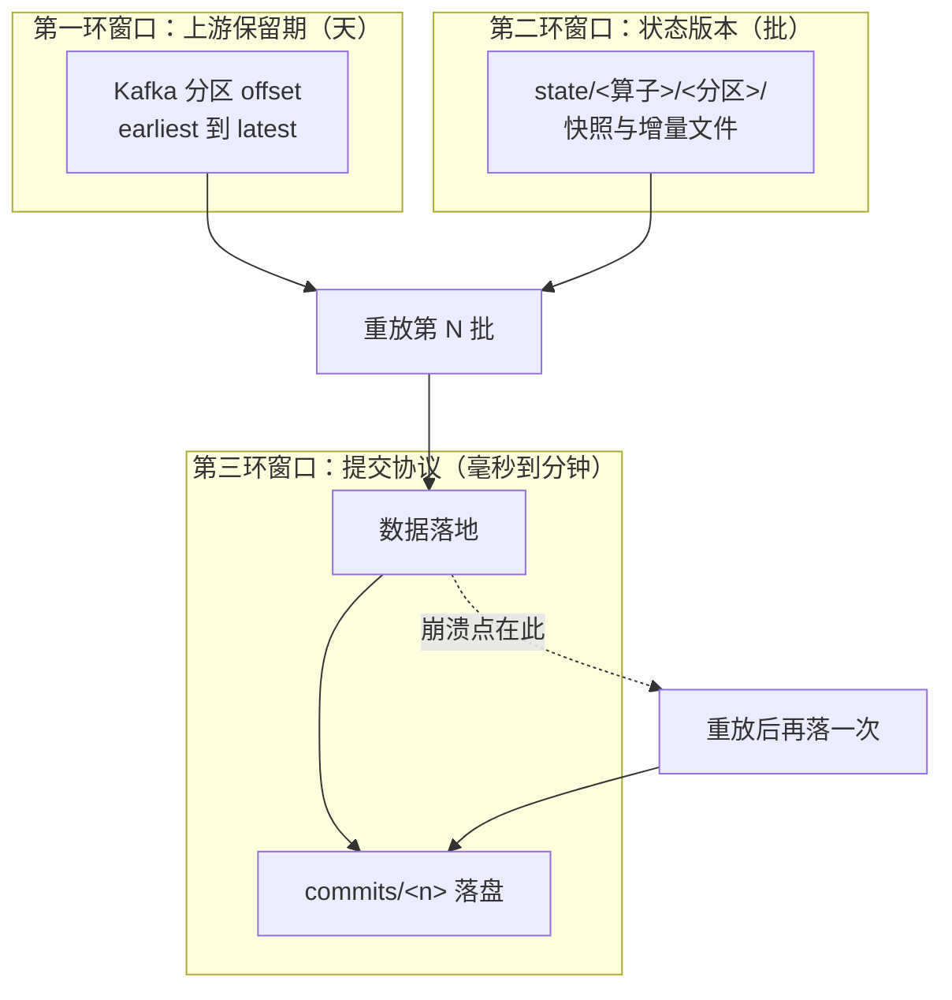
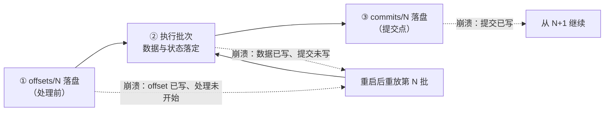
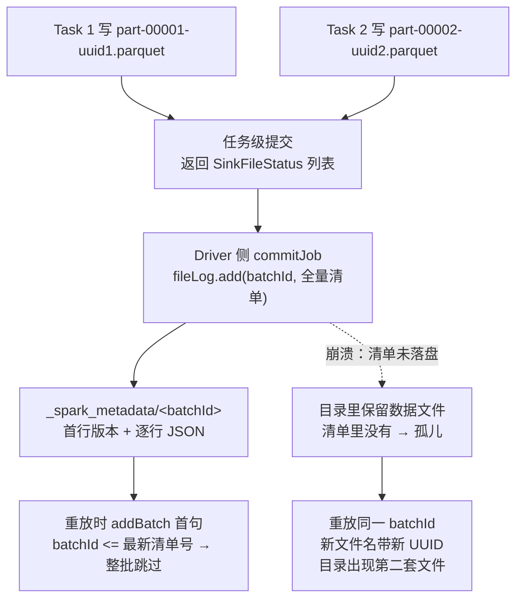
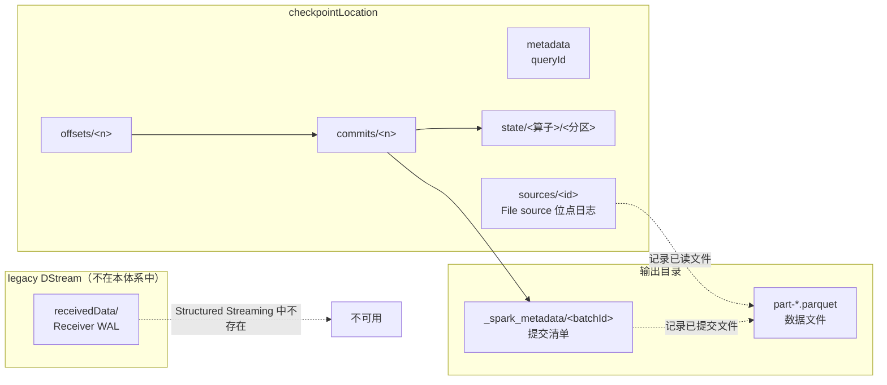
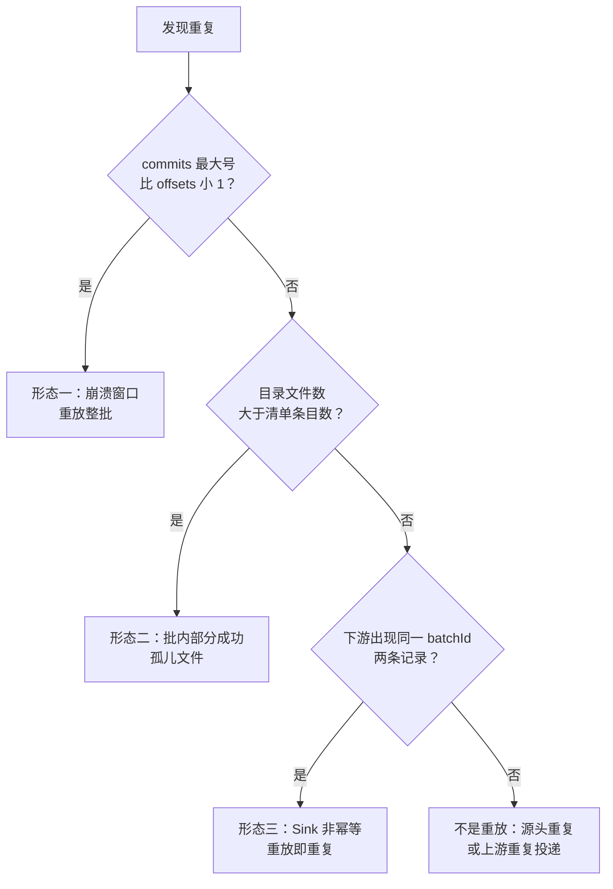

# 05 WAL 与幂等写出：Exactly-once 的两道保险

**摘要：**

端到端精确一次（Exactly-once）不是一个开关，而是一组条件的合取：Source 可重放、引擎内部状态可恢复、Sink 幂等或事务。缺第一环，重启后无从知道「这批数据还在不在」；缺第二环，重算会把聚合结果累加第二遍，比重复更糟；缺第三环，引擎重放时必然在两处留下第二份副本。本文沿一条支付事件流的故障复盘展开，先把这个合取式拆成三环与八种组合，再下潜到提交协议本身——`offsets/`、`commits/` 与数据落地三笔落账的先后顺序，以及 `commit(epochId, messages)` 在一代与二代 Sink 接口里的不同落点。随后用一张判据表区分文件 Sink、Kafka Sink 与 `foreachBatch` 三种保证等级，并把三个容易被混为一谈的「WAL」拆开：File source 的位点日志在 checkpoint 里，`_spark_metadata` 是文件 Sink 的提交清单，而 Receiver WAL 只属于已经退场的 DStream。末章给出重复的三种形态、对账判据、保留窗口的取舍与一次演练，以及五个真实反例。文中关于落账顺序与空实现的说法都以源码为依据，重复量与概率一律标注为示例推算。

**关键词（Keywords）**：WAL, CommitLog, `_spark_metadata`, foreachBatch, Kafka Sink, transaction.timeout.ms

---

## 第 1 章 三个条件的合取

### 1.1 一条对不上的行数

笔者拿一个真实形态的集群做贯穿案例：三百台节点、每天跑两千个作业，其中一条是电商的支付事件流。`payment_events` 从 Kafka 读出，解析出订单号、用户、商户、金额与事件时间，经 `foreachBatch` 写进明细宽表；宽表再供两个下游消费——实时看板的每分钟成交额，和 T+1 的对账报表。

某天早上看板与报表差了 0.7%。追下去发现，明细表里有三批数据被写了两次，一共十八万行，重复行的批次号是连续的三段。往上查当晚的作业日志：Driver 所在的节点内存耗尽被杀，容器重启后引擎从 checkpoint 恢复，把最后三批重放了一遍，`foreachBatch` 里的 `mode("append")` 老老实实又插了一遍。

三个环节各自的行为都无可指摘。offset 已经写进 `offsets/`，引擎要保证「这三批处理过」，就只能重放；`commits/` 里没有这三批，说明它确实没看见提交成功；`append` 的语义就是追加，它不认订单号。问题出在这条链上没有人回答一个问题：同一个批次被写两次，下游会看见什么。

对账之后做的第一件事没有落在代码上，落在「端到端精确一次」这句话本身：它得先被拆成可以逐项检查的断言，才谈得上修。这篇文章就是那份检查表的展开。

### 1.2 「两道保险」这个说法漏了一环

两道保险的流行说法源自预写日志（Write-Ahead Log，WAL）时代的经验：Source 可重放，Sink 幂等或事务。它对，但不完整，漏掉的是引擎自己的状态。补齐之后是**三个条件的合取**，每个条件各自负责一段故障窗口。

状态这一环在有状态算子面前不是可选项。假设上面那条流里有一个按商户的分钟级聚合，重放第三批时，若聚合状态停在「第三批开始之前」的版本，重算会把这一批的金额再累加一次，下游看到的是虚高的成交量，而不是重复的行——重复还能去重，虚高的指标连去重的机会都没有。反过来，若状态根本没恢复，算子要么从零重算，要么直接起不来。所以完整表述是三个条件的合取，缺一环换一个名字：

- **Source 可重放**：给了 offset 就能取回同一批数据，且这批数据还在上游的保留期内。
- **内部状态可恢复**：重放某一批时，算子状态必须精确回到该批开始之前的版本。
- **Sink 幂等或事务**：同一批数据写第二次，目标系统的可观测结果与写一次相同。

### 1.3 三句话判据

这三条都能当场验证，不需要读文档找承诺。

第一句：`checkpointLocation/offsets/` 下的最大批次号，必须大于等于你打算回退的位置；同时，那段 offset 在 Source 侧仍然可定位。Kafka 上就是目标 offset 不小于该分区当前的 earliest offset。这一条不成立时的表现很干脆——抛 `OffsetOutOfRangeException`；但如果恰好配了 `startingOffsets=earliest`，它会**静默地从最早开始读**，把「读不到」变成「重复一整段」，这是最难查的组合。

第二句：`commits/<n>` 里记录的 State Store 文件标识，必须能在 `state/` 目录下找到对应文件。在 checkpoint V2 格式下，状态文件的 unique id 会被写进提交日志，恢复时按 id 精确装载，不再靠「目录里版本号最大的那个」去猜。目录结构与状态存储的读写路径见 [[大数据/Spark/Spark-容错与状态管理深度解析/04 Structured Streaming 容错模型：Offset 与 Checkpoint|04 篇]] 与 [[大数据/Spark/Spark-容错与状态管理深度解析/06 State Store 内幕：HDFSBackedStateStore 的读写路径|06 篇]]，本篇不重复。

第三句：用同一个 `(queryId, batchId)` 把同一批数据往目标系统写 N 次，结果与写一次相同。这一句是本文后半部分的全部内容。

### 1.4 口径与分工

版本口径为 Spark 4.3.0（2026-10-30，Scala 2.13）。文中关于提交顺序、日志内容、Sink 接口的说法，均以该版本的 `MicroBatchExecution`、`StreamExecution`、`CommitLog`、`FileStreamSink`、`KafkaStreamingWrite` 为依据，链接列在文末。文中的重复量与概率均为示例推算，用于说明量级关系，不是实测数据。

接口分层与 Sink 的五个角色分工见 [[大数据/Spark/Spark-Structured-Streaming流处理深度解析/02 Source 与 Sink：DataSource V2 的流式读写接口|Streaming 02 篇]]；文件 Sink 清单的可见性与孤儿文件的判据见 [[大数据/Spark/Spark-Structured-Streaming流处理深度解析/09 dropDuplicates 与精确去重：Exactly-once 的应用层保障|Streaming 09 篇]]；Kafka 事务的协议细节只在这里交代到够用为止，完整讨论路由 [[中间件/Kafka/07 消费语义——Exactly-once 的实现路径|Kafka 专栏 07 篇]]。

---

## 第 2 章 三环合取：缺一环，端到端就换一个名字

### 2.1 第一环：可重放的实质是「还有第二份数据」

「可重放」常被理解成「能重新读」，这个理解太松。真正的条件是：给定一个 offset 区间，两次读取得到完全相同的一批记录。满足它需要两个前提——offset 的语义稳定，以及 offset 指向的数据仍然存在。

Kafka 同时满足这两点，代价是 topic 的保留期。保留期到期，数据被删，offset 就成了一张失效的地址；这时候可重放性不是「变弱」，而是**直接归零**。File source 的数据就是源文件本身，只要文件没被改、没被删，重读结果就一致；一旦上游有作业会原地覆盖文件，可重放性同样归零，而且不报错，读出来的内容与上次不同，比对都无从做起。Socket 则连第一点都不满足，读走即丢，它的存在意义只在本地验证。

由此可见，第一环的判据不是「我用了 Kafka」，而是「我打算回退的那一段，上游还留着」。这一条把责任推到了数据治理上：保留期、清理策略、文件不可变性，都是精确一次的前置条件，比任何 Spark 参数都靠前。

### 2.2 第二环：状态版本与批次号必须对齐

有状态算子的每次批次提交，都会产生一个新的状态版本，版本号与批次号一一对应。重放第 N 批时，引擎要装载的是第 N-1 批提交的那个版本，多一个少一个都会算错。

这一环最容易被忽略，因为它的故障表现不像重复。聚合被多算一遍之后，行数没变、主键没冲突、下游的 upsert 还会把「正确的旧值」覆盖成「错误的新值」——一切看起来都很成功。去重状态错乱的表现则是另一个方向：本该被记住的键丢了，同一笔事件在下一批重新出现，于是又写了一遍。

4.x 里这条链被收紧过一次。checkpoint V2 把每次提交产生的状态文件 unique id 记进 `commits/<n>`，恢复时按 id 装载而不是按目录扫描，状态与提交点因此变成线性依赖，不会再出现「快照覆盖导致回退到错误版本」的情形。这个改动只是把「状态可恢复」从一个概率问题变成了确定问题，并没有让状态变得可省。

### 2.3 第三环：能被问一句「这一批收过没有」

Sink 侧的保证只有两条路可走，其余都是这两条的变体。

一条是幂等写（Idempotent Write），也就是**键覆盖**：目标系统里存在一个稳定的键，写第二次时按同一个键覆盖，结果与写一次相同。主键、rowkey、对象存储的固定文件名，都是这一类。它的前提是键必须由业务语义决定，而不是由写入动作决定——带自增主键的表、带时间戳的文件名，都会让「写第二次」变成「新增一行」。

另一条是事务写（Transactional Write），依赖一个**提交协议（Commit Protocol）**：目标系统能原子地记下「第 N 批已提交」这件事，重放时先查这个标记，查到就跳过。文件系统的清单日志、Delta 的事务日志、Iceberg 的快照，都属于这一类。它的前提是目标系统自身提供原子提交点，而这个提交点必须能被读出来。

两条路的分界可以用一句话问出来：目标系统能不能回答「第 N 批你收过没有」。能回答，第三环成立；不能回答，无论生产者配了什么参数，第三环都不成立。

### 2.4 八种组合与它们的退化结果

三环各有成立与不成立两种状态，组合起来八种。下表把每种组合的结果与现场症状列在一起，这张表是整篇的骨架，后面的章节都在解释它的某一行为什么长这样。

| Source 可重放 | 状态可恢复 | Sink 幂等或事务 | 端到端结果 | 现场症状 |
|---|---|---|---|---|
| 是 | 是 | 是 | 精确一次 | 对账一致，重放不产生可见变化 |
| 是 | 是 | 否 | 至少一次 | 明细按批成段重复，批次号连续 |
| 是 | 否 | 是 | 至少一次且指标虚高 | 行数不重复，聚合值偏大 |
| 是 | 否 | 否 | 重复且指标虚高 | 两种症状同时出现 |
| 否 | 是 | 是 | 至多一次 | 重启后一段数据凭空消失 |
| 否 | 是 | 否 | 至多一次 | 消失，且偶发重复 |
| 否 | 否 | 是 | 至多一次且状态错乱 | 数据缺口加聚合漂移 |
| 否 | 否 | 否 | 无法定义 | 每次重启结果都不一样 |

第三行值得单独看一眼：Sink 是事务的，重复被挡住了，但状态回退让聚合多算了一遍，下游看到的是**干净的数据加上错误的数字**。这类故障最难归因：所有写入都成功、没有重复行、没有报错。

### 2.5 三个窗口彼此独立

三个环不是串联的流水线，它们各有各的失效窗口，而且窗口大小互不相关。第一环的窗口由上游保留期决定，通常以天计；第二环的窗口由状态快照的保留版本数决定，通常以批计；第三环的窗口由目标系统的提交协议决定，文件 Sink 是一个清单文件，Kafka 是一个事务超时。



三个窗口都要覆盖到同一个故障的恢复时长，端到端才成立。恢复用了四天而上游只留三天，第一环就断了；状态只保留一百个版本而故障回退两百批，第二环就断了；这两件事都不会在崩溃当下暴露，而是在恢复完成之后以「数据不对」的形式浮现。

### 2.6 三道闸门的比喻

不妨把这条流想成一段运河上的三级船闸。上游水库（Source）负责供水，闸室（状态）负责把水位抬到指定高度，下游闸门（Sink）负责放船。船要恰好通过一次，三道门必须配合：上游没水，船根本进不来；闸室水位不对，船会被抬到错误的高度，下一段航道就搁浅；下游门开了两次，同一条船被计了两次吨位。

比喻的限定在于：现实中的船闸靠机械联锁保证同一时刻只有一道门开，Spark 没有这种联锁。它的做法是让每一步都留下可检查的痕迹，出错之后靠痕迹重算——重算的前提是痕迹本身没被破坏，于是问题又回到三环上。

---

## 第 3 章 提交协议：Spark 的「两阶段」提交了什么

### 3.1 一次批次的三笔落账

要讲清楚第三环，必须先讲清楚引擎在每一批里到底写了什么。答案写在 `CommitLog` 的类注释里：拿到第 N 批的 offset，写进 offset 日志；处理第 N 批；把第 N 批写进完成日志；然后才开始第 N+1 批。

这三步在 `MicroBatchExecution` 里有明确的落点。构造下一批时，`constructNextBatch` 在 `reportTimeTaken("walCommit")` 里调用 `markMicroBatchStart`，后者执行 `offsetLog.add(batchId, endOffsets)`；批次执行时，`addBatch`（二代接口是写节点的 `collect`）把数据与状态一起落定；批次结束、且在 `withProgressLocked` 保护下，`markMicroBatchEnd` 执行 `commitLog.add(batchId, CommitMetadata(watermark, stateUniqueIds))`。

`StreamExecution` 里对 offset 日志的注释解释了为什么它必须先写：写入发生在任何处理之前，因此日志里第 N 条记录代表「正在处理的数据」，第 N-1 条代表「已经提交到 Sink 的数据」。两句注释合起来给出一个关键结论——**顺序由正确性约束死**，不是实现偏好。第 3.6 节会给出反过来的后果。



图里两个崩溃点都指向重放，区别只在重放的代价：落在「数据已写、提交未写」那个点，重放会重复写一遍数据；落在「offset 已写、处理未开始」那个点，重放还没写任何东西，不会产生重复。所谓「重复窗口」，指的就是第一个崩溃点存在的那段时间。

### 3.2 commit 在两个 Sink 接口里的不同落点

「两阶段提交」这个词在 Spark 里指的不是一个统一机制，两套 Sink 接口各有自己的形态。

一代 Sink（`Sink` 特质的实现者，如 `FileStreamSink`）只有 `addBatch(batchId, data)` 一个方法，没有单独的提交钩子。提交就隐含在 `addBatch` 正常返回这件事里——返回即成功，抛异常即失败，引擎据此决定写不写 commit 日志。所以对一代 Sink 来说，「两阶段」是引擎的两阶段，Sink 只是被调用一次。

二代 Sink（`StreamingWrite` 的实现者）有完整的三件套：`createStreamingWriterFactory` 造出每个分区的 `StreamingDataWriter`，writer 的 `commit()` 返回提交消息，driver 侧的 `StreamingWrite.commit(epochId, messages)` 收口。这套接口看起来更像经典两阶段，但它的 `commit` 仍然发生在 `addBatch` 那一步之内，也就是仍然早于 commit 日志。有资料把顺序说成「先写 commit 日志、再调 Sink 的 commit」，这个说法在两代接口上都不成立：commit 日志是最后一步，Sink 的提交动作始终在它之前。看一个具体的实现就明白了：Kafka Sink 的 `KafkaStreamingWrite` 里，`useCommitCoordinator()` 返回 `false`，`commit(epochId, messages)` 与 `abort(epochId, messages)` 都是空实现。它在接口上占了一个位置，在行为上什么都没做——这是它只能给出至少一次的直接原因，第 4.3 节展开。

### 3.3 `commits/<n>` 里到底有什么

流传的说法是「commits 目录里每个文件只有一行数字」。这在很早的版本里近似成立，现在不成立。

`CommitLog` 的序列化逻辑是两行：第一行是版本标记 `v<版本号>`，版本号取自 `spark.sql.streaming.stateStore.checkpointFormatVersion`；第二行是 `CommitMetadata` 的 JSON，字段是下批水位 `nextBatchWatermarkMs` 与状态文件标识 `stateUniqueIds`。无状态查询里后者为空，JSON 退化成 `{}`；有状态查询在 V2 格式下会带上一张算子到分区再到 unique id 的映射表。下面两行是示意，第二行在真实文件里是单行 JSON，没有折行：

```text
v2
{"nextBatchWatermarkMs":1719999999000,"stateUniqueIds":{"0":[["21_ef6618c2","22_4489578d"]]}}
```

这个细节为什么重要？因为它决定了「对账能对到什么粒度」。只记批次号的清单只能回答「这批提交了没有」；带上状态文件标识之后，它还能回答「这批用的是哪一份状态」——后者才是重放时状态不错位的依据。水位也记在这里，因为下一批的水位必须与这一批的状态匹配，两者分家就会出现「状态是旧的、水位是新的」这种无法解释的组合。

### 3.4 恢复时 commit 日志判什么、不判什么

重启时 `populateStartOffsets` 只做一件事：比较 offset 日志的最大批次号与 commit 日志的最大批次号。三种情形如下表。

| 比较结果 | 引擎的判断 | 动作 | 现场特征 |
|---|---|---|---|
| 两者相等 | 最后一批已完整提交 | 从下一批开始，不必重放 | 日志出现 `Resuming at batch N+1` |
| commit 落后一批 | 最后一批写了 offset、没提交 | 重放这一批 | 重复窗口就在这一批里 |
| commit 落后更多 | 状态异常，但仍按落后一批处理 | 重放最后一批并告警 | 警告 `is not trailing batchid ... by one` |

第二种情形是精确一次的关键分支，也是「重放」这个词的唯一来源。引擎不判断 Sink 写了多少、写到哪里，它只看到「没有提交记录」，于是重跑整批。这件事在设计上是正确的：没有提交记录就无法断言数据完整，**宁可重复不可缺失**。代价被完整地转移给了 Sink。

第三种情形值得警惕。commit 落后超过一批，说明中间有若干批的提交记录丢了（人为删除、存储故障、清单被覆盖）。引擎只重放最后一批，中间那几批既不会再跑、也不会被标记，数据缺口就此固化。看到这条警告，正确的处置是停下来对账，而不是让它继续跑。

### 3.5 它不是分布式两阶段提交

业界的分布式两阶段提交有协调者、有 prepare 阶段的锁、有全局事务状态。Spark 这套东西一样都没有，它只有两次落盘和一次比较。把两者放在一起比，差异是结构性的：

| 维度 | 分布式 2PC | Spark 的本地两阶段 |
|---|---|---|
| 参与者 | 多个资源管理器 | 一个 Sink 加两份日志 |
| prepare 阶段 | 锁定资源、写入 undo/redo | 不存在，直接写数据 |
| 失败处置 | 全部回滚 | 不回滚，重放 |
| 判定依据 | 事务状态表 | commit 日志里有没有这一批 |
| 中间状态 | 不允许长期存在 | 允许，孤儿数据就地保留 |

差异的核心在最后一行。Spark 不追求「要么全成要么全不成」，它接受中间状态存在，只保证中间状态不会被当成结果。文件 Sink 里那批写了文件却不在清单里的数据就是这种中间状态——它在目录里，但不在结果里。这个设计让恢复逻辑变得极简，代价是中间状态需要有人清理，而且一旦有人绕过清单去读目录，中间状态立刻变成重复数据。

「重放而不是回滚」这条路线在批处理时代就已经定型：RDD 靠血缘（Lineage）重算丢失的分区，从不做补偿事务，流处理只是把同一种思路搬到了微批上。重算机制本身见 [[大数据/Spark/读书笔记-spark内核/04_存储与容错机制/4. Spark容错机制与Runtime生命周期|内核系列容错机制篇]]，本篇关心的是重算在流处理里被谁触发、被谁约束。

### 3.6 顺序反过来会怎样

假设有人为了「减少一次写盘」，把 commit 日志提前到数据落定之前写。崩溃发生在两者之间时，引擎看到「已提交」，跳过这一批，数据永远缺失。更糟的是这个缺失不会报错：offset 推进了、提交记录有了、下游少了一批，直到对账才发现。

这就是为什么 offset 必须先写、commit 必须后写。前者保证「同一批数据固定」，后者保证「提交即完整」。两句话合起来，才是那套看似朴素的双日志协议全部的正确性来源。任何试图调整这个顺序的优化，都会把「重复」换成一个不可见的「缺失」，而**缺失比重复难查一个量级**。

---

## 第 4 章 三种 Sink 的保证等级与判据

### 4.1 判据三问

面对任何一个 Sink，按顺序问三个问题，答案会直接落在某个等级上。

第一问：目标系统有没有稳定主键，写入是不是覆盖语义？有，是幂等写，等级到顶。
第二问：目标系统能不能把批次号原子地写进自己的元数据，并且能被读出来？能，是事务写，等级到顶。
第三问：下游能不能按主键去重，或者只消费追加日志？能，至少一次可以接受；不能，这个 Sink 不可用。

三个问题都不需要读 Sink 的实现，只需要读目标系统的能力；换句话说，你要问的是目标系统，而不是 Sink 作者。这正是判断的可靠之处——Sink 作者配了什么参数不重要，目标系统能回答什么才重要。

### 4.2 文件 Sink：清单决定「可见」，不决定「已写」

文件 Sink 的机制常被描述成「先写临时文件，再原子 rename」。这个描述在 4.x 上已经不准确，准确的说法是「任务直接写最终目录，driver 把文件清单原子地追加进日志」。

默认的 `ManifestFileCommitProtocol` 里，`newTaskTempFile` 生成的路径就在输出目录下，文件名形如 `part-00003-<uuid>.parquet`，带任务号与 UUID，没有临时子目录；任务提交时把自己的文件状态列表交回 driver；`commitJob` 里一次 `fileLog.add(batchId, fileStatuses)` 把整批清单写进 `_spark_metadata/<batchId>`。全程没有 rename，也不依赖 rename 的原子性。

这个细节解释了两件事。第一，对象存储上文件 Sink 的清单内一致性是可以成立的——既然不靠 rename，就不受「S3 没有原子 rename」的限制，把这条老结论继续当约束用的方案，多半是照着旧提交协议写的。第二，一批数据被拆成两处写：数据文件落在输出目录，清单落在 `_spark_metadata`；两处之间的任何一次崩溃，都会留下「文件在、清单无」的孤儿。

下面这张图把一次成功提交与一次中途失败的落点画在一起，可以看清「提交」这个动作究竟发生在哪一步。



图里两条虚线是全部损失与重复的来源：孤儿只落在目录层，清单层始终只有一份。所以判断这句话是否成立，要看读者站在哪一层。

提交协议本身是可替换的，配置项是 `spark.sql.streaming.commitProtocolClass`。换掉它的动机通常是往清单里塞自定义元数据，或者接入自研的存储。这件事可行，但会同时动到精确一次的根基：文件名生成、任务级提交消息、driver 侧清单写入这三步必须由新的协议完整实现。清单写入本身就是 `ManifestFileCommitProtocol.commitJob` 的职责，换成一个不知道清单存在的协议，`_spark_metadata` 就再也不会前进——数据文件照样落地，读取端却看不到新批次。这类改动要在评审里单列，因为它改的不是性能，是语义。

「先写临时目录、再原子 rename」这套说法也不是凭空来的：Spark 2.x 的 `FileStreamSink` 确实是写临时路径再搬运，那是「文件 Sink 靠 rename 原子性」这一说法的源头。3.0 起默认协议换成清单式之后，原子性由清单文件的一次追加提供，rename 不再是必要条件，这也是对象存储上同样能拿到清单内一致的原因。

清单的保留策略是另一处容易忽略的地方。`FileStreamSink` 支持 `retention` 选项，配合 `spark.sql.streaming.fileSink.log.cleanupDelay` 与 `.deletion` 一起决定清单条目能活多久。清单条目过期后被删，读取端就看不到对应的批次；数据文件还在目录里，于是同一个目录在「清单视角」与「目录视角」下的差异随时间扩大。保留策略因此必须与下游消费方式对齐：走清单的读者可以短，走目录的读者必须长。

`addBatch` 的第一句是判重：`if (batchId <= fileLog.getLatestBatchId())` 就跳过整批。注意它跳过的是整批，不是「检测文件是否已存在」——清单里已经登记过的批次，重放时不会再写任何文件。所以文件 Sink 在清单这一层确实是幂等的。

真正的问题是目录这一层。`FileStreamSink` 的类注释把话说得很直白：部分失败时，目标目录里可能出现重复数据，但日志里每个文件只会有一份。失败批次的数据文件由 `abortJob` 尽力清理，尽力而为意味着「Driver 被直接杀掉就没清理机会」。于是同一个批次的文件可能有两套，文件名不同（UUID 不同），清单里只有后一套。

后果分三种读者。按 Structured Streaming 文件源读，Spark 会先探测 `_spark_metadata` 是否存在，存在就走清单索引，只枚举登记过的文件，看不到孤儿；用 `spark.read.parquet`、外部 Hive 表或其他引擎直接扫目录，看到的则是目录现状，孤儿一并被算进去。同一份数据，两种读法给出两个行数。第三种读者更隐蔽：把输出目录整个迁移到别处时漏掉了 `_spark_metadata`，源探测不到清单，自动退回目录扫描——迁移那一刻起，结果集就变了，而且没有任何报错。

### 4.3 Kafka Sink：空的 commit 与两个超时参数

Kafka Sink 是最容易被高估的一个。它的写路径是每个 Task 自己建一个 producer，读到就发，批末 flush；`KafkaStreamingWrite` 的 `commit` 与 `abort` 是空实现，`useCommitCoordinator` 为 `false`。这三个事实一起说明：Spark 没有为 Kafka 建立批次级的提交协议，它甚至没有把提交消息集中起来的机会。

于是保证等级只能落在第三级。中间那层「幂等生产者」能挡住的只有一种重复：同一个 producer 实例内部因为网络超时重发同一条消息，broker 侧按 `(PID, 序号)` 去重。它挡不住 Task 重试——重试会新建 producer，PID 变了，在 broker 眼里是另一个客户端，序号从零开始；更挡不住整批重放。

要跨过批次重放，只能在 `foreachBatch` 里自己用事务 Producer。此时的判据不再是 Sink 配了什么，而是下面三件事有没有做对。

第一件是 `transactional.id` 的构造。它必须同时满足三个条件：跨进程重启稳定、同一批的重试中保持不变、不同分区之间不冲突。把批次号放进 id（形如 `前缀-主题-分区-批次号`）能同时满足三条：重放同一批时 id 相同，新实例会通过 fencing 终止上一实例，这样「上一次的事务到底提交了没有」才有一个确定的答案。

第二件是 `transaction.timeout.ms` 与批次时长的配比。Kafka producer 的这个参数默认 60000 毫秒，broker 侧的 `transaction.max.timeout.ms` 默认 900000 毫秒；前者超过后者时，`InitProducerId` 会直接报错。如果事务在整个批次期间保持打开，那么单批的 p99 执行时长必须明显小于事务超时，否则 broker 会在批次提交之前主动 abort，客户端拿到的是超时类异常，重试之后又超时，形成循环。按量级判断，取单批 p99 的两倍是稳妥的下限，同时要确认它没有超过 broker 的上限。

第三件是「事务提交」与「commit 日志落盘」之间的那个窗口。事务提交之后、`commits/<n>` 落盘之前崩溃，重放会发生；重放时同一 `transactional.id` 会 fencing 上一实例，但库里已经有那一批消息了，要不要跳过、怎么知道它提交过，需要生产者自己去查（`read_committed` 消费端能看到什么、事务状态怎么问），Spark 不代劳。严格的闭合还要一张外部幂等表，把 `(事务 id, 批次号)` 记下来。这几步的完整协议与 broker 侧的行为，见 [[中间件/Kafka/07 消费语义——Exactly-once 的实现路径|Kafka 专栏 07 篇]]。

行文至此可以给出判断：Kafka 上的精确一次不是一个配置项，它是一段需要自己实现、自己测试、自己承担维护成本的代码，而且正确性依赖生产者侧的 fencing 语义。

### 4.4 `foreachBatch`：责任的转移点

`foreachBatch` 把每个微批变成一个普通批处理 DataFrame，交给用户函数。它的语义写在函数签名里：签名只给了 `DataFrame` 与 `batchId`，没有给「这一批是否已处理」的标记，因为引擎不打算回答这个问题。

用户能从引擎拿到的只有两样东西。一是 `batchId` 单调递增、同一批次重放时不改变——这是**唯一的免费幂等键**。二是 `query.id`，它持久化在 checkpoint 的 `metadata` 文件里，重启不变；`runId` 每次 `start()` 都会变，不能当幂等键。用 `query.id` 时要注意一个前提：它随 checkpoint 目录绑定。删掉 checkpoint 重建查询，`query.id` 就变了，下游幂等表里旧 id 的记录全部失效。

三种幂等写法各自有一条失效边界，写在这里供对照：

| 写法 | 成立条件 | 失效边界 |
|---|---|---|
| 同库同事务里先查后写 | 数据与标记在同一个数据库事务内 | 数据写库 A、标记写库 B |
| 按业务主键 upsert | 主键由业务决定、写入是覆盖语义 | 主键含时间戳或自增列 |
| 按批次覆盖分区 | 分区可枚举、每批数据恰好对应确定分区 | 一批数据跨多个分区或分区不完整 |

第二种写法在 Streaming 09 篇里已经拆过键的三个前提，这里只补一条与提交协议相关的：如果 upsert 的表还承担「状态」的职责（譬如累计金额），upsert 会让重复写入变成幂等，也会让错误的值被覆盖成另一个错误的值，两种错误都无法从行数上看出来。

### 4.5 保证等级速查

把三种 Sink 放在一起，按判据对齐，得到下面这张表。表里的「重放后果」一列描述的是重放一批之后目标系统的可见状态，这一列比任何保证等级的标签都更能说明问题。

| Sink | 提交协议 | 重放一批的后果 | 关键配置或前提 |
|---|---|---|---|
| 文件 Sink | `_spark_metadata` 清单 | 清单不变，目录可能出现第二套文件 | `spark.sql.streaming.fileSink.log.*` |
| Delta / Iceberg / Hudi | 事务日志里的 `txn` 或快照 | 按版本号判重，直接跳过 | 表格式依赖，无需额外配置 |
| Kafka Sink | 无（`commit` 空实现） | 目标主题多一份消息 | `enable.idempotence` 只能挡传输重试 |
| `foreachBatch` 自管 | 用户实现 | 取决于用户实现 | `batchId` 与 `query.id` |
| `console` / JDBC `append` | 无 | 多一份输出 | 仅用于调试或可去重的下游 |

---

## 第 5 章 三个叫 WAL 的东西

### 5.1 名字撞车

「WAL」这个词在这套技术栈里至少对应三个不同的东西，位置不同、归属不同、版本口径下的存废也不同。按旧资料找目录，很容易在三个地方都扑空。

| 名字 | 归属 | 位置 | 记什么 | 4.3.0 是否存在 |
|---|---|---|---|---|
| `sources/<id>` | File **source** 的位点日志 | checkpoint 目录内 | 已处理的文件清单 | 存在 |
| `_spark_metadata` | File **sink** 的提交清单 | 输出目录内 | 已提交批次的文件清单 | 存在 |
| `receivedData/` | 旧 DStream 的 Receiver WAL | 旧 checkpoint 目录内 | 接收到的原始数据块 | 不存在 |

这张表值得背下来。第一种记的是「读过什么」，第二种记的是「提交了什么」，第三种记的是「收到了什么」。三者语义完全不同，混用会导致两类典型错误：把 `_spark_metadata` 当成 File source 的位点去分析，找不到「已处理文件」的记录；按 Receiver WAL 的思路去找数据副本，结果发现 Structured Streaming 根本不存这份东西。

三者的位置关系可以用一张图固定下来，图的左侧是 checkpoint 目录，右侧是输出目录，剩下那个虚框是已经不在的旧物。



图的箭头表示依赖方向而非数据流向：File source 的位点日志指向数据文件，是在声明「这些文件我已经读过」；提交清单指向数据文件，是在声明「这些文件属于已提交批次」。两句话的对象相同、含义不同，这正是两者最容易被对调的地方。

### 5.2 File source 的位点日志在 checkpoint 里

`FileStreamSource` 的构造函数接一个 `metadataPath`，值来自 `MicroBatchExecution` 里拼出的 `$resolvedCheckpointRoot/sources/$nextSourceId`。它用这个路径建 `FileStreamSourceLog`，每发现一批新文件就把它写成一条 `FileEntry(path, timestamp, batchId)`，批次号即 offset。

也就是说，File source 的「读到哪儿了」不在输出目录，而在 **checkpoint 目录下的 `sources/0`**。文件里存的是路径与时间戳，不是数据本身——这是它和 Receiver WAL 的根本区别：它记的是位点，不是副本。

旁证是一个容易踩的坑。`FileStreamSource` 内存里还有一个 `SeenFilesMap`，用来快速判断「这个文件见过没有」，它会按 `maxFileAge` 主动清理过期条目。有人把这个内存结构当成账本，以为条目被清掉就等于文件可以重读，于是调小 `maxFileAge` 来「省内存」。实际的真账本是 `sources/<id>` 下的日志，内存表只是加速；调小它的后果是同一批文件可能被重复发现，而不是释放空间。

### 5.3 `_spark_metadata` 是 Sink 的清单

`_spark_metadata` 属于 `FileStreamSinkLog`：每个批次一个文件，文件名就是批次号；文件首行是版本号，之后每行是一个 `SinkFileStatus` 的 JSON，包含路径、大小、修改时间与动作（`add` 或 `delete`）。批次多了会按 `spark.sql.streaming.fileSink.log.compactInterval`（默认 10）合并成一个 `.compact` 文件；过期条目按 `spark.sql.streaming.fileSink.log.cleanupDelay`（默认 10 分钟）延迟清理，删除行为由 `spark.sql.streaming.fileSink.log.deletion` 控制。

它是 Sink 的提交点，不是 Source 的位点。有人把输出目录再当流式源读回来时，会把两者混起来：读取端看到 `_spark_metadata` 就切到清单索引，这是复用 Sink 的提交记录，而不是复用 Source 的位点。这两本账恰好对得上，是因为它们由同一次批次提交先后写下；一旦有人搬走目录的一部分，两本账就会对不上。

### 5.4 已经不在的那一个：Receiver WAL

Receiver WAL 是 Spark Streaming（DStream）时代的产物，开启参数是 `spark.streaming.receiver.writeAheadLog.enable`。它的思路是：Receiver 收到数据之后、交给计算之前，先把原始数据块写进可靠存储，崩溃后从这些块重放。目录形态是 checkpoint 下的 `receivedData/`。

这套机制在 Structured Streaming 里不存在，原因不是被优化掉了，而是**前提消失了**。DStream 的 Receiver 是「拉过来再处理」，数据在 Receiver 的内存里有一份，一旦 Receiver 挂了这份就没了，所以必须先落盘。Structured Streaming 的 Source 是「按 offset 去取」，取的动作可以重复，数据本来就还在上游，于是「先存一份副本」这件事失去了意义。

这里要区分两件事：Spark Streaming 这个模块在 3.4.0 起被标记弃用，进入 legacy 状态，它的 API 与文档仍然能找到，但已经不属于新作业的选择范围；而 Structured Streaming 从设计之初就没有 Receiver WAL，两件事不能互相印证。判据很直接：`ls` 一下 checkpoint 目录，正常结构只有 `metadata`、`offsets`、`commits`、`sources` 与 `state`（有状态查询才有最后一项），没有任何 `receivedData`。

### 5.5 去掉 WAL 之后，谁在保管数据

省掉一份副本不是没有代价的，代价被转移到了上游的保留策略上。

Kafka 的 topic 保留期就是这套架构**事实上的 WAL 保留期**。保留期三天，意味着可重放窗口只有三天；故障修复用了四天，第四天恢复时目标 offset 可能已经被删掉，表现是 `OffsetOutOfRangeException`；如果恰好配了 `startingOffsets=earliest`，则从现存最早的位置开始读，把「读不到」变成「整段重放」。这是笔者见过的最昂贵的静默行为之一。

文件源的同理之处在于「源文件不可变、不被删」。`cleanSource` 之类的清理策略会搬走或删掉处理过的文件，一旦清理跑在核对之前，重放能力就没了。所以第一环的配置项其实不在 Spark 里，而在上游生命周期管理里；把它当成 Spark 参数来调，方向从一开始就错了。

---

## 第 6 章 「重复」的三种形态与对账判据

「重复」在故障复盘里是一个结论，在现场却是一组互不相同的现象：有时是按批成段的多余行，有时是目录里没人认领的文件，有时是同一批在没有任何崩溃的情况下被写了两遍。三者的触发条件、责任方与补救手段都不一样，混为一谈就会用错修法——给孤儿文件配幂等键，或者给必然重复的代码加去重查询。

先给一张判定流程图，把现场能拿到的几个数按顺序问一遍，形态自然落到某一支上。



四支的处理方式完全不同：形态一改 Sink，形态二清孤儿并统一读法，形态三补幂等键，最后一支则要回到上游去查投递语义。下面三节分别展开前三支。

### 6.1 形态一：offset 已提交、Sink 未提交

这是唯一一种由引擎机制必然产生的重复。崩溃落在「数据落定」与「commit 日志落定」之间，重启后引擎看到 commit 落后一批，重放这一批；Sink 若不幂等，第二份副本就落地了。

窗口大小可以用三段耗时估出来：offset 日志落盘、批次执行（含数据与状态落定）、commit 日志落盘。重复窗口是第三段的耗时，因为前两段无论怎么崩都不会产生「已写数据」的状态。commit 日志是一次小文件写，量级在几十到几百毫秒；批次执行则是秒到分钟。于是崩溃落进窗口的概率大致是「commit 日志耗时 / 批次总时长」。

按示例推算：批次间隔 10 秒，commit 日志写入 p99 取 200 毫秒，概率约 2%；集群每天一千次容器重启，落在窗口内的约二十次；每次重放一批五万行，一天就是百万行级别的重复。这组数字是推算而非实测，但它说明一件事——单次概率很小的窗口，在两千个作业的规模上会变成每天都会发生的事件。

重复量的上界是「一批」，不是「整个历史」。这一点常被误解：有人以为窗口持续多久就重复多久的数据。窗口决定的是「会不会重放」，而重放的粒度永远是整批，所以重复量由批大小决定，与窗口时长无关。

同源的另一个误解是「把 `maxOffsetsPerTrigger` 调小就能减小重复量」。这个参数限制的是每批读多少，它改变的是批的边界，不改变「一批」这个粒度。调小之后单批变小、批数变多，每批的重放量确实下降了，但批次总数按比例上升，按天计的重复量大致不变，而 commit 日志的写入次数与文件数反而成倍增加，checkpoint 所在存储的小文件压力先顶上来。想减小重复量，动的是 Sink 的幂等，不是读取速率。

窗口还有一层容易忽略的时间结构：它并不是均匀分布在时间轴上的，而是紧贴着每批执行的末尾。这意味着「批越慢、窗口占比越小」，因为 commit 日志的写入耗时基本恒定，分母变大；「批越快、窗口占比越大」，短批次的高频作业反而更容易撞上。一个 1 秒一批的作业，200 毫秒的提交延迟意味着 20% 的崩溃会落在窗口内，这就是为什么高频短批作业几乎必然要处理重复问题，而不是「偶发」。

### 6.2 形态二：批内部分成功

第二种是同一批里有的任务成功、有的失败。文件 Sink 上表现为目录里多出一套文件而清单只有一份；Kafka Sink 上表现为部分分区收到了消息；JDBC 上表现为部分任务已 commit、部分已回滚。

这种形态的麻烦在于脏数据只有半批，既够不上整批回滚，又足以污染结果，而且引擎那一侧看起来是干净失败——`addBatch` 抛异常，commit 日志没写。对于可回滚的目标系统（数据库事务），失败的半批会被回滚，问题不大；对于不可回滚的（文件、Kafka），半批就留在那里，成为第 4.2 节说的孤儿。

判据是把三处的时间戳摆在一起：清单里的最大批次号、目录里最新文件的名字（其中含任务号与 UUID）、以及恢复日志里重放的是哪一批。三者不一致，就有孤儿。

### 6.3 形态三：`foreachBatch` 无幂等

第三种没有概率性，只要发生重放就一定重复。它和前两种的区别在于责任方：前两种是引擎机制的正常代价，第三种是使用者漏掉了一件事。

需要注意的是，「重放」的触发不只有崩溃。批执行中途的 Task 失败重试、Stage 重算、作业被手工重启、集群资源不足导致的容器驱逐，都会让同一个 `batchId` 被调用第二次。`foreachBatch` 的签名没有「已处理」标记，用户不实现，就没有第二道防线。

### 6.4 反方向的缺口：不是重复，是缺失

错误并不总是多写一份，也可能少写一份。两种典型的缺失都出在提交协议周围。

一种是把 commit 日志提前写。这在第 3.6 节已经推过：引擎认为已提交，跳过重放，数据永久缺失。另一种是 `foreachBatch` 里 `catch` 住异常然后正常返回——函数正常返回，引擎认为这一批成功，`commits/<n>` 照写，而实际写入只完成了一部分。这个错误比任何重复都难查，因为日志上一切正常，只有对账会报出来。

第二种缺失有一个隐蔽的变体：在 `foreachBatch` 里对同一个 DataFrame 做两次 action（先 `count()` 再 `write`），第二次会触发上游重算。如果上游是 Kafka，同一个 offset 区间会被读两遍——写入端可能因此看到两次相同数据，表现为「没重放却重复了」。修法是先 `persist()`，函数结束前 `unpersist()`。

### 6.5 对账：四个数放在一起看

出问题时要同时取四个数，缺一个就容易误判。

| 数据源 | 取什么 | 怎么取 |
|---|---|---|
| offset 日志 | 最大批次号 | `hdfs dfs -ls .../offsets`，取文件名最大者 |
| commit 日志 | 最大批次号 | `hdfs dfs -ls .../commits`，取文件名最大者 |
| 文件 Sink 清单 | 最大批次号 | `hdfs dfs -ls .../_spark_metadata`，取文件名最大者 |
| 下游表 | `max(batch_id)` 或最大业务时间 | 一次聚合查询 |

四个数的相对关系直接指向结论：offset 比 commit 大一批，说明发生过一次重放；commit 比下游批次号大，说明有一批标了成功但数据不全；下游批次号比 commit 大，说明下游有别的写入方；清单比 commit 小，说明最后一批文件写在清单之前就崩了。这套判据配合 [[大数据/Spark/Spark-容错与状态管理深度解析/10 生产容错调优手册：从告警到根因的系统性诊断|10 篇]] 的告警体系使用，能在几分钟内定位到是哪一环破了。

---

## 第 7 章 保留窗口：commit 日志能回溯多久

### 7.1 purge 的时机与阈值

`offsets/` 与 `commits/` 都放在 `spark.sql.streaming.checkpointLocation` 指向的目录里，也都不会无限增长。`constructNextBatch` 在写完 offset 日志之后、执行批次之前，会做一次清理：只要当前批次号大于 `minBatchesToRetain`，就 `purge(batchId - minBatchesToRetain)`，把两份日志里更早的条目删掉。`minBatchesToRetain` 来自 `spark.sql.streaming.minBatchesToRetain`，默认 100。

顺带说一句配置位置：`checkpointLocation` 既可以写在 `writeStream` 的选项里，也可以由 `SparkSession` 的全局默认值提供；同一个作业换了路径等于换了查询身份，第 7.3 节的复合伤害就是这么产生的。这个目录必须放在所有 Executor 都能访问、且具备原子重命名语义的可靠存储上，本地盘与容器临时目录都不合格。

注意清理发生在批次执行之前，而且用的是「当前批次号减去保留数」。这两个细节决定了保留窗口的实际语义：保留的不是「最近 100 批的完整历史」，而是「最近 100 个批次号对应的日志文件」。批次号不连续（譬如中间有空触发、有跳过的批次）时，窗口的时间跨度会比 100 乘以批次间隔更长或更短。

### 7.2 恢复只读最新一条

一个常见的误解是「保留窗口越大，恢复越可靠」。引擎恢复只读最新的两条记录：offset 日志的最大号与 commit 日志的最大号。历史长度对恢复路径没有影响，多留的那些只服务三件事：事后对账、手工重放某个历史批次、以及有状态查询的状态版本回溯。

所以调大 `minBatchesToRetain` 换来的是运维能力，不是可靠性。代价是 NameNode 上的小文件数量——`offsets/` 与 `commits/` 每批各一个文件，一天两万批就是四万个文件；默认 100 的窗口在这个量级上几乎不占空间，调到一万才会开始明显。

### 7.3 删掉 checkpoint 之后

删 checkpoint 是**精确一次的头号杀手**，因为它是复合伤害。

第一层，`metadata` 文件没了，新的 `queryId` 被生成，下游幂等表里以旧 id 为键的记录全部失效，重放会被判成「没处理过」。第二层，offset 清零，作业从 `startingOffsets` 指定的位置重新开始；默认是 `latest`，看起来安全，但只要有人为了「补数据」改成 `earliest`，就会从 topic 现存最早的位置重放整段。第三层，文件 Sink 的清单若与 checkpoint 一起被删，目录里的历史文件不会消失，新查询从零开始写，清单与目录彻底错位。

`deleteCheckpointOnStop` 与临时 checkpoint 的存在让这件事更容易发生：配置了临时目录的查询在正常停止时会删掉自己的 checkpoint，若有人把它当成生产配置，每次发布都会重置一次 `queryId`。

### 7.4 下游幂等表的清理窗口

幂等表的清理策略必须比 checkpoint 的保留窗口更宽，这是一个常被漏掉的约束。

设想下游用 `(query_id, batch_id)` 做幂等标记，运维按「只保留最近 7 天」清理。若某次故障恢复回退到 8 天前的批次，重放时查不到标记，判成未处理，重复写入。修正的方式不是把清理周期无限拉长，而是让幂等表按「批次号」而不是按「写入时间」保留，并把保留下限绑定到 checkpoint 的保留窗口——**两个窗口必须能对上**，否则幂等键在时间维度上是断的。

### 7.5 相关配置与代价

| 配置 | 默认值 | 管什么 | 调大的代价 | 调小的代价 |
|---|---|---|---|---|
| `spark.sql.streaming.minBatchesToRetain` | 100 | offset 与 commit 日志保留批数、状态版本保留 | 小文件增多，NameNode 压力上升 | 事后对账与状态回溯窗口变窄 |
| `spark.sql.streaming.fileSink.log.cleanupDelay` | 10m | 清单过期条目的删除延迟 | 清单变大、读取变慢 | 与正在重放的批次竞争，可能删掉在用条目 |
| `spark.sql.streaming.fileSink.log.compactInterval` | 10 | 清单合并间隔（批） | 单次合并耗时长，抖动明显 | 小文件多，清单读取变慢 |
| `spark.sql.streaming.fileSink.log.deletion` | true | 是否清理清单过期条目 | 不适用（布尔） | 关掉后清单无限增长 |
| `transaction.timeout.ms`（自管 Kafka 事务时） | 60000 | 事务最长存活时间 | 超过 broker 上限直接报错 | 批次未提交就被 abort，重试循环 |
| `transaction.max.timeout.ms`（broker 侧） | 900000 | 允许的最大事务超时 | 长时间未提交的事务阻塞消费端读 | 略小于批次 p99 时全线失败 |

最后两行要一起看。producer 的 `transaction.timeout.ms` 与服务端的 `transaction.max.timeout.ms` 是一对上下界：前者超过后者，`InitProducerId` 阶段就被拒绝；前者小于单批执行时长，事务会在提交之前被 abort。两端都要改、且改完要在压测里验证 p99 批次时长，这条约束才算落地。

---

## 第 8 章 五个反例

### 8.1 反例一：把 `foreachBatch` 当精确一次

典型写法是 `foreachBatch` 里直接 `write.mode("append").jdbc(...)`，然后认为「Structured Streaming 保证精确一次」。这个判断在第一次崩溃之前都不会出问题。

判据：`foreachBatch` 的函数体里有没有出现 `batchId`。没有出现，就说明这份代码没有使用引擎提供的唯一幂等键，第三环必然不成立。修法有两种，一是把写入改成按主键 upsert；二是在同一个数据库事务里先查 `(query_id, batch_id)` 再写，两件事必须同库同事务。

### 8.2 反例二：以为文件 Sink 天然幂等

「文件 Sink 不重复」这句话只在「按清单读」的前提下成立。见过一次事故：实时结果写对象存储，离线报表用另一个引擎直接扫目录取数据，跑了一个月都对，某次 Driver 被杀之后报表行数突然多了 0.4%。原因是失败批次的文件没被清理，报表读到了孤儿。

判据：消费方是否走 `_spark_metadata`。用 Spark 的流式文件源读，走清单；用批读、外部表、其他引擎读，走目录。前者安全，后者需要定期对账清理，或者干脆在写入端改用带事务日志的表格式。

### 8.3 反例三：`transaction.timeout.ms` 与批次时长配错

自管 Kafka 事务的团队常见两个极端。一是照抄默认的 60 秒，而大促期间单批处理时长会到三分钟，事务在提交前被 broker abort，作业进入「超时—重试—再超时」的循环，日志里是一串事务相关异常；二是把 `transaction.timeout.ms` 调到二十分钟却没动 broker 的 `transaction.max.timeout.ms`，`InitProducerId` 直接被拒。

判据：把单批 p99 执行时长与事务超时放在一张图上，前者必须明显小于后者，后者必须小于 broker 上限。任何一端不满足，都会在压力最大的时候暴露。

### 8.4 反例四：删掉 checkpoint「从 Kafka 重放」

「反正 Kafka 里有数据，删掉 checkpoint 重跑一遍就行」是笔者见过代价最高的操作习惯。它同时破坏三环中的两环：第一环从「精确重放」变成「按起始位置重放」，第三环的幂等键（`queryId`）被换掉，下游的重复判断随之失效。

判据：动手之前先确认三件事——新的 `queryId` 与下游幂等表能否衔接、起始位置是否会读到不该读的旧数据、输出目录里的历史文件与清单是否还配套。三件事有一件答不上来，就不该动 checkpoint。

### 8.5 反例五：`catch` 住异常正常返回

`foreachBatch` 里 `try { ... } catch { case e => log.error(...) }`，函数正常返回。引擎据此写 `commits/<n>`，从此这一批被认定完整。若写入只完成了一部分，缺口就永久固化，而且不会有任何异常暴露。

判据：`foreachBatch` 内是否捕获了不该捕获的异常。允许的捕获只有那些「确定可以安全重试且不会产生副作用」的场景，其余一律应当向上抛，让批次失败、让重放发生。重放会带来重复，但重复可以被下游挡住；缺失挡不住。

---

## 第 9 章 上线前的四问与一次演练

### 9.1 四问

上线前把这四个问题写在评审记录里，每个问题都要有具体的答案，不能是「应该没问题」。

一问：这条流的上游保留期是多少，故障恢复的最坏耗时可接受吗？答案要落到具体的天数与小时数。
二问：Sink 是幂等写还是事务写，幂等键是什么？答不上来，说明第三环没设计。
三问：`foreachBatch` 里出现 `batchId` 了吗？没有出现就没有幂等。
四问：下游消费方走的是清单还是目录？走目录的，孤儿什么时候清。

### 9.2 一次演练

精确一次的配置不演练等于没有。演练的步骤可以固定成四步，一次半小时左右。

第一步，跑一个中等吞吐的作业，让它稳定处理若干批，记录四个数：offset 最大号、commit 最大号、清单最大号、下游最大批次号。取前三个数的命令很短，先把目录变量定好：

```bash
# 三个数在同一个 checkpoint 路径与输出路径下，取文件名排序后的最后一个
CKPT=hdfs://ns/stream/payment/checkpoint
OUT=hdfs://ns/stream/payment/detail
hdfs dfs -ls "$CKPT/offsets"  | awk -F/ '{print $NF}' | sort -n | tail -1
hdfs dfs -ls "$CKPT/commits"  | awk -F/ '{print $NF}' | sort -n | tail -1
hdfs dfs -ls "$OUT/_spark_metadata" | awk -F/ '{print $NF}' | sort -n | tail -1
```

注意 `_spark_metadata` 下可能有 `.compact` 结尾的合并文件，取最大号时要过滤掉，否则比较的是合并批次号而不是真实批次号。

第二步，找到 Driver 进程，`kill -9`，不要用优雅停止——优雅停止会走 `stop()`，清理逻辑会掩盖真实行为。
第三步，等容器重启、作业恢复，观察日志里是否出现 `Resuming at batch N`；再取一遍四个数。
第四步，核对下游：若第四个数比恢复前多了一批，说明发生了重放且 Sink 不幂等；若没有增加，说明幂等生效或者当时没有重放。

演练的价值在于把「理论上会重复」变成「我知道它会以什么形态重复」。演练记录里要留下那两批的行数与批次号，日后真出问题时可以直接比对。

### 9.3 该盯的指标

| 指标 | 含义 | 异常判据 |
|---|---|---|
| commit 与 offset 的批次号差 | 是否有未提交批次 | 长期为 1 说明反复重放 |
| 单批执行时长 p99 | 事务超时的分母 | 接近 `transaction.timeout.ms` 的一半时预警 |
| 下游 `max(batch_id)` 增速 | 是否重复写入 | 与 offset 增速不一致 |
| 目录文件数与清单条目数之比 | 孤儿数量 | 比值持续大于 1 说明清理没跟上 |
| 容器重启次数 | 重放概率的乘数 | 单日增幅异常时检查资源 |

### 9.4 责任表

最后把三个环的责任写清楚，避免出问题时互相推。

| 环 | 由谁负责 | 交付物 |
|---|---|---|
| Source 可重放 | 数据平台 | 保留期、不可变文件、起始位置策略 |
| 状态可恢复 | 引擎 | checkpoint 目录、状态存储版本 |
| Sink 幂等或事务 | 业务应用 | 幂等键或提交协议、幂等表清理策略 |

三行里只有第二行能靠「用 Spark」自动获得，前后两行都需要人来决策。这大概是精确一次这件事最容易被忽略的地方：它看起来像引擎自带的能力，落地时却是一项跨团队的契约。

---

## 小结

精确一次是三个条件的合取，不是一道保险。Source 可重放提供重放的可能，状态可恢复保证重算的起点正确，Sink 幂等或事务决定第二份副本会不会被看见；三环各有自己的时间窗口，任何一环的窗口小于恢复耗时，端到端就退化成另外的名字。

引擎那一侧能承诺的是一条很窄的断言：每个 offset 区间的处理结果被应用一次。它的实现方式是两笔落账加一次比较——offset 先写、commit 后写，中间那段没有任何原子性保护，重放因此是设计的一部分而不是缺陷。commit 日志只回答「这一批提交了没有」，不回答「Sink 写了多少」，所以第三环永远需要 Sink 自己的机制来兜。

工程上的取舍也清楚：重复可以被下游挡，缺失挡不住，所以引擎宁可重放；事务能闭合重放窗口，代价是批次时长被事务超时反向约束；自管 Kafka 事务能把窗口压到最小，代价是 fencing、超时与外部幂等表都要自己维护。选哪条路取决于下游能不能去重，而不取决于哪个方案更彻底。

---

## 参考资料

1. Apache Spark 源码（branch-4.0）：`sql/core/src/main/scala/org/apache/spark/sql/execution/streaming/MicroBatchExecution.scala`，`constructNextBatch`／`markMicroBatchStart`／`markMicroBatchEnd` 的三笔落账顺序。<https://github.com/apache/spark/blob/branch-4.0/sql/core/src/main/scala/org/apache/spark/sql/execution/streaming/MicroBatchExecution.scala>
2. Apache Spark 源码（branch-4.0）：`sql/core/src/main/scala/org/apache/spark/sql/execution/streaming/StreamExecution.scala`，offset 日志与 commit 日志的注释、`minBatchesToRetain` 与 `purge`。<https://github.com/apache/spark/blob/branch-4.0/sql/core/src/main/scala/org/apache/spark/sql/execution/streaming/StreamExecution.scala>
3. Apache Spark 源码（branch-4.0）：`sql/core/src/main/scala/org/apache/spark/sql/execution/streaming/CommitLog.scala`，版本行与 `CommitMetadata` 的序列化格式。<https://github.com/apache/spark/blob/branch-4.0/sql/core/src/main/scala/org/apache/spark/sql/execution/streaming/CommitLog.scala>
4. Apache Spark 源码（branch-4.0）：`sql/core/src/main/scala/org/apache/spark/sql/execution/streaming/FileStreamSink.scala`、`FileStreamSinkLog.scala` 与 `ManifestFileCommitProtocol.scala`，`_spark_metadata` 清单与批次跳过。<https://github.com/apache/spark/blob/branch-4.0/sql/core/src/main/scala/org/apache/spark/sql/execution/streaming/FileStreamSink.scala>
5. Apache Spark 源码（branch-4.0）：`connector/kafka-0-10-sql/src/main/scala/org/apache/spark/sql/kafka010/KafkaStreamingWrite.scala`，`commit`／`abort` 的空实现与 `useCommitCoordinator`。<https://github.com/apache/spark/blob/branch-4.0/connector/kafka-0-10-sql/src/main/scala/org/apache/spark/sql/kafka010/KafkaStreamingWrite.scala>
6. Apache Spark 官方文档：Structured Streaming Programming Guide 的 Fault Tolerance Semantics 一节。<https://spark.apache.org/docs/latest/streaming/structured-streaming-programming-guide.html>
7. Apache Kafka 文档：Producer Configs 中 `transaction.timeout.ms`、`enable.idempotence`，Broker Configs 中 `transaction.max.timeout.ms`。<https://kafka.apache.org/documentation/#producerconfigs>
8. Apache Spark 源码（branch-4.0）：`sql/core/src/main/scala/org/apache/spark/sql/execution/streaming/FileStreamSource.scala` 与 `FileStreamSourceLog.scala`，File source 位点日志的位置与 `FileEntry` 结构。<https://github.com/apache/spark/blob/branch-4.0/sql/core/src/main/scala/org/apache/spark/sql/execution/streaming/FileStreamSource.scala>
9. Delta Lake 文档：Structured Streaming 写入与事务标识（`txn` 动作）。<https://docs.delta.io/latest/delta-streaming.html>

---

> [!note] 思考题
> 1. 引擎的两笔落账之间有一段没有原子性保护的时间，如果要求把重复窗口压到零，需要改动的是 Sink 还是引擎？改完之后哪个保证会先崩掉？
> 2. 文件 Sink 用「清单可见性」代替「数据原子性」，这个替换在什么读者面前会失效？能否设计一种清单，让绕过清单的读者也能得到正确结果？
> 3. 自管 Kafka 事务时，把批次号编进 `transactional.id` 换来了 fencing 能力，代价是什么？在什么情况下这份代价会超过收益？
> 4. 三个环的窗口分别由谁设定？如果三方分别属于不同团队，你打算用什么机制保证三个窗口在同一份变更里被一起评审？
> 5. 演练里用 `kill -9` 而不是优雅停止，这个选择背后的假设是什么？如果换成优雅停止，哪些故障形态会被掩盖？