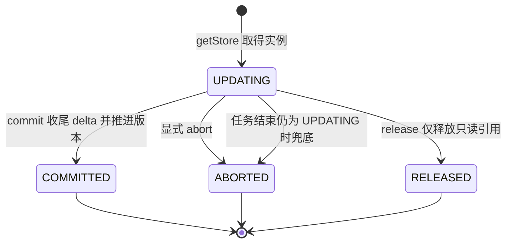
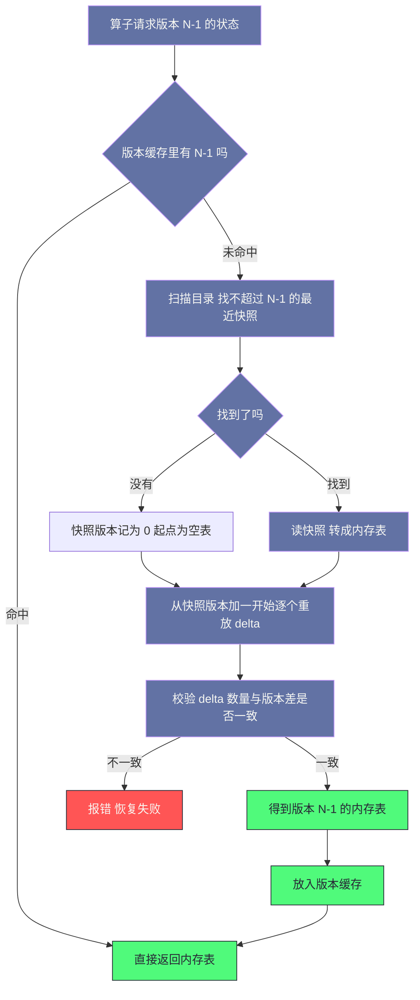
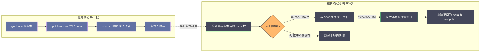
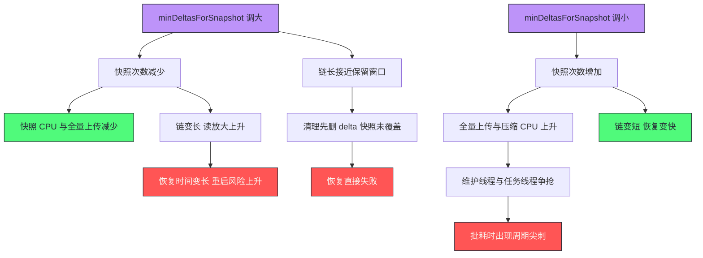
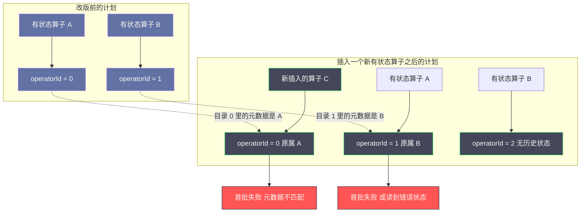

# 06 State Store 内幕：HDFSBackedStateStore 的读写路径

**摘要：**

一条有状态的流查询跑起来之后，checkpoint 目录下的 `state/` 会持续长出文件：每提交一批，多一个 `<version>.delta`；每积累若干批，多一个 `<version>.snapshot`；再往后，旧文件被后台线程删掉。这个目录的形状不是实现细节，它直接决定三件事——查询重启时多久能恢复、每批提交要多付多少网络、以及 executor 的堆里为什么总要多留一份状态。本文不重讲算子如何使用状态（`GroupState` 的契约、超时语义在姊妹专栏里已拆过），只把一个批处理放到 `state/<operatorId>/<partitionId>/` 这个目录上走一遍：`StateStore` 与 `StateStoreProvider` 各自负责什么、版本号从哪里来、delta 与 snapshot 的字节格式与命名规则、写入为什么是批内写穿而提交只做收尾、读取为什么要合并"最近快照加之后的增量"、主维护线程什么时候才肯生成快照。看清这条路径之后，三个代价会自然浮出来：版本累积带来的读放大、全量快照的 CPU 与上传开销、以及每批 delta 与状态变化量成正比的上传带宽。文末把这些代价折成一张可代入的估算表，并给出"状态对不上"时的判据次序与四则反例。读完之后至少该能回答三个问题：某个 `state/<operatorId>/<partitionId>/` 目录里每个文件的来历与大小由什么决定，一次重启到底要读多少字节，以及动一个参数会在另外两处引起什么回声。

---

## 第 1 章 一个目录，两种记账

先看一个具体的形态。一条设备风险评分的流查询，每 10 秒一个微批，状态里存着一千二百万台设备的评分摘要，每批大约有三十万台设备的摘要会更新。把这条查询停掉，去看它的 checkpoint 目录，会看到下面这样一组文件（版本号已省略中段）：

```text
checkpoint/state/0/37/
├── 1000.snapshot      ← 某个版本的全量转储
├── 1001.delta
├── 1002.delta
├── ...
├── 1010.delta         ← 当前最新版本
└── 1011.delta.<随机后缀>.tmp   ← 批内正在写的临时文件
```

这些文件的名字里没有算子、没有时间、没有分区，只有版本号和类型，因为路径前缀已经把这些信息编码完了。更重要的是，它们的语义是一条只追加的链：**一次批次只追加一个文件**，任何"修改"或"删除"都不体现为改写旧文件，而是等下一个版本的文件出现之后被覆盖掉。这条链是 State Store 的全部持久化形态。

之所以要有这条链，而不是每次把全量状态覆盖写一遍，理由并不复杂：流处理的重算请求是随时可能到来的——某个 task 失败要重试、某个 executor 被回收后分区要搬迁、进程崩溃后整批要重放。重算的前提是"能回到同一个起点"，也就是必须先能读到某一批开始之前的那份状态。若只有一份会被覆写的全量文件，重算就只能靠运气。版本号把"起点"变成了不可变对象，于是重算变成了"再读一次版本 N-1"。

但版本化不是免费的，它把成本记到了两个不同的账本上。第一本是**写账**：每一批都要落一个新文件，字节数与本批的变更量成正比。第二本是**读账**：将来某次恢复要读到版本 N，就得从最近的快照开始把中间所有增量重新放一遍，成本与"链有多长"成正比。批处理之所以便宜，在于它只有一个账本；流处理之所以麻烦，在于它的状态既被反复读、又被反复写，两本账都躲不开。

后面几章会把这两本账拆开。先划一条边界：状态的业务语义——聚合状态长什么样、`GroupState` 怎么更新、超时如何触发删除、watermark 如何推进——属于算子侧的话题，见 [[大数据/Spark/Spark-Structured-Streaming流处理深度解析/07 flatMapGroupsWithState：任意有状态逻辑的终极武器|flatMapGroupsWithState：任意有状态逻辑的终极武器]] 与 [[大数据/Spark/Spark-容错与状态管理深度解析/08 状态过期与 TTL：让 State Store 不再无限膨胀|状态过期与 TTL]]；checkpoint 目录里除 `state/` 之外的部分（`offsets/`、`commits/`、`metadata`）见 [[大数据/Spark/Spark-容错与状态管理深度解析/04 Structured Streaming 容错模型：Offset 与 Checkpoint|Structured Streaming 容错模型]]。本章只关心一件事：一次批处理在 `state/` 之下经过哪些接口、落下什么文件、这些文件将来要付多少代价。

| 观察对象 | 何时产生 | 由谁写 | 字节数与什么成正比 |
|---|---|---|---|
| `<version>.delta` | 每一批提交 | 任务线程（同步） | 本批变更的 key 数与单条编码长度 |
| `<version>.snapshot` | 维护线程判断值得时 | 维护线程池（异步） | 状态总量（全量转储） |
| `*.tmp` 等临时文件 | 批内写入过程中 | 任务线程 | 本批已写入的变更量 |
| 旧版本的 delta 与 snapshot | 被清理时删除 | 维护线程池（异步） | 与最新版本的距离 |

> [!info] 版本口径
> 本文按 Spark 4.x（4.3.0）口径叙述，涉及的类与配置以该版本源码为准。少数 4.x 才出现的机制（自动快照修复、维护线程池拆分、离线状态重分配）会单独标注版本；更早版本的行为差异不在本文讨论范围内。

---

## 第 2 章 两个接口：一次批次的两端

### 2.1 `StateStore`：一批更新的事务对象

`StateStore` 是算子直接打交道的对象，生命周期极短——短到与"一次状态更新"同寿。它暴露的方法不多，但每条都带着明确的事务语义：

| 方法 | 语义 | 调用时机与失败后果 |
|---|---|---|
| `get` / `multiGet` | 读当前版本中某个 key 的状态 | 批内任意时刻；只碰内存表，不做 IO |
| `put` | 写入一个 key 的新状态 | 批内计算过程中；同时追加进 delta 输出流 |
| `remove` | 删除一个 key 的状态 | key 在本版本存在时才写删除标记 |
| `commit` | 结束本次更新，返回新版本号 | 批末一次；此后该实例不可再写 |
| `abort` | 丢弃未完成更新 | 失败或任务结束时；只影响未完成文件 |
| `iterator` / `prefixScan` | 全量或前缀遍历 | 提交后读取本版本内容 |
| `metrics` | 导出内存与状态规模等指标 | 随进度上报 |

这张表里最容易被忽略的是"一次性"：一个 `StateStore` 实例只允许一次 `commit` 或一次 `abort`，之后再调 `put` 会直接抛错。源码里用一个极简状态机守住这一点——`UPDATING` 出发，走向 `COMMITTED`、`ABORTED` 或 `RELEASED`，并注册了一个 task 完成回调：只要任务结束时它还停在 `UPDATING`，就自动执行 `abort`。这条兜底路径解释了运维上一个常见疑问——任务被 kill 之后目录里为什么偶尔会看到半个临时文件：写入是边算边写的，abort 只能尽量清理，进程被强杀时清理动作本身也可能没跑完；好在临时文件不叫正式名字，恢复逻辑不认它。

把三个出口画成一个状态机，边界更清楚。



### 2.2 `StateStoreProvider`：一个分区的长期持有者

`StateStoreProvider` 的生命周期与查询同寿（严格说是与 executor 上这个分区的驻留时间同寿）。它按 `(operatorId, partitionId)` 绑定一个目录，手里握着四样东西：checkpoint 文件系统的封装、当前目录的路径、若干版本的内存哈希表缓存、以及后台维护要用到的线程池引用。算子请求某一版本时找它要实例，它负责把"版本号"翻译成"内存里的那张表"——命中缓存就返回，未命中就去读文件。

分工可以概括成一句话：`StateStore` 管一次更新的一致性，`StateStoreProvider` 管版本之间的可追溯性与资源。前者是短命的事务，后者是长命的账房。这也解释了为什么"提交"在观测上显得廉价：真正的持久化动作在批内已经通过写穿完成，`commit` 只做收尾；而真正昂贵的全量转储与旧文件清理，被挪到了另一个线程里，因此不出现在任何一批的耗时统计里。

| 视角 | `StateStore` | `StateStoreProvider` |
|---|---|---|
| 生命周期 | 一批 | executor 驻留期间 |
| 身份 | 版本号 | `(operatorId, partitionId, storeName)` |
| 核心职责 | 一次更新的读写与提交/回滚 | 版本还原、缓存、快照、清理 |
| 线程 | 任务线程 | 任务线程 + 维护线程池 |
| 失败处理 | abort 未完成文件 | 后台任务异常只记日志，不失败查询 |

### 2.3 版本号从哪里来

流处理里版本号与批次号是一对一的：第 N 批开始时读版本 N-1 的状态，提交后得到版本 N。这个约定把"状态恢复点"与"位点恢复点"钉在了一起——commit log 里写着第 N 批完成，就意味着版本 N 的 delta 已经落定；反过来，只要第 N 批没写进 commit log，即使 `N.delta` 已存在于目录里，重启后也会从 N-1 重算并把 `N.delta` 重新写一遍。

允许重写同一个版本号，靠的是两件事：文件系统侧的原子替换（先写临时文件、再 rename 成正式名，且允许多次尝试互相覆盖），以及计算侧的确定性（同样的起点状态加同样的输入，产出同样的更新集）。这两条合起来才成立，缺一条就会在重试场景下产生不可解释的偏差。也正因为版本号可被重写，运维上不能把 `state/` 目录当成审计日志来读——它记录的是"状态最终长成什么样"，而不是"历史上发生过哪些尝试"。任务失败与重试在 RDD 层怎么被组织、Lineage 如何驱动重算，这套机制的推导见内核系列的 [[大数据/Spark/读书笔记-spark内核/04_存储与容错机制/4. Spark容错机制与Runtime生命周期|Spark 容错机制与 Runtime 生命周期]] 与 [[大数据/Spark/读书笔记-spark内核/04_存储与容错机制/6. Spark_Checkpoint机制|Spark Checkpoint 机制]]；本篇只写明它们到了流式状态目录上落成什么形状。

---

## 第 3 章 目录结构：名字里带着版本

### 3.1 路径的组成

状态目录的完整形状是 `<checkpoint>/state/<operatorId>/<partitionId>/`，其中 `<checkpoint>` 由 `checkpointLocation` 指定，`state` 是固定子目录名。若使用命名存储（一个算子持有多个逻辑状态），路径末尾会再挂一层存储名；不指定名字时这一层不存在，这也是兼容早期版本的写法。

```text
<checkpoint>/
├── offsets/
├── commits/
├── metadata
└── state/
    ├── 0/                    ← operatorId = 0
    │   ├── 0/                ← partitionId = 0
    │   │   ├── 1.delta
    │   │   ├── 2.delta
    │   │   ├── 11.snapshot
    │   │   └── ...
    │   ├── 1/
    │   └── ...               共 <状态分区数> 个
    └── 1/                    ← operatorId = 1
        └── ...
```

有一点与直觉不符：**版本 0 没有文件**。空状态的表示是"没有文件"，读取版本 0 时 provider 直接构造一张空表，而不是去找 `0.snapshot`。所以一个刚启动、尚未提交任何批次的有状态查询，其 `state/<operatorId>/` 下可能什么都没有；`state` 子目录本身的创建也是惰性的——只有第一次真的要写文件时才会 `mkdirs`，只读的恢复路径不会在 checkpoint 上留下空目录。这个细节在排障时有用：看到 `state/` 不存在，未必是目录被误删，也可能是查询还没提交过任何一批。

### 3.2 两种文件与它们的编码

正式文件只有两种，命名规则极简：`<version>.delta` 与 `<version>.snapshot`，都以版本号开头、以类型结尾。同版本若两者同时存在（快照写完但旧 delta 还没被清理），文件列表解析时以快照为准，那个 delta 会被忽略——这条规则意味着快照一旦写成，同版本的增量就自动失效，不需要额外的删除动作来保证正确性。

两类文件都是压缩过的，压缩算法由 `spark.sql.streaming.stateStore.compression.codec` 决定，默认 `lz4`。压缩发生在流层，文件扩展名不变，所以从文件名看不出内容是否压缩，也不能用常规工具直接解压后阅读——这一点在需要人工核对状态内容时会带来麻烦，也解释了为什么"把 delta 文件拷出来 grep 一下"这种土办法在这里不成立。

delta 的编码是一条可顺序扫描的记录流，每条记录由四个字段拼成：key 长度、key 字节、value 长度、value 字节。删除不单独设标记位，而是让 value 长度为负——读到负数就表示"这个 key 在本版本被删除"，从内存表里去掉即可。整条流以一个负的长度值收尾，充当结束标记。这个格式的选择很务实：不需要索引、不需要页对齐、顺序写顺序读，代价是不能随机访问，因此想要"只看某个 key 的某个版本"是做不到的，只能把整条链重放一遍。

snapshot 是同构的全量转储：把内存表里所有 key-value 按同样的编码顺序写出去，读的时候就相当于"重放一份从头到尾都是有效写入的 delta"。两者共用一套编码，好处是读取逻辑只需要一套解码器，快照与增量的区别退化成"从哪个版本开始放"。

### 3.3 目录即状态：一次批处理留下的痕迹

把一次正常的批次放到这个目录上看，动作序列是这样的：批内第一次 `put` 时，provider 惰性创建一个临时文件（名字带 `.tmp` 之类后缀），随后每条变更被压缩后追加进去；批末 `commit` 时，先写入结束标记再关闭流，然后原子 rename 成 `<version>.delta`。旧快照与旧 delta 依然躺在目录里，直到维护线程认为可以删。

| 目录元素 | 出现时机 | 内容 | 删除时机 |
|---|---|---|---|
| `<version>.delta` | 每批提交后 | 本批新增/更新/删除的 KV 记录流 | 早于保留窗口时由清理删除 |
| `<version>.snapshot` | 维护判断值得时 | 该版本全量 KV 记录流 | 早于保留窗口时由清理删除 |
| 临时文件 | 批内写入期间 | 尚未收尾的 delta | 提交时改名，abort 时删除 |
| 校验和文件 | 开启文件校验时 | 对应状态文件的校验值 | 随状态文件一同清理 |
| 算子元数据 | 首批提交前 | 算子名、状态 schema 位置 | 随算子目录保留 |

---

## 第 4 章 写路径：批内写穿，提交时落定

### 4.1 `put` 与 `remove` 都在写穿

状态的写入是**写穿**的：`put` 不满足于更新内存表，它立刻把这条变更追加到压缩输出流里。这个选择值得多想一层，因为它决定了整个写入成本模型。

如果把变更先攒在内存里、等 `commit` 时一次性写出，那么批内会同时存在"全量状态表"和"本批变更缓冲"两份内存数据，缓冲的大小取决于本批改了多少 key——在高变更率的查询里，这份缓冲可能与状态表同量级，等于凭空把堆压力翻倍。写穿之后，缓冲变成了操作系统与压缩流的几十 KB 级窗口，堆占用回到"只有状态表"。

代价是失败时的粗糙：批内任何时刻出错，那个临时文件都只能整体作废，不能续写。重试会从头再写一遍新的临时文件，旧的自然消失。这换来了另一个好处——`commit` 的耗时不再与变更条数强相关，因为数据早就出去了，`commit` 只需要补结束标记、关闭流、做一次 rename。

`remove` 有一处容易被忽略的判断：只有当这个 key 在当前版本的内存表里存在时，才会往 delta 里写一条删除记录。删一个不存在的 key 是纯内存操作，不产生任何字节。推论是，一个"什么都没删掉"的批次，其 delta 可以小到只剩一个结束标记；反过来，一个大范围清理过期状态的批次，delta 可能比正常更新批更大——那些 `remove` 才是真正的写放大来源。

### 4.2 `commit`：把版本钉下来

`commit` 做四件事：写结束标记并关闭 delta 流（这一步触发临时文件到正式文件的重命名）、把版本推进到 `version + 1`、把这张内存表放进版本缓存、必要时顺带写一份快照（框架可以在某些需要强制快照的批次上带一个标志）。四件事完成之后，这一批在 `state/` 之下才算有了痕迹。

时序上的保证是这样的：只有当 `commit` 返回成功，微批执行的推进逻辑才会去写 commit log；也就是说"commit log 里有第 N 批"蕴含"版本 N 的 delta 已经可见"。反过来不成立，`N.delta` 存在而 commit log 未写的情况完全可能发生（进程恰好死在两个动作之间），恢复逻辑会重算第 N 批，重新生成一份 `N.delta` 覆盖旧的。因为这个不对称，`state/` 目录里的文件数量可以比 commit log 里记录的批次多出若干，这不算异常。

### 4.3 `abort`：只丢弃未完成的部分

`abort` 的语义比名字听起来窄：它只丢弃当前这个尚未提交的更新，把临时文件清掉，不会去动任何已提交版本的文件。所以"回滚"在 State Store 里不是撤销一个动作，而是"从未发生过"——重算时读到的是上一个版本，新版本号上的内容会被重新生成。

| 步骤 | 落在哪里 | 何时对外可见 | 失败时的残留 |
|---|---|---|---|
| `put` / `remove` | 临时文件 + 内存表 | 不可见 | 临时文件，无法续写 |
| 结束标记 + 关闭 | 临时文件 | 不可见 | 同上 |
| 原子 rename | `<version>.delta` | 提交后可见 | 老版本不受影响 |
| 版本推进 + 入缓存 | executor 内存 | 本批之后立即可读 | 缓存丢失可由文件重建 |
| 可选快照 | `<version>.snapshot` | 提交后可见 | 快照缺失不影响正确性 |

### 4.4 提交校验与"漏提交"

4.1 起有一个默认开启的校验（`spark.sql.streaming.stateStore.commitValidation.enabled`，默认 true）：在 `foreachBatch` 这类由用户函数驱动的 sink 中，如果用户函数没有把每个分区的迭代器消费完（譬如函数里写了 `show()` 或 `limit()`），就可能出现部分状态分区根本没提交的情况。校验让这种"静默少提交"在批次结束时直接报错，而不是让状态在无人察觉的情况下落后几批。

这条校验的存在改变了排障时的思考顺序：状态文件数量与批次号对不上，先怀疑"这一批有没有真的提交全部分区"，再去怀疑文件系统。

---

## 第 5 章 读路径：快照与增量的合并

### 5.1 恢复一次状态的完整动作

读取某一版本的状态，入口是 provider 的版本还原逻辑，动作分三步：

1. **先看内存缓存**。provider 内部维护一张按版本号倒序排列的映射表，缓存最近几个版本的内存状态。命中就直接返回，一个字节的文件都不读。
2. **未命中则找快照**。在目录里找"版本号不超过目标版本"的最近快照；若目标版本是 0 或更小，直接给一张空表。4.1 起这里还多了一层自动修复：若最近快照读坏了，跳过它、退到更早的快照，用增量文件把差额补齐。
3. **重放增量**。从"快照版本 + 1"开始，逐个版本把 delta 应用到内存表上，直到目标版本。

这里有一条必须遵守的校验：从快照版本到目标版本之间，**delta 文件必须一个不少**，文件数必须正好等于版本差。少一个文件就意味着中间某批的变更丢了，恢复出来的状态是错的，因此宁可让查询起不来也不接受这种状态——报错信息会直接写出"Unexpected list of delta files"。这条校验是"手工清理 checkpoint"这类操作最容易被抓的地方：删掉几个看似无用的旧 delta，可能正好在某个快照链中间打出一个洞。

把恢复的三步画成判定流，缓存的位置与校验落点一目了然。



### 5.2 缓存的分界：它决定了"每批要不要读盘"

有一种流传很广的说法需要纠正：不是"每个微批开始时都要把状态从 HDFS 加载到内存"。真实形态正好相反——**正常批次不读盘**。批开始时请求的版本，恰好就是上一批提交时放进缓存的那个版本，缓存命中，直接拿内存表开算。读盘只发生在几种特定时刻：查询的第一批、executor 被换掉之后的第一批、缓存里保留的版本不够用的时候（重试跨度超过保留数），以及显式开启"提交后卸载"的测试或特殊配置下。

缓存保留几个版本由内部配置控制，默认 2：一个覆盖"成功提交后紧接着下一批"的常规路径，一个覆盖"直接失败后重试当前批"的路径。保留更多没有收益，因为流处理的访问模式几乎从不回看更早的版本；保留为零则每批都要重建内存表，代价见第 7 章。

| 场景 | 缓存是否命中 | 读盘量 | 可观测表现 |
|---|---|---|---|
| 常规批次推进 | 命中 | 0 | 批耗时平稳，无额外 IO |
| 查询刚启动第一批 | 未命中 | 快照 + 增量链 | 首批明显慢于后续批次 |
| executor 被回收后接管分区 | 未命中 | 快照 + 增量链 | 个别分区出现首读尖刺 |
| 重试跨度超过缓存版本数 | 未命中 | 快照 + 增量链 | 重试变慢，且随链长恶化 |
| 开启提交后卸载 | 每批未命中 | 快照 + 增量链 | 每批慢，但堆占用与驻留更小 |

### 5.3 读放大的形状

一旦读盘发生，读取量可以写成一句话：**最近快照的压缩字节，加上链上每条 delta 的压缩字节之和**。链长 d 是这条式子里唯一可调的量，而它的实际取值比配置项的默认值要复杂——下一章会看到，它由"阈值"与"维护时效"两个因素共同决定，而不是一个常数。

读的一方还有一类隐性成本容易被忽略：文件数量。恢复时要列目录、要按版本号排序、要逐个打开，这些是元数据操作，与字节数无关。链长从 10 涨到 100，读取字节涨十倍，元数据操作也涨十倍，NameNode 上的 `listStatus` 与 open 调用会跟着放大，小文件多的目录在这类场景下从来不是免费的。

---

## 第 6 章 后台维护：快照与清理是两条时钟

### 6.1 维护由谁驱动

快照与清理不由批次触发，而是由一条固定的维护节拍驱动：每隔 `spark.sql.streaming.stateStore.maintenanceInterval`（默认 60 秒），每个仍处于活跃状态的 provider 会在后台执行一次维护，检查两件事——值不值得写快照、有没有旧文件可以删。这段逻辑跑在维护线程里，不在任务线程里，所以它不进入任何一批的耗时统计，也不占用任务的计算时间片（但会抢 CPU 与网络，见第 7 章）。

4.3 起，这两件事被拆成了两个线程池：快照归快照池，清理归清理池，池子的总线程数由 `spark.sql.streaming.stateStore.numStateStoreMaintenanceThreads` 决定（默认取核数的四分之一且不少于 2），两者按 `snapshotToCleanupThreadRatio` 分配（默认各一半）。拆分解决的是一个很实际的问题：清理要列目录、删文件，偶尔会卡在文件系统的元数据操作上，若与快照共用一个线程，一次慢清理就能让所有快照顺延，进而把恢复用的增量链拖长。

### 6.2 快照的三个隐含条件

快照的阈值是 `spark.sql.streaming.stateStore.minDeltasForSnapshot`，默认 10，含义是"某个版本之后积累的 delta 文件数超过这个数，就值得合并成一份快照"。很多人把它理解成"每 10 个 delta 一定产生一次快照"，这个理解偏了，因为实际触发要同时满足三个条件：

第一，维护节拍必须跑到。若一批 10 秒，60 秒内积累 6 个 delta，不到阈值；要等下一个节拍才可能生成快照。
第二，当前 provider 缓存里必须有最新版本的那张内存表。快照是从内存表整体序列化写出的，不是重新读文件拼出来的；如果这个 executor 刚接管分区、缓存还是空的，或者这个分区正由别的实例负责，维护就跳过这一轮，什么也不做。
第三，delta 数确实超过了阈值。阈值是"严格大于"，恰好等于阈值时不会触发。

三个条件合起来，链长的真实取值是"阈值 + 维护周期内提交的批数"这个量级，慢查询稳定在阈值附近，快查询则可能超过阈值若干批。这也解释了为什么"快照时机与数据量无关"——一个几乎没数据的查询照样会在该快照时快照，而一个每批变更巨大的查询，只要批数没到，也不会多快照。

### 6.3 清理的保留窗口

清理的判据是版本距离，不是快照个数：以最新版本为基准，保留最近 `spark.sql.streaming.minBatchesToRetain` 个版本的文件，更早的删掉。这个配置同时控制 offset log 与 commit log 的保留（默认 100），因此调大它不仅会让状态目录变大，也会让整个 checkpoint 目录一起变胖。

这里有一处极易混淆的数字，值得单独点出来。磁盘上保留的版本数与内存里缓存的版本数不是一个概念：前者默认 100，管的是"重试与回退能看多远"；后者默认 2，管的是"常规路径要不要读盘"。两个数字常被揉成一句"保留最近 2 个快照版本"，而真实情况是两个 2 里只有一个成立：缓存版本数是 2，磁盘保留窗口是 100，两者差了五十倍。

这条保留窗口还决定了另一个上限：**恢复能回看多远**。清理会按版本距离删文件，不关心快照是否覆盖了被删区间，于是这里存在一个配置间的隐含约束——快照阈值必须明显小于保留窗口。若把 `minDeltasForSnapshot` 调到 200，而保留窗口仍是 100，清理就会先一步删掉那些还没被快照覆盖的 delta，等到某次恢复需要重放它们时，链上出现空洞，查询直接起不来。这两个参数必须一起看，只看一个就会踩坑。

任务线程与维护线程的两条时间线并排放在一起，维护的滞后就看得见了。



### 6.4 配置一览与双向代价

| 配置 | 默认值 | 调大的代价 | 调小的代价 |
|---|---|---|---|
| `spark.sql.streaming.stateStore.minDeltasForSnapshot` | 10 | 恢复要重放更长链，读放大与恢复时间上升；接近保留窗口时会与清理打架 | 快照更频繁，全量序列化的 CPU 与上传带宽上升，批延迟更易抖动 |
| `spark.sql.streaming.stateStore.maintenanceInterval` | 60s | 快照与清理都变迟钝，链长与时延窗口一起变长 | 维护过于频繁，反复列目录、空转扫描，元数据压力上升 |
| `spark.sql.streaming.minBatchesToRetain` | 100 | checkpoint 目录整体变大（状态、offset、commit 三处一起），存储成本上升 | 重试与回退的可用窗口收窄，出错后更容易"回不去" |
| `spark.sql.streaming.maxBatchesToRetainInMemory` | 2 | 每个分区多缓存一份全量状态，堆占用成倍上升 | 缓存命中率下降，缓存未命中时按链长重新读盘 |
| `spark.sql.streaming.stateStore.numStateStoreMaintenanceThreads` | 核数四分之一，至少 2 | 维护抢更多 CPU 与网络，批处理可用资源被挤压 | 快照排队，链长被动变长，恢复变慢 |
| `spark.sql.streaming.stateStore.snapshotToCleanupThreadRatio` | 0.5 | 快照更快、清理更慢，目录膨胀 | 清理更快、快照更慢，链长上升 |
| `spark.sql.streaming.stateStore.compression.codec` | lz4 | 压缩率更高（zstd）则 CPU 变重、上传字节变少 | 压缩更快则 CPU 省、上传字节变多 |
| `spark.sql.streaming.stateStore.providerClass` | HDFSBacked | 换成 RocksDB 是换格式，不能原地恢复（见第 8 章） | 换回默认实现同样需要重建状态 |

---

## 第 7 章 三个代价：版本、快照、上传

前面几章把路径走完了，现在把成本集中起来看。HDFSBacked 的三个代价并不独立，它们由同一组旋钮控制，所以任何一个"优化"都会在另外两处产生回响。

### 7.1 第一个代价：版本累积与读放大

增量文件只追加、不合并，意味着"从某个快照到当前版本"的链会一直变长，直到维护线程把它截断。链越长，两件事同时变差：恢复时要读的字节更多，恢复时要打开的文件更多。这就是**读放大**——读的放大倍数等于"链上文件数"，而不是状态规模。

它的危险在于延迟暴露：链长在正常运行时几乎不影响批处理耗时，只在重启、executor 更换、跨版本重试时一次性兑现。一条查询可以在链长 40 的状态下平稳跑一周，然后因为一次例行发布重启，用二十分钟才恢复上来，期间上游数据堆积。若此时恰好有下游的超时告警，排查会先往"启动慢""资源不足"上走，很少有人第一步去看 `state/` 目录里链有多长。

可观测信号也散落在两个地方：目录里的文件个数（`ls` 一下即可，按版本号排序看快照与最新版本的距离），以及进度指标里的状态规模与提交耗时（提交耗时的阶梯式上抬往往对应快照恰好落在那一批）。把这两条并排看，链长问题基本藏不住。笔者倾向于把"目录里的链长"做成一条日常巡检项，因为它比任何事后的耗时归因都便宜——一条 `ls` 就能看出快照落后了多少个版本。

### 7.2 第二个代价：快照写入

快照是**全量**的：状态有多少，就要序列化、压缩、写多少。它与变更率无关，只与状态总量有关。这带来一个反直觉的结论——"每批只改一点点"的查询，快照成本占比反而最高，因为平时的 delta 很便宜，而每隔若干批的全量转储是固定开销。

这份开销有三种形态。其一是 CPU：序列化与压缩是纯计算，跑在维护线程上，与任务线程争抢同一个 executor 的核。其二是网络：全量字节要从 executor 写到 checkpoint 文件系统，大状态下这是分钟级的流量。其三是内存：序列化过程中会临时持有整张表的遍历状态与压缩缓冲，堆本来就紧的 executor 可能在这里触发一次 GC 尖刺。

因为快照是异步的，它不会直接出现在某一批的耗时里，但它会以"每 N 批一次整体减速"的形式影响吞吐：维护线程占满核、网络占满带宽时，紧挨着的那几批就是慢的。

### 7.3 第三个代价：每批上传

每一批提交都要把 delta 写到 checkpoint 文件系统，字节数与本批变更量成正比，与状态总量无关。这条性质既是这套设计的优点——成本可预测、可随变更率线性伸缩——也是它最容易被低估的地方：状态很小的查询也可能有很高的上传量，因为决定上传量的是"每批改了多少 key"，不是"状态存了多少"。

以第 1 章那条查询为例（示例推算，非实测）：每批更新三十万台设备，每条记录的 key 约 44 字节、value 约 248 字节，加长度前缀约 300 字节，本批原始约 90 MB；按 lz4 压到四成左右约 36 MB；批间隔 10 秒，平均上传约 3.6 MB/s，折合约 29 Mbps。单条查询不算什么，但这个集群上同时跑着几十条同量级的有状态查询时，checkpoint 文件系统的入口带宽与 NameNode 的写请求就会成为共享瓶颈，表现为提交耗时整体上抬、批次开始排队。

在对象存储上做 checkpoint 时，这条成本还会被放大一层：底层的"原子改名"通常要靠复制加删除或专门的提交器来实现，每次提交的元数据往返比 HDFS 更贵，而单文件越大，这笔往返越贵。

### 7.4 三个代价互相牵制

把调大与调小两条路径的后果摊开，会看到一个闭合的回路。



这张图想说明的事很简单：三个代价背后是同一对矛盾——**把成本花在平时（勤快照、勤上传）还是花在恢复时（长链、重放）**。前者用稳态的 CPU 与带宽换恢复速度，后者用恢复的不确定性换稳态的平稳。没有哪一种选择在所有场景下更优，只能按预算决定：重启预算是分钟级还是小时级，checkpoint 文件系统的余量是宽松还是紧张，堆是富裕还是刚好够用。

| 代价 | 随什么增长 | 可观测信号 | 主要调节手段 | 调错的典型症状 |
|---|---|---|---|---|
| 读放大 | 快照之后的链长 | 目录文件数、恢复耗时、首批耗时 | `minDeltasForSnapshot`、维护线程数 | 重启恢复超预期，首批耗时逐月变长 |
| 快照写入 | 状态总量 × 快照频率 | 维护期 CPU、上传字节、GC 尖刺 | `minDeltasForSnapshot`、压缩算法、维护线程数 | 周期性批耗时尖刺，吞吐呈锯齿状 |
| 每批上传 | 每批变更量 × 批次频率 | 提交耗时、checkpoint 写入带宽 | 变更频率、编码体积、提交频率 | 提交排队，批次积压，与状态大小无关 |

---

## 第 8 章 两个 Provider 的判据

### 8.1 换的是底层，不是接口

默认实现在 `spark.sql.streaming.stateStore.providerClass` 里指定，取值就是 HDFSBacked 的 provider 类；换成 RocksDB 的实现同样只改这一个配置。上层算子看到的接口不变：`get`、`put`、`remove`、`commit`、`abort` 的语义一致，版本推进的约定一致，因此"换一个 provider"在代码层面确实是一行配置的事。

但**切换 Provider 不是换配置，是换格式**。两种实现在磁盘上的文件形态完全不同：一个是压缩的 KV 记录流，一个是本地 RocksDB 实例加 checkpoints 上传（含 changelog 或全量快照目录）。同一份 checkpoint 无法被另一种实现直接读起来，因为"版本 N 的状态"在两边被编码成了不同的字节。工程上的含义是：切换必须伴随状态重建或迁移，不能在原地把一个正在跑的查询换过去。

### 8.2 判据在状态之外

选择依据通常被简化成"状态多大"，但真实的判据至少有三条，且常常互相矛盾：

第一条是状态能否常驻堆。HDFSBacked 的全部状态在 JVM 堆里，还要按缓存版本数多留一份，堆不够就是 OOM，没有溢写这条路可走（堆内内存池的划分与统一内存管理见 [[大数据/Spark/读书笔记-spark内核/04_存储与容错机制/1. Spark内存管理机制|Spark 内存管理机制]]，状态表走的是普通堆，不参与执行内存与存储内存的借用）。RocksDB 把状态放到堆外与本地盘，堆压力被移走。

第二条是恢复时间预算。HDFSBacked 的恢复是"读快照加放增量"，通常是秒级到十几秒；RocksDB 的恢复要把全量快照下载到本地盘，状态大时是分钟级。若业务对"发布后多久恢复产出"很敏感，这一条可能压过第一条。

第三条是延迟稳定性。HDFSBacked 的读路径是内存哈希表，单次访问极快，但在大堆上做 GC 会带来批级抖动；RocksDB 的读要经过序列化与本地 IO，单次更慢，但没有大堆 GC 的长停顿。

| 维度 | HDFSBacked（默认） | RocksDB | 判据落点 |
|---|---|---|---|
| 状态位置 | JVM 堆（含缓存版本） | 堆外内存 + 本地盘 | 堆是否装得下全量状态 |
| 单次读 | 内存表，微秒级 | 序列化 + 本地读，略慢 | 算子是否高频点读 |
| 提交字节 | 本批变更的 delta | changelog 或文件上传 | 变更率与上传带宽 |
| 恢复 | 快照 + 增量链，较快 | 下载全量快照，较慢 | 恢复时间预算 |
| GC 影响 | 大堆下显著 | 小 | 延迟稳定性要求 |
| 本地盘 | 不需要 | 需要，且要留足容量 | 部署形态是否允许本地盘 |
| 运维面 | 关注链长与上传 | 关注本地盘、压缩、changelog | 团队熟悉的排障路径 |

还有一条容易被忽略的运维事实：状态在哪个 executor 上，调度器就倾向于把那个 executor 按住不放——因为状态是"有位置的"。这在开启动态资源分配时会造成资源利用率偏低，executor 明明空闲却因为持有状态而不能回收。4.1 起提供了一个反向开关（`spark.sql.streaming.stateStore.unloadOnCommit`，默认关闭），让任务结束时同步做完维护并释放实例，代价是每批都要重建状态，即每批都可能命中缓存未命中路径。这是一个典型的"用恢复成本换资源弹性"的取舍，没有普适答案。

---

## 第 9 章 状态的身份：operatorId 与 partitionId

### 9.1 operatorId 是按顺序发的号

状态目录的第一层是 `operatorId`。它的分配方式近乎朴素：在规划阶段，执行计划里的每个有状态算子按出现顺序领一个自增的编号，第一个领 0，第二个领 1，依此类推。编号一旦写进目录名，就与"是哪个算子"绑定；而"哪个算子"这个信息，另外记在 `state/<operatorId>/` 下的一份元数据里，恢复时逐个比对。

这种"按位置发号"的方案有一个致命特征：**编号的稳定性依赖于计划的稳定性**。在链路上游插入一个有状态算子（哪怕只是随手加一个 `dropDuplicates`），它就会领走原本属于后面那个算子的号，后面的全部后移一位。于是 `state/0/` 里原本是聚合算子的状态，现在被去重算子认领，元数据里记录的名字对不上，恢复在第一批就失败；即便元数据校验宽松到能让它过，读到的也是别人的状态，属于更坏的情况——错得无声无息。

把编号的错位画出来，后移的连带效应很直观。



由此可以推出一条演进原则：**改逻辑安全，改身份危险**。用户函数内部怎么算、状态类怎么解释、schema 怎么演进（在有兼容通道的前提下），这些都是"代码与数据内容"层面的事，checkpoint 不关心；而在计划里增删或调换有状态算子的顺序，改的是身份，checkpoint 立刻就知道了。演进策略应当围绕这条不对称来设计：会变的放进代码，必须稳定的留在身份里。

### 9.2 partitionId 与状态分区数

目录的第二层是 `partitionId`，取值从 0 到"状态分区数减一"。这里的并行度不是每批重新算的，而是**随 checkpoint 固定在元数据里**：批次元数据中记录了状态分区数，恢复时以记录值为准，缺省才回落到当前的 shuffle 分区配置。这一点与很多人的直觉相反——把 `spark.sql.shuffle.partitions` 改大，重启后已存在查询的状态分区数不会跟着变大，因为状态目录的布局是按记录值组织的。

这个设计的用意是保护正确性：状态里的 key 之所以能"待在自己的分区"，靠的是按分组键的哈希取模。若并行度在两次运行之间变了，同一个 key 会落到另一个分区号上，而那个分区里存的是别的 key 的状态——读出来的东西张冠李戴。所以并行度被钉死在 checkpoint 里，改它等于要求状态重新分布。

4.2 起提供了一条正规通道来做这件事：在查询停止的状态下调用离线重分配，把 checkpoint 里的状态按新的分区数重新分布，并生成一个"只做重分配、不读上游"的新批次（批次 N+1），下次启动就从这一批继续。它的前提写得很硬——查询必须停止、目标分区数必须与当前不同、需要保证 sink 的精确一次语义；换句话说，它不是热点扩容按钮，而是一次需要停机窗口的维护操作。

| 变更 | operatorId | 状态分区数 | 能否原地恢复 | 处置 |
|---|---|---|---|---|
| 改用户函数，状态类型不变 | 不变 | 不变 | 可以 | 直接发布 |
| 状态类末尾加带默认值的字段 | 不变 | 不变 | 通常可以 | 走 schema 兼容通道 |
| 删除状态字段或改类型 | 不变 | 不变 | 不可以 | 新 checkpoint 重放 |
| 计划中新增或删除有状态算子 | 后续全部错位 | 不变 | 不可以 | 新 checkpoint 重放 |
| 调换两个有状态算子的顺序 | 错位 | 不变 | 不可以 | 新 checkpoint 重放 |
| 只改 shuffle 分区配置 | 不变 | 不变（被钉住） | 可以，但无效果 | 用离线重分配 |
| 通过离线重分配改分区数 | 不变 | 改变 | 可以 | 停机执行重分配批次 |
| 换 provider 实现 | 不变 | 不变 | 不可以 | 状态重建或迁移 |

---

## 第 10 章 状态对不上：判据与反例

### 10.1 三类报错与它们的来源

所谓"状态对不上"，在系统里的表现是查询起不来、第一批就失败，错误信息通常落在三类里。第一类是算子身份不匹配：元数据里记录的名字与当前计划里那个编号对应的算子不同，成因是计划结构变了。第二类是 schema 不兼容：key 的结构严格不符，或 value 的新 schema 读不懂旧数据，成因是状态类型定义改了。第三类更隐蔽——文件链断裂：增量文件数量与版本差不一致，成因是手工清理、清理窗口与快照阈值打架、或存储侧丢了文件。

三类之外还有一类不报错的例外，最值得警惕：状态分区数在两次运行之间被动改变（绕过正规通道直接换了 checkpoint 元数据或用了不同并行度），哈希落点整体平移，每个分区读到的都是"别的 key 的状态"。它不会在启动时报错，只会在结果里体现为指标突然变得毫无道理——去重失效、聚合值跳变、活跃键数在一批之内翻几倍。

| 现象 | 首批报错 | 成因 | 处置 |
|---|---|---|---|
| 元数据不匹配 | 算子身份校验失败 | 计划里增删或调换了有状态算子 | 新 checkpoint 重放，或把新算子放到上游独立查询 |
| key 结构不兼容 | schema 兼容校验失败 | 分组键类型或顺序变了 | 新 checkpoint 重放 |
| value 无法演进 | 状态 schema 演进失败 | 删字段、改类型、超演进次数 | 新 checkpoint 重放 |
| 增量链断裂 | 文件数与版本差不一致 | 手工删过文件，或清理先于快照 | 从更早备份恢复，或新 checkpoint 重放 |
| 状态目录不存在 | 有状态算子缺少状态目录 | 手工清理时删错目录 | 新 checkpoint 重放 |
| 不报错但结果错 | 无 | 状态分区数被绕过正规通道改动 | 停机做离线重分配，或重建状态 |

### 10.2 反例一：改查询结构后原地恢复

最常见的形态是在链路上游顺手加一个去重。动机很正当——上游偶有重复投递，加个 `dropDuplicates` 压掉最省事——本地跑通、测试通过，然后直接把新包滚上去重启，指望状态无缝延续。实际结果是首批失败，元数据校验把问题拦在了门口。

这个反例的教训不在"不要加去重"，而在发布动作的粒度：有状态查询的发布必须区分"改内容"与"改结构"。内容类改动（用户函数、常量、日志）可以原地重启；结构类改动（增删算子、调整顺序、改状态 schema）本质是新建一条查询，正确做法是换 checkpoint 目录、从上游保留位点回放，或者把新算子挪到上游的独立查询里，让主查询的计划保持不变。

### 10.3 反例二：把快照阈值设得很大

第二个形态出于"省资源"的好意：观察到维护期 CPU 与上传有尖刺，于是把 `minDeltasForSnapshot` 从 10 调到 200，想用更少的快照换更平稳的稳态。短期内确实安静了。问题在重启时兑现：链上积累了两百个增量，恢复要按顺序重放两百个文件，读取量是原来的二十倍；如果状态本身几十 GB，这个动作从十几秒变成二十分钟量级（示例推算）。

更糟的是与保留窗口的冲突：若保留窗口是默认的 100 个版本，第 200 个 delta 生成时，清理已经在按版本距离删文件，链的起点被删掉而快照还没覆盖到那里，恢复时直接报文件链断裂。此时既不能靠回退版本，也不能靠重算——状态的持久化本身出了洞，只能从备份恢复或重建。

这个反例的正确版本是：调阈值之前先算两个数——状态总量乘以快照频率得到的全量上传量，以及阈值与保留窗口之间的余量。后者必须留出足够空间，让"快照先覆盖、清理后删除"的顺序永远成立。

### 10.4 反例三：忽略上传带宽

第三个形态最难在事前发现。状态一直很稳、堆也很宽松、恢复也快，唯独批次耗时每过几天就整体上抬一截，重启后又恢复正常。查下去会发现 checkpoint 文件系统的写入延迟在涨，而根因是集群上有状态查询的数量在涨——每条查询都在按自己的变更率上传 delta，总量超出了共享带宽，提交开始排队，批次被反压。

这类问题的特征是与状态规模脱钩：看起来"状态不大"的查询照样是带宽大户，因为决定上传量的是变更频率。诊断时应把"每批变更条数"当成一等指标来采集，与状态总量分开看；调节手段也很具体——降低状态更新的频率（比如把每批摘要更新改成按需更新）、缩小单条状态的编码体积、或者干脆把状态从堆内实现换到以文件增量上传为主的实现上去重新算这笔账。

---

## 第 11 章 量化：把三个代价折成一张表

### 11.1 代入一组参数

仍用第 1 章那条查询，参数如下（均为示例推算的设定值，不是实测数据）：状态分区数 100，活跃键 1200 万，单键编码后约 240 字节，因此全量状态约 2.9 GB；每批更新三十万个键，约占活跃键的 2.5%；批间隔 10 秒；delta 压缩比按四成计。

先看堆。2.9 GB 的原始字节进入内存表之后还要加上哈希结构与对象头，按 1.2 倍估约 3.5 GB；若缓存两个版本，峰值可到 7 GB 上下。这条推算是选堆大小的下限依据，也是"为什么状态不到 3 GB 却要 12 GB 堆"这类疑问的答案。

再看每批上传。三十万条乘以约 300 字节，本批原始约 90 MB，压缩后约 36 MB；折到 100 个分区，每分区 0.36 MB；平均上传速率约 3.6 MB/s。

再看快照。2.9 GB 全量压缩后约 1.2 GB，链长按阈值 10 计，大约每 100 秒产生一次；单次上传 1.2 GB 折合平均约 12 MB/s。压缩本身按单核 400 MB/s 的量级估算，2.9 GB 需要约 7 秒单核时间，摊到 100 个分区是每分区几十毫秒——这一项在中小状态上不是瓶颈，真正的压力来自把 1.2 GB 在几十秒内写出去占用的带宽。

最后看恢复。若链长 10，单分区读取量为快照 11.6 MB 加 10 个 delta 共 3.6 MB，约 15 MB；100 个分区并行恢复，按单分区顺序读 50 MB/s 估算约 0.3 秒的数据时间，加上列目录、解压与反序列化，整条查询恢复到可服务状态大致在数秒到十几秒之间。若链长 100，读取量升到约 48 MB 每分区，数据时间近 1 秒，加上元数据开销，恢复时间大致翻数倍。

| 量 | 计算方式 | 示例值 | 观测位置 |
|---|---|---|---|
| 全量状态字节 | 活跃键 × 单键字节 | 约 2.9 GB（堆内约 3.5 GB） | 进度指标中的状态规模 |
| 缓存峰值 | 全量 × 缓存版本数 | 约 7 GB | executor 堆监控 |
| 单批 delta 原始 | 变更键 × 单条字节 | 约 90 MB | 提交耗时、目录文件大小 |
| 单批 delta 压缩 | 原始 × 压缩比 | 约 36 MB | checkpoint 写入带宽 |
| 单次快照 | 全量 × 压缩比 | 约 1.2 GB | 维护期网络与 CPU |
| 单批上传速率 | 压缩 delta ÷ 批间隔 | 约 3.6 MB/s（29 Mbps） | 文件系统写延迟 |
| 快照期上传速率 | 快照字节 ÷ 快照间隔 | 约 12 MB/s | 维护期网络 |
| 恢复读取量 | 快照 + 链长 × 单批 delta | 链长 10 约 15 MB/分区 | 首批耗时 |

### 11.2 三个旋钮的联动

笔者把这张表当成一个可调的模型来用，代入不同参数会看到三组联动关系。第一组是阈值与恢复时间：阈值翻十倍，恢复读取量近似翻数倍（快照占比越大，倍数越小；快照占比越小，倍数越接近十倍）。第二组是阈值与稳态开销：阈值减半，快照频率翻倍，全量上传量随之翻倍，维护期带宽压力也翻倍。第三组是保留窗口与安全余量：保留窗口必须显著大于阈值，否则清理会先于快照删掉数据，此时前面两组关系都失效，因为查询根本恢复不了。

这组联动的工程含义是：**没有单点最优配置，只有与预算匹配的配置**。恢复时间预算宽、带宽预算紧，就该往大阈值方向走，但要同步把保留窗口拉大；带宽宽、恢复要快，就往小阈值走，但要接受维护期的周期性资源占用。把三个预算（恢复、带宽、堆）先摆出来，再定参数，比事后按症状调参要省力得多。

---

## 第 12 章 落点

把这条路径重新走一遍，会发现整套设计的骨架异常简洁：一批一个 delta，若干批一个 snapshot，旧文件按窗口清理，读取时把快照与增量拼起来。简洁的好处是每一步都能推演、都能观测；代价是所有成本都被摊到了三个地方，而且互相关联。

第一层落点是"版本化换来的是什么"。它换来的是可重算与可回退：任何一批都可以从确定的版本起点重来，任何一次失败都可以当作从未发生。为此付出的，是每批一份增量、以及恢复时必须重放的那条链。这笔交易在流处理里没有替代品——不版本化的状态无法支撑精确一次语义。

第二层落点是"三个代价该在哪一侧付"。快照勤、链短、恢复快，是拿稳态的 CPU 与上传换恢复时间；快照疏、链长、恢复慢，是拿恢复的不确定性换稳态的平稳。两条路都成立，但必须选一条，并让参数、保留窗口、监控指标三者一致。选完之后再看第四个旋钮——provider 实现：RocksDB 并没有取消这笔交易，只是把账从堆和链挪到了本地盘与全量下载上，判据也从"状态多大"换成了"恢复要多久、延迟要稳不稳"。

第三层落点是"身份比内容更难改"。内容可以演进，身份不能漂移：`operatorId` 按计划顺序分配，`partitionId` 的并行度被 checkpoint 钉死，两者一起构成状态在目录里的坐标。发布有状态查询时，先分清这次改的是内容还是坐标——这条判断能省掉绝大多数"上线后起不来"的事故。

> [!note] 思考题
> 1. 若把 `minDeltasForSnapshot` 与 `spark.sql.streaming.minBatchesToRetain` 的比例设计成 1:2，会在什么场景下先出问题，症状是恢复慢还是恢复失败？
> 2. 一条查询的 delta 上传量与状态总量完全脱钩。如果你的集群同时跑着几十条有状态查询，你会用哪个指标来定位"哪条查询在吃带宽"？
> 3. 版本缓存默认保留 2 个。把它调成 5 能换回什么，代价出现在堆还是别处？
> 4. 手工清理 checkpoint 时，删掉"看起来最旧的 delta"为什么会比删掉"最旧的 snapshot"更危险？
> 5. 若业务要求发布后 30 秒内恢复产出，而状态规模已经接近堆上限，你会先调参数、换 provider，还是改状态设计？

## 参考资料

- Apache Spark 源码（4.x）：`sql/core/src/main/scala/org/apache/spark/sql/execution/streaming/state/HDFSBackedStateStoreProvider.scala`——delta/snapshot 的命名、写穿与收尾、版本缓存、快照与清理判据。
- Apache Spark 源码（4.x）：`sql/core/src/main/scala/org/apache/spark/sql/execution/streaming/state/StateStore.scala`——`StateStoreId` 的路径构造与版本约定。
- Apache Spark 源码（4.x）：`sql/core/src/main/scala/org/apache/spark/sql/internal/SQLConf.scala`——`stateStore.minDeltasForSnapshot`、`maintenanceInterval`、`numStateStoreMaintenanceThreads`、`snapshotToCleanupThreadRatio`、`compression.codec`、`providerClass`、`maxBatchesToRetainInMemory` 等默认值。
- Apache Spark 源码（4.x）：`sql/core/src/main/scala/org/apache/spark/sql/execution/streaming/runtime/IncrementalExecution.scala`——`numStateStores` 的来源与 `operatorId` 的顺序分配。
- Apache Spark 源码（4.x）：`sql/core/src/main/scala/org/apache/spark/sql/execution/streaming/state/OfflineStateRepartitionRunner.scala` 与 PySpark `StreamingQueryManager.repartition`——离线状态重分配。
- Apache Spark 官方配置文档：Structured Streaming 段落的 `spark.sql.streaming.*` 配置项说明，见 [Spark Configuration](https://spark.apache.org/docs/latest/configuration.html)。
- Apache Spark JIRA：[SPARK-44480](https://issues.apache.org/jira/browse/SPARK-44480)——状态存储维护任务从单线程改为线程池。