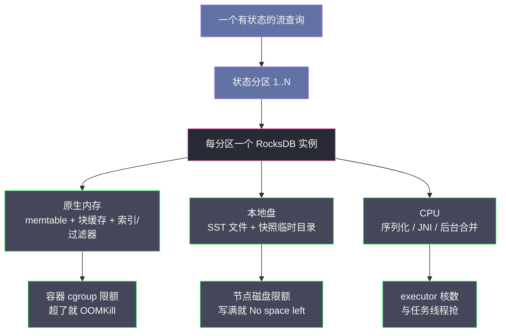
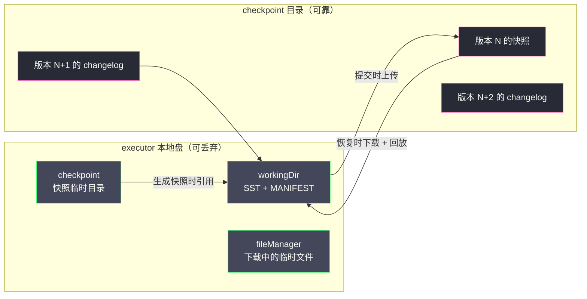
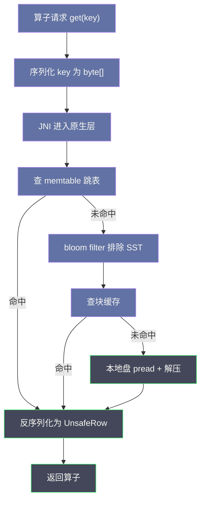
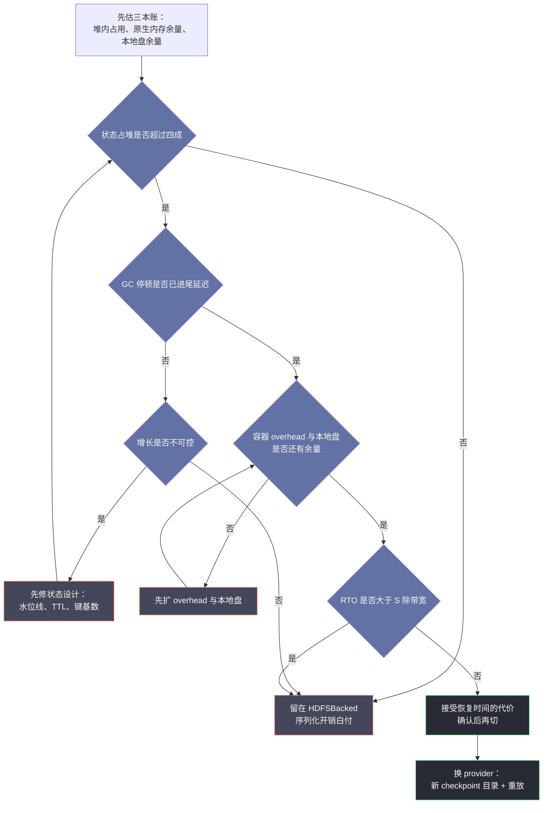
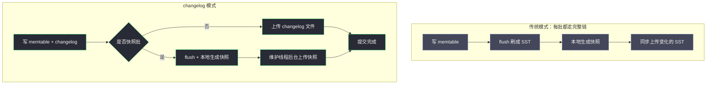

# 07 RocksDB State Store：为超大状态而生

**摘要：**

2021 年 10 月的 Spark 3.2.0 给 Structured Streaming 的状态后端添了第二种实现：`RocksDBStateStoreProvider` 把每个状态分区的键值映射从 JVM 堆搬到 executor 本地盘的 RocksDB 实例上，热数据在原生内存，冷数据在 SST 文件，于是状态规模不再由堆大小决定。但这次替换不产生"免费的容量"，只是把成本从一处挪到另外三处：原生内存不计入 `-Xmx` 却计入容器 cgroup，本地盘要按 LSM 的空间放大预留容量，每次读写还要多付序列化、JNI 与后台合并的 CPU。本文按这三本账组织：先说明它到底改变了什么，再逐本拆内存、磁盘、CPU 的构成与默认口径，给出每本账可以量的指标与阈值；然后收束到"什么时候该换"的正面与反面判据，逐项列出关键配置调大调小的代价，并纠正几个在社区里流传但并不存在的旋钮；最后拆 changelog checkpointing 的提交与恢复路径，以及容器被杀、磁盘写满、格式不兼容、本地盘丢失四类故障的签名。三本账都折算成了可代数的量级：状态占堆四五成是经验线，空间放大按 1.2 到 2 倍估，单实例的写缓冲潜势在百兆级。

---

## 第 1 章 一句话的改变：状态搬到了本地盘

2021 年 10 月发布的 Spark 3.2.0 里，Structured Streaming 的状态后端第一次有了第二种实现。在此之前，`spark.sql.streaming.stateStore.providerClass` 虽然一直可以改，能选的只有 `HDFSBackedStateStoreProvider` 一个；从 3.2 起，`RocksDBStateStoreProvider` 成了另一个可选值，并在随后几年里被 Databricks 运行时扶正为默认。

两种实现的接口相同，落点不同。前者把每个状态分区的键值映射放在 executor 的 JVM 堆里，键与值都是 `UnsafeRow` 对象；每批结束前把本批改动追加成 delta 文件写进 checkpoint 目录，攒够若干批再把整份状态写成一次快照。后者把同一份映射放进 executor 本地盘上的一个 RocksDB 实例：写入先进 memtable，memtable 满了刷成不可变的 SST 文件，后台线程再把 SST 逐层合并；热数据留在原生内存的写缓冲与块缓存里，冷数据在盘上，堆里几乎不留东西。

一句话概括这层替换：**状态从"堆内哈希表 + HDFS 文件"变成"本地盘的 LSM 树"**，于是堆占用与状态规模脱了钩，代价是每一次读写都要序列化，并且要跨一次 JNI 调用。

### 1.1 两次访问各做了什么

把一次读取摊开看，差别比"一个在内存、一个在磁盘"要细。HDFSBacked 的 `get` 是一次哈希查找，返回的是堆里那个 `UnsafeRow` 对象的引用，没有拷贝、没有反序列化，代价是这次查找必须发生在持有该分区的 executor 上。RocksDB 的 `get` 则是：把 key 序列化成字节数组，通过 JNI 进到原生层，先在 memtable 的跳表里找，没找到再过 bloom filter 排除大部分 SST 文件，命中块缓存的直接拷贝出来，没命中的发一次本地 `pread`，解压、读出 block，最后把字节反序列化回 `UnsafeRow`。

写入的差别小一些，但也不是零。HDFSBacked 的 `put` 改堆里的映射，同时把这一行追加进 delta 文件的写缓冲，两者都不涉及原生层；RocksDB 的 `put` 要序列化 key 与 value，进原生层插入 memtable，若开了 changelog checkpointing 还要被 changelog writer 再复制一份。所以"多一次序列化"这个说法只在读路径上完全成立，写路径上多出来的是原生层的插入与可能的一份复制。

下面这张表把两种实现在"访问"这一层的差异摆在一起，它不重复资源占用的对比，只回答每一次读写各自做了什么。

| 观察点 | HDFSBacked | RocksDB |
|---|---|---|
| 状态对象住在哪 | JVM 堆，`UnsafeRow` 常驻 | 本地盘 SST 文件，热块在原生内存 |
| 单次读取 | 哈希查找，直接拿到对象引用 | 序列化 key、JNI、bloom、块缓存或盘、反序列化 |
| 单次写入 | 改 map，追加一行到 delta 缓冲 | 序列化、JNI、memtable 插入、changelog 再写一份 |
| 每批持久化 | 增量 delta 文件，大小正比于本批变更 | 传统模式上传快照，changelog 模式上传增量日志 |
| 堆占用 | 正比于状态总量 | 只剩元数据与短命字节数组 |
| 容量上限由什么决定 | 堆大小与 GC 停顿 | 本地盘容量 |

### 1.2 为什么要把成本拆成三本账

换后端这个动作，直觉上像是在"买更大的内存"，因为宣传口径总是"突破 JVM 堆限制"。但把账摊开，它其实是把一份堆内存成本换成了三份不同性质的资源：一份不可回收的原生内存、一份必须与别的租户共享的本地盘、一份与数据处理本身抢核的 CPU。

这三份成本的预算主人各不相同。原生内存归容器管，cgroup 按进程的匿名内存页记账，超了直接杀掉，不看你怎么配堆；本地盘归节点管，同一块盘上还躺着 Shuffle 溢写、日志和别的 executor；CPU 归 executor 的核数管，RocksDB 的后台合并线程与任务线程平级争抢。调其中一个，另外两个的余量会跟着变，这正是"明明堆还很空，容器却被杀"这类现象的来源。

机制层面的推导不在这里展开：LSM 的层级结构、memtable 到 SST 的刷写、compaction 的读写放大，在 [[大数据/Spark/读书笔记-spark内核/04_存储与容错机制/2. Spark内存管理模型深度解析|Spark 内存管理模型]] 一侧已经讲过；HDFSBacked 的 delta、快照与版本号怎么组织，见 [[大数据/Spark/Spark-容错与状态管理深度解析/06 State Store 内幕：HDFSBackedStateStore 的读写路径|State Store 内幕]]。本篇只关心三本账各自怎么算、卡在哪、出了问题先看什么。

---

## 第 2 章 内存账：堆是空的，容器是满的

先说最容易被忽略的那本。RocksDB 的内存是原生内存，由 JNI 调用 `malloc` 拿到，不经 JVM 堆，因此 `-Xmx` 管不到它，GC 也看不到它；但它在进程的常驻内存里，容器按 cgroup 记账，超限就是 SIGKILL。这就是"堆使用率六成，Pod 却被 OOMKilled"的全部机制，没有任何神秘之处。

### 2.1 四块组成与一个指标

RocksDB 实例占用的原生内存大致分四块：memtable（写缓冲，包括正在写的和等待刷盘的不可变 memtable）、块缓存（缓存 SST 里的数据块）、索引与过滤器（每个 SST 文件的索引块和 bloom filter，常驻在 table reader 里），以及分配器与 JNI 自身的余量。Spark 把这些量汇总成 `RocksDBMetrics` 里的 `totalMemUsageBytes`，口径就是三者相加：`rocksdb.estimate-table-readers-mem` 加 `rocksdb.size-all-mem-tables` 加 `rocksdb.block-cache-usage`；另有一个 `pinnedBlocksMemUsage` 单列被块缓存钉住、无法驱逐的那部分。

这四块的量级差别很大，而且由不同的配置决定。memtable 的上限是 `writeBufferSizeMB` 乘以 `maxWriteBufferNumber`，两个参数默认都是 `-1`，也就是交给 RocksDB 自己的默认值：写缓冲 64MB、最多两个 memtable，单实例的写缓冲潜势约 128MB。块缓存的默认值是 `blockCacheSizeMB=8`，注意**这是容量而不是预留**，实际内存随读取的数据块增长，读得少就只占几百 KB。索引与过滤器的量级由键的数量与键长决定，经验上每 GB 状态对应几 MB 到十几 MB（示例推算，与 bloom 位数、平均键长强相关）。分配器与 JNI 的余量是常数级，单实例几十 MB。

| 组成 | 决定它的配置 | 单实例量级 | 什么会把它推高 |
|---|---|---|---|
| memtable | `writeBufferSizeMB`、`maxWriteBufferNumber` | 默认潜势约 128MB | 写多、批间隔长、写缓冲被调大 |
| 块缓存 | `blockCacheSizeMB` | 默认上限 8MB，实际随读增长 | 点读频繁、分区状态远大于缓存 |
| 索引与过滤器 | 无直接配置，随 SST 数量增长 | 每 GB 状态几 MB（示例推算） | key 多、SST 文件碎、合并不及时 |
| 分配器余量 | 无 | 单实例几十 MB | 实例数多时按实例数线性叠加 |

### 2.2 为什么 `-Xmx` 看不见它

JVM 的堆上限只约束 Java 对象。RocksDB 的 memtable、块缓存、索引块全部在原生层分配，JVM 只持有一个指针；GC 的标记、复制、压缩都碰不到这些页，所以堆使用率可以长期停在六成而进程 RSS 持续上涨。这一点与 Spark 自己的堆外内存（`spark.memory.offHeap.enabled` 打开后由 `Unsafe` 分配的存储内存）是两回事，后者走的是 `spark.memory.offHeap.size` 那本账，两者互不相干，把它们的配置混在一起算是最常见的一类误判。

容器这一侧看到的则是进程的全部匿名内存：堆、原生内存、元空间、线程栈、Direct buffer，加上可回收的页缓存。页缓存会进 `memory.current`，但它是可回收的，压力上来时内核会先把它扔掉，所以真正能把容器顶到 OOMKill 的是不可回收的匿名内存，也就是堆加原生内存。判据就很直接：容器被杀时若堆的 GC 后使用率并不高，而各实例 `totalMemUsageBytes` 之和已经接近甚至超过 `spark.executor.memoryOverhead`，那这笔账就是原生内存吃掉的。

这里要纠正一个流传很广的等式：`spark.executor.memoryOverhead` 不是给 RocksDB 设的上限，它只是**调度器在申请容器时加进内存请求的那部分预留**。RocksDB 分配内存时不会问 Spark 要配额，它直接向操作系统要；overhead 只影响容器被批准多大，不影响进程实际能长到多大。所以把 overhead 调大是"给容器留出余量"，而不是"给 RocksDB 设上限"，后者要靠下面这组配置。

> [!warning] 只调 `-Xmx` 的后果
> 容器限额通常是 `executor.memory + executor.memoryOverhead`。把堆从 8g 调到 16g 而 overhead 不动，容器限额同步涨到 17g 左右，表面上看空间更充裕；但堆越大，GC 后常驻的对象也越多，留给原生内存的余量并没有变宽，反而因为堆的伸缩（commit 的页、G1 的 region 保留）更容易把 RSS 顶到限额。流作业里"加堆之后 OOMKill 来得更早"的案例，多数是这么发生的。

### 2.3 用内存上限把账做实

默认配置下每个实例各管各的：一个 8MB 的 `LRUCache`，一个不受总量约束的写缓冲，实例之间没有任何共享。一个 executor 上跑十个状态任务就是十份独立的缓存与写缓冲，总量随任务数线性放大，谁也不知道加起来是多少。

`boundedMemoryUsage` 就是为这件事准备的。把它打开之后，同一 executor 上的所有 RocksDB 实例共享一个 `WriteBufferManager` 和一个 LRU 缓存，总量由 `maxMemoryUsageMB` 封顶，默认 500MB；其中写缓冲按 `writeBufferCacheRatio`（默认 0.5）分走一块，索引与过滤器块按 `highPriorityPoolRatio`（默认 0.1）进入高优先级池，剩下的留给数据块。同时 Spark 会把 `cacheIndexAndFilterBlocks`、`setPinL0FilterAndIndexBlocksInCache` 打开，让索引与过滤器真正进缓存并被钉住。

这个开关改变的是一组权衡，而不是省下了内存。开启了上限，写缓冲到顶时 RocksDB 会让写操作等待（也就是 stall），表现为批时长的周期性尖峰，指标上能看到 `rocksdbWriterStallLatencyMs` 抬头；不开上限，写缓冲可以长到把容器顶死。前者是慢，后者是死，选择取决于业务能容忍哪一种。

**上限本身也不是一道硬边界**。4.0 创建这个共享缓存时把严格容量限制关掉了（源码里 `strictCapacityLimit=false`，注释引的是 SPARK-44878），原因是严格限制在缓存满时会直接抛异常；关掉之后，缓存满了靠驱逐与阻塞来消化，进程的 RSS 可能短暂超过 `maxMemoryUsageMB`。所以把上限当作"预算"而不是"闸门"更准确，容器限额仍要留出余量。这里没有"托管内存"这个概念：RocksDB 不向 Spark 的统一内存池申领配额，上限由这组配置在进程内自管，与 Flink 那套由 TaskManager 统一分配托管内存的机制是两回事。

| 场景 | 不开上限 | 开上限（`boundedMemoryUsage=true`） |
|---|---|---|
| 实例数少的 executor | 内存占用随实际读写自然增长，通常够用 | 共享缓存带来额外协调，收益有限 |
| 实例数多的 executor | 总量不可控，OOMKill 风险高 | 总量封顶，风险转为写 stall 与命中率下降 |
| 调优方向 | 减少同 executor 上的状态任务数 | 调 `maxMemoryUsageMB` 与两个 ratio |

### 2.4 一次示例推算

把数字代进去，账才看得清。设一个风控去重加窗口聚合的流作业，逻辑状态 10GB，切成 200 个状态分区，跑在 40 个 executor 上，每个 executor 并发 5 个状态任务，也就是 5 个 RocksDB 实例。

按默认口径，每个实例的写缓冲潜势约 128MB（64MB 乘 2），块缓存上限 8MB；稳态下 memtable 未必填满，取实际占用 40 到 80MB（示例推算，取决于批间隔内的写入量），加块缓存 5MB 左右、索引与过滤器 10MB 上下、分配器余量 20MB，单实例 80 到 120MB，5 个实例是 400 到 600MB。executor 堆 8g，默认 overhead 是 `max(384MB, 0.1 × 8g)` 约 819MB，容器限额约 8.8GB；堆在 GC 后常驻 4 到 5GB，JVM 其他原生部分 300 到 500MB，加上 RocksDB 的 0.5GB，合计 5.3 到 6.5GB，余量还算健康。

把并行度调一倍就未必了。分区数从 200 涨到 400，每个 executor 上的实例数从 5 变 10，原生内存翻倍到 0.8 到 1.2GB，合计逼近 7.5GB，再叠上一次 Full GC 的临时膨胀或者某个实例的写缓冲被填满，越过 8.8GB 限额的窗口就出现了。这时堆的 GC 后使用率可能还是五成，`kubectl describe pod` 里却是 `OOMKilled`、退出码 137。这类事故的复盘通常只写一句"内存不足"，真正的算术是上面这两行。

### 2.5 实例数是三本账的公共乘数

三本账里有一个量反复出现：**单 executor 上的状态实例数**。它等于这台机器上并发执行的状态任务数，而状态任务数由状态分区数除以 executor 数决定，分区数又来自有状态算子那一侧的 shuffle 并行度与自适应执行的重分区结果。换句话说，并行度调优时顺手改的那个数，同时乘在内存、磁盘、线程三本账上。

这个乘数容易被忽略，是因为它在三个账本里的表现不同。内存账里它是线性的：实例数翻倍，写缓冲潜势与缓存容量按实例数翻倍。磁盘账里它是除法：分区数翻倍而 executor 数不变，单机承担的分区数翻倍，本地盘占用跟着翻倍。CPU 账里它变成线程数：每个实例两条后台合并线程，十个实例就是二十条，与任务线程争同一批核。

所以判断"能不能再加并行度"时，要同时看三个方向：容器里还剩多少原生内存、本地盘还剩多少容量、这张机器上的核数能不能容下 2N 条后台线程。三个方向里任何一个先到底，加并行度都是负收益——它会把某个账本推到临界，然后用 OOMKill、磁盘满或批时长尖峰的方式告诉你。

---

## 第 3 章 磁盘账：本地盘既是缓存也是硬约束

RocksDB 把状态放在 executor 本地盘，路径来自 `spark.local.dir`（或环境变量 `SPARK_LOCAL_DIRS` 给出的目录列表）。每个状态分区一个实例，实例在本地目录下再开三个子目录：`workingDir` 放正在使用的 SST 与 MANIFEST，`fileManager` 放从 DFS 下载的临时文件，`checkpoint` 放生成快照时的拷贝。这一层没有单独的配置项，社区里流传的 `spark.sql.streaming.stateStore.rocksdb.localDir` 并不存在，想把状态放到单独的盘上，只能改 `spark.local.dir` 本身，并且要确保 driver 与所有 executor 的配置一致。

### 3.1 容量的三个乘数

磁盘占用的计算比内存好做，因为它是静态的乘法。第一乘数是逻辑状态 S，第二乘数是 LSM 的空间放大，第三乘数是单台机器上分到的分区比例。之后再补上快照临时目录与预分配带来的固定开销。

空间放大的来源是**"旧版本数据在合并之前不会消失"**。一个键被更新或删除后，旧值仍躺在某一层的 SST 里，直到 compaction 把它与新值合并才真正释放。level 策略下这个倍数常在 1.2 到 2 之间（示例推算，取决于更新比例、键的分布与合并是否跟得上）；如果写入速度长期高于后台合并速度，L0 会堆积，倍数随之向 2 甚至更高滑过去。

快照临时目录是第二个隐形占用。生成一次快照时，RocksDB 会在 `checkpoint` 目录下创建一棵引用当前 SST 的目录树，同盘情况下多为硬链接，引用不复制，占不了多少额外空间；但如果 `spark.local.dir` 配了多个目录、或者 `checkpoint` 与工作目录落在不同文件系统上，链接退化成复制，瞬时就会多出一份接近 S 的占用。

第三个是 4.0 起可配的 `allowFAllocate`，默认打开，意思是文件创建时用 `fallocate` 按目标大小预占空间。好处是写入不会因为空间碎片而中途失败，坏处是"很多小的状态实例并发运行"时，预占的空间远大于实际写入量；源码注释里对这个副作用的原话就是会浪费大量磁盘。容器磁盘本来就紧的场景，把它关掉通常比调大磁盘更划算，代价是写入变慢。

| 乘数 | 量级（示例推算） | 什么时候会变大 |
|---|---|---|
| 逻辑状态 S | 由键数与每键字节数决定 | 键基数增长、TTL 不生效 |
| 空间放大 | 1.2 到 2 倍 | 更新比例高、合并跟不上、L0 堆积 |
| 单机分区比例 | S / 分区数 × 本机分区数 | 并行度调大但 executor 数没加 |
| 快照临时目录 | 同盘硬链接时接近 0，跨盘时接近 S | 本地目录跨文件系统、目录列表配错 |
| 预分配 | 每实例数十 MB 到上百 MB | 小实例多、`allowFAllocate` 保持默认 |

### 3.2 磁盘写满的形态

磁盘写满不是"状态写不进去"这么简单，它会沿着三条路径同时发作。第一条在 RocksDB 内部：SST 写失败、后台合并失败，RocksDB 进入只读或者报错状态，任务提交时抛 `RocksDBException`，日志里是 `No space left on device`。第二条在 Spark 的任务层：提交失败触发批重试，重试又要重写同一批的状态，盘一点没腾出来，重试必然再失败，直到重试上限打满、查询终止。第三条在同一块盘的邻居身上：Shuffle 溢写、事件日志、executor 的临时文件全都落在 `spark.local.dir` 下，状态先把盘吃掉，最先报错的却可能是 Shuffle。

这三条路决定了一个判据：看到 `No space left on device` 时，**先分清是哪一类文件写的**。`df -h` 看分区余量，`du -sh` 分别量状态目录、Shuffle 目录与日志目录，再看 `lsof +L1` 有没有"文件已删除但句柄未释放"的残留——RocksDB 的实例在 close 之前会占着 SST 文件，进程被杀之后才释放，这类残留能让 `df` 与 `du` 的差差出几十 GB。

容量规划的口径要留出三份余量：状态本身按 S 乘空间放大算，快照临时目录按半份 S 留，再给同一块盘上的 Shuffle 与日志留两成。一个 10GB 状态的作业在 200 个分区上铺开，单机承担 5 个分区约 250MB 逻辑状态，放大了也就 500MB，看不出压力；换成 1TB 状态的作业，单机承担 5 个分区就是 25GB 逻辑状态、50GB 落盘，再叠一份快照目录，100GB 的容器盘就到底了。

### 3.3 本地盘是缓存，不是持久层

这一点决定了"本地盘丢了我该慌不慌"。4.x 的 `WriteOptions` 明确关掉了 WAL（源码注释是"提交时显式刷盘，不需要 WAL"），也就是说未提交的写入在本地盘上没有日志保护；能恢复的数据只有已经上传到 DFS 的快照与 changelog。因此 executor 的本地盘本质上是**一份可以被丢弃的缓存**：盘坏了、Pod 重建了、节点换了，状态都能从 checkpoint 目录重新下载回来，代价是恢复时间。

这个性质也解释了为什么在 Kubernetes 上跑这类作业要谨慎选择临时盘。`emptyDir` 随 Pod 生死，节点被驱逐一次就清空一次；每次都从 DFS 重新下载一份完整快照，恢复时间按 S 除以带宽算，10GB 状态在 100MB/s 的链路上是一百秒量级，期间查询停止推进、上游积压增长。把大状态作业放到抢占式节点上，等于把"恢复"变成日常操作。

---

## 第 4 章 CPU 账：序列化、合并、校验

第三本账最不容易被当成账，因为它不出现在任何资源配额里，只出现在批时长的分布上。RocksDB 把原本纯内存的访问变成了**"序列化 + 原生调用 + 块查找"**，又把原本不存在的后台合并线程塞进了 executor，两笔开销都不小，且都不受 `-Xmx` 与磁盘容量的约束。

### 4.1 每次访问多出来的三段

第一段是序列化。`UnsafeRow` 在堆里是一段带 schema 描述的二进制，写进 RocksDB 要先把 key 与 value 转成 `byte[]`，读出来要再 `readFrom` 还原成 `UnsafeRow` 交给算子。单个键的转换在亚微秒到一两微秒之间（示例推算，与行宽强相关），但状态访问是每批百万次量级的操作，乘起来就是秒。

第二段是 JNI 与原生调用。跨语言边界本身有固定开销，更贵的是它带来的不可内联与缓存局部性损失：JVM 侧的优化对原生层无效，原生层读写的数据块也不在 GC 的掌控范围内。

第三段是块查找。一次 `get` 在原生层要走 memtable 的跳表、bloom filter、块缓存，最终可能落到一次 `pread`；写路径则要插入跳表，写缓冲满时还要等待刷盘。这些操作在 HDFSBacked 上都不存在，因为那里只有一次哈希查找。

### 4.2 默认开着的一次多余点读

`trackTotalNumberOfRows` 默认是真，作用是维护状态里的键数，供 UI 与自检使用。它的实现方式是每次 `put` 之前先 `get` 一次旧值判断是不是新键、每次 `remove` 之前也先 `get` 一次判断键是否存在。对写密集的状态来说，这等于把读操作翻了一倍。

源码注释里把这个代价说得很直白：写密集负载下这些额外查找带来不可忽视的开销，建议在真正需要行数可观测性时再打开。判据也就清楚了：如果 `rocksdbGetCount` 与 `rocksdbPutCount` 长期同量级、而业务并不依赖 `numRowsTotal`，说明读操作里有一半是这类额外查找，把它关掉是最省事的一笔优化；关掉之后 `numRowsTotal` 会显示为 -1，依赖行数的自检和图表要一并调整。

### 4.3 flush 与 compaction 落在哪条路径

传统提交模式（不开 changelog）里，每批的提交路径上都有一次同步的 `db.flush()`，等待所有 memtable 落成 SST，然后生成一份本地快照并上传。这三个动作都在任务线程里，直接计入批时长，所以状态越大、盘越慢，批时长越不稳定。

changelog 模式把那一次 flush 从每批挪到了"快照批"：只有每 `minDeltasForSnapshot` 批才刷盘并生成快照，其余批次只写一份 changelog 上传。批时长的分布因此变平，代价是未刷盘的数据只能在内存里待着，而恢复要依赖 changelog 回放。

**compaction 永远在后台跑**，每个实例默认两条后台线程（RocksDB 的 `max_background_jobs` 默认 2，Spark 不改它）。一个 executor 上十个实例就是二十条后台线程，对一台 8 核或 16 核的机器来说，这是与任务线程平级的竞争者；合并最凶的时候，批时长会出现与合并周期吻合的尖峰。

还有一个常被误用的旋钮：`compactOnCommit`。它在每次快照提交时调用 `compactRange()`，把整个 DB 做一次全量合并。开的动机通常是"读放大太高"，代价是提交路径上多出一次与状态总量成正比的重活，CPU 与磁盘 I/O 同时尖峰。除非状态读多写少到合并几乎不触发，否则这个开关不值得打开。

### 4.4 怎么量这本账

RocksDB 把耗时以状态算子的自定义指标上报，名字统一带 `rocksdb` 前缀，驼峰命名：`rocksdbGetLatency` 与 `rocksdbPutLatency` 是累计耗时，`rocksdbGetCount` 与 `rocksdbPutCount` 是调用次数，两者相除得到单次平均；更细的分位数要靠 executor 日志里的原生直方图或者旁路采集。三个方向各有读法：get 的平均耗时抬升说明块缓存不够或者盘慢，`rocksdbReadBlockCacheHitCount` 与 `rocksdbReadBlockCacheMissCount` 的比值能直接印证；put 的耗时抬升通常是写缓冲满导致的等待，`rocksdbWriterStallLatencyMs` 会同时上涨；`rocksdbTotalCompactionLatencyMs` 与 stall 时间同向增长，说明后台合并跟不上写入。

提交路径上的分解是四个指标：`rocksdbCommitFlushLatency`、`rocksdbCommitCheckpointLatency`、`rocksdbCommitFileSyncLatencyMs`、`rocksdbCommitCompactLatency`，分别对应刷盘、生成快照、上传 DFS、以及在开了 `compactOnCommit` 时的全量合并。哪个占大头，问题就在哪一侧——`fileSync` 大是 DFS 带宽或 NameNode 慢，`flush` 大是本地盘慢或 memtable 太大，`checkpoint` 大通常是状态文件碎、快照目录里文件太多。

上传与容量的观察另有三个：`rocksdbSstFileSize` 是本地盘上 SST 的总大小，`rocksdbFilesCopied` 与 `rocksdbFilesReused` 的比值说明快照上传到底传了多少、复用了多少；后者高、前者低，说明文件映射在正常工作，增量上传没有退化成全量。

| CPU 项 | 触发条件 | 能调什么 | 代价 |
|---|---|---|---|
| key/value 序列化 | 每次读写 | 缩小行宽、减少访问次数 | 需要改业务状态结构 |
| 多余点读 | `trackTotalNumberOfRows=true` | 关闭该开关 | 失去 `numRowsTotal` |
| 提交时 flush | 传统模式每批，changelog 模式仅快照批 | 开 changelog | 恢复要回放 |
| 后台合并 | 写入速率高、L0 堆积 | 调大写缓冲、减少实例数 | 内存上涨、stall 风险 |
| 全量合并 | `compactOnCommit=true` | 保持默认关闭 | 关掉后读放大回升 |
| 压缩 | `compression` 默认 `lz4` | 换更快的算法或关闭 | 磁盘占用上涨 |

---

## 第 5 章 什么时候该换

三本账记完，判断就有了依据。换后端这个决策的本质不是"RocksDB 更先进"，而是"我现在付的这份成本（堆内状态加 GC 停顿）能不能用另外三份成本（原生内存、本地盘、CPU）换得更低"。所以判据必须两边都算：正面的三条说明该换，反面的三条说明换了更亏。

### 5.1 正面判据一：状态与堆的比例越线

经验线是**状态占用堆的四成到五成**。算法是：先估逻辑状态 S，再除以状态分区数得到单分区状态，乘以单 executor 上并发的状态任务数，得到单 executor 的堆内占用，最后与堆大小比。HDFSBacked 的每个键在堆里不只有值，还有 `UnsafeRow` 的头、哈希表的桶与链、以及对象对齐的填充，实际占用按裸数据的 1.5 到 2 倍估更稳，这条字节口径在 [[大数据/Spark/Spark-Structured-Streaming流处理深度解析/12 生产调优手册：吞吐量、延迟、背压与资源配置全攻略|生产调优手册]] 里已经推到可以代数的程度。

越过这条线之后，症状通常不是马上 OOM，而是 GC 频率上升、单次停顿变长、批时长的方差变大。堆里的长命对象多了，老年代增长快，mixed GC 与 Full GC 的间隔缩短，每一次都可能吃掉几百毫秒到几秒；流作业的端到端延迟由批时长与提交时间共同决定，这几百毫秒会直接摊到 P99 上。

### 5.2 正面判据二：GC 停顿进了尾延迟

这是比第一条更硬的判据，因为它可以直接量。把 GC 日志打开，看 Full GC 的次数与停顿分布，与流查询的批时长曲线叠在一起；如果批时长的尖峰与 GC 停顿在时间上吻合，且这些尖峰的幅度已经超过业务能接受的尾延迟预算，那么继续在堆里优化只是换参数，换后端才动结构。

这一条之所以要单独列，是因为它可能先于容量越线出现。状态只占堆的三成，但键值都很大、生命周期很长，老年代照样会被顶起来；反过来，状态超过堆的一半但键值很小、分配速率低，GC 可能一直很温和。判据的**落点始终是停顿，不是比例**。

### 5.3 正面判据三：增长不可控

状态增长没有上界，是第三个信号。键空间本身无界（用户 ID、设备 ID、订单号），水位线推不动（上游有长尾迟到数据、或者根本没定义水位线），TTL 没配或者配了但没生效——这三种情况下状态会单调上涨，只是快慢不同。此时换 RocksDB 只买到时间，不解决问题，状态设计该修还得修。

清理机制的细节在 [[大数据/Spark/Spark-容错与状态管理深度解析/08 状态过期与 TTL：让 State Store 不再无限膨胀|状态过期与 TTL]] 里逐条拆过，本篇只取一个结论：换后端与修状态设计是两件事，前者的收益是把天花板抬高，后者的收益是把天花板以下的增长压平；两件事都做，作业才稳，只做前者，几个月后还要再换一次。

### 5.4 反面判据一：状态小的时候换了更慢

状态只有几百 MB 的作业换 RocksDB，通常是负收益。原因有三层：每次读写多一次序列化与 JNI，在纯内存命中就能解决的场景里这是纯粹的开销；每个实例有固定的内存与线程开销，实例数一多，固定成本就超过省下的堆；恢复路径从"加载若干个小 delta"变成"下载快照再回放"，RTO 反而变长。

量化一下会更直观。状态 300MB、200 个分区，每分区 1.5MB，块缓存 8MB 已经能装下整个分区，读路径几乎全命中缓存，可即便全命中，序列化与 JNI 的费用仍在；HDFSBacked 在同一场景下是纯哈希查找。批时长因此可能出现 10% 到 30% 的上升（示例推算，与状态访问密度正相关），而堆压力本来就不存在，换来的收益接近零。

### 5.5 反面判据二：恢复时间预算紧

RocksDB 的恢复是"下载最近快照 + 回放其后的 changelog"。下载时间按 S 除以可用带宽算，回放时间按最近快照之后累积的变更量算。10GB 状态在 100MB/s 的链路上是 100 秒量级，如果恢复还要跨机房、走对象存储，或者 checkpoint 目录同时在服务十几个查询，实际时间会显著更长。

如果业务的 RTO 是 30 秒，而状态是 10GB，这个后端从一开始就不该选——不是它不好，是恢复模型与预算不匹配。HDFSBacked 在同等状态下的恢复是读最近一份快照再重放其后少量 delta（默认快照间隔为两批），量级上小得多；当然它能不能承载 10GB 的堆内状态是另一个问题。两个约束都硬的时候，正确的方向是缩小状态（更短的水位线、更粗的粒度、更少的键），而不是在两个后端之间反复横跳。

### 5.6 反面判据三：本地盘与容器余量本来就紧

换后端不减少总资源消耗，只改变资源种类。堆里省下来的空间，会以原生内存的形式出现在同一个容器里；状态从 HDFS 挪到本地盘，会把原本落在 DFS 上的容量压力转到节点盘上。如果容器限额没有上调、本地盘没有扩容、executor 上本来就挤着别的状态任务，换过去的结果是换一种死法：从 `Java heap space` 变成 `OOMKilled`，从 checkpoint 目录写满变成 `No space left on device`。

这一类误判在"照着别人的推荐配置抄"的场景里最常见：别人是 64GB 内存的专用节点、本地 NVMe 单挂，你是 16GB 的混部容器、系统盘共享，同样的 `writeBufferSizeMB` 与实例数落下来，账完全不同。

### 5.7 换的固定成本

除了三本账，还有一笔一次性的成本：checkpoint 里的状态格式不兼容，切 provider 必须换一个新的 checkpoint 目录，从源头重放或者从业务侧导入初始状态。重放期间输出是空的，积压按输入速率累积，这段时间的业务影响往往比参数调优省下的资源更值钱。迁移的完整口径见 [[大数据/Spark/Spark-Structured-Streaming流处理深度解析/12 生产调优手册：吞吐量、延迟、背压与资源配置全攻略|生产调优手册]] 的兼容性一节，checkpoint 目录本身的结构见 [[大数据/Spark/Spark-容错与状态管理深度解析/04 Structured Streaming 容错模型：Offset 与 Checkpoint|Offset 与 Checkpoint]]。

把六条判据放在一起，决策的形状就出来了：三条正面判据是"必须换"的必要条件，三条反面判据是"换了更亏"的否决条件；正面两条以上成立、反面三条都不成立时，换才是净收益。

| 判据 | 阈值或证据 | 数据来源 | 动作方向 |
|---|---|---|---|
| 状态占堆比例 | 超过四成到五成 | 状态大小估算 + 堆配置 | 倾向换 |
| GC 停顿进尾延迟 | 尖峰与 GC 时间吻合且超预算 | GC 日志 + 批时长曲线 | 倾向换 |
| 增长不可控 | 键数单调上涨、水位线不动 | `numRowsTotal` 趋势 | 先修状态设计 |
| 状态规模 | 小于几百 MB | 状态大小估算 | 不要换 |
| 恢复预算 | RTO 小于 S 除带宽 | 恢复演练实测 | 不要换 |
| 容器与本地盘余量 | overhead 与盘均无余量 | 容器限额、`df -h` | 先扩资源再换 |

---

## 第 6 章 关键配置的判据表

配置这一节不按"重要程度"排，按它动的是哪本账排。每一项都给出 4.x 的默认值、它约束的量、以及调大调小各自的代价；只写"建议调大"而不写代价的调优建议，**在线上通常都会以另一种形式还回来**。

### 6.1 内存与写缓冲

`blockCacheSizeMB` 默认 8，管的是单实例的块缓存容量。调大能提高点读命中率，尤其在分区状态远大于 8MB 时收益明显；代价是原生内存按实例数线性上涨。调小到 1 到 2MB 省内存，但读基本全走盘，`get` 的 P99 会从微秒级跳到毫秒级。判据是命中率：`rocksdbReadBlockCacheHitCount` 与 `rocksdbReadBlockCacheMissCount` 的比值长期低于 8 比 2，就该往上加，而不是先去动内存上限。

`writeBufferSizeMB` 默认 `-1`，即用 RocksDB 的 64MB。调大减少 flush 次数、降低写放大与 L0 文件数；代价是 memtable 占用的原生内存变大，changelog 模式下恢复要回放的数据也可能更多。调小让 flush 更频繁，写放大与后台合并压力上升，极端情况下合并跟不上写入，进入 stall。这个参数从 3.5 起才由 Spark 暴露，更早的版本里改不动。

`maxWriteBufferNumber` 默认 `-1`，即 RocksDB 的 2。它决定允许积压几个 memtable；调大能在刷盘慢的时候吸收更多写入、减少 stall，代价同样是内存。调小到 1 会让写缓冲一满就等刷盘，写延迟的方差变大。它与 `writeBufferSizeMB` 是一对，乘积就是写缓冲的内存潜势，两个一起调才是"总量"，单独调一个是"形状"。

`boundedMemoryUsage` 与 `maxMemoryUsageMB`（默认 500）是一组。打开之后总量有了上限，`writeBufferCacheRatio`（0.5）与 `highPriorityPoolRatio`（0.1）决定这块上限怎么切。三个 ratio 型的参数没有"越大越好"的方向，它们的意义是把有限的配额在写缓冲、索引过滤器、数据块之间重新分配：写多读少就把写缓冲的比例调高，读多写少就反过来。

### 6.2 快照与版本

`minDeltasForSnapshot` 默认 2，在 HDFSBacked 与 RocksDB 的 changelog 模式里都起作用。调大减少快照次数、降低上传量与提交尖峰，代价是恢复时要回放更长的 changelog 链；调小让快照更频繁，恢复快但每周期的上传量上升。这个值要与批间隔一起算：间隔十秒、取 2，意味着二十秒一次快照；状态 100GB 时这个频率不可能承受，必须同时缩状态或换存储介质。

`minVersionsToRetain`（来自 `spark.sql.streaming.minBatchesToRetain`，默认 100）决定本地与 DFS 上保留多少个版本，供回滚与恢复使用。调大提高可回退的深度，代价是 DFS 上的文件数与本地盘的占用一起上涨；调小省空间，但一旦需要回滚，可用的落点变少。4.0 另外加了 `minVersionsToDelete` 与每次维护的删除上限，用途是把清理从"一次性删一大批"改成"每次删一点"，避免维护线程长时间占住目录。

`formatVersion` 默认 5，指定 RocksDB 的 table format 版本。它会被写进 checkpoint 元数据，在查询的整个生命周期里沿用，目的是让升级 Spark 之后仍能回滚到旧版本而不至于读不了旧文件。改它等于换文件格式，已有查询不能平滑过渡，属于"上线前定，上线后别碰"的范畴。

### 6.3 提交、压缩与预分配

`compactOnCommit` 默认假。打开会在每次快照提交时做一次全量合并，读放大下降、空间放大下降，但提交路径上多一次与状态总量成正比的 CPU 与 I/O 重活。只在"读多写少、且能接受周期性尖峰"的场景里考虑。

`trackTotalNumberOfRows` 默认真，代价是每次写多一次点读。写密集的状态把它关掉，省下的读操作相当可观；关掉之后 `numRowsTotal` 不再可信，依赖它的告警与看板要改成别的口径。

`allowFAllocate` 与 `compression` 是 4.0 才暴露的。前者默认开，用预分配换写入连续性，小实例多的场景会浪费盘，关掉省盘但写入变慢；后者默认 `lz4`，压缩率与 CPU 之间取了个偏快的点，换成更重的算法省盘费 CPU，关掉压缩则相反。这两个参数直接改的是磁盘账与 CPU 账的兑换比例，与内存无关。

### 6.4 找不到的那几个旋钮

社区文章里出现频率很高、但在 OSS Spark 的 SQLConf 里找不到对应键的参数有五个，抄过来只会静默不生效：`spark.sql.streaming.stateStore.rocksdb.compactionStyle`（合并策略没有暴露，只有 `compactOnCommit` 这一个开关）、`minWriteBufferNumberToMerge`（写缓冲的合并阈值没有暴露，只暴露了大小与个数）、`memoryManaged`（这个名字来自 Flink 的 `state.backend.rocksdb.memory.managed`，Spark 侧对应的是 `boundedMemoryUsage` 那一组）、`rocksdb.localDir`（本地目录只有 `spark.local.dir` 一个来源）、以及各种 compaction 限速参数（Spark 没有把它接口化）。

这几个键的共同点是"听起来非常合理"。`compactionStyle` 换成 universal 在写密集场景下确实能降写放大，`minWriteBufferNumberToMerge` 在 RocksDB 原生配置里确实存在，`memoryManaged` 在 Flink 里确实是标准做法——但 Spark 没有把它们透出来。想改这些，只能改 Spark 源码或者等社区暴露，写进作业配置里等于没写。

| 流传的参数名 | 真实归属 | 在 Spark 里的替代 |
|---|---|---|
| `rocksdb.compactionStyle` | RocksDB 原生选项，Spark 未暴露 | 只有 `compactOnCommit` 一个间接开关 |
| `rocksdb.minWriteBufferNumberToMerge` | RocksDB 原生选项，Spark 未暴露 | 只暴露 `writeBufferSizeMB` 与 `maxWriteBufferNumber` |
| `rocksdb.memoryManaged` | Flink 的 `state.backend.rocksdb.memory.managed` | `boundedMemoryUsage` 与 `maxMemoryUsageMB` 一组 |
| `rocksdb.localDir` | 不存在，Spark 无此配置 | `spark.local.dir` 或 `SPARK_LOCAL_DIRS` |
| compaction 限速 | RocksDB 的 `rate_limiter`，Spark 未暴露 | 无，只能靠减少实例或缩状态 |

说到 `compactionStyle`，绕过它谈取舍仍然有价值：level 策略把数据分成逐层放大的层级，读放大低、空间放大中等，写放大高；universal 策略用更多层重叠换更少的写放大，代价是空间放大与读放大一起上升。Spark 选了 level 作为固定策略，意味着写密集的状态作业要额外为写放大买单——这份成本最终落在本地盘的写入量与盘寿命上，而不是落在某个可调的参数上。

| 参数 | 4.x 默认 | 作用 | 调大的代价 | 调小的代价 |
|---|---|---|---|---|
| `blockCacheSizeMB` | 8 | 单实例块缓存容量 | 原生内存按实例数上涨 | 读走盘，`get` P99 变差 |
| `writeBufferSizeMB` | -1（RocksDB 64MB） | memtable 大小 | 内存潜势变大、恢复回放变多 | flush 频繁、写放大上升 |
| `maxWriteBufferNumber` | -1（RocksDB 2） | 允许积压的 memtable 数 | 内存潜势变大 | 写 stall 概率上升 |
| `boundedMemoryUsage` | false | 是否给原生内存封顶 | 转为 stall 与命中率下降 | 总量不可控，OOMKill 风险 |
| `maxMemoryUsageMB` | 500 | 每 executor 原生内存上限 | 容器压力上涨 | 写缓冲被挤，批时长尖峰 |
| `writeBufferCacheRatio` | 0.5 | 上限中写缓冲的份额 | 数据块与索引被挤 | 写 stall 更早出现 |
| `highPriorityPoolRatio` | 0.1 | 索引与过滤器的高优先级份额 | 数据块空间被挤 | 索引被驱逐，读放大上升 |
| `changelogCheckpointing.enabled` | false | 只传增量还是每批快照 | 恢复要回放，内存停留更久 | 提交路径变长，批时长不稳 |
| `minDeltasForSnapshot` | 2 | 快照间隔（批数） | 恢复回放变长 | 快照上传量与尖峰上升 |
| `minVersionsToRetain` | 100 | 保留版本数 | DFS 与本地占用上涨 | 可回滚深度变浅 |
| `compactOnCommit` | false | 提交时是否全量合并 | 提交路径重活，尖峰明显 | 读放大与空间放大回升 |
| `trackTotalNumberOfRows` | true | 是否维护状态键数 | 写密集时读操作翻倍 | `numRowsTotal` 不可信 |
| `allowFAllocate` | true | 是否预分配文件 | 小实例多时浪费盘 | 写入变慢 |
| `compression` | lz4 | 块压缩算法 | 压缩率高但 CPU 上升 | 省 CPU 但盘占用上涨 |
| `formatVersion` | 5 | 落盘文件格式版本 | 与旧版本不兼容 | 与旧 checkpoint 不兼容 |

> [!info] 默认值的版本边界
> `writeBufferSizeMB`、`maxWriteBufferNumber`、`boundedMemoryUsage`、`maxMemoryUsageMB` 与两个 ratio 是 3.5 起才暴露的；`allowFAllocate` 与 `compression` 是 4.0 起才暴露的；`changelogCheckpointing.enabled` 在 3.5 引入且默认关闭，到 4.0 仍然默认关闭，只在 Databricks 运行时的较新版本里被改成默认打开。拿别的发行版的默认值套到自建集群上，是最容易出错的地方。

---

## 第 7 章 changelog checkpointing：只传增量，代价是回放

前面几次提到"传统模式"与"changelog 模式"，这里把两条提交路径拆开。这个特性在 3.5 引入，默认关闭，到 4.0 仍未改变默认；它与旧机制双向兼容，打开或关闭都不需要重放历史，这一点与切 provider 完全不同。

### 7.1 传统模式的提交路径

不开 changelog 时，每批的状态提交都要走完整链条：`db.flush()` 把所有 memtable 刷成 SST（`waitForFlush` 为真，同步等待），然后在本地生成一份快照目录，再逐个文件上传到 DFS。上传并不是把整份状态重新写一遍——SST 文件一旦生成就不可变，Spark 在本地维护了一张"本地文件到 DFS 文件"的映射，已经上传过的文件按映射跳过，只传新增的 SST 与 MANIFEST。

即便如此，这条路径仍然与状态总量相关：每批都要 flush（memtable 里的数据必须落盘才能做快照），每批都要生成一份新的快照目录与清单，提交时间随状态规模与文件数增长。状态到了几十 GB、SST 文件到了几千个，这份清单本身就是几百 KB 的元数据，每批上传一次。

### 7.2 changelog 模式的提交路径

打开之后，`put` 与 `remove` 除了写 DB，还会被 changelog writer 记一份；每批提交时只把这份 changelog 文件上传，不再 flush、不再生成快照。快照按 `minDeltasForSnapshot` 的间隔就地生成一份，但生成之后先放在本地，由维护线程在后台上传——源码里的注释写得很清楚：开 changelog 时快照异步上传，不开时在 `uploadSnapshot()` 里同步上传。

这两条路径的差别**不在"传了多少字节"，而在"批提交路径上有多少工作"**。传统模式下，任务线程要等 flush 与上传都完成才能结束这一批，状态越大批时长越不可控；changelog 模式下任务线程只等一个增量文件写完，快照的重活被挪到后台。批时长的分布因此变平，这是它最直接的收益。

### 7.3 恢复路径与代价

恢复时先找最近的快照，下载到本地重建实例，然后从快照的下一个版本开始逐个回放 changelog 文件，直到目标版本。回放的实现是把 changelog 里的每条记录重新 `put` 或 `remove` 进本地 DB，所以恢复时间约等于"下载 S 除以带宽"再加"回放累积变更量除以写入吞吐"。

`minDeltasForSnapshot` 在这里的作用被放大：它既决定快照多久做一次，也决定故障时最多要回放多少批。默认 2 意味着最多回放一两批，恢复时间主要由下载主导；调到 100 就省下大量快照上传，但一次故障可能要回放上百批的变更，恢复时间与变更密度成正比地涨。这个参数没有普适值，要从 RTO 反推。

### 7.4 三本账怎么跟着变

内存账微妙一些。不开 changelog 时每批都 flush，memtable 里的数据很快落盘，占用是一个稳定的低水位；开了 changelog 之后，只有快照批才强制刷盘，其余时间 memtable 靠自然写满才刷，占用会在一个更高的区间里波动。省下的是提交路径，不是内存。

磁盘账的变化在文件数上。传统模式每个版本一份快照目录加若干 SST；changelog 模式每个版本一个 changelog 文件，快照只在快照批出现。目录里的对象数从"版本数加 SST 文件数"降到"版本数加一份快照"，对检查点目录的元数据压力小得多，但 changelog 文件要按 `minVersionsToRetain` 清理，否则目录会随版本线性增长。

CPU 账则略微变差：每次 `put` 多了一份 changelog 写入，每次 `remove` 也一样。这份开销与状态变更量成正比，相对于省下的 flush 与快照生成，在状态大、变更比例中等偏低的场景里是划算的；如果每批几乎全量键都在变，changelog 的大小接近一份全量快照，收益就消失了。

| 观察点 | 传统模式 | changelog 模式 |
|---|---|---|
| 任务线程每批的工作 | flush、生成快照、上传 | 写并上传一个 changelog 文件 |
| 快照时机 | 每批 | 每 `minDeltasForSnapshot` 批 |
| 快照上传 | 同步，在任务线程 | 异步，在维护线程 |
| 本地盘的角色 | 状态的实际载体 | 缓存，丢了也能从 DFS 重建 |
| 恢复路径 | 下载最近快照 | 下载快照并回放 changelog |
| 文件数量级 | 版本数乘 SST 数 | 版本数 |
| 内存水位 | 每批回落 | 在更高区间波动 |
| 打开成本 | — | 与旧机制双向兼容，无需重放 |

---

## 第 8 章 故障形态与反例

四类故障各自对着一本账。分清楚是哪本账出了事，处置顺序才不会反：把内存问题当磁盘问题查，会去清盘；把磁盘问题当内存问题查，会去加堆，两种做法都会让事故延长。

### 8.1 容器被杀：原生内存超了 cgroup

签名很明确：Pod 的 `lastState.terminated.reason` 是 `OOMKilled`，退出码 137；YARN 上的文案是 `Container killed by YARN for exceeding memory limits`，会带上用了多少、限额多少。日志里通常没有异常堆栈，因为进程是被内核直接杀掉的，任务重试从下一批重新开始。

判据是三个数放在一起看：堆的 GC 后使用率（低，说明不是堆）、各实例 `totalMemUsageBytes` 之和（接近或超过 overhead）、以及容器限额（等于 `executor.memory + executor.memoryOverhead`）。三个数凑齐就能定性。要区分它与节点内存压力导致的驱逐：驱逐的 reason 是 `Evicted`，通常伴随节点上的其他 Pod 一起出问题，而 OOMKill 只针对这一个容器。

处置的方向按代价排序：先减少同 executor 上的状态任务数（并行度与 executor 数的配比），再打开 `boundedMemoryUsage` 把总量封顶，然后才是调大 overhead 并同步缩小堆。把堆调大而不动 overhead，等于把余量从原生内存那边挪走，事故会以同样的方式再来一次。诊断的完整链路在 [[大数据/Spark/Spark-容错与状态管理深度解析/10 生产容错调优手册：从告警到根因的系统性诊断|生产容错调优手册]] 的 OOM 一节里有更细的分支。

### 8.2 磁盘写满：容量没留够

签名是日志里的 `No space left on device`，可能出现在 SST 写入、快照目录生成、或者同盘的 Shuffle 溢写上。RocksDB 的表现是任务提交失败、`RocksDBException` 后跟 `IOException`，批重试几次之后查询终止。

判据是分目录的 `du`：状态目录、Shuffle 目录、日志目录各自的量级，再与 `df` 的分区余量对照。三者相加逼近分区容量，就是容量规划的问题；状态目录独自占满，是空间放大或分区倾斜的问题；`du` 与 `df` 差出几十 GB，是文件句柄未释放的残留。

处置按根因分：空间放大导致就调合并策略（可调的只有 `compactOnCommit` 与减少实例数）、或者缩状态；分区倾斜导致就改分区键或调并行度；预分配导致就关 `allowFAllocate`；容器盘本身太小就换盘或者把状态作业挪到有独立盘的节点池。清盘只是临时手段，不清根因，第二天还会满。

### 8.3 版本与格式不兼容

这一类的签名不会出现在运行期日志的开头，而是在启动或者恢复的时候直接失败：读不出 checkpoint、状态格式校验不过、或者 `formatVersion` 与文件不匹配。RocksDB 的 table format 会随版本演进，`formatVersion` 被写进 checkpoint 元数据就是为了让升级后的 Spark 仍能读旧文件、也让回滚成为可能；绕开这个机制去手工改元数据，等于放弃回滚能力。

触发这一类的原因不止一个：provider 变更、`formatVersion` 被改过、跨大版本回滚，三者都可能撞上同一类失败，所以换之前至少要演练一次从 checkpoint 恢复的流程，而不是等真出事时才发现读不出来。

另一类不兼容来自 provider 切换：HDFSBacked 与 RocksDB 的 checkpoint 格式不同，直接换配置会让查询在新目录里找不到可读状态。反过来，changelog 开关是兼容的，两个方向都能切，因为它改的是快照的生成方式，不改状态本身的编码。

### 8.4 本地盘丢失：恢复路径重走

签名是任务被重新调度、状态从 DFS 重新加载，日志里有 `Loading` 与文件下载记录，批时长在恢复期间出现一段很长的停顿。Kubernetes 上的表现更集中：Pod 重建、`emptyDir` 清空、下一个批次的开始时间比平常晚了 S 除带宽那么久。

判据是恢复耗时与状态规模的比值。如果每次重启都要花几分钟下载，说明状态规模与本地盘的可靠性假设不匹配；如果只是偶发，属于正常代价。处置方向是提高本地盘的持久性（hostPath 或本地 SSD 的专用节点池）、减少重启频率（避开抢占式节点）、或者把状态规模压下来。

### 8.5 四个反例

第一个是只调 `-Xmx` 不看 cgroup。容器限额是堆加 overhead，堆涨了限额跟着涨，但 GC 后常驻也跟着涨，原生内存的余量没有变宽。正确顺序是先按实例数与每实例量级算出原生内存需求，再从容器限额反推堆能给多少。

第二个是把 checkpoint 目录放在本地路径上。看起来是"反正有本地盘"，实际上是让 checkpoint 与状态共享同一份不可靠存储，Pod 一换两个一起没。checkpoint 必须在 HDFS 或对象存储上，这一条没有例外。

第三个是在小状态上用 RocksDB。序列化与 JNI 是每次访问都要付的固定成本，状态小的时候它换不来任何收益，反而让恢复变慢、让容器里多出一份原生内存。

第四个是打开了 `boundedMemoryUsage` 却不减堆。上限只是把不可控的溢出变成了可控的 stall，容器限额没变、堆没变，余量还是不够，只是从"被杀"变成"周期性卡顿"，然后再被杀。

| 故障 | 日志或指标签名 | 属于哪本账 | 先查什么 | 处置方向 |
|---|---|---|---|---|
| 容器 OOMKill | 退出码 137、reason OOMKilled、无堆栈 | 内存 | 堆使用率、`totalMemUsageBytes`、限额 | 减实例、开上限、调 overhead |
| 磁盘写满 | `No space left on device` | 磁盘 | `df`、分目录 `du`、`lsof +L1` | 清残留、缩状态、关预分配 |
| 格式不兼容 | 恢复期直接失败、格式校验不过 | 磁盘与版本 | checkpoint 元数据、provider 是否变过 | 换新目录重放、回滚版本 |
| 本地盘丢失 | 状态重载日志、批时长长停顿 | 磁盘与恢复 | 恢复耗时与 S 的比值 | 换持久化本地盘、压状态 |
| 批时长尖峰 | `rocksdbWriterStallLatencyMs`、合并耗时上升 | CPU | 合并周期与批间隔的关系 | 调写缓冲、减实例数 |

---

## 小结

RocksDB State Store 没有消灭状态管理的成本，它**把一份堆内存成本重新分配成原生内存、本地盘与 CPU 三份**。理解这一点，比记住任何一组推荐参数都重要：堆这个约束只是不再直接卡住你，容器限额、本地盘容量与后台合并的算力接着卡。

三本账的算法都可以写成式子：内存是实例数乘每实例的写缓冲与缓存量级，磁盘是状态总量乘空间放大再乘单机分区占比，CPU 是访问次数乘单次序列化与原生调用的耗时再加后台合并的占比。式子里的每个量都有对应的配置与指标，因此"该不该换"这个问题可以被算出来，而不是被感觉出来。

判据的落点是两条：状态占堆超过四五成、或者 GC 停顿已经进了尾延迟，才值得换；状态小、恢复预算紧、容器与本地盘本来就没余量，换了只会换一种失败方式。换完之后还要接受一笔固定成本——新的 checkpoint 目录与一次重放——这笔成本通常比参数调优省下的资源更值钱，所以决策要在上线前做，而不是等状态长到几十 GB 之后才回头改。

---

## 参考资料

1. Apache Spark 文档：Structured Streaming Programming Guide，State Store 与 RocksDB State Store 一节，含全部 `spark.sql.streaming.stateStore.rocksdb.*` 配置与默认值。https://spark.apache.org/docs/latest/structured-streaming-programming-guide.html
2. Apache Spark 源码（v4.0.0）：`RocksDB.scala`，`RocksDBConf` 的默认值、`commit()` 的提交路径、`setDisableWAL(true)` 的注释、`boundedMemoryUsage` 下的共享缓存与高优先级池。https://github.com/apache/spark/blob/v4.0.0/sql/core/src/main/scala/org/apache/spark/sql/execution/streaming/state/RocksDB.scala
3. Apache Spark 源码（v3.5.0）：`RocksDB.scala`，changelog checkpointing 的初版实现，`shouldCreateSnapshot` 与快照异步上传的位置。https://github.com/apache/spark/blob/v3.5.0/sql/core/src/main/scala/org/apache/spark/sql/execution/streaming/state/RocksDB.scala
4. Apache Spark 源码（v4.0.0）：`StateStoreConf.scala`，`minDeltasForSnapshot` 与 `minVersionsToRetain` 的来源与语义。https://github.com/apache/spark/blob/v4.0.0/sql/core/src/main/scala/org/apache/spark/sql/execution/streaming/state/StateStoreConf.scala
5. Apache Spark JIRA：SPARK-42819，为 RocksDB 状态存储暴露 `writeBufferSizeMB` 与 `maxWriteBufferNumber`。https://issues.apache.org/jira/browse/SPARK-42819
6. Apache Spark JIRA：SPARK-43364，RocksDB 状态存储内存管理的文档与默认值（`maxMemoryUsageMB` 等）。https://issues.apache.org/jira/browse/SPARK-43364
7. RocksDB Wiki：Memory usage in RocksDB，memtable、块缓存与 table reader 三类内存的口径。https://github.com/facebook/rocksdb/wiki/Memory-usage-in-RocksDB
8. RocksDB Wiki：Write Buffer Manager，多个实例共享写缓冲预算与 stall 语义。https://github.com/facebook/rocksdb/wiki/Write-Buffer-Manager
9. RocksDB Wiki：RocksDB Tuning Guide，写放大、读放大与空间放大的权衡。https://github.com/facebook/rocksdb/wiki/RocksDB-Tuning-Guide
10. Patrick O'Neil 等：The Log-Structured Merge-Tree（LSM-Tree），1996。https://www.cs.umb.edu/~poneil/lsmtree.pdf
11. Databricks 文档：Configure RocksDB state store，changelog checkpointing 的默认值与迁移说明。https://docs.databricks.com/aws/en/structured-streaming/rocksdb-state-store
12. Kubernetes 文档：Pod 生命周期与容器终止原因，`OOMKilled` 与 `Evicted` 的区别。https://kubernetes.io/docs/concepts/workloads/pods/pod-lifecycle/

---

> [!note] 思考题
> 1. 容器限额等于 `executor.memory` 加 `executor.memoryOverhead`。如果把堆从 8g 调到 16g 而 overhead 保持默认，RocksDB 可用的原生内存余量是变大了还是变小了？请用三个数推出结论。
> 2. `boundedMemoryUsage=true` 把"被杀"换成了"写 stall"。在端到端延迟预算 200 毫秒的作业里，这个交换成立的条件是什么？哪些指标能证明它成立或不成立？
> 3. 默认 `minDeltasForSnapshot=2` 意味着 changelog 模式下大约每两批做一次快照。把它调到 100，恢复时间与快照上传量各自怎么变？如果 RTO 是五分钟，你会取多少？
> 4. 一个状态 300MB、堆 8GB、GC 正常的作业，切到 RocksDB 之后批时长上升三成。请给出三个可能的原因，并说明各自用什么指标验证。
> 5. 日志里同时出现 `No space left on device` 与 `RocksDBException`，你怎么判断是状态目录满了还是 Shuffle 目录满了？需要哪两条命令？
> 6. 为什么切 provider 必须换 checkpoint 目录，而 changelog 开关可以双向切换？这两件事在 checkpoint 里改的分别是什么？