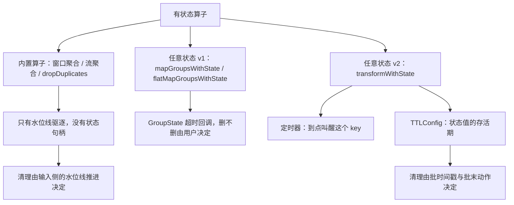
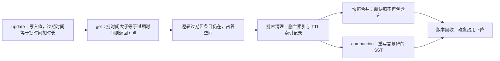
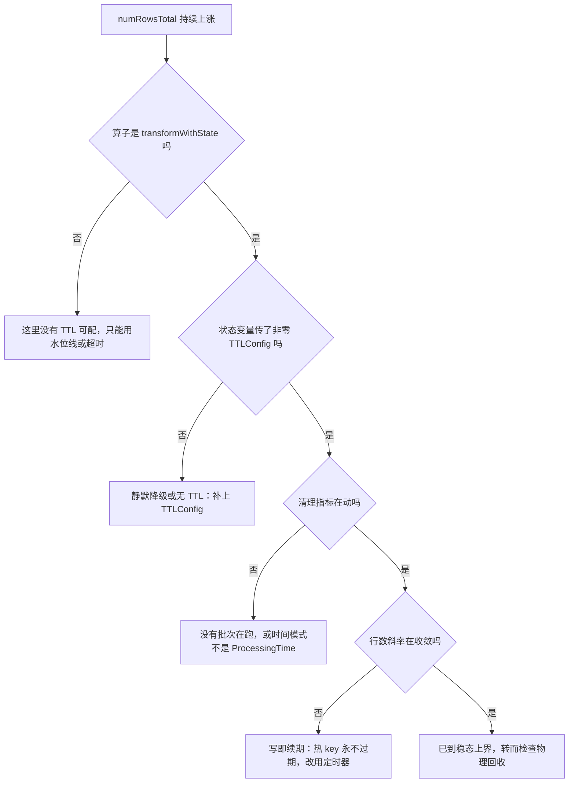
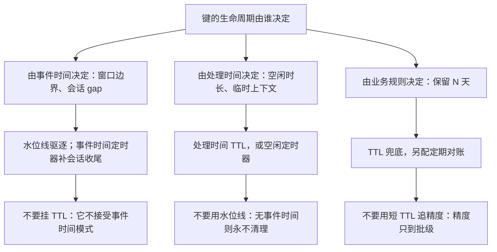

# 08 状态过期与 TTL：让 State Store 不再无限膨胀

**摘要：**

状态过期这件事，最容易出错的地方不在"怎么配"，而在"你以为配上了什么"。Spark 没有统一的状态过期开关，只有四种互不相干的手段：内置算子靠水位线驱逐，v1 任意状态靠超时回调，v2 任意状态靠定时器与状态变量的 TTL，窗口状态则只认水位线。本文只讲第四条，并把另外三条作为边界摆清楚。核心是三种语义：`TTLConfig` 只有存活时长一个字段，时间基准是批时间戳而不是墙钟，续期只发生在写路径上、过期值一律不可见；这三条分别决定了"能配多长""多久判定一次""什么算过期"。清理还要经过逻辑过期、条目删除、快照吸收、版本回收、磁盘重组五段，各段延迟由批间隔与存储后端决定，与 TTL 时长无关。在此基础上给出"配了 TTL 状态还涨"的六个成因——没挂上、时间基准是批时间戳、写即续期、把上界当下降、物理回收滞后、TTL 索引自身占空间——配一张按指标走的排障表，划清 TTL 与窗口清理的边界，并给出标注为示例推算的容量算式与三则反例。

---

## 第 1 章 一个配了 TTL 还在涨的作业

### 1.1 三十行的改动，三个月的观察

笔者的集群每天跑两千个作业，三百个节点，其中一个设备会话作业叫 `dev_session`：从 Kafka 读设备上报，按 `deviceId` 分组，维护一条会话状态（最后活跃时间、本会话事件数、会话开始时间），超过三十分钟没有新上报的会话在超时回调里收尾并输出。作业跑了三年，状态目录常年待在四十 GB 上下，白天涨到五十 GB，凌晨批量清理后落回来，运维早就把它当成一条正常的呼吸曲线。

去年团队决定把 v1 的 `flatMapGroupsWithState` 换成 v2 的 `transformWithState`，理由很正当：v1 的超时回调要自己写 `remove()`，漏一行就是永久泄漏，而 v2 可以在声明状态变量时直接挂一个 `TTLConfig`，看起来是把"记得删"换成了"框架替我删"。改动一共三十几行，上线之后曲线果然平了两周，然后接着往上走，三个月后到了九十二 GB。

于是"TTL 没用"的结论在团队里传开。查下来的答案分三层。第一层，TTL 确实挂上了，算子指标里 `numValueStateWithTTLVars` 等于 1，说明框架认出了这个带 TTL 的状态变量。第二层，`numRowsRemoved` 与 `allRemovalsTimeMs` 长期是 0，说明清理一次都没发生过。第三层才是真因：每台设备每十秒上报一次，每一批都会对它的会话状态调一次 `update()`，而过期时间恰恰是在每次 `update()` 里被重新算成"当前批时间加三十分钟"的——**写即续期**，一条从来没有停止被写的状态，永远不会进入过期区间。

这不是把 TTL 用错了，而是把 TTL 用成了一件它不承诺的事。TTL 承诺的是"过期之后读不到"，不是"写得勤的状态也会过期"。这条界不写清楚，调多大都没用。

### 1.2 先确认"配了"到底配上了什么

在追究"为什么没生效"之前，值得先把"生效"的判据立起来。在生产代码里，所谓"配了 TTL"至少有三种含义不同、现象却一样的状态。

其一，代码里写了 `TTLConfig`，但时长是从配置中心读出来的，配置键没设或设成 0，于是构造出 `TTLConfig(Duration.ZERO)`。框架对这个值的处理是把它当成"不要 TTL"，创建普通状态变量，不报错、不打日志、不产生任何指标差异。这是最隐蔽的一种，代码评审时看起来完全正确。

其二，把 `TTLConfig` 传给了不支持它的算子。`flatMapGroupsWithState` 与 `mapGroupsWithState` 的签名里根本没有这个参数，所以这条路在 Scala 里编译不过；但编译不过之后，常见的补救动作是去 SQL 层找一个全局配置，而后者的名字往往是 `table.exec.state.ttl` 这类来自 Flink 的记忆——Spark SQL 没有这个配置项，也没有任何等价的全局状态过期配置。找不到，于是要么不了了之，要么把水位线当成 TTL 用。

其三，时长与算子都对，但 `timeMode` 是 `EventTime`。这条不会静默失败，`getValueState` 在挂 TTL 之前会校验时间模式，直接抛 `STATEFUL_PROCESSOR_INCORRECT_TIME_MODE_TO_ASSIGN_TTL`，附带状态变量名与当前模式。4.x 的报错信息质量不错，问题只在于很多人是隔着日志平台看到这条异常的，第一反应是"Spark 的 TTL 有问题"。

三种情况的共同点是：从作业的运行现象上看，它们与"TTL 配得太长"完全无法区分。所以后面第 5 章的排障表，第一条判据不是看状态大小，而是看清理指标动没动。

### 1.3 三个问题，与本文的边界

本文只回答三个问题。第一，Spark 的 TTL 究竟保证什么、不保证什么，三个语义维度里哪几个可以调、哪几个被写死了。第二，"过期"从逻辑上成立到磁盘上真正少掉字节，中间要走几段路、各段延迟由谁决定。第三，一个配了 TTL 却仍在膨胀的作业，按什么顺序拆。

其余部分划归别处。State Store 的内存哈希表、增量文件、快照合并这条读写路径，见 [[大数据/Spark/Spark-容错与状态管理深度解析/06 State Store 内幕：HDFSBackedStateStore 的读写路径|06 篇]]；RocksDB 的 LSM Tree、changelog 与本地磁盘布局，见 [[大数据/Spark/Spark-容错与状态管理深度解析/07 RocksDB State Store：为超大状态而生|07 篇]]；水位线的推进与迟到数据语义，见 [[大数据/Spark/Spark-Structured-Streaming流处理深度解析/04 Watermark 全解：事件时间语义与延迟数据处理|Streaming 04 篇]]；窗口状态的键结构、展开与清理时机，见 [[大数据/Spark/Spark-Structured-Streaming流处理深度解析/06 窗口聚合：滚动窗口、滑动窗口与会话窗口的实现机制|Streaming 06 篇]]；v1 任意状态的完整用法见 [[大数据/Spark/Spark-Structured-Streaming流处理深度解析/07 flatMapGroupsWithState：任意有状态逻辑的终极武器|Streaming 07 篇]]；去重的精确保留期语义见 [[大数据/Spark/Spark-Structured-Streaming流处理深度解析/09 dropDuplicates 与精确去重：Exactly-once 的应用层保障|Streaming 09 篇]]。本文不重复这些机制推导，只取它们的结论当常数。

### 1.4 一句话的语义

把上面那条界线压成一句话：**TTL 是一道界，不是一台泵**。它给状态规模划一个有上界的窗口，而不是把已经写进去的字节抽走；它保证窗口之外的数据读不到，不保证窗口之外的数据不占地方；它把清理从"同步释放"降级成"异步追赶"，追赶的速度由批间隔、快照周期和 compaction 共同决定。

记住这句话，后面六个成因几乎都是它的推论。

---

## 第 2 章 Spark 有四种过期，各管一段

### 2.1 水位线驱逐：内置算子的默认答案

窗口聚合、无窗口的流聚合、`dropDuplicates`，这三类算子的状态归引擎直接管理，用户拿不到状态句柄，也就谈不上配 TTL。它们的清理手段只有一个：水位线。

机制上，批末（或 4.3.0 引入的批内摊薄）执行一次驱逐扫描，把事件时间早于水位线的状态行删掉，删除的同时，Append 模式还会把这些行当作"已闭合"的结果输出。**这条路径的开关不在清理侧，而在输入侧**：有没有 `withWatermark`、水位线推不推得动，决定了状态会不会被清。

三个算子对水位线的要求并不一样。窗口聚合在 Append 模式下必须配水位线，否则优化器直接拒绝——没有水位线就无法定义"窗口何时闭合"；在 Update 模式下可以不配，代价是状态永不清理。无窗口流聚合在 Update 模式下同样可以不配，同样永不清理，这也是生产上最常见的一类状态膨胀来源。`dropDuplicates` 的水位线要求更隐蔽：它需要事件时间列出现在去重键里，否则水位线推得再快，驱逐谓词也找不到可以比较的列。

驱逐的成本在 4.x 有一个专门的旋钮：`spark.sql.streaming.statefulOperator.incrementalCleanupFactor`，默认 0，即所有驱逐都在批末一次性做完；设成 k 则每处理一条输入最多删 k 条可驱逐记录，把成本摊进批内，剩下的仍在批末扫尾。这个旋钮只对会驱逐的算子有意义（Append 与 Update 模式下的窗口、聚合、去重），Complete 模式从不驱逐，设了也没用。

### 2.2 v1 的超时：一次回调，删不删由你

`mapGroupsWithState` 与 `flatMapGroupsWithState` 提供的是 `GroupState`，它没有 TTL，只有超时。两种写法：`setTimeoutDuration("30 minutes")` 走处理时间，超时时间戳等于时长加本批的处理时间戳；`setTimeoutTimestamp(ms)` 走事件时间，需要水位线推进到该时间戳之后。

关键在于它叫"超时"而不是"过期"：**超时只负责叫醒，不负责删除**。超时只做一件事：在某个批次里把这个 key 以 `hasTimedOut = true` 回调给你的函数，让你决定收尾动作。删不删状态由你写在回调里。源码里的判定是 `shouldWriteState = isUpdated || isRemoved || hasTimeoutChanged`，也就是说，你既没更新、也没删除、超时时间戳也没变，这一轮就什么都不写，状态原样留在那里。所以 v1 会话作业最经典的泄漏不是忘了设超时，而是超时回调里忘了 `state.remove()`——每一批都回调一次，每一批都不删。

### 2.3 v2 的定时器：事件时间也能叫醒你

`transformWithState` 的状态变量之外，还有一条独立的定时器通路：`registerTimer(expiryTimestampMs)` 登记，"到点"时由框架以 `handleExpiredTimer` 回调。处理时间定时器在微批模式下用批时间戳比较，在实时模式下用执行器时钟；事件时间定时器则由水位线推进触发。

定时器管的是"这个 key 在某个时刻该做一件事"，不是"这条状态什么时候该死"。两者可以配合，但语义不能互相顶替：一个每五分钟被心跳续期的会话，用定时器可以在"五分钟后仍无数据"时删掉它，用 TTL 则会因为续期而永远不触发。这条区分在第 5 章还会再出现一次。

还有一处容易漏掉的归属：Python 侧的 `applyInPandasWithState` 与 Scala 侧的 `mapGroupsWithState` 同属 v1 语义，都是超时回调、都要用户自己删，都没有 TTL 入口。跨语言看代码时，别把"Python 版看起来更简单"当成"Python 版支持 TTL"。

### 2.4 v2 的 TTL：唯一叫"过期"的开关

`transformWithState` 的 `StatefulProcessorHandle` 提供了三种状态变量：`ValueState`、`ListState`、`MapState`。声明时可以多传一个 `TTLConfig`，此后这条状态值在写入时会被附带一个过期时间戳，读取时若已过期则视作不存在，批次结束前统一清理。

官方文档对它的限制写得很直白：TTL can be used only with `TimeMode.ProcessingTime`。也就是说不存在"事件时间 TTL"这种东西，想让过期跟着业务时间走，只能用事件时间定时器，而定时器删的是 key，不是值的生命周期。这一句是后面很多误解的源头。

### 2.5 四者对照

把四种手段放在一起，差别一眼可见。

| 维度 | 水位线驱逐 | v1 GroupState 超时 | v2 定时器 | v2 TTLConfig |
|---|---|---|---|---|
| 作用对象 | 内置算子的状态行 | v1 的 key | v2 的 key | v2 的状态变量 |
| 时间基准 | 事件时间水位线 | 处理时间批时间戳或事件时间戳 | 处理时间或事件时间 | 仅处理时间，批时间戳 |
| 是否自动删 | 是，引擎删 | 否，需用户 `remove()` | 否，回调里自己删 | 是，框架删 |
| 是否需要水位线 | 需要（否则永不清理） | 事件时间超时需要 | 事件时间定时器需要 | 不需要，也不接受事件时间模式 |
| 删除粒度 | 时间边界之前的全部行 | 单个 key | 单个 key 的某个时刻 | 单个状态变量的单个元素 |
| 能否重放一致 | 能（事件时间确定） | 事件时间超时能，处理时间不能 | 事件时间能，处理时间不能 | 不能（处理时间随运行而变） |

表里最后两列值得单独解释。"删除粒度"一列说明这四种手段删的东西根本不是一个量级：水位线删的是"时间边界之前的所有行"，一次能带走几十万个键；v1 超时删的是单个 key 的整条状态；v2 定时器删的是调用方在回调里指定要删什么；TTL 删的是状态变量里的单个元素——`ValueState` 删整条值，`MapState` 删单个 map 键，`ListState` 删单个列表元素。粒度越细，语义越准，成本也越分散。

"能否重放一致"一列则决定了这些手段能不能参与回算。事件时间驱动的清理，给定同一批输入会得到同一批删除，所以重跑可复现；处理时间驱动的清理，过期边界跟着运行时的批时间戳走，换个时间跑一遍，边界就整体平移。这一列在第 8 章还会用到。

四种手段的分工，用一张图看得更清楚。



### 2.6 为什么 Spark 里没有 `table.exec.state.ttl`

从 Flink 迁过来的同学几乎都会问同一个问题：全局的状态 TTL 配置在哪。答案是它不存在，而且这个不存在是有理由的。

Flink 能把 TTL 做成一个 SQL 配置项，是因为它把所有算子的状态抽象成同一套 keyed state，外加一个可以统一注入的 TTL 描述符，于是"给所有状态配一个默认存活期"在实现上只是描述符的默认值。Spark 没有这层统一抽象：窗口聚合的状态由 `StreamingAggregationStateManager` 管，去重的状态是另一套键值布局，v2 的状态变量是第三套、带独立的编码器与列族，v1 的 `GroupState` 是第四套。四套状态的生命周期语义本来就不同，硬给一个统一配置，结果只能是某些算子静默忽略它——那比没有配置更危险。

所以 Spark 的选择是把 TTL **做成 API 而不是配置项**，挂在唯一能表达"每个状态值独立存活期"的那套状态上，其余的交给水位线与超时。理解了这一点，"找不到全局 TTL 配置"就不再是缺失，而是边界。

---

## 第 3 章 TTLConfig 的三个语义维度

### 3.1 维度一：存活时长，与它的时间基准

`TTLConfig` 在 4.x 里是一个只有一个字段的 case class，字段名 `ttlDuration`，类型 `java.time.Duration`。没有更新策略，没有可见性选项，没有最小值约束，也没有"仅在创建时计时"这类开关。所有关于 TTL 的可配空间，就是这一个时长。

但它不是"墙钟上的时长"。判定用的"现在"来自一个函数：微批模式下是本批的批时间戳（写入 checkpoint 提交日志的那个逻辑时刻），实时模式下才是执行器时钟。过期时间的算法是批时间戳加时长，判定的算法是"现在大于等于过期时间"。两处相加比较的都是同一个逻辑时间，由此得到三条推论。

第一条，**TTL 的分辨率等于批间隔**。一个三十分钟的 TTL 配上五分钟的批间隔，状态的实际存活区间是三十分钟到三十五分钟；一个三十秒的 TTL 配上五分钟的批间隔，实际存活是五分钟——因为在两批之间没有"现在"可以越过那三十秒，下一批到来时，判定用的"现在"直接跳到了五分钟之后，于是它过期了。想靠 TTL 做秒级的精确控制，在微批模式下是做不到的。

第二条，批内时间冻结。一个批如果跑了四十分钟，批内所有写入用的"现在"都是批开始的那个时间戳，批内读取的过期判定同样用它。也就是说，一个 TTL 五分钟的状态，在一个长达四十分钟的批里可以被反复读写而始终"未过期"。这听起来荒谬，但它保证了同一批内语义自洽：批内看到的世界是同一个时间点。代价是 TTL 的实际精度还要再叠上批时长。

第三条，批不来，就不判定。TTL 的判定与清理都挂在批次执行上，没有批次就没有"现在"，也没有清理动作。触发器是 `Once` 或 `AvailableNow` 的作业，跑完就停，状态在停止期间当然不会过期；上游断流的作业，只要还有空批次在跑，清理仍会发生，但空批次本身也依赖触发器持续触发。这一条在第 5 章会作为成因二展开。

还有一处与"时间"有关的实现细节：过期时间戳不是存在某个旁路表里，而是存进状态值本身的 schema——带 TTL 的状态变量，值 schema 比不带 TTL 的多一列存放过期戳。这个选择让"读一条状态"与"判断它是否过期"变成一次读取而不是两次，也让带 TTL 与不带 TTL 的状态编码不同。于是有一条恢复侧的注意事项：源码注释明确说 TTL 配置可以在两次运行之间变更，譬如停下作业、把时长从三十分钟改成六十分钟、再恢复，这是被支持的；但"从不带 TTL 换成带 TTL"改变的是值 schema，不属于配置变更，恢复时是否能通过 schema 校验要按当时的报错判断，不能假定平滑——真要这么改，换个 checkpoint 目录重跑一遍，比在恢复路径上试探更省时间。

### 3.2 维度二：续期只在写路径上

三个状态变量的内容只能通过写方法改变：`ValueState` 是 `update()` 与 `clear()`，`MapState` 是 `put()` 与 `remove()`，`ListState` 是整体替换式的写入。每写一次，过期时间就被重新算成"当前批时间加时长"。而读方法 `get()` 只做一件事：取出值，看它是否过期，过期返回 null。它不回写、不续期、不改变任何持久化状态。

由此可以推出 Spark 的 TTL 在续期维度上的固定语义：**只按写续期**，且每次写都重置，不是只在创建时计时。这恰好对应 Flink `StateTtlConfig` 里 `UpdateType.OnCreateAndWrite` 的含义，而 `OnReadAndWrite`——读一次也续期——在 Spark 里没有对应开关。

三种状态变量在续期上的行为一致，过期粒度的实现方式不同。`ValueState` 的每个分组键只有一条过期戳，写一次就覆盖；`MapState` 与 `ListState` 属于一对多结构，分组键下的每个 map 键、每个列表元素各自带自己的过期戳，写入其中一个不影响其他元素的计时。这意味着对 `MapState` 逐键重写一遍（读出来、改一处、再把每个键 `put` 回去）会刷新所有元素的过期时间，而只对改动的键做一次 `put`，其余元素的计时不受影响——写法上的一个选择，直接决定了状态里那些"长期没被单独更新的元素"会不会被清掉。

这个固定语义产生两个方向相反的后果，两个都容易踩。写得勤的 key 永远不会过期：设备心跳、维表缓存刷新、会话活跃更新，只要每批都有一次 `update()`，过期时间就永远在往前滚，状态条目的存活期与业务无关，只与写入频率有关。反过来，只读不写的 key 照常过期：一个被反复查询的维度状态，只要没有新写入，到了时长照样失效。笔者见过一个反例，团队把一张小维表放进了 `MapState` 当本地缓存，认为"查得这么频繁，TTL 应该不会触发"，结果每半小时整张缓存失效一次，打满下游数据库——他们在 Flink 里习惯了读续期。

### 3.3 维度三：过期即不可见，没有第二个选项

`get()` 的实现里有一个明确的判定：取到行之后先解码，再检查是否过期，过期就返回 null。`exists()` 干脆就是 `get() != null`，`getOption()` 则是把 null 包成 None。于是对用户代码来说，**过期即不存在**，两者完全不可区分——没有"读到过期值"这条路。

Flink 在这里给了两个选项：`NeverReturnExpired` 保证过期值绝不可见，`ReturnExpiredIfNotCleanedUp` 则允许在清理之前读到旧值。Spark 只有前者，而且没有开关。

这个设计的好处是语义简单：用户永远不需要担心"读到一条逻辑上已经死了的数据"，写过期判断的业务逻辑不会因为清理滞后而出现分支差异。代价是"不可见"与"已删除"之间的窗口彻底不可观测，你无法从读取侧知道一条状态是"从未存在"还是"过期但还没清"。唯一的观测手段是指标：`numRowsRemoved` 与 `allRemovalsTimeMs` 是否在动。

顺带一个容易混淆的区分：用户代码里主动调 `clear()` 与等待过期是两条不同的删除路径。`clear()` 是即时的，主索引与 TTL 索引同步删，计入 `numRemovedStateRows`；过期删除要等到清理时点，走 TTL 索引的范围扫描，计入 `numValuesRemovedDueToTTLExpiry` 与 `allRemovalsTimeMs`。前者是业务决定，后者是时间决定，两者在指标上是分开的——如果一个作业的删除全都来自 `clear()`，那 TTL 实际上没起过作用。

一条状态条目从写入到字节真正消失，走的是同一条流水线，差别只在每一段的等待时间。

### 3.4 一个旋钮，两条写死的语义

把三个维度摊在表里，与 Flink 的概念逐个对齐，误解的来源就很清楚了。

| 维度 | Flink `StateTtlConfig` 的做法 | Spark 4.x 的对应 | 对运维的影响 |
|---|---|---|---|
| 存活时长 | `newBuilder(Duration)` | `TTLConfig(ttlDuration)`，唯一可配项 | 时长是唯一能调的旋钮 |
| 时间基准 | 仅处理时间 | 仅处理时间，取批时间戳 | 精度受批间隔限制，事件时间不支持 |
| 续期时机 | `OnCreateAndWrite` 或 `OnReadAndWrite` | 固定等同于 `OnCreateAndWrite`，每次写重置 | 热 key 永不过期，只读 key 照常过期 |
| 过期可见性 | `NeverReturnExpired` 或 `ReturnExpiredIfNotCleanedUp` | 固定为前者 | 不会读到过期值，也无法据此判断清理进度 |
| 清理策略 | 惰性、增量、快照、RocksDB 压缩过滤四条 | 批末统一清理，走 TTL 二级索引 | 不存在"配了增量清理却没开"这回事 |

这张表值得反复看。它解释了为什么从 Flink 迁过来的人几乎都会踩同一批坑：他们带着三个旋钮的记忆，来到一个只有一个旋钮、另外两个被焊死的实现前面，然后在"读续期"与"过期可见"这两个方向上都预期错误。

如果你在旧材料里见过 `ttl.incrementalCleanup`、`cleanupIncrement`、`cleanupFullSnapshot`、`cleanupInRocksdbCompactFilter` 这类参数名，那些都是 Flink 侧 `StateTtlConfig` 的清理策略，Spark 侧没有对应项。照抄过来不会有任何效果，唯一的可见后果是配置里多了一行永远不会被读取的键。

三条语义落到一条状态条目上，可以串成一幅生命周期图。



这张图里，只有第一段是用户能通过参数影响的，后三段都由批节奏与存储后端决定。

> [!warning] 三条外来直觉，在 Spark 里都不成立
> 其一，"事件时间 TTL 要靠水位线推进才会清理"——Spark 没有事件时间 TTL，挂了会直接报错。其二，"读操作会续期，所以频繁读的 key 永不过期"——Spark 只按写续期，只读的 key 照常过期。其三，"配了增量清理开关才会清理"——Spark 微批模式没有这个开关，清理固定发生在批末。

### 3.5 正确的挂法

代码层面，TTL 只能挂在 `transformWithState` 的状态变量上，且必须处于 `ProcessingTime` 模式。下面这段是 `dev_session` 改造后的骨架，写法按 Spark 4.3 的 API：`init` 的签名带 `outputMode` 与 `timeMode`，状态变量在 `init` 里声明，`getHandle` 在 `handleInputRows` 里使用。

```scala
import java.time.Duration
import org.apache.spark.sql.Encoders
import org.apache.spark.sql.streaming._

case class SessionState(lastSeen: Long, count: Long, startedAt: Long)

class SessionProcessor(ttl: Duration)
    extends StatefulProcessor[String, (String, Long), (String, Long)] {

  @transient private var session: ValueState[SessionState] = _

  override def init(outputMode: OutputMode, timeMode: TimeMode): Unit = {
    // TTL 只在这个位置声明；时长一旦为零，等于没挂，且不会报错
    session = getHandle.getValueState[SessionState](
      "session",
      Encoders.product[SessionState],
      TTLConfig(ttl))
  }

  override def handleInputRows(
      key: String,
      rows: Iterator[(String, Long)],
      timerValues: TimerValues): Iterator[(String, Long)] = {
    val now = timerValues.getCurrentProcessingTimeInMs()
    val base = if (session.exists()) session.get() else SessionState(0L, 0L, now)
    val next = rows.foldLeft(base) { (s, r) => s.copy(lastSeen = r._2, count = s.count + 1) }
    session.update(next)   // 每写一次，过期时间就被推到 now + ttl
    Iterator((key, next.count))
  }
}
```

调用侧只有一处需要交代：`timeMode` 必须是 `ProcessingTime`，用事件时间那个重载（传 `eventTimeColumnName`）会让算子进入 `EventTime` 模式，随后在 `init` 里挂 TTL 时抛异常。

```scala
val query = events
  .groupByKey(_._1)
  .transformWithState(
    statefulProcessor = new SessionProcessor(Duration.ofMinutes(30)),
    outputMode = OutputMode.Update(),
    timeMode = TimeMode.ProcessingTime())
  .writeStream
  .option("checkpointLocation", "/warehouse/ckpt/dev_session")
  .start()
```

三种常见错法各有不同的失败面。传给 `flatMapGroupsWithState`，编译不过。在 `EventTime` 模式下挂，运行期抛 `STATEFUL_PROCESSOR_INCORRECT_TIME_MODE_TO_ASSIGN_TTL`。时长传零，静默降级成无 TTL 状态——第三种没有任何信号，只有在指标上能看出来。

### 3.6 静默降级：零值与 `NONE`

`TTLConfig` 的工厂里有一个 `TTLConfig.NONE`，语义是零时长。框架在处理状态变量声明时，先看时长是不是零：是零就创建一个普通状态变量，既不建 TTL 索引，也不注册清理，连"带 TTL 的状态变量"那个计数指标都不会加一。整个过程不告警。

这个设计本身没错——零时长当"关闭"用是合理的表达方式，`NONE` 也让代码意图更清楚。但它留下一个运维上的空洞：从配置中心读到 0、从环境变量读到空字符串再 `Duration.ofSeconds` 强转失败后兜底成 0、从上游配置里继承了另一个作业的 0 值，这几种情况都会安安静静地把 TTL 关掉。

负值走的是另一条路：`getValueState` 校验时抛 `STATEFUL_PROCESSOR_TTL_DURATION_MUST_BE_POSITIVE`，附状态变量名。所以"配错了"这件事，只有负值会喊出来，零值不会。

由此得到一条部署前的校验习惯：TTL 时长不要直接由配置值构造，先在应用侧断言大于零，或者显式区分"关闭"与"配错"。把零值当关闭用，就把一个可诊断的错误变成了一个不可诊断的默认行为。

---

## 第 4 章 过期之后：清理走的三条路径

### 4.1 主索引与 TTL 索引

理解了语义，再看清理怎么落地。带 TTL 的状态变量在 Store 里占两处：主索引存"元素键到值加过期时间戳"，一条 TTL 索引存"过期时间戳加元素键到空行"。TTL 索引的键按过期时间做前缀，并用大端编码，目的是让"找出所有已过期的条目"退化成一次范围扫描——从上一批已经清到的位置扫到当前批时间，而不是把整个状态扫一遍。设计上的目标是清理成本与"要删的条目数"成正比，而不是与"总条目数"成正比。

对 `ValueState` 与 `ListState`，一个元素键只有一条 TTL 索引；对 `MapState`，每个 map 内的键都是一个独立元素键，各自有自己的过期时间，于是 TTL 索引的条目数等于 map 内键的总数。这也是第 5 章成因六的伏笔：TTL 索引不是免费的，它按元素数线性放大。

索引的删除同样要走两条记录：删主索引里的元素行，删 TTL 索引里对应的那条。两条记录必须落在同一个批次的提交里，否则崩溃恢复后会出现"主索引没了、索引还在"的孤儿条目，后续扫描会反复撞到它。框架把两处写入放在同一个状态存储事务里，正是为了避免这种半删状态——这也是为什么 TTL 的清理成本不能按"删一条"来估，而是按"删两条"来估。

### 4.2 微批：批末、按分区、在 commit 之前

微批模式下，清理发生在批的收尾阶段：输入处理完、输出迭代器耗尽之后，**先清理、后提交**，再做状态存储的 commit。这个顺序保证了"本批清理产生的删除"与"本批写入的更新"一起提交，崩溃回滚时两者同进同退。

清理是按分区进行的。每个 task 持有自己那一份状态存储实例，各自扫自己的 TTL 索引，所以清理与计算是同一个并行度，不需要额外的 shuffle，也不会有一个中心点成为瓶颈。代价是它只在有数据的 task 里发生：某个分区这一批没有输入，它的清理这一批就不执行。

清理耗时被单独计时，记入 `allRemovalsTimeMs`。源码注释对 `transformWithState` 的这个指标有一句明确的说明：在这个算子里，`allRemovalsTimeMs` 就是"因 TTL 而删除状态"所花的时间，不含用户显式调用 `clear()` 的开销。换言之，想判断 TTL 是否在工作，这个指标比任何日志都直接。

这段清理挂在一个"完成即触发"的收尾动作上，只有当本批的输出被完全消费、迭代器走到头时才会执行。由此派生一个容易被忽略的边界：如果下游写出去失败、或者上游算子提前中止了迭代器，收尾动作不会执行，清理也就不会发生，同时本批的写入随 abort 一起回滚。换句话说，清理与写入共享同一次提交的成败，不存在"写入成功、清理漏掉"的中间态；但也不存在"这一批写失败、清理照样推进"的可能。批失败重跑时，清理会跟着重跑，成本按批重复计一次。

### 4.3 实时模式：按记录推进的清理

实时模式（`Trigger.RealTime`）下没有批的概念，时间基准换成执行器时钟，清理也从"批末一次"变成"随记录推进"。具体做法是每处理一条输入就检查一次距上次清理的时间差，超过阈值才真正执行一次清理。这个阈值是 4.3.0 引入的内部配置 `spark.sql.streaming.realTimeMode.transformWithState.ttlEvictionIntervalMs`，默认 1000 毫秒。

于是清理精度在这个模式下**从批间隔变成了清理间隔**，代价是每记录一次的时钟比较与更频繁的清理扫描。注意这个配置只对实时模式生效，在微批模式下调它没有任何作用——又一处"看起来配了其实不生效"。

两种模式对同一个 TTL 时长的解释也不同。微批模式下，过期边界是批时间戳的整数倍，同一批内的所有写入共享同一个"出生时刻"；实时模式下用的是执行器时钟，边界落在写入发生的真实时刻，分辨率取决于清理间隔。把作业从微批切到实时，或者反过来，同一个时长参数的行为会变，容量模型要跟着重算——这也是 4.3 把清理间隔做成独立配置的原因：实时模式不可能靠批来摊薄清理成本，只能用一个时间阈值控制频率。

### 4.4 物理回收：快照、保留版本、compaction

条目删掉之后，字节并不会立刻从 checkpoint 里消失，这一段延迟由后端决定，两个后端的路径完全不同。

HDFSBacked 后端每批写一个增量文件，删除作为一条删除记录写进本批的增量里；内存哈希表当场少一行，但磁盘上的旧增量文件仍然带着这条数据。积累到 `spark.sql.streaming.stateStore.minDeltasForSnapshot`（默认 10）个增量之后，引擎合并出一个新快照，合并过程相当于把基准快照与增量重放一遍，被删的键不会再写进新快照——从这一刻起，"checkpoint 里没有这条数据"才成立。再往后，旧版本的增量与旧快照要等到超过 `spark.sql.streaming.minBatchesToRetain`（默认 100 批）才可回收，所以"目录占用下降"还要再等一轮。

RocksDB 后端的路径更长。删除写进去是一条墓碑记录，SST 文件本身是不可变的，不会因为逻辑删除而变小；checkpoint 上传的是每个版本的 zip，里面记录元数据加一份"本版本引用了哪些不可变 SST"的清单，相邻版本之间共享这些 SST 文件。只要某个 SST 还被某个保留版本引用，它就不能删；只有当 compaction 把包含墓碑的 SST 与下层文件重写之后，旧文件才会退出引用集，最终被清掉。压缩什么时候发生，由文件大小、层数与后台调度决定，与 TTL 时长没有关系。这部分机制见 [[大数据/Spark/Spark-容错与状态管理深度解析/07 RocksDB State Store：为超大状态而生|07 篇]]，此处只取结论。

### 4.5 延迟链

把这几段延迟串起来，就得到一条从"逻辑过期"到"磁盘少字节"的链路，每一段有各自的触发条件。

| 阶段 | 从什么变成什么 | 触发条件 | 延迟量级（示例推算） |
|---|---|---|---|
| 逻辑过期 | 仍可读，变成读不到 | 判定用的"现在"越过过期时间 | 0 到一个批间隔 |
| 条目删除 | 行还在，变成行被删 | 批末清理，或实时模式清理间隔 | 一个批时长，或 1 秒级 |
| 快照吸收 | 增量里还有，变成快照里没有 | 累计 10 个增量后合并快照 | 约 10 个批间隔 |
| 版本回收 | 旧版本还在，变成目录里没有 | 超过 100 批保留窗口 | 约 100 个批间隔 |
| 磁盘回收（RocksDB） | SST 里还有墓碑，变成文件被重写 | compaction 扫到该文件 | 小时到天级，取决于数据量与层数 |

这张表的用法很直接：如果有人问"TTL 配好了，磁盘什么时候降"，答案不在 TTL 上，而在这五段里，且后两段的等待时间往往是批间隔的一百倍。

两个后端在"怎么观测"上也有差别。HDFSBacked 的目录是明文可数的，`state` 子目录下每个版本一个目录，里面是快照与增量文件，文件数与时长的关系一眼可见，磁盘占用用 `hdfs dfs -du` 就能按月看趋势。RocksDB 的目录是"共享的不可变 SST 加每版本一个 zip"，单个文件的大小与版本无关，看到的是引用集合的变化，光看目录大小很难判断是"数据没删"还是"文件被共享着"，得配合行数指标一起读。这也是第 5 章成因五的判据要分后端写的原因。

这条链路的形状如下图，两处分叉分别对应两个后端各自的回收路径。


### 4.6 五个参数的代价

把与 TTL、清理、回收相关的参数放在一张表里，各自的默认值与"调大调小换来什么"就一目了然。

| 参数 | 默认值 | 作用对象 | 调大的代价 | 调小的代价 |
|---|---|---|---|---|
| `TTLConfig(ttlDuration)` | 无默认，必须显式传 | `transformWithState` 的状态变量 | 稳态条数线性上升，过期判定更宽松 | 可能早于业务生命周期删数据，索引开销占比上升 |
| `spark.sql.streaming.realTimeMode.transformWithState.ttlEvictionIntervalMs` | 1000 毫秒，4.3.0 起 | 仅实时模式的 TTL 清理 | 清理更稀疏，状态峰值更高，单条开销更低 | 清理更频繁，单条开销上升 |
| `spark.sql.streaming.statefulOperator.incrementalCleanupFactor` | 0，4.3.0 起 | 水位线驱逐类算子，不含 TTL | 批内摊薄，批尾尖峰变小，但可能保留更多状态 | 回到批末集中清理，批尾耗时出现尖峰 |
| `spark.sql.streaming.stateStore.minDeltasForSnapshot` | 10 | HDFSBacked 的快照合并 | 快照更晚，恢复更慢，体积下降更迟 | 快照更频繁，合并写放大 |
| `spark.sql.streaming.minBatchesToRetain` | 100 | 整个 checkpoint 的版本保留 | 目录占用更高，回滚余地更大 | 恢复窗口变窄，旧版本更早消失 |

表里第二、三行的配置都是 4.3.0 才引入的：前者说明实时模式的清理需要一个独立的时间阈值，后者说明批内摊薄是后来才补上的能力。查资料要看年份，几年前"状态清理只有批末一次性扫描"的结论，在今天的实时模式下已经不成立。

---

## 第 5 章 "配了 TTL 还涨"的六个成因

六个成因按排查成本从低到高排列：前四个偏语义与预期，后两个偏物理与成本。每一条都给症状、机制与处置。

### 5.1 成因一：TTL 没挂上

症状是 `numValueStateWithTTLVars` 这类计数指标为 0，或者根本不存在这个指标；`numRowsRemoved` 恒为 0。

机制有三种。其一，时长为零，静默降级成无 TTL 状态。其二，挂在了没有 TTL 能力的算子上——窗口聚合、流聚合、去重、v1 任意状态都属于这一类，它们的状态没有 TTL 入口，能调的只有水位线与超时。其三，`timeMode` 是事件时间，挂 TTL 时直接抛异常。

处置：先用指标确认"带 TTL 的状态变量数量"，再确认"清理是否发生过"。这两个数都不动，就不要往下调时长，先回去看声明位置。

### 5.2 成因二：时间基准是批时间戳

症状是 TTL 时长设得很短，状态规模却按批间隔的粒度在变化，`numRowsRemoved` 每隔若干批才跳一次，且跳变的时间点与批时间戳对齐。

机制在于第 3 章讲过的两点：判定用的"现在"是批时间戳，批内冻结；没有批次不判定。于是 TTL 的实际保留期是"时长上取整到批间隔"，最坏情况下等于时长加一个批间隔，而清理动作的粒度就是一个批。

这个成因有一个很容易误判的变体：作业因为上游积压，批间隔从一分钟变成十分钟，TTL 的实际保留期跟着变成原来的十倍，状态规模随之翻倍，运维看到的却是"TTL 时长没改，为什么反而不灵了"。批间隔是 TTL 事实上的第二参数，改触发器、改资源、改上游分区数，都会间接改它。

处置：把 TTL 时长按"批间隔的整数倍"规划，并在监控里把批间隔与 TTL 时长放在一张图上；如果业务要求清理精度在分钟以内，考虑实时模式而不是继续压缩时长。

### 5.3 成因三：写就续期

症状是 `numRowsUpdated` 与 `numRowsTotal` 高度相关，清理指标偶尔动一下但对总量没有影响；把 TTL 从三十分钟改到五分钟，几乎看不到曲线变化。

机制是 `update()` 每次都重置过期时间。对"每批都有更新"的 key，过期时间永远在未来，**TTL 等价于无穷**。第 1 章的 `dev_session` 就是这一类：心跳频率十秒，TTL 三十分钟，心跳每十秒把过期时间往后推三十分钟，一天推八千多次。

处置有两条路。一条是改变"写"的判定：只有当业务上真正算一次活动时才 `update()`，心跳只更新定时器不更新状态值——但要注意这么做的前提是状态里确实不需要记心跳时间。另一条是换成定时器：`registerTimer(now + idle)`，每次有数据就重设定时器，到点仍未续期则在 `handleExpiredTimer` 里 `clear()`。定时器的语义是"空闲到期"，TTL 的语义是"无人问津到期"，两者的差别就在"有没有写"。

诊断上有一个可直接代入的算式：`numRowsUpdated` 每批的读数如果等于或接近 `numRowsTotal`，说明几乎每条状态每批都在被写，TTL 对这批 key 等价于无穷；反过来，如果 `numRowsUpdated` 远小于 `numRowsTotal` 却仍看不到清理，问题就不在续期，回去看成因一与成因二。这个比值描述的是写入模式，比时长设置更能说明问题。

> [!info] 一条判据
> 如果一条状态的更新频率高于 TTL 的倒数，TTL 对它就等于不存在。判断方法很简单：用 TTL 时长除以批间隔，得到"多少个批次不写才算过期"，再看业务上这个 key 的写入间隔是否可能大于它。

### 5.4 成因四：TTL 给的是上界，不是下降

症状是 TTL 生效、清理在动、`numRowsRemoved` 每批都有，但 `numRowsTotal` 仍然在涨，只是斜率比之前小。

这条常被当成"没生效"，其实它是生效之后的正确形状。TTL 把"随时间无限增长"改成"随时间收敛到稳态"，稳态规模约等于"一个保留期内新出现的 key 数"，收敛之前的曲线仍然向上。一个每天新增一千万个 key 的去重状态，配七天 TTL，稳态就是七千万条；从零开始跑到稳态需要七天，这七天里曲线一直在涨，涨到第七天之后才走平。

判断要看斜率而不是绝对值。把 `numRowsTotal` 按天取差分：如果差分在衰减并最终稳定在一个正值，说明正在收敛；如果差分恒定不变，说明 TTL 根本没作用于新增的这部分 key——回去看成因一与成因三。

处置：容量规划按稳态算，不按当前值算。稳态公式与算例放在第 7 章。

### 5.5 成因五：物理回收滞后

症状是内存指标与行数都降了，checkpoint 目录的占用不降，或者降得很晚；RocksDB 后端的本地磁盘占用几乎不降。

机制是第 4 章那条延迟链：HDFSBacked 要等快照合并才把被删的键从快照里抹掉，要等超过保留批次数才回收旧版本；RocksDB 要等 compaction 重写包含墓碑的 SST，而 compaction 的触发与 TTL 无关。这段滞后在不同后端之间可能差一个数量级。

这里要纠正一个从 Flink 带过来的排查方向：Spark 没有为 TTL 装 RocksDB 的压缩过滤器，也就不存在"压缩过滤器没触发"这回事。删除一旦写进去就成了墓碑，谁把它扫出来、什么时候重写文件，全由常规 compaction 决定。所以在这个后端上问"为什么磁盘不降"，等价于问"包含这些墓碑的文件还没被 compaction 覆盖到吧"。另外，旧材料里"TTL 只清内存、不清 checkpoint"的说法，在 TTL 这套实现里也不成立：删除与写入走同一个状态存储提交，问题只在物理文件回收滞后，不在"没写进 checkpoint"。

处置：**体积下降是存储侧的函数**，不是 TTL 的函数，应把预期挂在快照周期与 compaction 上。真要快速收缩，动作在存储侧：调小快照间隔（代价是更频繁的合并写）、调小保留批次数（代价是恢复窗口变窄）、对 RocksDB 触发一次 compaction（代价是一次显著的 IO 与 CPU 峰值）。

### 5.6 成因六：TTL 本身要占存储

症状是"改小 TTL 之后状态反而变大了"，或者一开始配 TTL 就比不配更大。

机制有两处。主索引的每一行要多存一个八字节的过期时间戳，值的 schema 也因此多一列。TTL 索引要为每个元素键再写一条记录，键是"过期时间戳加元素键"。对一个键长十六字节、值八字节的 `ValueState`，不配 TTL 时每条大约是键加值加行开销，配了 TTL 之后要再加上八字节的过期戳与一整条 TTL 索引记录，条目字节数接近翻倍（量级判断）。对 `MapState`，放大系数按 map 内键的总数走，短 TTL 加长键的组合最不划算。

处置：把 TTL 索引的开销算进容量模型；对"值很小、键很长、元素很多"的状态，短 TTL 未必是净收益，可以改用定时器按 key 整条删除，让它复用主索引的删除路径。

### 5.7 排障次序

六个成因的判断顺序，可以按指标走成一条链。

| 现象 | 先看什么指标 | 指向成因 | 处置动作 |
|---|---|---|---|
| 行数一直涨，清理指标为 0 | 带 TTL 的状态变量计数、`numRowsRemoved` | 成因一 | 检查声明位置、时长是否为零、时间模式 |
| 清理偶尔跳变，行数仍在涨 | `allRemovalsTimeMs` 的跳变周期、批间隔 | 成因二 | 按批间隔规划时长，或改用实时模式 |
| 更新行数与总行数同涨 | `numRowsUpdated` 与 `numRowsTotal` 的相关性 | 成因三 | 改为空闲定时器，或停止无意义更新 |
| 行数斜率在衰减 | `numRowsTotal` 按天差分的趋势 | 成因四 | 按稳态做容量规划，不必调 TTL |
| 行数降、目录不降 | checkpoint 目录里 state 子目录的大小随时间 | 成因五 | 调快照间隔与保留批次，RocksDB 触发 compaction |
| 行数不降反升 | 单个状态变量的平均字节数 | 成因六 | 评估 TTL 索引开销，改用定时器删 key |

表里的指标都出自 `StateOperatorProgress`，采集方式是把一个 `StreamingQueryListener` 挂在 `spark.streams` 上，在 `onQueryProgress` 里遍历 `progress.stateOperators`，把 `numRowsTotal`、`numRowsUpdated`、`numRowsRemoved`、`allRemovalsTimeMs` 与 `customMetrics` 里的 TTL 相关项一起打到监控系统。四个基础字段的语义多年未变，改动主要发生在自定义指标的名字上——所以排障逻辑可以复用，指标名要以对应版本的算子输出为准。

再补一条顺序上的提醒。六个成因里有三个会表现为"行数还在涨"，如果一开始就按"调小 TTL"处理，等于在没确诊的情况下改了最不容易回滚的参数——TTL 一改，过期边界整体前移，已删的数据不会回来。正确的顺序是先读指标确认 TTL 在工作，再判断形状属于收敛还是发散，最后才动时长。

把这套顺序画成判据树，前四个问题就能区分出六个成因里的大部分。



---

## 第 6 章 TTL 与窗口的边界

### 6.1 窗口状态由水位线管

窗口状态的生命周期不归 TTL，归水位线。一个 `[11:00, 12:00)` 的窗口，在 Append 模式下要等水位线越过 12:00 才闭合输出并从状态里删除；Update 模式下窗口开着的时候每批都要输出增量，水位线越过之后同样会清理，只是不额外输出"最终结果"这个动作。会话窗口按 gap 决定边界，清理条件同样由水位线表达。

这条路径的精细机制——键的 schema、展开、批末驱逐、逐条扫描的成本——在 [[大数据/Spark/Spark-Structured-Streaming流处理深度解析/06 窗口聚合：滚动窗口、滑动窗口与会话窗口的实现机制|Streaming 06 篇]] 里已经拆过，这里只取两个结论：窗口状态必须靠水位线推进才能清，水位线不推，窗口就永远开着；驱逐在批末完成，4.3.0 起可以用增量清理因子把它摊到批内。

会话窗口值得单独说一句，因为它看起来最像 TTL。会话窗口的边界由数据间的 gap 决定，一个会话在"超过 gap 没有新数据"时闭合——形式上和"空闲三十分钟就过期"几乎一样。差别在于 gap 是事件时间上的度量，比较的是数据里的时间戳；TTL 是处理时间上的度量，比较的是批时间戳。于是同一句"三十分钟没有新数据"，在会话窗口里是业务语义（这通会话结束了），在 TTL 里是运维语义（这条状态占着内存太久）。回放一段历史数据时，会话窗口会按历史时间轴重新闭合，TTL 则会按当前的批时间戳批量判定——一个可复现，一个不可复现。用 TTL 冒充会话窗口，第一次重算就会暴露。

### 6.2 TTL 为什么碰不到窗口

原因很朴素：窗口聚合的状态不是 `transformWithState` 的状态变量。它是引擎内部的聚合状态，用户拿不到句柄，也就无法在声明处挂 `TTLConfig`；SQL 层也没有任何全局状态过期配置可以覆盖它。所以"给窗口配 TTL"这件事，在 Spark 里**连表达都表达不出来**。

这一点与 Flink 形成了鲜明对照：Flink 所有算子共用一套 keyed state 抽象，TTL 描述符可以挂在任意状态描述符上，于是"给状态配一个统一保留期"至少是可表达的。Spark 里没有这层统一抽象，窗口状态与 v2 状态变量是两套完全不同的东西，只能选其一，谈不上叠加。

### 6.3 两种混用的错法

第一种是把窗口键搬进 `transformWithState`，再挂 TTL。写法上可行：按 `window` 列分组，每个窗口是一个 key，状态里存该窗口的累加值，挂一个 TTL。但它把一个事件时间语义换成了处理时间语义，于是出现两种错法。TTL 短于"水位线闭合所需的时间"，窗口会被提前删掉，同窗口的迟到数据到来时会创建一个新窗口、输出第二次结果，聚合值偏低；TTL 长于闭合时间，窗口关闭后状态还留着，白占内存，遇到回放还会把旧窗口的值续上。

第二种是给窗口聚合"补一个 TTL"来兜底。没有入口，于是有人改成无窗口聚合加自己算时间分桶，再由应用层处理过期；这实际上是把窗口机制重新实现了一遍，既丢掉了引擎对迟到数据的处理，也丢掉了输出模式的保证。

### 6.4 判据：键的生命周期由谁决定

选哪种清理，取决于这个键的生命周期由谁定义。

| 键的生命周期由谁决定 | 典型场景 | 该用的机制 | 用错的后果 |
|---|---|---|---|
| 事件时间：窗口边界、会话 gap | 小时级聚合、会话分析 | 水位线驱逐 | 用 TTL 会早删或晚删，结果不可复现 |
| 处理时间：空闲时长 | 设备心跳、在线状态、临时上下文 | 处理时间 TTL 或处理时间定时器 | 用水位线则永不清理（上游无事件时间） |
| 业务规则：保留 N 天 | 去重记录、幂等标记、缓存 | TTL 兜底加定期对账 | 与水位线混用会随延迟波动 |
| 三者叠加 | 既要按事件时间闭合，又要按处理时间兜底 | 先水位线，再用大于最大事件时间跨度的 TTL 兜底 | TTL 小于水位线宽限，正常数据被误删 |

最后一行是唯一允许"两者叠加"的情形，但方向必须对：水位线是主语义，TTL 只是防止水位线停滞时的无限增长，所以 TTL 必须显著大于"水位线宽限加最大乱序跨度"，否则它会在正常数据还在路上的时候就开始删。

把这张判据表画成一条选择路径，落到具体查询时就只剩两个问题要回答：这个键的边界是数据给的，还是运维给的。



---

## 第 7 章 量化：TTL 与状态规模的关系

### 7.1 三个乘数

稳态状态规模由三个量相乘：单位时间新写入的键数、保留期、每条键的字节数。写成式子就是"稳态条数约等于写入速率乘以保留期"，再乘一个回收滞后系数得到磁盘占用。滞后系数在 HDFSBacked 上主要来自快照与保留批次，在 RocksDB 上主要来自 compaction 与共享 SST 的引用，量级判断在 1.3 到 2 之间（示例推算，取决于写入量与批间隔）。

三个乘数里，只有保留期是可配的；写入速率来自业务与 key 设计；每条字节数来自状态类型、键长度与是否带 TTL。把三者分开看，就能解释为什么"调 TTL"经常是最无效的那个动作——如果写入速率本身在涨，调小保留期只是把稳态压低了，斜率照旧。

滞后系数值得再拆一层，因为它经常是"算出来的容量与实际不符"的原因。HDFSBacked 上的滞后来自两部分：最多 `minDeltasForSnapshot` 个增量里还带着已删数据，加上最多 `minBatchesToRetain` 批的旧版本尚未回收；这两部分都以批为单位，所以批间隔越长，折算成时间的滞后越久，按字节折算则取决于批的写入量。RocksDB 上的滞后来自两处：墓碑仍占着 SST 的空间，以及被引用的不可变文件在版本退出引用集之前不能删。两者叠加之后，磁盘占用在行数已经稳定之后还会继续涨一段时间，这段"行数走平、磁盘还在涨"的窗口，正是最容易误判成"TTL 失效"的时候。

### 7.2 一个算例

把 `dev_session` 的量级代入，看看两种参数下的差别（全部为示例推算，只用于说明数量级）。

设备总数一百二十万，同时在线约六十万，上报间隔十秒。假设每条会话状态的键是十六字节的设备号，值是三个长整型共二十四字节，带 TTL 时另加八字节过期戳与一条 TTL 索引记录（约十六字节键加八字节过期戳）。下表里的字数是序列化后的估算，不含 JVM 对象头与哈希表的额外开销，真实堆占用要再乘一个一点五到两倍的系数（量级判断）。

| 参数 | 稳态条数 | 每条字节 | 序列化量级 | 特点 |
|---|---|---|---|---|
| TTL 三十分钟，每批更新 | 约六十万 | 约 90 字节 | 约 54 MB | 实际不死：每十秒被续期一次 |
| 改用空闲定时器三十分钟 | 约六十万 | 约 90 字节 | 约 54 MB | 空闲设备会真删，规模随在线数波动 |
| TTL 三十分钟，仅活动时更新 | 约六十万 | 约 90 字节 | 约 54 MB | 与上一行等价，但依赖业务判定准确 |
| 无 TTL，历史全留 | 随运行时间线性增长 | 约 90 字节 | 三个月后按亿级计 | 就是第 1 章那个九十二 GB 的形状 |

这张表想说的不是"哪种更好"，而是"TTL 与定时器在条数上可能完全等价，差别在'什么时候算过期'"。设备场景里，真正决定规模的是在线设备数，不是 TTL 长短——因为只要设备在线，它每十秒就写一次。

表里前两行条数一样，成本却不一样。TTL 的写入路径要为每条状态多写一条索引记录，定时器方案则要维护定时器的登记表，两者都在写入侧加成本，但方向不同：TTL 的成本随"状态元素数"线性增长，定时器的成本随"每次登记与取消的次数"增长。对高频续期的场景，定时器要不停地删旧登记、建新登记，反而比 TTL 更贵；对低频更新的场景，定时器只在状态真正该消失时动一次，比 TTL 的索引便宜。

### 7.3 保留期的三个区间

保留期取多少，可以按三个区间来想。

短于批间隔的保留期没有意义。判定精度就是批间隔，设一个三十秒的 TTL 配五分钟的批，实际行为等价于五分钟 TTL，只是徒增误解。

在批间隔到业务容忍度之间的保留期是有效的，但会抖动。抖动幅度约等于一个批间隔，业务侧如果要拿状态规模做容量告警，阈值必须把这段抖动留出来。

大于业务需要的保留期等于没配。它仍然买到一个上界，这个上界可能远大于实际需要，问题只在于它的成本要在稳态到达之后才显现，容易被误判成"没问题"。

### 7.4 checkpoint 为什么不同步

最后把体积这件事说透。TTL 到期之后，checkpoint 目录不会立刻变小，原因不止一个：被删的条目还在旧增量文件里、旧快照里、被共享的 SST 里；这些文件的回收又分别被快照间隔、保留批次数与 compaction 调度卡住。所以"TTL 生效"与"checkpoint 变小"之间隔着一条由存储后端决定的管道，两者的时间常数可以差两个数量级。

运维上正确的做法是**把两件事分开监控**：行数与清理耗时看 TTL 是否工作，目录大小与文件数看物理回收是否跟上。把它们混成一条告警，得到的结论只会是"TTL 没用"。

---

## 第 8 章 反例三则

### 8.1 以为 TTL 能立刻省空间

某团队给一个高基数的去重状态加了七天 TTL，第二天看 checkpoint 目录没降，判断"TTL 不生效"，回滚了改动。实际情况是：行数在 TTL 到期后确实开始下降，但快照要再等十个批次才合并，旧版本要等一百批才回收，RocksDB 的 SST 要等 compaction。他们在一周后重新上线同一个改动，这次没有回滚，因为这次有人先去看了行数指标。

这个反例的形状是"用错误的指标验证正确的改动"。验证 TTL 该看 `numRowsRemoved` 与 `allRemovalsTimeMs`，验证物理回收该看目录与文件数，两件事的验收时间点不一样。

### 8.2 以为事件时间 TTL 靠水位线推进

某团队从 Flink 迁过来，习惯性地在 `TimeMode.EventTime` 模式下挂 TTL，认为"水位线推一推，状态自然就过期了"。第一次运行就抛异常，随后他们把 TTL 去掉，改成依赖水位线，并把水位线宽限设得很短，结果迟到数据被大量丢弃，窗口结果偏低。

这个反例里叠了两个误解。其一，Spark 没有事件时间 TTL，挂了直接报错，报错本身是好事。其二，在 `EventTime` 模式下，水位线负责的是驱动事件时间定时器、丢弃超过宽限的迟到行，它不会清理状态变量——状态变量的清理仍然只有定时器与 TTL 两条路，而 TTL 不接受事件时间模式。于是这个模式下想清状态，只剩事件时间定时器一条路。

### 8.3 用 TTL 兜业务保留期

最隐蔽的一类。业务要求"去重记录保留七天"，团队用 TTL 七天实现，语义上看起来等价。但 TTL 的时间基准是处理时间，它保证的是"最近七天的处理时间里被写过的状态还在"，不是"事件时间上最近七天的记录还在"。于是在两种情形下会露馅：补数据重跑时，新的运行有自己的批时间戳，同一条记录可能落在过期边界的不同一侧，两次运行的结果对不上；停跑两天再恢复时，这两天里没有批次，状态既不会被判定也不会被清理，恢复后的第一批把积压的判定一次性补上，删除全部集中在一个批次里完成，那一个批的清理耗时会出现尖峰。

这不算 bug，而是处理时间语义的固有代价。要用 TTL 做业务保留期，前提是业务能接受"保留期按处理进度算，不按事件时间算"；不能接受时，正确的做法是把保留期编码进事件时间语义里，用水位线或显式的时间戳判断，而不是指望 TTL。

---

## 第 9 章 落点

回到第 1 章那个九十二 GB 的作业。它的错不在 TTL 这个机制，而在把一个"空闲到期"的语义套在了一条"持续活跃"的键上。设备每十秒上报一次，会话从来不空闲，TTL 每次写入都把过期时间推到三十分钟之后，于是这条状态的寿命与业务无关，只与心跳频率有关。换成空闲定时器之后，同一个三十分钟参数就真的生效了。

由此得到三条判据，都不复杂。TTL 只能配在 `transformWithState` 的状态变量上，别的地方要么没有这个入口，要么直接报错，找不到全局配置不是缺失而是边界。TTL 的时间分辨率是批间隔，它给的是上界而不是下降，所以容量规划要按"写入速率乘保留期"算稳态，而不是按"配了 TTL 就会小"做预期。要判断它有没有工作，看清理指标而不是目录大小；要判断体积什么时候降，看快照与 compaction 而不是 TTL。

最后落在权衡上。水位线换的是事件时间上的完整性，代价是上游一停滞状态就无限长；TTL 换的是规模上的有界性，代价是过期边界跟着处理进度走、不可确定性复现；定时器换的是语义上的精确，代价是要自己写删除逻辑。三者不是替代关系，是**三种不同的答案**——回答的是同一个问题：什么时候可以安全地忘掉一条数据。选哪一种，取决于这个键的生命周期究竟由谁定义。

---

## 参考资料

1. Apache Spark 4.3.0 文档：Structured Streaming Programming Guide，transformWithState 一节，含"TTL can be used only with `TimeMode.ProcessingTime`"与 TTL 声明方式的原文。[https://spark.apache.org/docs/latest/streaming/structured-streaming-transform-with-state.html](https://spark.apache.org/docs/latest/streaming/structured-streaming-transform-with-state.html)
2. Apache Spark 4.3.0 源码：`org.apache.spark.sql.streaming.TTLConfig`，仅含 `ttlDuration` 一个字段与 `NONE` 工厂。[https://github.com/apache/spark/blob/master/sql/api/src/main/scala/org/apache/spark/sql/streaming/TTLConfig.scala](https://github.com/apache/spark/blob/master/sql/api/src/main/scala/org/apache/spark/sql/streaming/TTLConfig.scala)
3. Apache Spark 4.3.0 源码：`TTLState` 与 `OneToOneTTLState`，TTL 二级索引的布局、范围扫描清理与"清理成本与待删条目成正比"的设计注释。[https://github.com/apache/spark/blob/master/sql/core/src/main/scala/org/apache/spark/sql/execution/streaming/operators/stateful/transformwithstate/ttl/TTLState.scala](https://github.com/apache/spark/blob/master/sql/core/src/main/scala/org/apache/spark/sql/execution/streaming/operators/stateful/transformwithstate/ttl/TTLState.scala)
4. Apache Spark 4.3.0 源码：`ValueStateImplWithTTL`，写入时计算过期时间、读取时判定过期并返回 null 的读路径。[https://github.com/apache/spark/blob/master/sql/core/src/main/scala/org/apache/spark/sql/execution/streaming/operators/stateful/transformwithstate/ttl/ValueStateImplWithTTL.scala](https://github.com/apache/spark/blob/master/sql/core/src/main/scala/org/apache/spark/sql/execution/streaming/operators/stateful/transformwithstate/ttl/ValueStateImplWithTTL.scala)
5. Apache Spark 4.3.0 源码：`StatefulProcessorHandleImpl`，`validateTTLConfig` 对时间模式与正时长的校验、`doTtlCleanup` 的调用路径。[https://github.com/apache/spark/blob/master/sql/core/src/main/scala/org/apache/spark/sql/execution/streaming/operators/stateful/transformwithstate/statefulprocessor/StatefulProcessorHandleImpl.scala](https://github.com/apache/spark/blob/master/sql/core/src/main/scala/org/apache/spark/sql/execution/streaming/operators/stateful/transformwithstate/statefulprocessor/StatefulProcessorHandleImpl.scala)
6. Apache Spark 4.3.0 源码：`TransformWithStateExec`，批末 TTL 清理与 `allRemovalsTimeMs` 的语义注释、实时模式按记录推进的清理。[https://github.com/apache/spark/blob/master/sql/core/src/main/scala/org/apache/spark/sql/execution/streaming/operators/stateful/transformwithstate/TransformWithStateExec.scala](https://github.com/apache/spark/blob/master/sql/core/src/main/scala/org/apache/spark/sql/execution/streaming/operators/stateful/transformwithstate/TransformWithStateExec.scala)
7. Apache Spark 4.3.0 源码：`SQLConf`，`spark.sql.streaming.realTimeMode.transformWithState.ttlEvictionIntervalMs`（4.3.0，默认 1000 毫秒）、`spark.sql.streaming.statefulOperator.incrementalCleanupFactor`（4.3.0，默认 0）、`minDeltasForSnapshot`、`minBatchesToRetain`。[https://github.com/apache/spark/blob/master/sql/catalyst/src/main/scala/org/apache/spark/sql/internal/SQLConf.scala](https://github.com/apache/spark/blob/master/sql/catalyst/src/main/scala/org/apache/spark/sql/internal/SQLConf.scala)
8. Apache Spark 4.3.0 源码：`RocksDBFileManager`，不可变 SST 文件的跨版本共享与仅相邻版本可复用的约束。[https://github.com/apache/spark/blob/master/sql/core/src/main/scala/org/apache/spark/sql/execution/streaming/state/RocksDBFileManager.scala](https://github.com/apache/spark/blob/master/sql/core/src/main/scala/org/apache/spark/sql/execution/streaming/state/RocksDBFileManager.scala)
9. Apache Spark JIRA：SPARK-47558，transformWithState 的 ValueState TTL 支持，含"过期值不再从 get 返回、在微批结束时清理"的设计说明。[https://issues.apache.org/jira/browse/SPARK-47558](https://issues.apache.org/jira/browse/SPARK-47558)

---

> [!note] 思考题
> 1. 第 5 章的六个成因里，哪一个可以通过单个指标在十分钟内排除，哪一个必须等一到两周才能确认？这个差别对告警设计意味着什么？
> 2. TTL 的时间基准是批时间戳，因此批间隔是它事实上的第二参数。如果上游流量有日内周期，批间隔随之波动，保留期也跟着变，业务侧该如何把这件事讲清楚？
> 3. 设备心跳这类"持续活跃"的键，用空闲定时器替代 TTL 之后，删除责任从框架回到了业务代码。这个转移在团队协作与测试上分别带来什么成本？
> 4. 如果要求"重跑结果与首跑完全一致"，处理时间 TTL 可以用在哪些指标上、不能用在哪些指标上？请按"是否参与最终结果"分组。
> 5. TTL 索引把清理成本从"总条目数"降到"待删条目数"，代价是写入侧多一条索引记录。在高基数、短 TTL 的场景下，这笔账在什么条件下会反过来？
