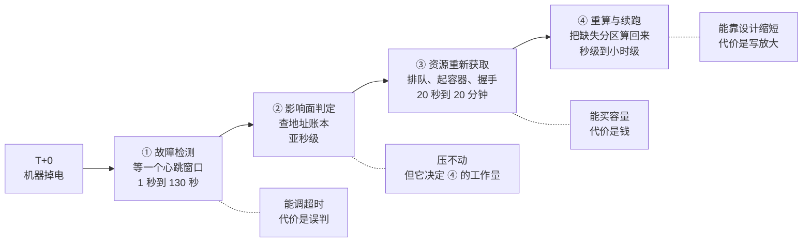
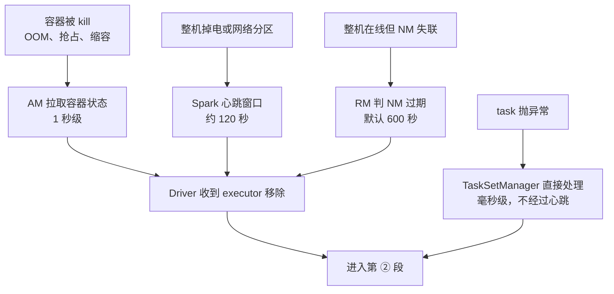
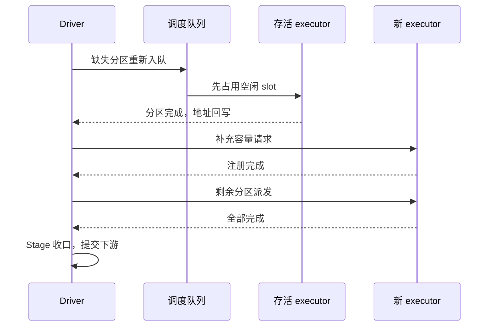
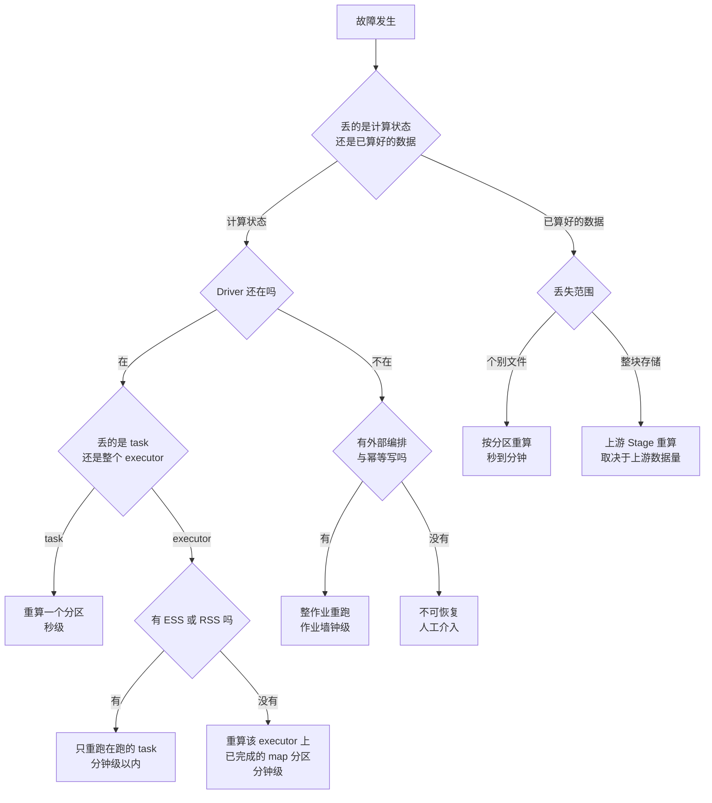
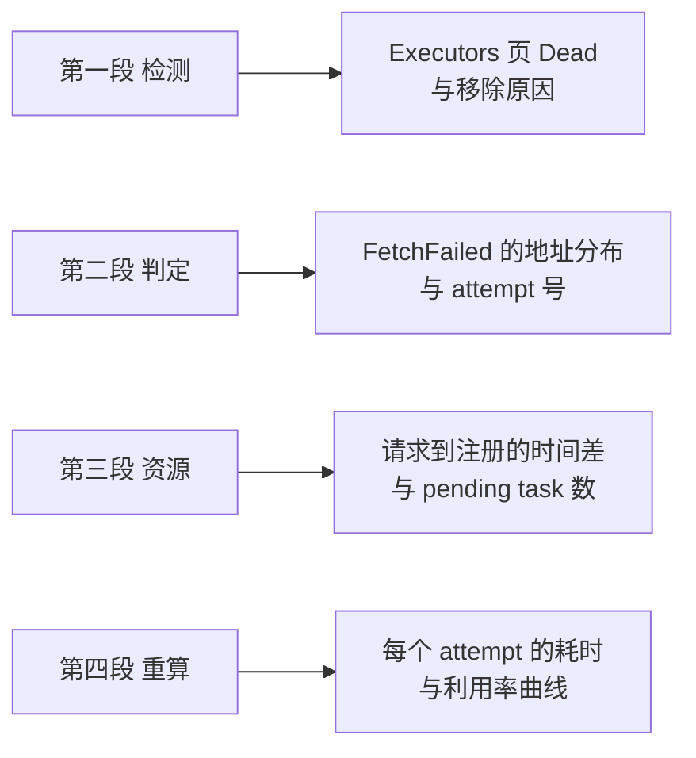

# 09 故障恢复全流程拆解：从宕机到续跑

**摘要：**

容错在机制层面是一组事件与处理函数，在运维层面却是一条按分钟计的时间线。凌晨三点二十一分一台机器掉电，随后那几分钟里作业究竟在干什么，能说清楚"哪一段卡了十分钟"的人不多，能说清楚"这十分钟能不能花钱买掉"的人更少。

本文把一次故障从发生到续跑拆成四段：故障检测、影响面判定、资源重新获取、重算与续跑。四段各有自己的耗时量级与可干预项，其中只有第三段能用钱买，第一段只能靠配置省，第二段几乎不耗时却决定了第四段的工作量。

四类常见故障——单 task 失败、executor 丢失、Driver 丢失、Shuffle 文件丢失——并不是四套彼此独立的机制，而是这四段的四种跳段方式。跳段方式不同，恢复时间差出三个数量级，这也是为什么"容错配置都开了，恢复速度还是差很多"。

读完之后应当能回答两个问题：这次故障 Spark 救回了多少、剩下多少必须重算；那条时间线上哪一段值得投入、哪一段只能靠提前设计。

---

## 第 1 章 四段：一次故障的时间形状

### 1.1 换一种读法

读内核系列的容错章节，读到的是"有什么机制、由谁触发、处理哪几件事"。那是实现视角，读完之后知道 `executorLost` 会做四件事，却不回答运维最常问的那句话：为什么这一次是四分钟，上一次是四十分钟。

要回答时长问题，得把同一批机制按时间重新铺一遍。凌晨三点二十一分零四秒机器掉电，到三点二十五分作业重新出数，中间发生的所有事情可以按"此刻在等什么"切成四段：等 Driver 确认机器没了、等 Driver 算清楚哪些分区要重算、等集群给一台新机器、等重算跑完。四段串行，总时长是四段之和，每一段的可压缩空间完全不同。

笔者用一个比喻。小区停电后的复电也分四件先后的事：定位断线的那一段、确认哪些楼受影响、等抢修车到位、按顺序合闸确认设备重启。四件事里只有第三件能靠"多派一辆车"缩短，第一件取决于保护装置的整定值，第四件取决于负荷本身有多重。把"多派车"用错地方，是运维里最常见的浪费。

### 1.2 四段各自的卡点

四段并排，最要紧的一列不是谁在做，而是能不能干预。

| 段位 | 在等什么 | 谁在做 | 耗时量级（示例推算） | 可干预性 |
|---|---|---|---|---|
| ① 故障检测 | 等一个心跳窗口到期，或等容器状态回报 | Driver 的 `HeartbeatReceiver`、集群管理器 | 1 秒到 130 秒，整机掉电多为 120 秒 | 只能调超时，且要付误判代价 |
| ② 影响面判定 | 不需要等，查内存里的地址账本 | `DAGScheduler` 与 `MapOutputTracker` | 亚秒级 | 压不动，但它决定第 ④ 段的工作量 |
| ③ 资源重新获取 | 等队列给容器、等 JVM 起来、等注册握手 | 集群管理器与 `SchedulerBackend` | 20 秒到 20 分钟，取决于队列水位 | 唯一能用钱买的一段 |
| ④ 重算与续跑 | 等缺失分区算完、等上游地址补齐 | executor 上的 task | 秒级到小时级，与数据量成正比 | 靠提前设计缩短，不能现场买 |

第一段与第三段经常被混为一谈，因为日志里都表现为"作业没动静"。区别在集群状态：前者的 executor 都好好的，只是 Driver 还没下决心；后者 Driver 已派单，集群没有位置给它。

### 1.3 一条被四段切碎的时间线

下面的图把四段画在一条横轴上，下方三条虚线是每一段真实存在的干预点。



图上有一个容易被忽略的比例关系：第 ① 段在掉电场景里占掉恢复时间的一大半，却买不到任何"少算一点"的收益；第 ③ 段在队列空闲时几乎看不见，队列满时能吃掉整个恢复；第 ④ 段名义上最贵，实际在"只丢一个 executor"这个量级下便宜得让人意外。

### 1.4 四类故障是四种跳段方式

这是本文的骨架命题。四类故障之所以恢复时间差出三个数量级，不是因为它们动用了四套不同机制，而是因为它们**走过的段数不同**。

单个 task 失败只走第 ② 段与第 ④ 段：executor 还活着，不需要检测等待，也不需要重新要资源，把那个分区重新排进同一个 executor 的队列就行。executor 丢失四段全走。Shuffle 文件丢失跳过第 ③ 段——机器还在、slot 还在，只是磁盘上那份数据不在了，重新算一遍写回原地即可。Driver 丢失四段全走，而且第 ② 段会失效：账本随 Driver 一起没了，没有"缺失分区"这个概念了，只剩"整个作业重来"。

### 1.5 与机制篇的分工

四段里每一段的内部机制，内核系列已按"判据与动作"拆过：四级失败的分诊、`executorLost` 的四个动作、`FetchFailed` 的三层去抖、两道上限取 max，见 [[大数据/Spark/读书笔记-spark内核/04_存储与容错机制/4. Spark容错机制与Runtime生命周期|Spark 容错机制与 Runtime 生命周期]]；重算放大的乘数口径与四本账，见 [[大数据/Spark/读书笔记-spark内核/04_存储与容错机制/5. Spark错误容忍机制|Spark 容错的代价与失败模式]]。本列前几篇也各有分工：重算范围的裁剪见 [[大数据/Spark/Spark-容错与状态管理深度解析/01 RDD Lineage 血缘容错：分布式计算的重建之道|RDD Lineage 血缘容错]]，四层重试的预算配比见 [[大数据/Spark/Spark-容错与状态管理深度解析/02 Task 与 Stage 的多级重试机制|Task 与 Stage 的多级重试机制]]，checkpoint 该不该写见 [[大数据/Spark/Spark-容错与状态管理深度解析/03 RDD Checkpoint：截断 Lineage 的工程权衡|RDD Checkpoint 的工程权衡]]。

本文换的是时间口径：一次故障占多长的墙钟、集群在干什么、哪一段能买。机制不复述，只取结论当常数。

### 1.6 一个贯穿全文的集群

设一个场景：某离线数仓集群 300 个节点、日均提交约 2000 个作业，跑在 YARN 上，每节点 32 core、128GB，executor 按 4 core / 16GB 切分。核心作业 `user_tag_daily` 每晚读两张 ODS 表，一次宽表 join、两次聚合，五个 Stage（三个 ShuffleMapStage），下游两千个分区，正常四十分钟跑完。故障发生在 Stage 2 的 map 阶段：`worker-72` 的电源模块烧了，其上驻留一个 executor、四个 slot 正在跑 map task，此前已贡献 180 个已完成的 map 分区。后文的算术都落在它身上，凡涉及具体秒数的都标为示例推算。

---

## 第 2 章 第一段：故障检测，一条被配置钉死的下限

### 2.1 心跳窗口不是十秒

一个流传很广的误解，是把 `spark.executor.heartbeatInterval` 的默认值 10 秒当成检测时延。它只是心跳的发送周期即采样频率，判死用的是另一个参数 `spark.network.timeout`，默认 120 秒：Driver 要等到最后一次心跳之后再过一个完整窗口才会处置它，所以上界约等于窗口加一个发送周期，量级 120 到 130 秒。这也解释了为什么很多人调了 `heartbeatInterval` 却感觉不到恢复变快——采样频率变了，窗口没变。

| 配置项 | 默认值 | 它决定什么 | 调大的代价 | 调小的代价 |
|---|---|---|---|---|
| `spark.network.timeout` | 120s | executor 被判死的心跳窗口 | 故障盲区变长，第 ① 段整体后移 | GC 停顿与网络抖动被误判成宕机，重算量凭空增加 |
| `spark.executor.heartbeatInterval` | 10s | 心跳发送周期，即采样密度 | 检测上界变大（窗口仍由上一项钉死） | 心跳与 Driver 端处理开销上升，收益有限 |
| `spark.yarn.scheduler.heartbeat.interval-ms` | 1000 | AM 拉取容器状态的周期 | 容器级死亡感知变慢 | RM 侧压力上升 |
| `yarn.nm.liveness-monitor.expiry-interval-ms` | 600000 | RM 判定 NodeManager 心跳过期的阈值 | 节点级丢失通知更晚，晚于 Spark 心跳，等于这条路径不生效 | 网络抖一下就被判节点丢失，整机容器一次性回收 |
| `yarn.am.liveness-monitor.expiry-interval-ms` | 600000 | RM 判定 AM（即 Driver）心跳过期的阈值 | Driver 丢失后重启触发更晚 | 长 GC 的 AM 被误杀，作业从头再来 |

窗口该设多大有一条能落地的判据：窗口必须显著大于 executor 的最长 Full GC 停顿，否则正常作业会被误判。做法是从 GC 日志或 `executor.gcTime` 曲线取停顿 P99，窗口取两倍以上，再看这个值是否小于业务能接受的盲区；两者冲突时说明堆设置或 GC 策略本身有问题，先修 GC 再谈窗口。

### 2.2 三条感知路径，谁先到

同一个"机器没了"，Spark 有三条感知路径，时延差着两个数量级。

第一条是容器级死亡。OOM killer 杀进程、YARN 抢占回收容器、动态分配缩容、磁盘写满被 NodeManager 清理，这些情况下容器本身会退出，NodeManager 把完成状态报给 RM，AM 下一次拉取（1 秒级）就能看到。这条路径的时延是秒级。

第二条是心跳窗口，即上一节说的 120 秒：不是最快的，却是唯一不依赖集群管理器行为的路径，在 standalone、K8s、YARN 上表现一致。

第三条是节点级丢失。RM 判定一个 NodeManager 死亡靠的是它自己的心跳过期阈值，默认 600 秒。这个数字常被误记成"YARN 十秒就知道节点没了"，进而得出"YARN 模式下恢复比纯 Spark 快"。实际情况相反：默认配置下 RM 要等十分钟，而 Spark 心跳两分钟就到了，所以节点级这个通知在绝大多数故障里根本轮不到它出场。它真正起作用的是"整机在线但 NodeManager 进程挂了"这种少数形态。



图里最后一条支路要单独说：task 层面的失败根本不走心跳。task 结束事件在进程内传到 `TaskSetManager`，几毫秒内完成判定与重新入队，所以"单个 task 失败是秒级"与心跳配置无关——它连第 ① 段都没进。

### 2.3 这一段的可优化空间

第 ① 段能动的只有两处：调小窗口，或换成更快的容器级路径。已经过去的 120 秒补不回来，它是故障发生那一刻就注定的固定成本；真正决定业务感知的往往是这 120 秒里有没有别的作业能顶上。

---

## 第 3 章 第二段：影响面判定，一秒钟决定后面八十分钟

### 3.1 判定的输入是一本地址账

Driver 手里没有 Shuffle 数据，只有地址。哪些分区在哪台机器上的哪个 BlockManager，记在 `MapOutputTracker` 里；缓存块的位置也在 Driver 侧的 BlockManager 元信息里。第 ② 段做的全部事情，就是拿这本账和"哪个 executor 没了"做一次差集，得到一份缺失分区清单。

这段耗时几乎为零，因为全程是内存里的哈希表操作，不涉及任何 I/O。它的重要性不在耗时，在于它产出的那份清单就是第 ④ 段的工作量。清单越大，第 ④ 段越久；而清单的大小由账本决定，不由重算能力决定。

判定按 Stage、执行按分区，所以日志里常出现自相矛盾的两句——"某 ShuffleMapStage 又要重跑了"和"只提交了 1 个 Task"，两句都对，前一句说判定，后一句说执行。

### 3.2 两种错判的代价

两种错法，代价方向相反。

一种是判多了，把还能用的输出一起作废，典型来源是输出不确定的 Stage：同一个分区算两次结果不同，命中这类 Stage 时 Spark 先整体作废再重提，重算量从一格涨到一个 Stage，宁可多算也不出错。另一种是判少了，以为地址还有效，表现是下游反复取数失败，每次三次重试、间隔五秒，单次失败烧掉十几秒才轮到回滚，一批并发取数同时撞上就要乘以波次，日志特征是同一批 `FetchFailedException` 密集出现。

| 判定环节 | 输入 | 输出 | 错判形态 | 代价 |
|---|---|---|---|---|
| 地址作废 | executor 标识、Shuffle 依赖关系 | 该 executor 上全部分区的地址抹除 | 漏抹 | 下游反复取数失败，每次十几秒 |
| 缺失分区计算 | 账本的空格 | 缺失分区清单 | 多算（整体回滚） | 重算放大到整个上游 Stage |
| 本地性缓存失效 | executor 集合变化 | 清空首选位置缓存 | 不清 | task 被派到已死机器，等超时再重试 |

### 3.3 三种"副本"在这一段的差别

同一段判定，cache、checkpoint、外部 Shuffle 服务三者的表现完全不同，因为它们把数据放在了账本的不同位置。

cache 的位置记在 Driver 的 BlockManager 元信息里，与 executor 同生共死，executor 没了它那几块的位置也被抹掉，于是重算——cache 买的是平时少算一点，不是故障时少算一点。可靠 checkpoint 在外部存储上，位置不依赖 executor，根本不进受影响的集合，这是跳过重算的唯一入口。外部 Shuffle 服务把文件生命周期从 executor 手里接走，"executor 死"不再等于"地址失效"。

### 3.4 一个可以立刻用的判据

恢复慢的作业，先算一个比值：**重算分区数除以丢失分区数**。这个系数在单个 task 失败时等于 1，在 executor 丢失且无外部 Shuffle 服务时等于"该 executor 已完成的分区数"，在整机 `FetchFailed` 波次之后可能到几十。系数超过十，说明问题不在"重算太慢"，在"判定的范围太大"，此时该调的是输出确定性、Stage 划分与地址账本的准确性，而不是去加 executor。

---

## 第 4 章 第三段：资源重新获取，唯一能用钱买的一段

### 4.1 四小段的耗时构成

Driver 发出补充容量请求之后，到新 executor 能接单，中间有四小段，量级差得很远。


排队是第一小段，也是唯一没有上界的一小段：集群有闲置容量时它是零，队列里压着几百个待分配容器时它是十几分钟。容器创建取决于本地化与镜像拉取，K8s 上还要算镜像层下载；JVM 启动与类加载是 Spark 特有的固定开销，依赖 JAR 从 HDFS 拉取时更慢；握手亚秒级，可以忽略。

| 小段 | 典型量级（示例推算） | 影响因素 | 压缩手段 | 代价 |
|---|---|---|---|---|
| 队列排队 | 0 秒到 20 分钟 | 队列水位、抢占策略、其他作业的提交密度 | 配额保障、预留容量、错峰提交 | 花钱，且预留容量在多数时间是闲的 |
| 容器创建 | 3 到 30 秒 | 节点本地化、镜像体积、拉取带宽 | 预热镜像、节点缓存 | 运维复杂度 |
| JVM 启动与类加载 | 10 到 40 秒 | 依赖 JAR 数量、从 HDFS 拉取的带宽 | 依赖预分发、类数据共享 | 版本一致性与分发维护成本 |
| 注册握手 | 亚秒级 | — | — | — |

### 4.2 队列满时这一段吞掉整个恢复

这是运维里最容易被误判成"Spark 容错不行"的场景。同一个作业、同一类故障，凌晨队列空闲时四分钟恢复，晚上八点高峰期变成二十二分钟，差别全在**第 ③ 段**。判据：事件日志里该 executor 的注册时刻与 Driver 发出请求的时刻差着好几分钟，同时集群 CPU 利用率是低的。反过来也有误判——集群 CPU 很高未必是重算压力大，那可能是别的作业被放行，区分方法是看本作业的 pending task 数与新 executor 注册数的曲线。

### 4.3 动态分配会把这一段拉长

动态分配让资源跟负载走，副作用是把第 ③ 段变成常态：executor 空闲 `spark.dynamicAllocation.executorIdleTimeout`（默认 60 秒）后被释放，容量随之下降；重算需要并行度时又要重走一遍申请、启动、注册。故障正好落在一次缩容之后，恢复期就要同时承担两笔账。`spark.dynamicAllocation.minExecutors` 是保险丝：把下限设成 0，省下的资源账单会在恢复那几分钟里以另一种方式还回来。

### 4.4 locality.wait 的方向常被弄反

有一种流传的做法是"恢复慢就把 `spark.locality.wait` 调大，让 task 等到本地数据"——方向是反的。这个参数决定 task 在某个本地性级别上等多久再降级派发，默认 3 秒。恢复期间最稀缺的是时间，把等待时间从 3 秒调到 30 秒，等于给每一个待派 task 增加 27 秒的固定延迟；在 slot 紧张、task 需要排队串行落地的场景里，这笔延迟会沿着队列累加。

正确的做法相反：恢复期间把 `spark.locality.wait` 临时压到几百毫秒甚至 0，先让 task 落到任何一个空闲 slot 上跑起来，接受跨机读取的网络开销——**用带宽换时间**，在故障窗口里划算，稳态下才轮得到用时间换带宽。容错参数与性能参数经常指向相反方向，把稳态最优的调优结论搬到故障窗口，往往让恢复更慢。

---

## 第 5 章 第四段：重算与续跑，账怎么还

### 5.1 三个决定因素

第 ④ 段的墙钟由三个量决定：要重算的分区数、单分区的工作量、可用并行度。写成下界估算是"分区数乘单分区耗时除以可用 slot 数"，实际值要比它大，因为重算的输入要重新读、Shuffle 输出要重新写、长尾分区会拖住收口。

用第 1 章的场景算一次（示例推算）：丢失的 executor 贡献过 180 个已完成 map 分区，单分区中位耗时 8 秒，集群那一刻约有 200 个空闲 slot，按公式重算的纯计算量不到 10 秒；实测这类恢复的重算段通常落在 60 到 120 秒，差额来自输入重读、长尾分区与部分分区等 slot 的几十秒。

这个算术的用处不是算准，而是看清一件事：**分区级重算便宜得惊人**。真正贵的不是重算这 180 个分区，而是判成了要重算整个上游 Stage，或者血缘太长回溯到读原始数据那一步。所以优化第 ④ 段的方向不是提高算力，而是缩小重算集合。

### 5.2 串行等待：一次只推进一个 Stage

Stage 之间有屏障：下游要等上游所有分区的地址齐了才能提交，这条规则在正常执行时避免反复碰壁，在恢复时是**时间的放大器**。`DAGScheduler` 的事件处理是单线程循环，重提带单飞标记，任意时刻只有一个重提在推进，两个 Stage 同时出问题时恢复时间近似等于两段之和而非最大值。

### 5.3 恢复期间集群在干什么

下图把恢复期按四段铺开，标出并行度的形状。注意两点：新 executor 注册之前，并行度是缺的；某个 Stage 收口之前，下游完全没有并行度。



判据：恢复期利用率低而 pending task 不降，卡在第 ③ 段；利用率高且 pending 在降，是正常的第 ④ 段；利用率呈锯齿，说明卡在串行等待，瓶颈是 Stage 数量与屏障结构。

---

## 第 6 章 四类故障：同一套四段，四种跳法

### 6.1 判据总表

先给表，再逐类解释。表中"能不能救"一列的含义是：Spark 内部有没有办法让第 ④ 段从更靠后的位置开始。

| 故障类型 | 感知路径与时延 | 丢的是什么 | 重算范围 | 恢复量级（示例推算） | 能不能救 | 观测位置 |
|---|---|---|---|---|---|---|
| 单个 task 失败（偶发） | 进程内上报，毫秒到秒 | 一个分区的计算结果 | 该分区 | 秒级 | 能，靠血缘原地重算 | Tasks 表 Attempt 列 |
| 单个 task 反复失败（数据问题） | 同上 | 同上，但会耗尽预算 | 该分区重试四次后放弃 | 秒级到作业失败 | 不能，重试不改变输入 | `failed 4 times; aborting job` |
| executor 丢失（无 ESS） | 心跳窗口 120 秒 | 在跑的 task 加已完成的 map 输出 | 该 executor 已完成的全部分区 | 分钟级，3 到 10 分钟 | 能，重算或从上游副本重建 | Executors 页 Dead，FetchFailed 波次 |
| executor 丢失（有 ESS） | 同上 | 只有在跑的 task | 在跑的那几个分区 | 数十秒到两分钟 | 能，且代价接近零 | 同上，但 FetchFailed 稀少 |
| Shuffle 文件丢失（个别） | 下游取数失败，重试十几秒后 | 若干 map 分区文件 | 单个或少数几个 map 分区 | 秒级到分钟级 | 能 | 失败块的地址集中在同一个 BlockManager |
| Shuffle 文件丢失（整盘或整服务） | 同上，一次几十上百条 | 一台机器或一个服务的全部输出 | 该范围内的全部分区 | 分钟到小时，取决于上游量 | 能，但要重读上游 | 失败集中在同一批地址 |
| Driver 丢失（批处理） | 容器退出被上报，秒到十几秒 | 全部调度状态与地址账本 | 整个作业 | 作业墙钟级，小时级 | 不能续跑，只能重跑 | 集群侧 application attempt 变化 |
| Driver 丢失（流式，有 checkpoint） | 同上 | 只有内存中未提交的那一批 | 当前批次 | 分钟级，与状态规模正相关 | 能，从 checkpoint 续 | Streaming 页的 batch 号跳跃 |

表里"感知路径与时延"一列有个反直觉的地方：Driver 丢失的检测比 executor 丢失更快。原因是 AM 本身是个容器，进程一退出 NodeManager 立刻上报，而 executor 掉电靠的是心跳窗口。快的那一步是检测，慢的是后面的重跑。



### 6.2 单个 task 失败：只重算一格

这是最容易的一类，第 ① 段与第 ③ 段都不必走：executor 活着、slot 还在，`TaskSetManager` 把失败分区重新入队，下一次有空位就派出去。判据在日志的失败原因里——`ExceptionFailure` 是用户函数抛异常、属于这一类，`ExecutorLostFailure` 是 executor 死了、属于下一类，`FetchFailedException` 是取不到上游数据、属于后面两类；三种字符串对应三条完全不同的恢复路径。这一类的反例是确定性失败：数据本身有问题时四次重试是四次同样的失败，白烧四倍槽位，此时该把校验前移到读入阶段。

### 6.3 executor 丢失：两样东西一起丢

这一类要丢两样东西，处理方式不同，常被混为一谈。第一样是正在跑的 task，它们被以 `ExecutorLostFailure` 收尾、重新入队，不消耗分区预算；第二样是它已经算完写在本地磁盘上的 Shuffle 输出，地址在账本上被抹掉，下游不再认。前者丢的是活着的计算，重跑那几个分区就有；后者丢的是死掉的数据，要重算的是它此前完成的全部 180 个分区。

外部 Shuffle 服务把第二样接走，于是只剩第一样：恢复量从重算 180 个分区降到重跑 4 个。但有一个边界——**ESS 保的是已完成的输出，不保正在做的**，掉电那一刻正在跑的四个 map task 还没落进 ESS 目录，仍要重跑。恢复时间由两部分构成：ESS 场景下几乎全部花在第 ① 段的窗口里，无 ESS 场景下再加第 ④ 段的重算；第 ③ 段取决于队列水位，方差最大。

### 6.4 Driver 丢失：批处理没有续跑，流式才有

这是最容易想当然的一处。常见说法是"RDD checkpoint 是批处理 Driver 容错的唯一有效手段，Driver 重启后已 Checkpoint 的数据仍在 HDFS 上，不需要重算"，这句话在机制上不成立：可靠 checkpoint 把数据写进 `spark.checkpoint.dir`，文件确实还在，但能不能用取决于 Driver 内存里那个 RDD 对象上的物化标记，而标记属于当前这个 `SparkContext`。Driver 一死标记就没了，YARN 重启 AM 拉起的是全新 application，新的 `SparkContext` 从头执行用户代码、构造出新的 RDD 对象，不会去翻上一个应用留下的 `rdd-N` 目录。数据在，认领它的那张地图没了——checkpoint 在这里裁短的是本次运行的 lineage，不是下一次运行的起点。

批处理真正能买到的"Driver 死后少干一点"在 Spark 之外：把中间结果写成表让下一次从表读、把作业切成可幂等重跑的小块、由外部编排决定重启粒度。量级上，Driver 丢失等于一次作业重跑：AM 重启的几十秒加上从头执行的整段墙钟。

### 6.5 Shuffle 文件丢失：量级取决于范围

这一类最容易误判：不走 executor 丢失那条路径，日志里只有一堆取数失败。

触发有三种：executor 丢失且没有 ESS（本质与上一类重合，只是表现为下游失败而非上游重提）、ESS 或 RSS 自身的存储坏了或被清了、计划内下线没有迁块（decommission 未开启 shuffle 块迁移时，节点优雅退出文件照样消失）。重算量与上游数据量直接相关：丢一个 map 分区就重算一个分区，丢一个 executor 的全部输出就重算那一片，丢一整块存储可能触发整个上游 Stage 重算，此时恢复时间由上游 Stage 的墙钟决定。

范围看失败块的地址分布：集中在同一个 BlockManager 就是一台机器或一个服务的问题，分散在多个地址说明原因是共性的（存储层、清理策略），按最坏情况估。

### 6.6 能不能救的判据

把"有没有副本"与"副本存在哪"合起来看，得到一张能力表。表的读法是：每一行代表手上多一样东西，能跳过哪些重算，跳不过什么。

| 手上有什么 | 能跳过哪些重算 | 跳不过什么 | 失效条件 |
|---|---|---|---|
| 只有血缘 | 什么都不跳 | 从丢失点回溯到源头 | 源头不可重读（保留期已过、上游被覆盖） |
| 血缘加 cache | cache 命中的分区 | 落在丢失 executor 上的那部分 | cache 与 executor 同生共死 |
| 血缘加 ESS 或 RSS | 全部已完成的 Shuffle 输出 | 在跑的 task、上游被重读的部分 | 服务自身故障、文件被清理 |
| 加可靠 checkpoint | 落盘点之前的整段血缘 | 落盘点之后的部分 | 落盘写失败、目录被换 |
| 加外部编排与幂等写 | 已提交的输出分区 | 未提交的部分 | 输出端不幂等 |
| 流式加 checkpoint | 全部历史批次 | 当前批次与状态加载 | checkpoint 目录丢失或换路径 |

这张表可以压成一句话：**恢复能力的上限由最远的那份持久副本决定，恢复代价由那份副本到故障点的距离乘上扇出决定**。前者是能不能救，后者是救多少：副本做远一点，救的能力上去了，代价也上去了。

---

## 第 7 章 恢复慢的四个原因，与能买的五样东西

### 7.1 四个原因与它们的判据

恢复慢从来不是单一原因，但可以先归到一个主因上。判断方法不是看总时长，而是看四段里哪一段最长。

| 原因 | 怎么确认 | 对症手段 | 不对症的手段 |
|---|---|---|---|
| 等资源，队列满 | 新 executor 注册时刻远晚于请求时刻，集群 CPU 低，作业 pending task 不降 | 配额保障、预留容量、错峰提交 | 调重试预算、写 checkpoint、调心跳窗口 |
| 上游数据量大，重算贵 | 重算分区的读入字节数大，单分区耗时长，恢复期利用率高 | 把重活物化成表、缩短重算链路 | 单纯加 executor（受分区数与带宽限制） |
| 血缘长，回溯远 | 重算分区数远大于丢失分区数，放大系数超过十 | checkpoint 截断、物化中间结果 | ESS（只管 Shuffle 文件，管不了血缘） |
| 串行等待 | 恢复期利用率呈锯齿，同一时间只有一个 Stage 在动 | 减少 Stage 数量、合并 Shuffle、用 AQE 收敛分区 | 加大重试上限（只延长失败时间） |

四个原因里只有第一个是"钱能解决"的，其余三个都是设计问题。运维现场最常见的错配，是拿第四个原因的钥匙（调大上限）去开第一个原因的锁。

### 7.2 五个手段与它们各自的代价

五个手段对应前面四个原因，但没有一个是免费的。

| 手段 | 买了什么 | 代价 | 适用前提 |
|---|---|---|---|
| 可靠 checkpoint | 把回溯距离截到落盘点，血缘再长也只算到这里 | 每个周期一次全量物化加一次落盘，写放大；物化那一遍本身要占时间 | 该 RDD 会被多次使用，或下游血缘确实很长 |
| ESS 或 RSS | executor 丢失时 Shuffle 输出不作废，重算量趋近零 | 常驻组件要部署、监控、跟着集群升级；它自己成为单点 | 集群规模足够大，动态分配在用 |
| 提高资源保障 | 直接压缩第 ③ 段，这是唯一能买时间的一段 | 预留容量在多数时间是闲的，账单按峰值付 | 作业有交付时点，恢复慢的代价高于闲置成本 |
| 减少血缘长度 | 直接缩小重算集合，同时降低串行等待的概率 | 多一次落盘与一次读取，链路变长；灵活性下降 | 中间结果能被多个下游复用 |
| 把重活放在能快速重算的位置 | 让昂贵的计算落在易重读、易并行的形态上（按分区幂等写、按天分区物化） | 存储成本与编排复杂度，分区设计一旦定下不好改 | 有编排系统，且输出端能做到幂等 |

第二行的取舍不是要不要，而是谁来承担这个常驻组件：YARN 上 ESS 跟着 NodeManager 走，运维成本被摊掉了；K8s 上长期缺位，于是 RSS（Celeborn、Uniffle 一类）以独立服务补位，代价是多一个要自己运维的分布式系统。

还有一层：decommission 场景下可以让 executor 退出前把 Shuffle 块迁走（`spark.storage.decommission.shuffleBlocks.enabled`，需要 ESS 在场），它管的是"我主动让它走"，管不了"它突然没了"，混为一谈就会出现"开了优雅下线还是重算"的事故。

---

## 第 8 章 观测点：在时间线上取证

### 8.1 五个观测点

| 观测点 | 位置 | 怎么读 | 回答哪一段 |
|---|---|---|---|
| executor 消失 | Executors 页 `Status=Dead`，事件日志的 executor 移除事件 | 死一个还是死一批，带什么原因 | 第 ① 段 |
| attempt 号 | Stages 页每个 attempt 的条目，事件日志里的 attempt 编号 | 涨了说明重提发生过，涨几次说明回滚几次 | 第 ② 段之后 |
| 失败原因 | Stage 条目的 Failure Reason，或 Tasks 表的 Error 列 | `FetchFailed` 还是 `ExecutorLostFailure` | 第 ② 段的判定输入 |
| 请求与注册的时间差 | 事件日志里 executor 加入时刻与故障时刻的差值 | 差值大说明卡在排队 | 第 ③ 段 |
| Stage 收口耗时 | 每个 attempt 的提交到完成 | 与基线比，涨了多少 | 第 ④ 段 |



### 8.2 attempt 号是最廉价的信号

一个作业跑了半年没人管，某天开始变慢，最先该看的就是 attempt 号有没有悄悄涨：重提成功之后作业照样成功，业务侧什么都看不见，唯一的痕迹是 Stage 经历了不止一次尝试。

这条信号是免费的——不需要新增监控，打开 Stages 页就有；接进监控也不难，事件日志里按 stage id 数 Stage 提交事件的出现次数，每小时超过两三回就该查机器、查 Shuffle 服务、查上游数据留存。不监控它，就会出现"作业一直成功但每天多算两个小时"的局面，而这两个小时的账没人认领。

### 8.3 连续失败计数的消耗

Stage 重提有上限：连续失败 `spark.stage.maxConsecutiveAttempts` 默认 4，总量 `spark.stage.maxAttempts` 默认不限，判死时取较大值。真正要盯的不是上限值而是消耗速度——连续计数在同一 Stage 成功一次后清零，所以它度量的是故障是否持续：零星重提十几次、每次都成功过，计数始终为零；一个 Stage 十分钟内连续失败三次，计数就是三。日志里对应的是 `failed 4 times; aborting job`，看到它时作业已到终点，前面的重提都是沉没成本。

### 8.4 事件日志给什么，不给什么

有一处流传的说法需要纠正：不少人以为"事件日志里能看到 `resubmitted` 事件"。事件日志记录的是生命周期事件——Stage 提交（带 attempt 编号）、Stage 完成（带失败原因）、executor 加入与移除，不记录 DAGScheduler 内部的决策；`Resubmitting ... due to fetch failure` 是 Driver 的运行日志。这个区别在取证时很实际：重提过几次查事件日志按 attempt 编号数，为什么重提查 Driver 日志，重提时集群在干什么查两个来源的交叉时间戳。

```
# Driver 日志：判定作废与重提的起点
INFO DAGScheduler: Resubmitting ShuffleMapStage 2 (...) due to fetch failure
WARN TaskSetManager: Lost task 5.0 in stage 2.0 (TID 205, worker-72):
  ExecutorLostFailure (executor 7 exited caused by one of the running tasks)

# Driver 日志：预算耗尽，作业收口
ERROR TaskSetManager: Task 77 in stage 2.1 failed 4 times; aborting job
```

### 8.5 观测能力的边界

`spark.ui.retainedStages`（默认 1000）决定 UI 保留多少个 Stage 记录，一个每天重提几百次的作业，几天前的 attempt 在 UI 上就找不到了，死掉的 executor 也只在保留窗口内可见；事件日志依赖 `spark.eventLog.enabled`，默认关闭，很多集群的历史事件日志其实是空的。复盘一次三天前的恢复过程，靠 UI 不够，得靠事件日志；没开就只能 grep Driver 日志。

### 8.6 反例四则

| 反例 | 现象 | 根因 | 正确做法 |
|---|---|---|---|
| 没有 ESS 却期望 executor 丢失不影响 | 每次掉机器都要重算几分钟 | shuffle 文件随 executor 消失，地址作废 | 部署 ESS 或 RSS，或接受重算 |
| 把 `maxConsecutiveAttempts` 调大当"提高稳定性" | 作业失败率没降，个别作业墙钟翻倍 | 上限只延长尝试，不降单次成本 | 先查重提原因，再决定是否放宽 |
| 不监控 attempt 号 | 作业天天成功，每天多算两小时 | 重提成功不留业务痕迹 | 把 attempt 增量接入监控 |
| 把"作业成功"当成"恢复无代价" | 出数时间一天天变晚 | 重算成本被摊进正常时长 | 复盘时把重算段与下游重取段一起算 |

第一则是配置认知问题：ESS 关闭时动态分配也起不来（只能靠 Shuffle Tracking），两个后果叠在一起。第二则的根因是因果混淆：上限是熔断器不是稳定器，调大它等于让作业在失败前多耗几个小时。第三则最隐蔽，因为它没有任何报错。第四则的账要算在恢复之后，不只是恢复那几分钟。

---

## 第 9 章 流式：同一场故障，另一条时间线

一句话概括两者的差别：**批处理的恢复是重算，流式的恢复是重放**。

流式不需要重算历史，是因为 checkpoint 里同时存了"数据在哪"和"处理到哪"：offset 与 commit 记录加上状态存储，让新起来的 Driver 能算出上一批提交到哪、从哪继续。时间线同样是四段，但第 ④ 段变了——不是把历史重算一遍，而是重放当前这一批，再把状态加载回内存；这条路径的细节见 [[大数据/Spark/Spark-容错与状态管理深度解析/04 Structured Streaming 容错模型：Offset 与 Checkpoint|Structured Streaming 容错模型]]。

耗时构成也因此不同：检测与重启是固定成本（几十秒），状态加载是与状态规模成正比的可变成本。状态越大恢复越慢，没有捷径——快照间隔调小能减少回放的增量文件，代价是更频繁地写全量快照；状态能不能变小取决于业务是否真需要保留那么多 key，那是 [[大数据/Spark/Spark-容错与状态管理深度解析/08 状态过期与 TTL：让 State Store 不再无限膨胀|状态过期与 TTL]] 讨论的问题。

对照一次（示例推算）：批处理丢一台机器是重算该机器承担的分区，分钟级；流式丢一台 executor 是受影响分区的状态重新加载，状态在 GB 级、受外部存储带宽限制时是几十秒到几分钟。流式多一个变量——状态规模随运行时长增长，昨天五分钟能恢复不代表下个月还行。

---

## 第 10 章 落点

把四段摆在一起看，能看出容错设计里一条不太被说出口的分工：第 ① 段属于配置；第 ② 段的时长可以忽略，却决定了后面全部的账，属于数据模型的确定性；第 ③ 段属于资源治理，唯一能花钱买；第 ④ 段属于血缘与物化设计，唯一能靠提前规划省下。这也解释了为什么"容错都配好了、恢复还是慢"的抱怨总在出现——四段分属四个责任面，靠一个部门的参数解决不了全部，而多数复盘只盯着第 ④ 段的重算量。

最后回到那张"能不能救"的表。它给的不是标准答案，而是提问顺序：手上有几份副本、各在哪一层、从最近那一份到故障点之间要重算多少扇出。三个问题答完，恢复时间的量级就定了，剩下的才是调参。

---

## 参考资料

1. Apache Spark 配置文档（4.3.0）：`spark.network.timeout`、`spark.executor.heartbeatInterval`、`spark.task.maxFailures`、`spark.stage.maxConsecutiveAttempts`、`spark.stage.maxAttempts`、`spark.locality.wait`、`spark.dynamicAllocation.*`。https://spark.apache.org/docs/latest/configuration.html
2. Apache Spark 源码（4.3.0）：`core/src/main/scala/org/apache/spark/scheduler/DAGScheduler.scala`，`handleExecutorLost`、`resubmitFailedStages`、`stageAbortReason`。https://github.com/apache/spark/blob/v4.3.0/core/src/main/scala/org/apache/spark/scheduler/DAGScheduler.scala
3. Apache Spark 源码（4.3.0）：`core/src/main/scala/org/apache/spark/scheduler/MapOutputTracker.scala`，`removeOutputsOnExecutor` 与缺失分区计算。https://github.com/apache/spark/blob/v4.3.0/core/src/main/scala/org/apache/spark/scheduler/MapOutputTracker.scala
4. Apache Spark 源码（4.3.0）：`core/src/main/scala/org/apache/spark/HeartbeatReceiver.scala`，executor 过期判定所用的超时参数。https://github.com/apache/spark/blob/v4.3.0/core/src/main/scala/org/apache/spark/HeartbeatReceiver.scala
5. Apache Hadoop YARN 默认配置：`yarn.nm.liveness-monitor.expiry-interval-ms`、`yarn.am.liveness-monitor.expiry-interval-ms`、`yarn.resourcemanager.am.max-attempts`。https://hadoop.apache.org/docs/stable/hadoop-yarn/hadoop-yarn-common/yarn-default.xml
6. Apache Spark 文档：Job Scheduling（`spark.scheduler.*`、外部 Shuffle 服务与动态分配的关系）、Running Spark on YARN。https://spark.apache.org/docs/latest/job-scheduling.html
7. Apache Spark 文档：Structured Streaming Programming Guide，checkpoint 目录结构与恢复语义。https://spark.apache.org/docs/latest/streaming/structured-streaming-programming-guide.html

---

> [!note] 思考题
> 1. 第 ① 段的 120 秒是配置定的固定成本。如果业务只能在故障后三分钟内感知到延迟，你会压缩窗口还是改感知路径，两者分别把风险转移给了谁？
> 2. 一个每天重提三次、每次成功、月成功率 100% 的作业，算健康还是不健康？判断这个问题需要哪一个指标，而这个指标为什么在 UI 默认保留窗口里会丢？
> 3. 开启 ESS 之后，executor 丢失的恢复量从 180 个分区降到 4 个，但如果第 ③ 段要等十分钟，这个优化在业务侧还能被感知到吗？
> 4. 批处理的 Driver 丢失没有内部续跑。如果要求"Driver 死后十分钟内出数"，这个要求应该落到 Spark 配置上还是落到编排与表设计上，两者的验收标准有什么不同？
> 5. 四段里只有第 ③ 段能花钱买。什么规模的集群上，预留容量的成本会低于一次超时交付的损失，这个临界点该用什么量来估？