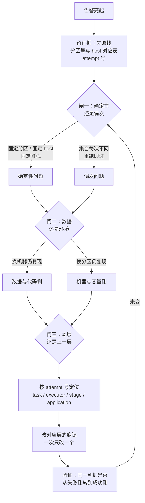
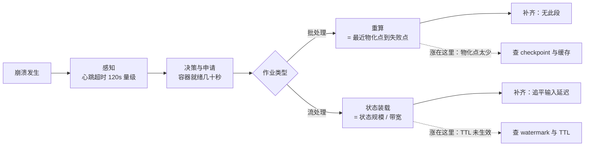
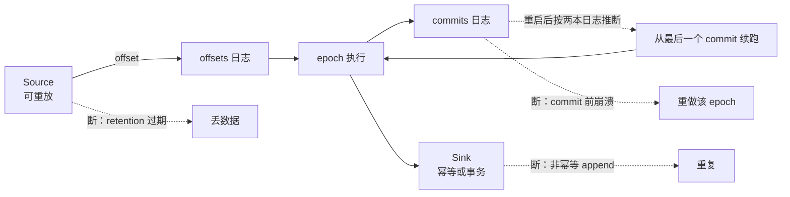
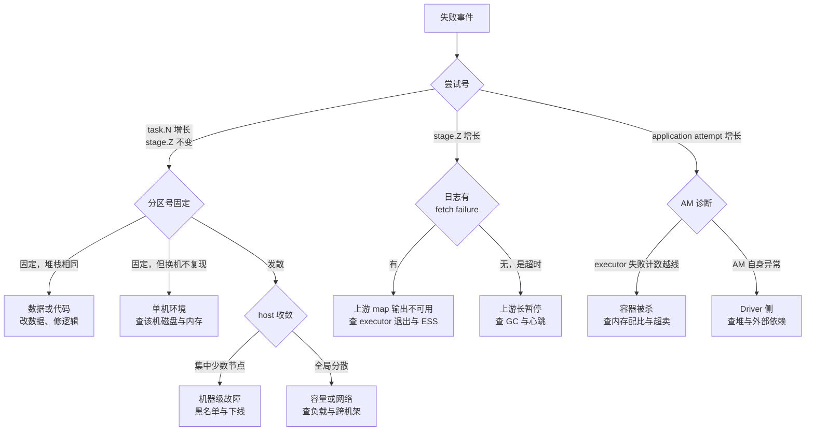
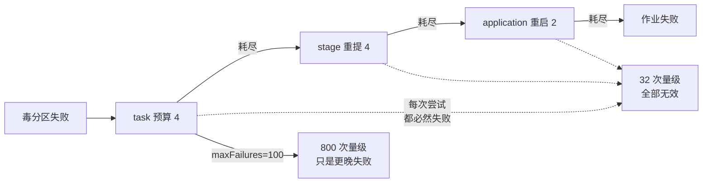
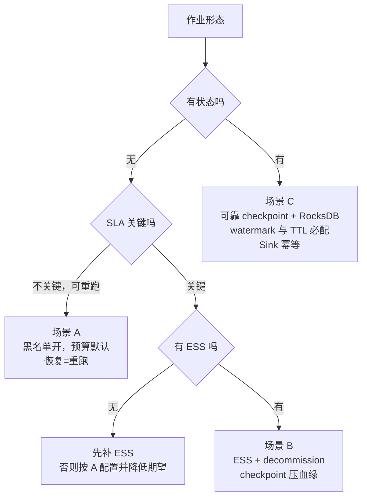

# 10 生产容错调优手册：从告警到根因的系统性诊断

**摘要：**

容错调优最常见的两种走法都不通：背参数的人把 `maxFailures`、`spark.network.timeout`、`spark.shuffle.io.maxRetries` 一律调大，等告警的人则在红灯亮起时加内存、加节点。两者都跳过了一个前提——告警只说明哪一层在疼，不说明哪一层坏了。本篇按"告警到根因"的判定树组织，把生产上最高频的六类容错告警（作业反复失败重启、恢复时间越来越长、`FetchFailedException` 频发、checkpoint 目录膨胀、executor 频繁被驱逐、数据重复或丢失）拆到可判定的分支上，并把判定顺序定死为三步：先分确定性与偶发，再分数据与环境，最后分这一层与上一层。每一类都给出日志关键字、UI 位置与尝试号三类判据，再把判据接到 01 至 09 篇讲过的机制与参数上，说明哪个旋钮真正改了失效路径、哪个只是把失败推后。收口处是三件事：三个判决性指标与量级阈值、按场景给出的三套最小可用配置、一份把"调大重试"当作容错的反例清单。口径为 Spark 4.3.0（Scala 2.13），除官方默认值外，数值一律标注量级判断。

---

## 第 1 章 告警说的是哪一层在疼

凌晨两点四十，值班台上的三条告警几乎同时亮起。第一条是批作业 `dwd_order_daily` 在 YARN 上第三次重启，`ResourceManager` 页面里 application attempt 已经排到 3；第二条是流作业 `kafka_order_stateful` 的 `FetchFailedException` 计数在十分钟内涨了两百多次，处理延迟跟着抬起；第三条来自监控，同一个集群里某个流的 checkpoint 目录日增从 40 GB 跳到 90 GB，而输入速率没变。

三条告警看上去互不相干，值班的人却很容易对它们做出同一种反应：找参数。作业老失败就调大 `spark.task.maxFailures`，取数老失败就调大 `spark.shuffle.io.maxRetries`，目录涨得快就去翻保留策略的默认值。这个反应之所以流行，是因为它快——改一个数、重提一次作业，告警确实会安静一阵。

问题在于，参数只改行为，不改失效路径。一个毒分区调大重试之后仍然失败，只是失败得更晚；一个已经消失的 shuffle 块调大重试之后仍然取不到。参数让告警安静下来的方式，往往是把"下一步该查什么"这条线索一起改掉。判定必须在调参之前，理由就在这里。

### 1.1 告警只说明"疼"，不说明"坏"

集群到了每天两千个作业、三百个节点，告警的机制基本只有两类：阈值规则（指标越线）与日志规则（某句关键字在窗口内出现若干次）。两类都只描述现象，不描述归因。同一个现象可以由完全不同的层级产生，这是容错诊断最基础的一条事实。

`FetchFailedException` 是最好的例子。日志里它出现在 reduce 端，病根却在 map 端：上游某个 executor 退出、某节点的 shuffle 文件所在磁盘写满、某台机器的 ESS 进程挂了，三种成因都让 reduce 端抛出同一个异常，文案几乎一样。只盯着 raise 异常的那一端查，永远查不到东西——这是"谁疼谁不坏"的典型形态，也是 [[大数据/Spark/Spark-容错与状态管理深度解析/01 RDD Lineage 血缘容错：分布式计算的重建之道|01 RDD Lineage 血缘容错]] 里那条 fetch 失败链条的运维结论。

反过来，同一种病也可能只疼一次：一台坏机器只被调度到一次，留下的证据也许只有一个偶发 task 失败，连告警都不触发。所以告警强度与病因严重程度之间没有稳定关系，能依赖的只有判据。

| 告警 | 它通常由哪一层产生 | 它能确认什么 | 它确认不了什么 |
| :--- | :--- | :--- | :--- |
| 作业失败率上升 | 四层中的任意一层 | 有失败发生过 | 层级、根因、是否与本次变更相关 |
| `FetchFailedException` 计数 | reduce 端，症状层 | shuffle 取数确实失败过 | 病根在哪个上游 executor、ESS 有没有生效 |
| stage attempt 数增长 | stage 层 | 重提发生过 | 触发重提的是取数失败还是超时 |
| executor 丢失计数 | executor 层 | 有容器非正常退出 | 为什么退出：堆内 OOM、原生内存、节点故障还是抢占 |
| checkpoint 目录日增 | 状态层 | 状态在增长 | 是 TTL 没生效，还是输入速率涨了 |
| 恢复耗时拉长 | 端到端 | 恢复链路变慢 | 慢在感知、重算、状态装载还是排队 |

### 1.2 从参数开始，代价是把证据改掉

先动手调参数，再回来查，证据会先被改掉。`maxFailures` 从 4 调到 20，同一个分区号的失败次数就从 4 变成 20，`failed 4 times; aborting job` 那句熔断话不再出现，样本污染之后，"失败是固定的还是发散的"就失去了基准。黑名单同理：它默认关着（`spark.blacklist.enabled=false`），关着或放宽 `spark.blacklist.timeout`，坏节点会反复接活，失败散在几百个 task 里，而判定机器问题最有效的证据恰恰是被排除对象的集合。时间对齐也会丢：`spark.network.timeout` 从 120 秒调到 300 秒，失联判定整体后移，与 YARN 的节点 LOST 时间戳、与运维操作记录都对不齐。

所以处置顺序要反过来：先留证据，再改参数，最后谈长期配置。值班现场能做的"留证据"很轻——保存失败 task 的完整栈、记录失败分区号与 host 的对应关系、把当次 attempt 号记进工单，这三样在故障过去之后补不回来。

### 1.3 三道闸，顺序不可颠倒

判定过程可以收敛成三道闸，每道闸只回答一个问题，且必须按顺序过。

闸一，确定性还是偶发。它决定这件事值不值得深查：同一个分区号每次都失败、同一个 host 每次都失败、同一段堆栈每次都出现，是确定性；失败分散、每次集合都不同、重跑一次就好，是偶发。确定性问题查数据与代码，偶发问题查容量与环境，两种查法不重叠。

闸二，数据还是环境。它决定处置方向：改数据与代码，还是换机器与扩资源。判据是"换了载体还复现吗"——同一分区换一台机器仍失败，是数据；同一台机器换一个分区仍失败，是环境。

闸三，这一层还是上一层。它决定改哪一层的配置：task、executor、stage、application 四层各有各的预算与日志，改错层的后果是把预算花在不会失败的地方。

顺序颠倒的代价是可观测的。先过闸二、再补闸一，会把偶发失败当成确定性问题去改代码，改完上线才发现问题自己消失了；先过闸三、再补闸一，会在 application 级重启的现场调 task 级参数，改几轮都不见效，因为每次重启都从零开始，task 级的账根本没留下。

### 1.4 机制归机制，判据归判据

分工先说清楚。四个层级的划分与"一次失败只能上升一级"的规则，见 [[大数据/Spark/读书笔记-spark内核/04_存储与容错机制/4. Spark容错机制与Runtime生命周期|Spark 容错机制与 Runtime 生命周期]] 第 1 章；失败模式里的部分成功、副作用重复、数据丢失与静默错误，见 [[大数据/Spark/读书笔记-spark内核/04_存储与容错机制/5. Spark错误容忍机制|Spark 错误容忍机制]] 第 4 至 8 章；task 预算按分区记账、stage 重提的账本裁剪与两道上限，见 [[大数据/Spark/Spark-容错与状态管理深度解析/02 Task 与 Stage 的多级重试机制|02 Task 与 Stage 的多级重试机制]]；容器被杀那条从 exit 137 往回推的链，见 [[大数据/Spark/读书笔记-spark内核/06_性能调优实战/8. Spark_on_YARN性能调优|Spark on YARN 性能调优]] 第 4 章；executor 内存从堆到容器的三次加法，见 [[大数据/Spark/读书笔记-spark内核/06_性能调优实战/3. Spark集群资源分配与并行度调优|集群资源分配与并行度调优]] 第 2 章；恢复时序与感知延迟的分解，见 [[大数据/Spark/Spark-容错与状态管理深度解析/09 故障恢复全流程拆解：从宕机到续跑|09 故障恢复全流程拆解]]。

这些材料回答的是"机制为什么这样工作"。本篇回答另一半：同一套机制，为什么在这个作业里表现为 application 反复重启，在那个作业里表现为取数风暴，在第三个作业里表现为目录悄悄涨了一倍。三种表现要三种判据，也要三个处置入口。

---

## 第 2 章 六类告警与它们的根因

以下六类告警覆盖了批处理与流处理容错问题的绝大部分，每一类按"表现 → 判据 → 分支"组织，判定树的叶子上写着该改哪一层的什么旋钮；机制推导不重复，只给指向。

### 2.1 作业反复失败重启：按尝试号分四层

"反复失败重启"是最容易被笼统处理的一类。把它拆开，四种形态的日志标志句、UI 位置与处置入口各不相同。

**task 层**的表现是失败集中在固定分区号上。日志先出现 `Lost task 5.0 in stage 2.0 (TID 25, worker-3, executor 9)`，紧接着 `Starting task 5.1 in stage 2.0`，分区号 5 不变；预算耗尽时收一句 `Task 5 in stage 2.0 failed 4 times; aborting job`。判据是分区号固定、堆栈每次相同、换机器仍复现。

**executor 层**的表现是失败在节点维度收敛。日志里出现 `excluding executor 12 for this task` 或 `excluding node worker-7 for this stage`，作业仍在推进，只是变慢。判据是被排除对象集中在少数节点或同一机架，且这些节点上的失败横跨多个 stage、多个分区号。

**stage 层**的表现是 attempt 号在 stage 上增长。标志句是 `Resubmitting stage 1 (map at ...) due to fetch failure` 与 `Marking stage 2 (reduce at ...) as failed due to a fetch failure`，Stages 页里同一个 stage 出现 attempt 1、attempt 2。判据有两条：每次重提时缺失的分区集合在变（是块在消失，不是数据在变坏），上游同时有 executor 掉线。

**application 层**的表现是从零开始。YARN 应用页显示 attempt 2、attempt 3，日志里出现新的 `SparkContext` 初始化与完整的 Stage 图重建，前一个 attempt 跑过的 stage 一个都没留下。判据就是这句"什么都没留下"——application 级失败不继承执行账本，而 stage 级重提保留 `MapOutputTracker` 的账，缺的只是几格。

还有一处容易漏判：YARN 模式下 ApplicationMaster 自己维护一套 executor 失败计数，默认按申请数的两倍计，越过就整作业失败。这条闸的表现很特别——stage 与 task 的日志都干净，没有连续失败，只有 application 直接退出。碰上这种形态别在 stage 层找原因，去看 AM 诊断里的 `Container ... exited with exit code`。

### 2.2 恢复时间越来越长：三本账

"恢复得越来越慢"很少是独立告警，多半从值班记录里看出来：同一个作业半年前崩一次十二分钟恢复，现在要四十分钟。它有三种成因，指向三本不同的账。

第一本是状态账，流处理专有。恢复时要把 State Store 装回来，装载时间与状态规模成正比。判据在三处：重启后第一个 batch 的 `batchDuration` 明显长于稳态、日志里 `Retrieved version N of HDFSStateStoreProvider` 的条数与耗时上升、state 目录体积持续上行。

第二本是血缘账，批处理专有。失败后的重算范围等于"最近一个物化点到失败点"，血缘越长回溯越远。判据是失败后重提的 stage 数与重算输入量：一次失败要重跑大半个 DAG，问题不在恢复机制，在物化点太少。机制见 [[大数据/Spark/Spark-容错与状态管理深度解析/01 RDD Lineage 血缘容错：分布式计算的重建之道|01 RDD Lineage 血缘容错]] 与 [[大数据/Spark/Spark-容错与状态管理深度解析/03 RDD Checkpoint：截断 Lineage 的工程权衡|03 RDD Checkpoint]]。

第三本是资源账，两者都有。重算与状态装载都要 slot，而崩溃往往伴随容量下降。判据是重算阶段的 `Pending` task 数、动态分配从零扩到满额的时间、调度队列的等待时长。

把一次恢复按时间轴切开：感知（默认 `spark.network.timeout=120s`，YARN 节点侧十秒级）、申请（容器就绪，几十秒量级）、重算或状态装载、补齐。哪一段在涨就查哪一类原因；不分段，结论只剩"恢复变慢了"。

| 现象 | 先看哪一段 | 判据 | 常见误判 |
| :--- | :--- | :--- | :--- |
| 崩溃后很久才开始重算 | 感知与申请 | executor 丢失时间戳与首个新 task 启动时间之差 | 误以为重算慢 |
| 重算一开跑就很久 | 重算 | 重提 stage 数与累计输入量 | 误以为资源不足 |
| 流作业重启后首个 batch 特别长 | 状态装载 | 首 batch 时长与 state 目录体积 | 误以为数据积压 |
| 恢复后迟迟追不上延迟 | 补齐 | 输入速率与处理速率的差 | 误以为还是故障没修好 |

### 2.3 FetchFailedException 频发：病根在上游，症状在下游

取数失败是集群里最会伪装的告警。它的四种成因在 reduce 端产生几乎一样的日志，区分全靠上游证据。

**成因一，上游 executor 退出。** 最常见。判据是失败消息里 `BlockManagerId` 指向的 host 与同期的 executor 丢失事件对得上，且同一 host 反复出现。没有部署 ESS 时这条因果是必然的：executor 一退，`MapOutputTracker` 立刻把它的全部 map 输出标为不可用，下游重试多少次都取不到。外部 shuffle 服务（External Shuffle Service，ESS）切断的正是这条因果，于是判断它有没有真正生效有个很直接的判据——**executor 丢失后是否仍取数失败**；有 ESS 仍频发，问题就在 ESS 的进程、磁盘或写入端。

**成因二，磁盘满。** 日志是 `No space left on device`，出现在 executor 或 ESS 一侧，driver 侧只看到 fetch 失败；判据是 `spark.local.dir` 所在盘的水位，以及失败时间与水位上升的对齐。**成因三，网络。** 失败分散、host 不收敛、伴随 `Connection reset` 与 `Failed to connect`，特点是抖一下就好，重试有效。

**成因四，长暂停伪装成节点故障。** 这一条要单列，处置方向与前三类相反。默认取数预算是 `spark.shuffle.io.maxRetries`（3）乘 `spark.shuffle.io.retryWait`（5 秒），合计十五秒量级；而堆大的 executor 一次 Full GC 就可能超过这个窗口。GC 一停即超时、判失败、上游重提，等 GC 结束，节点好得很。

| 成因 | 日志指纹 | 与其它成因的区分点 | 有效处置 |
| :--- | :--- | :--- | :--- |
| 上游 executor 退出 | `FetchFailed(BlockManagerId(...))` 与 executor lost 时间对齐 | 同一 host 反复出现 | 部署 ESS，或修容器被杀问题 |
| 磁盘满 | `No space left on device` | 失败发生在本地目录水位 90% 以上 | 清理与扩容 local dir，检查文件句柄泄漏 |
| 网络抖动 | `Connection reset`、`Failed to connect` | 失败分散，无 host 收敛 | 适度调大重试预算 |
| 长暂停 | 与 GC 日志的停顿窗口对齐 | 节点指标正常，无退出记录 | 调大重试预算或降堆压 |

处置上要区分"块真没了"与"块还在但拿不到"。前者只能靠 ESS、decommission（`spark.storage.decommission.enabled` 与 `spark.storage.decommission.shuffleBlocks.enabled`，下线前先迁走 shuffle 块）或远程 shuffle 服务解决；后者才是重试预算的适用场景。两者混为一谈就会得到一个经典错觉：重试调到十几次，取数失败依然每天几百次，因为每次都去敲一个已经没有文件的门。

### 2.4 checkpoint 目录膨胀：三种增长与一种残留

流作业的 checkpoint 目录值得单独设一条告警，因为它的增长是静默的，等发现时往往已经影响恢复时间。把目录拆成三段看，增长来源才分得清。

`offsets/` 与 `commits/` 是两本日志，每个 epoch 各写一个文件，保留数量由 `spark.sql.streaming.minBatchesToRetain`（默认 100）控制。这一段的膨胀是文件数膨胀而非体积膨胀：单文件通常只有几百字节到几 KB，涨到几万个文件时压力落在 NameNode 的元数据上，表现为 `hdfs dfs -ls` 都要等。判据是 `hdfs dfs -count` 的文件数，不是 `du` 的体积。

`state/` 是状态本体，每个 epoch 一个 delta 文件，按 `spark.sql.streaming.stateStore.minDeltasForSnapshot`（默认 10）的节奏合成快照，体积与状态规模成正比，文件数与快照间隔成正比。判据要把体积与 delta 文件数分开记：体积涨说明状态在涨，文件数涨说明快照太稀或 epoch 太密。`metadata`、`sources/` 与临时目录是第三段，体积小但会残留，常见于作业反复重启与目录迁移。

于是膨胀有四个成因：保留数设得过大（把 100 改成 200，文件数直接翻倍）、状态本身在涨（TTL 或 watermark 没生效，`numRowsRemoved` 长期为 0）、快照间隔过大（恢复要回放多份 delta）、旧产物残留。前三个看趋势，第四个看目录里有没有"不该存在的时间点"。

机制的推导见 [[大数据/Spark/Spark-容错与状态管理深度解析/06 State Store 内幕：HDFSBackedStateStore 的读写路径|06 State Store 内幕]] 与 [[大数据/Spark/Spark-容错与状态管理深度解析/08 状态过期与 TTL：让 State Store 不再无限膨胀|08 状态过期与 TTL]]，这里只用结论：目录体积是状态量的镜像，状态量上限由 TTL 与 watermark 决定，不由 checkpoint 目录决定；手工删旧文件解决不了增长，只会让恢复点变旧。

### 2.5 executor 频繁被驱逐或丢失：四个成因，一个退出码

"executor 不稳定"这句话在日志里的真实形态是一串容器退出记录，而退出方式本身就是最有力的判据。

**成因一，资源超卖。** 节点上被塞了超过物理内存的容器，NodeManager 的监控线程动手，日志是 `Container ... is running beyond physical memory limits`。判据是集群整体分配率与超卖比，以及同一节点上多个容器同时退出的形态。

**成因二，原生内存超限。** 这一类最隐蔽：堆内指标一路正常，GC 日志里堆从没满过，容器却被杀。容器上限是"堆 + `spark.executor.memoryOverhead`"，而默认 overhead 只有堆的十分之一（下限 384 MB），装不下 Netty 的 direct buffer、RocksDB 的 block cache 与 write buffer、线程栈与 mmap。判据很干脆：看容器被杀的瞬间堆峰值离 `-Xmx` 还有多少余量，余量大就是堆外。

**成因三，节点故障。** NodeManager 上报 LOST、硬件报错、系统盘故障，同一节点上的容器一起消失。判据是同一节点的失联时间戳高度集中，以及 `dmesg` 与运维事件记录。

**成因四，抢占与 Spot 回收。** 竞价实例上这是常态。判据是退出码：抢占与优雅下线走 SIGTERM，退出码 143 量级，OOM 类走 SIGKILL，退出码 137。两者在监控上都是"executor 丢失"，处置却相反——前者改调度策略与实例类型，后者改内存配比。

| 退出码或日志 | 含义 | 判据 | 处置方向 |
| :--- | :--- | :--- | :--- |
| 137 | SIGKILL，多为内存超限 | 堆峰值远低于上限 → 堆外；接近上限 → 堆内 | 调 overhead 或降堆压 |
| 143 | SIGTERM，优雅终止 | 有回收通知或 decommission 记录 | 改实例类型、调抢占容忍 |
| 1 | 应用自身异常退出 | 栈里有顶层异常 | 修代码或依赖冲突 |
| `beyond physical memory limits` | 节点级超卖 | 同节点多容器同时退出 | 调超卖比与节点容量 |
| NodeManager LOST | 节点故障 | 该节点全部容器同一时刻消失 | 下线检修 |

容易被忽略的连锁：executor 被驱逐之后，它承载的 shuffle 输出随之消失，取数失败与 stage 重提接踵而来。监控上看到的顺序常是"先有几十次 fetch 失败，后有 executor 丢失计数上升"，判定因此被带偏到取数配置上；正确的时间因果是反的，驱逐在前，两者差一个心跳周期。堆里的对象为何比逻辑数据大出数倍，见 [[大数据/Spark/读书笔记-spark内核/06_性能调优实战/1. Spark核心性能调优实战|序列化与对象模型]] 的装箱账。

### 2.6 数据重复或丢失：exactly-once 三环，断哪一环

前五类告警都有人盯着，这一类往往没人盯——它不产生错误，只产生错误的数。判定方法也不同，不是找"哪里报错"，而是逐环验证三个承诺。

第一环，Source 可重放，即给定 offset 能重新读回那一段。断开的表现是丢失，判据是 Kafka 保留期是否越过恢复点、`auto.offset.reset` 配成什么、File source 的文件还在不在。这一环断掉，下游的幂等与事务都救不回来。

第二环，offset 与状态的提交是原子的：两本日志构成一次两阶段提交，重启后能推断哪些 epoch 已确认。断开的表现是重复，判据是 `offsets/` 与 `commits/` 的文件号是否连续。断在"数据已写出、commit 未落盘"的窗口里，恢复后必然重做该 epoch。

第三环，Sink 幂等或事务，即同一 epoch 重做一次结果不变。断开的表现取决于写法：无主键 append 会重复，跨连接 DELETE 再 INSERT 会先丢后重、甚至删掉正确数据，Delta 或 Kafka 事务则天然幂等。

修复方向有一处关键的不对称：**加幂等解决不了丢失，加事务也救不回被删的源数据**。诊断时先判断是重复还是丢失，比先看代码有效得多。三环的实现细节在 [[大数据/Spark/Spark-容错与状态管理深度解析/04 Structured Streaming 容错模型：Offset 与 Checkpoint|04 Structured Streaming 容错模型]] 与 [[大数据/Spark/Spark-容错与状态管理深度解析/05 WAL 与幂等写出：Exactly-once 的两道保险|05 WAL 与幂等写出]] 里。

---

## 第 3 章 三道闸的判据

第 1 章只给了三道闸的次序，这里给出每闸的操作判据。判据的价值在于可复核：换个人值班，用同一套判据应得出同一个分支。

### 3.1 闸一：确定性的四个证据

判断"确定性还是偶发"，看四个证据，按成本从低到高排。分区号集合：同一个号出现两次以上、每次堆栈相同，可以定性为确定性。host 集合：失败集中在两三台机器、横跨多个分区号，方向指环境。堆栈同一性：同一段用户代码抛同一个异常，是确定性的最强证据。时间相关性：把失败时间戳与扩容、节点下线、上游切换、发版对照，能对齐的就是触发条件。

最便宜的判据是重跑：同一份输入连跑三次，两次以上通过，按偶发处理。这一条有个陷阱——偶发不等于无害，容量不足引起的失败是偶发的，却会随负载线性恶化；反过来，确定性也不等于代码问题，坏盘上那个固定的块读一百次失败一百次。闸一只回答"值不值得深查"，把它当结论是第一个常见误判。

### 3.2 闸二：数据与环境的分水岭

过了闸一，用"换载体复现"分岔：同一分区换一台机器仍失败，问题在数据；同一台机器换一个分区仍失败，问题在环境。执行上有两个要求。

其一，复现要有次数。一次复现不构成证据，调度可能又落到同一个坏节点；两次独立复现才有判据力，而生产上做得到的往往是"看历史"——同一个分区号过去一周是否在多台机器上失败过，日志里现成。

其二，环境要分维度：机器维度看 host 与机架收敛，容量维度看失败率是否随负载涨跌（白天高夜里低就是容量），网络维度看失败是否跨机架成对出现。数据维度也有三种形态：固定 key 上的毒数据、schema 漂移导致的读端失败、脏数据触发的转换异常，处置分别是改数据、对齐契约、调整容错语义。

### 3.3 闸三：本层与上一层

第三道闸用尝试号定位层级：task 尝试是 `stage Z.N` 里 task 的 `.0`、`.1` 后缀，stage 尝试是 `stage Z.1`，application 尝试在 YARN 应用页上；三级同时增长时以最高一级为准，因为下面两级的账已经作废。这里还要防一种方向性错误：**疼的那一层未必是坏的那一层**——取数失败在 reduce 端报出，病因在 map 端的 executor，reduce 端调任何参数都不会让那个块回来。判定上一层的通用手法是看"失败集合是否随上游分区数变化"：上游产出变了，下游失败集合跟着变，方向就指向上游。

把三道闸与层级判定合成一张图：

---

## 第 4 章 该调什么：从告警到旋钮的因果链

判定给出层级之后才轮到旋钮。这一章把六类告警接到参数上，重点不在推荐值，在于每个旋钮改了哪一段失效路径、账单记在哪里。

### 4.1 一张因果链表

| 告警分支 | 失效机制 | 有效旋钮 | 调整的代价 | 无效动作 |
| :--- | :--- | :--- | :--- | :--- |
| task 层固定分区失败 | 同一份输入每次必错 | 无参数可解，改数据或代码 | 调预算只是推迟失败 | 调大 `spark.task.maxFailures` |
| executor 层节点收敛 | 坏机器持续接活 | `spark.blacklist.enabled` 与 `spark.blacklist.timeout` | 排除期过长会误伤瞬抖机器 | 调大 task 预算 |
| stage 层取数失败 | 上游输出不可用 | ESS、decommission、必要时远程 shuffle | ESS 需要 YARN 侧配置一致 | 调大 `spark.shuffle.io.maxRetries` |
| application 层重启 | 容器被杀或 AM 异常 | 内存配比、实例类型、依赖稳定性 | 加内存会降低单节点可容纳的 executor 数 | 调 stage 参数 |
| 恢复时间变长（状态） | 状态规模上行 | watermark、TTL、RocksDB provider | watermark 放宽会抬输出延迟 | 加 executor |
| 恢复时间变长（血缘） | 重算回溯过远 | checkpoint、持久化中间表 | 写盘成本与恢复点变旧 | 加内存 |
| checkpoint 目录膨胀 | 保留数与状态增长 | `minBatchesToRetain`、`minDeltasForSnapshot`、TTL | 保留数调小则人工回滚窗口变短 | 手工删目录 |
| executor 频繁丢失 | 堆外内存或超卖 | `spark.executor.memoryOverheadFactor`、超卖比 | 调大 overhead 则单容器可承载堆变小 | 加堆内存 |
| 数据重复 | 幂等或事务缺失 | Sink 幂等、事务写入 | 事务写入有提交开销与两阶段代价 | 调重试 |
| 数据丢失 | 源不可重放 | 延长源保留、备份 | 存储成本 | 调重试 |

### 4.2 调大重试次数解决不了数据问题

重试预算是乘法关系，不是加法关系。一次失败可以在三个层级上各消耗一轮预算：task 层 `spark.task.maxFailures` 默认 4，stage 层 `spark.stage.maxConsecutiveAttempts` 默认 4，application 层在 YARN 上由 `yarn.resourcemanager.am.max-attempts` 决定（默认 2）。同一个毒分区被反复重算的总次数上限因此是 4 × 4 × 2 = 32 次量级，而每一次都必然失败——因为输入没变、代码没变。

把这笔账算在这个集群上：单个 task 失败一次连同调度开销约几十秒，一次 stage 重提还要重算上游分区，一次 application 重启要从零重建上下文并重跑已完成的大半 DAG。三十二次尝试叠起来，一次"注定失败"的作业能把恢复时间从分钟级拖到小时级（示例推算，具体取决于 DAG 规模）。此时把 `maxFailures` 调到 100，上限变成 800 次，作业不会更快成功，只会更晚失败，期间一直占着 slot，还挡着同队列里其他作业。

结论应当写得直白：**重试是给偶发留的余量，不是给确定性问题留的次数**。偶发的失败率越低，需要的预算越大；确定性的失败率是百分之百，预算不论多大都不够。判定出"确定性"之后，正确的动作是把预算调回默认值附近，把精力放到数据与代码上，而不是相反。

顺带说清两个反直觉的旋钮。`spark.shuffle.io.maxRetries` 只对"块还在、连接抖了"成立，对"块已随 executor 消失"无效，判断方法是看失败 host 是否与 executor 丢失对齐。`spark.network.timeout` 调大则让失联判定更晚，RTO 的感知段直接变长，它能换来的只是对 GC 长停顿的容忍。两个旋钮的账都不在失败率上。

---

## 第 5 章 三个必须盯的指标

指标体系的全量清单见 [[大数据/Spark/Spark-容错与状态管理深度解析/09 故障恢复全流程拆解：从宕机到续跑|09 故障恢复全流程拆解]] 第 6 章，这里只挑三个判决性指标：它们直接决定判定树往哪个分支走，而不只是描述状态。

第一个是 stage attempt 数。它衡量恢复代价，也是"是否发生过取数失败"的直接证据。口径按作业统计"attempt 大于 1 的 stage 占比"，不用累计重提次数——后者会被长作业的分母稀释。阈值：单作业出现两次以上重提值得看一眼，集群维度重提占比越过百分之一按系统性取数问题处理（量级判断，具体阈值随作业规模调）。

第二个是 executor 丢失次数。它衡量失效源的强度。口径是每小时丢失数除以集群 executor 总数，赔率化之后才有可比性。阈值：每小时越过百分之一，或稳态集群按"每千 executor 小时不超过一次"（量级判断），越过就往 §2.5 的四个成因上分流。它还能与取数失败计数对齐，判断取数风暴是驱逐引起还是独立发生。

第三个是 checkpoint 目录增速。它衡量状态增长，是唯一能在故障之前预警的指标。口径拆成日增体积与日增文件数，前者对应状态量，后者对应保留与快照策略。阈值：连续三天增速上行超过两成，或增速与输入速率脱钩（输入没涨而目录在涨），按 TTL 未生效排查（量级判断）。

| 指标 | 采集口径 | 建议阈值 | 越过先看 | 阈值会失效的情形 |
| :--- | :--- | :--- | :--- | :--- |
| stage attempt 数 | attempt>1 的 stage 占比 | 单作业两次以上重提 | 取数失败日志与 executor 丢失 | 首次上线、数据量突变 |
| executor 丢失次数 | 每小时丢失数 / executor 总数 | 每小时百分之一 | 退出码与 AM 诊断 | 计划内的缩容与抢占 |
| checkpoint 目录增速 | 日增体积与日增文件数 | 连续三天上行两成 | `numRowsRemoved` 与 watermark | 补数、回放历史数据 |

三个指标背后是同一个落点：恢复时间需要目标值，否则调优没有验收标准。给一组量级（示例推算，按每天两千作业、单作业小时级的中等规模集群）：批作业一次失败的恢复不超过作业总时长的十分之一；流作业从崩溃到追平输入延迟以十五分钟为上界；状态装载控制在五分钟以内，超过就该调快照间隔或缩小状态。三条都不是行业标准，只是让"恢复慢"变成可以超线告警的数。

---

## 第 6 章 容错配置的最小可用组合

前面把判定与指标讲完，这一章收成能落地的三套配置。共同前提先说清楚：参数给的是起点，不是最优；每套配置真正的信息量在最后那句"放弃了什么"。

场景 A 是批处理、无 ESS、作业非关键——离线报表、失败可重跑、SLA 宽松。这一类的正确姿态是承认恢复等于重跑，把预算花在"别让坏机器一直吃预算"上：`spark.blacklist.enabled=true`，task 与 node 的记账阈值各设 1，`spark.blacklist.timeout` 保持默认一小时；两个重试预算都用默认值；不开推测执行；开启动态分配与 shuffle tracking。放弃的是取数容忍度——executor 一退出，取数失败与 stage 重提就跟着来，恢复时间按重跑一遍计。

场景 B 是批处理、有 ESS、SLA 关键。核心动作只有一件：把 shuffle 文件的生命周期从 executor 上摘下来。ESS 打开（`spark.shuffle.service.enabled=true`，且 YARN 侧 aux-service 对齐，两边不一致时 Spark 会静默退化成不用 ESS），decommission 打开，让节点下线前先迁走 shuffle 块；task 预算放到 4 到 6，黑名单照开；迭代型作业补 checkpoint。放弃的是简单性——ESS 成了一个必须监控的新依赖，它的进程与磁盘状态直接决定取数成败。

场景 C 是流处理、要求 exactly-once。重心不在重试，而在状态与提交：checkpoint 落在可靠存储、大状态换 [[大数据/Spark/Spark-容错与状态管理深度解析/07 RocksDB State Store：为超大状态而生|07 RocksDB State Store]]、watermark 与 TTL 必配、保留数与快照间隔按恢复目标调、Sink 用幂等或事务写法、Driver 不跑抢占实例。放弃的是延迟与磁盘——TTL 越短迟到数据丢得越多，事务 Sink 有提交开销，RocksDB 要独立本地盘。

| 参数 | 默认值 | A 批非关键 | B 批关键 | C 流精确一次 | 理由 |
| :--- | :--- | :--- | :--- | :--- | :--- |
| `spark.task.maxFailures` | 4 | 4 | 4 至 6 | 4 | 只对偶发失败有效，调大不改路线 |
| `spark.stage.maxConsecutiveAttempts` | 4 | 4 | 4 | 4 | 每次重提都要重算上游，放宽只推迟失败 |
| `spark.blacklist.enabled` | false | true | true | true | 坏机器靠排除，不靠重试 |
| `spark.blacklist.timeout` | 1h | 1h | 1h | 1h | 太长会误伤瞬抖机器，缩短会让坏机器回来 |
| `spark.shuffle.service.enabled` | false | false | true | 视部署 | 取数可靠性的分水岭 |
| `spark.storage.decommission.enabled` | false | false | true | true | 下线前迁移 shuffle 块，避免人为取数失败 |
| `spark.speculation` | false | false | 无倾斜时开 | false | 倾斜场景下副本同样慢，只多花资源 |
| `spark.executor.memoryOverheadFactor` | 0.1 | 0.1 | 0.15 左右 | 0.15 以上 | RocksDB 与 Netty 用堆外内存 |
| `spark.sql.streaming.minBatchesToRetain` | 100 | 不适用 | 不适用 | 100 至 200 | 人工回滚窗口与文件数的折中 |
| `spark.sql.streaming.stateStore.minDeltasForSnapshot` | 10 | 不适用 | 不适用 | 按恢复目标调 | 调小则快照密、恢复快、写放大高 |

四个最容易拧错的旋钮并排如下，每个方向都有账单。

| 旋钮 | 调大之后 | 调小之后 |
| :--- | :--- | :--- |
| `spark.task.maxFailures` | 毒分区暴露时间成倍拉长，slot 被长期占用 | 偶发失败的容忍不足，作业更容易整体失败 |
| `spark.blacklist.timeout` | 坏机器排除更久，但瞬抖的健康机器也被闲置 | 坏机器反复回池，失败率回升 |
| `spark.shuffle.io.maxRetries` 与 `spark.shuffle.io.retryWait` | 对长暂停更宽容，但块真丢失时白等更久 | 对 GC 尖峰的容忍下降，取数风暴更频繁 |
| `spark.executor.memoryOverheadFactor` | 单容器申请变大，同节点可容纳 executor 变少 | 堆外内存不足，容器被 137 杀掉 |

按作业形态选配置的路径如下：

---

## 第 7 章 反例清单

第一个反例是把 `spark.task.maxFailures` 调到很大。动机是"让作业不容易失败"，实际效果是把预算放大若干倍而路线一寸没改。后果有三层：毒分区的暴露时间从四次变成几十次，作业不会更快成功，只会更晚失败，期间一直占着 slot；黑名单的相对位置失效，一百次预算里换到二十几台机器都失败之后，问题显然不在机器上，剩下七八十次全是浪费；平均墙钟被拉长，排队时间上升，影响的不只这一个作业。需要调大它的场景很窄：失败确认与机器相关且偶发，且黑名单已开、配比正确。

第二个反例是关掉黑名单。默认就是关的，所以"关掉"往往不是主动选择，而是没人打开。代价在正常日子里看不出来：一台坏机器持续接活、持续失败，四格预算被它吃掉大半，最终表现为"某些作业总比预期慢几分钟"。它难归因，因为这个代价不产生错误，只产生延迟。判断方法很直接：开启排除之后失败率没变、平均时长下降，说明此前一直在为看不见的坏机器付费。

第三个反例是不做 checkpoint 却要求 SLA。批处理若只靠"重跑能过"兜 SLA，等于把恢复时间押在血缘长度上：血缘越长，一次失败回溯越远，最坏是整条链重算，而这条链会随需求叠加悄悄变长。流处理更甚，没有可靠 checkpoint 就没有 offset 与状态的续跑点，"重启"等于"从头消费"。

第四个反例是只看作业成功率，不看恢复时间。成功率九成九听上去很好，但失败的那一次平均要九十分钟恢复，SLA 早就被击穿——恢复时间落在长尾里，平均值看不见它。正确口径是把恢复时间当成一等指标，像成功率一样设目标、设告警、看月度趋势。

---

## 第 8 章 落点

十篇走到这里，容错这条线可以收口。机制篇回答"它会不会坏、坏了机制怎么接住"，本篇回答"接不住时，从哪条线索判断坏在哪一层"。不懂机制，判据只是几条口诀；不握判据，机制只是几段漂亮的设计。

三件事值得留在值班台上。判定顺序不可颠倒，颠倒的每一步都会把证据改掉。重试是给偶发留的预算，确定性问题在任何预算下都不会通过，调大只是把结论推后。容错的成本记在恢复时间上，而不是记在成功率上，因为成功率是平均值，SLA 却是一条长尾。

配置没有最优解，只有与失效模式匹配的解：同一个 `maxFailures`，在有 ESS 的关键作业上它是余量，在没有 ESS 的非关键作业上它是浪费。判断依据始终是那个问题——这个作业最可能怎么坏，坏了之后我能接受多久恢复。

---

## 参考资料

- Apache Spark 4.3.0 Documentation: Configuration（`spark.task.maxFailures`、`spark.stage.maxConsecutiveAttempts`、`spark.blacklist.*`、`spark.shuffle.io.*`、`spark.storage.decommission.*`、`spark.sql.streaming.*` 的默认值以此为准）. <https://spark.apache.org/docs/latest/configuration.html>
- Apache Spark 4.3.0 Documentation: Structured Streaming Programming Guide（checkpoint 目录结构、两本日志与 exactly-once 前提）. <https://spark.apache.org/docs/latest/structured-streaming-programming-guide.html>
- Apache Spark 4.3.0 Documentation: Job Scheduling（黑名单与推测执行的记账方式）. <https://spark.apache.org/docs/latest/job-scheduling.html>
- Zaharia, M., et al. "Resilient Distributed Datasets: A Fault-Tolerant Abstraction for In-Memory Cluster Computing." NSDI 2012. <https://www.usenix.org/system/files/conference/nsdi12/nsdi12-final138.pdf>
- Hadoop: YARN NodeManager（容器内存监控与 `running beyond physical memory limits` 的触发条件）. <https://hadoop.apache.org/docs/stable/hadoop-yarn/hadoop-yarn-site/NodeManager.html>
- Kubernetes Documentation: Pod Lifecycle（`OOMKilled` 与退出码 137 的含义）. <https://kubernetes.io/docs/concepts/workloads/pods/pod-lifecycle/>

---

> [!note] 思考题
> 1. 你的集群里 `spark.blacklist.enabled` 是开着的吗？如果关着，能不能用一周的数据估出"坏机器造成的额外时长"？
> 2. 一个作业平均失败率很低，但每次失败都要重启 application。你会先改哪一层，用什么判据证明改对了？
> 3. 如果要求把流作业的恢复时间从三十分钟压到十分钟，你会动 checkpoint 的哪些参数，各自的代价记在谁头上？
> 4. 取数失败的日志里，如何用三条证据区分"块随 executor 消失"与"GC 长暂停"？两条处置方向为什么相反？
> 5. 把"恢复时间不超过作业时长十分之一"当作 SLA 的一部分，会对现有的重试配置提出什么反向约束？