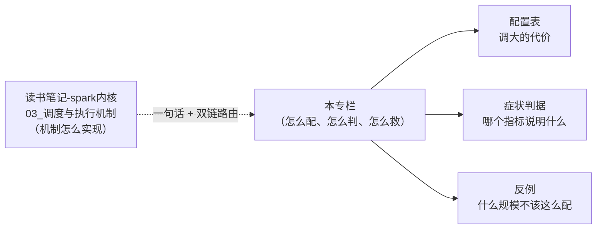

# Spark 调度系统与执行模型 · 专栏导览

## 这一列解决什么问题

Spark 的调度器不是一个"配好就不用管"的组件——同一份代码，`spark.locality.wait` 差三位数就能让作业快慢差一倍，`minRegisteredRatio` 设成 1 会让作业永远等不到资源，开了 FAIR 却所有作业用同一个池等于没开。

这一列回答的是**怎么把它调对**：每个开关决定什么行为、调错的症状长什么样、从哪个指标能认出来。

至于调度器的**内部实现**——Stage 划分算法、TaskSetManager 的数据结构、事件循环与锁、`resourceOffers` 的分配流程——在另一套专栏里已经逐组件拆过（`读书笔记-spark内核` 的 `03_调度与执行机制` 分册，10 篇，每篇 13,000 字以上）。本专栏不重讲那些，需要时用双链指过去。

**技术版本**：Spark 4.3.0（2026-10-30，预编译 Scala 2.13）。默认值以官方 Configuration 文档为准，4.x 与旧版存在差异的地方会标注，不确定处写「以对应版本文档为准」。

## 两套专栏的分工

判断一段内容该放哪边很简单：如果它讲的是"代码怎么走的"，放内核系列；如果它讲的是"我该把参数设成多少、出问题先看哪里"，放这里。

## 目录

| 序号 | 文章 | 这一篇回答什么 |
| :--- | :--- | :--- |
| 01 | [[01 任务提交全链路：从用户代码到 RDD 动作的触发细节]] | 作业卡在提交阶段时，用四行日志切成三段定位；资源闸门的真实语义；`--packages` 为什么与调度器无关 |
| 02 | [[02 DAGScheduler 核心逻辑：Stage 划分算法与逻辑计划生成]] | Stage 数过多或过少的诊断；AQE 默认并不真合并；"一个 action = 一个 Job"的四个反例 |
| 03 | [[03 TaskScheduler 架构解析：任务编排与调度后端的协作机制]] | "任务派不下去"的差集算法；可用 slot 的正确口径；"一秒一批"说明即时路径被堵 |
| 04 | [[04 调度后端（SchedulerBackend）：Spark 与资源管理器（YARN，K8s）的对接细节]] | 后端层没有"申请"动作；Standalone 闸门的双重失效；资源等待的七段与四条证据链 |
| 05 | [[05 调度算法深度剖析：FIFO 与 FAIR 策略的实现原理与应用场景]] | 应用内公平性；默认池的两条构建路径；判断"公平性有没有真生效"的五条判据 |
| 06 | [[06 Task 运行生命周期：从 TaskSetManager 分发到 Executor 端执行]] | 单 Task 的七段计时归属；`TaskMetrics` 各字段高意味着什么；Scheduler Delay 是残差不是采集量 |
| 07 | [[07 执行器（Executor）底层机制：任务运行环境、线程池管理与资源隔离]] | 三本账与谁在判定边界；加核与加内存各自的失效条件；同 JVM 三条拖慢路径的可分辨判据 |
| 08 | [[08 推测执行（Speculative Execution）：分布式环境下长尾任务的自动修复机制]] | 它治长尾不治倾斜；幂等性前提；什么时候开了反而更糟 |
| 09 | [[09 本地化调度（Locality-Aware Scheduling）：移动计算而非移动数据的实现细节]] | 本地性在真实集群里的退化与挽回；`locality.wait` 的调参判据；shuffle 之后本地性已失效 |
| 10 | [[10 动态资源申请（Dynamic Resource Allocation）：弹性计算的资源调度逻辑]] | 弹性不生效的五种成因；抖动的成因；ESS 为什么是前提 |

## 阅读路径

- **排障优先**：03（任务不动）→ 07（资源不够）→ 09（本地性差）→ 01（提交就卡）
- **调优优先**：02（Stage 结构）→ 06（单任务成本）→ 10（弹性）
- **多租户场景**：05（应用内公平）→ 04（跨管理器差异）
- **不建议**：跳过导读直接读 08。推测执行是最容易被当成万能药的一个开关，不知道它治什么会白开。

## 关联专栏

- [[大数据/Spark/读书笔记-spark内核/00 专栏导览|Spark 内核剖析]]：调度机制的内部实现（本专栏的机制支撑）
- [[大数据/Spark/读书笔记-spark内核/03_调度与执行机制/5. Spark_DAGScheduler_Stage划分|Stage 划分算法]]：第 02 篇的机制出处
- [[大数据/Spark/读书笔记-spark内核/03_调度与执行机制/6. Spark_TaskScheduler_深度解析|TaskScheduler 深度解析]]：第 03、05、09 篇的机制出处
- [[大数据/Spark/读书笔记-spark内核/06_性能调优实战/3. Spark集群资源分配与并行度调优|资源分配与并行度调优]]：第 07、10 篇的配置算术
- [[大数据/Spark/Spark-on-Kubernetes工程实践/00 专栏导览|Spark on K8s]]：第 04、10 篇在容器平台上的形态
- [[大数据/Hadoop/Yarn/00 专栏导览|YARN]]：对外部资源管理器的完整视角

> [!note] 使用建议
> 这一列的表都带「调大的代价」一列，是刻意这么排的——调度参数没有单向的"越大越好"，每一处调大都在别处换了东西。读配置表时先看代价那一列，再看推荐值。