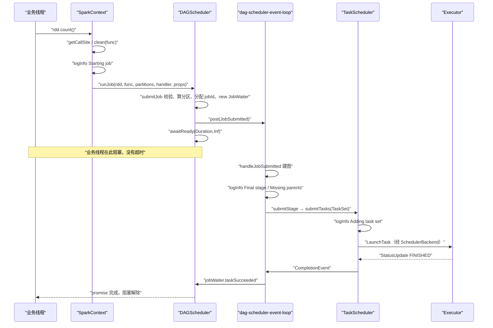
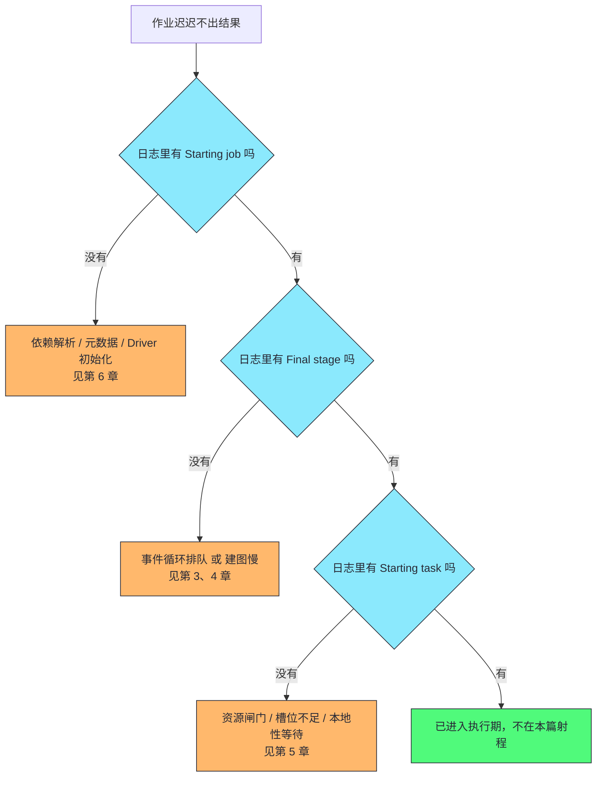

# 01 任务提交全链路：从用户代码到 RDD 动作的触发细节

**摘要：**
一线值班最常遇到的一类抱怨是“作业卡住了”，而“卡住”至少有三种彼此无关的含义：作业根本没提交出去、提交了但一个 Task 都没起、Task 起来了但跑得慢。本篇只处理中间那一段——从 action 被调用，到第一条 Task 在 Executor 上启动，中间到底发生了什么、每一段在日志与 UI 上留下什么痕迹、慢的时候该看哪个指标。文章把提交链路切成五段，逐段给出可观测点，并把“提交慢”归纳成四类成因：Driver 侧建图慢、事件循环与监听总线积压、`spark.scheduler.maxRegisteredResourcesWaitingTime` 一类资源闸门、以及外部依赖与元数据解析。在此之上补三块运维口径的内容：同步 action 为什么会让同一 Driver 上的其他作业排不上队、`localProperties` 与作业组如何决定“UI 上这个作业归谁”、以及哪些看起来能调大的参数其实只是把问题从延迟挪成内存与错误。调度机制的内部推导不在这里重复，`runJob`、`JobWaiter`、事件循环与属性传播的细节分别见内核系列的 Job 生命周期与 SparkContext 两篇。

## 第 1 章 先把“提交阶段”划出来

### 1.1 一个加资源也无效的慢

集群里每天跑两千个作业、三百来台机器，某个报表作业的端到端时间是四十分钟，其中三十二分钟花在三十几个 action 上一个接一个地提交。运维的第一反应通常是加 Executor，但这一类慢对资源不敏感：加机器之后端到端时间几乎不动，因为时间根本不在计算上。把 Driver 日志按时间戳摊开，会看到这样的节奏——`Starting job` 打出来，隔了二十几秒才出现 `Final stage`；又一个作业 `Starting job` 之后，`Adding task set` 与 `Starting task` 之间空了四十秒；再往后是一段长长的沉默，期间连 `Starting job` 都没有。三种沉默，三段完全不同的病因。

所以本篇先把边界钉死：**提交阶段**指从用户代码调用 action（`count`、`collect`、`saveAsTextFile`、`foreach` 等）开始，到第一条 Task 在某个 Executor 上真正开始执行的这段时间窗。它不产出任何计算结果，纯粹是“组织一次计算”的开销。它由 Driver 单机的 CPU、单线程的事件循环、以及集群资源的到货速度共同决定，与 Executor 的算力基本无关。


### 1.2 为什么不重讲机制

`runJob` 的七重载、`submitJob` 的校验与短路、`JobWaiter` 的 Promise 语义、`ThreadUtils.awaitReady` 没有超时、事件循环为什么是单线程、`localProperties` 的四次搬运与线程池里的两种走样，这些在内核系列里已经逐行拆过。本篇的写法是“把机制当已知量”，只保留三样对排障有用的东西：分段、每段的观测点、以及每段耗时异常时的判据。

机制细节见 [[大数据/Spark/读书笔记-spark内核/03_调度与执行机制/9. Spark_Job生命周期详解|Spark Job 生命周期详解]]（提交路径、`JobWaiter`、取消与失败的三级放大）与 [[大数据/Spark/读书笔记-spark内核/03_调度与执行机制/2. SparkContext深度剖析|SparkContext 深度剖析]]（单例边界、`localProperties` 传播、作业组与取消）。任务分发之后的环节见 [[大数据/Spark/读书笔记-spark内核/03_调度与执行机制/6. Spark_TaskScheduler_深度解析|TaskScheduler 深度解析]]，本地性等待造成的那部分延迟见 [[09 本地化调度（Locality-Aware Scheduling）：移动计算而非移动数据的实现细节|本地化调度]]。

### 1.3 贯穿案例

后文沿用同一个场景：三百节点的混部集群，YARN 与 Kubernetes 各占一半，每天约两千个作业，其中既有跑二十分钟的批处理，也有跑三秒钟的取数查询。有争议的作业是一个报表任务，它把同一份宽表按十八个业务口径各刷一次，每次一个 action；另有几个实时取数接口，跑在长驻 Driver 的 Thrift Server 里。这两类负载对提交阶段的敏感度完全不同，后面每讲一个配置，都要回到它们身上看代价。

## 第 2 章 五段链路与它们各自留下的痕迹

### 2.1 分段原则

分段的依据不是组件名，而是“谁能观测到”。每段的开始与结束都要能在 Driver 日志里找到一行确定的输出，否则运维没法在事后复盘。按这个标准，一次同步 action 的提交可以切成五段。

| 段 | 起点 | 终点 | 这段在干什么 | 典型耗时量级 |
|---|---|---|---|---|
| 一、用户代码与计划 | 请求进入业务方法 | `Starting job` 日志 | 构造 DataFrame / RDD、解析 schema、列目录、查元数据 | 毫秒到分钟 |
| 二、提交与属性快照 | `Starting job` | `Final stage:` 日志前 | 解析调用点、清理闭包、算分区、分配 jobId、投事件 | 毫秒到秒 |
| 三、建图 | `Final stage:` | `Adding task set` | 递归建 Stage DAG、找缺失父 Stage、构造 TaskSet | 毫秒到数十秒 |
| 四、闸门与排队 | `Adding task set` | `Starting task` | 等资源注册达标、等槽位、等本地性降级 | 秒到分钟 |
| 五、下发 | `Starting task` | Executor 侧 `Running task` | 序列化 Task、经 RPC 送达、反序列化 | 毫秒级 |

表里第四段的“等本地性降级”属于执行期调度的范畴，放在这里是因为它与资源到货混在同一段日志区间里，排障时必须一起看。

### 2.2 一次提交的时序与日志对照

把五段画成时序，横轴是时间，纵向的每条泳道对应一个线程。EventLoop 那条泳道是最容易堵的，因为它一根线程要同时处理新作业提交、Task 完成、Executor 上下线。



日志侧有几个锚点值得背下来：`Starting job: count at Foo.scala:42` 由 `SparkContext.runJob` 打出，此时还没进事件循环；`Final stage: ResultStage 0 (count at Foo.scala:42)` 由事件循环在 `handleJobSubmitted` 里打，此时 DAG 已经建完；`Submitting ResultStage 0 (...), which has no missing parents` 与 `Submitting 3 missing tasks from ResultStage 0` 紧挨着出现在同一线程；`Adding task set 0.0 with 3 tasks` 由 `TaskSchedulerImpl.submitTasks` 打出；再往后是 `TaskSetManager` 的 `Starting task 0.0 in stage 0.0 (TID 0)`。这几行的顺序与间距，就是四类成因的分界线。

### 2.3 UI 只反映事件，不反映线程状态

Spark UI 的 Jobs 与 Stages 页不是实时状态机，它消费的是 `SparkListenerJobStart`、`SparkListenerStageSubmitted` 这类事件。由此得到一条非常实用的推断：`SparkListenerJobStart` 在 `handleJobSubmitted` 中、建图完成之后才投递，所以“UI 上还没有这个作业，日志里已经有 `Starting job`”，说明作业正卡在建图或排队进事件循环；“UI 上有作业但没有 Stage”，说明建图完成而 Stage 事件还没发出，卡在 `submitMissingTasks` 里的 Task 构造与位置计算。反过来，“日志里连 `Starting job` 都没有”，问题压根不在调度器，得往前找依赖解析与元数据。

把这条推断做成判断树，排障时按顺序问三个问题即可收敛。



### 2.4 线程转储是最后一块拼图

日志给区间，UI 给状态，两者都不能回答“这根线程此刻在干什么”。Driver 是普通 JVM，`jstack`（或用 Spark UI 的 Thread Dump 页）可以直接看。要认的线程名不多：`dag-scheduler-event-loop` 是 DAGScheduler 的唯一执行线程；`spark-listener-group-shared`、`spark-listener-group-appStatus`、`spark-listener-group-executorManagement`、`spark-listener-group-eventLog` 是监听总线各自的分发线程；`driver-revive-thread` 周期性地触发资源报价；`task-starvation-timer` 负责那条“Initial job has not accepted any resources”的告警。

判据很直接：业务线程停在 `awaitReady`、而事件循环线程的栈顶落在 `createResultStage` 或 `getMissingParentStages`，是建图慢；事件循环线程的栈顶落在 `handleTaskCompletion` 且转储连续几次都如此，是完成事件洪峰；业务线程还停在 `eagerlyComputePartitionsForRddAndAncestors`，是分区元数据计算慢——这一处是提交时在调用方线程上预热的，机制见内核 Job 生命周期那一篇；业务线程停在 Ivy、HMS 或对象存储客户端里，那作业还没进 Spark。

### 2.5 在日志上切段的实操

线上 Driver 日志动辄几百兆，逐行读不现实，按锚点行切段才是可持续的做法。四类锚点行都有稳定前缀，抽出来之后按时间排序，相邻两行的差值就是对应段的耗时；不需要装任何 Spark 侧工具，一份日志加两个命令就够。

```bash
# 抽出四类锚点：提交、建图完成、任务集入队、任务启动
grep -E "Starting job:|Final stage:|Adding task set|Starting task [0-9]" \
  spark-driver.log > anchors.log
# 带毫秒时间戳排序（日志格式为默认的 log4j 布局时，前两个字段即日期与时间）
sort -k2 anchors.log | head -n 60
```

拿到三个差值之后别急着看单条，先看分布。同一个报表作业在一天里跑几十批，取 P50 与最大值的差别比取平均更有用：P50 大说明结构性慢，最大值大而 P50 正常说明是偶发争抢。笔者的习惯是给每个差值单独列一张分钟级的时间序列，三条曲线叠在一起，哪个先抬起来一目了然——这比对着一条几百兆的日志反复翻要快得多。

## 第 3 章 成因一：Driver 侧建图慢

### 3.1 建图成本由什么决定

事件循环拿到 `JobSubmitted` 之后要做的第一件重活，是从最终 RDD 向上递归，遇到宽依赖就切一个 Stage，遇到窄依赖就并进当前 Stage。这条递归的成本与三件事成正比：RDD 链的深度、宽依赖的个数、以及每个 RDD 的分区数。深度决定递归调用次数；宽依赖个数决定 Stage 对象、`stageIdToStage` 映射、以及为每个 Stage 构造 `StageInfo` 的数量；分区数决定后面 `submitMissingTasks` 要造多少个 Task 对象、要为多少个分区算首选位置。

一个反直觉的地方是**分区数**的影响远大于血缘深度。某个报表作业的血缘只有二十来层，但最末端的分区数是二十万，`submitMissingTasks` 要为此构造二十万个 Task 描述、逐个算位置、再打包成 TaskSet；这一段发生在事件循环线程上，期间所有新作业的提交都排在它后面。现象就是“每个作业单看都不慢，但一批作业一起提就集体变慢”，因为它们在排队等同一根线程。

判据可以量化到日志间隔：`Final stage` 与 `Adding task set` 之间的毫秒数，除以该 Stage 的 Task 数，得到单任务建造成本。这个比值在正常集群里是微秒级，一旦上升到毫秒级，说明每个 Task 的构造都在做额外工作——最常见的是闭包过大（序列化时要复制几十 MB 的查找表）、或首选位置计算在反复查 BlockManager。

### 3.2 缓存治不了建图慢

很多人把 `cache()` 当成万能药。它确实能省掉重算，但一点也省不掉建图：每个 action 仍然要重新走一遍递归、重新构造 TaskSet、重新投事件。缓存改变的是 Stage 内部的计算量，不改变 Stage 的拓扑数量。真正能压住建图成本的手段是减少 action 次数与减少分区数：把十八个业务口径合成一次 `groupBy` 后的单次聚合，比给中间结果加缓存有效得多；把末端分区数从二十万降到两万，TaskSet 的构造成本直接降一个数量级，代价是单 Task 处理的数据量变大，需要同时放宽 Executor 内存与 `spark.task.cpus`。

还有一类建图慢来自“每次都重新算一遍分区”。某些 RDD 的 `getPartitions` 需要访问文件系统或元数据服务，Spark 在提交时就把它算完（SPARK-23626 的处理），目的是不让这根慢路径污染事件循环。这段计算落在业务线程上，日志上表现为 `Starting job` 之后一段空白，然后才出现 `Final stage`；线程转储能直接看到业务线程停在分区计算里。它不属于调度器的问题，改法是把文件系统的目录规模降下来，或者干脆在作业开头就把数据读成带固定分区的格式。

### 3.3 建图慢的处置顺序

| 观察 | 结论 | 处置 |
|---|---|---|
| `Final stage` 距 `Starting job` 超过数秒，且 Stage 数很多 | 宽依赖过多，拓扑复杂 | 合并业务口径，减少 shuffle 级数 |
| `Adding task set` 距 `Final stage` 长且与 Task 数成正比 | 分区数过多 | 降分区数，或改用 AQE 收敛末端分区 |
| 每个 Task 构造耗时在毫秒级 | 闭包过大或位置查询变慢 | 大表改广播变量，缓存 RDD 控制规模 |
| 业务线程停在分区计算 | 分区元数据慢 | 收敛目录规模，固定输入分区 |

## 第 4 章 成因二：事件循环与监听总线积压

### 4.1 一根线程的吞吐上限

DAGScheduler 的事件循环是**单线程**，这一点在内核系列里已经从“为什么必须单线程”的角度论证过。从运维角度看，它的意义是：这根线程的处理能力就是整个 Driver 的作业吞吐上限，而它处理的事件里有相当一部分不是新作业，而是 Task 完成。一个 Stage 有一万个 Task，就有至少一万个完成事件要过这根线程，每个事件都要更新 MapOutputTracker、做失败统计、回调 `JobWaiter`。完成事件的洪峰会直接挤占新作业的提交。

所以“事件循环积压”的判据不是“listener 太多”，而是“完成事件率太高”。表现是：`Starting job` 与 `Final stage` 的间隔随着集群负载上升而变长，空闲时段同一个作业只需要几百毫秒。可观测的指标是 `DAGScheduler` 这个 metrics source 下的 `messageProcessingTime`（一个 Timer，统计事件处理耗时），以及 `job.activeJobs`、`stage.waitingStages` 的绝对值。前者持续偏高说明线程饱和，后者堆高说明任务在等资源而不是在等线程。

### 4.2 监听总线是另一条队列，它不阻塞提交

监听总线（LiveListenerBus）与 DAGScheduler 的事件循环是两套东西。总线按用途分成几个队列——`shared` 放用户与内置的普通监听器，`appStatus` 供状态存储构建 UI，`executorManagement` 供执行器管理，新版还把事件日志单独放进 `eventLog` 队列——每个队列一根分发线程，互不干扰。这正是“listener 多”与“提交慢”之间那层容易搞错的关系：投递事件用的是 `offer`，队列满时事件被丢弃并计数，**不会反压提交方**。

由此得到一条很有用的反直觉结论：慢 listener 不会让作业提交变慢，它会让 UI 与事件日志丢事件，表现为“作业跑完了，UI 上却没有”或者“History Server 里这个 Stage 缺了一段”。真正会拖慢提交的，是 Driver 堆上堆积的事件对象引发的 GC，以及自定义 listener 在 `onJobStart` 里做同步 RPC 时占住的 driver 线程。

| 现象 | 指向 | 首查 |
|---|---|---|
| 提交间隔长，`messageProcessingTime` 高，UI 完整 | 事件循环饱和 | 完成事件率、Task 数、Stage 数 |
| 提交正常，UI 偶发缺作业/缺 Stage | 监听总线丢事件 | `queue.<name>.numDroppedEvents` |
| Driver GC 频繁，所有操作一起变慢 | 队列容量过大或 listener 持有大对象 | Driver 堆、队列 size、listener 实现 |
| UI 与事件日志都缺，且 Driver 内存正常 | 保留数上限淘汰 | `spark.ui.retainedJobs`、`retainedStages` |

### 4.3 配置与代价

监听总线的两个关键参数是队列容量与慢事件日志。默认容量一万，按队列覆盖，配置项形如 `spark.scheduler.listenerbus.eventqueue.shared.capacity`；慢事件日志默认开启，阈值一秒，超过阈值的处理会留下记录，这是找“哪个 listener 慢”的第一手材料。

调大容量要清楚代价：队列里装的是事件对象，容量翻十倍，极端场景下 Driver 堆上可能多出十倍的事件对象，而事件对象里往往挂着 Task 的 metrics 与累加器快照。把容量调大并没有让消费变快，只是把“丢弃”换成“堆积”，把一次可观测的错误换成一次不可观测的 GC。正确的顺序是先减少事件产出（合并分区、关掉不必要的事件类型、把审计 listener 改成异步落盘），再考虑容量。

### 4.4 自定义监听器的两条纪律

内置监听器大体可控，真正把 Driver 拖垮的往往是自研的那一个。审计、埋点、把作业开始事件推到消息队列，这些需求都会写成一个 `SparkListener`，而最省事的写法就是在回调里直接发网络请求。队列分发线程是串行的，一个几十毫秒的同步调用乘以每秒上万条 Task 事件，队列立刻从“忙”变成“满”。

```scala
// 反例：回调里同步写库，占住共享队列的分发线程
override def onJobStart(event: SparkListenerJobStart): Unit = {
  auditJdbc.insert(event.jobId, event.properties)   // 网络往返加事务，几十毫秒起步
}

// 改法：回调只入队，独立线程批量落盘，满了就丢并计数
override def onJobStart(event: SparkListenerJobStart): Unit = {
  if (!buffer.offer(toRecord(event))) droppedCounter.increment()
}
```

纪律就两条：回调只做入队，不做 IO；队列有界并单独线程消费，丢弃必须打点。第二条尤其重要，因为丢弃本身是静默的，不打点就只能靠用户来告诉你“UI 上少了一个作业”。

## 第 5 章 成因三：资源闸门与“起了但没跑”

### 5.1 闸门到底在哪一段

`spark.scheduler.maxRegisteredResourcesWaitingTime` 常被误解成“作业等待资源的超时”，其实它管的是调度后端“就绪”的判定。`TaskScheduler` 启动后有一个后置钩子，会等后端就绪；后端的判据是两条取其一：已注册资源达到 `spark.scheduler.minRegisteredResourcesRatio` 设定的比例，或者从后端创建起已经等满了这个时间。两条路谁先满足谁生效，日志里分别对应 `SchedulerBackend is ready for scheduling beginning after reached minRegisteredResourcesRatio: ...` 与 `... after waiting maxRegisteredResourcesWaitingTime: 30000.0(ms)`。

这两条路带来三个容易被忽略的后果。第一，等待发生在**应用启动期**，而不只是首个作业：`SparkContext` 的构造要等这个钩子返回，所以会出现“应用日志打完了、UI 也起来了，但第一个 action 迟迟不开始”的现象。第二，闸门只管“首次启动任务”，一旦有任务被拉起，后续作业不再受它约束。第三，比例没达标而时间到点时，Spark 不会失败，它会用当时到货的资源直接开跑，于是首批任务只占满一部分槽位，后面的 Stage 继续排队——端到端反而更长。

### 5.2 与饥饿告警的分工

闸门之外还有一条独立的告警：首次提交任务后，如果一直没有任务被真正拉起，`TaskScheduler` 会每隔 `spark.starvation.timeout`（默认十五秒）打一次 `Initial job has not accepted any resources; check your cluster UI to ensure that workers are registered and have sufficient resources`。这条日志与闸门日志配合起来才能定性：先看有没有 `SchedulerBackend is ready`，有就说明闸门已过、问题在槽位或本地性；没有就说明闸门还没过，问题在后端注册。

Kubernetes 与 YARN 上的具体形态不同。Kubernetes 上 executor Pod 可能长时间 Pending，原因从资源不足、镜像拉取慢到节点亲和性不满足都有，Spark 侧只能看到“没有 executor 注册”；YARN 上则是容器申请排在队列里，Spark 侧看到的是 `totalRegisteredExecutors` 长期为零。这两类都是“集群侧慢”，不是 Spark 调度器慢，判据是 Spark UI 的 Executors 页为空、而集群侧页面能看到处于等待态的容器。

| 配置 | 文档默认 | 作用 | 调大的代价 |
|---|---|---|---|
| `spark.scheduler.maxRegisteredResourcesWaitingTime` | 30s | 比例未达标时的最长等待 | 每次应用启动与首个作业固定多等，短作业被拖长；弹性集群上资源本就分批到货，等满只是空转 |
| `spark.scheduler.minRegisteredResourcesRatio` | YARN 口径 0.8，Standalone 口径 0.0（版本间有出入，以对应版本文档为准） | 达标即放行 | 比例越高越接近“等满时间”，在异构或按需扩容的集群上等价于把等待时间调大 |
| `spark.starvation.timeout` | 15s | 饥饿告警的重复间隔 | 只影响告警密度，调大等于让“没资源”这件事更晚被发现 |
| `spark.executor.cores` / `spark.executor.instances` | 1 / 未设 | 决定首批槽位规模 | 单 Executor 核数调大，首批任务数变少、并行度上升慢，配合比例闸门会进一步拉长首个 Stage 的启动 |

### 5.3 闸门与弹性资源的配合

闸门参数与动态资源分配叠在一起时最容易反直觉。动态分配下期望资源是按需申请的，比例的分母并不是“最终会有多少 Executor”，而是当前申请的规模；于是等待行为取决于集群多快把第一批容器给出来。Kubernetes 上拉一个 Executor Pod 的时间由镜像大小、调度排队、卷挂载共同决定，单 Pod 准备时间一旦接近等待上限，闸门事实上“从来没等齐过”，日志会稳定落在 `after waiting maxRegisteredResourcesWaitingTime` 这一句上，而运维以为自己在等资源达标。

据此可以给出一个粗糙但好用的分档：跑几十秒的短作业，把等待上限压到几秒、比例显式设为零，让首批任务用先到的资源立刻开跑，靠后续 Stage 逐步铺满；跑几十分钟的批处理，保留默认值甚至略调大，用启动期的一点等待换首 Stage 的并行度；跑在按需扩容集群上的作业，优先解决镜像与调度时延，而不是继续加等待时间。

## 第 6 章 成因四：外部依赖与元数据解析

### 6.1 依赖解析发生在 Driver 之前

用 `--packages` 提交时，**Ivy 解析**并不发生在 DAGScheduler 里，也不在事件循环里，而是在 `SparkSubmit` 这个提交进程里完成。客户端模式下它与 Driver 同进程，集群模式下它是集群外那台提交机上的进程，Driver 还没被拉起。所以它慢起来的样子不是“作业提交慢”，而是“提交命令挂在那里，UI 根本没有应用”：日志停在解析与下载的进度上，偶尔能看到解析仓库的地址与重试记录。

这类问题的处置不在调参上，而在预置与隔离：把依赖预置进镜像或 `spark.jars.ivy` 指向的本地缓存，把内网镜像仓库配成首选并缩短不可达仓库的超时，或者干脆打成 fat jar 用 `--jars` 直传。判据也很直接：同一份代码换成本地已有缓存的机器提交就快，说明是解析与网络；换机器没变化，才轮到怀疑 Spark。


### 6.2 元数据与目录列举

另一类“连 `Starting job` 都没有”的慢来自读数据之前的准备工作。读 Parquet 时要列目录、推断 schema、构造文件索引；读 Hive 表要连 metastore、做分区裁剪；在对象存储上，列一个几十万文件的目录意味着几十万次分页请求，这些工作全部在 Driver 上串行完成。它的可观测特征是 Driver 日志停在该阶段的最后一行、UI 上的应用存在但没有任何作业、`jstack` 里业务线程停在文件系统或 metastore 客户端。

这类问题的改法是改变数据布局与访问方式，而不是调调度参数：把目录按天分区、控制单分区文件数、用清单文件替代目录列举、把 metastore 的元数据规模控制在可裁剪的范围内。一个实用的判据是看“同一张表换一个分区读”是否同样慢，若同样慢则问题在表级元数据，若只有全表扫描慢则是目录规模。

## 第 7 章 同步与异步的运维含义

### 7.1 被 action 占住的线程

同步 action 在 Driver 上是一条**没有超时**的等待，业务线程会一直停在那里直到作业成功、失败、被取消，或 `SparkContext` 关闭。这条等待本身不占锁，也不阻塞 DAGScheduler，但它占住了一个业务线程，并且让这个业务线程所在的执行上下文无法继续提交下一个作业。对于“一个驱动线程串行刷十八个口径”的报表作业，这是设计使然；对于长驻服务，这是事故来源：接口线程池的线程全部阻塞在 action 上，新请求进不来，表现为“服务卡死”而 CPU 与集群都空闲。

同一 Driver 上的多个作业之间没有排他锁，但它们共享 Driver 的 CPU、堆与事件循环。一个阻塞线程不会让别人的提交变慢，一堆阻塞线程加一个慢 GC 才会。所以判断“是不是同步阻塞导致的慢”，要看的是 Driver 的线程数与 GC，而不是作业数。

| 维度 | 同步 action | 异步提交 |
|---|---|---|
| 返回 | 结果或异常 | `Future`/`FutureAction`，作业在后台推进 |
| 阻塞位置 | 业务线程 | 不阻塞业务线程，但回调仍落在事件循环线程 |
| 取消 | 需另一线程按组或按 Job 取消 | 同上，且更容易做超时兜底 |
| 适合 | 批处理、单线程 ETL | 长驻服务、可取消的交互查询 |
| 风险 | 线程池耗尽、无超时等待、中断默认不开 | 回调里做重活会拖慢事件循环；属性在异步线程里可能丢 |

### 7.2 回调不是“另一个线程”

异步 API 只把等待挪走，没有把回调挪走。结果处理器在事件循环线程上被调用，这一点在内核系列里已经指出。运维上的含义是：任何在结果处理器里做的重活——写数据库、发 HTTP、拼大字符串——都会直接拖慢整个 Driver 的调度。把重活丢到业务线程池、回调里只做入队，是异步写法必须遵守的纪律。

### 7.3 部署模式改变了“看哪里”

客户端模式下 Driver 就在提交机里，与业务进程共享 CPU 与网络，`--driver-memory` 不能通过 `SparkConf` 设置；集群模式下 Driver 在 AM 或 Pod 里，日志要通过 `yarn logs` 或 `kubectl logs` 去捞。提交阶段的耗时恰恰大量落在 Driver 单机上，所以“同一份代码在客户端模式快、集群模式慢”往往不是调度问题，而是 Driver 所在机器的资源与网络差异。排障时先把 Driver 日志拿到手，再谈分段。

### 7.4 止损只能从外部发起

同步等待没有超时，意味着作业一旦卡住，取消只能由另一条线程或外部系统发起：按作业组取消、按 job ID 取消、或者直接停掉 SparkContext。前两者依赖作业组或作业 ID 能对上，第三条的代价是整个应用退出，正在跑的其他作业一起陪葬。这也解释了为什么第 8 章要把作业组当成必配项而不是可选装饰——它是止损开关的把手。

还有一层容易被忽略的语义：按组取消只对提交时刻已经存在的作业生效。取消动作返回之后，同一线程若再提交一个同组的 action，它会照常运行；要让取消对“后续还会来的同组作业”也生效，得用 4.x 提供的按组取消并拦截后续作业的接口，它把组 ID 记进一个容量受限的集合，之后同组作业提交时直接失败。长跑服务选宽语义更安全，一次性批处理选窄语义更贴合直觉，机制与取消的四个检测点见内核 Job 生命周期那一篇。

## 第 8 章 作业归属：为什么 UI 上找不到那个作业

### 8.1 三处证据

一个作业在系统里留下三处归属证据，它们的来源都是同一个属性表：UI 的作业描述列（没有设置描述时回落到调用点的短形式）、REST 接口 `/api/v1/applications/<appId>/jobs` 里的作业组字段、以及事件日志中作业开始事件携带的属性快照。所以“归属”问题的根因几乎总是同一个：属性没有在提交 action 的那个线程上设置，或者被后台线程池洗掉了。

| 证据 | 位置 | 依赖的属性 | 缺失时的表现 |
|---|---|---|---|
| 作业描述 | UI Jobs 页 Description 列 | `spark.job.description` | 显示框架代码的调用点，如 `Dataset.collect` |
| 作业组 | REST 作业列表的组字段、事件日志 | `spark.jobGroup.id` | 按组取消时匹配不到，日志出现“找不到活动作业”的告警 |
| 调度池 | FAIR 模式下的池归属 | `spark.scheduler.pool` | 作业全部落进默认池，公平性配置失效 |

属性的传播机制与线程池里的两种走样在内核系列里拆过，这里只留运维口径的写法：在真正调用 action 的那个线程上设置，用 `try/finally` 收尾；不要在“发起请求”的线程上设置后指望子线程继承，因为线程池的工作线程创建时机不受控，继承只发生在线程创建那一刻。

### 8.2 六种“UI 上没有”

“UI 上找不到作业”不是单一故障，至少有六种成因。按表格从上往下逐行排除：前三行看日志与线程栈，后三行看保留策略、监听器实现与属性设置。

| 现象 | 成因 | 首查位置 |
|---|---|---|
| 日志有 `Starting job`，UI 无作业 | 建图未完成或事件循环排队 | `Final stage` 日志、事件循环线程栈 |
| 日志与 UI 都无，但应用在 | 依赖解析、元数据列举 | 提交进程日志、Driver 线程栈 |
| UI 有作业无 Stage | `submitMissingTasks` 未完成 | `Adding task set` 日志、Stage 数 |
| 作业曾出现后消失 | 保留数上限淘汰 | `spark.ui.retainedJobs`、`retainedStages` |
| UI 缺事件但日志正常 | 监听总线丢事件 | `queue.<name>.numDroppedEvents`、丢弃日志 |
| 作业归到错误组或错池 | 属性丢或串味 | `setJobGroup` 调用位置、线程池复用 |

第五行值得单独强调。监听总线队列满时打出的告警是 `Dropping event from queue <name>. This likely means one of the listeners is too slow and cannot keep up with the rate at which tasks are being started by the scheduler.`，这条日志一旦出现，UI 与事件日志的完整性就不再可信，此时任何“UI 上找不到”的结论都要先打折。

### 8.3 给作业起名字的实际收益

`setJobDescription` 与 `setJobGroup` 的成本几乎为零，收益却集中在排障时刻：日志里能按业务键 grep，UI 上能按批次对照，REST 接口能按组统计耗时。一个可操作的做法是把批次号写进描述，例如把“日终对账-20261119-第三批”作为描述、把业务线作为组 ID，再包一层作用域函数保证异常路径也清理。这件事不需要改调度参数，也不需要重启集群，属于投入产出比最高的那类改动。

## 第 9 章 反例与配置总表

### 9.1 四种把提交阶段拖长的写法

第一类是在 Driver 里做重活。用 `collect()` 把几百万行拉到 Driver 再循环处理，或者对每个元素发一次 RPC，这类写法把本该在 Executor 上并行的工作搬回单机，提交阶段与执行阶段一起被拖长，还顺带把 Driver 堆吃掉。它的问题不在调度参数，改法是把计算下推到 Executor，只把聚合结果拉回来。

第二类是把资源闸门调到很大。有人看到“等资源”的日志，就把 `maxRegisteredResourcesWaitingTime` 从三十秒调到五分钟，以为能让作业等足资源再开跑。实际效果是每个短作业都先固定空等，且比例达标后依然按当时到货的资源开跑，端到端时间反而更长。真正该调的是资源到货速度与首批槽位规模，而不是等待上限。

第三类是忽略作业组。批处理里十八个 action 全用默认属性，出事时既没法按业务线取消，也没法在 UI 上把同一批次的作业归拢；一旦有人用按组取消做止损，会发现匹配不到任何作业，因为组 ID 根本没设。

第四类是把重活塞进监听器与结果处理器。自定义监听器在 `onJobStart` 里同步写审计表，结果处理器里拼大对象，两处都在 Driver 的关键线程上，前者在监听队列线程上拖慢 UI 与事件日志，后者在事件循环线程上拖慢所有作业。

| 反例 | 表面症状 | 实际原因 | 替代做法 |
|---|---|---|---|
| Driver 里 `collect` 后循环 | 作业超时、Driver OOM | 单机串行 + 结果集过大 | 下推计算，只回聚合 |
| 闸门调到数分钟 | 短作业启动固定变慢 | 等待上限与到货速度无关 | 提高资源到货速度、调首批槽位 |
| 不设作业组 | 按组取消失效、UI 归不了类 | 属性表为空 | 作用域内设置组与描述 |
| 监听器同步写库 | UI 与事件日志缺事件 | 队列消费慢、事件被丢 | 监听器只入队，异步落盘 |
| 循环里提交小作业 | 提交阶段累计数分钟 | 每次 action 都重新建图 | 合并为一次聚合 |

### 9.2 配置总表

下面这张表把与提交阶段相关的参数收在一起，第四列统一回答“调大换来了什么、代价是什么”。默认值以官方 Configuration 文档为准，版本间若有出入以对应版本为准。

| 配置 | 默认 | 调大的收益 | 调大的代价 |
|---|---|---|---|
| `spark.scheduler.maxRegisteredResourcesWaitingTime` | 30s | 首批资源更可能等齐 | 每次启动固定空等，短作业被拖长 |
| `spark.scheduler.minRegisteredResourcesRatio` | YARN 0.8 / Standalone 0.0（版本间有出入） | 首批并行度更饱满 | 弹性集群上等价于延长等待，首批任务铺开更晚 |
| `spark.scheduler.listenerbus.eventqueue.capacity` | 10000 | 高峰期少丢事件 | Driver 堆压力上升，丢弃变 GC |
| `spark.scheduler.listenerbus.logSlowEvent.threshold` | 1s | 少打日志 | 埋掉真正的慢事件线索，排障时无据可依 |
| `spark.scheduler.mode` | FIFO | 改 FAIR 可改善多租户响应 | 队列间切换与池配置增加运维成本 |
| `spark.extraListeners` | 未设 | 增加审计与指标采集能力 | 每个 listener 分走队列吞吐，实现不当会丢事件 |
| `spark.job.interruptOnCancel` | false | 取消能更快中断任务线程 | 外部存储写入被中断时状态不确定，依赖上游幂等 |
| `spark.driver.maxResultSize` | 1g | 允许更大结果集回传 | Driver OOM 风险前移到运行时 |
| `spark.ui.retainedJobs` / `retainedStages` | 1000 / 1000 | 长跑应用保留更久历史 | Driver 与状态存储内存增长 |
| `spark.eventLog.enabled` | false | 事后复盘与 History Server 可用 | 事件日志写入成为一批队列负载，需配存储与清理 |

### 9.3 把提交阶段变成可告警的量

要让“提交慢”从口头抱怨变成可告警的信号，先得有基线。在一段正常的日子里抽几十批报表作业，按第 2 章的三个差值分别算出 P50 与 P99，再把阈值设在不高于 P99 两倍的位置；阈值不必追求精确，它只需要能区分“日常波动”与“结构变了”。这在集群扩容、升级、或者换了资源队列之后尤其有用，因为提交阶段的耗时结构会随集群一起变，而端到端时间往往被计算时间掩盖。

| 差值 | 正常量级 | 抬升时的含义 |
|---|---|---|
| `Starting job` 到 `Final stage` | 毫秒 | 建图慢或事件循环排队 |
| `Final stage` 到 `Adding task set` | 毫秒到秒 | Task 构造、分区数、位置计算 |
| `Adding task set` 到首条 `Starting task` | 秒 | 资源闸门、槽位不足、本地性等待 |

## 第 10 章 把提交预算花在哪里

提交阶段的耗时是 Driver 的**单线程预算**，四类成因对应四种不同的花钱方式：建图花的是 Driver 的 CPU，事件循环花的是 Driver 的调度吞吐，资源闸门花的是等待时间，依赖与元数据花的是网络与元数据服务的响应。它们互不替代，所以“提交慢”永远不能只靠一个参数解决。

处置顺序应当是**先证伪再调参**：先用 `Starting job`、`Final stage`、`Adding task set`、`Starting task` 这四行日志把区间切出来，用 UI 与线程转储确认状态，再决定是改代码、改数据布局，还是改集群资源。闸门类参数最容易被当成万能旋钮，但它买到的只是“等”，而等待在短作业与弹性集群上几乎总是负收益。真正稳的收益来自减少 action 次数、控制分区规模、把重活移出 Driver 关键线程——这三件事不增加任何等待时间，只是把预算花在更少的**无效工作**上。

一个 300 节点、每天 2000 个作业的集群，提交阶段的总开销通常不是被某个巨大的作业吃掉的，而是被每天的几千次重复建图、几万次事件投递与几十次“先等满三十秒再说”累加出来的。这也是为什么这类问题难有单点修复：它需要用可观测性把成本摊开，再逐项砍掉。

## 参考资料

- Apache Spark Configuration：`spark.scheduler.*`、`spark.ui.*`、`spark.job.*` 的默认值与语义，https://spark.apache.org/docs/latest/configuration.html
- Apache Spark 源码 `TaskSchedulerImpl.scala`：`submitTasks` 的饥饿告警、`postStartHook` 的后端就绪等待，https://github.com/apache/spark/blob/master/core/src/main/scala/org/apache/spark/scheduler/TaskSchedulerImpl.scala
- Apache Spark 源码 `CoarseGrainedSchedulerBackend.scala`：`isReady` 的两条放行判据与对应日志，https://github.com/apache/spark/blob/master/core/src/main/scala/org/apache/spark/scheduler/cluster/CoarseGrainedSchedulerBackend.scala
- Apache Spark 源码 `AsyncEventQueue.scala`：队列容量、丢弃计数与丢弃告警，https://github.com/apache/spark/blob/master/core/src/main/scala/org/apache/spark/scheduler/AsyncEventQueue.scala
- Apache Spark 源码 `LiveListenerBus.scala`：队列划分、`numEventsPosted` 与逐队列指标，https://github.com/apache/spark/blob/master/core/src/main/scala/org/apache/spark/scheduler/LiveListenerBus.scala
- Apache Spark 源码 `DAGSchedulerSource.scala`：`messageProcessingTime`、`stage.waitingStages`、`job.activeJobs` 等指标，https://github.com/apache/spark/blob/master/core/src/main/scala/org/apache/spark/scheduler/DAGSchedulerSource.scala

> [!note] 思考题
> 1. 你的集群里 `minRegisteredResourcesRatio` 是显式设置的还是依赖默认值？在按需扩容的 Kubernetes 集群上，把它设成 0.8 与设成 0 相比，端到端时间会差在哪一段？
> 2. 如果 Driver 的监听队列持续丢弃事件，而 `messageProcessingTime` 一直正常，你会先怀疑哪一类 listener，为什么？
> 3. 一个作业在 UI 上有 Job 但没有 Stage，持续十几秒后正常，日志里对应的是哪两行之间的间隔？这与“资源没到货”在日志上如何区分？
> 4. 业务接口在高并发下卡死，CPU 与集群资源都很空闲，`jstack` 显示工作线程停在 `awaitReady`。这个现象与事件循环积压的处置顺序有何不同？
> 5. 把 `spark.job.interruptOnCancel` 打开能为取消止损争取时间，但为什么很多团队仍然保持默认关闭？需要上游满足什么前提才能安全打开？