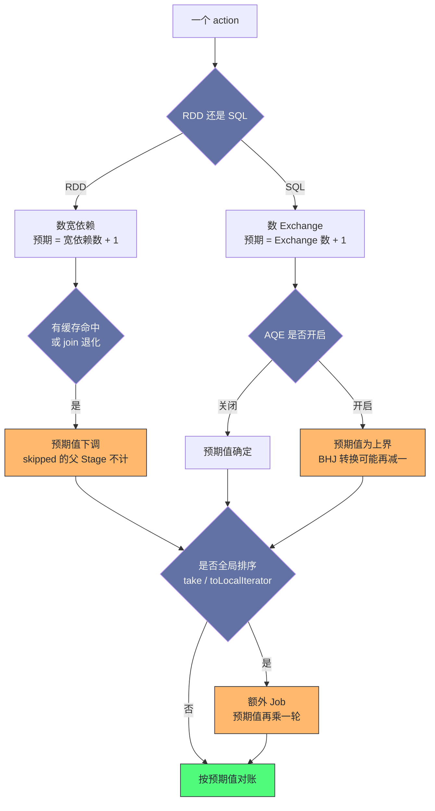
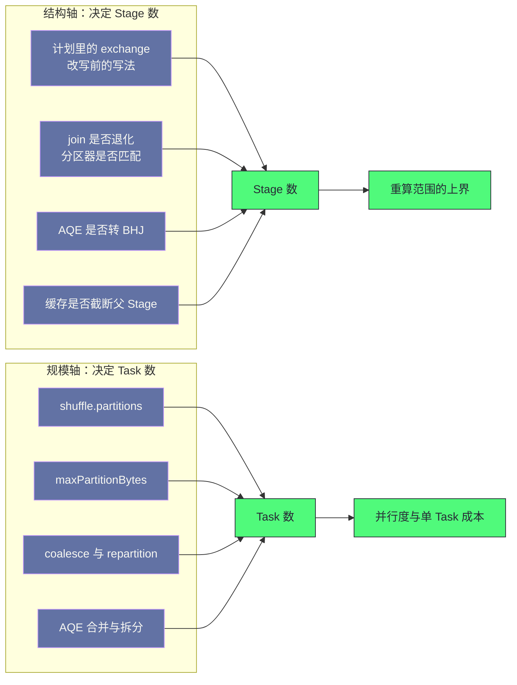
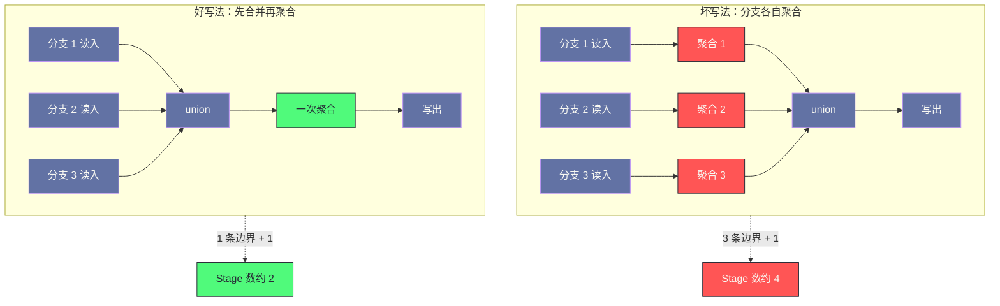
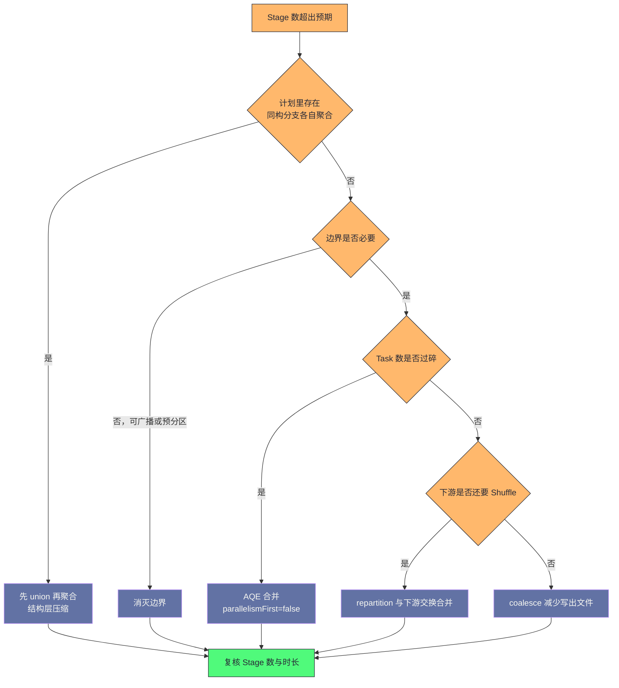
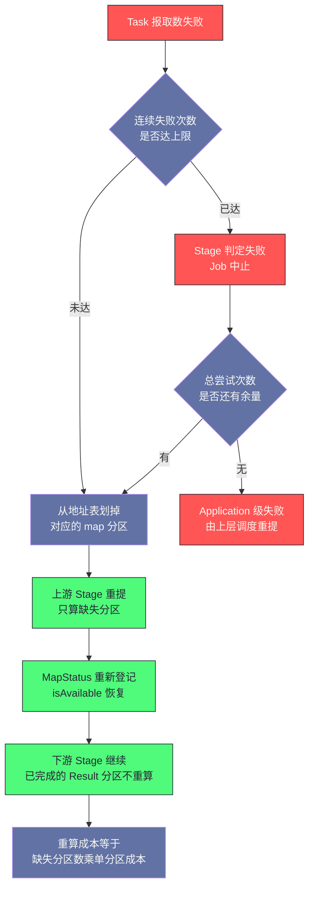

# 02 DAGScheduler 核心逻辑：Stage 划分算法与逻辑计划生成

**摘要：**

Stage 划分的算法本身在内核系列里已经拆到了栈式遍历那一层，本篇不再走一遍，而是换一个视角：作业跑起来之后，UI 上那个 Stage 数字是多了还是少了，怎么从这个数字反推回写法与配置。全文围绕一个每天两千个作业、三百台机器的集群展开，先把"一个 action 该产生几个 Stage"的预期值立起来，再分别讨论过多与过少这两侧的代价，最后落到几条能直接写进配置模板的判据。文中给出五张判读框图与七张对照表，把"算预期值、对账、改写法、再动配置"这条路径固定下来。核心结论有三条：Stage 数由执行计划里的 exchange 结构决定，与 `spark.sql.shuffle.partitions` 无关，后者只改 Task 数，把两者混看是绝大多数误诊的来源；Stage 边界是重算的定价单位，它买的是"失败之后能回到的最后一个物化点"，付的是屏障与调度的固定开销；失败之后真正被重算的是缺失分区而不是整个 Stage，于是重算成本等于缺失分区数与单分区成本的乘积，Stage 数只是把这个乘积的上界挪了位置。

---

## 第 1 章 从"切了几刀"到"切得值不值"

### 1.1 机制已讲透，缺的是判据

从末端 RDD 反向遍历、遇宽依赖立父 Stage、递归到底得到一张 Stage DAG，这条链路在 [[大数据/Spark/读书笔记-spark内核/03_调度与执行机制/5. Spark_DAGScheduler_Stage划分|内核系列《Spark DAGScheduler Stage 划分》]]里是逐行拆过的——手写栈为什么能防递归溢出、`getOrCreateShuffleMapStage` 为什么要做二次检查、`pendingPartitions` 与 `MapOutputTracker` 两套账本为什么必然不对称，笔者都不再复述。

真正让开发与运维在日常里争论不休的是另一个问题：一个作业跑完，UI 上显示 37 个 Stage，这算多还是算少，该不该动它，动哪里。这类问题的答案不在算法里，而在两个数字之间的关系里——Stage 数与 Task 数。前者是计划形状的度量，后者是数据规模的度量，它们由完全不同的东西控制，混着看就会得出互相矛盾的结论。

### 1.2 贯穿案例：一张按天回刷的归因宽表

设想一个典型的数据平台集群：三百台机器，每台 32 个核，对外大约九千六百个 core 槽位；每天提交两千个作业，夜间高峰时排队两三百个。其中一个作业叫 `ad_attribution_daily`，读十二张维表（单张 1 到 5 GB），三张按天分区的事实表，做四十来组窗口与聚合，最后拼成一张宽表写回 HDFS。原始写法是每个来源分支先各自聚合、再依次 union，一次 action 划出四十多个 Stage，其中三十多个的 wall time 不到十秒；改造之后把同构分支先 union 再统一聚合，一次 action 只剩四个 Stage，作业整体时长下降。这条案例会在后文反复出现，因为它同时踩到了"Stage 数过多"与"Stage 数过少"两种相反的坑。

### 1.3 两个量必须分开看

`spark.sql.shuffle.partitions` 在多数人的心智模型里是"Stage 数的旋钮"，调大能让并行度上去，调小能让小文件变少。这个模型在第一次认真读 UI 时就会崩掉：把它从 200 改成 2000，Jobs 页面上每个 Job 的 Stage 数量一个不变，变的只是每个 Stage 的 Task 数从 200 变成 2000，以及每个 Task 处理的数据量缩到十分之一。

反过来也有一类误判：看到某个 Stage 只有 12 个 Task，就断定"Stage 数太少、并行度不足"，于是加了一批 `repartition`，Stage 数从 4 涨到 11，Task 数从 12 涨到 2400，作业反而更慢。根源在于把**结构量与规模量**当成了一个量。

### 1.4 与机制篇的分工

本篇的引用关系是固定的，遇到机制细节直接跳转，不在这里重推：

- Stage 划分算法、边界判定、`ShuffleMapStage` 与 `ResultStage` 的分工：[[大数据/Spark/读书笔记-spark内核/03_调度与执行机制/5. Spark_DAGScheduler_Stage划分|内核 03 组第 5 篇]]
- TaskSet 如何被接收、排队与派发：[[大数据/Spark/读书笔记-spark内核/03_调度与执行机制/6. Spark_TaskScheduler_深度解析|内核 03 组第 6 篇]]
- 分区数与核数的经验关系、`defaultParallelism` 的三处口径错位：[[大数据/Spark/读书笔记-spark内核/06_性能调优实战/3. Spark集群资源分配与并行度调优|内核 06 组第 3 篇]]
- AQE 的 QueryStage 框架、动态合并与倾斜拆分的实现：[[大数据/Spark/Spark-SQL深度解析与性能调优/06 AQE：运行时自适应查询优化|SQL 专栏 AQE 篇]]
- 从症状到根因的整体调优路径：[[大数据/Spark/Spark-Shuffle与内存管理机制深度解析/10 生产调优手册：从症状到根因的系统性诊断|Shuffle 专栏诊断手册]]

本篇只回答三件事：预期值是多少、偏了之后代价落在哪里、用哪个参数把它拨回来。

---

## 第 2 章 预期值：一个 action 该产生几个 Stage

### 2.1 RDD 侧的计数规则

用 RDD API 写出来的作业，计数规则简单到可以口算：一次 action 产生的 Stage 数等于执行期真正发生的宽依赖数加一。原因是每一个宽依赖必然对应一个 `ShuffleMapStage` 作为生产端，末端再有一个 `ResultStage` 收口；中间那一层既消费上游 Shuffle 又向下游写 Shuffle 的 Stage，同时也是某个宽依赖的生产端，所以不重复计数。这个"加一"不是巧合，而是**只有一个末端**这一拓扑事实的直接后果。

口算之后要打三个补丁，否则预期值会和 UI 对不上：

第一，缓存会截断。某个父 Stage 的全部分区都已在 `BlockManager` 里时，提交前的依赖检查不再向上追溯，那个父 Stage 不会被执行，UI 上显示为 skipped。它并没有消失，仍然在 DAG 里，只是这次没跑，把它算进"预期值"会和页面数字差出若干。

第二，`join` 未必切 Stage。两侧分区器恰好等于本次 join 的目标分区器时，依赖退化成一对一的窄依赖，`join` 不再引入新的边界。这也是"先 `partitionBy` 再 join 能省一次 Shuffle"这句话的调度层解释，机制细节见内核第 5 篇的边界反例一节。

第三，barrier Stage 与流水线 Shuffle 走的是另一套账。barrier 要求全部 Task 同时起步，失败时整段作废；流水线 Shuffle 则把"等上游写完"换成了"上游写下游读"的交错推进。两者都让"宽依赖数加一"这个公式失真，在用到这两种特性的作业上不能用口算。

### 2.2 SQL 侧的计数规则

DataFrame 与 SQL 的 Stage 来自物理计划的切分，口算的依据从"宽依赖"换成 exchange 节点：一次 action 的 Stage 数约等于物理计划里 `Exchange` 节点数加一。这里的"约等于"要比 RDD 侧更松，因为 AQE 在运行期还会改写计划。

关闭 AQE 时，预期值是确定的，`explain` 出来的计划里有几个 `Exchange`，跑起来就是几个边界。开启 AQE 后，物理计划会在每个物化点重新优化一次，计划里的 `Exchange` 数只是上界：运行期把 sort-merge join 换成 broadcast join 时，那一侧的 Shuffle 连同它对应的 Stage 一起被省掉；分区合并（coalesce）则只改读取端的 Task 数，不动 Stage 数。同一份 SQL 两次运行给出不同的 Stage 数，在 AQE 开启的集群上是正常现象，不是调度器不稳定。

### 2.3 一个 action 未必只有一个 Job

"一次 action 一个 Job"是个方便的近似，但它有几个稳定出现的反例，而每一个反例都会顺手把 Stage 数翻上去：

全局排序要先采样。`sortBy`、`sortByKey`、`orderBy` 需要按分位点切分区间，切点由一次采样算出（SQL 侧对应 `spark.sql.execution.rangeExchange.sampleSizePerPartition`，默认 100），这个采样本身是一个独立 Job。于是在 Jobs 页面看到一个 action 出现两个 Job，第一个小得可疑，call site 指向排序那一行。

`take` 是迭代式的。取前 n 行时，Spark 不会一次扫全部分区，而是先扫一个分区、不够再放大到四个、再不够扫全部，每轮一个 Job。写 `take(10)` 的人通常意识不到自己点了三次运行。

`toLocalIterator` 按分区跑 Job。它把结果一个个拉到 Driver，每个分区触发一次独立计算，几百分区就是几百个 Job、几百套 Stage。这是"Stage 数暴涨"的经典写法，在把 DataFrame 逐分区写给外部系统时尤为常见。

重复 action 且中间结果未缓存。两次 `count()` 之间没有 `cache`，第二遍会把整张 DAG 从头再算一遍，UI 上表现为两个 DAG 完全相同的 Job，Stage 数直接翻倍。

### 2.4 预期值速查

下表把常见写法的预期 Stage 数与判读证据放在一处，用来在诊断时快速判断"这个数字对不对"。

| 写法 | 预期 Stage 数 | 看到偏差时的判读 |
| :--- | :--- | :--- |
| 单表读入、过滤、写出 | 1 | 多于 1 通常是读入分区被动过，或中间藏了排序 |
| 一次 `groupBy` 后写出 | 2 | 若为 4 以上，检查是否先聚合再 union |
| `join` 后写出 | 2 至 3 | 两侧都需 Shuffle 时为 3；一侧可广播时为 2 |
| `orderBy` 后写出 | 2 至 3，且多一个采样 Job | 采样 Job 极短，若它很长说明分位数估计在扫大表 |
| N 个分支各自聚合再 union | 分支数加一 | 这是最容易被误当成"正常"的结构性膨胀 |
| 同一缓存表上连续多个 action | 首个 Job 之后其余大量 skipped | skipped 意味着复用，不意味着 Stage 不存在 |
| `toLocalIterator` 遍历 P 个分区 | P 套 Job，Stage 数约为 P 的倍数 | 单看 Stage 数会以为作业规模大，实际是写法问题 |

判断"Stage 数是否异常"的第一步，永远是先把预期值算出来，再和 UI 对账；对不上时先查 2.3 节那四个反例，而不是先动配置。

UI 上的判读按三个页签分工：Jobs 页看每个 Job 的 Stage 条数与 skipped 标记，Stages 页看 Task 数与 Shuffle 读写量，SQL 页看 Exchange 节点与 AQE 的合并标记。三者对不上时，先信 SQL 页的结构，再信 Stages 页的数字。

下面这张流程图给出从"一个 action"推到"预期几个 Stage"的判读路径。

---

## 第 3 章 为什么调分区数改不动 Stage 数

### 3.1 扇出参数与结构参数

`spark.sql.shuffle.partitions`（默认 200）定义的是每一次 Shuffle 的扇出，也就是下游 Stage 的初始分区数；它不参与"要不要在这里切一刀"的判断。切不切由计划结构决定：计划里有没有一个需要按 key 重分布的节点。既然它只影响扇出，那么它**对 Stage 数的影响是零**，对 Task 数的影响是线性的——每个 Shuffle 边界下游那个 Stage 的 Task 数约等于这个值，整个 Job 的 Task 总数则约等于它乘以边界数。

RDD 侧的分区数来源更分散，读入时由 `spark.sql.files.maxPartitionBytes`（默认 128 MB）与文件块决定，`textFile` 的 `minPartitions` 另有下限规则，`coalesce` 与 `repartition` 各改写一次，但改的都是分区数，不是边界数。

### 3.2 唯一的间接影响在运行期

分区数确实能**间接影响 Stage 数**，但路径在 AQE 的运行期决策里，而且方向不容易控制。分区数决定了每个 Shuffle 分区的大小，而大小是 AQE 选择连接算法的输入：某一侧实测足够小，sort-merge join 会被换成 broadcast join，那一侧的 Shuffle 被省掉，对应的 Stage 随之消失。同一份 SQL 在数据量翻倍之后多出两个 Stage，往往就是这个机制在反向作用——broadcast 不再划算，又退回了需要 Shuffle 的连接。

还有一个能把 Stage 数往上顶的开关：`spark.sql.adaptive.forceOptimizeSkewedJoin`（默认 false）强制开启倾斜连接优化，官方文档写明了它会"即便引入额外 Shuffle 也要执行"。把它打开，等于允许运行期新增边界，这是少数几个会让 Stage 数在运行期增加的配置。

### 3.3 AQE 的三种动作对 Stage 数的效果不同

把 AQE 的三个主要动作按"改不改 Stage 数"分开，很多困惑会立刻消失：

- 合并分区（coalesce）：只改读取端把几个连续分区并进一个 Task，Stage 数不变，Task 数下降。
- 转 broadcast join：被广播那一侧的 Shuffle 不再需要，边界消失，Stage 数下降；配合本地 Shuffle 读取（`spark.sql.adaptive.localShuffleReader.enabled`，默认 true），另一侧也能直接读本地文件而不必再走一次网络。
- 转 shuffled hash join 与拆分倾斜分区：两侧的 Shuffle 都还在，Stage 数基本不变，改的是 Task 数与单个 Task 的数据量。

所以"开 AQE 就能少几个 Stage"只在第二种动作发生时才成立，而在一个广播阈值长期不触发的作业里，AQE 对 Stage 数的贡献一直是零。

### 3.4 一次 200 改 2000 的对账

把 `ad_attribution_daily` 的 `spark.sql.shuffle.partitions` 从 200 调到 2000，会观察到的变化落在四个量上：Stage 数不变；每个 Shuffle 边界的 Task 数从两百上下涨到两千上下；单 Task 处理的数据量降到十分之一；Shuffle 文件数与 Fetch 请求数按比例上升，而 `spark.reducer.maxSizeInFlight`（默认 48 MB）没变，于是同样数据量需要更多轮拉取。作业时长通常变差，因为在数据量没变的前提下，每个 Task 的固定开销（序列化、启动、状态上报）被摊薄到了更少的数据上。

| 参数 | 影响 Stage 数 | 影响 Task 数 | 影响单 Task 数据量 | 调大的代价 |
| :--- | :--- | :--- | :--- | :--- |
| `spark.sql.shuffle.partitions` | 否 | 是，线性 | 是，反比 | 小任务变多，调度与拉取开销上升，小文件变多 |
| `spark.sql.adaptive.coalescePartitions.initialPartitionNum` | 否 | 是（经 AQE 合并后） | 是 | 仅在 AQE 合并生效时才划算，否则等于把上一条的代价放大 |
| `spark.sql.adaptive.coalescePartitions.parallelismFirst` | 否 | 是 | 是 | 置 false 后并行度可能下降，长作业更明显 |
| `spark.sql.adaptive.advisoryPartitionSizeInBytes` | 否 | 是 | 是 | 目标过大时容易 OOM 与长尾，过小则合并意义消失 |
| `spark.sql.adaptive.forceOptimizeSkewedJoin` | 是（可能新增） | 是 | 是 | 引入额外 Shuffle，边界变多，调度开销上升 |
| `spark.sql.autoBroadcastJoinThreshold` | 是（间接） | 是 | 是 | 阈值过大时广播端把 Driver 与网络拖垮 |
| `spark.sql.files.maxPartitionBytes` | 否 | 是（读入侧） | 是 | 读入分区过大，单 Task 内存压力上升 |

这张表是整篇的枢纽：左三列说明"哪个参数管哪个量"，右一列说明"动的代价"。只有把"管 Stage 数"和"管 Task 数"的参数分开，调优才不至于南辕北辙。

下图把这个区分画成两条独立的控制轴。

---

## 第 4 章 Stage 数过多：代价落在哪里

### 4.1 每个边界都是一笔固定开销

Stage 边界不是免费的抽象，它对应七项实打实的动作：上游全部 Task 完成后才能提交下游的屏障等待；每个 Stage 尝试前把 RDD 与闭包序列化成一个 `taskBinary`；Shuffle 文件的写出、索引与（启用 push-based Shuffle 时）merge 收尾；向 `MapOutputTracker` 注册每个 map 分区的地址；Driver 侧 TaskSet 的创建、监控与状态事件；下游 Stage 起跑时本地性重新计算；以及动态分配下一次"从待调度任务数推断要不要扩容"的重新判断。

这七项里，**只有第三项与数据量成比例**，其余基本是常数。边界数量越多，这些常数被乘的次数就越多，而它们带来的有效计算并没有增加。一个四十个 Stage、每个 Stage 平均八秒的作业，与一个四个 Stage、每个 Stage 平均八十秒的作业，做的是同一件事，但前者在调度器里走的路径长了一个数量级。

### 4.2 小任务的结构性损失

Stage 数过多几乎总是伴随着 Task 变碎。碎到什么程度算过，可以看三个信号：Task 的中位运行时长已经接近调度的固定开销；同一 Stage 内 Task 时长的分布极窄，说明每个 Task 都在做"开箱、算一点点、收尾"这套动作；Shuffle 写出的文件数远大于分区数据量该有的规模，小文件把 NameNode 与下游读放大。

碎任务**不会让总 CPU 时间等比例下降**，反而会因为单位有效计算占比降低而上升。这一点与"分区数取核数的两到四倍"那条经验规则是同一件事的两面，规则本身的推导见[[大数据/Spark/读书笔记-spark内核/06_性能调优实战/3. Spark集群资源分配与并行度调优|内核 06 组第 3 篇]]。

### 4.3 成因清单

| 症状 | 典型成因 | 判读证据 |
| :--- | :--- | :--- |
| Stage 多但每个都很短 | 分支各自聚合后 union | 每个 Stage 的 Task 数相同，DAG 图呈扇形重复 |
| Stage 数随分区参数变化 | 误把规模参数当结构参数 | 改 `shuffle.partitions` 后 Stage 数不变、Task 数剧变 |
| Stage 数随时间线性增长 | 循环里不断追加 union | 计划深度持续增加，Driver 端解析时间上升 |
| Stage 数随重分布次数增长 | `repartition` 链未与下游合并 | 连续两次重分布各自新增一个边界 |
| 同一 DAG 出现两遍 | 中间结果未缓存就多次 action | 两个 Job 的 DAG 完全一致 |
| Stage 数量级等于分区数量级 | `toLocalIterator` 逐分区取数 | Jobs 页面上大量微小 Job，call site 指向同一行 |
| 每层 join 后都多一对 Stage | join 链未做预分区 | 每个 join 两侧都有 Exchange 节点 |
| 窗口函数处成对增加 Stage | 多个窗口的 `partitionBy` 不一致 | 计划里同一层出现多个 Window 与对应 Exchange |

### 4.4 合并类算子为什么让 Stage 数暴涨

`union` 本身是窄依赖，不切 Stage，这一点常常让人误以为"合并数据不会增加开销"。问题出在它与聚合的相对位置上。

先看常见的坏写法：每个来源分支各自 `groupBy` 再 union，最后写出一张宽表。每个分支的 `groupBy` 各自产生一次 Shuffle，于是 N 个分支就是 N 个 ShuffleMapStage，再加上末端合并后的 ResultStage，Stage 数近似为 N 加一。改造方式是**先合并、再聚合**：同构分支先 union 成一张表，再做一次统一聚合，union 是窄依赖，N 个分支并进同一个 Stage，聚合只发生一次，Stage 数从 N 加一降到二。两种写法的数据量与计算结果完全一样，差别只在于"在哪一层合并"。

`MERGE INTO` 这类写路径也有类似效应。它需要先按目标表的分区与文件布局匹配源数据，通常伴随一次重分区与排序，再按匹配结果重写受影响文件；这一串动作在计划里表现为若干个 exchange，Stage 数比同数据量的"读—转换—覆盖写"多出一截。使用 Delta 或 Iceberg 的 merge 时看到 Stage 数翻倍，多数是这个原因，而不是调度器出了问题。

下图把两种 union 写法的 Stage 结构并排放置，左侧是分支各自聚合，右侧是先合并再聚合。

### 4.5 判据与观测窗口的截断

三条经验判据可以当作"该动手了"的信号：Stage 数超过分支数的两倍且多数 Stage 的时长在个位数秒；单个 Job 的 Stage 数进入数十量级而 Task 的中位时长不足一秒；Driver 端日志里 `Submitting N missing tasks from Stage` 的条数远超 `Job` 条数。

> [!warning] 观测窗口会被截断
> UI 的 `spark.ui.retainedStages`（默认 1000）与 `spark.ui.retainedTasks`（默认 100000）限制了保留量，超出之后旧 Stage 被回收。一个 Job 划出几千个 Stage 时，页面上看到的数字可能小于真实值，DAG 图也不完整；判断"Stage 是不是真的很多"，除了 UI 还要看事件日志或 REST 接口拉到的原始记录。

---

## 第 5 章 把 Stage 数压下来：四种手法与各自的前提

### 5.1 改写：把合并提前到聚合之前

上一章的对比已经给出结论：同构分支先合并再聚合，是唯一不损失任何计算量的压缩手段。它不依赖任何配置，只依赖"这些分支的 schema 与聚合语义一致"这个前提。分支语义不一致时强行合并会引入空值填充与列对齐的开销，收益可能被吃掉，这一点要在改写前算清楚。

### 5.2 让 AQE 真的合并

AQE 默认开启（`spark.sql.adaptive.enabled` 自 3.2.0 起默认 true），但默认配置下的合并效果常被高估。关键在于 `spark.sql.adaptive.coalescePartitions.parallelismFirst` **默认 true**，官方文档写得很直接：为真时 Spark 忽略 64 MB 的目标分区大小，只把分区大小压到最小值（`minPartitionSize`，默认 1 MB），目的是最大化并行度、避免开启 AQE 带来的性能回退。文档同时建议在繁忙集群上把它设为 false。

对一个每天两千作业的集群来说，这条建议基本可以直接采纳：把 `parallelismFirst` 设为 false，让合并按 `advisoryPartitionSizeInBytes`（默认 64 MB）来；同时把 `initialPartitionNum` 设成一个偏大的初值，让 AQE 有东西可合，而不是从 200 起步往 64 MB 的目标上撞。这个组合的思路是"先给足并行度，再让运行期按实测大小收拢"，与静态估一个分区数相比，它对数据量日常波动的容忍度高得多。

Spark 4.3 还增加了 `spark.sql.adaptive.coalescePartitions.maxReducerPartitionsPerTask`（默认 `Int.MaxValue`），用来独立于目标分区大小限制单个 Task 最多合并多少个 reduce 分区。当合并后的 Task 因为扇入过大而拉取超时，这个参数比调大目标分区大小更精准。

### 5.3 coalesce 与 repartition 的取舍

`coalesce` 是窄依赖，不新增 Stage，代价是并行度下降且上游的分区被整块吞并，容易出现"少数 Task 干了大部分活"的形态；`repartition` 是宽依赖，会新增一个边界与一次 Shuffle，但换来均匀的分区与可控的并行度。二者不是优劣关系，而是"省一次边界"与"换一次重分布"的选择。

判断依据是下游还有没有重活：如果下游马上就要做一次聚合，那次聚合本来就要 Shuffle，此时 `repartition` 的边界大概率会与聚合的交换合并（或在同一 Stage 内完成），额外代价很小；如果下游只是写出，`coalesce` 更划算。反过来，在写出之前用 `repartition` 去"整理数据"，除了多一个 Stage 之外几乎没有收益。

### 5.4 消灭边界本身

比"合并边界"更进一步的是**让边界不发生**：

- 广播连接：小表进广播，那一侧不再需要 Shuffle，边界直接消失。代价是广播端被复制到每个 Executor，阈值 `spark.sql.autoBroadcastJoinThreshold`（默认 10 MB）设得过大时会把 Driver 和网络压垮。
- 预分区后连接：两侧先按同一列 `partitionBy` 或分桶，连接时分区器匹配，依赖退化为窄依赖。
- 存储分区连接：Spark 4.x 对兼容的 V2 数据源支持利用存储层已有的分区布局免去 Shuffle（相关开关 `spark.sql.sources.v2.bucketing.enabled` 默认 true），适用面受数据源能力限制，用之前要确认自己的表格式是否在支持范围内。
- 缓存复用：把多处分叉的共同上游 `cache` 住，后续 Job 里那些父 Stage 直接变 skipped。

### 5.5 各类手法的对照

| 手法 | 减少的 Stage 数 | 代价 | 前提 |
| :--- | :--- | :--- | :--- |
| 先合并再聚合 | 分支数减一 | 基本无，需确认语义一致 | 分支 schema 与聚合逻辑同构 |
| AQE 合并分区 | 0（只减 Task） | 并行度可能下降 | AQE 开启且 `parallelismFirst=false` |
| `coalesce` | 0（不新增也不减少） | 并行度下降，易倾斜 | 下游没有需要重分布的算子 |
| `repartition` | -1（会增加一个） | 一次 Shuffle | 下游本来就要 Shuffle |
| 广播连接 | 1 至 2 | 广播端内存与网络 | 小表在阈值内 |
| 预分区或分桶 | 1 至 2 | 写入侧成本前移 | 两侧分区方式可对齐 |
| 缓存共同上游 | 每个后续 Job 若干 | 内存占用 | 上游可容纳于存储层 |

下面这张决策树把上述手法按"先看能不能不改结构、再看改写法、最后才动参数"的顺序排开。

### 5.6 压缩的尽头

边界压到零并不成立：Stage 边界的本质是"把中间结果写到一个有地址的地方"，删光边界等于把作业变成一条从数据源到输出的长链，任何一次失败都要从源头重来。问题于是翻到另一面。

---

## 第 6 章 Stage 数过少：另一侧的代价

### 6.1 三个识别信号

Stage 数过少不像过多那样有直观的异常感，它表现为"图很干净，但作业就是慢，而且一失败就非常贵"。可用的信号有三个：单个 Stage 的时长占整个 Job 的八成以上；Stage 的 Task 数远小于总槽位数，或者远大于槽位数但单 Task 时长同样地长；某次失败之后作业回退到很久以前的位置重新计算，而不是从最近一次 Shuffle 之后继续。

### 6.2 代价一：重算的起跑线被推得很远

Stage 边界在容错上的作用，是把中间结果变成一个"有名字、有地址"的对象。窄依赖链里的中间结果没有名字，Executor 一掉，整段链只能从头再算。边界越少，从失败点回退到最近物化点的距离就越长。这与后文要讲的"只重算缺失分区"并不矛盾：缺失分区数决定重算的宽度，**边界密度决定重算的起点**，两个维度各自独立。

### 6.3 代价二：并行度的天花板

一个 Stage 的并发上限就是它的分区数。上游被 `coalesce(1)` 收成一个分区之后再接 join 或写出，整段就是串行的；窗口函数全部落在同一个分区里，横向扩展无从谈起。这类问题在 UI 上有直白的表征：一个 Stage 只有一个 Task，或在跑的 Executor 寥寥无几。

### 6.4 代价三：长尾与缺乏介入点

Stage 的完成时间由最慢的那个 Task 决定。Stage 越少、单 Stage 越长，长尾藏得就越深，能补救的手段也越少：推测执行（`spark.speculation`，默认 false）能复制慢任务，代价是重复计算与资源抢占；而 AQE 的倾斜拆分、分区合并都需要一个物化点才能介入，没有边界就没有介入时机。

### 6.5 代价四：动态分配与检查点失去着力点

动态分配的扩容依据是待调度任务数。一个超长 Stage 在起步时就把所有 Task 一次性派出去，待调度数瞬间归零，之后再想扩容也没有信号可依，于是整个作业的形状被固化成"起步时那批资源"。检查点同理：`checkpoint` 与 `cache` 只能在已有的物化点上截断血缘，边界越少，能截断的位置越少。开启优雅下线（`spark.decommission.enabled`，默认 false）之后，节点退出时可以把 Shuffle 块迁移走，这能显著减少"边界附近的失败"，但它同样以"存在可迁移的 Shuffle 块"为前提。

### 6.6 什么信号说明该切一刀

| 信号 | 判读 | 处置方向 |
| :--- | :--- | :--- |
| 单 Stage 占 Job 时长八成以上 | 边界过疏，失败代价高 | 在关键中间结果处分段，用 `repartition` 或 `persist` 制造物化点 |
| 一个 Stage 只有极少 Task | 上游被过度合并 | 取消 `coalesce(1)`，或在上游恢复分区 |
| Task 数远小于总核数 | 并行度不足 | 提高读入分区或 Shuffle 扇出 |
| 失败后回退距离极长 | 缺少中间物化点 | 在分叉处缓存，或接受一次 Shuffle |
| 作业起步即占满全部资源 | 单 Stage 一次性派单 | 拆 Stage 让资源分批释放 |

---

## 第 7 章 重试上限与重算成本：配置判据

### 7.1 两条上限的形状

Stage 级别的重试有两把尺子：`spark.stage.maxConsecutiveAttempts`（默认 4）量的是连续失败次数，Stage 成功一次就清零；`spark.stage.maxAttempts`（默认 `Int.MaxValue`）量的是总尝试次数。两者取最大值作为真正的上限，因此前者是硬底线，后者只能在它之上再加约束。这层"取 max"的语义与 `failedAttemptIds`、`nextAttemptId` 两个计数的分工，内核第 5 篇的熔断一节已经写明，此处只讨论怎么配。

### 7.2 调大买什么、付什么

把连续上限调大，**买到的能力只有一个**：让作业扛过一段持续超过四次重试窗口的瞬时故障。典型场景是节点滚动重启、Kubernetes 上整批 Pod 被驱逐、机架级网络抖动——这些故障的共同点是"一段时间内反复失败，故障源消失后又能正常跑"。付出的代价有四项：作业在故障持续期间一直挂着不结束，占住的槽位不释放；在 FAIR 模式下它继续消耗自己 pool 的份额，拖慢同 pool 的其他作业；运维侧失去"作业尽早失败"这个信号，故障发现被推迟到人工巡检；事件日志与 UI 的失败记录成倍增长，事后复盘更难定位第一次失败的时间点。

把连续上限调小，效果相反：故障被更快地暴露，但一次本该自愈的抖动也会被误判成作业失败，重跑整套上游的代价远大于多等几分钟。

### 7.3 按故障形状定，而不是按经验值定

判据应当从"故障是瞬时的还是持续的"出发，而不是从"4 太小"这种直觉出发：

瞬时故障有明确的运维窗口——计划内的滚动重启、节点维护、跨机架切换。这类窗口内可以把连续上限临时抬高，窗口结束后恢复默认；把这类调整写进作业模板长期生效，等于给所有持续故障也开了绿灯。

持续故障没有窗口——磁盘坏道、数据文件损坏、用户代码在特定分区上必现的异常。这类故障重试多少次都不会好，连续上限越大，暴露越晚。对付它们要靠别的机制：把有问题的分区定位出来、把坏数据隔离掉，而不是靠重试。

还有一类介于两者之间：单机掉线引发的一批取数失败。这类故障会在几十秒内收敛，默认的 4 次连续重试通常够用；如果集群规模大、单批次掉线的主机多，可以把 `spark.files.fetchFailure.unRegisterOutputOnHost` 打开，让一次取数失败按主机粒度作废输出，避免逐格失效与失败来回拉锯。那个开关的语义与代价见内核第 5 篇的取数失败一节。

### 7.4 配置表

| 配置 | 默认值 | 调大的代价 | 调小的代价 |
| :--- | :--- | :--- | :--- |
| `spark.stage.maxConsecutiveAttempts` | 4 | 持续故障下作业挂更久、占资源、发现延迟 | 瞬时抖动被误判为失败，重跑代价大 |
| `spark.stage.maxAttempts` | `Int.MaxValue` | 同上，但作用于总量而非连续量 | 长跑作业里零星失败累积后过早失败 |
| `spark.task.maxFailures` | 4 | 坏数据分区被反复重试，浪费时间 | 偶发 OOM 或序列化抖动被当成永久失败 |
| `spark.speculation` | false | 重复计算与槽位抢占，推测副本自身也可能失败 | 长尾任务无补救，Stage 完成时间由最慢者决定 |
| `spark.files.fetchFailure.unRegisterOutputOnHost` | false | 一次失败作废整机输出，重算量放大 | 逐格失效在整机故障时反复拉锯 |
| `spark.decommission.enabled` | false | 下线流程变长，资源释放变慢 | 节点退出时 Shuffle 块直接丢失，触发重算 |

### 7.5 一个容易忽略的运维事实

失败之后，真正被重算的是缺失分区，不是整个 Stage。取数失败会把 `MapOutputTracker` 上对应的那一格地址划掉，重提时上游只需要补算那一格；Stage 的 Task 数从几百变成一，attempt 号加一。这条机制本身在内核第 5 篇里讲得很细，这里只取它对配置判断的推论。

推论一：**重算成本等于缺失分区数与单分区成本的乘积**，而不是 Stage 数的函数。一个有三千个八兆分区的 Stage，掉一台 Executor 需要补算的量并不大；一个三 Stage 但其中一个分区有二十 GB 的作业，一次取数失败就要重算二十 GB。判断"这个作业的重算贵不贵"，要看分区大小的分布，而不是 Stage 数。

推论二：Stage 数只改变重算的上界形状。边界多，重算起点近，单次失败的期望成本低，但每次边界都要付固定开销；边界少，固定开销省下来了，单次失败的期望成本就上升。这与第 4 章、第 6 章的两侧代价是同一枚硬币。

推论三：把重试上限调到很大，并不会降低单次重算的成本，只会增加重算的次数上限。真正降低重算成本的手段在别处：让分区大小均匀（倾斜是重算成本的头号放大器）、让 Shuffle 块在 Executor 退出后仍然可读（外部 Shuffle 服务，`spark.shuffle.service.enabled` 默认 false，各部署模式需自行搭建）、让节点优雅下线。

下图把一次取数失败从触发到重算范围收敛的路径画出来，注意第 4 步之后 Task 数从全量变成只剩缺失分区。

---

## 第 8 章 反例：五种常见的"压 Stage"姿势

### 8.1 为了少几个 Stage 强行 `coalesce(1)`

这是最典型的错误。写出前 `coalesce(1)` 确实能让 Stage 数看起来更干净，Task 数也降到一，但它把整个下游变成单线程：上游几百个 Task 算出来的数据要先汇聚到一个分区，再串行写出。代价是**并行度归零**、单 Task 数据量放大到可能 OOM、作业时长随数据量线性上升。真正要解决的问题通常是"输出文件太多"，那就该在写出层控制文件数，而不是把计算的并行度一起砍掉。

判读这个反例的方法很简单：Stage 数下降了，但 Stage 的最大 Task 数等于 1，且该 Stage 时长占整个 Job 的大头。

### 8.2 忽略 AQE 已能自动合并，手工 `repartition` 覆盖

AQE 的分区合并不需要额外的 Stage，它在 QueryStage 边界上改变读取方式。手写 `repartition(n)` 则必然增加一次 Shuffle 与一个边界。当默认的 `parallelismFirst=true` 让合并效果不明显时，正确的动作是把这个参数关掉、把初值调大，而不是在代码里补一个 `repartition`。前者不增加边界，后者增加。

### 8.3 把连续重试上限调到无限

`spark.stage.maxAttempts` 的默认值本来就是 `Int.MaxValue`，所以"调到无限"这件事在总量维度上早已是默认。把 `maxConsecutiveAttempts` 也调到极大，等于**取消熔断**：持续故障下作业永远不结束也不报错，占着槽位，在排队系统里变成一个"活着但没进展"的僵尸。它比失败更难被发现，因为失败会触发告警，挂着不会。

### 8.4 把 Stage 数当重算成本

"Stage 少所以重算便宜"是一个方向错误的推论。重算成本由缺失分区数与分区大小分布决定，Stage 数只决定重算的起跑线。一个 Stage 数很少但存在超大倾斜分区的作业，比一个 Stage 数中等但分区均匀的作业更怕失败。

### 8.5 用 Stage 数做容量规划

按"每作业 20 个 Stage"估算 Driver 压力没有依据：同一个作业换写法可以从 40 个 Stage 变成 4 个，而资源需求几乎不变；两个 Stage 数相同的作业，也可能一个跑十秒、一个跑两小时。容量规划该看的是 Task 数、单 Task 数据量与 Shuffle 量。

### 8.6 反例速查

| 反例 | 表面收益 | 实际代价 |
| :--- | :--- | :--- |
| 写出前 `coalesce(1)` | Stage 与 Task 数都变干净 | 并行度归零，OOM 与长尾，文件写出串行 |
| 手工 `repartition` 替代 AQE 合并 | 分区大小看起来均匀 | 多一个边界与一次 Shuffle |
| 连续重试上限调到极大 | 抖动不再导致失败 | 持续故障下作业僵尸化，资源不释放，故障发现延迟 |
| 用 Stage 数推断重算成本 | 指标易得 | 忽略缺失分区与倾斜，判断方向相反 |
| 用 Stage 数做容量规划 | 指标易得 | 与资源需求无稳定关系 |
| 关掉 AQE 以"稳定 Stage 数" | 数字确定 | 失去运行期合并与广播转换，Stage 数只增不减 |

---

## 第 9 章 落点

回到开头那个问题：37 个 Stage 算不算多。答案取决于两件事——这些边界有没有换来"失败后能就近重启"的能力，以及每个边界付的固定开销有没有被它带来的并行度或正确性抵掉。`ad_attribution_daily` 的四十多个 Stage 之所以该压，不是因为数字大，而是因为其中三十多个只跑了几秒，边界带来的物化价值远小于它摊掉的调度成本；而把它压到四个 Stage 之后不再继续压，是因为再压下去就要动并行度与物化的位置，代价从调度侧转移到了失败恢复侧。

这也是 Spark 把边界定义在宽依赖上的深意：边界不是性能优化，它是**重算的定价单位**。多切一刀，等于为"最坏情况下要重算多少"买了一份更小的保单，保费是每个边界的固定开销；少切一刀，保费省了，单次事故的赔付上限就抬高了。配置参数做的也是同一笔生意：`parallelismFirst` 选择并行度还是资源效率，`maxConsecutiveAttempts` 选择尽快暴露还是多等一轮，`coalesce` 与 `repartition` 选择省一次边界还是换一次重分布。没有哪一个方向是普适正确的，能做的只是把这个集群的作业形状、故障分布、排队压力量出来，再决定这一次往哪边偏。

至于"Stage 数多少才算健康"，目前给不出一个跨集群通用的数字——它取决于单 Stage 的固定开销与槽位规模的比值，而这个比值随部署形态变化。相比追一个标准值，更实用的做法是把"预期 Stage 数"算出来对账：对不上先查写法，写法没问题再看配置，配置也没问题，那就是这个作业本来就该有这么多边界。

---

## 参考资料

1. Apache Spark 4.3.0 文档：Configuration，`spark.sql.shuffle.partitions`、`spark.shuffle.service.enabled`、`spark.decommission.enabled` 等默认值。https://spark.apache.org/docs/latest/configuration.html
2. Apache Spark 4.3.0 文档：Performance Tuning，Adaptive Query Execution 各参数默认值与 `parallelismFirst` 的行为说明。https://spark.apache.org/docs/latest/sql-performance-tuning.html
3. Apache Spark 4.3.0 文档：Web UI，Jobs、Stages、SQL 页签的判读口径。https://spark.apache.org/docs/latest/web-ui.html
4. Apache Spark 4.3.0 文档：Job Scheduling，动态分配与外部 Shuffle 服务的前置条件。https://spark.apache.org/docs/latest/job-scheduling.html
5. Apache Spark 源码（4.3.0）：`core/src/main/scala/org/apache/spark/scheduler/DAGScheduler.scala`，Stage 提交、失败重提与熔断判据。https://github.com/apache/spark/blob/v4.3.0/core/src/main/scala/org/apache/spark/scheduler/DAGScheduler.scala
6. Apache Spark 源码（4.3.0）：`core/src/main/scala/org/apache/spark/scheduler/Stage.scala`，`findMissingPartitions` 与 attempt 计数。https://github.com/apache/spark/blob/v4.3.0/core/src/main/scala/org/apache/spark/scheduler/Stage.scala
7. Apache Spark 源码（4.3.0）：`core/src/main/scala/org/apache/spark/MapOutputTracker.scala`，Shuffle 输出地址表与缺失分区查询。https://github.com/apache/spark/blob/v4.3.0/core/src/main/scala/org/apache/spark/MapOutputTracker.scala
8. Apache Spark 源码（4.3.0）：`core/src/main/scala/org/apache/spark/rdd/RangePartitioner.scala`，全局排序前的采样流程。https://github.com/apache/spark/blob/v4.3.0/core/src/main/scala/org/apache/spark/rdd/RangePartitioner.scala
9. Apache Spark 源码（4.3.0）：`sql/core/src/main/scala/org/apache/spark/sql/execution/adaptive/AdaptiveSparkPlanExec.scala`，AQE 的运行期计划改写入口。https://github.com/apache/spark/blob/v4.3.0/sql/core/src/main/scala/org/apache/spark/sql/execution/adaptive/AdaptiveSparkPlanExec.scala
10. Apache Spark JIRA：SPARK-31412，Adaptive Query Execution 的设计提案，含"以物化点为边界重新优化"的原始动机。https://issues.apache.org/jira/browse/SPARK-31412

---

> [!note] 思考题
> 1. 一个作业从 40 个 Stage 压到 4 个之后时长下降，是否能推断"边界越少越好"？换一个数据量只有几十分之一、槽位却很充裕的场景，这个推断是否还成立？
> 2. `parallelismFirst` 默认 true 是为了避免开启 AQE 时的性能回退。如果一个集群的作业以小时级批处理为主、槽位紧张，把它设为 false 的风险主要落在哪一类作业上？
> 3. 若某个 Stage 有三千个 8 MB 分区，另一个作业的某个 Stage 只有 20 个分区但其中一个有 20 GB，两者在"一次 Executor 掉线"上的重算成本差多少？这个差别该用哪个指标衡量？
> 4. 把 `spark.stage.maxConsecutiveAttempts` 从 4 调到 20，在什么运维窗口内是合理的？窗口结束后靠什么机制保证它被改回去？
> 5. 如果 UI 上 Stage 数比按计划推算的预期值少，除了缓存命中与 AQE 改写之外，还有哪些可能的原因？