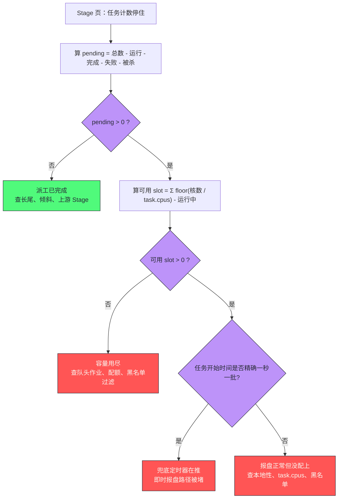
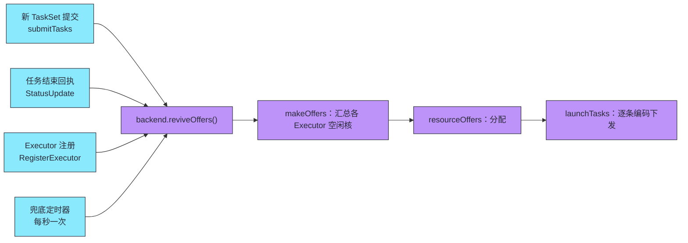
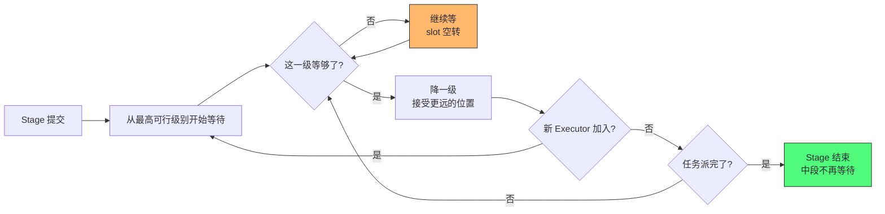
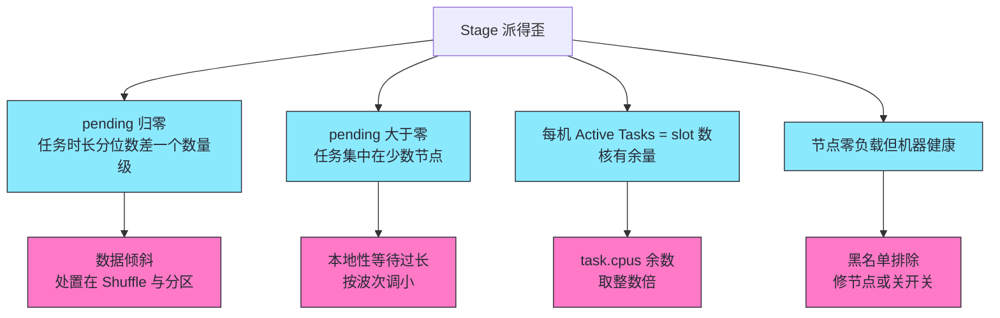
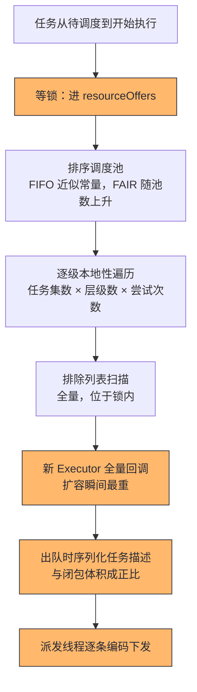

# 03 TaskScheduler 架构解析：任务编排与调度后端的协作机制

**摘要：**

一个作业卡住时，值班的人最常说的是"任务派不下去"，但这句话在 Spark 里至少对应五个层次的问题：集群配额、Driver 的启动等待、DAGScheduler 的事件循环、TaskScheduler 的排队与本地性、Backend 的派发与序列化。本文不谈调度算法的推导，只谈怎么把这句话拆成可判定的判据：先用待调度任务数与空闲 slot 数的差集定方向，再靠"任务是不是精确一秒一批"区分报盘没被触发与报盘被堵，然后把派不均拆成数据倾斜、本地性等待过长、`spark.task.cpus` 的除法余数、黑名单排除四种成因，逐一给出观测位与处置边界。判断的顺序比调参重要：先算容量，再看差集，再判触发，最后才谈取舍。这些判据的共同点是不改代码、不加埋点，只靠 UI 的三列、Driver 日志的几行与一次 `jstack`。文末给出 `spark.locality.wait`、`spark.scheduler.mode`、`spark.task.maxFailures` 与黑名单参数族的判据表，以及三组单独看都合理、凑在一起才出事的配置反例。机制层面的推导——TaskSetManager 的账本、五级本地性的降级、报盘在锁上的消息流——由内核系列的对应篇目承担。

---

## 第 1 章 先把"排队"说清楚：三个计数与两处差集

### 1.1 一个卡在 40/240 的 Stage

一个每天跑两千个作业、三百台机器的混部集群，`settle_daily` 这个每日结算作业平时四分半钟，某天变成十七分钟。它的第三个 Stage 有 240 个任务，Stage 页顶部停在 40/240，任务表里 40 行全是 RUNNING，跑得最久的那一个已经挂了九分钟；同一时刻 Executors 页上 600 个 Executor 的 Active Tasks 加起来不到 800，而这批机器的总 slot 数是 4800。

三个数字摆在一起，结论与"资源不足"恰好相反：集群闲着，任务不动。排查之所以反复，是因为"派不下去"这个描述把五种完全不同的故障压成了一句话——集群管理器的队列配额、Driver 启动期等注册比例、DAGScheduler 事件循环积压、TaskScheduler 本地性等待与黑名单、Backend 派发线程编码大任务描述。判据的第一步不是猜，而是把"还有多少任务没派"与"还有多少 slot 空着"这两个量算出来。

### 1.2 三个计数与一个只能减出来的差集

Stage 页能直接读到三个计数：任务总数、正在运行数、已完成数；失败数与被杀数在同一区域，多数时候是零。真正需要的第四个量——**待调度任务数（pending）**——没有单独的展示位，任务表也只列已经启动过的尝试，于是它只能减出来。

| 计数 | 口径 | 从哪读 | 读错会怎样 |
| :--- | :--- | :--- | :--- |
| 任务总数 | `TaskSet.tasks.length`，即分区数 | Stage 页顶部、Jobs 页的 Tasks 列 | 把 Stage 重算后的新尝试当成同一个量 |
| 正在运行 | 已派出、还没回执的任务数 | Stage 页顶部、Executors 页 Active Tasks 之和 | 把推测副本算成两个任务，重复计数 |
| 已完成 | 成功回执并记账的任务数 | Stage 页顶部 | 用已完成数反推 pending 时忘了失败与被杀 |
| 待调度 | 总数减运行、完成、失败、被杀 | 只能算，REST 的 Stage 字段可直接取 | 不看它，就只能凭"Executor 空着"下结论 |

REST 的 Stage 列表会直接给出总数、运行、完成、失败与被杀这几个字段，字段名以对应版本文档为准；减一遍比肉眼估稳。

这里有一个必须提前说清的读法：**pending 不是单调下降的**。任务失败之后会重新入队，Executor 丢失会让它上面整批任务重投，推测副本被判无效时也会退回队列，这三种情况都会让 pending 在下降的途中回升。回升本身不是故障信号，它只说明"有任务被重投了"；要判断问题在不在任务侧，得看同一时刻失败计数有没有跟着涨。

### 1.3 三种组合，三条完全不同的路

把 pending 与可用 slot 两个量放在一起，只有三种组合，而每一种指向的下一跳完全不同。

| 组合 | 直译 | 下一步看哪里 |
| :--- | :--- | :--- |
| pending > 0，可用 slot = 0 | 容量真的用尽了 | 谁把 slot 占了：FIFO 下的队头大作业、`spark.cores.max`、队列配额，或黑名单把 offer 过滤光 |
| pending > 0，可用 slot > 0 | 这才是"派不出去" | 先分"报盘没来"（第 3 章）与"报盘来了没配上"（第 4、5 章） |
| pending = 0，可用 slot > 0 | 派工已完成，没有活可派 | 作业还在跑就看长尾与倾斜（5.1 节），或上游 Stage 还没提交 |

第二行是本文的主战场，也是最容易被写成"资源不足"的一行：有空 slot，任务却排着队，说明问题在"匹配"而非"容量"。第三行最容易被误判成卡住：pending 为零说明没有可派的任务，界面上的"不动"是计算侧的长尾。

### 1.4 五层漏斗：先定层，再定参数

从用户按下回车到任务在 Executor 里跑起来，中间有五道闸门，各有判据。排成漏斗从上往下走，比一上来就翻配置项有效。

| 层 | 闸门 | 卡住时的样子 |
| :--- | :--- | :--- |
| 集群管理器 | 队列配额、节点可分配资源 | 应用一直 PENDING 或 ACCEPTED，Driver 都没起来 |
| Driver 启动 | 已注册资源比例达标才开工 | 应用状态是 RUNNING，但一个任务都不发，最长等三十秒 |
| DAGScheduler | 事件循环、Stage 提交 | Stage 之间有明显空档，或 Stage 一直不出现 |
| TaskScheduler | TSM 排队、本地性、黑名单、`task.cpus` | Stage 已提交、任务表很稀，Executor 空闲 |
| Backend 与 RPC | 派发线程、任务描述体积 | 任务被分配了但迟迟不到 Executor，调度延迟一列偏高 |

下图把这几层判据串成一条可执行的路径，菱形节点就是需要取数的位置。

`TaskSetManager` 怎么记这三本账、五级本地性怎么算可行级别，内核系列的 [[大数据/Spark/读书笔记-spark内核/03_调度与执行机制/6. Spark_TaskScheduler_深度解析|TaskScheduler 深度解析]] 已经推导过，本文不再重复；报盘在一把锁上的消息流与四类阻塞点，见 [[大数据/Spark/读书笔记-spark内核/03_调度与执行机制/8. Spark任务调度核心机制|任务调度核心机制]]。

---

## 第 2 章 空闲 slot 的口径：四个数字里有三个会读错

### 2.1 从核数到 slot 的两步换算

"空闲 slot"不是 UI 上现成的一列，它要从核数换算两次。第一次是容量：一个 Executor 能同时跑几个任务，由 `floor(核数 / spark.task.cpus)` 决定，余数是用不上的死核。第二次是余量：把上一步得到的 slot 数减去这个 Executor 当前的运行任务数，才是此刻真正空着的 slot。

判据的分母必须用第二步的结果。用 `spark.executor.cores` 当分母，等于假设配给 Executor 的核都空着；用 Executor 数乘核数当分母，等于假设空闲 slot 一个都没被占用。两种算法在作业刚提交时正确，在中段偏差极大，而需要判断"派不出去"的时刻几乎总是中段。

| 名称 | 定义 | 从哪取 | 用途 |
| :--- | :--- | :--- | :--- |
| 总核 | 集群分给本应用的核数 | Executors 页 Cores 列求和 | 算容量上限、核对配额 |
| 空闲核 | 总量减去运行中任务占用的核 | 核数减 Active Tasks 乘 `task.cpus` | 判断是否真的有闲置算力 |
| slot | `floor(Executor 核数 / task.cpus)` | 算 | 并行度上限、波次估算 |
| 可用 slot | slot 数减去该 Executor 运行任务数 | 算 | 与 pending 对比的那个量 |

### 2.2 一个算例：4800 核、600 个 Executor

回到那三百台机器：每台 16 核，共 4800 核；`spark.executor.cores = 8`，于是 600 个 Executor，每个 8 个 slot（`task.cpus` 取缺省 1），合计 4800 个 slot。Active Tasks 加起来不到 800，空闲 slot 约四千。

算到这里判断就简单了：pending 是 200，即便全部按最差的 ANY 级别铺开也用不完空闲容量。此时"加机器""提并行度"都是无效动作，问题只可能在匹配逻辑上——本地性在等，或者这些 slot 压根没被看见。

### 2.3 三个容易读错的数

第一个是把总核当空闲核。Executors 页的 Cores 列是"配给"，不是"余量"，一个 8 核 Executor 上跑着 7 个任务时，它在容量口径上是满的，在空闲口径上只剩一个 slot。

第二个是忘了 `task.cpus` 的除法。这一条在把 CPU 密集型算子调成多核任务之后尤其致命，因为总核数一点没变，slot 数却腰斩了，而 UI 上没有任何一列会提示这件事。

第三个是忽略 ResourceProfile。譬如给 GPU 或自定义资源定义的 profile 会生成只满足特定要求的 offer，核数够但资源类型不匹配时，任务依然派不进去，现场的观感与本地性等待完全一样。

### 2.4 任务表只列已经启动的尝试

Stage 页的任务表按行列出每一个尝试，行数等于"已经派出去过的任务数"，不包括还在排队的那部分。这带来一个很实际的后果：当 pending 很大而任务表很稀时，界面看起来像"任务数比 Stage 声明的少"，容易被当成 UI 显示问题放过。把顶部计数与任务表行数摆在一起看，两者之差就是 pending，这个差集比任何一条日志都直接。

---

## 第 3 章 报盘有没有被触发：即时路径与一秒兜底

### 3.1 报盘的四条触发路径

TaskScheduler 不会自己去"找活"，它只在收到一批 `WorkerOffer` 时才做一次分配。Backend 侧发起报盘的路径有四条：新的 TaskSet 提交进来、某个任务结束回执、Executor 注册进来、以及一个固定周期的兜底定时器。

四条路径里前三条"有事才报"，第四条"没事也报"。兜底那条的周期由 `spark.scheduler.revive.interval` 决定，缺省一秒，意图是让延迟调度有稳定的推进节奏；它顺带成了一条判据：即使前三条全被堵死，每隔一秒也会有一批任务被推进。

### 3.2 一秒一批：最省事的判据

于是有了一个几乎不花成本的判据：把 Stage 页任务表按启动时间排序，看相邻两批任务的时间差。若它精确聚在一秒附近，且每批数量大致相当，说明即时路径被堵住了，眼下全靠兜底在推，这就是**一秒一批**。

这个判据不需要埋点、不需要改日志级别，也不受 UI 刷新延迟的影响。反过来，时间差散乱，说明即时路径在工作，要往"报盘来了没配上"那一边查。

### 3.3 报盘从未发生的两种情形

第一种发生在作业启动期。YARN 与 Kubernetes 模式下，调度器要等"已注册资源与期望资源的比例"达到阈值才肯开工，这个比例缺省是 0.8，等不到也有时间上限，缺省三十秒；这三十秒里应用状态是 RUNNING，任务一个都不发。它不是故障，是稳态行为，但它总被当成"调度卡住"而重启作业，白等一轮。Standalone 下这个比例缺省是 0，同一个作业在这里不会出现这段等待，配置在不同部署模式下表现不一致，根子就在这个默认值上。

第二种是 Stage 还没交给 TaskScheduler。上游 Stage 的 Shuffle 没写完、父 Stage 在重算、事件循环把提交请求压在队列里，此时 TaskScheduler 手里没有这个 Stage 的 TSM，报盘再频繁也没用。判据是 Active Stages 列表里有没有这个 Stage：Stage 已出现但任务表为空，问题在调度层；Stage 压根没出现，问题在 DAGScheduler 那一层。

### 3.4 饥饿告警只报一次

Driver 日志里那条 "Initial job has not accepted any resources" 是排查这类问题的第一手线索，但它有一个常被忽略的边界：这条警告只在应用从未成功启动过任何任务时才会周期性打印，周期由 `spark.starvation.timeout` 决定，缺省十五秒。一旦有任务跑起来过，后续 Stage 再怎么卡，这条警告也不会再出现。

所以"日志里没有饥饿告警"不能作为"调度正常"的证据，它只说明这个应用曾经成功派出去过任务。反过来，如果一条作业从头到尾连这条警告都没有，那问题根本不在 TaskScheduler，得往 Driver 启动或集群管理器那边找。

---

## 第 4 章 本地性等待：把"等"折算成 slot·秒

### 4.1 等待只发生在 Stage 的开头

本地性等待的机制内核系列已经讲过，这里只留一句可操作的话：一个 TSM 的本地性级别是单向降级的，一旦降到 ANY 就不会自己退回，除非有新 Executor 加入。这句话推出一个很有用的现场特征——**等待的成本集中在 Stage 的开头**，中段不再等待。

判据因此可以写得很具体：如果一个 Stage 在提交后的头几秒里没有任何任务启动，而 Executor 全程空闲，随后任务开始成批上量，那等待就是嫌疑对象；如果任务从头到尾都以每秒几十个的均匀节奏启动，等待就不是主因。Stage 页任务表的 Locality Level 列可以进一步佐证：降级之后的任务会大量落在 NODE_LOCAL 与 ANY 上，若一整个 Stage 几乎全是 ANY，说明等待窗口早用完了，此刻调大 `spark.locality.wait` 只会让下一次更慢。

下图把这条单向路径与唯一的回退条件画在一起，回退只在新 Executor 加入时发生。

### 4.2 等待的成本可以算，但别算错

等待的代价是"slot 空转的时间"，量纲是 slot·秒：等待时长乘以空转的 slot 数。最容易算错的是把它当成一个 Stage 只付一次。实际情形取决于 TSM 的状态——正常路径下只付一次，但如果集群在动态分配，新 Executor 加入会重算可行级别并把等待窗口清零，于是每次扩容都重新付一遍。扩容越频繁，等待被触发的次数越多，按需伸缩的 Kubernetes 环境里比 YARN 上明显。

另一处容易算错的是收益。等待换来的是本地读，省掉一次跨节点传输；只有任务本来有本地位置、且这个位置会很快空出来，等待才兑现。若数据在对象存储上、任务本来就没有首选位置，等待换不到任何东西，纯粹是延迟。所以等待的收益判据不是"数据量大不大"，而是"这个 Stage 的任务里有多少比例存在真实的本地位置"。

### 4.3 一个 3 秒的算术

缺省配置下，`spark.locality.wait` 与它的三个分级参数都是 3 秒，从 PROCESS_LOCAL 一路降到 ANY，最坏情形是一个任务要等 3 加 3 加 3、也就是九秒才被允许以 ANY 派出。这个九秒不是每个任务各等九秒——同一批任务共享同一个 TSM 的等待窗口，所以它是"这个 Stage 的开头被推迟了最多九秒"。

放到那台每天两千个作业的集群上：按每个作业四个 Stage、每个 Stage 的开头平均被推迟两秒估算，一天就是一万六千秒的 Stage 启动延迟，折合约四个半小时；再乘上这段时间里空转的 slot 数，才是真正的浪费量。每一项都是可替换的假设，写在纸上比在会议桌上争有效。

反过来，当任务数远小于 slot 数时，等待的收益上限只是"每个任务省一次传输"，而成本是"整个 Stage 推迟九秒"。四千八百个 slot 对应两百个任务，每个 slot 连一个任务都分不到，此时等待换不来第二轮本地命中，只会把整体时长往后推。**波次**这个量（任务数除以 slot 数）已经用来估过这笔交易，结论可以照搬：波次不到一点五时，把等待归零通常更划算。

| 场景 | 等待是否值得 | 判断依据 |
| :--- | :--- | :--- |
| HDFS 输入、任务数远大于 slot 数 | 值得，保留缺省 | 每个 slot 要跑多轮，本地命中能反复兑现 |
| 对象存储输入、无首选位置 | 不值得，归零 | 等不到任何本地位置，只有延迟 |
| 交互式查询、单 Stage 几十个任务 | 不值得，归零或 1 秒 | 用户感知的是首字节时间，波次小于一 |
| 缓存 RDD 被反复扫描 | 值得，可只加大 process 一级 | 命中靠缓存布局，等的是同进程的那份数据 |
| 动态分配频繁扩容 | 要谨慎，等待会被反复触发 | 每次扩容都重算可行级别 |

---

## 第 5 章 派得匀不匀：四种把 slot 分歪的成因

### 5.1 数据倾斜：任务数均，工作量不均

倾斜是四种成因里唯一与调度器无关的一种。分区数按 key 的哈希切成等份，调度器也按 slot 等份地派，问题在于某几个分区里的数据量是其他分区的几十倍，于是派得均匀与**做得均匀**分道扬镳。

它在派工层面的现场极具辨识度：pending 早就归零，Executor 页上绝大多数机器空闲，少数几台上各挂着一个跑了很久的任务，Stage 页任务表里最长的 Duration 与中位数差出一个数量级。判据是任务时长的分位数比值，配合 Shuffle Read Size 列的分布看；如果两者的离散度一致，就是倾斜，而不是派工问题。处置方向不在调度参数上——加分区、给热点 key 加盐、或者调整聚合方式，都在 Shuffle 与内存那一侧，可参见 [[大数据/Spark/Spark-Shuffle与内存管理机制深度解析/00 专栏导览|Spark Shuffle 与内存管理]]。

开推测执行能摊平长尾，但治的是"慢任务"而非"倾斜的分布"：副本跑得再快，热点分区仍然只有一个。

### 5.2 本地性等待过长：热点与空转同时出现

把等待调长，表面上是"更尊重数据位置"，实际效果往往是"把任务集中到少数有数据的节点上"。等待只对"有本地位置"的任务生效，而这些任务的首选位置集中在持有副本的少数机器上；等待窗口越长，调度器越倾向于把这批任务攒着等那几台机器空出 slot，其余机器则空转。

判据是两条同时成立：Executor 页上任务分布明显不均（少数几台 Active Tasks 接近容量上限，多数为零），Stage 页任务表的 Locality Level 列以高等级为主。这与倾斜的现场很像，区别在 pending：等待造成的空转会伴随 pending 长期大于零，而倾斜的 pending 已经归零。这一条把两种"看起来派得歪"的现场分开。

### 5.3 `task.cpus` 的除法余数：死核与容量高估

`spark.task.cpus` 缺省是 1，绝大多数作业不会碰它；一旦为了某个 CPU 密集型算子把它调成 2 或 3，两件事同时发生。第一件是除法余数：Executor 的核数不是 `task.cpus` 的整数倍时，余数成为永远用不上的**死核**。第二件是容量口径的整体偏移：所有按核数做的容量规划都高估了并行度。

| Executor 核数 | `task.cpus=1` | `task.cpus=2` | `task.cpus=3` | 配 3 时的核利用率 |
| :--- | :--- | :--- | :--- | :--- |
| 4 | 4 | 2 | 1 | 75% |
| 6 | 6 | 3 | 2 | 100% |
| 8 | 8 | 4 | 2 | 75% |
| 12 | 12 | 6 | 4 | 100% |
| 16 | 16 | 8 | 5 | 94% |

表里最右一列是 `slot 数乘 task.cpus 除以核数`，也就是"能真正被任务占用的核占比"。四核配三核任务的组合会长期闲置四分之一的算力，而 UI 上 Executor 的 Cores 列显示得满当当，只是 Active Tasks 永远上不去。

还有一层与内存相关的连带效应：执行内存是按核份额摊到每个任务上的，`task.cpus` 变大时单任务分到的份额随之上升，并行度却下来了。把 `task.cpus` 当成"给任务多分点内存"的旋钮，会同时买到两个方向的副作用，这笔账要一起算。

### 5.4 黑名单把节点排除：offer 变少

黑名单（Spark 3.1 起改称排除机制，参数前缀 `spark.excludeOnFailure`，旧名 `spark.blacklist` 仍被接受）在 `resourceOffers` 的最前面按 offer 过滤，被排除的 Executor 与主机提供的 offer 在洗牌之前就被整条丢掉。效果是"可用于调度的容量变小"，而且这部分容量是被动空转的——机器没坏，只是调度器不再往上面派活。

判据有两条：Driver 日志里出现包含 excluded 或 blacklisted 字样的排除记录；被排除节点在 Executor 页上的 Active Tasks 掉到零，而同机的资源监控显示它仍然健康。两条同时成立，就能确定是排除机制在起作用，而不是节点真的挂了。

小集群上这条机制会走到极端：节点少于十台时，几次系统性故障就足以把节点排除干净，调度器手里没有 offer，作业安静地卡住。这种局面要修的是机器，不是继续调阈值。

### 5.5 四种成因的判据表

| 成因 | 现场长什么样 | 关键判据 | 处置方向 |
| :--- | :--- | :--- | :--- |
| 数据倾斜 | 少数任务长跑，多数机器空闲 | pending 归零，任务时长分位数差一个数量级 | 加分区、加盐、改聚合方式 |
| 本地性等待过长 | 任务集中到少数有数据的节点 | pending 大于零且任务分布不均，Locality 列以高等级为主 | 按波次调小等待，或只留 process 一级 |
| `task.cpus` 余数 | 每台机器的 Active Tasks 恒为 slot 数 | slot 数乘 `task.cpus` 小于核数，余数长期闲置 | 让 `executor.cores` 是 `task.cpus` 的整数倍 |
| 黑名单排除 | 被排除节点零负载但健康 | 日志有排除记录，机器监控正常 | 修节点；小集群不要开 |

四种成因在 UI 上的第一印象都是"派得歪"，但证据分布在三个不同的位置。下图把它们与对应的观测位连起来，三处证据的固定顺序可以当成一张检查清单。

---

## 第 6 章 四个参数族：判据与代价

### 6.1 参数表的读法

下表把四族参数的缺省值、作用面与代价放在一起；任何一项的"调大"都要在代价一列里找到对应物，找不到就说明还没理解它在换什么。

| 参数 | 缺省 | 它决定什么 | 调大的代价 | 什么时候才动它 |
| :--- | :--- | :--- | :--- | :--- |
| `spark.locality.wait` | 3s | 每一级本地性等待的基准时长 | Stage 开头的 slot 空转拉长；动态分配下每次扩容重付一遍 | 任务数远超 slot 数、数据在 HDFS 上 |
| `spark.locality.wait.process` | 与基准同（3s） | PROCESS_LOCAL 一级的等待 | 缓存命中没提高，首任务启动变慢 | 缓存 RDD 被反复扫描且命中率低 |
| `spark.locality.wait.node` | 与基准同（3s） | NODE_LOCAL 一级的等待 | 同机另一 Executor 迟迟不接活，slot 空转 | 同机多 Executor、磁盘读带宽是瓶颈 |
| `spark.locality.wait.rack` | 与基准同（3s） | RACK_LOCAL 一级的等待 | 在无机架拓扑的集群上纯属浪费 | 有真实机架拓扑且跨机架带宽紧张 |
| `spark.scheduler.mode` | FIFO | 同一 SparkContext 内多作业的次序 | 切 FAIR 后每轮报盘要重算池份额，成本落在锁内 | 一个 Context 跑多租户（Thrift Server、Connect） |
| `spark.task.maxFailures` | 4 | 单个任务的尝试次数上限 | 尝试记录与重试轮次成倍增长，Driver 堆压力上升 | 集群有偶发坏节点且未开排除机制 |
| `spark.excludeOnFailure.enabled` | false | 排除机制总开关 | 阈值不当时可用 offer 变少，小集群可能被排空 | 节点故障率明显不均 |
| `spark.excludeOnFailure.task.maxTaskAttemptsPerExecutor` | 1 | 同一任务在同一 Executor 失败几次后不再派 | 坏位置被容忍得更久 | 任务失败与机器无关、属偶发 |
| `spark.excludeOnFailure.task.maxTaskAttemptsPerNode` | 2 | 同一任务在同一节点失败几次后不再派 | 同上，且会牵连同机其他 Executor | 同机多 Executor 的部署 |
| `spark.excludeOnFailure.stage.maxFailedTasksPerExecutor` | 2 | 本 Stage 在该 Executor 失败几个任务后排除 | 坏机器继续吃任务，Stage 反复失败 | 有明确的坏节点证据 |
| `spark.excludeOnFailure.application.maxFailedTasksPerExecutor` | 2 | 跨 Stage 累计到几个任务失败后整应用排除 | 同 Stage 级，但作用期更长 | 机器长期不可信 |
| `spark.excludeOnFailure.killExcludedExecutors` | false | 是否顺手杀掉被排除 Executor 上的任务 | 杀掉在跑的任务会延长作业，且要额外补偿重算 | 需要尽快止损、任务本身可重算 |
| `spark.excludeOnFailure.timeout` | 1h | 排除条目的自动解除时间 | 修好的节点迟迟回不来，容量长期少一块 | 与运维修复节奏对齐 |
| `spark.task.cpus` | 1 | 每个任务向调度器申请几个核 | 并行度按除法下降，余数成死核 | 算子确有单任务多核需求（少见） |
| `spark.scheduler.revive.interval` | 1s | 兜底报盘的周期 | 报盘更频繁，锁竞争上升，Driver CPU 升高 | 需要更细的延迟调度粒度（很少） |

### 6.2 本地性等待的取值逻辑

`spark.locality.wait` 的取值不该凭经验给一个数，而该由波次决定：任务数除以 slot 数，得到每个 slot 平均要跑几个任务。波次高，等待能在多轮里反复兑现；波次低，等待只有一次机会兑现，成本却按 Stage 付满。第二层是数据位置的真实性：首选位置来自 HDFS 副本或缓存布局，对象存储上没有可等的本地位置；第三层才是网络条件，跨机架带宽紧张值得为 rack 留一点时间，没有机架拓扑的集群这一级等于没有。

三个分级参数的意义在于分而治之：只调基准等于四级一起动，而实际需要往往只是"PROCESS 一级多等一点"。只加大 process、把 node 与 rack 留缺省，换来的是缓存命中率，代价是首任务启动变慢；这个交换在缓存 RDD 被反复扫描时成立，在一次性扫描的 ETL 里不成立。

### 6.3 调度模式的边界

`spark.scheduler.mode` 只调节同一个 SparkContext 内多个并发作业之间的次序，与集群上多个应用之间谁先排队无关，后者归 YARN 队列或 Kubernetes 优先级管。这个边界一划，很多期待就落空了：单作业的日常批处理改成 FAIR 不会有任何变化，它的作业队列里永远只有一个作业。

FAIR 真正起作用的是"一个进程里并发跑多个规模差异极大的作业"，典型如 Thrift Server 或 Connect 服务端。这里还有一个容易踩的坑：FAIR 的池归属是通过本地属性 `spark.scheduler.pool` 指定的，而本地属性按线程生效；在一个共享线程池里提交多个查询，池属性会互相串，最终所有作业都落进同一个默认池，FAIR 退化成分时复用的 FIFO。判据是看 Jobs 页按池分组的统计，若所有作业都在默认池里，先查提交线程，再查调度模式。

切 FAIR 的代价不止排序：每轮报盘都要按池的权重与最小份额重算份额，成本落在锁内，作业与池越多越高；锁竞争已经严重时，切 FAIR 会让派发更慢。

### 6.4 失败预算与排除预算的配比

`spark.task.maxFailures` 的缺省值是 4，官方措辞是"放弃整个作业之前允许失败的次数"，并补了一句"这个数减一才是重试次数"。比数字更重要的是计数单位：计数挂在单个任务下标上，所以"四个不同任务各失败一次"与"同一个任务失败四次"在账上是两件完全不同的事，前者只是四次正常重试，后者直接把 Stage 打掉。

排除机制用的是另一本账：统计"失败发生在哪个位置"，据此决定是否回避。两本账要配合看——排除机制能生效的前提是任务还有重试机会，如果 `maxFailures` 被压到 2，一个任务在坏节点上失败一次、换到另一个坏节点再失败一次，预算就见底了，而 stage 级的排除阈值还没攒够，坏节点一次都没被排除。反过来，把 `maxFailures` 提到十次，排除机制有充足的采样，但每个任务的尝试记录上限也涨到原来的两倍半，反复失败的作业会把 Driver 堆吃出压力。

笔者的取向是让**排除判据比失败预算更早触发**：任务级阈值保持 1（一次就换位置），stage 级阈值保持 2，`maxFailures` 留在 4 或略高，这样"换个位置再试"与"这个位置别用了"两件事都有空间。至于小集群，排除机制宁可不开——它的收益是回避坏节点，代价是把容量主动削掉一块，节点数少的时候这笔交易不划算。

---

## 第 7 章 Driver 侧的闸门：派工单本身算得慢

### 7.1 报盘的耗时从哪来

`resourceOffers` 做的事可以概括成一句：把"每个 Executor 有多少空闲核"翻译成"每个 Executor 该跑哪些任务"。这个翻译过程的成本随规模线性甚至超线性增长，来源有四类：调度池排序（FIFO 下几乎不变，FAIR 下每轮重算份额）、逐级本地性遍历（任务集数乘层级数乘每层尝试次数）、排除列表的超时扫描（全量扫描被塞进锁内）、以及新 Executor 出现时对全部任务集逐个回调 `executorAdded` 触发可行级别重算。四类成本源的推导与两层锁的持有时长，[[大数据/Spark/读书笔记-spark内核/03_调度与执行机制/8. Spark任务调度核心机制|任务调度核心机制]] 已经逐项拆过；四者相乘，能解释一个常见现象：集群从二十个 Executor 扩到六十个，派发速率不是涨三倍，可能只涨一点五倍——核多了，报盘这一侧的固定成本也多了。

### 7.2 判据：调度延迟列与线程栈

Driver 侧变慢的判据不在任务本身，而在任务"开始之前"的那段时间。任务表里有一列调度延迟，口径大致是"从被调度器分配出去到真正开始执行"加上"结果回到 Driver 并被处理完"这两段之和；它正常时远小于执行时间，一旦占到总耗时的可观比例，就说明时间花在调度侧。这一列的精确口径以对应版本文档或界面提示为准。下图把这段等待拆开，标出的是每一段可能变慢的位置。

第二个判据是线程栈。对 Driver 连做几次 `jstack` 采样，看 `dag-scheduler-event-loop` 与 `dispatcher-CoarseGrainedScheduler` 这两条线程各停在什么位置：若前者连续停在提交任务或处理完成事件上，是事件循环积压；若后者连续停在分配逻辑里，是报盘本身重；若后者停在对某个 Executor 的写操作上，则是网络或对端解码慢。三条分支的处置完全不同，混着看只能靠加机器碰运气。

第三个判据是 CPU。譬如一个 Stage 里两千个任务在两秒内陆续完成，报盘被反复触发，Driver 的 CPU 与 GC 就会一起抬头，因为排序、遍历、扫描都是纯内存计算；若 CPU 很低而调度延迟很高，那是在等而不是在算，方向转向锁竞争或对端。

### 7.3 监听总线积压：UI 不刷新

监听总线是另一类 Driver 侧问题，症状与调度无关却总被误认为调度卡住：作业在跑，UI 不刷新，历史页面回放缺事件。判据非常明确——每条监听队列都有一个丢弃计数，只要它不为零，就说明该队列满过。处置顺序是先找出哪个监听器慢，而不是直接调大容量：从一万提到两万只是把丢弃推迟，问题变成"更晚丢事件加更大内存占用"。队列分法本身提供了定位线索：事件日志队列在丢说明写事件文件那一侧慢，共享队列在丢则几乎总在用户自己注册的监听器上。

### 7.4 兜底节奏不是吞吐旋钮

`spark.scheduler.revive.interval` 常被当成"调度频率"来调，这个理解偏了。它只是兜底定时器的周期，作用是让延迟调度有稳定的推进节奏；真正高频的报盘来自任务结束回执与 Executor 注册。把它调小，换来的是"堵时推进得更勤"，代价是报盘次数增加、锁竞争加剧、Driver CPU 上升——锁竞争已经严重时，这是往伤口上撒盐。

它的正确用法是**诊断而不是调优**：观察到"一秒一批"说明即时路径被堵，此时该去查为什么被堵（派发线程在编码大任务、事件循环在造任务、还是锁被谁占着），而不是把周期改成两百毫秒让堵得更频繁。只有确认堵点短期消不掉、且业务能接受更高的 Driver 开销，才考虑动这个值。

---

## 第 8 章 三组反例

### 8.1 把 `locality.wait` 调到分钟级

第一组反例的动机通常是"网络太贵，宁可等也要本地读"。把基准从 3 秒调到 60 秒，效果是把每一个 Stage 的开头都推迟到最多三分钟，而收益只在本地位置真的会在这个窗口内空出来时才兑现。任务数远小于 slot 数时这个前提根本不成立：每个 slot 只跑一轮，省下的传输抵不过整批任务往后推的时间。

更麻烦的是它与动态分配叠加：新 Executor 加入会重算可行级别并把等待窗口清零，扩容越频繁，等待被反复触发，slot 空转的时间按扩容次数累加。判据是 Stage 开头的空转时长与扩容事件的时间戳对得上——对得上就说明等待在被反复刷新。

### 8.2 `task.cpus` 大于 1 却按单核算容量

第二组反例的现场很典型：为了某个 CPU 密集型算子把 `spark.task.cpus` 设成 2，容量规划、队列配额、并行度估算全部还按核数走。结果是报给集群的容量是 4800 核，实际并行度只有 2400 个任务；Stage 里明明有 2400 个任务，看起来"刚好铺满"，实际上每个任务占两个核，真正在算的线程只有一半。

这一组的修正成本最低：先让 `spark.executor.cores` 是 `spark.task.cpus` 的整数倍，把余数消掉；再把容量口径整体换成 slot 数，从"核数除以 task.cpus"重新算一遍并行度与队列申请量。两件事都做完，才谈得上调别的参数。

### 8.3 开黑名单却不给失败预算留余量

第三组反例最隐蔽，因为两个参数单独看都合理。排除机制打开，阈值按缺省（任务级一次、stage 级两个任务），同时因为"这个作业很关键，不想让它因为偶发失败就挂"，把 `task.maxFailures` 调成了 2。

于是坏节点上的剧本变成：任务失败一次，换到下一台，又失败一次，预算用尽，Stage 失败；而 stage 级的排除阈值要求"同一 Executor 上失败两个任务"，一次都没攒够，节点始终没被排除。排除机制在这里只完成了一半工作——它记下了"这个位置不好"，但作业已经没有机会利用这条信息。

| 反例 | 表面症状 | 实际机制 | 修正 |
| :--- | :--- | :--- | :--- |
| `locality.wait` 调到分钟级 | Stage 开头长时间空转，之后正常 | 等待窗口被动态扩容反复重置 | 按波次定值，或只留 process 一级 |
| `task.cpus` 大于 1 按单核算容量 | 并行度只有预期的一半，核有余量 | slot 数为核数除以 `task.cpus` | `executor.cores` 取整数倍，容量改按 slot 算 |
| 黑名单开、`maxFailures` 压到 2 | Stage 反复失败，节点没被排除 | 失败预算先于排除判据耗尽 | `maxFailures` 留 4 以上，让排除先触发 |

### 8.4 小集群开排除机制

还有一组同样常见：节点数不到十台的集群打开排除机制，收益是回避坏节点，代价是削掉可用容量；十台以下时两次系统性故障就足以把大半节点排除，调度器手里没有 offer，作业安静地卡住。此时调大阈值只是推迟，正确的动作是修机器或扩节点。

---

## 第 9 章 落点：可判定的漏斗

回到开头那个 40/240 的 Stage。按本文的路径走一遍：pending 是 200，可用 slot 约四千，第一格排除"容量不足"；任务启动时间不是一秒一批，第二格排除"报盘没被触发"；那么问题落在"报盘来了没配上"。再看 Locality Level 列，40 个已启动任务里 36 个是 NODE_LOCAL，说明它们在等本地位置；Stage 开头那段 Executor 全空，与等待窗口的特征吻合。调小 `spark.locality.wait` 之后，同一批任务在 ANY 上散开，Stage 时长回到五分钟附近——但代价是 Shuffle Read 的网络流量上去了，这个代价要写进变更记录，否则下一轮又有人把它调回去。

这条路径把"派不下去"拆成五个可以独立取证的格子：算容量、看差集、判触发、查匹配、定代价。前两格是算术，几乎不会错；第三格靠时间间隔，不需埋点；第四格靠三处证据交叉（pending、任务分布、Locality 列）；第五格才是权衡，也最难被别人替代。

由此可以给出一个不太讨巧的结论：这类问题里真正需要调参数的比例并不高，多数现场是**容量口径算错**、等待策略与任务规模不匹配、或者排除机制与失败预算互相抵消。调度器的设计是克制的——**策略留在配置里，机制留在代码里**，代价是默认值必须保守，而保守的默认值在规模、存储类型、部署模式各不相同的集群上总有几处错配。判据的意义，就是让这几处错配在自己手上被发现，而不是等作业超时之后靠猜。

---

## 参考资料

- Apache Spark 官方配置文档：<https://spark.apache.org/docs/latest/configuration.html>
- Apache Spark 调优指南（数据本地性一节）：<https://spark.apache.org/docs/latest/tuning.html>
- Apache Spark 作业调度文档（FIFO、FAIR 与池）：<https://spark.apache.org/docs/latest/job-scheduling.html>
- `TaskSchedulerImpl` 源码：<https://github.com/apache/spark/blob/master/core/src/main/scala/org/apache/spark/scheduler/TaskSchedulerImpl.scala>
- `TaskSetManager` 源码：<https://github.com/apache/spark/blob/master/core/src/main/scala/org/apache/spark/scheduler/TaskSetManager.scala>
- `BlacklistTracker` 源码：<https://github.com/apache/spark/blob/master/core/src/main/scala/org/apache/spark/scheduler/BlacklistTracker.scala>

> [!note] 思考题
> 1. 你的集群有 4800 个 slot，一个 Stage 只有 200 个任务，`spark.locality.wait` 却保持缺省的 3 秒。按本文的波次口径，这 3 秒买到的是什么，又损失了什么？
> 2. 如果任务启动时间精确地一秒一批，你会先去查派发线程、事件循环还是锁？三条分支各需要什么证据才能确认？
> 3. 把 `task.cpus` 从 1 调到 2 之后，容量口径、内存份额、除法余数分别怎么变？哪一个变化最容易被容量规划忽略？
> 4. 排除机制与 `task.maxFailures` 的配比失衡时，为什么现场表现是"Stage 反复失败"而不是"节点被排除"？
> 5. 一个 Stage 的 pending 长期大于零、Executor 却大量空闲，你如何用 Locality Level 列与任务分布把"等待"和"倾斜"分开？