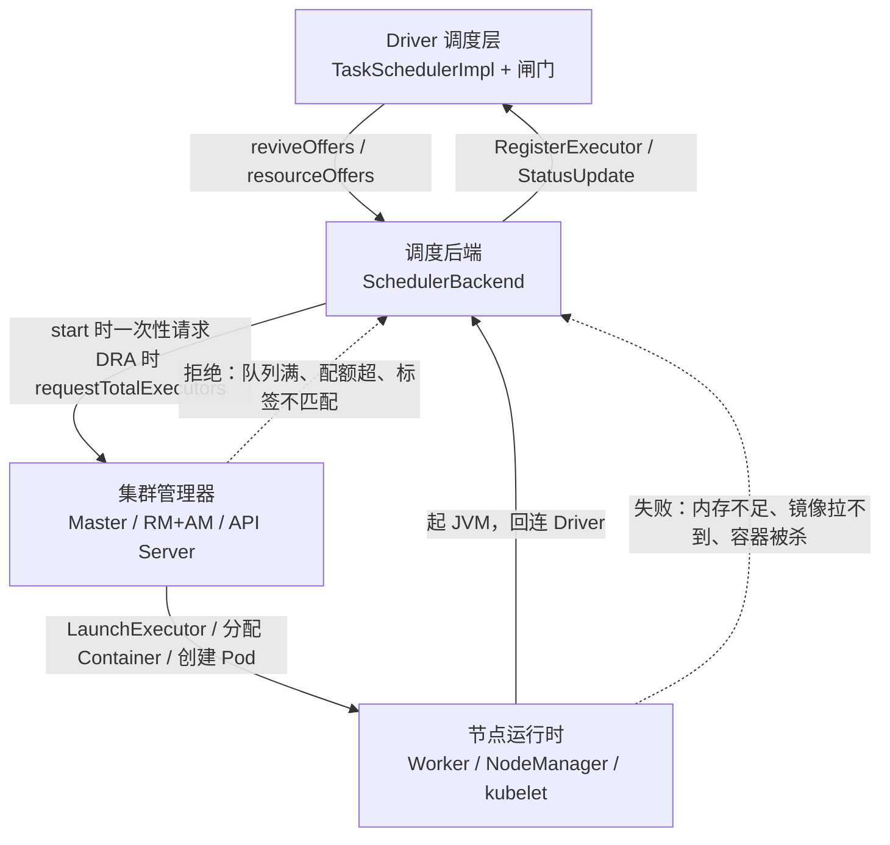
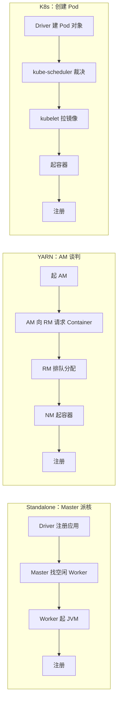
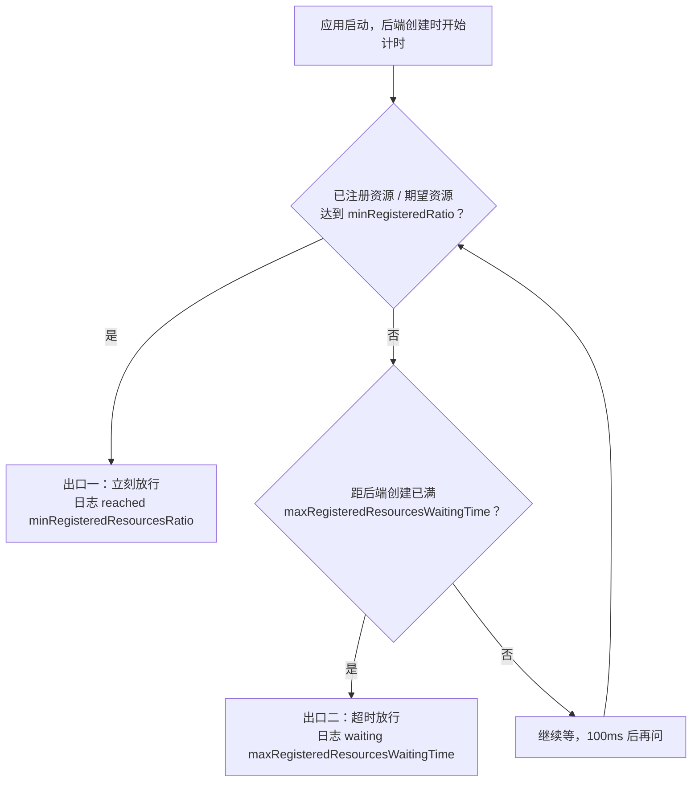
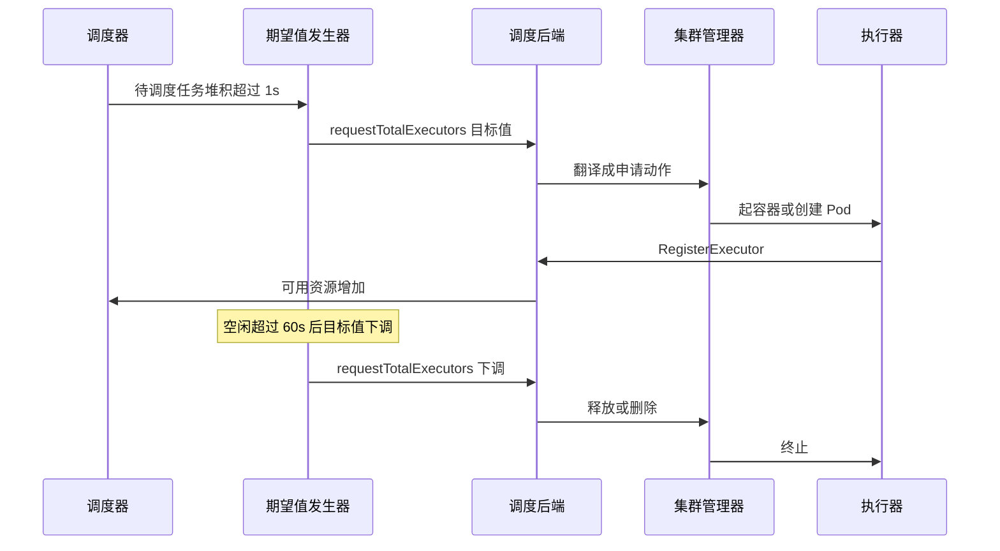
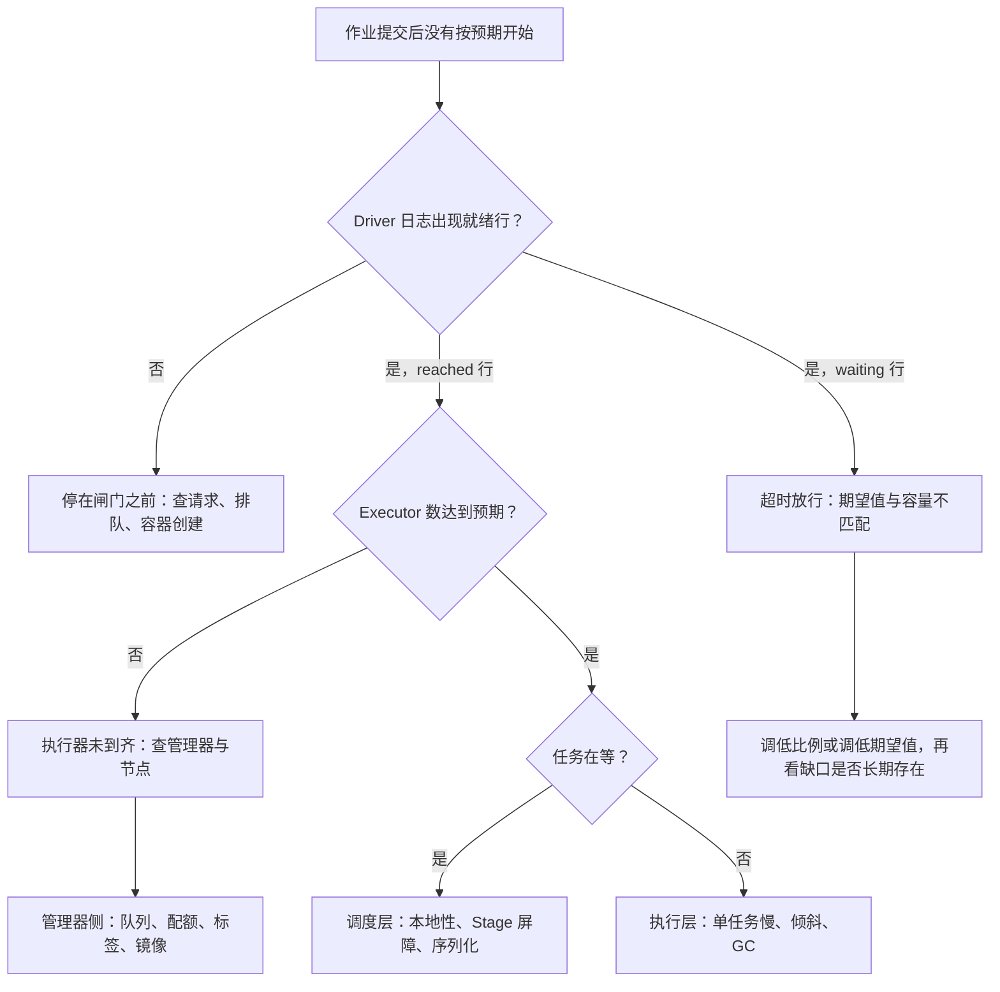

# 04 调度后端（SchedulerBackend）：Spark 与资源管理器（YARN，K8s）的对接细节

**摘要：**

把作业提交上去，UI 上的 Executor 数长时间停在零，或者只来了三五个就开始跑，这两种情形在运维记录里经常被写成同一类故障，实际上分属两层：一层是资源压根没到，另一层是资源到了一部分而调度器不再等。本文把调度后端（SchedulerBackend）放回它本来的位置——它只做两件事，把 Task 发给 Executor、把已有资源汇报给调度器，资源的获取从来由集群管理器决定——然后沿「等待被切成了几段」这条线索，拆开 Standalone 由 Master 派核、YARN 靠容器落地、K8s 靠创建 Pod 三种到达方式在节奏上的差异；再把手上的两道闸门 `spark.scheduler.minRegisteredResourcesRatio` 与 `spark.scheduler.maxRegisteredResourcesWaitingTime` 讲成一组可读的开关，解释 Standalone 缺省 0 而 YARN 与 K8s 缺省 0.8 造成的分野，以及把比例调高、把超时调长各自要付的账；最后交代动态分配在这一层的执行边界——它只是执行端，四个保数据的前提缺一不可——并给出三模式配置对照与一张按症状定位的归因表。文中的数字以 Spark 4.3.0 官方 Configuration 文档与对应分支源码为准；契约、账表与唤醒线的机制推导不在本文重复，见内核系列第 7 篇。

---

## 第 1 章 后端不管资源：一条被反复越过的责任边界

### 1.1 一次没有 Executor 的提交

先看一个具体的早晨。集群三百台，每天两千个作业，`ods_order_daily` 排在七点四十提交，Spark UI 的 Executors 页一直是空的，第二十六秒才冒出第一批四个执行器，此后每两秒多一个，到第十九个停下。值班同事的第一判断是「调度器慢」，理由是 `DAGScheduler` 的 `JobSubmitted` 与第一条 `LaunchTask` 之间隔了半分钟。

这个判断错了方向。调度器那一刻能做的最负责任的事就是什么都不做：报价列表是空的，`launchTasks` 一次也没被调用。吃掉那半分钟的是另一条链路——Driver 的请求、资源管理器排的队、容器或 Pod 的创建、JVM 引导、执行器注册，这条链上 Spark 能干预的只有首尾两小段。

把边界说清楚是本文的前提：**调度后端是外交层，不是采购部**。它把三种资源系统的语言翻译成「有哪个执行器、还剩几个核」这一种，往上是账表，往下是 RPC，中间没有一处在决定资源给不给。

### 1.2 契约里没有申请这个动作

打开 `SchedulerBackend` 这个 trait，方法集短得让人意外：`start`、`stop`、`reviveOffers`、`killTask`、`defaultParallelism`，加一个带缺省实现的 `isReady`，以及几个与反压、执行器编号相关的小方法。没有任何一个名字与申请资源有关，没有 `requestExecutors`，没有 `acquire`，也没有资源规格类的参数。

这不是遗漏，而是适配器设计的取舍：屏蔽差异的收益只存在于「任务怎么送达」这一侧，资源申请的语义在 YARN、K8s、Standalone 之间差得太远——一个是队列里的排队请求，一个是对象的创建，一个是 Master 内部的分配循环。于是抽象停在交付层，申请的复杂度被推进子类的 `start()`。

后果很直接：`start()` 长什么样，决定了应用启动那一刻能拿到多少资源。Standalone 把执行器启动命令与应用描述交给客户端，核数上界取自 `spark.cores.max`；YARN 起 AM 端点，让 `YarnAllocator` 去和 ResourceManager 谈判；K8s 启动 Pod 分配器与两条 Watch 通道，由 Driver 直接对着 API Server 建 Pod。三种实现写完各自的 `start()`，之后能做的就只有等待注册。

### 1.3 唯一的「再要一点」入口在另一份契约上

后端层并非完全不能要资源，那个能力放在另一份更窄的契约里：`ExecutorAllocationClient`。它的 `requestTotalExecutors` 由期望执行器数量发生器（`ExecutorAllocationManager`）调用，落到子类的 `doRequestTotalExecutors`，再翻译成调整 Master 上限、让 AM 重新申请容器、或按批创建 Pod。

这条路径有一个前提：动态分配（Dynamic Resource Allocation，DRA）必须打开。没开 DRA 时，没有任何组件会调用 `requestTotalExecutors`，启动时申请的规模就是整个生命周期的规模，运行期只剩下「执行器丢失、后端再补一个」这一种变动。把这一点记牢，很多归因不必绕弯：**扩容窗口在提交那一刻就关闭了**，之后抱怨「资源不够也不见它多要几个」属于对设计的误解，不是故障。

### 1.4 责任四分

一次「资源到达」可以拆给四个角色，决定权互不重叠。下表是后文归因的底稿。

| 角色 | 决定什么 | 出问题的典型表现 | 判断入口 |
|---|---|---|---|
| Driver 调度层 | 要不要等、什么时候开始派任务 | 资源已到齐却仍在等闸门，或不等就开工 | Driver 日志的两行 `SchedulerBackend is ready` |
| 调度后端 | 把到达的执行器记账、把 Task 投递出去 | 执行器已注册但任务不派，或任务投不出去 | Spark UI 的 Executors 页、Driver 日志的序列化报错 |
| 集群管理器 | 给不给、给多少、何时给 | 执行器数长期不动，队列或配额或标签挡住 | YARN RM 页面、K8s 事件、Standalone Master 页 |
| 节点运行时 | 容器或 Pod 能否真正起来 | 执行器不断失败重试，注册从不到达 | NM 日志、kubelet 事件、镜像仓库 |

最后一行更值得记住：「资源没来」把三件事混成一件——管理器没批、批了没起来、起来了没注册上，三者的第一现场完全不同。

### 1.5 与机制篇的分工

后端层内部的实现细节——契约的方法归属、`executorDataMap` 的字段与 `freeCores` 的补齐、三条唤醒线的去抖——已经在 [[大数据/Spark/读书笔记-spark内核/03_调度与执行机制/7. Spark_SchedulerBackend_原理|内核系列第 7 篇]]拆过，本文只引结论。K8s 侧 Pod 从 Pending 到 Running 的六个阶段与探针，见 [[大数据/Spark/Spark-on-Kubernetes工程实践/04 Driver 与 Executor Pod 的生命周期管理|Spark on K8s 专栏第 04 篇]]。

下图把四层责任与它们之间的接口画在一起，箭头代表谁向谁提出请求，方框内是各层能自主决定的事项。



两条虚线是所有「资源没来」的真实路径，它们不经过 Driver 的调度逻辑，也不在 Spark 日志里留痕。

---

## 第 2 章 等待被切成了七段

### 2.1 七段

从 `spark-submit` 到第一个 Task 在 Executor 上跑起来，中间至少有七段：上下文初始化与后端装配、提出请求、排队与裁决、对象创建、JVM 引导、注册与闸门、首次报价与投递。每段的责任人与观察信号都不同。

### 2.2 每一段的观察点

每段都有一个不必猜的观察点。下表按段列出第一现场，顺序即排查顺序。

| 段 | 谁在推进 | 可观察信号 | 卡住时的形状 |
|---|---|---|---|
| 上下文与后端装配 | Driver 进程 | Driver 日志首行时间戳、`SparkContext` 初始化日志 | 提交即失败，通常伴随配置异常 |
| 提出请求 | 后端子类 | Standalone 的 `Connected to Spark cluster`、AM 启动日志、K8s 分配器日志 | 请求发不出去，应用停在提交阶段 |
| 排队与裁决 | 集群管理器 | Master 页面、RM 页面、Pod 的 `PodScheduled` 条件 | 长时间无变化，且 Spark 侧没有任何新日志 |
| 对象创建 | Worker / NM / kubelet | Worker 日志、NM 容器日志、Pod 事件与容器状态 | 反复失败重试，或停在 `ContainerCreating` |
| JVM 引导 | 执行器进程 | 执行器日志的启动横幅 | 进程起来又退出，注册从不出现 |
| 注册与闸门 | 后端与调度器 | 账表变化、`isReady` 的两行日志 | 执行器数不达标时静默等待 |
| 首次报价与投递 | 调度器与后端 | UI 的 Active Stages、任务的 `LaunchTask` | 有执行器但任务不派，属另一层问题 |

### 2.3 三种模式的分段差异

同样七段，在三种部署方式下长度分布差别极大。Standalone 的段最短也最均匀，Master 与 Worker 都在 Spark 自己的进程里，中间没有外部系统的排队；YARN 多出一层 AM 谈判，容器请求要搭 RM 的心跳周期；K8s 的段最长，Pod 创建链上多了调度器裁决与镜像拉取两段不受 Spark 控制的路径。



差异的根源不在 Spark 内部，而在资源如何被承诺：Standalone 是 Master 内存里的一次决策，YARN 是 RM 心跳周期里的一次应答，K8s 根本没有分配，只有对象创建与调度器裁决，三者决定了 Spark 侧能观察到的最小时间粒度。

### 2.4 先看两行日志，再看 UI

碰到「起不来」或「起得慢」，笔者习惯先翻 Driver 日志里 `CoarseGrainedSchedulerBackend` 打出的那两行，再去看 UI。它们是闸门的唯一直接证据。

```
SchedulerBackend is ready for scheduling beginning after reached minRegisteredResourcesRatio: 0.8
SchedulerBackend is ready for scheduling beginning after waiting maxRegisteredResourcesWaitingTime: 30000.0(ms)
```

括号里的数字是毫秒，缺省打出 `30000.0`。**第一行是达标放行，第二行是超时放行**：看到第一行，说明闸门没有拖慢任何东西，慢在闸门之前；看到第二行，说明等够了时间仍未达标，后续的性能问题要从期望值与集群容量不匹配入手；两行都没出现，说明应用连闸门都没走到，问题在更早的段。

UI 的误导性在于它只展示已注册的执行器，那是第六段之后的产物；「执行器数为零」无法区分请求没发出去、管理器没批、容器没起来、JVM 崩了，只有日志与管理器页面能区分。

---

## 第 3 章 Standalone：Master 派核，先到先跑

### 3.1 分配单位是核，不是执行器

Standalone 的记账单位与其他两种模式不同：Master 手里拿的是 Worker 上报的空闲核数，分配时按核拨付，再由应用侧换算成执行器个数。换算发生在 `StandaloneSchedulerBackend` 里，分母是 `spark.cores.max`，每份大小由 `spark.executor.cores` 决定；若 `spark.cores.max` 没设，Master 侧回退到 `spark.deploy.defaultCores`，缺省 `Int.MaxValue`，意思是不加限制地把集群给出去。

由此推出一条容易忽略的结论：在 Standalone 上调 `--num-executors`（落到 `spark.executor.instances`）不改变 Executor 数量。分配只看核数上界与每份的核数，把它从二十改成一百，Master 不会多派一个执行器。要限流该改 `spark.cores.max`，或者在 Master 上把 `spark.deploy.defaultCores` 压低。

### 3.2 在这里闸门通常是常开的

基类的取值是「配置没给就用 0.0」，`StandaloneSchedulerBackend` 不做覆盖，于是 `minRegisteredRatio` 恒为 0；判断式是 `totalCoreCount >= totalExpectedCores * minRegisteredRatio`，右边恒为 0，`sufficientResourcesRegistered` 永远为真。

还有第二重失效：分母 `totalExpectedCores` 直接取自 `spark.cores.max`，多数小集群根本不设这个参数，分母本身就是 0。**两重失效叠加**之后，这道闸在缺省配置下没有任何拦阻作用——第一个执行器一注册，`isReady` 立刻返回真，后续执行器到一批用一批。

这解释了一个反复出现的行为差异：同一份作业在 Standalone 上一提交就滚动任务，在 YARN 与 K8s 上却要静默等一段。前者不是调度更快，只是没人拦；后者不是更慢，是在等一个比例。

### 3.3 症状：并行度爬升与 15 秒的看门狗

「先到先跑」的表现是并行度阶梯式爬升。Executors 页上执行器逐个出现，Running 的 Task 数跟着上升；一个 Stage 有一百个分区而集群要二十秒才凑齐二十个执行器，前十五秒跑的就是斜率很低的那条线。

与此并行的是看门狗。作业开始约十五秒后仍拿不到资源，Driver 会打出 `Initial job has not accepted any resources; check your cluster UI ...`。这句话出现得极频繁，但多数时候不是资源不足，而是某一段没走完——最常见的是 Master 已收下应用、Worker 还没来得及起 JVM。

### 3.4 三种「资源没来」

Standalone 上真正的资源问题有三种形状，各有明确观测点。

第一种是 Master 收下了应用但没有可分配的核，应用在 Master 页面保持等待，Worker 列表里能看到核被其他应用占满。此时 Spark 侧除了看门狗什么都不会说，要看的是 Master 页面与排在前面的应用。

第二种是核有了但 Worker 起不来执行器，典型原因是内存不够：执行器申请的堆内存加非堆内存超了 Worker 额度就被拒绝。这类拒绝反复重试，`spark.deploy.maxExecutorRetries` 缺省 10，连续失败超过这个次数且期间没有执行器成功运行，Master 会把应用移除。观感像「资源给了又收回去」，实际是执行器从未成功过。

第三种是应用注册不上。客户端向所有 Master 地址群发注册请求，超时二十秒、最多三轮，全都无应答就判死并终止应用，日志留下 `All masters are unresponsive`。这条属于 Master 侧或网络侧的问题，但体感同样是作业起不来。

### 3.5 抵达节奏还受铺开策略影响

Master 分配执行器的顺序不是随机的，`spark.deploy.spreadOutApps` 缺省为真，意思是尽量把同一应用的执行器铺到不同 Worker。铺开对 HDFS 本地性有利，代价是到达更分散：二十个 Worker 各起一个，比四台机器各起五个要慢。所以 Standalone 上追求「同一批任务同一起跑线」时，不能只依赖闸门，还得把 `spark.cores.max` 与比例一起设上；只设比例不设上限，分母为 0，配了等于没配。

---

## 第 4 章 YARN：一场跨进程的谈判

### 4.1 两个进程、两个时钟

YARN 模式下的后端是双层的：Driver 里跑 `YarnSchedulerBackend`，负责把期望执行器数转给 AM、接收 AM 报上来的注册；AM 里跑 `YarnAllocator`，真正对着 ResourceManager 发容器请求。两层结构带来两段不同节奏：Driver 侧是闸门的三十秒上限，AM 侧是请求容器的间隔。

申请间隔是自适应的。`spark.yarn.scheduler.initial-allocation.interval` 缺省 200 毫秒，用于有未满足请求时加速心跳；请求仍挂着则间隔逐次翻倍，直到达到 `spark.yarn.scheduler.heartbeat.interval-ms` 的常规周期（缺省 3000 毫秒）。设计意图是启动阶段尽快把请求递上去，长期排队时回到低开销节奏。

翻译成运维语言：请求递到 RM 很快，一般一秒之内；花时间的是 RM 排队与 NM 启动容器。所以看到「提交五秒内 AM 已在请求、执行器十分钟后才到」，第一现场在队列或节点容量。

### 4.2 排队与落地是两件事

应用处于 `ACCEPTED`，意味着 RM 收下了应用但连 AM 容器都没给；cluster 模式下 Driver 还没起来，用户看到的「没动静」与 Spark 调度无关，要查队列容量、`spark.yarn.queue` 指向的队列是否已满、集群是否在维护。

应用进入 `RUNNING` 但执行器数为零，说明 AM 在正常请求而 RM 没有分配。`YarnAllocator` 会持续发请求，日志里能看到请求数与待满足数；对应要查队列可用额度、节点标签表达式是否把可用节点缩得太窄、容器规格是否根本没有节点能满足。

执行器「分配了又释放」，说明容器起来了但注册没完成。这条路径多指向网络与主机名解析：执行器要回连 Driver 的 `CoarseGrainedScheduler` 端点，client 模式下 Driver 不在集群内，提交机器地址若在集群侧不可达，执行器连不上就退出，重试若干次后被 RM 回收。

### 4.3 容器规格算错，资源就永远等不到

YARN 上最隐蔽的一类「资源没来」，根因是申请了一个集群里不存在的容器规格。Spark 申请的内存不是 `spark.executor.memory`，而是堆内存加非堆内存：`spark.executor.memoryOverheadFactor` 缺省 0.10（K8s 上的非 JVM 作业为 0.40），下限由 `spark.executor.minMemoryOverhead` 兜住，缺省 384 MiB。写 8g 的执行器，容器请求约 8.8 GB，再叠加 NM 的最小分配粒度，可能变成 9 GB。

这个数若超过任何节点的可分配内存，RM 不会报错，只会把请求一直挂着：表面上应用在跑、AM 在请求、集群也有空闲内存，但每一块都小于请求值。排查入口是 RM 页面的未满足请求列表，看请求规格与集群最大可用块的差值。

| 现象 | 根因方向 | 第一现场 |
|---|---|---|
| 应用长期 `ACCEPTED` | 队列容量不足、队列被暂停、集群维护 | RM 应用页、队列页 |
| 应用 `RUNNING` 但执行器数为零 | 容器规格无节点满足、标签表达式过窄 | RM 的未满足请求、节点标签 |
| 执行器反复分配又释放 | 回连 Driver 失败、主机名不可解析 | 执行器日志、NM 容器日志 |
| 执行器数到一半停住 | 队列临时额度耗尽，等待其他应用释放 | 队列的已用与上限两条线 |
| 启动即报内存超限 | `memoryOverhead` 与 NM 的限制冲突 | AM 日志、容器退出码 |

### 4.4 缺省 0.8 在 YARN 上的读法

YARN 的闸门缺省比例 0.8，分母是 AM 报告的期望执行器数。这个期望值的来源要分清：没开动态分配时取 `spark.executor.instances`（`--num-executors` 落到这里），开了动态分配时取 `spark.dynamicAllocation.initialExecutors`，其缺省跟随 `minExecutors`，若显式设了更大的 `--num-executors` 则取较大值。

这意味着开了动态分配之后，闸门只对启动阶段生效：它等的是最初那批的八成，而不是最终会扩到多少的八成。扩缩容期间资源是否到齐，闸门不管，那是 `ExecutorAllocationManager` 的领域——它没有失效，只是分母变小了。

---

## 第 5 章 Kubernetes：Pod 是创建出来的，不是分配出来的

### 5.1 没有资源池，只有 API

K8s 模式下没有「申请额度」这个动作。Driver 侧的 `KubernetesClusterSchedulerBackend` 启动后调用 Pod 分配器，按批往 API Server 写 Pod 对象；能否落地由 kube-scheduler 裁决，能否启动由 kubelet 与容器运行时完成，能否成为可用执行器由执行器进程能否回连 Driver 决定。四件事分属四个组件，Spark 只做第一件。

这条链上最容易被低估的是两段没有超时语义的路：镜像拉取与 initContainer 执行。一个取决于镜像大小、节点缓存与仓库带宽，另一个取决于模板里塞了什么；它们把 Pod 卡在 `Pending`，而 Driver 只看到「创建了，但一直没注册」。这两段的完整拆解见 [[大数据/Spark/Spark-on-Kubernetes工程实践/04 Driver 与 Executor Pod 的生命周期管理|Spark on K8s 专栏第 04 篇]]。

### 5.2 提交完不等于可用

Pod 分配按批走：`spark.kubernetes.allocation.batch.size` 缺省 20，`spark.kubernetes.allocation.batch.delay` 缺省 1 秒。二百个执行器的申请要分十轮写完，光交给 API Server 就占掉约十秒，而这十秒里一个执行器都不可用。

这十秒只是第一段，之后每个 Pod 还要各自过调度、拉镜像、起容器、引导 JVM。日志里的锚点是分配器打出的 `Going to request N executors from Kubernetes ... target: X, known: Y`，它给出的是还差多少，不是已有多少可用，把它当进度条会得出与 UI 相反的判断。

| 观察对象 | 它回答的问题 | 不能回答的问题 |
|---|---|---|
| 分配器的 request 日志 | 请求了多少个 Pod、目标是多少 | 这些 Pod 是否已被调度 |
| Pod 的 `phase` | Pod 是否被接受、是否在运行 | 执行器是否已注册 |
| Pod 的 `PodScheduled` 条件 | 调度器是否已找到节点 | 容器是否已启动 |
| 容器 `state.waiting.reason` | 卡在镜像还是卡在准入 | 卡住要多久 |
| Spark UI 的 Executors | 有多少执行器已注册可用 | 还有多少在路上 |

### 5.3 资源会计：三个数不是一回事

K8s 上「资源够不够」有三个口径，混用会把容量问题误判成调度问题。`spark.executor.cores` 决定 executor 内部的任务并发；`spark.kubernetes.executor.request.cores` 决定 Pod 向调度器声明的 CPU 请求，若设置则优先于前者；`spark.kubernetes.executor.limit.cores` 才是硬上限。把 request 设得低于 cores 是一种有意的**超卖**，可以让更多 Pod 被调度上来，代价是节点 CPU 争抢时任务互相拖慢。

内存侧没有这样的分离：Pod 的内存请求同样由堆内存加非堆内存构成，两个 overhead 参数同样生效。YARN 上「申请的容器比预期大」的问题在 K8s 原样存在，只是表现从 RM 不分配变成 Pod 调度不上。

还有一层是准入期拒绝：Namespace 的 `ResourceQuota` 在对象创建那一刻检查，超了直接拒绝。此时 Driver 收到创建失败，Pod 根本不存在，页面上看不到 `Pending`——前者要改配额或换 Namespace，后者要等节点腾位置。

### 5.4 两个计时器与一个轮询

K8s 侧有两组与「等太久」相关的参数。`spark.kubernetes.allocation.executor.timeout` 缺省 600 秒，管的是请求已发出但 Pod 迟迟没进入 pending 状态：超时后分配器认为请求丢了，删掉重申请，日志是 `Executors with ids ... were not detected in the Kubernetes cluster after ... ms`，提示 API Server 可能丢过事件。

另一组是观测节奏：`spark.kubernetes.executor.apiPollingInterval` 缺省 30 秒，是 Watch 之外的兜底轮询。Watch 正常时事件实时，一旦连接抖动退化成轮询，执行器状态的可见性就以三十秒为粒度。排查时若发现执行器丢失的报告总是滞后半分钟，先看 Watch 是否在工作。

### 5.5 反例：把镜像当成基础设施的细节

K8s 上最常被低估的延迟是拉镜像。`spark.kubernetes.container.image.pullPolicy` 缺省 `IfNotPresent`，节点有缓存就直接用；一旦策略改成 `Always`，或用了带时间戳的 tag 让缓存永不命中，每个执行器 Pod 都要付一次完整拉取时间，三百节点一次扩容两百个执行器、镜像几 GB 且无缓存时，这一段就能让到达变成以分钟计的爬升。

观感与资源不足几乎一样，区分方法是看 Pod 的容器状态与事件：`ImagePullBackOff` 是镜像问题，`FailedScheduling` 才是资源问题。

---

## 第 6 章 闸门的读法：0.8、30 秒与 1.0

### 6.1 一道闸，两个出口

闸门在 `SparkContext` 的初始化路径上，`TaskSchedulerImpl` 在启动钩子里反复询问后端是否就绪，每 100 毫秒一次，直到得到肯定答复。后端的实现只有两个出口：资源达标，或者等满时限。



**计时起点是后端创建时刻**，不是用户按下提交的时刻。所以「日志时间戳减去应用创建时间」才是真实等待量；把提交命令的时间当起点，会多算上客户端上传依赖与申请 AM 或 Driver Pod 的那段。

### 6.2 三个模式的口径

三个子类对「什么算够」的定义不同，这是最容易配错的地方。

| 模式 | `minRegisteredRatio` 缺省 | 分母（期望资源） | 判断式 | 缺省行为 |
|---|---|---|---|---|
| Standalone | 0.0 | `spark.cores.max`，未设时为 0 | 已注册核数达到分母乘比例 | 闸门常开，第一个执行器到就开工 |
| YARN | 0.8 | AM 报告的期望执行器数 | 已注册执行器数达到分母乘比例 | 等八成或 30 秒 |
| Kubernetes | 0.8 | 初始期望执行器数 | 已注册执行器数达到分母乘比例 | 等八成或 30 秒 |

差异的根子在记账单位：Standalone 用核做分母，因为 Master 分配的是核；YARN 与 K8s 用执行器个数，因为分配单元是容器或 Pod。同一个数字放在不同记账单位上含义完全不同，这也是「Standalone 缺省 0」不能简单读成「Spark 不提倡等资源」的原因。

### 6.3 关键配置与调大的代价

下表把与资源到达相关的参数按三种模式并列，并给出调大之后要付的账。读法是先找症状所在那一行，再看代价是否可接受。

| 参数 | 三模式缺省与适用范围 | 作用与判据 | 调大后的代价 |
|---|---|---|---|
| `spark.scheduler.minRegisteredResourcesRatio` | Standalone 0.0；YARN 0.8；K8s 0.8 | 启动闸门的达标比例，越高越晚开工、越整齐 | 越接近 1.0 越容易每次白等满 30 秒，启动时延固定化 |
| `spark.scheduler.maxRegisteredResourcesWaitingTime` | 三模式 30s | 闸门的超时出口，兜住集群容量不足 | 单次提交最多多等这个时长，短作业端到端时间被拉长 |
| `spark.cores.max` | Standalone 未设（回退 `spark.deploy.defaultCores`） | Standalone 的核数上界，也是闸门分母 | 应用可能占满集群，影响同集群其他应用 |
| `spark.executor.instances` | YARN 缺省 2；Standalone 不参与分配 | 静态分配的执行器数量 | 资源占用变多，与配额上限冲突时整单排队 |
| `spark.executor.cores` | YARN 1；Standalone 为 Worker 全部核 | 每执行器的并发槽位，也决定核到执行器的换算 | 单个执行器变大，调度粒度变粗，失败重算代价更高 |
| `spark.executor.memoryOverheadFactor` | 0.10（K8s 非 JVM 作业 0.40） | 非堆内存占比，决定容器与 Pod 的实际规格 | 规格变大，可能超出节点可分配额度而永远分配不出 |
| `spark.dynamicAllocation.minExecutors` | 0 | 动态分配下限，也是初始值主要来源 | 常态占用的保底资源变多，空闲时段利用率下降 |
| `spark.dynamicAllocation.initialExecutors` | 跟随 `minExecutors` | 动态分配启动时申请的个数，即闸门分母 | 申请变多，闸门等待变长，但首 Stage 并行度更整齐 |
| `spark.dynamicAllocation.executorIdleTimeout` | 60s | 判空闲多久后释放执行器 | 空闲资源持有更久，缩容更迟钝，账单更高 |
| `spark.kubernetes.allocation.batch.size` | 20 | 每轮创建 Pod 的数量 | 单轮 API 压力与 Driver 侧开销上升 |
| `spark.kubernetes.allocation.batch.delay` | 1s | 两轮 Pod 创建之间的间隔 | 完成整套申请的时间变长，扩容更慢 |
| `spark.kubernetes.allocation.executor.timeout` | 600s | 未进入 pending 的请求多久算丢 | 真正丢失的请求要更晚才被重试 |

### 6.4 判据：什么时候该动这道闸

闸门只在启动阶段影响何时开始干活，不改变集群能给出的资源总量，因此它解决的是并行度整齐度问题，不是资源不足。

该调高的场景很具体：Stage 之间是屏障依赖、分区数远大于执行器数、单任务以分钟计、作业对首 Stage 的倾斜敏感。这类作业把比例调到 0.9 有意义，代价是每次提交多等几秒到几十秒。

该保持缺省甚至调低的场景同样具体：短作业、交互式查询、执行器到达零散且总量不稳定、或队列里永远有别的作业竞争。这类作业等不起，把比例调到 0.5 上下、超时压到十秒以内，启动提速往往比整齐更值钱。至于 Standalone，要动这道闸就得同时把 `spark.cores.max` 设上。

### 6.5 三个误配

第一个是把比例设成 1.0。判断式里的期望取配置目标值而不是集群实际能给的值；只要偶尔少给一个执行器，比例 1.0 就永不达标，每次提交白等满三十秒。痕迹很规整：每次启动恰好耗时三十秒出头，`waiting maxRegisteredResourcesWaitingTime: 30000.0` 反复出现。

第二个是在 Standalone 只设比例不设上限，分母为零使闸门失效，而配置写上去之后没有任何提示，日志里同样出现达标放行，只是达标得太容易。

第三个是把闸门当资源不足的解法。它只影响启动那一刻，作业跑起来后执行器被抢占、下线、缩容都不会让它重新关上；运行期的兜底只有执行器丢失、任务重算、后端再补这条链。

---

## 第 7 章 动态分配：唯一能再要资源的那条路

### 7.1 执行端，而不是决策端

动态分配打开之后，后端层多了一个角色：执行端。决策在 `ExecutorAllocationManager` 里，它盯着待调度任务的堆积与执行器的空闲时长，算出目标数量，调用 `requestTotalExecutors`；后端把这句请求翻译成集群管理器的语言——Standalone 调整 Master 上的上限，YARN 让 AM 重新申请或释放容器，K8s 调整分配器目标值并删除多余 Pod。

这解释了动态分配场景下一类特殊形态：目标值涨了、请求也发出去了，集群管理器却给不出来。此时没有报错，只有执行器数长期低于目标值，作业以低并行度继续跑。判断入口不在 Spark：YARN 看队列的未满足请求，K8s 看 Pod 是否持续 `Pending`，Standalone 看应用是否在等待。

### 7.2 四个前提，缺一个就起不来

K8s 没有外部 Shuffle Service（External Shuffle Service，ESS），动态分配必须换一条保数据的路。Spark 4.x 的判据是四个条件满足其一：开 ESS、开 Shuffle 追踪、开 Shuffle 块下线、或配置可靠的 `ShuffleDataIO` 插件；都不满足时构造分配器直接抛异常，异常文本把四个条件逐条列出。

| 前提 | 关键配置 | 三模式可用性 | 代价 |
|---|---|---|---|
| 外部 Shuffle Service | `spark.shuffle.service.enabled` | Standalone 与 YARN 可用；K8s 无原生 ESS | 每节点常驻进程，运维成本上升 |
| Shuffle 追踪 | `spark.dynamicAllocation.shuffleTracking.enabled`，4.x 缺省已为 true | 三模式均可用 | 有未读 Shuffle 数据的执行器释放不掉，缩容变保守 |
| Shuffle 块下线迁移 | `spark.decommission.enabled` 与 `spark.storage.decommission.shuffleBlocks.enabled` | 三模式均可用 | 下线时要搬数据，缩容更慢但更彻底 |
| 自定义 `ShuffleDataIO` | `spark.shuffle.io.plugin.class` | 取决于插件实现 | 可靠性要自己兜住 |

Shuffle 追踪缺省为 true 影响很大：4.x 上开动态分配，K8s 侧通常不用额外配置就能过构造检查，要权衡的是它带来的释放延迟，而不是能不能启动。同时 `spark.dynamicAllocation.shuffleTracking.timeout` 缺省为不超时，只要 Shuffle 数据没被回收，执行器就一直留着——资源曲线因此更像阶梯而不是滑梯。

### 7.3 三种模式的扩缩手感

同一个算法落到三种集群管理器上，扩和缩的手感完全不同。

| 维度 | Standalone | YARN | Kubernetes |
|---|---|---|---|
| 扩容动作 | Master 调整上限，继续派核 | AM 向 RM 申请新 Container | Driver 创建新 Pod |
| 扩容典型延迟 | 秒级 | 秒到十几秒（取决于队列与 NM） | 秒到几十秒（取决于调度与镜像） |
| 缩容动作 | Master 直接减少执行器 | AM 释放 Container | Driver 删除 Pod |
| 缩容的坑 | 执行器被硬停，任务随之重算 | 归还容器，需 ESS 保 Shuffle 数据 | 删 Pod 前需确认 Shuffle 数据已被追踪 |
| 观测入口 | Master 页面 | RM 与 AM 日志 | Pod 事件与分配器日志 |

扩容判据三模式一致：待调度任务堆积超过 `spark.dynamicAllocation.schedulerBacklogTimeout`（缺省 1 秒）就申请，之后每轮按上一轮的两倍增加。缩容判据也一致：空闲超过 `executorIdleTimeout`（缺省 60 秒）即可释放。差别全在动作成本上——YARN 释放容器是一次资源归还，K8s 删除 Pod 要过优雅终止期，再创建又要重走整条链路。



### 7.4 期望值与「资源来了用不上」

动态分配下另有一类错配：闸门等的是初始执行器数，扩容却由堆积驱动。一个作业设了 `initialExecutors=20`、`maxExecutors=200`，前几个 Stage 二十个执行器就够；第三个 Stage 突然放大到一个分区几十 GB，堆积触发扩容、每轮翻倍申请，但集群只给得出十几个。表现是 Stage 跑很久、执行器数缓慢上升，瓶颈却是队列额度。

另一种形态是资源来了却用不上：执行器注册成功、账表记上一行，调度器却不往它上面派任务，三种成因见第 8.4 节。这里只划边界：后端只记账与投递，派不派由调度器决定；本地性调度的细节见本专栏 [[09 本地化调度（Locality-Aware Scheduling）：移动计算而非移动数据的实现细节|第 09 篇]]，动态分配的完整决策逻辑见 [[10 动态资源申请（Dynamic Resource Allocation）：弹性计算的资源调度逻辑|第 10 篇]]。

### 7.5 反例：把动态分配当弹性伸缩

最常见的误用是期待它像无服务器那样按秒伸缩。做不到的原因在结构上：每次扩容都要穿过整条启动链路，YARN 是排队加容器启动，K8s 是调度加拉镜像加容器启动，量级在秒到几十秒；缩容还要等空闲判定的 60 秒。以秒计的波峰波谷它追不上，只会留下一串创建了又删的记录。

判据很朴素：负载空闲期显著长于执行器启动时间，动态分配才划算；两者同量级时，它只是把资源账做得更难看。

---

## 第 8 章 归因手册：三分钟内定位到层

### 8.1 四条证据链

排查资源问题时，笔者按固定顺序看四个地方：Driver 日志里 `CoarseGrainedSchedulerBackend` 的两行就绪日志回答闸门是不是瓶颈；Spark UI 的 Executors 页与 Active Stages 回答注册了多少执行器、多少任务在等；集群管理器页面回答请求发出后发生了什么；节点侧日志回答容器为什么起不来。

**顺序不能乱**。先看第四处再回头找 Spark 的问题，容易被节点侧噪声带偏；只看 Spark UI 不下沉到管理器，会把排队误判成调度慢。



### 8.2 症状对照

下表把症状与第一现场对齐，可作排查的第一张纸。

| 症状 | 最可能的层 | 第一现场 | 下一步 |
|---|---|---|---|
| 提交后无就绪行，UI 无执行器 | 请求或排队 | RM 应用状态、Pod 是否存在、Master 应用状态 | 按模式查队列、配额、标签 |
| 就绪行是 waiting 版本，恰好等了 30 秒 | 闸门与期望值 | 对比期望执行器数与集群实际可给 | 调低比例、调低期望、或扩队列 |
| 执行器数为零但 Pod 存在且 Pending | 节点调度 | Pod 事件里的 `FailedScheduling` 原因 | 看资源碎片、亲和性、污点 |
| Pod 存在但容器 `Waiting` | 镜像或准入 | `ImagePullBackOff`、`ErrImagePull` | 仓库凭据、tag、拉取策略 |
| 执行器注册后立刻丢失 | 网络或节点 | 执行器日志的回连错误、节点状态 | Driver 地址可达性、节点健康 |
| 执行器到齐但任务不派 | 调度层 | UI 的 pending tasks 与 locality 等待 | 本地性等待、Stage 依赖、序列化 |
| 任务在跑但吞吐远低于核数 | 执行层 | 任务时长分布、GC、磁盘等待 | 进入执行器与 Shuffle 的排查 |

### 8.3 一次完整的复盘

回到第 1 章那个作业。七点四十提交，两秒后 Driver 日志出现 `Connected` 类日志，说明后端已在请求资源；四秒后 API Server 里出现第一批 Pod 对象，`phase` 为 `Pending`，事件里没有 `FailedScheduling`，说明调度器没有拒绝；七点四十零九秒起 Pod 陆续进入 `ContainerCreating`，容器状态长期 `Waiting`，原因是 `ImagePullBackOff`，重试间隔逐步退避；七点四十二十六秒第一个执行器注册，之后每两秒多一个。

结论很清楚：资源并不缺，节点容得下这些 Pod，卡住的是镜像分发。此时调低比例会把启动从二十六秒压到几秒，代价是首 Stage 只用四个执行器跑，倾斜照旧；正确处置是把镜像预热到节点，或把拉取策略从 `Always` 改回 `IfNotPresent`。这个复盘也说明：闸门的等待与镜像的等待在时间轴上可能重叠，只有时间轴能把它们分开。

### 8.4 「资源到了没用上」的三种真身

第一种是**记账侧空转**。执行器注册了，`freeCores` 是满的，调度器却没有可派的 TaskSet——所有 Stage 都在等上游，或者整个 Job 只有一个分区。此时加执行器毫无意义，问题在分区划分。

第二种是**本地性等待**。任务因为数据在别的节点而反复降级重试，调度器宁可等三秒也不立刻派到远端空闲的核上。表现是执行器数够、CPU 利用率上不去，Stage 页里能看到 `Locality Level` 在 `NODE_LOCAL` 与 `ANY` 之间跳动。

第三种是**交付失败**。闭包过大导致序列化超限，后端在 `launchTasks` 里直接判失败，执行器从未收到它；判据是 Driver 日志里的 `serialized ... bytes, which exceeds max allowed`。

### 8.5 反例清单

| 反例 | 错在哪 | 正确做法 |
|---|---|---|
| 把 `minRegisteredResourcesRatio` 设成 1 | 只要少给一个执行器就永远等满 30 秒 | 设 0.8 到 0.9，并保证期望值不超过集群容量 |
| 在 Standalone 上调 `--num-executors` | 分配只看核数上界，这个参数不参与换算 | 调 `spark.cores.max` 或 Master 的 `spark.deploy.defaultCores` |
| 在 Standalone 只设比例不设上限 | 分母为零，闸门恒开 | 两个参数一起设 |
| 把 K8s 的 `request.cores` 当并发数 | request 只是调度声明，并发由 `executor.cores` 决定 | 分开设，理解超卖的代价 |
| 忽略镜像拉取时间 | 把基础设施延迟记在 Spark 头上 | 预热镜像、固定 tag、`IfNotPresent` |
| 期待动态分配按秒伸缩 | 每次扩容都要走完整条启动链路 | 按空闲期与启动时间的量级判断是否划算 |
| 把队列排队当调度器慢 | 应用可能连 AM 都没拿到 | 先看 RM 应用状态，再看 Spark 日志 |

---

## 第 9 章 落点

调度后端做的是换算、唤醒、投递三件事，它把三种资源系统的语言统一成一张账表，把调度器的决策换成一条条 RPC；至于资源什么时候到、到几个、卡在哪一步，那是集群管理器与节点运行时的事。接口越窄，可替换面越大，代价就是它无法替上层解决拿不到资源的问题。

闸门是一个典型的工程折中：目标不是更快，而是让同一批任务站在同一条起跑线上，因为 Stage 是屏障式的，先到的执行器抢走任务会把并行度错觉与结构性倾斜一起带进来。三十秒的超时出口把这个理想拉回现实——宁可并行度不完美，也不能因为集群本来就没有那么多资源而永远不开工。

三种模式的缺省差异，说到底是记账单位与链路长度的差异：Standalone 用核记账、链路短，于是闸门常开、先到先跑；YARN 与 K8s 用执行器记账、链路长，于是等八成再开工，把不整齐的部分交给等待吸收。由此得到一个可操作的结论：遇到「资源没来」，先在时间轴上定位段，再决定改哪个参数；遇到「资源来了用不上」，先分清是调度层不派还是执行层跑得慢。要不要为整齐度牺牲启动时延、要不要为弹性启用动态分配，取决于作业时长分布与混部强度——这类问题没有唯一答案，**只有与场景相配的答案**。

---

## 参考资料

1. Spark 4.3.0 文档 Configuration：闸门两参数、`spark.cores.max`、两个 overhead 参数。https://spark.apache.org/docs/latest/configuration.html
2. Spark 4.3.0 文档 Running Spark on YARN：申请间隔、心跳周期、队列与节点标签。https://spark.apache.org/docs/latest/running-on-yarn.html
3. Spark 4.3.0 文档 Running Spark on Kubernetes：Pod 批量创建、pending 超时、CPU request、镜像拉取策略。https://spark.apache.org/docs/latest/running-on-kubernetes.html
4. Spark 4.3.0 文档 Spark Standalone Mode：`spark.deploy.defaultCores`、`maxExecutorRetries`、`spreadOutApps`。https://spark.apache.org/docs/latest/spark-standalone.html
5. 源码 `CoarseGrainedSchedulerBackend.scala`：比例缺省、`isReady` 两个出口与两行日志、计时起点。https://github.com/apache/spark/blob/branch-4.3/core/src/main/scala/org/apache/spark/scheduler/cluster/CoarseGrainedSchedulerBackend.scala
6. 源码 `StandaloneSchedulerBackend.scala`：核数上界与比例判断式。https://github.com/apache/spark/blob/branch-4.3/core/src/main/scala/org/apache/spark/scheduler/cluster/StandaloneSchedulerBackend.scala
7. 源码 `YarnSchedulerBackend.scala`：比例缺省 0.8 与期望执行器数判断式。https://github.com/apache/spark/blob/branch-4.3/resource-managers/yarn/src/main/scala/org/apache/spark/scheduler/cluster/YarnSchedulerBackend.scala
8. 源码 `KubernetesClusterSchedulerBackend.scala` 与 `ExecutorPodsAllocator.scala`：初始期望执行器的比例判断、按批创建、超时删除。https://github.com/apache/spark/blob/branch-4.3/resource-managers/kubernetes/core/src/main/scala/org/apache/spark/scheduler/cluster/k8s/KubernetesClusterSchedulerBackend.scala
9. 源码 `ExecutorAllocationManager.scala`：动态分配的四个前提与异常文本。https://github.com/apache/spark/blob/branch-4.3/core/src/main/scala/org/apache/spark/ExecutorAllocationManager.scala
10. 源码 `internal/config/package.scala`：闸门两参数定义、`shuffleTracking` 的缺省与不超时。https://github.com/apache/spark/blob/branch-4.3/core/src/main/scala/org/apache/spark/internal/config/package.scala

---

> [!note] 思考题
> 1. 一个作业在 YARN 上设了 `spark.executor.instances=100`、`minRegisteredResourcesRatio=0.9`，而队列长期只能给出六十个容器的额度。每次提交会发生什么？若希望作业照常开工又不想改队列配额，该动哪个参数，代价是什么？
> 2. K8s 上的执行器 Pod 一直 `Pending`，事件里只有 `FailedScheduling`，而 `kubectl describe node` 显示每个节点都有空闲 CPU。可能的原因有哪几类，各自的第一步验证动作是什么？
> 3. 为什么 Standalone 的闸门分母取核数，而 YARN 与 K8s 取执行器个数？如果强行把 Standalone 也改成按执行器个数判断，会遇到什么计量上的困难？
> 4. 一个 Stage 有一千个分区、集群有五十个执行器，`minRegisteredResourcesRatio` 设为 0.9 之后每次提交都要等二十多秒。这个等待换来的整齐度，对哪类作业值得、对哪类作业不值得？判据应该看哪些指标？
> 5. 动态分配在 K8s 上依赖 Shuffle 追踪且超时缺省为不超时。如果一个作业的最后一个 Stage 只消费了部分上游 Shuffle 数据，执行器会怎样？这对资源账单和作业时长分别意味着什么？