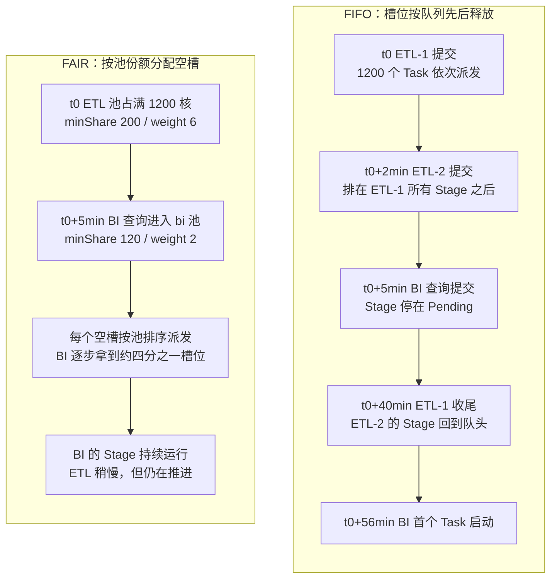
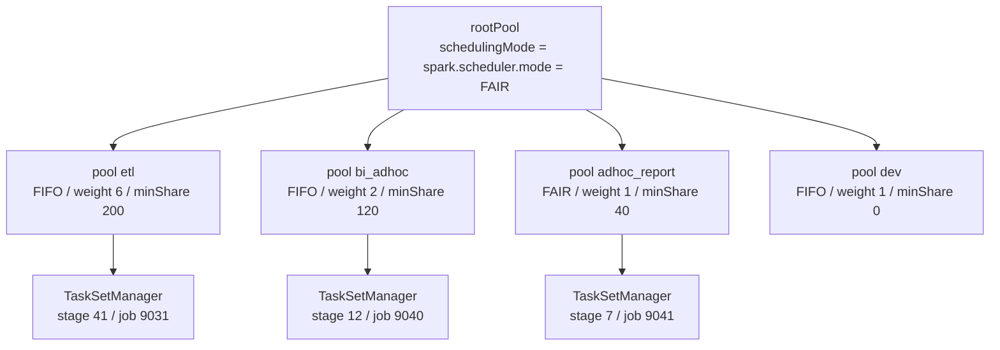
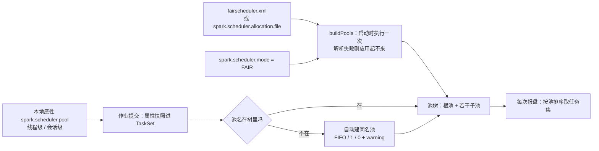
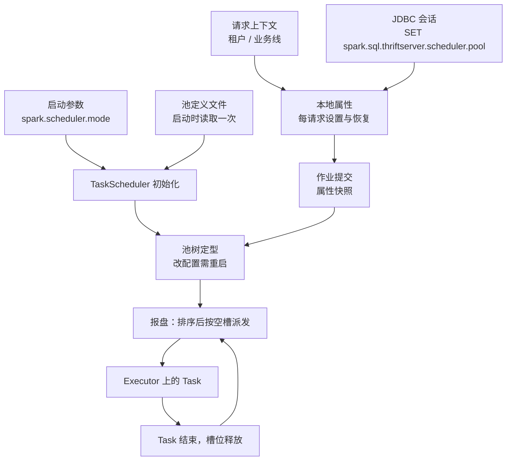
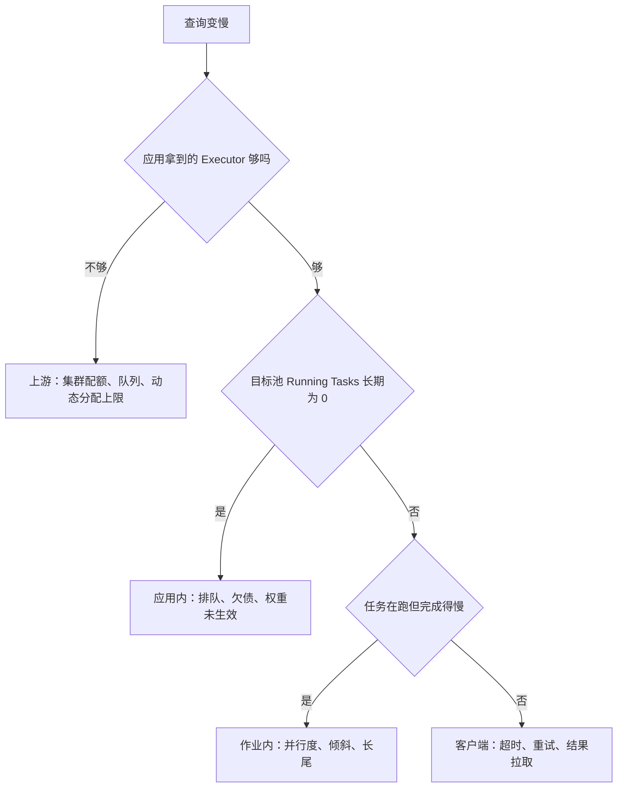

# 05 调度算法深度剖析：FIFO 与 FAIR 策略的实现原理与应用场景

**摘要：**

在一个常驻的 Spark 网关里，几十位分析师的长短查询与夜间批处理共用同一个 driver、同一批 Executor，"下一个空出来的核先给谁"于是成了每天都要回答的问题。本文不推导比较器，只站在配置与运维角度回答两件事：FIFO 在交互式场景下怎样把几十秒的查询拖成没有上限的等待；FAIR 打开之后为什么常常看起来没有生效。行文沿五问推进：先看队头阻塞的四条传导路径；再拆开池树、minShare 与 weight 的语义，以及三条建池路径的失败面；随后逐条解释权重不生效、保底落空、默认池退化成 FIFO 这几种落差；给出可抄的池清单、带代价的参数表与判断公平性是否生效的证据清单；最后划清应用内公平与集群级公平的边界，并用六个反例收束。贯穿案例是一个每天两千个作业的网关，判断口径有三条：池表里的 Running Tasks 比例、排队时长的 P99、以及是否存在持续饥饿；机制细节在 Spark 内核剖析专栏里已有推导，本文只取结论当判据。

---

## 第 1 章 队头阻塞：一次四十秒查询的等待

### 1.1 一个网关的早晨

某公司的共享集群有 300 台机器、每台 24 核，合计七千二百核；划给常驻 SQL 网关的配额是一千二百核，网关是一个 Thrift Server 进程，四十位分析师通过 JDBC 连它，夜间的 ETL 也走同一套连接池，平均每天两千个作业。早上九点四十，一位分析师提交了一条按渠道汇总上周订单的查询：扫描两千万行，两级聚合，估算四十秒、两百个 Task。

九点四十一分，UI 上 Executor 全部繁忙，Running 的 Stage 只有 ETL 的两个写入作业，分析师的 Stage 停在 Pending；没有失败、没有告警、没有异常栈。十一点零二分，第一个 Task 才被启动，而 BI 工具的超时阈值是三分钟。

不用压测数字也能推演出后果：若两个 ETL 作业各有一千二百个 Task、每个平均三分钟，在严格先来先服务的派发下，排在后面的查询最坏要等第一个 Task 结束才有机会拿到槽位，只要 ETL 持续提交，这个等待就没有上限。FIFO 下排在后面的作业不会失败，只会安静地不动，这条特征决定了后面所有的误判。

### 1.2 FIFO 保证的到底是什么

`spark.scheduler.mode` 默认是 `FIFO`（本文口径为 4.3.0），这个参数从 0.8.0 起就存在，文档对它的描述是"同一个 SparkContext 内作业之间的调度模式"。排序规则很朴素：第一键是作业号，第二键是 Stage 号，作业号小的、Stage 号小的排在前面；作业号来自 DAGScheduler 的自增计数器，于是"先提交"与"排序靠前"在默认路径上是一回事。

但 FIFO 并不保证一个作业把集群占到自己结束。它保证的是每个派发回合都先问队头：队头当前 Stage 还有待派 Task 就先给它，它这一刻没有可派的了（任务全在跑、在等本地性、或者已经派完），才轮到下一个。这个区别很要紧：FIFO 的阻塞是概率性的，由任务粒度与并行度共同决定，而不是"整作业独占"的硬规则。并行度只有两百、集群有一千二百核的作业，其实会给后面留出空位；并行度一千二、Task 又长的作业，才会把队头堵死。

还有一层常被忽略：第一排序键是作业号，一个作业的所有 Stage 都比后提交作业的 Stage 靠前。作业 A 的 Stage 3 与作业 B 的 Stage 0 同时可跑时，A 先派。所以"等一个 Stage"在 FIFO 下往往是"等一个作业的全部并发 Stage"。

### 1.3 阻塞的四条传导路径

第一条是槽位耗尽：队头待派 Task 数超过可用槽位，后面的作业一个槽位都分不到。这条最直观，也是多数人唯一想到的。

第二条是任务粒度：槽位按 Task 结束逐个释放，一个跑了五十分钟的 Task 占着核不放，后面的作业既抢不走，也等不到"批量释放"的时刻。Task 越长，等待越呈台阶状。

第三条是 Stage 回流：ETL 作业是一串首尾相接的 Stage，后一个提交时仍带着更小的作业号回到队头，于是后提交的查询面对的不是一个 Stage 的时长，而是一个作业的时长，叠加上夜间连续提交，等待被拉到小时级。

第四条是本地性等待：队头 Task 等数据本地槽位时会短暂让出派发机会，后面的作业因此能挤进几个槽位，代价是队头自身被拉长。分级与降级见 [[大数据/Spark/Spark-调度系统与执行模型深度解析/09 本地化调度（Locality-Aware Scheduling）：移动计算而非移动数据的实现细节|本地化调度]]，这里只取结论：`spark.locality.wait` 默认 3 秒，空槽会在队头那里"过一手"再给别人。

### 1.4 交互式负载为什么特别怕它

批处理集群里，FIFO 的问题只是完成时间不理想；交互式网关里，它是体验崩塌。

其一，等待没有上限，也没有老化。批处理排队时运维能估个完成时间，交互式查询没有这个可能，前面排了多少作业、各自还剩多少 Task，用户都看不到；刚提交的小查询也不会因为"等得久"而提升优先级。

其二，重试会正反馈：提交率上升、队列变长、等待变长、超时更多、重试更多，循环形状与资源不足完全一样，监控上很容易被归因成"集群不够大"。

### 1.5 FIFO 没有错，只是场景错配

FIFO 在独占集群的批处理里是最优解：单作业应用里它退化成常数，批处理流水线里它给出可预测的先后次序，调度开销接近零，也不会因为某个池的份额算错而抖动。它的问题只在同一个 SparkContext 里同时有多个规模差异极大的作业时出现。

这个前提来自三种形态：常驻的 SQL 网关（Thrift Server、Spark Connect 服务端）、共享 driver 的 notebook 环境、用多线程并发触发 Action 的写法。网关最典型，请求来自不同的人、规模跨越三个数量级，对延迟的期待完全相反。

| 现象 | 更可能所在的层 | 判断依据 |
| :--- | :--- | :--- |
| Executor 全忙、只有少数 Stage 在 Running | 应用内排队 | 池表里某个池 Running Tasks 接近总槽位，其余池为 0 |
| Executor 数远低于配额 | 上游资源获取 | 应用拿到的 Executor 数、动态分配的申请记录 |
| Stage 在跑但 Task 完成很慢 | 作业内部 | Task 时长分布、Shuffle 读写量、倾斜 |
| 客户端报超时但服务端仍在跑 | 客户端与取消 | 网关的取消日志、重复提交的查询指纹 |

图 1 把同一个早晨的两种排期并排画出来，左半是 FIFO，右半是 FAIR 之后期望的样子，两边的 Task 总量与槽位数一致，差别只在"下一个空槽给谁"。



---

## 第 2 章 三层结构：池、份额与权重各管什么

### 2.1 树的形状

FAIR 模式把 FIFO 那一条扁平队列换成**三层树**：根池（root pool）是唯一的根，`schedulingMode` 由 `spark.scheduler.mode` 决定；中间层是若干子池，各有自己的 `schedulingMode`、`weight` 与 `minShare`；叶子是 TaskSetManager，一个 Stage 对应一个。每一层按自己的比较器排序，根池先排子池，子池再排叶子，最后递归展开成一条有序的任务集列表。

这个结构的用意是把"谁重要"与"谁先来"分开：池之间回答这块资源先给哪个业务，池内回答同一个业务里哪个作业先跑；两层用两套规则，可以独立配置。排序结果如何被报盘消费、Task 最终落到哪个槽位，这套任务分配机制的细节见 [[大数据/Spark/读书笔记-spark内核/03_调度与执行机制/6. Spark_TaskScheduler_深度解析|TaskScheduler 深度解析]]，这里只留一个判据：配出来的每一个池都是根池的孩子，中间没有隐式层级。

### 2.2 池名的入口：一个按线程生效的本地属性

作业进哪个池由 `spark.scheduler.pool` 这个本地属性决定，代码写作 `sc.setLocalProperty("spark.scheduler.pool", "bi_adhoc")`。本地属性存在 `InheritableThreadLocal` 里，这个实现细节带来三个后果。

第一个是按线程：A 线程设了池名，只影响 A 线程提交的作业，B 线程不设就进 default 池，这正是网关类应用要的效果。

第二个是可继承：线程池里的工作线程如果是在设置之后创建，会继承创建者的属性；如果线程是复用的，属性就粘在它身上，直到被显式清掉。所以正确的写法永远成对出现——设置、执行、在 finally 里恢复或清空。

第三个是提交时快照：池名在 Action 被触发的那一刻随本地属性捕获进作业，之后这条作业在调度树里的位置就定了。作业跑起来之后再改池名没有效果，能改的只有下一条作业。

### 2.3 minShare：保底，但不是预留，也不是上限

`minShare` 的文档口径是"希望这个池至少拥有的 CPU 核数"，公平调度器先尽量满足所有活跃池的最小份额，剩下的再按权重分。三句话要一起读，少一句就会配错。

它是**保底**：资源紧张、所有池都在抢的时候，运行 Task 数低于 minShare 的池在排序上优先，先补到保底线。它是**非预留**：池里没有待派 Task 时，minShare 不占住任何资源，别人可以用满，所谓"给关键业务留两百核"用 minShare 做不到，那是集群级配额或 `spark.dynamicAllocation.minExecutors` 的职责。它也是**非上限**：其他池空闲时，一个 minShare 只有 20 的池可以把一千二百核全吃掉。

还有一条容易被忘记：minShare 不抢占。FAIR 只决定"下一个空槽给谁"，不会把已经跑起来的 Task 从别的池手里夺回来。所以 minShare 的效果总是滞后一个 Task 时长，池欠债时看到的是"已有的任务继续跑完、新的槽位开始向它倾斜"，而不是"立刻补齐"。

### 2.4 weight：只在竞争时才有意义的相对份额

`weight` 默认是 1，含义是相对其他活跃池的份额。它的生效条件比多数人以为的窄：只有当参与比较的两个池都已还清 minShare 的欠账时，权重才进入比较；只要还有池子在保底线以下，优先权就归它。权重是分配剩余资源时的比例，不是优先级，也不是配额，这句话同时否掉了三种常见误解。

推论有三条。单池活跃时权重完全无意义，它拿走全部；权重是相对值，10 比 5 与 2 比 1 等价，写成 1000 比 1 只是把"几乎总是先派"这个效果放大；权重不改变池内顺序，同一个池里两个作业谁先跑，仍由池的 `schedulingMode` 决定。

### 2.5 池内默认仍是 FIFO

这里有一个广泛流传的误记，值得单独澄清。文档写的是"默认情况下每个池拿到相等的份额，但池内作业按 FIFO 顺序运行"，源码里的常量同样把 `DEFAULT_SCHEDULING_MODE` 定为 `FIFO`，XML 里不写 `<schedulingMode>` 的池、运行时按名字自动创建出来的池，用的都是这个默认值。所以"池内 FIFO"是默认行为而非硬编码，把某个池显式配成 `FAIR`，池内的多个作业就会轮流拿槽位。

这个区别在网关场景里很实际：给每位分析师一个池，池内 FIFO 时同一个人的第二条查询仍要等第一条跑完，改成 FAIR 才会交错。个人会话通常希望"先提交先算清"，团队共享的池更希望人人有份。

| 层 | 由谁排序 | 排序依据 | 典型配置错误 |
| :--- | :--- | :--- | :--- |
| 根池 | `spark.scheduler.mode` | 子池之间按 minShare 欠债与权重份额 | 只开 FAIR 不建池，以为会自动按用户分 |
| 子池 | 池自己的 `schedulingMode` | 叶子之间按作业号或按份额 | 以为池内默认就是公平轮转 |
| 叶子 | 池内 `schedulingMode` 的比较器 | Stage 的待派任务 | 池内 FAIR 却没意识到 Stage 之间也在轮转 |

图 2 是贯穿案例的池树：四个池挂在根池下，池内各自选一种模式。



---

## 第 3 章 三条建池路径与各自的失败面

### 3.1 文件定义：fairscheduler.xml 与 allocation.file

池的定义写在 XML 里，找文件有两条路：把 `fairscheduler.xml` 放到 classpath 上，或者用 `spark.scheduler.allocation.file` 指定路径。后者支持 `file://` 与 `hdfs://`，路径按 Hadoop 的 FileSystem 解析，所以集群里放一份共享配置、所有应用指同一个路径是可行的。

读取发生在应用启动阶段，TaskScheduler 初始化时构建池树，此后没有公开的刷新入口，所以改池定义要重启应用，对常驻网关意味着一次计划内重启。文件里的每个 `<pool>` 支持三个字段——`schedulingMode`、`weight`、`minShare`。

这条路径有三个失败面。第一个是解析失败：XML 语法错误直接抛异常，应用起不来，问题在启动时暴露。第二个是**取值失败**：`weight` 写成非数字、`schedulingMode` 拼成怪写法，源码打一条 warning、用默认值继续（FIFO、权重 1、minShare 0），应用照常启动，池看起来存在、参数却是默认的。第三个最隐蔽：XML 表达不了层级——取池节点用的是递归选择器，所有 `<pool>` 不管嵌在哪一层，读出来都直接挂到根池。想要多级池，只能在代码里用 `Pool.addSchedulable` 自己搭。

### 3.2 运行时按名字建池

第二种方式是隐式的：作业带着池名进来，池树里没有这个名字，调度器就临时建一个同名池、参数取默认值，再打一条 warning，大意是"作业提交到了未配置的池，已用默认参数创建"。便利是不用改文件就能试新池，风险在于池名拼错不会报错：`bi-adhoc` 与 `bi_adhoc` 差一个连字符就是两个池，一个按配置运行，另一个用默认参数运行。

排障时这条 warning 是必须找的证据：日志里出现"has not been configured"，就说明池定义没被读到、或者名字对不上，不必再往比较器的方向怀疑。

### 3.3 代码与会话级指定

第三种是在代码里显式设置本地属性，作用域精确到线程与作业。网关类应用通常会包一层：从请求上下文取出租户或业务线，映射成池名，设置、执行、恢复。最容易漏的是恢复——线程处理完 A 用户的请求后没有清空属性，下一个复用该线程的请求会继续用 A 的池。

SQL 侧另有一个入口：JDBC 会话可以用 `SET spark.sql.thriftserver.scheduler.pool=<池名>` 指定池，这个配置项从 1.1.1 起就存在。实现方式是 Thrift Server 在每条语句执行前读取会话里的值、设到本地属性上，执行完把原始属性整体还原，所以粒度是**语句**而不是连接生命周期；也正因如此，别指望它在语句执行期间被外部改动影响。

这里有一个部署参数相关的陷阱：`spark.sql.hive.thriftServer.singleSession` 默认为 false，每个 JDBC 连接拿一个独立的 SparkSession，SQL 配置天然隔离；一旦设成 true，所有连接共享临时视图、函数注册表、SQL 配置与当前库，池设置也跟着共享，A 会话设的池会影响 B 会话。

最后补一句最容易踩的：FIFO 模式下池名被完全忽略。FIFO 的池构建器只做一件事，把 TaskSetManager 挂到根池，属性里有没有池名它都不看，也不打日志。配了 XML、写了池名、忘了把 `spark.scheduler.mode` 改成 `FAIR`，是"配了等于没配"里最常见的一种，而且没有任何提示。

| 路径 | 生效时机 | 作用域 | 配错时的表现 |
| :--- | :--- | :--- | :--- |
| `fairscheduler.xml` / `allocation.file` | 应用启动构建池树时 | 全应用 | 语法错则启动失败；取值错则 warning 后静默用默认值 |
| 池名首次出现时自动创建 | 作业提交时 | 该池 | 参数为默认值，打一条 warning，功能上"看起来能用" |
| `setLocalProperty` / JDBC 会话参数 | 设置之后、提交之前 | 线程内或会话内 | 模式为 FIFO 时被忽略且无日志；忘记恢复则泄漏到后续作业 |

图 3 把两条链路画在一起：上面是池树的构建，下面是作业入池的选择，交汇点就是"这个名字在树里存不存在"。



---

## 第 4 章 为什么效果常与预期不符

配置看起来都对，效果却像没开，这是 FAIR 在生产里最常见的一类反馈。原因不玄，基本落在下面六条里。

### 4.1 权重只在竞争时生效

单池活跃时，那个池拿走全部槽位，权重再小也没人跟它抢。所以"我把 dev 池权重调到 1 了，为什么开发还能把集群占满"这类问题，答案通常是"那一刻只有 dev 池有作业"。要看权重是否起作用，先确认同时有两个以上池有待派任务，再看池表里的 Running Tasks 比例。

### 4.2 保底不预留，也不设上限

minShare 只在有资源可派时影响排序，池里没有待派任务时它不占位；反过来，别的池空闲时它也不封顶。"给关键业务设了 minShare 200"的实际效果是"紧张时优先补到两百，空闲时可以吃到一千二"，两头都不是配额。要真正的上限，只能用集群级手段或者拆应用。

### 4.3 有人欠债时，权重根本轮不到比较

这是"权重调了没感觉"最硬的一条原因。比较的第一档是谁欠 minShare，只要有一个活跃池在保底线以下，它就先拿槽位，权重只在所有池都不欠的时候才参与。于是出现一种典型的配置错位：给 ETL 大池设了 `minShare=200`，给小查询池只设了 `weight`、`minShare` 留空（等于 0）。ETL 池长期有一千多个待派 Task，永远在欠债或刚好达线之间，小查询池的权重无论多大都排在它后面。

反过来，如果两个池都不设 minShare，权重真的会按比例生效——这时"只设 weight 不设 minShare"不是无效，而是没有底线：份额随活跃池数量漂移，某个池空闲、退出竞争、又突然提交，剩下的人分到的比例会在这些时刻跳变。只给大池保底而不给小池保底，等于把小池钉在队尾。

### 4.4 计量的单位是任务，不是核

文档说 minShare 以 CPU 核数计，实现里比较的却是各池的运行中 Task 数。`spark.task.cpus` 为 1 时两者口径一致；设成 2 或小数（4.x 支持 0.2、1.5 这类取值，并发 Task 数为 `floor(executor 核数 / task.cpus)`）时，一个池的 8 个 Task 可能占 8 核，也可能占 16 核，份额与实际算力开始分叉。这条失真靠调权重补不回来，属于实现口径的固有偏差，推导见 [[大数据/Spark/读书笔记-spark内核/03_调度与执行机制/6. Spark_TaskScheduler_深度解析|TaskScheduler 深度解析]]；运维上能做的是让同一应用内的 `spark.task.cpus` 保持一致，或者按"任务数"而不是"核数"来估 minShare。

### 4.5 单池退化：两种看起来一样、实际不同

"开了 FAIR 但所有作业用同一个池，等于没开"这句经验要拆成两半，因为两种情况的机制不同。

如果没有配置文件、classpath 上也没有 `fairscheduler.xml`，调度器会拿 `spark.scheduler.mode` 的取值建一个 default 池，此时它的 `schedulingMode` 就是 FAIR，池内多个作业按份额轮转，作业级公平仍然成立。如果有配置文件、但文件里没有写 `default` 池，调度器会在解析完之后补一个 FIFO、权重 1、minShare 0 的 default 池，所有没设池名的作业都退回先来先服务。

两种情况在界面上几乎一样——一个池、一堆作业——差别只在作业之间是轮转还是排队。很多团队是在引入配置文件之后才观察到"公平性消失"，原因就在这里：文件一加，default 池的行为从 FAIR 变成了 FIFO，而没有人注意到。

### 4.6 公平的收敛单位是 Task

调度只在有 Task 结束、槽位空出来的时刻发生。长 Task 意味着公平性收敛得慢：池与池之间的比例不是通过抢占实现的，而是通过"接下来的空槽给谁"逐渐逼近。一个池已经超出份额，它手里的长 Task 仍会一直跑到结束；一个池欠着份额，也要等别人有 Task 结束才能补上。所以 FAIR 在短 Task 负载上很明显，在长 Task 负载上更像方向修正而不是即时纠偏。

这也带来判读上的提醒：池表是瞬时快照，稳态窗口之外的某个瞬间（刚提交一批 Task、或某个 Stage 正在切换）比例失常是正常的，不能拿一眼截图下结论。另外，服务端排队只是等待的一部分，判读时要把两段拆开：从 Stage 提交到首个 Task 启动是应用内排队，从首个 Task 启动到最后一个 Task 结束才是执行。

| 你以为会发生 | 实际发生 | 原因 | 判据 |
| :--- | :--- | :--- | :--- |
| 开了 FAIR，小查询立刻插队 | 还要等一个 Task 结束 | 分配只在空槽出现时发生，且不抢占 | 池表里本池 Running Tasks 为 0 但有 Active Stages |
| 权重 10 的池应该占九成资源 | 比例远远不到 | 有池在欠 minShare，权重未参与比较 | 某池 Running Tasks 低于其 minShare |
| minShare 给了 200 就是保底 200 核 | 高峰时仍拿不到 | 无预留，欠债只影响排序 | 总槽位已被更高优先级的欠债池占满 |
| 池配好了就会生效 | 作业全进了 default | FIFO 模式忽略池名，或池名拼错 | 日志有 "has not been configured"，或没有 "Created pool" 行 |
| 池内会公平轮转 | 同一用户两条查询仍串行 | 池内默认 FIFO | 池表 SchedulingMode 列显示 FIFO |

---

## 第 5 章 配置落地：三个开关、一份池清单

### 5.1 应用侧的三个开关

要让应用内公平跑起来，需要三样东西同时到位：`spark.scheduler.mode=FAIR` 打开公平调度；`spark.scheduler.allocation.file` 指向池定义；提交侧把池名送到正确的线程或会话上。顺序是"先定池、再开模式、最后在提交侧选池"，因为模式一开池名就起作用，池没定义好会直接落进自动创建的默认参数池。

对常驻网关，这三个开关都落在启动参数里；对 notebook 环境，前两个在 SparkContext 创建时定死，第三个可以每个单元格单独设。模式与池树都不能运行时修改，改了要重启应用。

### 5.2 一份可抄的池清单

下面的 XML 对应贯穿案例：一千二百核的网关配额，ETL 与 BI 争资源，报表池内部希望长短查询交错，开发池只做兜底。注释里写的是"为什么这么设"，比数值本身更重要。

```xml
<?xml version="1.0"?>
<allocations>
  <!-- ETL：吞吐优先，给足保底但权重不必最高，
       目的是竞争时先补到 200，剩下的按份额慢慢拿 -->
  <pool name="etl">
    <schedulingMode>FIFO</schedulingMode>
    <weight>6</weight>
    <minShare>200</minShare>
  </pool>

  <!-- BI：交互式，必须有保底；权重不必大，
       因为作业大多短，靠每个空槽按比例分就能获得不错的响应 -->
  <pool name="bi_adhoc">
    <schedulingMode>FIFO</schedulingMode>
    <weight>2</weight>
    <minShare>120</minShare>
  </pool>

  <!-- 报表：同一个池里长短查询混跑，池内改成 FAIR 让它们交错；
       保底给小一些，避免抢占 BI 的份额 -->
  <pool name="adhoc_report">
    <schedulingMode>FAIR</schedulingMode>
    <weight>1</weight>
    <minShare>40</minShare>
  </pool>

  <!-- 开发：不设保底，永远排在最后，但空闲时可以用满 -->
  <pool name="dev">
    <schedulingMode>FIFO</schedulingMode>
    <weight>1</weight>
    <minShare>0</minShare>
  </pool>
</allocations>
```

四个池的 minShare 合计 360，占配额的三成，留出了足够的竞争空间。如果把 minShare 按"我想要的核数"填满，合计逼近甚至超过总槽位，就会出现所有池同时欠债的局面：比较的第一档永远命不中"都不欠"的条件，权重彻底失效，实际分配退化成按 `runningTasks / minShare` 的欠债比例走。Spark 不校验这个和，也不会告警。

### 5.3 关键参数与代价

| 参数 | 默认值 | 作用 | 调大或改动的代价 |
| :--- | :--- | :--- | :--- |
| `spark.scheduler.mode` | `FIFO` | 根池比较器，决定业务之间是否按份额 | 改为 FAIR 后每次报盘都要按池重算排序，作业与池越多，落在调度锁里的开销越高 |
| `spark.scheduler.allocation.file` | 未设，回落到 classpath 的 `fairscheduler.xml` | 池定义来源，支持本地与 HDFS 路径 | 路径指向的存储必须全应用可读；改配置要重启应用，不能热更新 |
| `spark.scheduler.pool` | 未设，进 default 池 | 把作业绑定到某个池，按线程生效 | 忘记恢复会泄漏到复用线程的后续作业；FIFO 模式下被忽略且无日志 |
| 池 `weight` | `1` | 竞争剩余资源时的相对份额 | 只是比例，写大没有上限意义；有池欠 minShare 时完全不参与比较 |
| 池 `minShare` | `0` | 竞争时的保底线，按运行中 Task 数计 | 总和逼近总槽位会让所有池长期欠债、权重失效；不预留、不抢占、无上限 |
| 池 `schedulingMode` | `FIFO` | 池内多个作业的排队方式 | 改成 FAIR 后同池作业交错，单作业完成时间变得不可预期 |
| `spark.task.cpus` | `1` | 每个 Task 占用的核数，可为小数 | 与 1 不一致时，minShare 的"核数"口径与实现的"任务数"口径分叉 |
| `spark.dynamicAllocation.maxExecutors` | 无穷 | 应用能扩到的 Executor 上限 | 设得过大，单应用会吃掉集群里其他应用的资源，公平只在自己内部有效 |

### 5.4 与动态资源申请的耦合

池的分配逻辑作用在"应用已经拿到的槽位"上，扩缩容决定"应用能拿到多少槽位"，两者串在一起，延迟会叠加。动态分配默认关闭；打开后，待派 Task 积压超过 `spark.dynamicAllocation.schedulerBacklogTimeout`（默认 1 秒）就开始申请 Executor，Executor 空闲超过 `spark.dynamicAllocation.executorIdleTimeout`（默认 60 秒）被回收。池内积压同样计入待派 Task，会推动扩容，扩出来的核按池排序分给欠债的池；但扩容有滞后，排在后面的人等的是"排队 + 申请 + 启动"三段之和，池配置只能优化第一段。

### 5.5 生效链路

图 4 把配置到执行的链路串起来，标出哪些环节需要重启、哪些可以按请求变化。



---

## 第 6 章 怎么判断公平性真的生效

公平性没有现成的监控大盘，Spark 的 metrics 体系里也没有"池份额"这类指标。可用的证据集中在四处：启动日志、运行日志、活着的 UI、事件日志的离线核算。

### 6.1 先确认配置被读到了

第一处是 Environment 页的 Spark Properties：模式是 FAIR 而分配文件为空，就是单池模式，池名配得再花也只是摆设；如果指望 classpath 上的 `fairscheduler.xml`，顺便确认它在该应用的 Classpath Entries 里。

### 6.2 启动日志的三类行

池树构建时，日志会明确写出读了哪个文件、建了哪些池、每个池的参数。三类行值得记住：一是"Creating Fair Scheduler pools from <路径>"（走 classpath 默认文件时是 from default file: fairscheduler.xml），说明文件被找到；二是"Created pool: <名字>, schedulingMode: ..., minShare: ..., weight: ..."，一个池一行，参数与 XML 一一对应；三是"Fair scheduler configuration not found, created default pool: ..."，说明文件没找到，应用退化成默认池。

看不到"Created pool"行，就不要往下查比较器了，问题在文件路径或类路径上。如果某行的参数与 XML 不一致，回到 3.1 节看取值失败的那条路径——warning 可能被日志采集的过滤规则吞掉了。

### 6.3 运行日志的两类行

运行期有两类行会持续出现。一类是每个 Stage 入池时的"Added task set <任务集> tasks to pool <池名>"，它告诉你作业实际落在哪个池。另一类是 3.2 节提过的未知池 warning，名字没配上的作业会走自动建池，warning 里写明池名与默认参数。

这两类行合起来能做一件事：把一段时间内的入池记录按池名聚合，就能看出池的分布是否符合预期，比如"所有作业都进了 default"，那就说明提交侧的池名根本没传到作业上。

### 6.4 活着的 UI：池表与池页

运行中的应用，Stages 页顶部有一块"Fair Scheduler Pools"表格，六列：Pool Name、Minimum Share、Pool Weight、Active Stages、Running Tasks、SchedulingMode；点池名进入池页，能看到该池下挂着的 Stage。这块表是判断公平性是否生效最直接的界面证据。

三个判读要点。第一，Running Tasks 与 weight 的比例是否大致吻合，某个池长期为 0 而 Active Stages 大于 0，它就在饿着。第二，Running Tasks 是否长期低于该池的 minShare，那是**欠债**的信号，说明总槽位不够分。第三，看 SchedulingMode 列，确认池内是 FIFO 还是 FAIR，很多人对"池内会轮转"的期待就是在这里被证伪的。

还有一个必须提前知道的限制：池信息只在活着的应用 UI 上提供，History Server 打开已完成应用时没有这块表，因为它需要向运行中的 SparkContext 询问池的实时状态。所以事后复盘不能指望 History Server 的池表，得靠事件日志。

### 6.5 事件日志与 REST 的离线核算

REST 接口里，Stage 数据带一个 `schedulingPool` 字段，按阶段标出所属池，可以直接按池聚合。事件日志里同样有池信息：Stage 提交事件的属性里带着作业的本地属性，池名就在其中，UI 的池归属也是从这里来的。

有了这两样，就能算两个有意义的量。一是**池内排队时长**：从 Stage 提交到该 Stage 首个 Task 启动的间隔，按池取 P50 与 P99；二是**池的并发度曲线**：按时间切片统计每池的运行中 Task 数，看它与权重比例是否靠拢。前者回答公平性有没有改善等待，后者回答份额有没有按配置分配，两者都比"平均任务时长"有用，因为后者把排队时间混进了执行时间。

### 6.6 饥饿的四个判据

把证据收拢成四条判据，任何一条成立都说明某个池在被系统性忽视：Active Stages 长期大于 0 而 Running Tasks 长期为 0；Running Tasks 长期低于自己的 minShare；该池任务"提交到启动"间隔的 P99 远高于其他池且随时间单调上升；日志里该池的作业持续入池，却从未出现对应的 Task 启动记录。

| 现象 | 先看哪一层 | 具体判据 |
| :--- | :--- | :--- |
| 查询排队，但集群看起来有空闲 | 应用内公平 | 池表 Running Tasks 分布、目标池 Active Stages |
| 所有作业都在跑，就是很慢 | 作业内部 | 单 Stage 的 Task 时长分布、Shuffle 与倾斜 |
| 应用 Executor 数远低于配额 | 上游获取 | Executor 数曲线、动态分配的申请与上限 |
| 池参数与 XML 不一致 | 配置读取 | 启动日志的 "Created pool" 行与文件内容对比 |
| 作业全在 default 池 | 提交侧 | 入池日志、提交线程的本地属性是否设置成功 |

图 5 把归因顺序画成决策树，从左到右依次排除上游、池、作业、客户端四层。



---

## 第 7 章 边界：应用内公平与集群级公平是两件事

### 7.1 两层各管一段

`spark.scheduler.mode` 的作用域在文档里写得很克制："同一个 SparkContext 内作业之间"，这句话划出了上界：它管不到另一个应用，也管不到集群上其他团队的作业。应用之间怎么排队由集群管理器决定——YARN 用队列容量与公平策略，Kubernetes 用 ResourceQuota、PriorityClass 与抢占，Standalone 用 `spark.cores.max` 给每个应用设上限（不设时应用会尝试拿走全部可用核）。

把两层混在一起，就会出现"我开了 FAIR，为什么夜间 ETL 还是把集群吃满"这类问题——夜间 ETL 很可能跑在另一个应用里，池配置对它是无效的。反过来，集群队列划分得再细，也管不到一个应用内部五十个分析师之间的先后，那是 FAIR 的职责。两层的接口是"应用能拿到多少资源"，内部再谈怎么分。

### 7.2 notebook 与网关的分岔

同样是"多用户共用 Spark"，不同产品的共享边界完全不同，配错了就是白配。

Livy 与多数 Jupyter 集成方案是"一个 session 一个应用"，每个 notebook 有自己的 SparkContext，作业之间不共享池树，应用内公平没有意义，要的是集群级隔离或按用户限核。Zeppelin 共享模式、自研查询网关、Thrift Server、Spark Connect 服务端则是"一个应用多个客户端"，所有请求共用一个 driver，应用内公平才真正有用。

判断方法很直接：看 UI 上的 Application 数。一个应用下面挂着几十个用户的作业，才需要 FAIR；一人一个应用，池只在各自的应用里各建一个，等于没开。

### 7.3 什么时候该用隔离而不是公平

公平是竞争时的折中，隔离是事先划界。需求是"保证某个业务拿到确定的资源量"时，公平只能给"竞争时优先"。能给出确定性的手段都在上一层：把长短作业拆到不同应用、给关键应用配独立队列或命名空间配额、用 `spark.cores.max` 或 `maxExecutors` 给单应用封顶。

这些手段的代价是资源利用率，划出去的容量在空闲时不能给别人用。这恰恰是公平调度想避免的浪费，也是它存在的理由。两者不是替代关系，而是"先隔离出大边界、再在边界内谈公平"。

### 7.4 FAIR 是纯支出的场景

单作业应用里只有一个作业，比较器没有可比较的对象，只多出报盘时重算排序的开销。批处理流水线里作业本就串行依赖，公平不改善任何东西。作业数很少、调度锁已经紧张的应用，加 FAIR 会让报盘更慢（[[大数据/Spark/读书笔记-spark内核/03_调度与执行机制/8. Spark任务调度核心机制|任务调度核心机制]]）。

| 场景 | 共享边界 | 该用哪层手段 |
| :--- | :--- | :--- |
| 常驻 SQL 网关，几十个分析师 | 一个应用多客户端 | 应用内 FAIR + 分池 + minShare |
| Jupyter 每人一个 session | 一人一个应用 | 集群级配额、按用户限核 |
| 夜间批处理流水线 | 应用内只有一个作业 | FIFO，不必开 FAIR |
| 多业务共用集群、SLA 不同 | 多个应用 | YARN 队列或 K8s 配额先分大账 |
| 关键业务要确定资源量 | 跨应用 | 独立队列或命名空间，不是 minShare |

---

## 第 8 章 反例与取舍

### 8.1 六个反例

只开模式不开池。打开 FAIR 却不配文件，只有 default 一个池；文件也没找到时这个池恰好继承 FAIR，作业级公平还在；一旦后来加了文件、文件里没写 default，默认池变成 FIFO，公平悄悄消失。

给大池设保底、给小池只设权重。大池长期积压，永远处于欠债状态，小池的权重永远排不到比较的那一档。想保护小查询，必须给它自己的 minShare，哪怕只有 20。

把 minShare 当配额填满。几个池之和接近或超过总槽位，所有池常年欠债，权重失效，实际按欠债比例分配，而且没有任何告警。

池名拼错。多一个下划线就是另一个池，自动创建、默认参数、一条 warning，症状是"配置完全不生效"。

在批处理应用上开 FAIR。应用同时只跑一个作业，开 FAIR 是纯支出：排序开销增加，单作业完成时间反而更不可预期。

用 FAIR 替代隔离。指望"开了公平调度，ETL 就不会挤掉实时查询"是不成立的：FAIR 不抢占、不设上限，ETL 已经拿到的槽位一个都不会吐出来，能做的只是让新槽位向实时查询倾斜。真正的隔离要回到集群级配额或拆应用。

### 8.2 一条判断线

配置之前先按三个问题过一遍。同一个 SparkContext 里会同时跑多个作业吗？不会就别开 FAIR。作业的规模与延迟敏感度差异大吗？差异不大，池分得再细也只是把同质作业切碎。能不能用集群级手段隔离？能就先隔离，再在边界内谈公平。

三个问题的答案都是"是、是、不能"，才轮到 FAIR 上场：分池、给每池一个能说清理由的 minShare、权重按相对比例设，并且接受它的三条固有性质——**不抢占**、只管下一个空槽、以 Task 为收敛单位。

### 8.3 落点

公平调度的价值，不在于让谁的作业更快，而在于把"队列里排第几"这件不可控的事，换成"份额与保底"这件可配置的事；代价是确定性下降与调度开销上升，收益集中在长短混跑、提交率高的交互式场景。需求若是"确定的资源量"，无论怎么调权重与保底都满足不了，那不是这一层的职责。应用内调度器再公平，也跨不过 SparkContext 的边界；把边界划清楚，比把权重调精确更重要。

---

## 参考资料

1. Apache Spark 4.3.0 文档 Job Scheduling：应用内公平调度、池与默认行为、`spark.scheduler.pool`、`spark.scheduler.allocation.file`、JDBC 会话池参数。https://spark.apache.org/docs/latest/job-scheduling.html
2. Apache Spark 4.3.0 文档 Configuration：`spark.scheduler.mode`、`spark.task.cpus`、动态分配与本地性等待的默认值。https://spark.apache.org/docs/latest/configuration.html
3. Apache Spark 源码 `SchedulableBuilder.scala`：池构建器、池默认值、未知池名自动创建与告警、XML 解析与取值兜底。https://github.com/apache/spark/blob/master/core/src/main/scala/org/apache/spark/scheduler/SchedulableBuilder.scala
4. Apache Spark 源码 `SparkOperation.scala`：Thrift Server 在语句执行期间设置与还原调度池本地属性。https://github.com/apache/spark/blob/master/sql/hive-thriftserver/src/main/scala/org/apache/spark/sql/hive/thriftserver/SparkOperation.scala
5. Apache Spark 源码 `PoolTable.scala`：Live UI 中公平调度池表格的列定义。https://github.com/apache/spark/blob/master/core/src/main/scala/org/apache/spark/ui/jobs/PoolTable.scala
6. Apache Spark 文档 Monitoring：REST API 与 Stage 数据中的 `schedulingPool` 字段。https://spark.apache.org/docs/latest/monitoring.html

---

> [!note] 思考题
> 1. 同一个应用里有两个池，A 的 minShare 设为 400、weight 为 1，B 的 minShare 设为 0、weight 为 10，可用槽位共 1200。集群满载时，B 的作业能拿到多少份额？如果把 A 的 minShare 改成 1200，会发生什么？
> 2. 某团队在引入 `fairscheduler.xml` 之后发现"公平性消失了"，此前只开 `spark.scheduler.mode=FAIR` 时反而正常。从默认池的两种构建路径出发，解释这个现象。
> 3. 网关里有四十位分析师，每人一个池与按业务线分四个池，再叠加池内 FIFO 与 FAIR，四种组合各适合什么业务特征？
> 4. 一个池的 minShare 设为 200，但该池长期只有 30 个 Running Tasks，其余槽位被另一个池占满。请列出至少三条可能的原因，并说明各自该看哪一处证据。
> 5. 如果只能改一个配置来改善"短查询被长作业压住"的问题，你会改 `spark.scheduler.mode`、`maxExecutors`，还是拆分应用？说明前提条件与放弃的东西。