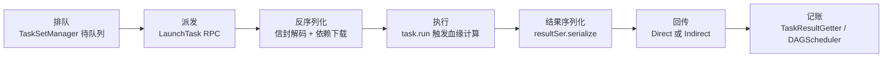
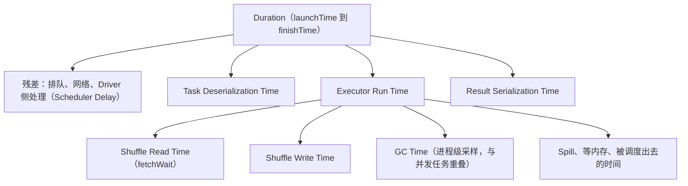
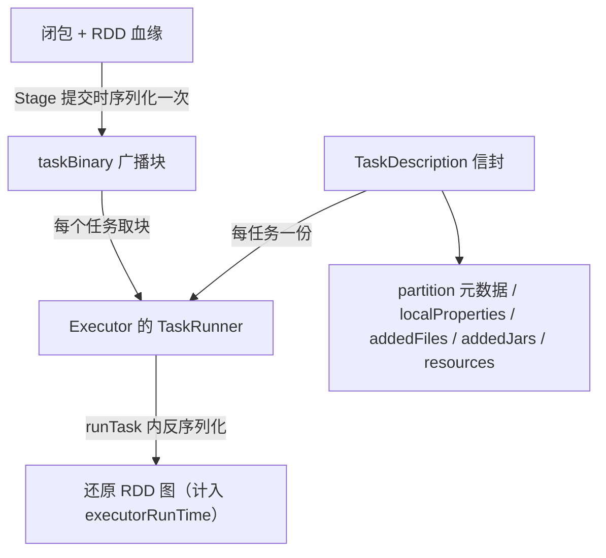
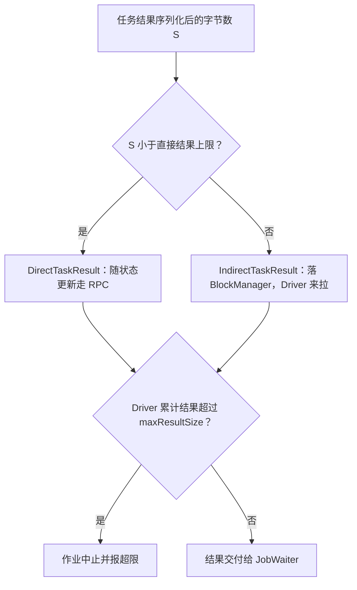
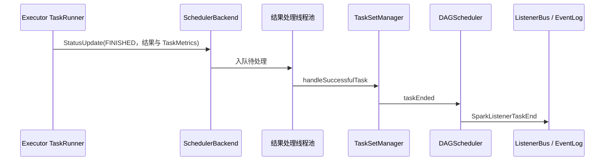
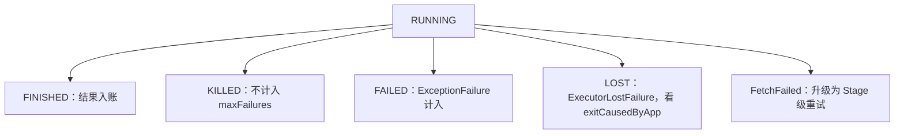

# 06 Task 运行生命周期：从 TaskSetManager 分发到 Executor 端执行

**摘要：**

一个 Task 从被 TaskSetManager 选中到结果入账，中间横着排队、派发、反序列化、执行、结果序列化、回传、记账七段路，而 TaskMetrics 只覆盖其中五段，剩下的两段落在一个常被误读的残差里。本文不做源码复述，只做一件事：把这七段各自归到明确的计量口径上，再给出"某一项指标高究竟意味着什么"的判据，以及在什么规模下值得动配置。全篇以一个每天两千个作业、三百个节点的集群作为贯穿案例，判据都尽量落成可核实的观察点。文中会拆开两个常被混为一谈的开销——任务信封（每个任务各带一份）与闭包广播（整个 Stage 共享一份），说明为什么闭包变大时 executorRunTime 会悄悄上涨而不是反序列化时间；会解释 jvmGCTime 是进程级采样、与并发任务重叠，因此不能当作单任务的执行成本；会把三档结果路径的三个上限（maxDirectResultSize、rpc.message.maxSize、driver.maxResultSize）与调大它们的代价摆在一起比较；最后按 KILLED、FAILED、ExecutorLost 三类失败给出"看哪里、下一步动什么"的判据表。行文落点始终是取舍：每一项可观测的数字，都在某个地方隐藏着它的计量边界。

---

## 第 1 章 七段账：把"任务慢"拆到可归因的区间

### 1.1 总时长是最后才该看的数字

集群每天跑两千个作业、三百台机器，值班时最先跳出来的信号往往是一句很短的话：某个 Stage 比昨天慢了一倍。UI 上能立刻拿到的是 Stage 时长、任务数、中位数与最大值，这些数字回答的是"多慢"，不回答"慢在哪"。而 Spark 的调度层、执行层、存储层各有各的慢法，三者的处置动作完全相反：调度层的慢要改资源与队列，执行层的慢要改算子与内存，存储层的慢要改分区与落盘。只盯着一个总时长去调参，最常见的结局是把 executor 内存从 8G 调到 16G，然后发现慢的还是同一批任务。

所以有用的第一刀，是把单个 Task 的墙钟切成几段互不重叠的区间，再让每一段都对应一个可以在日志或 UI 上核实的位置。切开之后，"任务慢"这个模糊判断就变成了"某一段占了 80%"，下一步该动什么也就有了方向。

### 1.2 七段的分界与各自的主人

一段 Task 的完整旅程可以分成排队、派发、反序列化、执行、结果序列化、回传、记账七段。前两段发生在 Driver 侧，中间三段在 Executor 进程里，回传跨网络，记账又回到 Driver。下图给出七段的顺序与归属。

七段并不都有独立的计量字段，这一点决定了它们的可观测程度完全不同。下面的表把每一段对应到 TaskMetrics 的字段、Spark UI 的位置，以及"没有字段时该退到哪里去找证据"。

| 阶段 | 发生位置 | 对应字段 | UI 位置 | 无字段时的证据来源 |
| :--- | :--- | :--- | :--- | :--- |
| 排队 | Driver 侧 TaskSetManager 待队列 | 无 | Stage 页时间线、Locality Level | Stage 提交时间与首个任务 launchTime 的差值、本地性等待日志 |
| 派发 | Driver 到 Executor 的 RPC | 无（并入 Duration 残差） | Stage 页 Scheduler Delay | Driver 出口带宽、RPC 消息队列、信封字节数 |
| 反序列化 | Executor 线程内 | executorDeserializeTime | Task 详情 Task Deserialization Time | 首次任务是否明显慢于后续任务、JAR 下载日志 |
| 执行 | Executor 线程内 | executorRunTime（含子项） | Duration 的主要构成 | Shuffle Read Time、Shuffle Write Time、GC Time、Spill |
| 结果序列化 | Executor 线程内 | resultSerializationTime、resultSize | Task 详情 Result Serialization Time | 结果对象形状、collect 的分区大小 |
| 回传 | Executor 到 Driver | 仅 Indirect 路径有 gettingResultTime | Task 详情 Getting Result Time | BlockManager 拉取日志、网络吞吐 |
| 记账 | Driver 侧状态处理链路 | 无（体现为 Duration 残差） | Driver 页 CPU、事件日志体积 | ListenerBus 丢弃事件日志、EventLog 增长速度 |

看这张表要抓住一个不对称：执行段被拆得最细，反序列化与结果序列化各只有一个数，排队、派发、记账三段则根本没有专属字段。也就是说，Spark 的指标设计假定"慢"主要发生在执行段，凡是不落在执行段的耗时，都会被挤压进两个残差里——一个是 Duration 减去执行、反序列化、结果序列化之后的差额，也就是 UI 里的 Scheduler Delay；另一个是 executorRunTime 减去它内部那些子项之后剩下的部分。理解这两个**残差**装了什么，比记住字段名更重要。

### 1.3 三个"时长"的口径差别

同一批任务可以读出三个时长，它们的**口径**并不相同。TaskInfo 的 duration 从 Driver 发出 LaunchTask 的那一刻起算，到收到状态更新为止，跨了网络、Executor 线程池排队与结果回传；executorRunTime 只覆盖 task.run 这一段的墙钟；executorCpuTime 则是线程实际占用 CPU 的时间。三者摆在一起，差值本身就是信息：duration 明显大于 runTime，说明时间耗在了执行之外；runTime 明显大于 cpuTime，说明任务在等（等数据、等内存、等 CPU 时间片），而不是在算。

下面的图把 Duration 的构成画成嵌套关系，外圈是 UI 上的 Duration，内圈是它的各个子项。这张图后面还会被反复引用，因为几乎所有"分项归因"的误判，都源于把内圈的一项当成了外圈的总量。

### 1.4 与机制篇的分工

本文只谈这七段的计量口径、判据与配置代价，不重讲机制实现。TaskRunner 的执行体、线程池的并发配置、任务级内存账本与 TaskReaper，机制细节见《[[大数据/Spark/读书笔记-spark内核/02_系统架构与运行机制/8. Spark_Executor_任务执行机制_上|8. Spark Executor 任务执行机制_上]]》；执行器丢失后的判死、重排与重建，见《[[大数据/Spark/读书笔记-spark内核/02_系统架构与运行机制/9. Spark_Executor_执行机制_下|9. Spark Executor 执行机制_下]]》；DirectTaskResult 与 IndirectTaskResult 两种信封的拆封过程、以及 ShuffleMapTask 的 MapStatus 归档，见《[[大数据/Spark/读书笔记-spark内核/03_调度与执行机制/10. Spark_Task执行结果管理|10. Spark Task 执行结果管理]]》。Executor 内部线程池的大小与任务并发，见本专栏《[[07 执行器（Executor）底层机制：任务运行环境、线程池管理与资源隔离]]》，下文的配置判据涉及 cores 时只给出结论，不重复推导。

---

## 第 2 章 排队与派发：信封重量与任务数的乘积

### 2.1 排队段没有字段，只有时间线

排队的三种来源性质完全不同。第一种是本地性等待，TaskSetManager 在把任务派到某个 Executor 之前，会先按 PROCESS_LOCAL、NODE_LOCAL 依次试探，每降一级要等一段由 `spark.locality.wait` 控制的时间（默认 3 秒，它还有按级别细分的变体）。第二种是资源等待，Stage 的任务数超过当前可用槽位，后面的任务在待队列里等前面的任务让位。第三种是队列内竞争，多个作业共用一个调度池时，FIFO 或 FAIR 决定谁先拿资源，机制见《[[05 调度算法深度剖析：FIFO 与 FAIR 策略的实现原理与应用场景]]》。

这三种等待都发生在 Driver 侧的 launchTask 之前，而 TaskInfo 的计时起点恰好在 launchTask，因此排队段在单任务的 Duration 里完全不可见。它只以一个整段的空白形式出现在 Stage 时间线上：Stage 已经提交，执行器已经开始报心跳，但任务列表里还没有任务。判断方法是量出 Stage 提交时间与首个任务启动时间的差，再对照 TaskSetManager 的本地性日志。这一段空着的时候去查 Executor 的 CPU 是没有意义的，任务根本还没派出去。

### 2.2 信封里装的是什么

被选中的任务会被封装成一个 TaskDescription，也就是本文所说的**信封**。这个信封里有一份固定元数据：任务 ID 与 attempt 号、目标 Executor、可读名称、分区索引、`addedFiles` 与 `addedJars` 两个映射、调度属性 Properties、CPU 核数、自定义资源（GPU 之类），以及序列化后的 Task 对象本身。运维视角下需要区分清楚的是：信封里装的是"地址与标签"，不是"计算逻辑的重量"。

计算逻辑的主体——Stage 内整条 RDD 血缘与被捕获的闭包——在 Stage 提交时被序列化一次，做成 taskBinary 广播，每个任务在信封里只带一个指向该广播块的引用。这个设计差异决定了"闭包太大"的代价落在哪里，下图给出两条路的对照。

于是闭包变肥的账单被分成三笔：Driver 端在 Stage 提交时的一次性序列化停顿（这里也最容易撞上 Task not serializable），广播块的网络分发，以及每个任务在 runTask 里把那串字节还原成 RDD 图的开销。前两笔是一次性的，第三笔是任务级重复的，并且它记在 executorRunTime 里。这就是为什么"闭包大"的表现经常是执行时间上涨而不是反序列化时间上涨，也是为什么看到 runTime 高就加 CPU 往往无效。

### 2.3 信封变肥的四种情形

信封本身通常很小，几百字节到几 KB，一个 Stage 上万任务也不过几十 MB。但在几种情形下它会退化：自定义 RDD 的 Partition 对象携带重元数据（例如把整份文件列表或大块配置塞进 partition），`localProperties` 里放进了长字符串（作业组名、描述、调用栈信息都可能被写进去），`sc.addFile` 与 `sc.addJar` 的条目极多导致每个任务都带一份大映射，以及给任务申请大量自定义资源时的资源描述。前三种都是用户代码可以控制的，第四种是集群配置决定的。

信封变肥的后果不是"每个任务慢一点"，而是 Driver 的出口带宽与序列化 CPU 被线性占用。下表给出量级推演，用来判断什么规模下这件事才开始值得关心。

| 单封字节数 | Stage 任务数 | launch 消息总量（单向） | 判断 |
| :--- | :--- | :--- | :--- |
| 1 KB | 20,000 | 约 20 MB | 可忽略，Driver CPU 才是瓶颈 |
| 20 KB | 20,000 | 约 400 MB | 需要留意 Driver 出口带宽与发送队列 |
| 200 KB | 50,000 | 约 10 GB | 派发段成为可观测瓶颈，可能挤占结果回传带宽 |
| 1 MB | 10,000 | 约 10 GB | 通常意味着分区元数据或 localProperties 设计有问题 |

这张表说明的是：信封大小的容错空间很大，一 KB 到几十 KB 都不值得动手，真正需要介入的是把大对象塞进 partition 元数据与 localProperties 这两类字段的做法。反过来说，把"任务太多"归因于"序列化太贵"之前，先算一遍这个乘积，往往能省掉一次无效的重构。

### 2.4 派发段的另一个成本：消息数

信封字节数只是一个维度，消息条数才是派发段更常见的瓶颈。每个任务至少产生两条上行或下行消息（LaunchTask 下行，RUNNING 与 FINISHED 上行），加上心跳里携带的进度更新。一个十万任务的 Stage 会产生数十万条 RPC 消息，Driver 的 RPC 处理线程与状态处理线程要逐条消费。这条链路的容量与 `spark.rpc.message.maxSize`（默认 128 MB，控制面单条消息上限）关系不大，与 Driver 的线程配置、事件处理队列深度关系更大。症状是 Driver 页 CPU 长时间打满、任务启动呈现阶梯而不是齐发、EventLog 写入速度跟不上。

---

## 第 3 章 反序列化：两段还原，一笔记错位置的开销

### 3.1 两段还原分别记在两个字段里

任务在 Executor 上的还原分**两段**。第一段是信封解码与依赖准备：把字节还原成 Task 对象，下载信封里列的 JAR 与文件，加载用户类。这一段被 executorDeserializeTime 覆盖，UI 上叫 Task Deserialization Time。第二段发生在 task.run 内部：ShuffleMapTask 与 ResultTask 都要先把 taskBinary 广播块里的字节还原成 RDD 与依赖对象，然后才调用 iterator 沿血缘链拉数据。这一段被 executorRunTime 覆盖，UI 上没有任何单独的一行。

两段还原的划分解释了三个常见困惑。第一，为什么首次跑的任务反序列化时间明显偏高：JAR 与文件在 Executor 上是按应用缓存的，第一个任务承担下载成本，后续任务复用。第二，为什么类加载问题的症状会分散：一部分表现为反序列化时间高（信封与依赖阶段），一部分表现为执行时间高（taskBinary 还原阶段）。第三，为什么 `spark.userClassPathFirst` 这类开关会把时间拉长：类加载顺序改变后，查找与链接的路径变长，机制细节见内核 02 组第 8 篇的类加载器一节。

### 3.2 executorDeserializeTime 偏高的分布判据

判据要先看分布。如果同一个 Executor 上只有每批的第一个任务高，那是依赖下载与类加载的一次性成本，属于正常现象；接近 Stage 结束、重试任务落到新 Executor 上时也会重现。如果整个 Stage 的任务普遍高，看信封大小，看用户 JAR 数量，也看类冲突——同一批类被反复尝试加载失败再回退，会让这段时间成倍增长。如果只有个别 Executor 高，优先怀疑磁盘（JAR 下载落盘）与该机器的 IO 争用，而不是 Spark 配置。

还有一个成因值得单独提一句：`spark.serializer` 默认仍是 JavaSerializer，信封解码与闭包还原都走它。换成 Kryo 能压低这一段，但代价是注册成本、类兼容风险与"某个类不可序列化"的新报错，且只对信封与 taskBinary 还原有效，对用户数据处理路径的收益要看具体对象图。是否切换属于团队级决策，不适合按单次慢查询的结果临场改。

### 3.3 闭包太大为什么不是"反序列化慢"

一个反复出现的误判是：把用户函数捕获了大对象（大字典、大模型、整张配置表）导致的变慢，归因到反序列化。真实的链路是——闭包先被广播分发，然后每个任务在 runTask 里把它还原成对象图，还原过程与后续计算在同一段墙钟里，所以账单记在 executorRunTime。此时 UI 上的反序列化时间很干净，执行时间却莫名其妙地高，GC 时间也高，因为还原出来的对象本身占内存。

正确的处置不是调大 executor 内存，而是缩小闭包：把大对象做成显式广播变量在函数里引用，把外部类方法改成局部函数避免捕获整个外部实例，把只在 Driver 侧需要的数据移出闭包。判断闭包是否过肥有一个成本极低的办法——看同一个 Stage 里任务最小与最大的输入记录数与执行时间的比例，如果输入相近而执行时间相差数倍，且 GC 时间同步偏高，闭包与对象图就该被怀疑。

---

## 第 4 章 执行段：墙钟时间里的五种成分

### 4.1 executorRunTime 是墙钟，不是 CPU 时间

executorRunTime 从 task.run 开始到返回为止，是纯**墙钟**。它内部至少混着五种成分：真正的计算（用户算子、表达式求值、反序列化 taskBinary 还原的对象图处理）、Shuffle 读取等待（fetchWaitTime，等远端 map 端数据到达）、Shuffle 写出（writeTime，排序、压缩、落盘）、垃圾回收停顿、以及被操作系统调度出去的时间（当每个 Executor 上的并发任务数超过物理核心数时，线程在等 CPU 时间片）。

这五种成分在指标里的可见度差别很大。Shuffle 读写时间有独立字段，GC 时间有独立字段，Spill 字节数有独立字段，被调度出去的时间没有任何字段，只能通过 executorCpuTime 与 runTime 的差来推断。所以"runTime 高"只是问题的起点，判据必须往下走一层。

### 4.2 jvmGCTime 的口径：进程级采样，且与并发任务重叠

TaskRunner 在任务开始与结束时各读一次 JVM 的 GC 累计时间，两者相减记为该任务的 jvmGCTime。这意味着它是**进程级**的观测量，不是线程级的：同一个 Executor 上并发的四个任务，会各自把同一段 GC 停顿计入自己的 GC 时间。把某个 Executor 上所有任务的 GC 时间相加，得到的是真实 GC 时间的数倍，UI 的汇总列同样有这个问题。

这条口径带来两个操作结论。其一，GC 时间不能从 runTime 里扣除来估算"纯计算时间"，因为它本来就包含在 runTime 内，扣除等于重复计算，而并发重叠又让这个减法在方向上不可控。其二，判断内存压力应该看 GC 时间占 runTime 的比例在任务之间的分布，而不是看绝对值；一个 Stage 里 GC 占比普遍偏高（比如超过三成），说明对象分配速率与堆配置不匹配，此时该动的是内存、序列化方式与分区数，而不是并发度。

### 4.3 分项判据表

把上面几节收拢成一张表：某一项指标高的时候，它通常意味着什么，下一步该核实什么。这张表是全篇最实用的部分，也是"只看总时长"最直接的替代品。

| 观察到的高值 | 口径说明 | 通常意味着 | 下一步核实 |
| :--- | :--- | :--- | :--- |
| executorRunTime 高，Shuffle Read Time 也高 | fetchWait 是 runTime 的子集 | 在等上游数据，读远端块受阻 | 上游 Stage 的写出耗时、远端 Executor 磁盘与网络、是否启用了外部 Shuffle 服务 |
| executorRunTime 高，Shuffle Write Time 高 | writeTime 是 runTime 的子集 | map 端写放大，分区数过多或磁盘慢 | 分区数与文件数、压缩编码、本地盘 IO |
| executorRunTime 高，GC 高、Spill 也高 | GC 是进程级采样，含并发重叠 | 对象膨胀或堆不足，执行内存吃紧 | `spark.memory.fraction`、序列化方式、记录宽度、分区大小 |
| executorRunTime 高，GC 低、Spill 低、等待低 | 剩余部分是真实计算 | 算子本身重、UDF 慢、taskBinary 还原开销大 | 执行计划、UDF 实现、闭包是否过肥 |
| executorRunTime 与 executorCpuTime 差距大 | 两者口径不同，差值是被抢占的时间 | 单 Executor 并发任务数超过物理核 | `spark.executor.cores` 与机器规格 |
| executorDeserializeTime 高 | 信封解码、依赖下载、类加载 | JAR 首次下载、类冲突、信封过大 | 任务分布（首个任务还是全体）、用户 JAR 数量 |
| resultSerializationTime 高 | 结果对象序列化耗时 | 结果集过大，collect 前没做过滤或聚合 | 结果条数与字节数、是否改为写外部存储 |
| Getting Result Time 高 | Driver 从 BlockManager 拉取间接结果 | 结果走了 Indirect 路径，拉取带宽受限 | `resultSize` 分布、`spark.task.maxDirectResultSize` |
| Scheduler Delay 高 | Duration 减去三项后的残差 | Executor 线程池排队、网络、Driver 处理积压 | 并发任务数、Driver CPU 与 GC、事件队列 |

### 4.4 两个常见误读

第一个误读是把 Duration 当成执行时间。Duration 里包含反序列化、结果序列化、网络与 Executor 排队，在任务很轻而调度很密的时候，非执行部分能占到一半以上。此时优化算子毫无意义，该改的是任务粒度与并发配置。

第二个误读是把 GC 时间当成执行成本。GC 时间是进程级采样，既与并发任务重叠，又已经包含在 runTime 里；把它当作"每个任务自己的开销"去乘以任务数，会得出一个远超实际的结论，进而做出加内存、降并发、加机器的过度反应。GC 高更接近的信号是"对象分配率过高"，处置方向在数据形状与序列化，不在机器数量。

---

## 第 5 章 结果回传：三档路径与三个上限

### 5.1 三档路径由结果大小动态决定

任务结束时的结果去向有三档。ShuffleMapTask 不返回数据，只返回一份描述各 reduce 分区数据量与位置的 MapStatus；ResultTask 把结果序列化后交给 Driver，字节数小于直接结果上限时随状态更新消息一起走 RPC，超过上限则先落到 Executor 的 BlockManager，只把地址回给 Driver，由 Driver 主动来拉。三档的判定与拆封过程属于机制内容，见内核 03 组第 10 篇，这里只处理它们的计量与配置后果。

### 5.2 三个上限各管一段

直接结果上限取两个配置的较小值：`spark.task.maxDirectResultSize`（默认 1 MB）与 `spark.rpc.message.maxSize`（默认 128 MB）换算成的字节数。默认组合下，1 MB 是实际的闸口，超过它的结果都会落到 BlockManager。这个值调大的直接效果是减少间接路径与 BlockManager 写入，代价是单条 RPC 消息变大，Netty 缓冲与堆外内存占用上升，序列化与反序列化的停顿被拉长，而且大消息在 Driver 与 Executor 两侧都会加剧 GC。

第三个上限是 `spark.driver.maxResultSize`（默认 1 GB），它统计的是一个动作跨所有分区的结果字节数累计值，与单条消息无关。超限时作业以"结果总量超过 maxResultSize"的措辞中止。这个上限在接近上限时还有一层不那么显眼的作用：Driver 会限制继续堆积结果，表现为该 Stage 尾部的任务不再被派发，UI 上看起来像"卡住"而不是"报错"。

### 5.3 调大的代价

| 参数 | 默认 | 管什么 | 调大的代价 |
| :--- | :--- | :--- | :--- |
| `spark.task.maxDirectResultSize` | 1m | 单任务结果走直连还是落 BlockManager | 大 RPC 消息推高堆外内存与 GC，序列化停顿变长，`spark.rpc.message.maxSize` 会跟着成为新的硬顶 |
| `spark.rpc.message.maxSize` | 128m | 控制面单条消息上限 | 单条消息内存峰值上升，异常消息也被放大，缓解不了真正的结果超限 |
| `spark.driver.maxResultSize` | 1g | 一个动作跨分区结果总量的上限 | 结果全压在 Driver 堆里，OOM 风险从 Executor 迁移到 Driver，且 Driver 是单点 |
| `spark.reducer.maxSizeInFlight` | 48m | 单个 reduce 任务并发拉取的 Shuffle 数据量 | 每个并发任务固定占用缓冲，任务数一多就是内存乘数 |
| `spark.shuffle.compress` | true | Shuffle 与溢写压缩 | 关闭后网络与磁盘 IO 上升，换来的是 CPU 节省 |

这张表的核心判断是：结果相关的三个上限里，只有 `maxResultSize` 是**安全阀**，另外两个更接近**路径选择器**。把路径选择器调大不会让大结果变小，只会让它在 RPC 通道上走得更远、占更多内存；把安全阀调大则等于主动放弃对 Driver 内存的保护。真正的解法通常在调用侧——collect 之前先过滤、聚合、取样，或者把结果写成外部存储再读。

---

## 第 6 章 记账：任务数越多越贵的那一段

### 6.1 Driver 收到状态更新之后

Executor 发出 FINISHED 状态更新后，Driver 侧的处理链路是：SchedulerBackend 收到消息并转给结果处理线程池，结果处理线程反序列化 TaskResult（若是间接结果还要去 BlockManager 拉取），把累加器更新合并进 TaskMetrics，再交给 TaskSetManager 标记该分区成功、取消同分区的其他 attempt，最后通知 DAGScheduler 完成一次 taskEnded，进而写事件日志、投递监听总线。整条链路在单任务尺度上的开销很小，但它对任务数是**线性**的。

### 6.2 记账成本的三个放大点

第一个放大点是状态消息条数。每个任务至少两条上行消息，加上心跳里携带的进度，十万任务的 Stage 意味着数十万次 Driver 侧的状态处理与累加器合并。第二个放大点是事件日志。开启事件日志后，每个任务产生若干条事件记录，日志体积与任务数成正比，History Server 的读取与重建成本也随之上升；默认开启滚动写文件，单文件上限 128 MB，压缩默认开启，这些都在缓冲而不是消除线性增长。第三个放大点是 UI 的保留策略，`spark.ui.retainedTasks` 默认 100000，表示单个 Stage 内 UI 会保留十万条任务记录，超出后旧记录被回收，所以超大 Stage 的早期任务在 UI 上查不到明细，只能翻事件日志。

这三个放大点解释了为什么"任务切得太碎"会同时伤两边：Executor 侧每个任务都有固定的启停成本，Driver 侧的记账成本按条累加。分区数从一万调到十万，单任务时间可能从几十毫秒降到几毫秒，但总时长不一定降，因为记账与调度占了越来越大的比例。

### 6.3 残差口径：Scheduler Delay 不是采集值

Scheduler Delay 在 UI 上是一个数，但它不是被采集出来的，而是 Duration 减去执行、反序列化、结果序列化三项后的残差。残差里混着 Executor 线程池排队、任务信封的网络往返、RUNNING 状态的 Driver 处理、以及结果回传的传输时间。当它偏大时，第一嫌疑是 Executor 上的并发任务数超过核心数导致排队，第二嫌疑是 Driver 处理不过来，第三才是网络。

把它当"调度器内部耗时"是一种误读，因为调度器本身在派发之后就不再参与单任务的时间线。反过来，也不能因为残差里混了网络就说它无效：同一集群、同一 Stage 内横向比较，残差高的任务与残差低的任务之间差出来的部分，通常就是线程池排队，这个信息足够指导并发配置的调整。

### 6.4 记账段变慢的症状

记账段没有专属指标，症状只能从侧面看：Driver 的 CPU 与 GC 长时间偏高而 Executor 空闲；监听总线的队列容量有限（`spark.scheduler.listenerbus.eventqueue.capacity`），消费跟不上时会丢弃事件并打印丢弃计数，表现为 UI 上任务数与实际不符；事件日志写入速度成为瓶颈时，Stage 完成到作业结束之间会多出一段与计算无关的尾巴；UI 页面加载某个超大 Stage 的任务列表异常缓慢，说明服务端在遍历大量保留记录。

---

## 第 7 章 失败判据：KILLED、FAILED 与执行器丢失

### 7.1 三类失败记在三本不同的账上

任务没有正常结束，可能是被取消、可能是抛了异常、也可能是执行它的 Executor 没了。三者在 Driver 侧走不同分支，也计入不同的账：KILLED 不计入失败次数，FAILED 按分区索引累计，ExecutorLostFailure 则要看退出是否由应用自身导致。搞混这三本账，会把"取消"统计成"失败"，把集群故障统计成应用缺陷，最后得出错误的稳定性结论。

| 结局 | 典型触发 | 是否计入 `spark.task.maxFailures` | 后续动作 | 该看哪里 |
| :--- | :--- | :--- | :--- | :--- |
| KILLED | 推测执行的落败副本、作业或 Stage 被取消、主动 kill | 否 | 任务可能重新入队，不消耗失败配额 | Task 详情的 kill 原因、推测执行统计 |
| FAILED（ExceptionFailure） | 用户代码异常、OOM 表现为异常、数据格式问题 | 是 | 同一分区重新入队重试，达到上限则中止 Stage | Executor 的 stderr、异常栈、失败任务的输入数据 |
| FAILED（FetchFailed） | Shuffle 读取失败，上游 map 输出不可用 | 否（升级为 Stage 级） | 重新计算上游 Stage | 上游 Executor 是否丢失、Shuffle 服务状态 |
| LOST（ExecutorLostFailure） | Executor 进程退出、被资源管理器回收、节点失联 | 视 `exitCausedByApp` 而定 | 该 Executor 上的任务重新入队 | 判死与重建机制见内核 02 组第 9 篇 |
| 结果丢失（TaskResultLost） | 结果在回传途中丢失 | 计入 | 重新执行该分区 | 网络抖动、Driver 侧拉取失败日志 |

### 7.2 KILLED 的判据价值

KILLED 经常被当成噪音忽略，其实它是推测执行与取消操作的健康指标。开启推测执行后，同一分区会有多个 attempt 并发，先完成的胜出，其余被取消并上报 KILLED；如果 KILLED 比例很高而 Stage 总时长没有下降，说明推测触发的阈值过于激进，白烧了资源。`spark.speculation` 默认关闭，开启后需要关注 `spark.speculation.multiplier` 与 `spark.speculation.quantile`——注意 4.0 起这两个默认值从 1.5 与 0.75 调整为 3 与 0.9，判定更保守，按旧博客给的参数照抄会得到与预期不同的触发频率。推测执行本身的机制与调参判据见《[[08 推测执行（Speculative Execution）：分布式环境下长尾任务的自动修复机制]]》。

KILLED 与 FAILED 混淆的直接后果是 `spark.task.maxFailures` 的语义被扭曲：这个参数是同一分区允许的失败次数（默认 4，含首次尝试），不是重试次数；如果取消也被计入，一个正常的推测执行作业会因为"失败过多"而中止。内核 02 组第 9 篇把这个反例讲得很清楚，这里只强调它的运维含义——看到 maxFailures 相关的中止，先确认这批失败里有没有 KILLED。

### 7.3 同一分区的 attempt 如何收尾

一个分区有多个 attempt 时，第一个成功的 attempt 会被采纳，其余运行中的 attempt 被 kill，晚到的成功结果被忽略。晚到的 attempt 如果已经写出了 Shuffle 数据，那批数据不会被立即清理，而是在 Shuffle 清理阶段统一回收；它也不会被下游误读，因为下游读取的是 MapOutputTracker 里登记的位置，登记只在最终被采纳的 attempt 上发生。这条收尾规则解释了为什么推测执行不会导致下游读到重复数据，但也解释了为什么推测执行期间磁盘与网络会被短时放大。

---

## 第 8 章 配置表：每个旋钮换来的代价

### 8.1 时间、失败与结果类

| 参数 | 默认（4.3 口径） | 影响阶段 | 调大的代价 | 适用判据 |
| :--- | :--- | :--- | :--- | :--- |
| `spark.task.maxFailures` | 4 | 失败计数 | 重复失败的坏任务消耗更多时间与资源，掩盖真实缺陷 | 存在偶发的外部依赖抖动且已定位 |
| `spark.stage.maxConsecutiveAttempts` | 4 | Stage 级重试 | 上游反复失败时整体耗时成倍增加 | 上游数据源明确存在瞬时不可用 |
| `spark.locality.wait` | 3s | 排队 | 每次都多等一段，任务启动被系统性推迟 | 数据本地命中率高、网络是瓶颈 |
| `spark.task.maxDirectResultSize` | 1m | 结果回传 | 大消息推高堆外内存与 GC | 结果略超 1 MB 且数量可控 |
| `spark.driver.maxResultSize` | 1g | 结果记账 | Driver OOM 风险上升，且是单点 | 已确认结果总量无法在调用侧削减 |
| `spark.speculation` | false | 失败与重复执行 | 多余副本消耗槽位，KILLED 比例上升 | 存在明显长尾且任务可重复执行 |

### 8.2 序列化、内存与观测类

`spark.serializer` 默认仍是 JavaSerializer，改为 Kryo 能压缩信封与闭包还原的时间，代价是类注册、兼容与"序列化异常"的新形态；`spark.memory.fraction` 默认 0.6，调大执行与存储可用内存会压缩留给用户对象的空间，调小则溢写变多；`spark.eventLog.enabled` 默认关闭，开启后才有事后归因的原始数据，代价是每个任务若干条记录的写入与存储；`spark.ui.retainedTasks` 默认 100000，调大能让超大 Stage 的明细留得更久，代价是 Driver 堆占用与 UI 渲染变慢。

配置的判断顺序应当与七段账一致：先用分项定位到段，再改与该段相关的参数，一次只改一个，改完在同一批作业上复测同一组分项。反过来的顺序——先调参数再看效果——在数以千计的参数里几乎不可能收敛，配置调整的第一步永远是**先定位到段**。

### 8.3 反例一：只看总时长，不看分项

某个 Stage 的时长从四分钟涨到九分钟，值班的第一反应是给 Executor 加内存，因为"Spark 慢就是内存不够"。改完复测，时长几乎没动。真正的原因是上游 map 端开始溢写，下游的 Shuffle Read Time 涨了三倍，executorRunTime 跟着涨，但其中大部分是在等数据。若先做分项归因，会看到 GC 没有变化、Spill 在 map 端上升、fetchWait 在 reduce 端上升，方向立刻指向分区数与写出压缩，而不是内存。

### 8.4 反例二：把 GC 时间当执行时间

另一个团队发现某批任务的 GC 时间占比接近一半，于是把 Executor 内存翻倍、把 `spark.memory.fraction` 调高，结果 GC 占比短期下降，随后又回到原状。原因在于 GC 时间是进程级采样，四个并发任务各自记录了同一段停顿，所谓"占比一半"是四份重叠采样的叠加；真正的问题是该批任务的记录宽度很大、每次 map 都构造大量临时对象。处置应当是收窄记录、改用更紧凑的序列化、降低单分区数据量，而不是继续堆内存。

### 8.5 反例三：忽略反序列化与闭包

第三个反例更隐蔽：某作业的每个任务执行时间都很稳定地偏高，看不出倾斜，GC 也不高，于是被归因为"算子写得不够快"。实际上这个作业的闭包捕获了一个几百 MB 的模型对象，每个任务在 runTask 阶段都要把它还原一次，还原与反序列化的开销全记在执行时间里。把模型改成广播变量引用之后，执行时间下降，任务还变干净了。判据很简单：任务数很多、每个任务都慢、耗时与输入数据量不成比例，就先怀疑闭包与对象图，再怀疑算子。

---

## 第 9 章 落点

七段账的价值不在于精确，而在于把"慢"这个模糊判断逼到一个有边界的位置上。排队与记账没有字段，只能靠时间线与 Driver 侧症状推断；反序列化被切成两段，一段有名字一段没有；执行段的墙钟里混着等待、GC 与被抢占的时间；结果回传的路径由两个上限决定，而真正的解法往往在调用侧。凡此种种，都指向同一件事：指标是带口径的观测，不是事实本身。

运维上可以保留一个很朴素的习惯——遇到任务慢，先把 Duration 拆成四份（执行、反序列化、结果序列化、残差），再看执行内部的两项（等待与 GC），最后才动配置。这个顺序不能省，因为七个阶段里只有两个有专属字段，其余五段的信息都藏在别处；省掉拆解，就等于把五个可能的原因压缩成一个直觉，而直觉在三百个节点的集群上通常不准。

---

## 参考资料

- Apache Spark Configuration：`spark.driver.maxResultSize`、`spark.task.maxDirectResultSize`、`spark.rpc.message.maxSize`、`spark.task.maxFailures`、`spark.locality.wait`、`spark.ui.retainedTasks` 等默认值，https://spark.apache.org/docs/latest/configuration.html
- Apache Spark Tuning Guide：序列化与内存管理，https://spark.apache.org/docs/latest/tuning.html
- Apache Spark Job Scheduling：调度池与本地性等待，https://spark.apache.org/docs/latest/job-scheduling.html
- Executor 源码（TaskRunner 的计时点与状态上报），https://github.com/apache/spark/blob/master/core/src/main/scala/org/apache/spark/executor/Executor.scala
- TaskMetrics 源码（各分项字段的口径），https://github.com/apache/spark/blob/master/core/src/main/scala/org/apache/spark/executor/TaskMetrics.scala
- TaskSetManager 源码（失败分类与 maxFailures 计数），https://github.com/apache/spark/blob/master/core/src/main/scala/org/apache/spark/scheduler/TaskSetManager.scala
- SPARK-47720：4.0 起 `spark.speculation.multiplier` 与 `spark.speculation.quantile` 默认值调整，https://issues.apache.org/jira/browse/SPARK-47720

> [!note] 思考题
> 1. 排队段没有 TaskMetrics 字段，如果让你只用事件日志重建"任务在 Driver 待队列里等了多久"，你会取哪两个时间点？
> 2. Scheduler Delay 是残差而非采集量，这个性质会让它在什么情况下失真？失真时你会用什么旁证交叉验证？
> 3. 某个 Stage 的 executorRunTime 与 executorCpuTime 差距很大，但 GC 与 Spill 都不高，你会优先怀疑哪一项配置？
> 4. `spark.task.maxDirectResultSize` 与 `spark.driver.maxResultSize` 都被调大之后，Driver 侧的故障形态会发生什么变化？
> 5. 如果只允许你保留一个指标来定位"单个任务为什么慢"，你会选哪个？为什么不是 Duration？