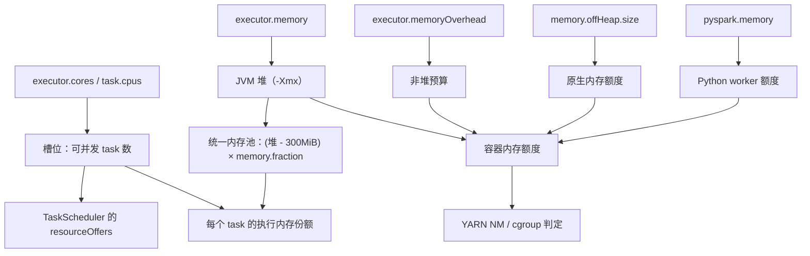
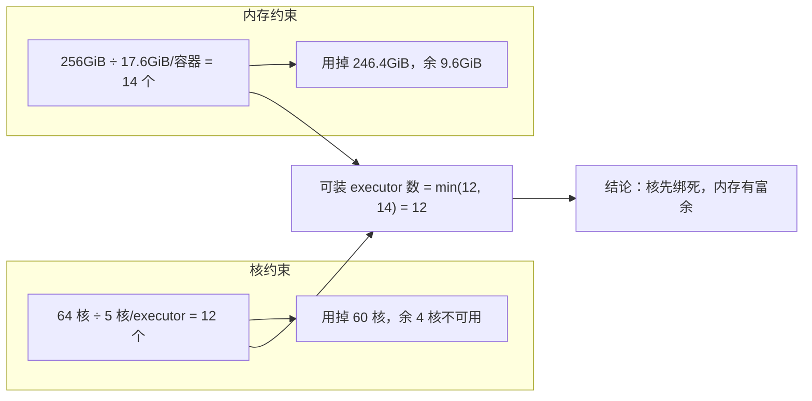
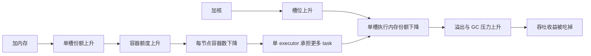
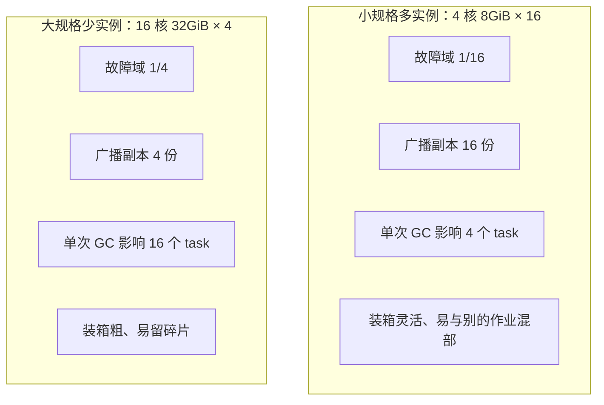

# 07 执行器（Executor）底层机制：任务运行环境、线程池管理与资源隔离

**摘要：**

Executor 的配置之所以反复被调错，是因为它同时被三本账约束：核数决定槽位（并发 task 数），堆决定执行与存储的额度，非堆与堆外决定容器能不能活下来，而这三本账的记账单位不同、越界时的第一现场也不同。本篇不重述 SparkEnv 的初始化链路，也不重推统一内存池的借用规则，只回答一个问题：在给定的集群与作业形态下，`spark.executor.cores`、`spark.executor.memory`、`spark.executor.memoryOverhead`、`spark.memory.offHeap.size` 这几个数该怎么定，定错之后症状长什么样，症状出现时又该往哪一层去归因。全文先建立三本账的算式与它们的交点（容器额度），再分别给出加核与加内存各自的收益区间与四条失效条件，然后落到 executor 数量与规格的取舍判据、同一 JVM 内 task 互相拖慢的三条路径，以及一套可执行的动作链与三个常见反例。同 executor 内的 task 共享一个堆与一条容器边界，这是粗粒度执行模型的取舍而非实现疏漏，因此两个 task 为什么互相拖慢，要从 GC、额度与连接三条路径去归因，而不是去找一个并不存在的 task 级隔离开关。落点是一句老话：并发上限是配置算出来的，吞吐上限不是。

---

## 第 1 章 从"配一个进程"到"配三本账"

三百个节点的共享集群，每天两千个作业，一段普通的 ETL 代码在两套提交参数下会跑出两种互相矛盾的结论。第一套是 4 核 8GB、每节点十六个 executor，Stages 页上有明显 spill，executor 却很少掉；第二套是 16 核 32GB、每节点四个 executor，spill 消失了，容器却经常被杀，driver 日志里全是 `ExecutorLostFailure`。运维据此总结出两条经验：小 executor 稳与大 executor 快。两条都对，也都错，因为它们各自只看了三本账里的一本。

把 executor 当成一个可以整体缩放的黑箱，是最常见的一类配置错误。黑箱的比喻漏掉了**容器额度**这一层：额度按内存总量称重，真正让进程死掉的东西往往不在堆上；反过来，让 task 变慢的东西几乎都在堆上。同一份资源在两个账本里各记一次，任何一个账本先穿破，症状都归到 executor 头上，但处置方向完全不同。

### 1.1 三个维度、五个参数、两种边界

与 executor 规格直接相关的参数不止两个。核数决定槽位，堆决定内部额度，非堆决定容器能否存活，堆外与 Python 进程是另两项要计入容器的原生内存。把这五项按"谁在管"分开，是后面所有判据的基础。

| 维度 | 决定它的参数 | 记账单位 | 越界时的第一现场 | 边界由谁执行 |
| :--- | :--- | :--- | :--- | :--- |
| 核 | `spark.executor.cores`、`spark.task.cpus` | 槽位（并发 task 数） | 并发上不去、Task 排队等待 | TaskScheduler 的资源派发，不是线程池 |
| 堆 | `spark.executor.memory` | MiB 堆内 | `Java heap space`、GC 占比、Spill | JVM 的分代与统一内存池 |
| 非堆 | `spark.executor.memoryOverhead` | MiB 原生内存 | 容器被杀、RSS 超限 | YARN NodeManager 或 cgroup |
| 堆外池 | `spark.memory.offHeap.size` | MiB 原生内存 | Spark 内部内存错误、容器被杀 | 内存管理器加容器双层 |
| Python | `spark.executor.pyspark.memory` | MiB | Python worker 被杀 | PySpark worker 的地址空间限制 |

这张表里最容易读错的是第一行。executor 内的线程池是无上限的缓存线程池，它只负责有活就开线程，从不负责限流；真正把并发压住的是一次**除法**，除法在 Driver 侧执行。线程池为什么不是配额、注册握手与启动链路为什么决定了 executor 的可调度时机，机制见 [[大数据/Spark/读书笔记-spark内核/02_系统架构与运行机制/3. Spark_ExecutorBackend_启动原理|Executor 的启动与注册链路]]，本篇只讨论这条除法本身及其后果。

### 1.2 两个数的直觉为什么会失效

"核数 + 内存"这套直觉来自单机程序：给多少 CPU、多少内存，程序就在这个盒子里跑。分布式执行器上这个直觉失效于三处。

其一，非堆开销不是堆的附属品。默认的 `memoryOverhead` 取堆的 10%，看上去是比例关系，可它要装的东西按别的维度增长：线程栈按并发线程数算，Netty 直接缓冲按并发 fetch 数算，Metaspace 按类数算。核数从 4 涨到 16 而堆不变时，前两项翻了几倍，overhead 却一分没涨。

其二，核与堆之间没有耦合，但并发会把堆摊薄。executor 的执行内存是一个池子，池子按当前活跃 task 数等分。加核不改堆，等于把同一块蛋糕切给更多人，每个 task 拿到的份额下降，溢出概率上升。

其三，容器只认总量，不认归属。堆里已经空闲但尚未归还操作系统的页、堆外的映射、线程栈、共享库、glibc 的分配器碎片，在容器看来都是"这个进程用了多少"，一视同仁。JVM 的账本与容器的账本只在一次回收把空闲页真正还给内核时才对得上。

下面的图把五个参数与两种边界画在一起，后文各章沿这三条分量展开。

### 1.3 本篇的边界

专栏的定位决定了取舍：内核系列已经把机制推导讲过一遍，本篇只留判据。executor 从 `main` 到注册成功的链路、`RegisterExecutor` 的载荷与拒绝重试、粗粒度与细粒度的取舍，见内核 02 组第 3 篇；分代结构、三种 OOM 的形态与容器被杀时的日志指纹，见 [[大数据/Spark/读书笔记-spark内核/06_性能调优实战/5. Spark_JVM性能调优|JVM 性能调优与 OOM 定位]]；M、R 两个视图、借用为什么单向、1/N 摊薄的三道除法，见 [[大数据/Spark/读书笔记-spark内核/04_存储与容错机制/2. Spark内存管理模型深度解析|统一内存池与 1/N 摊薄]]。篇幅省下来的地方，全部投到什么规模该配多少、配错长什么样。

---

## 第 2 章 核的账：并发上限是除出来的

### 2.1 一条除法与三个参数

一个 executor 能同时跑多少个 task，由一条除法决定：`floor(executor.cores / spark.task.cpus)`。`spark.executor.cores` 的默认值随部署模式变化，YARN 下是 1，Standalone 下取 worker 上的全部可用核；`spark.task.cpus` 默认 1。这条除法的结果就是槽位（slot），它决定了这台 executor 在 Driver 眼里能被派发多少个 task。

分子分母都可调，但调法不同。调 `executor.cores` 改的是这台 executor 有多大，调 `task.cpus` 改的是一个 task 占多宽；前者是资源规格问题，后者是任务粒度问题。较新的版本里 `spark.task.cpus` 允许取小数，0.2 表示五个 task 共享一个核，1.5 表示一个 task 要一个半核，并发数依旧是那条除法向下取整，细节以对应版本文档为准。小数核的用法要克制：它换来的是时间片意义上的并发，对 IO 等待型任务合适，对纯计算任务只增加上下文切换。

有一点必须钉住：这个除法在 Driver 侧的资源派发里执行，executor 的线程池不参与限流。线程池开得再多，Driver 不派任务过来也白开；反过来，Driver 认为还有槽位而线程池已经吃满，就会表现为槽位显示空闲、任务却排不上队。这类错位在 Executors 页上的判据是 `Active Tasks` 长期低于槽位，归因顺序见 8.1。

### 2.2 余数去哪了

集群是按整台机器装箱的，而 executor 是按槽位切分的，两者几乎永远除不尽。一台 64 核的节点，`executor.cores=5` 只能装 12 个 executor，用掉 60 核，剩下 4 核谁也拿不到，因为它们凑不出一个完整的 5 核容器。这个损失与核数的取值直接相关：4 核与 8 核能把 64 整除，5 核浪费 4 核，7 核与 3 核各浪费 1 核。

除不尽还有一种更隐蔽的形态：核数除得尽，内存除不尽。容器额度是堆与非堆的和，256GiB 的机器若每容器 17.6GiB，装 14 个就剩 9.6GiB，装不进第 15 个。核数还有富余时，可用的 executor 个数却由内存先绑死。装箱的约束永远是**两者取小**，下图把两个约束并排放置，先算两个商再定规格，比先定规格再去撞运气可靠。

这张图里还有一层平台差异。YARN 的容器内存上限受 `yarn.scheduler.maximum-allocation-mb` 约束，单容器要得比这个值大，申请会直接失败；K8s 的 pod 有 request 与 limit 两套口径，limit 低于实际用量时由内核限流、超内存时由 cgroup 杀进程。规格上限必须按平台硬上限倒推。

### 2.3 并发不等于吞吐

槽位是吞吐的必要条件，不是充分条件。任务时间里有多少是真正的计算，决定了加核的边际收益。一条 task 若一半时间在等 HDFS、等 fetch、等 GC，槽位翻倍只会让等待叠在一起，端到端改善很小。

集群层面还有一个事实：YARN 默认只对 vCore 记账，不做 CPU 隔离。`executor.cores` 在 YARN 上主要影响派发与账本，物理 CPU 仍由操作系统调度，同节点的多个容器会互相抢核。K8s 上这一点由 `spark.kubernetes.executor.limit.cores` 决定，设了 limit 才真的限流。

### 2.4 核数的代价表

把 64 核节点、8GiB 堆固定住，只改 `executor.cores`，能得到一张很说明问题的表。最后一列是重点：加核从来不是免费的，它换走的是每个 task 的内存份额与故障域的粒度。

| 配置（64 核节点，堆 8GiB） | 每节点 executor | 每 executor 槽位 | 全部槽位 | 单槽执行内存上限 | 调大的代价 |
| :--- | :--- | :--- | :--- | :--- | :--- |
| `cores=2` | 32 | 2 | 64 | 约 2368MiB | 进程数与连接数翻倍，广播分发成本上升 |
| `cores=4` | 16 | 4 | 64 | 约 1184MiB | 无余数损失，属均衡档 |
| `cores=5` | 12 | 5 | 60 | 约 947MiB | 4 核不可用；单槽份额下降一档 |
| `cores=8` | 8 | 8 | 64 | 约 592MiB | 单槽份额逼近排序类任务的溢出线 |
| `cores=16` | 4 | 16 | 64 | 约 296MiB | 需要执行内存超过 300MiB 的算子必然溢出 |
| `cores=64` | 1 | 64 | 64 | 约 74MiB | 一次 GC 停住全部 64 个 task；失败域等于整节点 |

单槽上限的算法是 `(8192 - 300) × 0.6 ÷ 槽位数`，算式在下一章拆开。这张表可以直接解释开篇那个矛盾：第二套配置之所以 spill 消失，不是因为它更快，而是因为它把核数与堆同时放大，让单槽份额回到了 1GiB 以上；它之所以频繁被杀，是因为 16 核的线程与直接缓冲把非堆开销抬高了，而 overhead 只跟着堆走，没跟上核数。

---

## 第 3 章 堆的账：memory 与 overhead 的容器算式

### 3.1 容器额度是一道加法

提交给 YARN 或 K8s 的容器内存，不是 `spark.executor.memory`，而是**四项之和**：堆、非堆、堆外池、Python 额度。`spark.executor.memory` 的默认值是 1g，且有一个 450m 的下限，这条下限来自 300MiB 的保留区与启动时的额度检查；`memoryOverhead` 的默认值不是一个数，而是一个表达式，取 `堆 × 0.10` 与 384MiB 中的较大者，4.0 起这个下限可以用 `spark.executor.minMemoryOverhead` 改动；`memory.offHeap.size` 默认 0；`pyspark.memory` 默认不设，不设就意味着 Python 进程的用量没有硬上限，只能挤在 overhead 里。

这是本专栏里所有"容器被杀"故事的同一道算式：`容器 = memory + memoryOverhead + offHeap.size + pyspark.memory`。它是一次真正的加法，意味着任何一项调大，容器就跟着变大；也意味着任何一项被漏算，进程就会在 RSS 上无声地越界。

### 3.2 默认值是"比例加下限"，不是"固定的 10%"

把 overhead 记成堆的 10% 会在两个方向上出错。小堆时算少了：4GiB 堆的 10% 只有 410MiB，与下限 384MiB 接近，看上去没问题；可堆一旦压到 450m 附近，10% 只有 45MiB，远不够一个 JVM 的 Metaspace 与线程栈，此时下限才是决定值。大堆时算多了：32GiB 堆的 10% 是 3.2GiB，比多数 executor 实际需要的非堆多得多，容器额度被抬高，装箱效率下降。

K8s 上还有第三种取值：非 JVM 作业（PySpark 为主）的 `memoryOverheadFactor` 默认 0.40 而不是 0.10，因为 Python worker 要更多原生内存。同一个作业从 Scala 改成 PySpark，overhead 会凭空涨四倍，这一点在迁移时最容易漏。

### 3.3 三处最容易算错的地方

第一处，overhead **不随核数增长**。线程栈、Netty 直接缓冲、RPC 连接都按并发数量增长，而默认的 10% 只按堆增长。executor 从 4 核扩到 16 核、堆不变，非堆需求近似翻倍，容器额度却一分未变，于是扩容这个动作本身就埋下了被杀的种子。判据很直接：扩容前后对比同一台机器上容器的 RSS 峰值，若峰值涨幅明显大于堆的涨幅，说明 overhead 需要显式抬高。

第二处，Standalone 与 local 模式不加 overhead。`spark.executor.memoryOverhead` 只在 YARN 与 K8s 上生效，本地与 Standalone 下没有容器这个概念，进程直接用宿主机内存。这一点让本地验证具有欺骗性：本地跑得通不代表集群跑得通，因为本地根本没有那道按总量判定的边界。

第三处，K8s 上 `executor.cores` 与 pod 的 CPU request 是两个数。`spark.kubernetes.executor.request.cores` 一旦设置就会覆盖 `executor.cores` 作为 CPU 申请量，但槽位数仍由 `executor.cores` 决定。两个数不一致时会出现 pod 只申请 2 个核、Spark 却按 8 个核派发 task 的局面，后果是限流与排队而非报错。

### 3.4 容器额度的算例

把算例摆出来，比记公式可靠。下表固定 `cores=4`，只改堆，观察容器额度与单槽份额的同步变化。注意最后一列：堆翻倍时单槽份额也翻倍，这正是加内存能救溢出的原因；而同时容器额度也翻倍，这是它的代价。

| 堆 | 默认 overhead | 容器额度 | 统一内存池 M | 4 槽时单槽上限 | 16 槽时单槽上限 |
| :--- | :--- | :--- | :--- | :--- | :--- |
| 8GiB | 819MiB | 约 8.8GiB | 4735MiB | 约 1184MiB | 约 296MiB |
| 16GiB | 1.6GiB | 约 17.6GiB | 9650MiB | 约 2413MiB | 约 603MiB |
| 32GiB | 3.2GiB | 约 35.2GiB | 19481MiB | 约 4870MiB | 约 1218MiB |
| 8GiB，overhead 显式 2GiB | 2GiB | 约 10GiB | 4735MiB | 约 1184MiB | 约 296MiB |

最后一行是一个重要的事实：抬高 overhead 只改容器额度，不改堆内任何一个数字。这解释了为什么加 overhead 永远救不了堆 OOM，也解释了为什么它只该在容器被杀、而堆还有余量时使用。堆内那一层怎么分、保留区为什么是 300MiB，推导见 [[大数据/Spark/读书笔记-spark内核/04_存储与容错机制/2. Spark内存管理模型深度解析|统一内存池的 M 与 R]]，本篇只取用两个结论：M 是 `(堆 - 300MiB) × memory.fraction`，单槽执行内存上限是 M 除以活跃 task 数。

---

## 第 4 章 第三本账：堆外与 Python 进程

### 4.1 堆外的定位：绕开 GC 的额度，不是免费的余量

`spark.memory.offHeap.enabled` 默认 false，`spark.memory.offHeap.size` 默认 0。打开之后，Spark 的执行侧（Tungsten 的排序、聚合、Shuffle 缓冲）可以改用原生内存分配，绕开 JVM 堆的 GC 管理。它解决的是 GC 成本随对象数量增长的结构问题，代价是把内存管理的记账责任转移给使用者。

关键在于这个额度是**容器账单上的一项**，而不是从堆里挪出来的一块。设了 `offHeap.size=4g` 而堆仍是 8GiB，容器额度就变成 8 + 0.8 + 4 = 12.8GiB，而不是 8.8GiB。把它当成"额外的免费内存"来用，是这套机制最常见的误用：堆没胀，RSS 先胀，容器先死。

### 4.2 三个数互不相等

使用堆外时，至少有三个数字在描述同一块内存，而它们从不相等：`spark.memory.offHeap.size` 是 Spark 允许自己分配的额度；`-XX:MaxDirectMemorySize` 是 JVM 对 `ByteBuffer.allocateDirect` 的限制；容器 RSS 是内核看到的物理占用。三者没有自动同步关系。`spark.shuffle.io.preferDirectBufs` 默认 true，Netty 的 Shuffle 传输走直接缓冲，这部分既不进 `offHeap.size` 的账，也不受堆大小约束。

于是同一个内存不足的报错，可能来自三个完全不同的判定：`Direct buffer memory` 来自 JVM 的直接内存计数，`SparkOutOfMemoryError` 来自 Spark 自己的执行池额度，容器被杀来自内核 RSS。三者的判读顺序与日志指纹见 [[大数据/Spark/读书笔记-spark内核/06_性能调优实战/5. Spark_JVM性能调优|JVM 与 OOM 的定位]]，这里只留一条配置判据：只要开启了堆外，`offHeap.size` 必须与 `memoryOverhead` 一起重新算，容器额度按四项之和重新估，否则越界点会从堆转移到容器。

### 4.3 Python 进程的边界

`spark.executor.pyspark.memory` 默认不设。不设的含义是 Spark 不为 Python worker 设限，但它的用量仍住在 `memoryOverhead` 划出的非堆预算里。设了之后，PySpark 的地址空间会被限制在这个额度内，超了由 Python 侧报错而不是容器被杀，故障形态从 137 变成可读的异常。

这两种形态的取舍很实际：不设限时，executor 容易因 Python 侧膨胀被整体杀掉，一次损失全部槽位；设了限，Python 侧先失败，task 重试即可。判据是历史上的峰值用量与容器被杀记录，两者都有数据时再设。

### 4.4 四个内存项的对照

| 项 | 参数 | 默认 | 在堆上还是堆外 | 越界指纹 | 调大的代价 |
| :--- | :--- | :--- | :--- | :--- | :--- |
| 堆 | `spark.executor.memory` | 1g（下限 450m） | 堆内 | `Java heap space`、GC 占比上升 | 容器同步变大；GC 停顿随存活集增长 |
| 非堆 | `spark.executor.memoryOverhead` | 堆 × 0.10，下限 384MiB | 堆外 | 容器被杀、RSS 超限 | 容器变大，装箱效率下降；不改善堆内 |
| 堆外池 | `spark.memory.offHeap.size` | 0 | 堆外 | Spark 内部内存错误、容器被杀 | 容器变大；内存管理责任转移 |
| Python | `spark.executor.pyspark.memory` | 未设 | 堆外 | Python worker OOM 或容器被杀 | 容器变大；限额过紧会变成失败循环 |

---

## 第 5 章 加核与加内存的收益边界

### 5.1 加核：并发的线性与份额的反比

加核的收益是线性的：槽位数等于核心数除以 `task.cpus`，加一倍核就多一倍槽位。加核的代价是反比的：执行内存池大小不变，池子按活跃 task 数等分，槽位翻倍则**单槽份额**减半。

用 8GiB 堆算一遍。M 是 `(8192 - 300) × 0.6 ≈ 4735MiB`，活跃 task 数为 4 时单槽上限约 1184MiB，为 8 时约 592MiB，为 16 时约 296MiB。若某段排序在峰值时需要 1GiB 执行内存，那么这台 executor 在 4 核时刚好不溢出，扩到 8 核立刻溢出，扩到 16 核时溢出更深。这就是扩容之后作业变慢最常见的物理原因：扩容动作加了并发，也顺手把每个 task 的内存额度砍掉了一半。

反过来也成立。把核数从 16 降回 4，单槽份额回到 1184MiB，溢出消失，但并发也回到 4，吞吐未必更好。两端都不是最优点，最优点取决于单个 task 的内存需求与总 task 数。可用的判据是：`单槽上限 ≥ 该作业 95 分位的单 task 执行内存峰值`，这个值可以用调小并发的对照实验估出来，Spill 量与 GC 时间是它的侧面证据。

### 5.2 加核的四条失效条件

- 单 task 的执行内存需求超过单槽上限。此时加核只会把溢出从偶发变成必然，处置方向是减并发或减分区体积。
- 任务数本来就少于槽位。分区数不足时，加核得到的槽位空着，机器空转，处置方向是先调分区数（见 [[大数据/Spark/读书笔记-spark内核/06_性能调优实战/3. Spark集群资源分配与并行度调优|并行度与分区数]]）。
- 长尾 task 由数据分布造成。加核只能让"多数 task 跑得更挤"，尾部的那个 task 一点没变快，端到端受尾部支配。
- 节点净核已用满。加 `executor.cores` 只改变同一批核的派发单位，物理核没有增加；在 YARN 上还会加剧抢核，在 K8s 上会撞上 limit 触发限流。

### 5.3 加内存：份额的线性与停顿的次线性

加内存的收益同样是线性的：单槽份额与堆成正比，堆翻倍份额翻倍，溢出显著减少。加内存的代价则是次线性的，它落在另一个维度上：GC 停顿随存活对象规模增长，堆越大，单次停顿的绝对时长往往越长。

这条代价在两种作业上表现相反。以短命对象为主的作业，堆变大只是让 Eden 更大、Minor GC 更少，停顿反而更短；以长命对象为主（大 cache、大状态）的作业，堆变大等于让老年代的存活集变大，混合回收与 Full GC 的单次成本同步上升。判据是 Executors 页的 GC 占比：随堆增大而下降，加内存有效；不变甚至上升，说明瓶颈已从额度不足转为回收成本。GC 选型的推导见内核 06 组第 5 篇第 7 章。

### 5.4 加内存的四条失效条件

- 瓶颈在 CPU 或 IO。堆本来没满，加堆只是让空闲的堆更大，容器额度却实打实变大，装箱变差。
- 溢出发生在存储侧：cache 被驱逐导致重算，加堆只是让 cache 装得下更多，处置方向是减少 cache 或改算子。
- 单 task 需要的额度远超任何单槽可给。当一个 task 的处理单元本身就超过单槽上限时，加堆只是把溢出推迟，正确动作是拆分单元。
- 容器上限先于堆触发。堆加到了 32GiB，overhead 仍按老比例，容器额度的增速跟不上实际 RSS 的增速，先被杀。

### 5.5 两条回路与一张对照

加核与加内存各自带着一个反馈回路：加核降低单槽份额，溢出增加，溢出又抬高 GC 与 IO 压力，进一步吃掉并发收益；加内存抬高容器额度，装箱数量下降，单个 executor 承担的 task 更多，单槽份额又被摊薄。**两条回路方向相反**，这是两端都不是最优点的结构原因，下图把两条回路画在一起。

| 维度 | 加核 | 加内存 |
| :--- | :--- | :--- |
| 直接改善的量 | 并发 task 数 | 单槽执行内存与存储额度 |
| 收益形状 | 线性，受任务数上限约束 | 线性，受溢出是否为瓶颈约束 |
| 主要代价 | 单槽份额反比下降、故障域扩大 | 容器额度上升、GC 停顿变长 |
| 失效条件 | 单 task 需求超份额、任务数不足、长尾、净核已满 | CPU 或 IO 瓶颈、存储侧溢出、单元过大、容器先死 |
| 误用后的症状 | 扩完更慢、溢出增加、尾延迟不变 | 堆有余量仍被杀、装箱变差、停顿变长 |
| 观测判据 | Spill 量、单槽份额算术、`Active Tasks` 与槽位之差 | GC 时间占比、RSS 峰值、容器退出码 |

---

## 第 6 章 小多与大少：数量与规格的取舍

### 6.1 两个自由度而不是一个

executor 的规模由两个独立自由度决定：规格（每个 executor 的核与堆）与数量。总资源不变时，这两个自由度组合出的形状差别极大。4 核 8GiB 乘 16 个与 16 核 32GiB 乘 4 个，核与内存总量相同、槽位相同，但**故障域**、GC 影响面、广播分发成本、Shuffle 连接数、Driver 侧簿记量全都不同。

选择形状的第一判据是**装箱约束**，第二判据是作业形态。装箱约束在上一章已经算过：核与内存两个商取小。作业形态决定的是，在同样的装箱结果里你更怕哪一种损耗。

### 6.2 两种形状的物理差异

小规格多实例，像一条街上开很多家小店：任何一家关门损失有限，但每家都要备一套设备。大规格少实例像一家大卖场：设备只有一套，摊到每个顾客身上便宜，但一次事故停掉的是整片区域。

这个比喻要配两个技术限定。其一，JVM 的固定成本并不高，几百 MiB 的 Metaspace 与线程栈在数十 GiB 的堆面前可以忽略，随实例数增长的其实是广播副本数与 Shuffle 对端连接数。其二，大 executor 的一次事故不只有进程退出，还包括一次 Full GC：JVM 内的停顿对同进程内所有 task 一视同仁。下图把两种形状在故障域、广播副本与 GC 影响面上并排放置。

### 6.3 按作业形态给判据

| 作业形态 | 识别信号 | 建议形状 | 判据依据 | 常见反例 |
| :--- | :--- | :--- | :--- | :--- |
| 短任务密集 | task 中位时长不足数秒；分区数远多于槽位 | 小规格、多实例，核数 2 到 5，堆 8GiB 上下 | 单 task 内存需求小，1/N 摊薄不构成约束；吞吐由槽位总数决定 | 32 核大 executor 上一次 GC 同时压住 32 个短 task，尾延迟立刻抬升 |
| 长任务重 Shuffle | task 中位时长分钟级；Stage 页有持续 Spill | 少槽位、大堆，核数 2 到 4，堆 16 到 32GiB | 单槽份额决定是否溢出，核多则摊薄；长 task 吃满 JIT 预热收益 | 16 核 8GiB 的 executor 单槽只有 296MiB，排序必然溢出 |
| 迭代计算带 cache | 有 `persist` 且 Storage 页占用稳定 | 中等规格，堆不低于 16GiB，实例数适中 | cache 占存储内存，堆太小会反复驱逐重算 | 4GiB 堆配大 cache，驱逐率高于命中率 |
| 多租户混部 | 队列/命名空间被多个作业共享 | 小规格、多实例，配动态分配 | 故障域小、装箱灵活、单作业影响面小 | 大容器占满节点，别的作业申请不到容器 |
| 单作业独占整个集群 | 队列空闲、无并发作业 | 大规格、少实例，核数 8 到 16 | 装箱不再是约束，减少广播与连接开销 | 有并发作业时沿用这套规格，碎片化严重 |

### 6.4 三档参考配置与它们各自的代价

下表给出三档起手配置，都以 YARN 或 K8s 的容器口径计算，第四行是面向重 Shuffle 的变体。最后一列是重点：每一档的调大都不免费，代价落在不同的地方。

| 档位 | cores | memory | overhead | 容器额度 | 适用 | 调大规格的代价 |
| :--- | :--- | :--- | :--- | :--- | :--- | :--- |
| 小而多 | 2 | 4GiB | 410MiB | 约 4.4GiB | 短任务密集、多租户混部 | 核数一升，单槽份额立刻下降；堆一升，每节点容器数骤减 |
| 均衡 | 4 | 8GiB | 819MiB | 约 8.8GiB | 多数批处理作业的起手档 | 核数从 4 升到 8，单槽份额从 1184MiB 掉到 592MiB |
| 大而少 | 8 | 16GiB | 1.6GiB | 约 17.6GiB | 单作业独占集群、长任务 | 故障域翻倍；容器变大后装箱余数变多 |
| 重 Shuffle 变体 | 4 | 32GiB | 3.2GiB | 约 35.2GiB | 大规模排序、聚合、Join | 单槽份额高但容器巨大，每节点只能放少数几个；GC 停顿随存活集增长 |

三档之间没有优劣，只有适用区间。均衡档被当作起手值，是因为它在两个方向上都留了余量：4 核让单槽份额不至于太薄，8GiB 让容器能被多数节点整除。从这一档出发向哪边偏，取决于第一个瓶颈落在哪本账上。

---

## 第 7 章 隔离与共享：同一个 JVM 里的邻居

### 7.1 共享清单

Executor 是一个长驻 JVM，同一时刻并发的多个 task 共享同一个进程内的几乎所有东西。共享清单值得逐项过一遍，因为它们对应的故障形态不同。

| 共享对象 | 共享程度 | 互相影响的形态 | 有没有配置手段 |
| :--- | :--- | :--- | :--- |
| 堆与 GC | 完全共享 | 一次 Full GC 停住全部 task；存活对象越多停顿越长 | 只能调堆大小与并发数 |
| 执行内存池 | 软隔离 | 一个 task 多拿，其他 task 少拿，只能等待或溢出 | 调槽位数、调 `task.cpus` |
| 线程池与线程栈 | 完全共享 | 线程数与栈空间按并发增长，计入非堆 | 间接由槽位数决定 |
| 静态状态与单例 | 完全共享 | 一个 task 写坏单例，后续所有 task 都读到坏值 | 无，只能靠代码纪律 |
| Netty 连接与直接缓冲 | 完全共享 | 并发 fetch 越多，直接缓冲占用越高 | `preferDirectBufs`、fetch 相关参数 |
| 本地磁盘目录 | 完全共享 | 一个 task 的大量 Spill 挤占同目录 IO | `spark.local.dir` 多目录分摊 |

表格的第三列解释了为什么同一个 executor 上的 task 会互相拖慢，第四列解释了为什么这些干扰无法在执行器层面消除：Spark 的隔离粒度是 executor，不是 task。task 共享进程是粗粒度执行模型的设计结果，换取的是进程启动与 JIT 预热不被重复支付，两者的取舍见内核 02 组第 3 篇第 9 章。

### 7.2 三条拖慢路径

第一条是 GC 停顿。所有 task 共用分代空间，任一批存活对象把老年代推高，下一次回收就让全部 task 一起停下来。表现为同一 executor 上多个 task 时长同时变长，其他 executor 不受影响。判据是 Executors 页的 GC 占比与 Task 页的 `GC Time` 是否同步上升。

第二条是执行内存的额度竞争。执行池按活跃 task 数等分，一个 task 多拿，其余 task 的上限就下降。观测量是 Spill：同一 Stage 内某个 executor 上 task 的溢出量显著高于其他 executor，往往说明它上面跑着一个吃内存的邻居。与第一条的区别是，GC 停顿让全进程同时变慢，额度竞争只让部分 task 溢出增多。

第三条是连接与磁盘。Shuffle Read 走 Netty，本地 Spill 走 `spark.local.dir` 指向的磁盘。一个 task 触发大量远端 fetch 或大量 Spill 时，会挤占同进程内其他 task 的带宽与 IO 队列。这条路径最难归因，因为对端连接数同时取决于数据分布与并发形状。

### 7.3 静态状态为何在 executor 上更危险

Driver 上的单例通常只被调度逻辑使用，生命周期与作业一致，污染范围可控。Executor 上的单例不同：它被成百上千个 task 反复使用，跨 TaskSet 甚至跨 Job 存活，而 Spark 对用户代码没有隔离检查。

`object` 单例里缓存了懒初始化的客户端或连接，第一次 task 初始化时用了某个租户的凭据，后续所有 task 都沿用这份凭据；UDF 里维护可变的累加器或计数器，task 重试后计数翻倍；用 `ThreadLocal` 缓存中间结果，而线程池里的线程是复用的，下一个 task 直接读到上一个 task 的数据。这些错误的共同点是本地单机测试完全正常，因为本地模式下只有一个进程、串行执行，复用关系暴露不出来。

处置手段只有代码纪律，没有配置手段。可操作的检查项有三条：UDF 与闭包中不得持有可变静态状态；需要连接时用每次调用创建并归还的模式，或用带超时与失效检测的对象池；需要缓存的中间结果放进 RDD 的 `persist` 或广播变量，而不是 JVM 的静态字段。第三条尤其重要，因为广播变量有明确的生命周期管理，静态字段完全在框架视野之外。

### 7.4 能做与不能做的隔离

既然 task 之间没有硬隔离，可用的手段就只剩改变粒度与改变位置两类：前者把并发调小、槽位调宽，让同时运行的 task 少一些；后者把重任务挪到专用 executor 上，让它不和别人做邻居。

| 手段 | 能挡住什么 | 挡不住什么 | 代价 |
| :--- | :--- | :--- | :--- |
| 减小 `executor.cores`，堆不变 | 提高单槽执行内存份额，减少额度竞争 | 单 task 需求超过整池时无效 | 并发下降，短任务吞吐下降 |
| 增加 executor 数量、减小规格 | 缩小单个 JVM 的邻居范围与故障域 | 单个 task 的内存泄漏仍会杀掉整个 executor | 广播副本与连接数上升，Driver 簿记增加 |
| `spark.task.cpus` 设为大于 1 | 限制同时运行的 task 数，给单 task 更多 CPU 份额 | 完全不限制内存 | 槽位变少，集群利用率下降 |
| `spark.executor.pyspark.memory` | 限制 Python 侧，失败形态从容器被杀变为可读异常 | 不限制 JVM 堆内单 task | 额度给小会变成稳定失败循环 |
| 抬高 `memoryOverhead` | 容器层面的非堆越界 | 不改善堆内任何额度 | 容器变大，装箱变差 |
| ResourceProfile 声明任务级资源 | 为重任务单独申请资源形状（如 GPU、更大核数） | 不改变同 executor 内 task 共享内存的事实 | 需要调度层支持，集群易碎片化 |
| 独立队列或命名空间跑重作业 | 跨作业互相干扰 | 作业内 task 间干扰照旧 | 资源成本与运维成本 |

这张表的最后一行值得强调：应用级隔离解决的是作业之间，task 级隔离在 Spark 里不存在。同 executor 内的 task 只能共享一个堆，能做的只是让共享的邻居少一些。

---

## 第 8 章 症状、反例与落地判据

### 8.1 症状归因表

配置错位的第一现场各不相同，先把症状与判据对上，再决定改哪个参数。

| 症状 | 第一判据（看哪里） | 指向本层：executor 配置 | 指向上一层 |
| :--- | :--- | :--- | :--- |
| Stage 页持续 Spill | `Shuffle spill (memory)` 随 Stage 增长 | 单槽份额不足：核多堆小，或槽位数远超单 task 需求 | 倾斜、聚合键设计、分区体积 |
| GC 时间占比上升 | Executors 页 GC 占比、Task 页 `GC Time` | 堆偏小、存活集偏大、槽位过多 | cache 策略、状态规模 |
| executor 反复退出且无 OOM 异常 | 容器退出码 137、`OOMKilled`、YARN 超限报错 | `memoryOverhead` 不足，或堆外与 Python 未计入 | 堆内对象增长 |
| 有 `Java heap space` 但容器从未被杀 | 异常栈、堆使用率 | 堆内额度不足 | 对象膨胀、单 task 单元过大 |
| 并发上不去 | Executors 页 `Active Tasks` 与总核数之差 | `executor.cores` 偏小，或派发侧等待 | 本地性等待、资源申请排队 |
| 尾延迟长，task 时长双峰 | 同一 executor 上 task 时长分布 | 同 JVM 邻居拖累（GC、额度竞争、IO） | 数据倾斜、输入不均 |
| 作业启动慢、executor 久不齐 | 申请与分配时间线 | 容器规格过大导致装箱困难 | 队列容量、平台配额 |

这张表最有价值的是第三与第四行的对照：有 OOM 异常而容器没死的，问题在**堆内**；容器死了而没有 OOM 异常的，问题在**容器账**上。两者处置方向相反，判反了就会出现堆越加越大、容器越杀越勤的循环。

### 8.2 三个反例

第一个反例是把 executor 配成 64 核，动机通常是一台机器一个 executor、管理简单。后果有三层：单槽份额被摊到 74MiB 量级，需要执行内存超过这个数的算子全部溢出；一次 Full GC 停住全部 64 个 task，推测执行只能补慢 task；故障域等于整台节点，进程一退就要重新申请 64 核容器。只有单机、单作业、纯 IO 等待型的场景站得住。

第二个反例是忽略 `memoryOverhead`。常见写法是把 `spark.executor.memory` 设成节点内存减去一点余量，64GiB 节点就设 60GiB；容器额度是堆与非堆之和，60GiB 堆加 6GiB overhead 已是 66GiB，结果必然被杀。更隐蔽的版本是核数翻倍而 overhead 不动，堆没超、RSS 超了；报错里 exceeded memory limits 的用量与上限之差通常只有几百 MiB，正对应被漏算的线程栈与直接缓冲。

第三个反例是用 `local[*]` 压测并据此定生产参数。`local[*]` 下 driver 与 executor 同在一个 JVM，`spark.executor.memory` 基本不参与，`memoryOverhead` 不生效，Shuffle 走本地文件，没有网络 fetch，也没有容器边界。这样测出的最优核数测的是单 JVM 的线程并发，搬不到容器化集群；本地只适合验证逻辑与倾斜形状。

### 8.3 一条可执行的动作链

遇到与 executor 配置相关的症状，按下面的顺序问，每一问都能落到一个参数或一个"不改参数"的结论。

第一问，症状落在哪本账上。有 OOM 异常看堆，容器被杀看非堆与堆外，Spill 与 GC 看堆内额度，并发不足看核与派发。这一问定错，后面全错。

第二问，算一遍单槽份额。用 `(堆 - 300MiB) × memory.fraction ÷ 槽位数` 算出单槽上限，与作业 95 分位的单 task 需求比较。份额不够不是加资源的问题，是核数与堆的配比问题。

第三问，算一遍容器额度与装箱。四项之和是否超过平台上限，每节点能装几个，余数损失多少。容器数若被内存先绑死，加核没有意义。

第四问，看 GC 占比与存活集。GC 占比高而堆还有余量，说明瓶颈是存活对象而非额度，方向是减少 cache、拆分单元。

第五问，区分全进程变慢与部分 task 变慢。前者指向 GC 与邻居干扰，后者指向数据分布与倾斜。

第六问，确认最近一次变更。规格、核数、overhead、Python 依赖、数据量、上游分区数，任何一项变动都可能改变前五问的结论。

第七问，若决定加资源，先写下预期改善的指标与失效条件：加核预期 `Active Tasks` 上升，加内存预期 GC 占比与 Spill 下降。变更后若指标没按预期方向动，说明瓶颈已转移。

### 8.4 落点

Executor 的配置之所以难，难在它的三本账由三个不同的执行者判定：核由调度层按除法派发，堆由 JVM 与统一内存池按份额分配，非堆由容器按 RSS 硬杀。三者没有共同的仲裁者，也没有哪一本账能代替另外两本。任何一次调大一点的动作，都同时改变了三本账的数值与它们的交点，这也是同一条经验在不同集群上效果相反的原因。

可迁移的判据只有三条。第一条，先算除法再谈优化：槽位、单槽份额、容器额度三个数算清楚，多数调参玄学自动消失。第二条，按症状分层归因：容器死而无异常看非堆，有异常而容器活看堆，溢出看份额，慢看邻居。第三条，接受隔离粒度的现实：隔离单位是 executor 不是 task，想要更小的干扰范围只能换更小的 executor，代价是更多副本与更粗的装箱。

这三条都指向同一个取向：配置不是把资源堆到足够大，而是把约束摆到台面上，让每一份损失落在自己看得见的地方。没有哪一种规格在所有作业上最优，只有哪一种规格在这一类作业、这一套平台、这一批硬件上，把代价放在了自己愿意承担的位置。

---

## 参考资料

1. Apache Spark 文档：Configuration 一节（版本口径 4.3.0），`spark.executor.memory`（默认 1g，下限 450m）、`spark.executor.memoryOverhead`（堆的 0.10，下限由 `spark.executor.minMemoryOverhead` 决定，默认 384m）、`spark.executor.cores`（YARN 默认 1）、`spark.task.cpus`（默认 1）、`spark.memory.fraction`（0.6）、`spark.memory.offHeap.size`（0）、`spark.executor.pyspark.memory`（未设）。https://spark.apache.org/docs/latest/configuration.html
2. Apache Spark 文档：Tuning Guide，(堆 - 300MiB) 的保留区、统一内存池 M 与 R 的划分、Eden 估算与 `NewRatio` 同 `memory.fraction` 的关系。https://spark.apache.org/docs/latest/tuning.html
3. Apache Spark 文档：Running Spark on Kubernetes，`spark.kubernetes.executor.request.cores` 与 `spark.executor.cores` 的分工、`memoryOverheadFactor` 的 0.10 与 0.40 两档默认、CPU limit 的限流语义。https://spark.apache.org/docs/latest/running-on-kubernetes.html
4. Apache Spark 文档：Job Scheduling，动态分配的启用条件、`executorIdleTimeout`（默认 60s）、`minExecutors`（0）与 `maxExecutors`（无穷）。https://spark.apache.org/docs/latest/job-scheduling.html
5. Apache Spark 源码：`core/src/main/scala/org/apache/spark/executor/Executor.scala`，任务线程池的构造（缓存线程池，不承担限流）、心跳线程与指标上报。https://github.com/apache/spark/blob/master/core/src/main/scala/org/apache/spark/executor/Executor.scala
6. Apache Spark 源码：`core/src/main/scala/org/apache/spark/scheduler/TaskSchedulerImpl.scala`，`resourceOffers` 中按 `availableCpus / CPUS_PER_TASK` 派发 task 的槽位计算。https://github.com/apache/spark/blob/master/core/src/main/scala/org/apache/spark/scheduler/TaskSchedulerImpl.scala
7. Apache Spark 源码：`resource-managers/yarn/src/main/scala/org/apache/spark/deploy/yarn/ExecutorRunnable.scala`，YARN 侧容器内存的组装与 `memoryOverhead` 的读取位置。https://github.com/apache/spark/blob/master/resource-managers/yarn/src/main/scala/org/apache/spark/deploy/yarn/ExecutorRunnable.scala
8. 本站内核系列：[[大数据/Spark/读书笔记-spark内核/02_系统架构与运行机制/3. Spark_ExecutorBackend_启动原理|Executor 的启动与注册链路]]、[[大数据/Spark/读书笔记-spark内核/04_存储与容错机制/2. Spark内存管理模型深度解析|统一内存池与 1/N 摊薄]]、[[大数据/Spark/读书笔记-spark内核/06_性能调优实战/5. Spark_JVM性能调优|JVM 与 OOM 的定位]]，三篇分别承担启动、内存池与 GC 的机制推导。

---

> [!note] 思考题
> 1. 一台 64 核 256GiB 的节点，若要求 `executor.cores=5`、堆 16GiB，核与内存两个商各是多少，先绑死的是哪一个，余数损失多少？
> 2. 某作业扩容后 Spill 反而增多，`Active Tasks` 也确实上升了。请用单槽份额的算术解释这两个现象为什么同源，并给出三个候选处置方向。
> 3. 容器被杀但日志里没有任何 OOM 异常，同时 Executors 页显示堆使用率只有六成。你会先核对哪两个数，依据是什么？
> 4. 同一 executor 上四个 task 的时长同时变长，而其他 executor 正常；同一 Stage 内另一个 executor 上只有一个 task 变慢。这两种现象分别指向第 7 章的哪条路径，判据有什么区别？
> 5. 为什么 `local[*]` 环境测出的"最佳核数"不能直接搬到 YARN 集群上？请从三本账里各举一条理由。