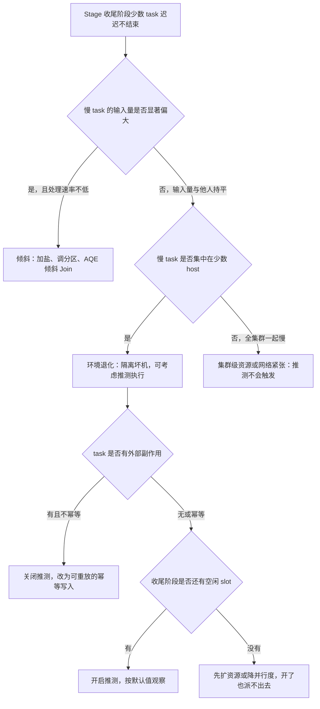
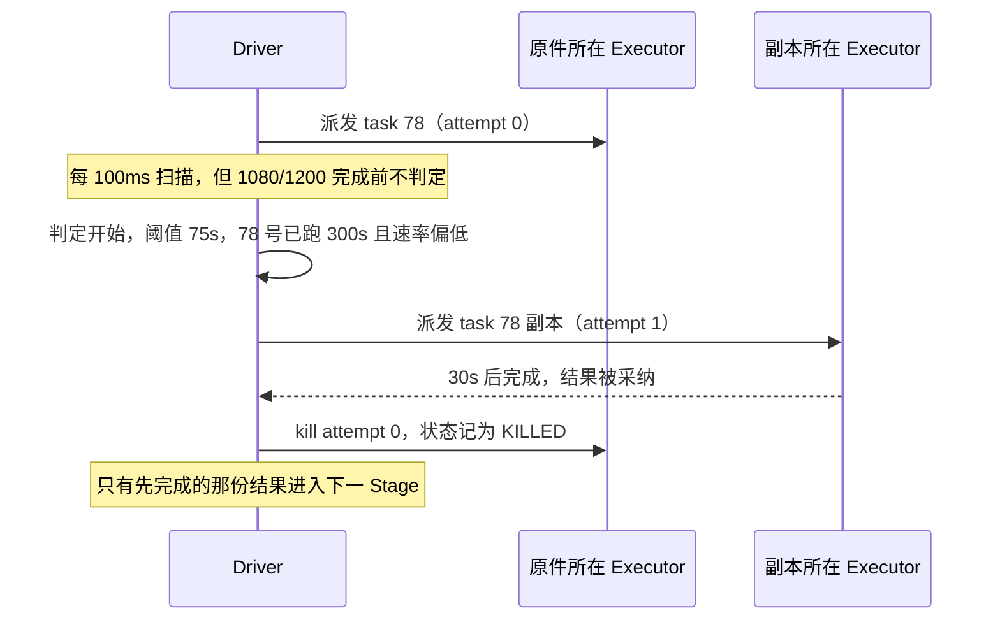
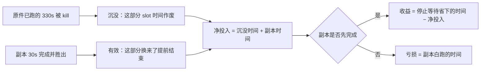
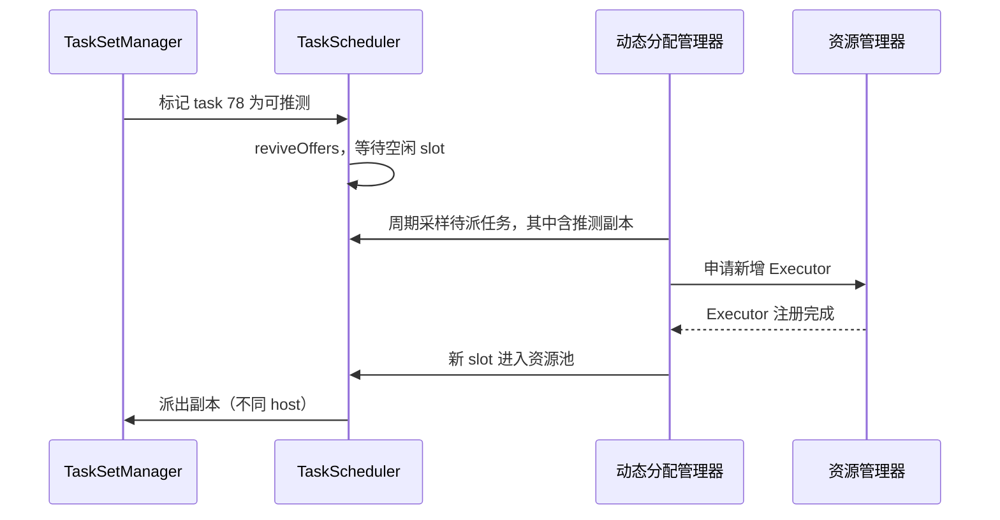
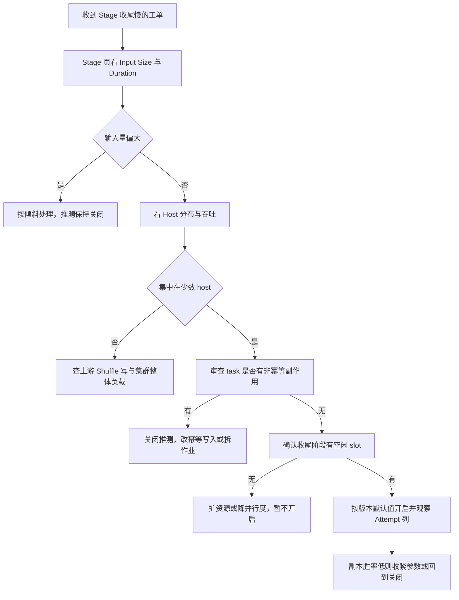

# 08 推测执行（Speculative Execution）：分布式环境下长尾任务的自动修复机制

**摘要：**
推测执行在 Spark 里只有一个职责：当某个 task 因为运行环境退化而明显落后于同 Stage 的同伴时，换一台机器把同一个分区再算一遍，谁先完成用谁的结果。它治的是长尾，不是倾斜，这条边界决定了绝大多数误用。本文按运维口径拆开四件事：第一，长尾与倾斜在 UI 上都表现为"少数 task 慢"，但一个要看输入量、一个要看吞吐率，判错的代价是把资源投进无底洞；第二，判定由完成比例、相对中位数倍率、绝对时间下限三个数决定，4.0 起官方把默认值从 1.5/0.75 调成 3/0.9，3.4 起又叠加了一道处理速率筛选，4.x 的实际行为比 3.x 保守得多，照抄旧参数会把集群拖进过度复制；第三，代价不止多跑一份，还包括只采纳一份结果的沉没成本、副本重读输入的 IO 放大、Driver 侧在途结果的双计、失败副本消耗同一分区的失败预算；第四，副作用是硬约束，写库、发消息、更新计数这类 task 开了推测就是重复写，Spark 不提供任何屏障。文末给出一张四道门的判定单、一组配置模板，以及从 UI 与日志确认推测确实生效的观测点。

---

## 第 1 章 两种病：长尾与倾斜

### 1.1 Stage 的时间由最慢的那个 task 决定

笔者维护的集群按三百个节点、九千多个可用 slot 记账，每天跑两千个左右的作业。最常见的慢不是整体慢，而是收尾慢：一个 Stage 有一千二百个 task，中位数二十五秒，第一千零八十个完成时，剩下的一百多个里有一个已经跑了十三分钟。Stage 的完成时间不取平均、不取总和，取最大值，于是整个 Stage 被这一个 task 按在地上，后面排队的 Stage 一起陪跑。

这种形态被叫作长尾（straggler），它是并行计算的固有副产品：任务数越多，运行时长的分布越宽，右端的极值越显眼。一千个 task 里出现一个慢十倍的几乎是必然事件，问题只在于慢的原因。原因分两类，处理方式完全不同，在界面上却长得一模一样。

### 1.2 长尾：同样的活，干得慢

第一类慢是**执行环境退化**。分区大小和别人一样、读取的记录数一样，但它落到了有问题的环境里：磁盘坏扇区或被同机 HDFS DataNode 抢占 IO，Shuffle 读写掉到正常值的零头；JVM 堆里对象太多触发 Full GC，Stop-The-World 期间该节点所有 task 一起停摆；同机还跑着别的容器，CPU 时间片被摊薄；或所在机架刚好是网络热点，Shuffle Read 带宽被挤得很低。共同点是：换一台健康机器重算同一份数据，它就能在正常时间内完成。

推测执行押注的就是这一点。它不诊断、不修复、不迁移现场，只把同一个分区再派给另一个 Executor 算一遍。这个赌注在环境退化型长尾上胜率很高，因为集群里绝大多数节点是健康的。

### 1.3 倾斜：不同的活，按同样的时间等

第二类慢是**数据倾斜**。某些分区的数据量是其他分区的几十倍：`groupByKey` 之后某个 key 占了三成记录；join 键分布极度不均，热点键把一整个分区撑爆；分区器设计不当，或上游文件本身大小悬殊。这类 task 慢不是因为机器差，是活本来就多，换机器重算照样要处理这么多数据。

> [!warning] 误用的分水岭
> 推测执行能救的是"换台机器就正常"的 task，救不了"数据本来就多"的 task。把推测执行开在倾斜 Stage 上，等于给最重的分区再压一份同样的计算，资源翻倍消耗，Stage 完成时间一秒都不提前。

### 1.4 两者在 UI 上无法靠目测区分

打开 Stage 详情页，两种病的表现几乎一致：Tasks 表里绝大多数行是几十秒，末尾几行是几分钟到十几分钟；Summary Metrics 的 Max 远超中位数；Timeline 上有几条拖得很长的条。凭"少数 task 特别慢"这一个现象，判断不出病因。

真正的分界线在另外两列上：输入量和处理速率。倾斜的慢 task，Input Size / Records 显著大于同 Stage 其他 task，Shuffle Read Records 同理；环境退化的慢 task 输入量持平，只是单位时间处理的记录数掉下去。把 Duration、Input Size / Records 与两者相除得到的 records per second 并排看，病名基本就出来了。

| 观察维度 | 长尾（环境退化） | 倾斜（数据不均） |
| :--- | :--- | :--- |
| 慢 task 的输入量 | 与同 Stage 其他 task 接近 | 显著偏大，常见数倍到数十倍 |
| 处理速率（records/秒） | 明显低于 Stage 平均水平 | 与平均水平接近，甚至更高 |
| 慢 task 的分布 | 集中在少数 host 或 Executor 上 | 分散在多个 host 上，跟着分区走 |
| 同 host 其他 Stage 的 task | 往往也偏慢 | 正常 |
| 换机重试后的表现 | 恢复正常 | 依旧慢 |
| 有效手段 | 修节点、隔离坏机、推测执行 | 加盐打散、调分区数、AQE 倾斜 Join |
| 推测执行的效果 | 通常有效，收益来自换机 | 无效，纯属资源浪费 |

### 1.5 还有第三种可能：全集群一起慢

除了长尾和倾斜，还有一种情况常被误当成推测执行的用武之地：集群的资源或网络同时变紧，比如共享交换机拥塞、YARN 队列被别的业务塞满、HDFS 整体负载升高。这时候所有 task 一起变慢，Stage 的中位数也跟着涨。

推测执行的判定是**相对中位数**的，中位数涨了，判定阈值同比上涨，于是它根本不会触发；即便个别 task 触发，副本也在同样拥塞的集群里跑，不会更快。这个机制只能识别"跑输同伴"的落后者，识别不了"全体变慢"，开之前先确认集群里还有健康的空闲资源，否则开了也是白开。

### 1.6 这一层的问题，还是上一层的问题

长尾的表象还可能来自别的层次，归因错了，推测执行就成了止痛药。上游 ShuffleMapStage 写端慢，会让下游 Reduce 端拉不到数据、`shuffle read` 拉长，看起来是下游全慢，根因却在上一层的磁盘或网络，这时该看 Shuffle Read 的等待时长。Driver 侧闭包过大、结果聚合慢，表现为所有 task 的调度延迟一起升高，推测插不上手。资源碎片化则让最后一批 task 挤在少数 slot 上排队，该调的是并行度。

下图把这套分流判据画成一条路径：先看慢 task 的输入量和吞吐，再看它是否集中在少数节点，最后才轮到要不要开推测。



## 第 2 章 判据：Spark 如何认定一个 task 值得补一份

### 2.1 三个数决定一切

判定逻辑在内核系列已拆到源码级，这里只看判据形态。一个 task 要被标记为可推测，需要同时满足三个条件：同 Stage 已完成 task 数达到总数的一个比例（`spark.speculation.quantile`）；已运行时间超过"已完成 task 时长中位数 × 倍率"（`spark.speculation.multiplier`）；阈值不低于绝对下限（`spark.speculation.minTaskRuntime`）。三个数缺一不可：前两个决定何时开始找，第三个防止为毫秒级短任务补副本。

完成比例这一条容易被忽略。一个 Stage 才完成一成 task 时，先跑完的往往是数据量小的分区，用这批时长算中位数会系统性偏低，判定谁慢必然误伤；等完成比例足够高再算，中位数才代表常态。代价是检测被推迟——一千二百个 task、`quantile = 0.9` 时要等到第一千零八十个完成，判定线程才开始工作。

这也带来一个副产品：检测开始的时刻恰好是 Stage 只剩尾部 task 的时刻，而尾部正是空闲 slot 最多的时候，副本因此常能立刻拿到资源。这件事在后面算代价时还会用到。

### 2.2 4.0 起的默认值与 3.x 不同

这是本篇最需要核实的一处。很多资料（包括仓库里较早的笔记）写着 `multiplier = 1.5`、`quantile = 0.75`，这两个值在 3.5 及以前的源码里确实是 `createWithDefault` 的缺省值；但从 4.0 起，官方通过 SPARK-47720 把它们改成了 `3` 和 `0.9`，理由是让推测执行不那么激进。4.0 与 4.1 的 Configuration 页面列出的就是 3 和 0.9。

| 参数 | 4.0 起的默认值 | 3.5 及以前的默认值 | 语义 | 调大的代价 |
| :--- | :--- | :--- | :--- | :--- |
| `spark.speculation` | false | false | 总开关，local 模式下不生效 | 打开即多一份复制风险，见第 4 章 |
| `spark.speculation.interval` | 100ms | 100ms | Driver 侧扫描各 TaskSetManager 的周期 | 扫描变稀，检测延迟上升，长 Stage 影响有限 |
| `spark.speculation.multiplier` | 3 | 1.5 | 超过中位数的多少倍才算慢 | 判定变迟钝，可能错过真正的落后者 |
| `spark.speculation.quantile` | 0.9 | 0.75 | 需要多少比例的 task 完成才开始判定 | 尾部只剩一成时才开始找，短 Stage 几乎来不及 |
| `spark.speculation.minTaskRuntime` | 100ms | 100ms | 绝对时间下限，3.2.0 引入 | 过滤掉短任务，调过头会让短 Stage 完全失效 |
| `spark.speculation.task.duration.threshold` | 无 | 无 | 按时长直接触发，绕过比例判定，3.0.0 引入 | 生效范围仅限小 Stage，调大则兜底更迟 |
| `spark.speculation.efficiency.enabled` | true | true（3.4.0 起） | 用处理速率筛掉"数据多但算得快"的 task | 关闭后退化为纯时长判定，倾斜误判明显增加 |
| `spark.speculation.efficiency.processRateMultiplier` | 0.75 | 0.75 | 速率低于 Stage 平均值的这个比例算低效 | 判定更宽松，更多 task 被复制 |
| `spark.speculation.efficiency.longRunTaskFactor` | 2 | 2 | 时长超过阈值的这个倍数时无条件复制 | 兜底更晚，极端大分区可能一直不被处理 |

这两组默认值的差别不是小数点级别的。旧参数下，跑过中位数 1.5 倍的 task 就进入候选，3.4 之前连吞吐都不看；新参数下时长门槛升到三倍，默认还要再过一道吞吐筛子，处理速率明显偏低、或者时长超过阈值两倍（即中位数的六倍）才真正复制，完成比例也要等到九成。同一条流水线上，副本数量会下降一个量级。把旧参数搬到 4.x 集群，最常见的症状是推测火力全开：每个 Stage 收尾冒出几十上百个副本，slot 被复制任务吃掉，排队的作业开始等资源，真正的倾斜分区也照样被复制一遍。

反过来，把 4.x 的默认值原样搬到 3.5 集群，行为也不会一致：3.5 的默认倍率与比例是 1.5/0.75，和 4.x 的 3/0.9 是两套判定组合。跨版本迁移时参数表要跟着版本一起搬。

### 2.3 吞吐筛子：判定倾斜的第一道防线

`spark.speculation.efficiency.enabled` 从 3.4.0 起默认开启，改写了判定的形态：超过时间阈值的 task 不会被立刻复制，而要再过一道**吞吐筛子**——处理速率是否低于同 Stage 已完成 task 的平均速率乘以 `processRateMultiplier`（默认 0.75）。速率是记录数除以 executor 运行时间，平均速率是累计记录数除以累计运行时间。

这道筛子恰好对上了第 1 章的病理：倾斜分区只是记录多，处理速率并不低，于是被筛掉；环境退化的 task 速率掉下来，于是被留下。这就是倍率从 1.5 放松到 3 之后误判没有按比例恶化的原因——时长门槛放宽的同时，吞吐门槛收紧了。

兜底条款还在：`longRunTaskFactor` 默认 2，task 已运行时间超过阈值两倍（按默认倍率折算即中位数的六倍）时，无论吞吐多好都会被复制。这是为了防"速率正常但就是卡住"，代价是数据量极端大的分区仍会被重复计算。所以 4.x 的默认配置不是绝不误判倾斜，而是把误判推后到六倍中位数之后，问题本身还得靠加盐或 AQE 解决。纯 CPU 密集、几乎不读输入的 task，速率判据会退化，判定回落到时长路径。

### 2.4 用一组数字走一遍

假设一个 Stage 有一千二百个 task，中位数二十五秒，`quantile = 0.9`，`multiplier = 3`，`minTaskRuntime = 100ms`。第一千零八十个 task 完成时，阈值是 `max(3 × 25s, 0.1s) = 75s`。此刻仍在运行的一百二十个 task 里，凡已跑过七十五秒且没有成功副本的，进入候选。

第七十八号 task 已经跑了三百秒，处理速率只有平均值的四成，它同时满足时长与速率两个条件，被标记为可推测。如果这时集群还有空闲 slot，副本会被派到另一台机器上，从干净的 JVM 里从头读入同样的分区数据。副本花三十秒完成，原件在第三百三十秒被 kill，Stage 随之收尾。

收益的来源在换机，不在并行：副本在另一台机器上重做同一份工作，能提前结束是因为原件所在环境已病态、副本所在环境健康。这也解释了副本为什么必须避开原件所在的主机，否则在同一个病态节点上重算毫无意义。

下面的时序图把这条时间线摊开：判定发生在尾部，副本从零开始，先完成者胜出。



### 2.5 明确不判定的情形

有几类 task 永远不会被推测，知道这些能省掉很多"开了没用"的排查。barrier Stage 的 task 不参与判定，因为同一 barrier 内的 task 必须一起启动、一起提交，单独复制会破坏屏障语义；只有一个 task 的 TaskSetManager 也不参与，除非显式给了 `spark.speculation.task.duration.threshold`，单个 task 没有同侪样本可比；进入 zombie 状态的 TaskSetManager 不再判定；local 模式下整个推测线程根本不启动，本地单元测试里验证不到。

还有两个边界。`task.duration.threshold` 只在 Stage 的 task 数不超过单个 Executor 的 slot 数时生效，slot 数由核数除以 `spark.task.cpus` 算出，核数未知按 1 处理，目的是让小 Stage 也能推测，同时避免大 Stage 过度复制。至于完成比例永远达不到的情形：Stage 里相当一部分 task 反复失败时，成功记录数到不了 `quantile × numTasks`，判定线程会一直等，这时该看失败原因。

另外，Executor 进入 decommission 流程且配置了 `spark.executor.decommission.killInterval` 时，Spark 会估算 task 是否大概率活不到强杀时刻，若是则提前标记。这条路径针对云上 Spot 回收，与长尾判定共用复制机制。

## 第 3 章 代价：多跑一份的账怎么记

### 3.1 不抢占，但机会成本是真的

调度器派发 task 的顺序是先普通任务、后推测副本：没有可派的普通 task 时，才去候选集合里挑一个复制。这个顺序意味着推测执行**不抢占**已在排队的任务，只填空闲 slot。

于是它的成本结构与抢占式策略不同。副本消耗的不是别人已排到的资源，而是本可以分给下一个 Stage 或下一个作业的空闲 slot。slot 长期富余时这份成本接近于零；slot 长期短缺时，每一次复制都在推迟别人的任务。同一个开关，两种集群的账完全不一样。

Stage 尾部的特殊性又放大了这个差异：尾部恰好是并发度最低、空闲 slot 最多的时刻，单次推测的资源成本通常不高。真正贵的是每个 Stage 尾部都复制一批所累积的 slot 占用——两千个作业、每个作业三到五个 Stage，一天下来是可观的 slot 时间，只因为分散在各处、不体现在单个作业耗时上，容易被忽略。

### 3.2 副本从零开始，输入要重读一遍

副本不是从原件的中断点继续，而是从零开始。输入来自 HDFS 的 Stage，同一个 split 被再读一遍，磁盘和网络各多一份流量；Shuffle Read 型的 Stage 则要重新从各 Map 端拉取同样的输出，网络流量在收尾阶段再冲一次。如果瓶颈本来就在 HDFS 读带宽或机架间网络，副本会加重瓶颈，收益被自己吃掉一部分。

这一点在长 Stage 上会累积：若干落后者各带一个副本，每个副本重读几十兆到几百兆输入，额外读放大不算小数目。判断是否值得，看的不是副本能不能提前完成，而是省下的时间是否大于额外读流量造成的排队。

### 3.3 只有一份结果被采用，另一份是沉没成本

两个 attempt 里先完成的胜出，它的结果进入下一 Stage，另一个被 kill，已经消耗的 slot 时间全部沉没。这不是并行加速，而是**重下注**。用第 2 章的例子算账：原件跑了三百三十秒才被 kill，副本跑了三十秒，总投入三百六十 slot 秒，换来的是不必再等原件可能还要几分钟的确定性。如果原件在第三百四十秒自己完成了，副本那三十秒就是纯支出。

把账写清楚：一次推测的净收益是原件的剩余预期时间减去副本耗时，前提是副本先赢；倾斜导致的误判里副本永远赢不了，支出就是副本白跑的全部时间。前者是投资，后者是亏损，而 Spark 分不清这两者，只能靠中位数和吞吐这两个代理指标去猜。

下面的图把两笔账分开：沉没的那部分和有效的那部分，只有后者对应收益。



### 3.4 Driver 侧的隐性成本

推测副本的结果同样要回传 Driver，而在 Driver 判定这份结果是重复的之前，它已被计入在途任务数和结果大小的账上，源码里是先加后减。对结果集接近 `spark.driver.maxResultSize` 上限的作业，副本与原件同时在跑的那段时间会让账面临时翻倍，更容易撞上序列化结果超限的失败。排查时看到余量充足的作业突然因结果大小失败而恰好开了推测，就该想到这条。

累加器的账也要分清。action 内部的累加器更新，Spark 承诺每个 task 只计一次，被重启或复制的 attempt 不重复累加；transformation 里的累加器在重算时会重复计数。用累加器做统计的作业，开推测后要复核计数。

还有一条容易漏的成本：失败的推测副本会消耗同一个分区的失败预算。每个分区有自己的失败计数，达到 `spark.task.maxFailures` 就中止作业；副本在不稳定节点上失败同样记在该分区名下。副本越多，撞上上限的概率越高，表现为开了推测后作业反而更容易 abort，而日志里的失败原因看起来与推测无关。

### 3.5 ShuffleMapTask 的副本：双份写与孤儿文件

ResultTask 复制的是计算，ShuffleMapTask 复制的是计算加落盘。两份 attempt 都会把 map 输出写到各自 Executor 的本地目录，只有胜出那份会登记到 MapOutputTracker，落败副本被 kill 后，它写到一半或已写完的输出文件不会立刻消失，要等 Executor 的块清理或进程退出才释放。在磁盘紧张的节点上，这表现为收尾阶段可用磁盘临时下降。

Shuffle 密集的 Stage 开推测，成本比纯计算 Stage 高：副本要多写一遍盘、多占一份本地磁盘，而收尾阶段的瓶颈往往不在计算，在于落盘与拉取。这也是为什么同样的开关，在 Shuffle 型作业上收益通常比纯计算作业低。

### 3.6 与 spark.task.cpus 的乘数

`spark.task.cpus` 默认 1，决定每个 task 占几个核。它不改变判定，但放大复制成本：Executor 十六核、`spark.task.cpus = 4` 时只有四个 slot，副本同样要四个核，收尾阶段未必凑得出，副本可能长时间停在待派，最后原件先完成，白等一场。

反过来，`spark.task.cpus` 越大，单个 task 越长，尾部拖尾越明显，推测的潜在收益越大。两个方向互相抵消，多核 task 的作业开推测要单独观察，不能照搬单核经验。`task.duration.threshold` 的 slot 计算也依赖这个比值，多核场景更容易满足捷径的生效条件。

| 代价项 | 机制 | 量级取决于 | 缓解方式 |
| :--- | :--- | :--- | :--- |
| 副本占用的 slot | 复制一份 task，占用一个空闲 slot | 副本数量 × 副本存活时间 | 提高 multiplier、保持 efficiency 开启 |
| 原件沉没时间 | 败者被 kill，已跑时间作废 | 副本先完成时原件已跑多久 | 无法消除，只能靠判定准确率降低 |
| 输入重读 | 副本从零开始读 HDFS 或 Shuffle | 分区输入大小、副本数量 | 对 IO 瓶颈型 Stage 谨慎开启 |
| Driver 在途结果双计 | 重复结果先计数后扣回 | 结果集大小与 `maxResultSize` 的余量 | 大结果作业提高上限或关闭推测 |
| 失败预算消耗 | 副本失败计入同一分区失败次数 | 副本数量、节点稳定性 | 与黑名单配合，避免在坏节点上复制 |
| Shuffle 双份落盘 | 两份 map 输出各写一份，败者文件延后释放 | Shuffle 数据量、本地磁盘余量 | Shuffle 密集 Stage 评估后再开 |

## 第 4 章 副作用：幂等是前提，不是建议

### 4.1 什么叫副作用

判断一个 task 能不能被复制，只需问一句：把同一个分区执行两遍，外部世界看到的结果是否和只执行一遍相同。纯计算、把结果交给 Driver 或写成 Spark 管理的中间文件，答案相同；在计算过程中向外部系统写入、发送、修改状态，答案往往是否定的。

Spark 的写入路径分成两类。一类走提交协议：写 HDFS、对象存储、Hive 表，task 只把数据写到临时位置，真正的提交由 Driver 在 job 结束时统一发起一次，副本先完成的那份进入提交，另一份在提交前被杀掉，日志里会留下 "Finish but did not commit due to another attempt succeeded"。另一类没有任何协议：在 `foreachPartition` 里开 JDBC 连接插库、往 Kafka 发消息、调外部接口、更新 Redis 计数，这些操作在执行瞬间生效，Driver 无法撤销也无法去重。

### 4.2 Spark 不提供兜底

需要明确一点：批处理里的恰好一次并不存在，Spark 在调度层只保证每个分区最终采纳一份结果，不保证每个分区只被计算一次。推测执行正是这条区分的体现：计算可以发生多次，结果只取一份。对外部系统而言，计算几次不重要，写入几次才重要，而写入发生在 task 内部，Spark 看不到。

因此**幂等**不是优化项，而是使用推测执行的前置条件。这与流处理的 sink 设计原则同源：任何可能被重放的算子，副作用都必须可重复施加而不改变最终状态。只不过流处理把它写在文档首页，批处理的推测执行把它藏在调度参数后面，于是经常被忘记。

### 4.3 按写入方式分类

| 写入方式 | 是否可重复施加 | 推测执行是否安全 | 依据 |
| :--- | :--- | :--- | :--- |
| ShuffleMapTask 写本地 Shuffle 文件 | 是 | 安全 | 同一 mapId 重写，只有胜出 attempt 被登记 |
| 写 HDFS / 对象存储（走 OutputCommitter） | 通常可 | 安全，但有残留 | Driver 侧 commitJob 只发起一次，败者可能留下临时目录 |
| 写 Hive 表（托管表、分区覆盖） | 通常可 | 大体安全 | 提交由 Driver 统一完成，目录替换具备原子性前提 |
| JDBC 直接 INSERT（无唯一键） | 否 | 危险 | 每份 attempt 都会插入一遍，产生重复行 |
| JDBC UPSERT / ON CONFLICT | 可 | 可用，但写压力翻倍 | 结果幂等，重复写入仍会放大锁竞争与 binlog |
| Kafka / MQ 发送消息 | 否 | 危险 | 消息一经发送即生效，副本会再发一份 |
| Elasticsearch 指定 `_id` 写入 | 可 | 可用 | 同 id 覆盖，最终状态一致 |
| Elasticsearch 自动生成 id | 否 | 危险 | 每份 attempt 生成新文档 |
| HBase Put 指定 rowkey 与值 | 可 | 可用 | 同 rowkey 同值覆盖 |
| HBase 计数器（Increment） | 否 | 危险 | 每次自增都生效 |
| Redis INCR、外部 API 调用、发短信 | 否 | 危险 | 状态在调用瞬间改变 |

这张表的关键不在写数据库一律不行，而在同一个操作重复施加之后最终状态是否相同。HBase 的 Put 幂等，Increment 不幂等；ES 指定 id 幂等，自动 id 不幂等；JDBC 加唯一键约束后，第二次插入要么失败要么被忽略，此时安全性取决于失败处理逻辑，而不只是数据库本身。

> [!warning] 最容易被忽略的一类
> 即使目标系统幂等，也不代表链路幂等。写库触发的 CDC 会把两份变更都投递到下游，写表触发的审计日志会记两条，写计数表会让下游报表短暂翻倍。副作用的影响面往往不在写入点，而在写入点之后。

### 4.4 幂等之外的三类放大

写压力是第一类。UPSERT 让结果正确，但两份 attempt 意味着双倍写入 QPS、双倍锁竞争、双倍事务日志，写入目标本身是瓶颈时会被压得更紧。

并发冲突是第二类。两份 attempt 写同一批主键可能触发死锁或唯一键冲突，没有重试时副本直接失败，反过来消耗失败预算。按写入行数记账的外部系统是第三类，它看到偏大的数字，对账对不上，排查成本远高于省下的时间。

### 4.5 工程上的三条做法

把副作用与推测执行分开。计算阶段只产出可重放的中间结果，写到 HDFS 或对象存储，这一阶段开推测；写出阶段单独起作业、关闭推测，把数据搬到目标库，两者用分区路径或提交标记衔接，既保留计算阶段的长尾修复能力，又避免重复写入。

如果必须在一个作业里完成写入，那就把写入做成幂等：目标表建唯一键并用 UPSERT，消息带业务去重键由消费端去重，ES 写入指定确定性的 `_id`。这些方案不是没有代价，写入放大还在，但至少不产生脏数据。

最后一条最常被忽略：确定有非幂等副作用的作业直接关闭推测执行，并写进配置注释。`spark.speculation` 是应用级配置，无法在一个应用内对不同 job 分别设置，所以"计算作业开、写出作业关"必须落在两个应用上。

## 第 5 章 与资源层的耦合

### 5.1 动态分配：副本会被计入资源需求

开启**动态分配**时，ExecutorAllocationManager 会周期性统计每个资源画像下正在运行与排队中的 task 数，推测副本作为排队任务被单独计数，并参与目标 Executor 数的计算。推测执行在这里不只是调度动作，还会触发资源层扩容：副本被标记后调度器请求资源要约，动态分配在下一个周期看到待派任务增加，于是向资源管理器申请 Executor。

源码里还有一处细节：单个 Executor 能跑多个 task、按任务数只算出一个 Executor 时，若存在待派副本会额外多申请一个，让副本有机会落到与原件不同的节点。这个加一说明 Spark 把"副本必须换位置"当作推测有效性的必要条件。

这条链路的代价是延迟。起一个新 Executor 需要时间，K8s 上还要等 Pod 调度、镜像拉取、JVM 启动；等它就绪时原件可能已经跑完。所以动态分配加容器化的环境里，推测的收益常被扩容延迟吃掉，尤其是短 Stage。反过来，集群长期保有富余常驻 Executor 时这条延迟不存在，命中率会高很多。

链路如下图。



### 5.2 静态分配与队列上限：开了也可能派不出去

不开动态分配、或队列打满时，Executor 数是固定的，副本只能等某个在跑的 task 结束腾出 slot。如果 Stage 的并行度吃满了全部 slot，副本要等到有 task 结束才轮得上，而那时原件可能也快结束了。

更常见的无效场景是队列配额打满：应用申请不到新 Executor，副本一直停在待派状态。排查时如果只在 Driver 日志里看到 "Marking task ... as speculatable" 却看不到副本启动，先去看资源队列，而不是调推测参数。

### 5.3 与 FAIR 和黑名单的关系

FAIR 模式下，推测副本仍属于同一个 TaskSetManager，占用该池分到的 slot，不会因为是副本而获得额外配额，排序时与普通 task 没区别，效果取决于该池还有多少余量。

黑名单与推测执行有一处直接冲突：副本的落点会跳过已经运行过该分区的 host，也会跳过被黑名单排除的节点，可选落点因此变少。在节点数不多、或者坏节点集中的集群里，副本可能找不到地方去。这不是参数问题，是拓扑问题。

## 第 6 章 该不该开：一张判定单

### 6.1 四道门

第一道门是**病名**。先用输入量和吞吐确认 Stage 里存在同规模、低吞吐的落后者，排掉倾斜、全集群变慢、上游 Shuffle 写慢。病名不对，后面三道门都不用看。

第二道门是副作用。task 有没有在外部系统上留下痕迹，重复施加是否等价。有非幂等副作用就到此为止，先改造成幂等写入，或者把写出拆成独立作业。

第三道门是资源。收尾阶段是否有空闲 slot，队列是否有配额余量。没有余量，副本派不出去，开了等于没开。

第四道门是收益。Stage 有多长，task 数有多少，`quantile` 要求的那批 task 能不能在合理时间内完成。十秒结束的 Stage 检测还没开始就结束了；二十个 task 的 Stage，`quantile = 0.9` 意味着等十八个完成才开始找，剩下两个的等待本来就不长。

### 6.2 判据表

下表是经验起点，不是官方数字，用的时候按集群形态校准。

| 判据 | 观察方式 | 建议门槛（经验起点） | 不满足时的结论 |
| :--- | :--- | :--- | :--- |
| 慢 task 输入量是否偏大 | Stage 页 Input Size / Records 列 | 慢 task 输入量不超过中位数的 1.5 倍 | 偏大即为倾斜，先治理倾斜 |
| 慢 task 处理速率 | 记录数除以执行时间 | 低于 Stage 平均值的一半 | 速率正常则不像环境问题 |
| 慢 task 是否集中在少数 host | Tasks 表的 Host 列 | 超过一半落在少数几个 host | 分散则考虑数据分布 |
| Stage 时长 | Stage 页 Duration | 明显长于作业的平均 Stage，如三倍以上 | 短 Stage 收益有限 |
| task 数量 | Stage 页 Total Tasks | 至少几十个，尾部才有统计意义 | 太少则改用时长阈值 |
| P99 与中位数之比 | Summary Metrics 或自行统计 | 大于三到五倍 | 分布平坦，说明没有明显落后者 |
| 收尾阶段空闲 slot | 集群监控或资源管理器 | 存在可立即分配的 slot | 没有余量则副本派不出去 |
| task 是否幂等 | 代码审查 | 无外部副作用或可重复施加 | 不幂等则必须关闭 |

### 6.3 配置模板

对绝大多数 4.x 作业，先不要改默认值，只打开开关观察一两周。默认值已把判定调得相当保守，先看它是否真的复制、副本是否先完成，再决定收紧还是放宽。

```properties
# 4.x 默认值即一组保守配置，显式写出便于审计
spark.speculation=true
spark.speculation.multiplier=3
spark.speculation.quantile=0.9
spark.speculation.minTaskRuntime=100ms
spark.speculation.interval=100ms
spark.speculation.efficiency.enabled=true
```

如果确认长尾主要来自磁盘抖动、且资源富余，可把倍率降到 2、完成比例降到 0.8，让判定更早；但每降一次都要观察副本胜率，胜率低于五成的配置不值得保留。

```properties
# 环境抖动型作业，资源富余时的小幅放宽
spark.speculation=true
spark.speculation.multiplier=2
spark.speculation.quantile=0.8
spark.speculation.minTaskRuntime=30s
```

对于 task 数很少、单个 task 很长的 Stage（比如读几个大文件、每个 task 处理几百兆），比例判定永远等不到，用时长阈值兜底。写库、发消息的作业则没有第二种选择。

```properties
# 小 Stage 兜底：task 数不超过单 Executor 的 slot 数时按 5 分钟触发
spark.speculation=true
spark.speculation.task.duration.threshold=5m
```

```properties
# 写外部系统的作业，关闭推测执行
spark.speculation=false
```

### 6.4 反例清单

| 误用 | 症状 | 为什么无效 | 正确做法 |
| :--- | :--- | :--- | :--- |
| 用推测治倾斜 | 副本数量暴增，Stage 时间不变 | 副本处理同样的数据量，一样慢 | 加盐、调分区数、AQE 倾斜 Join |
| 写库作业开推测 | 目标表出现重复行或写压力翻倍 | task 内写入无提交屏障 | 关闭推测，或改幂等写入 |
| quantile 设到 0.99 | 几乎不触发，触发也已太晚 | 尾部只剩极少数 task 才开始判定 | 用 0.9 或配合时长阈值 |
| 沿用 1.5/0.75 旧默认值 | 每个 Stage 尾部大量副本 | 4.x 判定更保守后旧值相当于激进 | 跟随版本用 3/0.9 |
| 在满载队列上开启 | 标记了从未启动 | 没有空闲 slot，副本派不出去 | 先扩资源或降低并行度 |

## 第 7 章 观测与处置：从 UI 到日志的顺序

### 7.1 UI 上确认推测是否真的发生

Stage 详情页的 Tasks 表有一列 **Attempt**。同一个 Index 出现两行、Attempt 分别为 0 和 1，就是一次推测复制；每个 Index 只有一行，说明推测没有动作。这是判断参数是否生效最快的证据。

Summary Metrics 表给出时长分布，配合 Duration 与 Input Size / Records 两列，可同时确认慢 task 的比例，以及它是不是输入偏大的一批。Shuffle Read 列用来判断慢来自拉取数据还是计算。

### 7.2 日志里的三类关键字

Driver 侧标记可推测时打 "Marking task ... as speculatable because it ran more than ... ms"，带 host、已运行时间和可推测任务数；副本胜出后打 "Killing attempt ... as the attempt ... succeeded"，带被杀 attempt 编号与胜者 host；败者算完但没提交会留下 "Finish but did not commit due to another attempt succeeded"，状态是 **KILLED** 而非 FAILED，不计入失败次数。

较新的版本还会在扫描耗时超过 `minTaskRuntime` 时打告警 "Time to checkSpeculatableTasks ... > ...ms"，通常意味着单个 TaskSetManager 的 task 数过多、或同时活跃的 TaskSet 太多。看到这条告警再考虑调大 `spark.speculation.interval`，否则不必动它。

### 7.3 事件与指标

Spark 在标记可推测时向监听总线发出推测任务已提交事件，带 stage id 与 task index；接进监控就能统计每小时推测次数与推测最多的作业。动态分配场景下，待派推测任务数反映扩容压力。

### 7.4 处置顺序

遇到 Stage 慢、怀疑长尾的工单，笔者的顺序是：先看输入量与吞吐定病名，再看 host 分布定层级，然后看代码定副作用，最后看资源余量定可行性。四步都通过才动参数，优先用版本默认值。

如果开了推测但没效果，按序排除：Stage 是否 barrier、task 数是否为 1、是否跑在 local 模式、完成比例是否永远到不了、收尾阶段是否没有空闲 slot、副本是否被黑名单卡住、是不是倾斜导致副本注定输。

处置顺序如下图。



### 7.5 与机制篇的分工

TaskSetManager 里推测执行的实现位置，包括候选集合怎么维护、副本怎么在资源要约里被挑出、结果采用与 kill 的顺序、KILLED 状态怎么处理，这些细节在内核系列 [[大数据/Spark/读书笔记-spark内核/03_调度与执行机制/6. Spark_TaskScheduler_深度解析|TaskScheduler 深度解析]] 里逐行拆过，本文只引用其结论。任务如何被封装、派发、回收的那条链路，见内核系列的 [[大数据/Spark/读书笔记-spark内核/03_调度与执行机制/8. Spark任务调度核心机制|任务调度核心机制]]；失败计数、KILLED 与重试预算的关系，见 [[大数据/Spark/读书笔记-spark内核/04_存储与容错机制/5. Spark错误容忍机制|错误容忍机制]]；倾斜的判定与治理手段，见 [[大数据/Spark/读书笔记-spark内核/06_性能调优实战/9. 数据倾斜解决方案_上|数据倾斜解决方案（上）]] 与 [[大数据/Spark/读书笔记-spark内核/06_性能调优实战/10. 数据倾斜解决方案_下|数据倾斜解决方案（下）]]。slot 与 TaskRunner 的关系，见本专栏 [[大数据/Spark/Spark-调度系统与执行模型深度解析/06 Task 运行生命周期：从 TaskSetManager 分发到 Executor 端执行|Task 运行生命周期]]；动态分配的资源申请逻辑，见本专栏 [[大数据/Spark/Spark-调度系统与执行模型深度解析/10 动态资源申请（Dynamic Resource Allocation）：弹性计算的资源调度逻辑|动态资源申请]]。本文的关注点始终是判据、代价与副作用，机制层不重复展开。

## 参考资料

1. Apache Spark 4.1.0 Configuration，推测相关参数默认值与说明。https://spark.apache.org/docs/4.1.0/configuration.html
2. Apache Spark 4.0.0 Configuration，核对 4.0 起的 3 与 0.9。https://spark.apache.org/docs/4.0.0/configuration.html
3. SPARK-47720：Update `spark.speculation.multiplier` to 3 and `spark.speculation.quantile` to 0.9，默认值调整的动机。https://issues.apache.org/jira/browse/SPARK-47720
4. Apache Spark 3.5.7 源码 `core/src/main/scala/org/apache/spark/internal/config/package.scala`，核对 3.5 的 1.5/0.75。https://github.com/apache/spark/blob/v3.5.7/core/src/main/scala/org/apache/spark/internal/config/package.scala
5. Apache Spark 4.1.0 源码 `TaskSetManager.scala`，判定、候选集合、结果采用与 KILLED 处理。https://github.com/apache/spark/blob/v4.1.0/core/src/main/scala/org/apache/spark/scheduler/TaskSetManager.scala
6. Apache Spark 4.1.0 源码 `TaskSchedulerImpl.scala`，推测扫描线程与扫描周期。https://github.com/apache/spark/blob/v4.1.0/core/src/main/scala/org/apache/spark/scheduler/TaskSchedulerImpl.scala
7. Apache Spark 4.1.0 源码 `ExecutorAllocationManager.scala`，待派推测任务计入资源需求。https://github.com/apache/spark/blob/v4.1.0/core/src/main/scala/org/apache/spark/ExecutorAllocationManager.scala
8. Hadoop `OutputCommitter` API 文档，task 提交与 job 提交。https://hadoop.apache.org/docs/stable/api/org/apache/hadoop/mapred/OutputCommitter.html
9. Databricks Knowledge Base：Understanding speculative execution，托管版长期以 3 与 0.9 为默认值。https://kb.databricks.com/scala/understanding-speculative-execution

> [!note] 思考题
> 1. 一个 Stage 有一千二百个 task，`quantile = 0.9`，其中一百个 task 因为坏节点反复失败重试，成功记录数迟迟到不了一千零八十。此时推测执行会怎样表现，应该调参数还是换节点？
> 2. 某作业用 `foreachPartition` 把结果 UPSERT 到 MySQL，主键保证不重复，但每个分区会向审计表插入一条批次完成记录。这个作业能开推测吗？如果不能，改动点在哪里？
> 3. 4.x 的 efficiency 判据用记录数除以执行时间算吞吐。如果一个 Stage 的 task 输入记录数相同、但单条记录的处理代价差异很大（比如长文本解析），吞吐判据会得出什么结论，是否仍然可靠？
> 4. 动态分配下，推测副本触发的扩容往往来不及在原件完成前就绪。什么样的 Stage 结构会让这条延迟变得无关紧要，什么样的结构会让它致命？
> 5. 如果允许改一处 Spark 的推测判定，你会用剩余时间估计还是同节点其他 task 的历史表现来替代当前的中位数判据？各自的误判成本是什么？