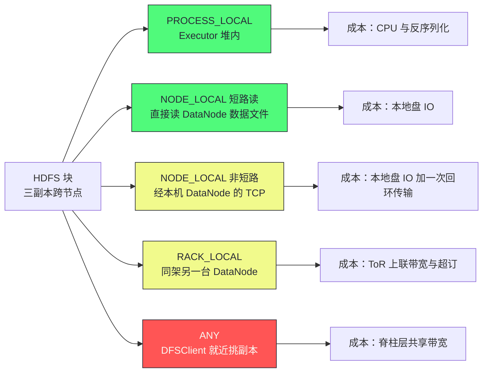
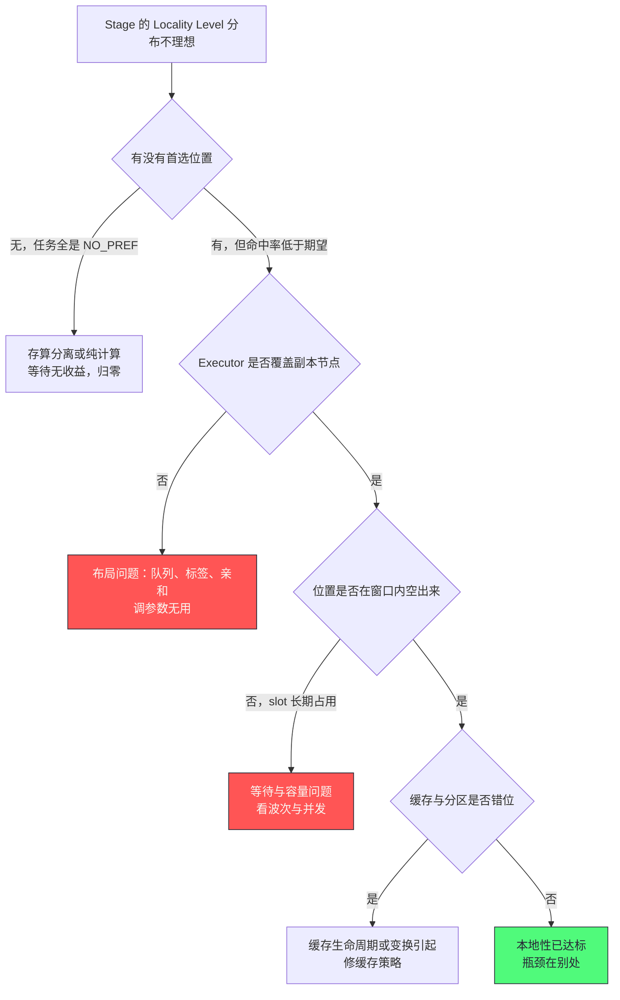
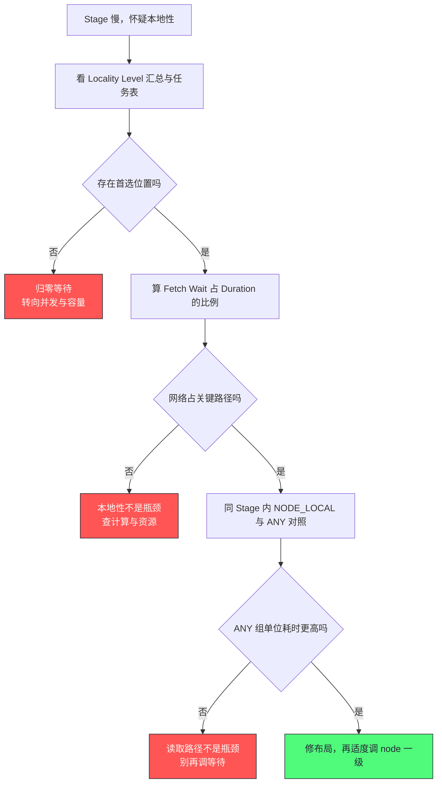
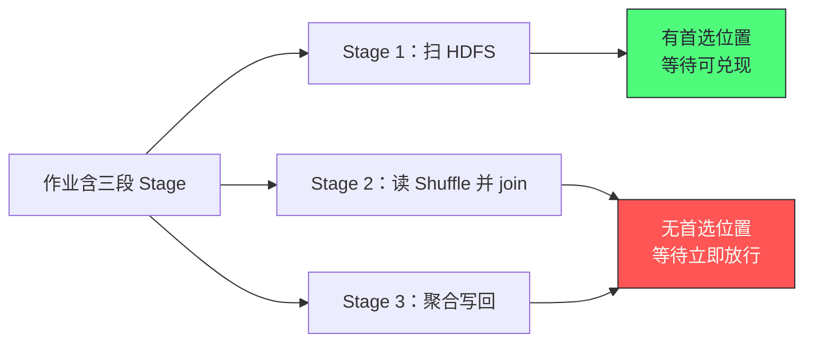

# 09 本地化调度（Locality-Aware Scheduling）：移动计算而非移动数据的实现细节

**摘要：** 本地性（Locality）在 Spark 里被讲成一条原则：把计算搬到数据旁边。但真正决定作业快慢的不是这条原则对不对，而是它在你的集群上还能兑现几成。三百台机器、每块三副本、Executor 只落在其中一部分节点，第一个 Stage 的本地命中率在作业提交之前就已经被布局定掉一半；动态分配再把 Executor 挪一轮，缓存位置与分区归属再错一次，剩下的那部分才是调度器三秒等待能挽回的。本文不重讲五级定义与等待-降级循环（机制细节见内核系列 03 组第 6 篇），只回答四个运维问题：五级本地性各值多少钱；本地性在真实集群里是怎么丢的，三种成因如何在界面上区分；`spark.locality.wait` 的三级参数分别需要什么证据才该动；以及如何用 Locality Level 汇总、Fetch Wait 与 Duration 的比值、同 Stage 内不同本地性任务的吞吐对照，判断本地性是不是瓶颈。末尾给三组反例：在存算分离集群上追 HDFS 本地性、给 Shuffle 之后的 Stage 调等待、把等待调到分钟级。

---

## 第 1 章 五级本地性各值多少钱

### 1.1 把级别换算成读路径

本地性之所以值得设计一整套等待机制，前提是同一份数据在不同位置上的读取成本差一个数量级；而要判断某一级值不值得等，得先把「一个任务读一份输入」这件事拆成物理路径。下面的量级按 128MB 的 HDFS 块估算：本机 SSD 顺序读按 500MB/s、机械盘按 120MB/s、机架内万兆按有效 5Gbps、跨架按共享千兆有效 80MB/s 计。这些是用来排序的估算口径，不是测量值。

- `PROCESS_LOCAL`：数据就在这个 Executor 的堆里，既不经过磁盘也不经过网卡，成本主要落在反序列化与 CPU 上。它一般不是 HDFS 的常态，而是缓存带来的副产品。
- `NODE_LOCAL`：数据在本机磁盘上。这里有一个容易被忽略的分叉：「本机」不等于「直接读文件」。HDFS 的短路读（Short-Circuit Local Read）缺省是关的（`dfs.client.read.shortcircuit` 缺省 false，还要配 `dfs.domain.socket.path`），没开时数据仍要从本机 DataNode 的 TCP 通道绕一圈。两者都算 NODE_LOCAL，但一个走文件系统，一个走回环网络。
- `RACK_LOCAL`：数据在同机架另一台主机上，过一次 ToR（Top of Rack）交换机，受上联带宽与超订比约束。
- `ANY`：理论上可以跨架、走脊柱层。不过 DFSClient 自己会挑最近的副本，所以被判为 ANY 的任务，读到的副本常常仍在同架，真正跨架的只是其中一部分。

把这条路径摊开画一遍，比背五个名词有用：



### 1.2 单块延迟不是重点，聚合带宽才是

初学者估本地性收益时习惯算「跨网读一个块要多久」，这个算法会把收益估小。真实的成本发生在聚合层面：一个 Stage 一千二百个任务、每任务读一块 128MB，输入总量约 150GB。这份数据如果全部从本机盘读，摊到三百台机器上每台只读 0.5GB，按 500MB/s 算是秒级，而三百块盘在并行工作；如果全部跨架读，同样 150GB 要挤过脊柱层，按每架两条万兆上联、有效 16Gbps 估，六个机架合起来约 12GB/s 的通道，需要十几秒，超订比再差一点就奔着半分钟以上去。秒级与十几秒的差别，来自「把 IO 摊到三百块盘」还是「把流量压进共享上联」，与单块延迟关系不大。

这笔账解释了另一件事：小作业调本地性往往看不到变化。一个只读 20GB 的 Stage，跨架读也就一两秒的额外开销，而 Stage 本身跑五分钟，本地性省下的那点时间被计算与排队淹掉了。本地性的收益与「Stage 的输入总量除以集群可用磁盘带宽」正相关，与「单块跨网延迟」关系不大。

`PROCESS_LOCAL` 与 `NODE_LOCAL` 之间的比较是另一回事：缓存命中省掉的不只是磁盘 IO，还有 `RecordReader` 的解析流程，所以在迭代计算里回报极高；而 `NODE_LOCAL` 与 `ANY` 的差别，在大 Stage 上才是十倍量级。

### 1.3 同样叫 NODE_LOCAL，成色可以差一倍

同一个级别里，实际成本还取决于三件事：页缓存命中、磁盘介质、以及是否走短路读。第一次读冷数据要落盘，第二次读同一批数据可能直接命中操作系统的页缓存，两者相差一个数量级，而界面上都显示 NODE_LOCAL。介质差别同样被抹平：SSD 与机械盘差四倍，混部集群里同级别任务时长离散得很开，原因常常在这里。

还有一条更少被提到的杠杆：HDFS 的集中缓存（`hdfs cacheadmin` 管理的 DataNode 堆外缓存）。被 HDFS 缓存住的块，Spark 会把它识别成一种特殊位置，在 `TaskSetManager` 里按「本机有 Executor 且该块在缓存中」处理，级别上等同于进程本地；它省掉的是磁盘 IO，走的是内存与本地传输。在反复扫描同一批维度表的小时级作业里，这比给缓存 RDD 加大内存更省事。

把这些放平，五级本地性可以排成一张代价表：

| 级别 | 数据实际所在 | 读取路径 | 128MB 块量级（估算） | 能动的杠杆 |
| :--- | :--- | :--- | :--- | :--- |
| `PROCESS_LOCAL` | Executor 堆内或 HDFS 集中缓存 | 内存 | 反序列化与 CPU，毫秒级 | 缓存策略、HDFS 集中缓存 |
| `NODE_LOCAL`（短路） | 本机磁盘 | 直接读数据文件 | SSD 约 0.3 秒，机械盘约 1 秒 | 短路读配置、介质 |
| `NODE_LOCAL`（非短路） | 本机磁盘 | 经本机 DataNode | 上面加一次回环传输 | `dfs.client.read.shortcircuit` |
| `RACK_LOCAL` | 同架另一台主机 | ToR 交换机 | 约 0.2 秒起，随并发上升 | 机架拓扑、上联带宽 |
| `ANY` | 跨架主机 | 脊柱层 | 数秒起，并在聚合层面放大 | 副本布局、Executor 布局 |

表里最右侧一列是本文后续讨论的入口：本地性的问题，一半出在「位置不存在」，另一半出在「位置存在但代价不在关键路径上」，只有很小一部分才归调度器的等待参数管。

### 1.4 一次等待的期望值

把等待当成一笔期望收益来看，判据可以写成一句话：等三秒换一次本地读，只有「兑现概率 × 省下的时间 × 任务数」大于「等待时长 × 空转的 slot 数」时才划算。**兑现概率**指那个本地位置在窗口内真的空出来的可能性，它与 slot 是否会被反复复用有关——这一点在本专栏 [[大数据/Spark/Spark-调度系统与执行模型深度解析/03 TaskScheduler 架构解析：任务编排与调度后端的协作机制|TaskScheduler 架构解析]] 里用波次（任务数除以 slot 数）算过，本文不再重复，改用另一半变量：位置到底存不存在、以及存不存在之外还要多久才轮得上。

一句话记住结论：本地性是一次**带概率的兑换**，不是一条必须遵守的原则；概率由集群布局决定，人只能在参数上动几个百分点，这也是为什么大多数「本地性调优」最后调的是布局与数据源。

---

## 第 2 章 谁把本地性弄丢了

### 2.1 副本在，Executor 不在

HDFS 的块一定有三份副本，这是很多人推「本地性应该接近百分之百」的根据；但副本分布在全集群，Executor 不是。按三百台机器、每块三副本、作业只拿到一百台机器上的 Executor 来估：任务落在「既有副本又有 Executor」节点上的概率约为一减去三分之二的三次方，也就是七成左右；剩下三成任务提交时就注定拿不到 `NODE_LOCAL`，这就是这个 Stage 的**本地性上限**。

副本布局也不是均匀随机。Hadoop 默认放置策略大致是：第一份在本机，第二份落到另一个机架，第三份与第二份同架，于是每个块的三份副本集中在两个机架里。把机架维度加进来估：三成未命中节点本地的任务里，所在机架恰好持副本的能落到 `RACK_LOCAL`，按副本所在两个机架各三分之一节点有 Executor 算，这个比例五成多一点，剩下的滑到 `ANY`。合起来，HDFS 输入 Stage 的典型分布是七成节点本地、两成机架本地、一成任意。

覆盖不全的成因多在管理侧：YARN 队列把作业限制在部分节点、节点标签把计算固定在一批机器上、Kubernetes 用 nodeSelector 或污点把 Pod 赶进同一个池子、混部集群按峰谷只申请一部分机器。这些选择为的是隔离与可预测性，代价由本地性承担。

还有几类更隐蔽的错位：目录副本数被改成 2 的，本地命中概率立刻掉一档；纠删码（Erasure Coding）文件按条带跨节点读取，没有「整块副本」，位置偏好失去意义；DataNode 下线或均衡器搬运期间块位置在变，Spark 手里的偏好只是快照。

| 错位形态 | 现场迹象 | 判据 | 处置方向 |
| :--- | :--- | :--- | :--- |
| Executor 只覆盖部分节点 | ANY 占比高且与队列/标签相关 | 对比「有 Executor 的节点集合」与「副本所在节点集合」 | 放开队列节点范围，或在数据侧加副本 |
| 副本集中在少数机架 | RACK_LOCAL 与 ANY 各占一部分 | 机架拓扑与副本分布对照 | 启用机架感知，调副本放置策略 |
| 副本数少于 3 或使用纠删码 | 首次读的 NODE_LOCAL 明显偏低 | 看目录属性与文件编码方式 | 接受现状，改按 ANY 做容量规划 |
| 副本正在迁移 | 同一批任务时好时坏 | 与下线、均衡任务的时间窗对齐 | 把运维窗口与批作业错开 |
| 存算分离 | 任务全是 NO_PREF，等待毫无收益 | 数据源是否为远端对象存储或远端 HDFS | 关掉等待，优化并发读 |

### 2.2 动态分配把 Executor 挪走

动态分配（Dynamic Resource Allocation，DRA）对本地性的影响分两个方向，两个方向都真实。

收缩方向的影响是「位置消失」。一个 Executor 空闲超过 `spark.dynamicAllocation.executorIdleTimeout`（缺省 60 秒）就会被回收，缓存在它堆里的分区随之消失，下一次访问同一 RDD 只能重算或落到 HDFS 上读。Spark 给了两道刹车：有缓存块的 Executor 由 `spark.dynamicAllocation.cachedExecutorIdleTimeout` 保住，缺省是 infinity，也就是永不为空闲而释放；持有活跃 Shuffle 数据的 Executor 由 Shuffle 追踪保住，`spark.dynamicAllocation.shuffleTracking.enabled` 缺省 true。两道刹车保住的都是「数据」，不是「节点会一直在」——下限由 `minExecutors` 决定，具体落在哪些机器上是资源管理器给的，作业无法指定。

扩容方向的影响是「位置不确定」。新 Executor 在哪里启动与数据分布无关，通常由资源管理器的调度策略决定；更麻烦的是等待窗口会被扩容打断：新 Executor 加入会使本地性可行级别重算、等待计时重置（实现细节见内核系列 [[大数据/Spark/读书笔记-spark内核/03_调度与执行机制/6. Spark_TaskScheduler_深度解析|TaskScheduler 深度解析]]），于是扩容越频繁，Stage 停留在「愿意等」的状态越久。一个按需伸缩的集群上，这条耦合会让本来三秒的等待变成每扩一轮再付一次。

回收还有个更硬的版本：`spark.decommission.enabled` 从 4.1 起才提供，缺省 false，没显式开启时缩容就是直接杀掉 Executor，缓存与 Shuffle 一起走；开启之后才有优雅下线的迁移窗口，迁移本身又会在第 6 章的层面扰动本地性。

| 参数 | 缺省 | 对本地性的作用 | 调大的代价 |
| :--- | :--- | :--- | :--- |
| `spark.dynamicAllocation.enabled` | false | 打开即允许 Executor 随负载增减，位置随之下沉 | 位置抖动，缓存与本地读都更难兑现 |
| `spark.dynamicAllocation.executorIdleTimeout` | 60s | 调大让节点多留一会儿，本地位置更可能还在 | 资源空转变多，排队时间上升 |
| `spark.dynamicAllocation.cachedExecutorIdleTimeout` | infinity | 已有缓存块的 Executor 不被空闲回收 | 释放慢，集群利用率下降 |
| `spark.dynamicAllocation.shuffleTracking.enabled` | true | 持有活跃 Shuffle 数据的 Executor 不回收 | 内存与磁盘占用延长 |
| `spark.dynamicAllocation.minExecutors` | 0（`initialExecutors` 跟随它） | 抬高下限，保留一批固定位置 | 弹性丧失，峰谷差被固定成本吃掉 |
| `spark.decommission.enabled` | false（4.1 起） | 开启后有优雅下线，缓存与 Shuffle 可迁移 | 下线变慢，迁移期占用网络与磁盘 |

### 2.3 缓存位置与分区归属错位

第三类错位发生在缓存与分区之间，它比前两类更难看出来，因为缓存命中本身看起来很健康。

第一层是生命周期错位。`MEMORY_ONLY` 的块被驱逐后，BlockManager 上报给 Master 的位置记录随之消失，`getCacheLocs` 查不到，于是同一个 RDD 的下一次访问会退回到「读 HDFS」的路径，级别从 `PROCESS_LOCAL` 掉到 `NODE_LOCAL` 甚至 `ANY`。界面上表现为同一份数据在不同 iteration 里的本地性分布不同，第一轮很好、第三轮开始滑落——这不是调度问题，是缓存装不下。分区被重算后缓存块与分区仍一一对应，但重算若发生在另一个 Executor 上，位置就换了。

第二层是变换带来的归属错位。`repartition` 之后，分区与数据之间隔了一次 Shuffle，新分区没有位置偏好；`coalesce` 之后，一个新分区对应多个父分区，DAGScheduler 查找偏好位置时会先看本级缓存、再看 RDD 自己声明的偏好、最后沿窄依赖回溯，于是它可能把多个父分区的缓存位置合并成一个候选集合，最坏情况下这个集合覆盖大半个集群，等于没有偏好。多路输入更典型：两侧都来自 HDFS 的 join，会把两侧的位置偏好取交集，交集为空时退化为并集——也就是说一次 join 最多只有一侧能真正本地，另一侧总要跨网读，这类 Stage 的本地性上限天生比单表扫描低。

第三层是概念错位：广播变量（Broadcast）常被误当成 `PROCESS_LOCAL` 的来源，可那是块分发机制，不是任务位置偏好，任务被派到哪里都能读到广播值。广播省的是 Shuffle，与本地性无关。

| 缓存错位形态 | 现场迹象 | 机制 | 修正 |
| :--- | :--- | :--- | :--- |
| 缓存被驱逐 | 后续 iteration 本地性下滑 | `MEMORY_ONLY` 块被回收，位置记录消失 | 改 `MEMORY_AND_DISK`，或加大存储内存份额 |
| 缓存分区被重算 | 同一分区位置在不同轮次变化 | 重算发生在新的 Executor 上 | 固定 Executor 规模，或让缓存跟随作业生命周期 |
| `coalesce` 之后偏好集合膨胀 | 任务分布散、ANY 占比上升 | 多个父分区位置合并 | 在 coalesce 之前先按位置聚合，接受收益有限 |
| 两侧 HDFS 的 join | 只有一侧真正本地 | 位置取交集，空则并集 | 按一侧布局排布，另一侧接受跨网读 |
| 把广播当本地性 | 缓存命中率没有提升 | 广播是内容分发，不是位置偏好 | 按 Shuffle 节省评估广播，而非按本地性 |

三种成因在三类界面上各有指纹，先分型再动手，比逐个参数试要快得多：



---

## 第 3 章 等待参数怎么写判据

### 3.1 先问存在性，再问兑现率

`spark.locality.wait` 以及 `spark.locality.wait.process`、`.node`、`.rack` 三个分级参数，缺省都继承基准值 3 秒（官方文档的措辞是「同一段等待会被用来逐级步进」，分级参数不单独设置时跟随基准）。这几级等待不是每个任务各付一遍，而是同一批任务共享同一个 TaskSetManager 的窗口，最坏情况是一个 Stage 的开头被推迟三级之和、约九秒。

调参之前要先回答两个问题，顺序不能颠倒。第一个是**存在性**：这个 Stage 的任务里，有多大比例真的带有首选位置。读远端对象存储的 Stage，这个比例是零，等待换不到任何东西；读 HDFS 的第一个 Stage，这个比例接近于「副本节点里有 Executor 的比例」。存在性为零时，任何等待值都只是纯延迟，这一点在参数上无从表达，只能靠知道数据从哪来。

第二个是**兑现率**：有位置的那批任务，位置会不会在窗口内空出来。这取决于 slot 是否被复用，也就是波次；也取决于同机其它 Executor 是否空闲。兑现率低而等待值大的组合，会让 slot 空转变得肉眼可见——Stage 已提交，Executor 全闲，任务一个不上。

### 3.2 三级参数各自该动不该动

三级参数中，`process` 一级最容易被误动。它等的是「同 Executor 内存里的那一份」，而调度器无法把缓存搬到别的节点，等待只能等到那个 Executor 空出 slot。缓存命中率不会因为等待而提高，只会让第一波任务启动更晚；只有缓存高度集中、且任务数远多于 slot 数时，多等才可能把任务攒到那几个 Executor 上，其余场合把 `process` 归零更划算。

`node` 一级是最值钱的一级，因为 HDFS 的三副本给了真实可兑现的位置，一次等待换来的是一次本地盘读。它的判据可以写得比较硬：输入在 HDFS、波次大于二、且 Stage 输入总量足以让磁盘读进入关键路径。三条都成立时，把 `node` 从 3 秒提到 5 到 10 秒是可以解释的；只成立前两条时，保持缺省。

`rack` 一级的价值完全取决于拓扑是否真实存在。没配机架解析脚本时所有主机都落在默认机架，这一级没有区分度；有拓扑且跨多机架时它才有意义，收益还要与跨架链路的紧张程度挂钩：上联打满时多等换机架内读是值的，链路空闲时不如直接把任务散出去。

| 参数 | 缺省 | 它买到的东西 | 调大的代价 | 该动的条件 |
| :--- | :--- | :--- | :--- | :--- |
| `spark.locality.wait` | 3s | 同时拉长三级等待的基准 | 四级一起变长，Stage 开头空转加剧，DRA 下按扩容次数复付 | 只在能确认三级都该等时才动 |
| `spark.locality.wait.process` | 跟随基准 | 等缓存所在的 Executor 空出 slot | 首波任务启动变慢，缓存命中率不因此提高 | 缓存高度集中且波次很高（少见） |
| `spark.locality.wait.node` | 跟随基准 | 一次本地盘读替代一次跨网读 | 同机 slot 空转，Stage 启动推迟 | 输入在 HDFS、波次大于二、磁盘带宽在关键路径 |
| `spark.locality.wait.rack` | 跟随基准 | 一次机架内读替代一次跨架读 | 无拓扑时纯浪费；有拓扑时推迟启动 | 真实机架拓扑 + 跨架链路紧张 |
| `spark.locality.wait.legacyResetOnTaskLaunch` | false（内部） | 改变等待计时锚点的语义 | 不建议改，语义与版本实现强相关 | 仅按官方说明与源码确认后使用 |

最后一行的参数是内部参数，列在这里是为了提醒：等待窗口的计时锚点在 3.x 上有过一次语义调整，不同版本的行为不完全一致，判断具体时序要以对应版本文档与源码为准。

### 3.3 两条纪律

第一条是分级调整而不是整体调整。改基准等于四级一起动，包括你可能并不想动的 `process`；而实际需要往往只是「节点本地多等一点」。把基准留在 3 秒，单独把 `node` 提到 5 秒、把 `rack` 归零，比整体改成 10 秒更容易解释，也更容易回滚。调短的代价则落在网络上：任务启动得更快，但 HDFS 读与 Shuffle 拉取会更多地落到机架间链路，网络争用往往在 Stage 中段才显形——这就是「调长换本地性、调短换吞吐」两笔账的分界。

第二条是变更必须带观测量。等待的代价是隐性的，只在 Stage 开头那几秒的空转里；所以每次调整都要先定好看什么（Locality Level 分布、Stage 首波任务的启动时刻、Shuffle Read Fetch Wait Time 的占比），否则下一轮换人值守时，这个值会被「看起来没用」的理由调回去。

对没有首选位置的作业，最省事的写法是把等待整体归零：

```properties
# 数据在远端对象存储或远端 HDFS 时，等待换不到本地位置
spark.locality.wait=0s
```

对 HDFS 输入的批作业，保留基准、单独抬高节点一级，是更保守的写法：

```properties
# 只给节点本地留时间，机架与进程两级不额外等
spark.locality.wait=3s
spark.locality.wait.node=6s
spark.locality.wait.rack=0s
```

---

## 第 4 章 判断本地性是不是瓶颈

### 4.1 三个观察位

第一个观察位是 Stage 详情页顶部那行 Locality Level 汇总。它按 Process local、Node local、Rack local、Any 四类给出任务计数，是看分布最快的入口。使用时有两个边界：一是这行汇总只列这四类，`NO_PREF` 不单列，所以读对象存储的 Stage 会看到计数之和小于任务总数，差额就是无偏好任务；二是汇总把整个 Stage 的任务算在一起，看不出「前一千个任务本地、最后两百个任意」这类时间上的滑落，那要看任务表。

第二个观察位是任务表的 Locality Level 列，配合 Host、Attempt、Input Size 横着看：本地性差的是不是集中在一批主机上（布局问题）、集中在尾部任务上（容量问题）、出现在缓存失效之后的轮次（生命周期问题）。同一 Index 两次 Attempt 级别不同，说明重算换了位置。

第三个观察位是 Driver 日志。每个任务启动时都会打一行 `Starting task ... (host, executor ..., partition ..., NODE_LOCAL, N bytes)`，本地性级别就在这行里。它比 UI 更全也更早，适合做聚合：把一天两千个作业的这类日志抽出来按级别计数，就是集群层面的长期**本地命中率**。

### 4.2 两个比值与一处纠正

要判断本地性丢失的代价是否落在关键路径上，看两个比值。第一个是 Shuffle Read Fetch Wait Time 与 Duration 的比值：前者是任务阻塞在「等远端 Shuffle 数据」上的时间，任务表里有独立列；占比可观说明网络在关键路径上，提升本地性有真实的兑现空间；比值很低而 Duration 很高，时间花在计算上，本地性不是瓶颈。

第二个比值出现在 Shuffle 读的输入构成上：Shuffle Remote Reads 与 Shuffle Read Size 的比。它回答「这次读取有多少来自远端」，与分区器、上游分布、是否启用 push-based shuffle 都有关；比值高说明数据搬运本身就是 Stage 的主要工作。

读 HDFS 的 Stage 没有「远端读字节数」这一列，所以要用 4.3 节的同 Stage 对照法。顺带纠正一个常见误读：任务表的 Scheduler Delay 列常被当成「本地性等待」，其实它是残差——按界面口径，它等于 Duration 减去执行时间、反序列化时间、序列化时间与取结果时间，起算点是任务被派出去的 launch time。本地性等待发生在 launch 之前，根本不计入这一列，它在界面上表现为「Stage 已提交、任务迟迟不启动」。把这两个概念混用，会让排查方向整个偏掉。

### 4.3 一个 Stage 内部的自证对照

最可靠的判断是拿同一个 Stage 里的任务互相做对照。做法是筛出输入大小接近的两组任务，一组 Locality Level 是 NODE_LOCAL，一组是 ANY，比较它们的 Duration 除以 Input Size。如果两组的单位输入耗时接近，说明这件作业的读取路径不是瓶颈，本地性丢了也不影响总时长；如果 ANY 组的单位耗时明显更高，本地性就有真实的兑现空间。这种**同 Stage 对照**自动消掉了作业之间的差异：同一 Stage、同一份代码、同一批数据，差别只有位置；前提是输入大小可比、Shuffle 读比重不能太高，否则两组都受网络影响。

把三个观察位与两个比值合起来，判定可以写成一张组合表：

| 证据组合 | 说明什么 | 本地性是不是瓶颈 | 处置 |
| :--- | :--- | :--- | :--- |
| ANY 占比高 + Fetch Wait 占比高 | 网络在关键路径上 | 是 | 先修布局，再谈等待 |
| ANY 占比高 + Fetch Wait 低 + 执行时间占大头 | 计算主导 | 不是 | 不要为本地性动参数 |
| NODE_LOCAL 占绝大多数但 Stage 仍慢 | 位置不是问题 | 不是 | 查磁盘、GC、倾斜 |
| RACK_LOCAL 与 ANY 各半 + 跨架流量高 | 机架维度在起作用 | 部分 | 启用拓扑或调整放置 |
| NO_PREF 占多数 | 数据源没有位置概念 | 无从谈起 | 归零等待，改用容量手段 |
| 同一 Index 两次 Attempt 级别不同 | 位置在漂移 | 视情况 | 查缓存生命周期与重算 |

下图把这条判定路径按顺序串起来，先排除「不存在位置」，再排除「计算主导」，最后才轮到调整布局与参数：



---

## 第 5 章 Shuffle 之后本地性就不归你管了

### 5.1 Reduce 端没有偏好位置

下游 Stage 的任务读的是上游写出的 Shuffle 数据，每个 reduce 分区要从所有 map 端各拉一份，数据天然分散在全部 Executor 上，没有「最近的那一份」可言。在实现层面，这一点落在偏好位置的查询路径上：DAGScheduler 求某个分区的偏好位置时，先看本级是否被缓存，再看 RDD 自己声明的偏好，最后沿窄依赖回溯父分区；ShuffleDependency 不是窄依赖，这条回溯走不通，于是 reduce 分区拿不到首选位置，被当作无偏好任务，等待窗口对它直接放行。

配置里确实还有一个 `spark.shuffle.reduceLocality.enabled`（缺省 true，文档口径是「是否为 reduce 任务计算本地性偏好」），容易让人以为 reduce 端也能等到本地性。它实际影响的路径很窄，是否生效与版本实现强相关，判断时以对应版本文档与源码为准；但有一点是确定的：reduce 端即使拿到偏好，也只可能偏好「持有较多 map 输出的那几台主机」，拉取仍要向所有 map 端发起，省不下跨网流量。

### 5.2 能受益的 Stage 数等于有外部输入的 Stage 数

由此可以推出一条规划口径：一个作业里有几个 Stage 能靠等待换到本地性，取决于有几个 Stage 直接读外部存储；把 `spark.locality.wait` 调大只在第一个 Stage 上有效，其余 Stage 分到的只是延迟。



| Stage 类型 | 输入来源 | 有首选位置吗 | 等待参数的作用 |
| :--- | :--- | :--- | :--- |
| 扫描 Stage（HDFS/文件） | HDFS 块、文件 split | 有，来自副本位置 | 有效，是主要受益者 |
| 缓存命中 Stage | 已缓存的 RDD 分区 | 有，来自块位置 | 有限，命中靠缓存布局 |
| Shuffle 读 Stage | 上游 map 输出 | 基本没有 | 无，等待立即放行 |
| 多路 join 的扫描侧 | 两侧文件 split | 只有一侧能真正本地 | 有效但上限低 |
| 纯计算 Stage | 无外部输入 | 没有 | 无 |

### 5.3 半例外

有三类情形容易被误判成「Shuffle 后的本地性恢复了」。第一类是缓存过的 Shuffle 结果：如果 reduce 之后的 RDD 被缓存，下一轮迭代读的是缓存块，位置来自 BlockManager，这时是 `PROCESS_LOCAL` 在起作用，功劳在缓存，不在 Shuffle。第二类是多路 join 的位置合成：两侧输入都来自 HDFS 时，位置偏好取交集，交集为空则取并集，所以一次 join 的扫描侧最多只有一侧真正本地，另一侧必然跨网。第三类是分桶表与 push-based shuffle：分桶表 join 读的仍是文件 split，第一个 Stage 的 HDFS 本地性照常成立；push-based shuffle 改变的是 merge 的位置与拉取次数，减少的是网络往返，不改变 reduce 分区的位置偏好。

识别它们不靠本地性参数：缓存引起的位置变化看块报告，位置合成的结果看 RDD 的依赖结构，而 merge 位置只影响拉取次数、不影响偏好。

---

## 第 6 章 与 ESS、动态分配、下线的耦合

### 6.1 外部 Shuffle 服务改的是文件归属

外部 Shuffle 服务（External Shuffle Service，ESS）的开关是 `spark.shuffle.service.enabled`，缺省关闭，端口缺省 7337。打开之后，Shuffle 文件由节点上的辅助服务持有，Executor 被回收后数据仍在，于是动态分配才敢放心地收 Executor。它对本地性的影响不在任务位置，而在**文件归属**：reduce 端的拉取目标从 Executor 变成节点上的 Shuffle 服务，某个 Executor 死掉不再等于它写的 Shuffle 全部作废，fetch 失败的重试与主机回避的判据随之变化。

这条区分很重要，因为「本地性差」与「Shuffle 数据不可用」在界面上都表现为下游慢。有 ESS 时下游慢多半在网络与磁盘；没有 ESS 又开着动态分配时，常见根因是 Executor 被回收、map 输出被重算，与本地性无关。

### 6.2 动态分配的四种「保留数据」机制

官方文档在 `spark.dynamicAllocation.enabled` 条目里列了四种让动态分配成立的前提，任选其一：启用 ESS；启用 Shuffle 追踪（`spark.dynamicAllocation.shuffleTracking.enabled`，缺省 true）；启用下线时的 Shuffle 块迁移（`spark.decommission.enabled` 与 `spark.storage.decommission.shuffleBlocks.enabled`）；或配置自定义的 Shuffle 数据插件。四种机制保住的都是数据，不是位置，选择哪一种会间接影响本地性的稳定程度。

| 机制 | 保住什么 | 对本地性的影响 | 代价 |
| :--- | :--- | :--- | :--- |
| ESS | 节点上的 Shuffle 文件 | Executor 回收不再打断下游，但拉取仍走网络 | 需要部署辅助服务与端口，YARN 要配 aux-services |
| Shuffle 追踪 | 持有活跃 Shuffle 的 Executor | 这些节点上的缓存与本地读顺带留住 | 内存与磁盘占用延长，收缩变慢 |
| 下线块迁移 | 迁移 RDD 块与 Shuffle 块 | 迁移窗口内本地性暂时变差 | 迁移占用网络与磁盘，下线变慢 |
| 自定义 Shuffle 插件 | 由插件决定 | 视实现而定 | 需要额外维护与验证 |

YARN 上已有 ESS 的集群可以比较激进地收缩；Kubernetes 上通常没有 ESS，靠 Shuffle 追踪与缓存超时兜底，本地性会随 Pod 起落漂移。缓存密集型作业还有另一条路：把 `cachedExecutorIdleTimeout` 留在 infinity，用「不释放」换稳定位置，代价是利用率。

### 6.3 下线窗口里的本地性

`spark.decommission.enabled` 从 4.1 起提供，缺省 false。开启后，Executor 收到下线信号会先尝试迁移数据：RDD 块由 `spark.storage.decommission.rddBlocks.enabled` 控制，Shuffle 块由 `spark.storage.decommission.shuffleBlocks.enabled` 控制（缺省 true，前提是可迁移的 Shuffle 解析器）。迁移期间读写都成了远端操作，恰好落在这批节点上的任务，Locality Level 会从 NODE_LOCAL 掉到 ANY，Stage 的本地性分布在十几分钟里明显恶化。

这不是故障，是运维窗口的必然代价，判断方法是对时间窗：打补丁、缩容、Spot 回收的时间段与作业的慢对得上，就不要去查调度参数。要留意的是两个强杀参数：`spark.executor.decommission.killInterval` 是外部服务强杀的时限，`spark.executor.decommission.forceKillTimeout` 是 Spark 自己强制退出的时限；设得太短，迁移没做完进程就没了，本地性丢得更彻底，还白耗一次重算。

### 6.4 扩容与等待窗口互相抵消

扩容会刷新等待窗口，这在前面提过，这里补上运维落点：在按需伸缩的集群上，本地性等待与弹性是一对反向的力。想要本地性，就要让 slot 反复复用；想要弹性，就会不断把 Executor 挪来挪去。两者都要的配置——一边调大 `executorIdleTimeout`、一边把 `spark.locality.wait` 调到五秒以上——得到的是「利用率低、等待照付」的组合。

---

## 第 7 章 三组反例

### 7.1 在存算分离集群上追 HDFS 本地性

最常见的反例出现在 Kubernetes 上：计算在集群里，数据在集群外的 HDFS 或对象存储上。此时 Executor 与 DataNode 没有拓扑关系，任务全是无偏好，等待换不到任何东西，最坏是每个 Stage 开头白等九秒。正确做法是把等待归零，把精力放回读取端：控制每个任务的并发拉取数、把大文件切成更多分区、或者把热点数据缓存到计算侧。

变异形态是把等待当成「读取更稳」的手段：对象存储偶尔抖动，就把 `spark.locality.wait` 调到十秒，指望任务被派到「更好的」节点——对象存储没有更好的节点，等待只是在抖动之上又叠了一段固定延迟。

### 7.2 给 Shuffle 之后的 Stage 调等待

第二个反例的原因在第五章讲过：reduce 端没有可等的位置。现场症状是「调了参数，只有第一个 Stage 有变化，后面几个分秒不差」，或者「全都没变化」。修正方式是分治：等待参数只对扫描 Stage 有意义，Shuffle 读的 Stage 要看 Shuffle Read Fetch Wait Time 与分区数，而不是看本地性。

### 7.3 把等待调到分钟级

第三个反例的动机通常是「网络太贵，宁等不传」。把基准从 3 秒调到 60 秒，每个 Stage 的开头最多被推迟三分钟；收益只在本地位置会在窗口内空出来时兑现，而窗口越长，等待与排队就越难区分。判据可以写得很具体：看这个 Stage 开头空转的时长占它总时长的比例，以及这段时间里 Locality Level 最后是否真的落在本地——如果空转超过一成而任务最终仍大量落在 ANY，说明等待没换成位置，换来的只是**延迟**。

分钟级等待在开启动态分配的集群上还会复利：每扩一轮 Executor 就重置一次窗口，而扩容本身就是「数据位置没变、机器位置变了」的过程，等来的往往不是本地位置，而是又一批新节点。修正方向不是折中成三十秒，而是先确认存在性与兑现率，两个都不满足就归零。

| 反例 | 表面症状 | 实际机制 | 修正 |
| :--- | :--- | :--- | :--- |
| 存算分离追 HDFS 本地性 | 每 Stage 开头空转，任务全是 NO_PREF | 没有首选位置，等待无收益 | `spark.locality.wait=0s`，转向并发与缓存 |
| 给 Shuffle 后 Stage 调等待 | 调了没变化，或只有首 Stage 变化 | reduce 端无偏好位置 | 按 Stage 类型分治，看 Fetch Wait |
| 等待调到分钟级 | 空转占比高，ANY 仍很多 | 窗口内位置不空出来，DRA 反复重置 | 确认存在性与兑现率后再给值 |
| 为本地性无限加大缓存 | 内存吃紧、GC 上升 | 缓存驱逐导致位置漂移 | 评估缓存收益，勿以本地性为唯一目标 |

---

## 第 8 章 落点：本地性是一笔账

### 8.1 三件事要分开看

回到开头那个三百节点、每天两千个作业的集群。面对「这个作业本地性差」，可以先拆成三件互不替代的事：位置存不存在（布局与数据源决定，调参数无用）、兑现得了吗（容量与波次决定，靠扩资源或降并发改善）、兑现之后代价是否在**关键路径**上（用 Fetch Wait 与同 Stage 对照证明）。三者各自对应一类处置，混在一起看只会得到「调了参数没效果」的结论。

这也解释了为什么本地性调优的收益常低于预期：能靠等待参数改善的只是「位置存在、时机稍差」这一小块，大部分问题在**布局与数据源**上——把 Executor 铺到更多节点、把副本放到计算侧，或者承认存算分离之后本地性不再是优化目标。

### 8.2 与机制篇的分工

五级本地性的定义、可行级别的计算、等待-降级的循环与时间锚点，这些推导在内核系列 [[大数据/Spark/读书笔记-spark内核/03_调度与执行机制/6. Spark_TaskScheduler_深度解析|TaskScheduler 深度解析]] 里已逐段拆过，本文只引其结论；任务从派发到执行的链路见 [[大数据/Spark/读书笔记-spark内核/03_调度与执行机制/8. Spark任务调度核心机制|任务调度核心机制]]；缓存的落盘、驱逐与块位置上报见 [[大数据/Spark/读书笔记-spark内核/04_存储与容错机制/3. Spark_数据缓存机制|数据缓存机制]]；Shuffle 的写读路径与拉取失败处理见 [[大数据/Spark/读书笔记-spark内核/05_Shuffle核心机制/1. Spark_Shuffle机制深度解析|Shuffle 机制深度解析]]；容量口径见 [[大数据/Spark/读书笔记-spark内核/06_性能调优实战/3. Spark集群资源分配与并行度调优|集群资源分配与并行度调优]]。本专栏内部，派工诊断见 [[大数据/Spark/Spark-调度系统与执行模型深度解析/03 TaskScheduler 架构解析：任务编排与调度后端的协作机制|TaskScheduler 架构解析]]，资源到齐却不派工见 [[大数据/Spark/Spark-调度系统与执行模型深度解析/04 调度后端（SchedulerBackend）：Spark 与资源管理器（YARN，K8s）的对接细节|调度后端]]，动态分配的决策见 [[大数据/Spark/Spark-调度系统与执行模型深度解析/10 动态资源申请（Dynamic Resource Allocation）：弹性计算的资源调度逻辑|动态资源申请]]。

### 8.3 收束

本地性这条原则从 MapReduce 时代传下来，在「数据在磁盘上、计算在旁边」的年代几乎是免费的午餐；到了存算分离、弹性伸缩、混部隔离的集群上，它的兑现率被削掉几成，而削减它的是架构选择本身，不是调度器的参数。所以笔者的取向是把它当成预算里的科目：先算有多少输入存在本地位置，再算这些位置值多少秒，最后才决定要不要用 slot 空转去买；买不到就承认买不到，把预算花到并发、缓存与布局上。

---

## 参考资料

1. Apache Spark 4.3.0 Configuration：`spark.locality.wait` 与三个分级参数的缺省值，动态分配与 Shuffle 服务参数。https://spark.apache.org/docs/4.3.0/configuration.html
2. Apache Spark 4.3.0 Tuning Guide：数据本地性一节。https://spark.apache.org/docs/4.3.0/tuning.html
3. Apache Spark 4.3.0 Web UI：Stage 页 Locality level summary、任务表列与 Fetch Wait 定义。https://spark.apache.org/docs/4.3.0/web-ui.html
4. Apache Spark 4.3.0 Job Scheduling：动态分配前置条件与外部 Shuffle 服务。https://spark.apache.org/docs/4.3.0/job-scheduling.html
5. Apache Spark 4.3.0 源码 `TaskSetManager.scala`：可行级别、等待计时、`HDFSCacheTaskLocation` 与启动日志字段。https://github.com/apache/spark/blob/v4.3.0/core/src/main/scala/org/apache/spark/scheduler/TaskSetManager.scala
6. Apache Spark 4.3.0 源码 `DAGScheduler.scala`：`getPreferredLocsInternal` 的查询顺序。https://github.com/apache/spark/blob/v4.3.0/core/src/main/scala/org/apache/spark/scheduler/DAGScheduler.scala
7. Apache Spark 4.3.0 源码 `ZippedPartitionsRDD.scala`：多路输入位置偏好的交集与并集。https://github.com/apache/spark/blob/v4.3.0/core/src/main/scala/org/apache/spark/rdd/ZippedPartitionsRDD.scala
8. Apache Spark 4.3.0 源码 `HadoopRDD.scala`：HDFS 集中缓存位置被标记为内存位置。https://github.com/apache/spark/blob/v4.3.0/core/src/main/scala/org/apache/spark/rdd/HadoopRDD.scala
9. Apache Hadoop `BlockPlacementPolicyDefault`：默认放置策略（本机、异架、同架）。https://github.com/apache/hadoop/blob/trunk/hadoop-hdfs-project/hadoop-hdfs/src/main/java/org/apache/hadoop/hdfs/server/blockmanagement/BlockPlacementPolicyDefault.java
10. Apache Hadoop `hdfs-default.xml`：短路读缺省关闭与 `dfs.domain.socket.path`。https://hadoop.apache.org/docs/stable/hadoop-project-dist/hadoop-hdfs/hdfs-default.xml

> [!note] 思考题
> 1. 你的集群有三百台机器，某个作业只拿到一百台上的 Executor，数据是每块三副本的 HDFS 文件。按本文的估算口径，这个 Stage 的节点本地命中上限大约是多少？如果想让上限提上去，动调度参数有用吗？
> 2. Locality Level 汇总里四类计数之和小于任务总数，说明什么？这个差额在对象存储场景下意味着什么？
> 3. 一个 Stage 的 Scheduler Delay 很高，能据此判断本地性等待过长吗？为什么？
> 4. 同一个作业的两个 Stage，第一个扫 HDFS、第二个读 Shuffle，为什么给第二个 Stage 调等待不会有效果？判断该 Stage 慢的正确指标是哪两个？
> 5. 在开启动态分配与外部 Shuffle 服务的集群上，你会用哪一组配置去换「稳定的本地位置」，代价分别是什么？