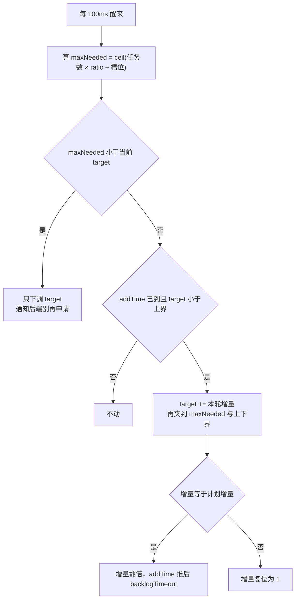
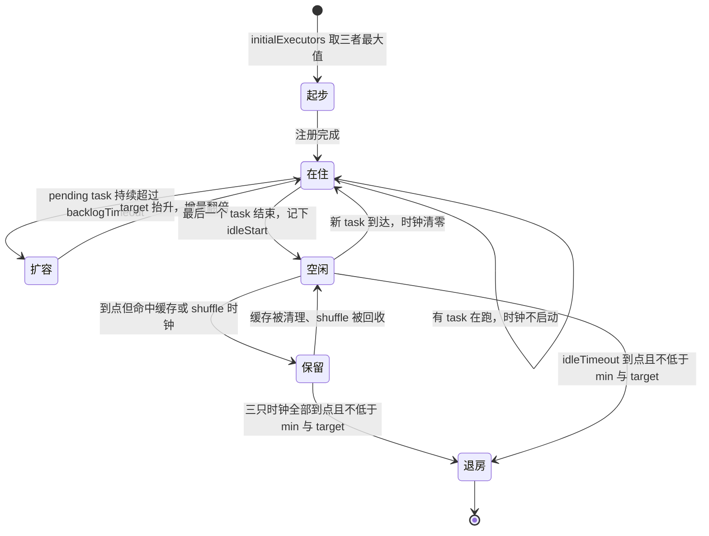
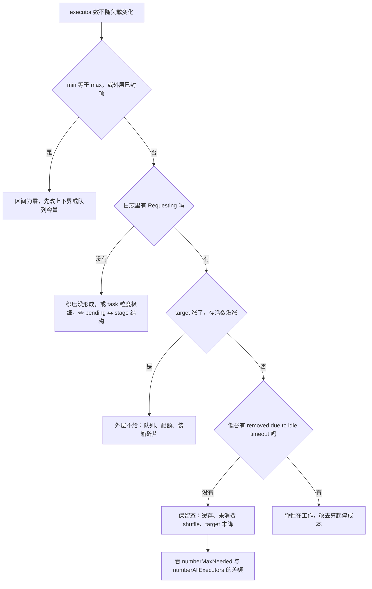
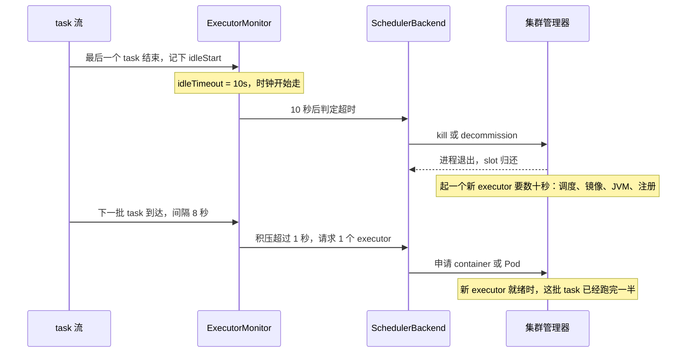
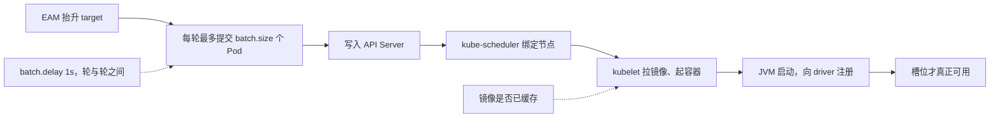
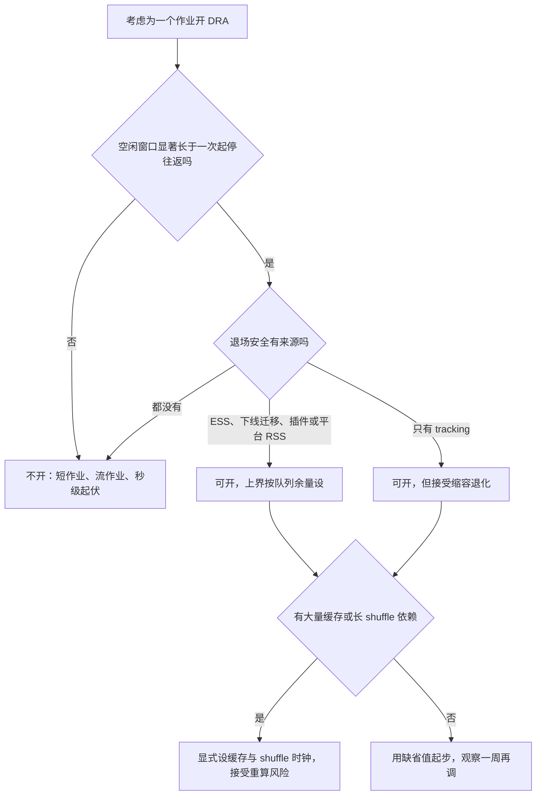

# 10 动态资源申请（Dynamic Resource Allocation）：弹性计算的资源调度逻辑

**摘要：**
动态资源分配（Dynamic Resource Allocation，DRA）在多数集群里被当成一个开关：打开它，executor 就会跟着负载起伏。这个心智模型漏掉了三件事，本文按运维口径补齐。第一，判定不是两态而是三态，扩容看积压、缩容看空闲，中间还夹着一个常被忽略的保留态——持有缓存块、持有未消费的 shuffle、以及 `minExecutors` 与目标值构成的地板，都会让“该走”的 executor 留下来，保留态直接决定了弹性的实际上限。第二，缩容的前提不是“配了外部 shuffle 服务（ExternalShuffleService，ESS）”，而是“executor 退场时它手上的 shuffle 还有别的可读来源”，四条合法路径的代价各不相同，YARN 上用 ESS 换完整的缩容能力，K8s 上只能靠 shuffle tracking 用“不释放”换“不丢数据”。第三，“弹性不生效”与“弹性抖动”是两类相反的病，前者要按六条成因逐个排除，后者要算起停成本与空闲时长的比值是否划算。文末给出配置判据表、四道门判定单、YARN 与 K8s 两组模板，以及从指标与日志关键字确认 DRA 真的在动的观测点。文中的缺省值以 4.3.0 的文档与源码核对。

---

## 第 1 章 一条几乎水平的 executor 曲线

### 1.1 工单：开了动态分配，曲线没有弯

笔者维护的集群按三百个节点、九千多个可用槽位记账，每天跑两千个左右的作业。这类集群里关于 DRA 的工单问法几乎都一样：“参数是不是没生效”。去年冬天的一张工单很典型，某数仓作业 `dw_session` 打开动态分配之后，所有者期待的曲线是“高峰拉满、低谷归零”，实际得到的是一条略微起伏的水平线。

这个作业每天 06:00 起跑，读埋点明细约 2.4 TB，两次 shuffle 聚合后按会话与渠道落两张表，三个半小时结束，读取阶段并行 task 一千二百个，同时运行的六百到七百个。提交参数是这样的：

```bash
spark-submit --master yarn --deploy-mode cluster \
  --num-executors 40 \
  --executor-cores 4 \
  --executor-memory 12g \
  --conf spark.dynamicAllocation.enabled=true \
  --conf spark.dynamicAllocation.minExecutors=8 \
  --conf spark.dynamicAllocation.maxExecutors=200 \
  --conf spark.dynamicAllocation.executorIdleTimeout=60s \
  --class com.example.DwSession dw-session.jar
```

三个半小时里，executor 数在 40 到 52 之间浮了七八次，既没有下探到 8，也没有上探到 200。第一次看这个现象，直觉是“扩容没触发、缩容也没触发”，其实两个方向都触发过，只是各自被三个具体的数字卡住了。

### 1.2 三个数把它定住

第一个数是起跑线。`spark.dynamicAllocation.initialExecutors` 的缺省值取 `minExecutors`，但真正生效的初值是三者取大：`minExecutors`、`initialExecutors`、`spark.executor.instances`（也就是 `--num-executors`）。所以那行 `--num-executors 40` 在打开 DRA 之后并没有作废，它把起跑线从 8 抬到了 40。driver 启动日志里有一行直接给出结论，形如 `Using initial executors = 40, max of ...`，这条日志比翻文档快，调参之后应当看一眼。

第二个数是空闲时钟。`spark.dynamicAllocation.executorIdleTimeout` 缺省 60 秒，而这个作业的 stage 之间有 30 到 45 秒的空档：一个 stage 收尾、写 HDFS、下一个 stage 提交、AQE（Adaptive Query Execution）重算分区，这些环节串起来就吃掉了大半空闲窗口。窗口跨不过 60 秒的门槛，于是“空闲到点”这件事从来没有发生，日志里也就没有一条 `removed due to idle timeout`。

第三个数是保留条件。十二个 executor 上留着前一个 action 写下的缓存块，`spark.dynamicAllocation.cachedExecutorIdleTimeout` 的缺省值是 `Integer.MAX_VALUE` 秒；另外三十来个持有尚未被消费的 shuffle，而这个集群没有部署 ESS，tracking 按缺省开着，`shuffleTracking.timeout` 又是 `Long.MaxValue`，等于要等 shuffle 被回收才放行。三条加起来，任一时刻真正“既空闲、又无缓存、又无未消费 shuffle”的候选只有零到三个。

### 1.3 三个数分属三个层面

起跑线属于上下界层面，时钟属于判定层面，保留条件属于数据依赖层面。三层的问题在曲线上形状不同：上下界错了是“上不去也下不来”，时钟错了是“该降的时候不降”，保留条件错了是“降了一半就停在那里”。排查时先分清落在哪一层，比逐个参数试要快。**三个数字，三个层面**，这是后面所有章节的骨架。

### 1.4 与静态分配的差别只有一句话

静态分配里，executor 个数是提交时确定的一个常量；动态分配里，它变成一条由两个时钟驱动的区间：积压时钟决定什么时候往上走，空闲时钟决定什么时候往下走，两端是 `minExecutors` 与 `maxExecutors`，中间那道闸门是“能不能安全退场”。接口如何落到 container 与 Pod，见本专栏 [[大数据/Spark/Spark-调度系统与执行模型深度解析/04 调度后端（SchedulerBackend）：Spark 与资源管理器（YARN，K8s）的对接细节|调度后端]]。

---

## 第 2 章 三种状态：扩容、保留、缩容

### 2.1 扩容的目标值是一次除法

DRA 每 100 毫秒醒来一次，先算一个目标数，再比对现状。目标数的算法可以压成一句：

> 目标 executor 数 = ⌈(运行中的 task + 待调度的 task + 待调度的推测副本) × `executorAllocationRatio` ÷ 每个 executor 的槽位数⌉

槽位数是 executor 核数除以 `spark.task.cpus` 向下取整，4 核、单 task 一核，就是 4 个槽位。`executorAllocationRatio` 缺省 1.0，含义是“按满并行算”，**缺省行为是把每个槽位都填满**；把它调到 0.5，等式右边减半，200 个待处理 task 在 4 槽 executor 上只需要 25 个 executor，而不是 50 个。

这个式子里有两个容易被忽略的加数。一个是不可调度的 taskSet——当节点被排除规则或连续失败挡掉，task 明明还在队列里却派不出去，EAM（ExecutorAllocationManager）会按这个 taskSet 的数量额外补 executor，避免“队列里全是被挡住的 task 又不扩容”的死锁。另一个是推测副本：源码里 `pendingSpeculative` 是独立加数而不是排除项，推测执行确实会把扩容目标推高；副本如何影响判定见 [[大数据/Spark/Spark-调度系统与执行模型深度解析/08 推测执行（Speculative Execution）：分布式环境下长尾任务的自动修复机制|推测执行]]，这里只记它对扩容的影响。

### 2.2 扩容的节奏由两个超时与一次翻倍决定

有 pending task 时，EAM 并不立刻申请，而是先记下一个到期时刻：当前时间加 `schedulerBacklogTimeout`（缺省 1 秒）。这 1 秒是观察窗，用来过滤掉那些“下一批 task 马上就派下去、根本不需要新 executor”的假积压。

到期之后每轮把目标值加上一个增量，成功后把这个增量翻倍，并把下一轮的到期时刻推到 `sustainedSchedulerBacklogTimeout`（缺省与前者相同，1 秒）之后。**翻倍只在增量被完整兑现时发生**：一旦被 `maxExecutors` 或当前需求截短，增量回到 1，爬坡退回线性。

目标值每轮还要被夹两次：先夹到本轮算出的需求，再夹到上下界之间。这解释了“日志里一直在请求、executor 数涨到某个值就停住”的现象——停住的位置要么是需求数，要么是上界。

后端侧还有一个独立的量：`SchedulerBackend.maxNumConcurrentTasks` 报告当前已注册 executor 能同时容纳多少 task，按资源画像分别计，随增删随时变化。EAM 的 target 是申请量，能同时跑多少由它决定，两者不等时以它为准——这也是扩容请求发出去之后“看着在涨、实际派不下去”的一个观察点。

还有一条写在源码注释里的前提：EAM 对申请不做重试，因为它假设集群管理器最终会兑现异步请求。这条假设在多租户集群上经常不成立，后果是“请求发出去了、资源一直没来、DRA 静默地停在原地”，第 5 章会把它列为一种独立的成因。



### 2.3 保留：三只时钟取最大值，外加一道硬闸

缩容的判定在 `ExecutorMonitor` 里，比扩容的除法琐碎。每个 executor 记一个空闲起点（最后一个 task 结束时），截止时刻取三只时钟里最晚的那只：`executorIdleTimeout`（缺省 60 秒）、`cachedExecutorIdleTimeout`（有缓存块时生效，缺省 `Integer.MAX_VALUE` 秒）、`shuffleTracking.timeout`（持有 shuffle 时生效，缺省 `Long.MaxValue` 毫秒）。取最大值这个动作很直白：**只要有一个理由说“再等等”，就不要走**。

三者是叠加关系，而非三选一。一个 executor 既缓存了中间结果、又持有未消费的 shuffle，截止时刻就由两只“实际上无限”的时钟决定，改 `executorIdleTimeout` 毫无作用。现场最常见的误判就在这里：把 `idleTimeout` 从 60 秒改成 30 秒，曲线纹丝不动，卡住它的根本不是这只时钟。

第二层保留来自一道不是时钟的闸：持有活跃 shuffle 的 executor 直接不进入候选集合。判定条件不是“空闲了多久”，而是“它手上的 shuffle 是否还被正在运行的作业需要”；作业还没结束、shuffle 还在被读，这个 executor 就一直是 busy 状态，空闲计时根本不启动。这道闸关着的时候，任何超时参数都无效。

第三层保留来自两个数量：`minExecutors` 与当前的 target。删除前会检查“删掉这一个之后还剩几个”，少于 `minExecutors` 不删，少于 target 也不删。第二条比第一条更容易被忽略：target 还没降下来的时候，即使 executor 已经空闲到点，也删不掉。日志里分别对应两句 debug：`Not removing idle executor ... (minimum number of executor limit ...)` 与 `Not removing idle executor ... (number of executor target ...)`，后者常常是“明明空闲了却没缩”的真正原因。

### 2.4 缩容：目标值先降，删除另算

需求小于 target 时，EAM 只做一件事：把 target 下调，并通过后端通知“别再申请了”。注释写得很清楚，已经跑着的 executor 不主动杀，杀由空闲超时单独控制，理由是假如某个 executor 恰好因为硬件故障或抢占消失，没有必要立刻补一个现在用不上的实例。

因此“缩容”在时间上分成两段：第一段是目标值下降，秒级，跟着 task 数走；第二段是 executor 真的消失，分钟级，跟着空闲时钟走。**目标先降，删除后到**，两条曲线之间的落差是观测时最容易误判的地方——目标值已经掉到 20、存活数还在 50，说明判定在做、回收还没到点，此时改任何扩容参数都没有意义。

开启优雅下线（`spark.decommission.enabled`）之后，删除动作会从 `killExecutors` 换成 `decommissionExecutors`，先迁块、再退出，把瞬间动作拉成一段过程；K8s 上这段过程还要叠加 Pod 的终止宽限，见第 7 章。

### 2.5 房态图

把三态画成一张房态图，比状态机更接近运维的直觉：在住（有 task）、保留（已预订或有行李）、空房待退（空闲到点且无牵绊）。



图中最容易被忽略的边是“空闲 → 保留”：已经到点，却被另一个更长的时间常数按住了。

---

## 第 3 章 退场资格：四条合法路径与两个平台的现实

### 3.1 前提是一句话，不是一条配置

3.x 时代的口径是“动态分配必须配 ESS”，4.x 的文档换了一种写法：打开 DRA 需要满足四个条件之一——打开 ESS（`spark.shuffle.service.enabled`）、打开 shuffle tracking（`spark.dynamicAllocation.shuffleTracking.enabled`）、同时打开下线与 shuffle 块迁移（`spark.decommission.enabled` 与 `spark.storage.decommission.shuffleBlocks.enabled`）、或者配置自定义 `ShuffleDataIO` 插件由驱动侧提供可靠存储。

四条路径说的是同一句话：executor 退场时，**它手上的 shuffle 数据必须还有别的可读来源**。ESS 把文件接管过去，tracking 用“不让你走”保证来源仍在，下线迁移先把文件搬到别处，插件把可靠性交给第三方。机制推导——文件如何注册、driver 如何记账、块迁移的顺序——在内核系列 [[大数据/Spark/读书笔记-spark内核/06_性能调优实战/3. Spark集群资源分配与并行度调优|集群资源分配与并行度调优]] 第 9 章已拆过，本文只关心这四条路在 YARN 与 K8s 上各要付什么代价。

### 3.2 YARN：ESS 换的是完整的缩容能力

YARN 上部署 ESS 的形状是固定的：它作为 NodeManager 的一个辅助服务运行，`yarn-site.xml` 里把 `spark_shuffle` 加进 `yarn.nodemanager.aux-services`，`yarn.nodemanager.aux-services.spark_shuffle.class` 指向 `org.apache.spark.network.yarn.YarnShuffleService`，classpath 单独配一项指向 Spark 的 network-yarn jar；executor 侧打开 `spark.shuffle.service.enabled`，端口缺省 7337。

ESS 打开之后，executor 写 shuffle 时把文件登记给这个常驻进程，executor 退出不影响文件可读，缩容也就不再受“手上还有未消费 shuffle”的限制——四条路径里唯一能把“弹性”与“数据安全”同时拿满的就是它。代价落在集群侧：ESS 是每节点一个进程的共享组件，要跟着 Spark 大版本升级，要单独管端口与目录，还要承担该节点上所有应用的拉取请求。`spark.shuffle.service.removeShuffle` 缺省为 true（3.3 起），意思是 executor 被释放后 ESS 会按 driver 的通知清掉这些文件，否则磁盘占用会随作业数线性增长；这一项关掉之后，“缩容成功、磁盘越来越满”就是一个必然结果。

这里要修正一个流传很广的说法：4.x 上 ESS 不再是硬前提，因为 tracking 缺省就开着；但没有 ESS 时，缩容能力会被未消费的 shuffle 吃掉一大块，更准确的说法是**想要完整的弹性，YARN 上仍然需要 ESS**。第 5 章把它列为一类“看起来生效、实际退化”的成因。

### 3.3 K8s：官方没有 ESS，自建要凑齐三件套

K8s 上的情况更硬。4.3.0 的部署文档写得很直接：Kubernetes 目前不支持外部 shuffle 服务，K8s 上的动态分配需要依赖 shuffle tracking。原因是 executor 是 Pod，文件系统默认随 Pod 消亡，而 YARN 的 ESS 依赖 NodeManager 与 container 共享宿主机磁盘。

要绕过这个限制，至少三件事同时成立：DaemonSet 保证每节点一个 ESS Pod；`hostNetwork: true` 让端口落在宿主机上，executor 才可能按“宿主机地址加 7337”找到它；hostPath 把宿主机目录同时挂进两侧，让文件真的共享。三件套凑齐后还有两笔账：隔离被打破，Pod 之间通过宿主机目录互相可见；升级被绑死，ESS 版本要跟 executor 的 Spark 版本对齐。这也是多数团队在 K8s 上不走自建 ESS、而转向 tracking 或平台级远程 shuffle 服务（Remote Shuffle Service，RSS）的原因。

远程 shuffle 服务是另一条路：shuffle 数据写到独立集群，executor 变成无状态单元，退场不再牵动数据；配置与存储设计见 [[大数据/Spark/Spark-on-Kubernetes工程实践/06 存储与 Shuffle：PVC、HostPath 与 Remote Shuffle Service|存储与 Shuffle]]。

### 3.4 tracking：默认开着，但只在 ESS 关闭时才算数

shuffle tracking 的缺省值是 true，这个缺省从 3.0 引入该配置起就没有变过。源码里的生效条件是两件事同时成立：`spark.shuffle.service.enabled` 为 false，且 `spark.dynamicAllocation.shuffleTracking.enabled` 为 true。这解释了两种相反的困惑：YARN 上明明没配 tracking，为什么 executor 被保住了（因为 ESS 也没开，tracking 自动接管）；YARN 上明明开着 tracking，为什么 executor 照样能缩（因为 ESS 开了，tracking 直接失效）。

它的代价必须说透：tracking 的本钱是“不释放”，不是“更快释放”。driver 记住每个 executor 上写了哪些 shuffle、这些 shuffle 是否还被活跃作业需要，凡是有需要的一律不放行；缺省的 `shuffleTracking.timeout` 是 `Long.MaxValue`，意思是“等 shuffle 被垃圾回收再说”。于是在长作业上，DRA 很容易退化成“只会扩、不会缩”：前面一百个 executor 上留着未消费的 shuffle，最后几个 stage 只需要二十个 executor，那一百个也得留着。把 timeout 设成有限值能缓解，但超时之后被回收的 executor 一旦带走未消费的 shuffle，下游读它就触发重算——这笔交换在第 6 章与第 8 章各有一处落点。

K8s 文档里还记了一个连带效应：stage 级调度给不同 stage 指定不同资源画像时，前面 stage 用过的 executor 会因持有 shuffle 而迟迟不空闲，画像越细，留下的 executor 越杂。

### 3.5 前提缺失的症状

最坏的情况不是报错，而是“看起来能跑”。小作业的 shuffle 在 executor 被判空闲前就消费完了，测试环境一切正常；上线后 stage 变多，某个 stage 的读端迟迟没起来，持有数据的 executor 先被回收，`FetchFailed` 开始出现。第一次重算还能成功，第二次重算又被回收，循环几次后 `spark.executor.maxNumFailures` 触顶（缺省按 executor 数的两倍、最少 3 计），作业失败。

排查这类故障不要先怀疑网络。判据是时间线：把 executor 增删日志与 stage 重提日志按时间对齐，如果每次 `FetchFailed` 之前都有一个 executor 被回收，结论就成立。还有一种更隐蔽的错位——“配置为真、进程为假”：`spark.shuffle.service.enabled` 打开了，节点上却没跑 ESS，executor 以为文件被接管、实际没有，拉取时报连接 7337 被拒；这种错位同时具备“配置正确”与“行为错误”两个特征，比完全不配更难查。

---

## 第 4 章 配置判据：两张表与三个容易看错的点

### 4.1 通用参数

下表按 4.3.0 的缺省值整理，“调大的代价”一列写的是把值往大改要付什么。

| 配置 | 缺省 | 决定什么 | 调大的代价 | 调小的代价 |
| :--- | :--- | :--- | :--- | :--- |
| `spark.dynamicAllocation.enabled` | false | 总开关，打开后个数从常量变成区间 | 不适用 | 回到静态分配，低谷不还资源 |
| `executorAllocationRatio` | 1.0 | 目标数的乘数，比值越小目标越低 | 目标贴近满并行，碎任务上拉起即闲置 | 排队变长，stage 尾延迟上升 |
| `initialExecutors` | 取 `minExecutors` | 起跑线，实际取 min、initial、`spark.executor.instances` 三者最大 | 起跑线高，首次下探要等空闲时钟 | 启动阶段第一批 task 排队 |
| `minExecutors` | 0 | 缩容地板，按资源画像各给一份 | 低峰常驻资源变多 | 每次波峰都要从零拉起 |
| `maxExecutors` | `Int.MaxValue` | 扩容天花板 | 缺省等于没有上界，会吃满队列 | 峰值被截断，task 排队 |
| `schedulerBacklogTimeout` | 1s | 首次扩容前的观察窗 | 反应慢，峰值起得晚 | 偶发积压就扩容，起停变多 |
| `sustainedSchedulerBacklogTimeout` | 同前一项 | 后续每轮扩容的间隔 | 爬坡变慢 | 申请与撤销交替 |
| `executorIdleTimeout` | 60s | 无缓存、无活跃 shuffle 的空闲时钟 | 低谷回收慢 | 短于 stage 间隔就抖动 |
| `cachedExecutorIdleTimeout` | `Integer.MAX_VALUE` 秒 | 持有缓存块时的空闲时钟 | 缓存复用率高，资源长期占用 | 缓存被回收，重算成本上升 |
| `shuffleTracking.enabled` | true | ESS 关闭时才生效的替代路径 | 打开即保守，缩容退化 | 关掉且无 ESS，缩容丢数据 |
| `shuffleTracking.timeout` | `Long.MaxValue` 毫秒 | 持有“无人使用” shuffle 的 executor 何时可走 | 缩容滞后 | 到点即走，可能触发重算 |
| `shuffle.service.enabled` | false | 是否使用外部 shuffle 服务 | 集群侧多一个要维护的常驻进程 | 退化为 tracking 的保守模式 |
| `shuffle.service.removeShuffle` | true（3.3 起） | 释放 executor 后是否清其 shuffle 文件 | 不适用 | 磁盘随作业数累积 |
| `shuffle.service.fetchRDDEnabled` | false | 磁盘持久化 RDD 块是否可由 ESS 提供 | ESS 要额外承担 RDD 块的拉取压力 | 缺省即磁盘块也算“有缓存”，executor 不放行 |

### 4.2 平台相关参数

| 平台 | 配置 | 缺省 | 决定什么 | 调大的代价 |
| :--- | :--- | :--- | :--- | :--- |
| YARN | `yarn.nodemanager.aux-services` | 不含 `spark_shuffle` | ESS 是否随 NodeManager 启动 | 不适用，这是开关而非刻度 |
| YARN | `spark.shuffle.service.port` | 7337 | ESS 监听端口 | 与节点上其他服务抢端口的风险上升 |
| K8s | `spark.kubernetes.allocation.batch.size` | 20 | 每轮提交的 Pod 数 | 一次创建太多，API Server 与调度器压力集中 |
| K8s | `spark.kubernetes.allocation.batch.delay` | 1s | 两轮提交之间的等待 | 扩容更慢 |
| K8s | `spark.kubernetes.allocation.executor.timeout` | 600s | 未进入 Pending 的 Pod 请求何时判超时并删除 | 幽灵 Pod 清得慢，占着 target 名额 |
| K8s | `spark.kubernetes.allocation.maximum` | `Int.MaxValue` | 全生命周期创建的 Pod 总数上限 | 缺省等于没有第二道上界 |
| K8s | `spark.kubernetes.dynamicAllocation.deleteGracePeriod` | 5s | 缩容时等 executor 优雅退出的时间 | 缩容变慢 |
| K8s | `spark.kubernetes.executor.terminationGracePeriodSeconds` | 30s（4.1 起） | Pod 终止宽限 | 缩容变慢，卡住的 Pod 更久才消失 |

### 4.3 三个容易看错的点

第一个是 `executorAllocationRatio` 的除法位置。它乘在 task 数上、除在槽位上，不是“把 executor 数乘个系数”这么含糊：200 个待处理 task、4 槽 executor、ratio 0.5，目标数是 25 而不是 100 或 50。写成 `ceil(200 × 0.5 ÷ 4)` 之后，就能算出“第二批 task 要等第一批跑完”的排队长度。

第二个是“infinity”这个字面量。文档写 `cachedExecutorIdleTimeout` 缺省 infinity，源码里是 `Integer.MAX_VALUE` 秒，换算过来是六十八年；`shuffleTracking.timeout` 文档写 infinity，源码是 `Long.MaxValue` 毫秒。观测上等价，但它们的意义不同：前者是“永不释放”，后者是“等 shuffle 被回收”。运维上把它们当成两个不同的开关更稳妥，因为后者在 shuffle 被清理之后还有机会缩，前者没有。

第三个是上下界按资源画像各给一份。`minExecutors` 与 `initialExecutors` 在源码注释里写得很明确：这些属性对每个 ResourceProfile 分别生效。用了 stage 级调度、给 GPU 任务单独开一个画像之后，`minExecutors=4` 的实际效果是“默认画像 4 个，GPU 画像再 4 个”，低峰期看到的常驻数量会翻倍。

---

## 第 5 章 “弹性不生效”的六种成因

### 5.1 前提没配，或者配了没跑

在第 3 章的基础上，这一条要拆成两半：真没配（既无 ESS、又关了 tracking），和配了没跑（ESS 打开但节点上没有那个进程）。前者表现为缩容后偶发 `FetchFailed`，后者在同一个 stage 内就会因为连接被拒而暴露；两者的共同点是“缩容看起来成功了”。

### 5.2 上下界相等

`minExecutors` 等于 `maxExecutors`，区间宽度为零，DRA 只是在做“把 target 一直维持在同一个数”的工作，曲线当然不动。这类配置往往不是笔误——很多人为了“稳定”把上下界设成同一个值，再打开 DRA 图个心安。另一种变形更隐蔽：`maxExecutors` 没设，但 YARN 队列容量只有那么大，实际可用的 executor 数被外层限死，效果与设了上界相同。

### 5.3 作业太短，窗口跨不过时钟

`executorIdleTimeout` 缺省 60 秒，这个数对“三个半小时的批作业”合适，对“每个 stage 只要四十秒”的作业就太长。更极端的是总时长本来就短的作业：一个跑六分钟的作业，去掉起跑与收尾，真正能发生缩容的时机只有中间那几分钟，如果这几分钟里每 30 秒就有新 task 上来，空闲计时根本不会到点。

判据在时间轴上：把 executor 增删事件与 stage 起止时间画在同一条轴上，看空闲窗口与 60 秒的距离。窗口普遍短于时钟，说明“来不及缩”，不是配置错误，而是这个作业的形状不适合用缺省值。

### 5.4 目标值不降：每个 executor 始终有一个 task

这一条最隐蔽，因为所有参数都对、所有前提都配了、扩容缩容的代码路径也都在跑，曲线就是不降。原因在缩容的单位：**缩容的单位是整个 executor，不是几个核**。只要一个 executor 上还有一个 task 在跑，它就不算空闲；当一个 stage 的 task 数长期大于 executor 数时，每个 executor 都被占着，没有任何一个是空闲候选。

举个具体算术：4 槽 executor、三百个 task 长期排队，填满这些 task 需要 75 个 executor，每个 executor 手里都压着 4 个 task，`numberMaxNeededExecutors` 也接近 75，target 便维持在 75 附近，看上去“需求就是这么高”。要让它降下来只有三条路：把 target 压到需求以下（调小 ratio，代价是排队变长）、把 task 粒度放大（减少 task 数，让 executor 有空窗）、把 executor 变小（换成更多 2 槽 executor，让缩容颗粒变细）。第三条听起来反直觉，实际是“把缩容单位改小”：颗粒越细，越容易在某些时刻凑出完整的空闲 executor。

### 5.5 保留态占满

第 2 章讲过三只时钟取最大值，现场表现是“降了一半就停住”：把 `numberMaxNeededExecutors` 与 `numberAllExecutors` 放在一起看，前者已掉到 20、后者还停在 50，差额就是被保留态按住的 executor。再用日志分辨是哪一只时钟——缓存密集的作业多半是 `cachedExecutorIdleTimeout` 的无限值，shuffle 密集的作业多半是 tracking 的无限 timeout。处置方向一致，都是“用重算风险换资源”，区别只在这笔风险落在缓存重算还是 shuffle 重算上。

### 5.6 外层不给

EAM 把请求交给后端，后端交给资源管理器，能不能兑现是另一回事。YARN 上的形状是队列容量与标签约束，K8s 上是 ResourceQuota 与节点可分配量，共同点是：**DRA 侧一切正常、日志里全是在申请，资源就是不来**。

装箱碎片值得单独提一句：总量够不等于放得下，8 核的请求遇上只剩 6 核的节点，会长期 pending 而不报错；这类“总量有、装不进”的算术在内核系列 [[大数据/Spark/读书笔记-spark内核/06_性能调优实战/3. Spark集群资源分配与并行度调优|集群资源分配与并行度调优]] 第 8 章拆过。诊断顺序是先看队列与配额余量，再看单节点能否装下，最后才怀疑 DRA。



### 5.7 六种成因的判据表

| 成因 | 现场长什么样 | 判据位置 | 处置方向 |
| :--- | :--- | :--- | :--- |
| 前提没配或没跑 | 缩容成功，之后 `FetchFailed` | executor 删除事件与 stage 重提的时间对齐 | 补 ESS、开 tracking、或关缩容 |
| 上下界相等 | 曲线平直，target 顶在上界 | `numberTargetExecutors` 与 `maxExecutors` | 拉开区间，按队列余量设上界 |
| 作业太短 | 全程只有零到一次缩容 | 空闲窗口长度与 `idleTimeout` 对比 | 缩短时钟或放弃 DRA |
| 目标值不降 | 需求与存活数长期贴合 | `numberMaxNeededExecutors ÷ 槽位数` | 压 ratio、放大 task 粒度、拆小 executor |
| 保留态占满 | 需求已降、存活数不动 | 需求与存活数的差额 | 给缓存与 shuffle 时钟设有限值 |
| 外层不给 | 申请不断、存活数不涨 | 队列余量、配额、单节点可装箱量 | 扩外层容量或降请求粒度 |

---

## 第 6 章 抖动：起停成本吃掉的那部分弹性

### 6.1 抖动的定义

抖动不是“缩得太快”，而是“起停的往返成本超过了省下来的资源”。一次往返包含两段时延与三类副作用：申请到就绪的时延、判定到删除的时延；调度器侧的状态抖动、缓存与 shuffle 的失效、外层审计与日志的噪音。当空闲窗口短于两段时延之和，executor 还没准备好就被删掉、或者刚删掉下一批 task 就到了，**净收益为负**。

这类作业有一个共同形状：task 粒度小、stage 短、stage 之间有固定间隔。典型的例子是每五分钟一次的增量计算，task 平均四秒，stage 之间空八秒，而 `executorIdleTimeout` 被设成 10 秒：每轮结束时十个 executor 先后到点被删，下一轮又开始申请，一天几百次起停。

### 6.2 起停成本清单

| 成本项 | 发生在哪一侧 | 是否随起停次数线性增长 | 能否摊薄 |
| :--- | :--- | :--- | :--- |
| container 或 Pod 的创建与调度 | 资源管理器 | 是 | 不能，只能减少次数 |
| 镜像拉取与容器启动 | 节点 | 是，且节点无缓存时最贵 | 预热镜像可部分摊薄 |
| JVM 启动与类加载 | executor | 是 | 不能 |
| 向 driver 注册与被纳入调度 | Spark | 是 | 不能 |
| 本地化丢失导致的重读 | Spark 与存储 | 是 | 只能靠放宽本地性等待 |
| 缓存块失效后的重算 | 作业 | 是 | 加大缓存时钟可避免 |
| shuffle 文件清理与重写 | 作业与 ESS | 是 | 开 ESS 清理由其承担 |

### 6.3 一条抖动的时间轴

把一轮起停放回时间轴，才看得出“省了多久”与“付了多少”是不是同一个量级。下图里空闲时钟 10 秒、task 间隔 8 秒、起停往返以数十秒计，结果一次都省不下来。



### 6.4 划算的判据

把收益与成本放在同一个单位上：收益是“空闲窗口内本可释放的资源时间”，成本是“一次起停往返的资源时间外加副作用”。一个作业要用 DRA，**典型空闲窗口必须显著长于一次起停往返**，否则省下的资源还不够付重新预热的账。

这个判据解释了两类常见结论。批作业之间如果只有几十秒的 stage 间隔，60 秒的缺省时钟恰好把抖动挡在门外；而把时钟调到 10 秒，等于主动把门槛拆掉。流式作业的空闲窗口以毫秒计，任何以秒为单位的时钟都跟不上，DRA 在这里只会制造抖动，正确做法是关掉它并用固定 executor 数配上队列侧的弹性。

### 6.5 处置顺序

先看形状，再看参数。形状指 task 粒度与 stage 间隔：task 太小就合并分区或调整聚合方式，stage 太碎就减少 action 次数；形状不动只调参数，抖动会换个形式回来。参数上的顺序是：把 `executorIdleTimeout` 抬到“典型 stage 间隔的两倍以上”这个量级，把 `cachedExecutorIdleTimeout` 按缓存复用率设成有限值，把两个 backlog 超时都抬到秒级以上，最后才动 `maxExecutors`。

还有一个常被忽略的方向：减少 executor 数量、加大单 executor 的槽位，把起停颗粒从“十个 4 槽 executor”变成“五个 8 槽 executor”，同样算力下起停次数减半；代价是单 executor 故障的影响面变大，槽位除法的算术见内核系列 [[大数据/Spark/读书笔记-spark内核/06_性能调优实战/3. Spark集群资源分配与并行度调优|集群资源分配与并行度调优]] 第 3 章。

---

## 第 7 章 K8s 上的两条通道：扩容慢，缩容也慢

### 7.1 扩容通道的时间预算

YARN 上扩容是“申请 container、NodeManager 起进程”，K8s 上扩容是“写 Pod 对象、等调度、拉镜像、起容器、JVM 引导、注册”。这条链路上每一段都有明确的配置投影，**提交请求只是链路的第一段**，把它叠起来看，才知道 K8s 上的 DRA 为什么更迟钝。

第一段受 `spark.kubernetes.allocation.batch.size` 限制：driver 每轮最多提交这么多个 Pod，4.3.0 的缺省是 20。第二段受 `batch.delay` 限制：两轮之间缺省等 1 秒。两段合起来给出下限——从 20 个扩到 200 个至少要九轮、至少九秒，而这仅仅是把请求提交出去；之后还有调度绑定、镜像拉取、容器启动、JVM 与注册，节点宽裕且镜像已缓存时以秒计，未缓存时以几十秒计。



### 7.2 缩容通道的宽限

删除也不是瞬间完成的。K8s 上有一个专门的参数 `spark.kubernetes.dynamicAllocation.deleteGracePeriod`，缺省 5 秒，含义是“等 executor 自己退出这么久，还没退就强杀”；Pod 本身还有 `terminationGracePeriodSeconds`，Spark 在 4.1 起把它暴露成 `spark.kubernetes.executor.terminationGracePeriodSeconds`，缺省 30 秒。两层宽限叠在一起，一次缩容从“判定超时”到“Pod 真的消失”可能要几十秒，其间 executor 既占着 target 名额，也占着节点资源。

这在观测上会制造错觉：`numberExecutorsPendingToRemove` 有值、`numberAllExecutors` 迟迟不降，看似删除失败，其实是在宽限期里。看它是否在几十秒内归零即可；一直不归零才怀疑 Pod 卡在终止流程，见 [[大数据/Spark/Spark-on-Kubernetes工程实践/04 Driver 与 Executor Pod 的生命周期管理|Pod 生命周期]]。

### 7.3 幽灵 Pod 与第二道上界

`spark.kubernetes.allocation.executor.timeout` 缺省 600 秒，管的是“已提交、但迟迟没进入 Pending 的 Pod 请求”：超时后这些请求被判失败并删除、重新提交。大规模扩容时它很有用，副作用是集群本身排不上队时，每十分钟有一批请求被判超时、删掉、重来，指标上表现为 Pod 反复创建而 executor 数不涨，看起来像“DRA 在乱建 Pod”。

4.1 起还多了一道上界 `spark.kubernetes.allocation.maximum`，限制全生命周期创建的 Pod 总数，与 `maxExecutors` 是两回事：前者算“创建过多少”，后者算“同时存在多少”。一个频繁起停的作业可能同时撞上两道墙，前者表现为“后面再也扩不出来”，后者表现为“卡在上界”。

### 7.4 外层：配额与抢占

K8s 的外层约束是 ResourceQuota、LimitRange 与节点可分配量。配额耗尽时 Pod 停在 Pending，事件里写的是 `exceeded quota`；节点放不下时事件里写的是 `Insufficient cpu` 或 `Insufficient memory`。前者要找平台扩配额，后者要改请求粒度或换节点池。抢占也会与 DRA 互相作用：被抢走的 executor 会被 DRA 当作正常损耗重新申请，两个作业都开 DRA 时就会出现“你缩我抢、我抢你申请”的来回，抢占语义与配置手段见 [[大数据/Spark/Spark-on-Kubernetes工程实践/08 资源优化：Spot 实例、Gang Scheduling 与容量规划|资源优化]]。

---

## 第 8 章 判定单、模板与观测点

### 8.1 四道门

判断一个作业该不该开 DRA，笔者用**四道门**：空闲窗口、退场来源、保留代价、外层余量。任何一道过不去，收益都会被抵消掉。



### 8.2 两组模板

YARN 上已经有 ESS 的作业，一组保守配置如下。取舍是“宁可缩得慢一点”：`minExecutors` 留 8 个，低峰不必从零拉起；`maxExecutors` 取队列容量的一部分而非缺省的无穷；`executorIdleTimeout` 抬到 120 秒跨过 stage 间隔；`cachedExecutorIdleTimeout` 给三十分钟而非 infinity。

```properties
# YARN + ESS：缩容能力完整，参数按保守取向
spark.dynamicAllocation.enabled=true
spark.shuffle.service.enabled=true
spark.dynamicAllocation.minExecutors=8
spark.dynamicAllocation.initialExecutors=8
spark.dynamicAllocation.maxExecutors=120
spark.dynamicAllocation.executorAllocationRatio=0.8
spark.dynamicAllocation.schedulerBacklogTimeout=3s
spark.dynamicAllocation.sustainedSchedulerBacklogTimeout=5s
spark.dynamicAllocation.executorIdleTimeout=120s
spark.dynamicAllocation.cachedExecutorIdleTimeout=1800s
```

K8s 上没有 ESS，只能靠 tracking，要把“缩容会退化”写进预期：`shuffleTracking.timeout` 给有限值，等于主动接受“超时之后可能重算”；`executorIdleTimeout` 比 YARN 上略短，因为删除与创建都更慢；`batch.size` 与 `deleteGracePeriod` 按集群规模调整。

```properties
# K8s + tracking：没有 ESS，缩容能力打折
spark.dynamicAllocation.enabled=true
spark.dynamicAllocation.shuffleTracking.enabled=true
spark.dynamicAllocation.shuffleTracking.timeout=600s
spark.dynamicAllocation.minExecutors=4
spark.dynamicAllocation.initialExecutors=4
spark.dynamicAllocation.maxExecutors=80
spark.dynamicAllocation.executorIdleTimeout=90s
spark.dynamicAllocation.cachedExecutorIdleTimeout=1800s
spark.kubernetes.allocation.batch.size=20
spark.kubernetes.dynamicAllocation.deleteGracePeriod=10s
```

### 8.3 观测点

指标侧，EAM 暴露的 gauge 足够回答大部分问题，名字在 4.x 之间可能调整，语义稳定：

| 指标 | 含义 | 判据 |
| :--- | :--- | :--- |
| `executors.numberAllExecutors` | 当前存活的 executor 数 | 曲线的纵轴，与 target 对照 |
| `executors.numberTargetExecutors` | 目标数 | 与需求数对照，判断判定是否在做 |
| `executors.numberMaxNeededExecutors` | 按当前负载算出的需求 | 与存活数的差额即保留态与未到点之和 |
| `executors.numberExecutorsToAdd` | 下一轮计划增加的数 | 停在某个值不再翻倍，说明被上界或需求夹住 |
| `executors.numberExecutorsPendingToRemove` | 已判超时、等待删除的数 | 长期不归零说明卡在宽限期或删除通道 |

日志侧的关键字按发生顺序排：`Using initial executors` 给出起跑线；`Requesting N new executor(s) because tasks are backlogged` 是扩容动作；`Lowering target number of executors` 是目标下调（debug 级）；`removed due to idle timeout` 是缩容真正发生；`Not removing idle executor` 是删除被挡，括号里写着被哪条规则挡住。barrier stage 与 DRA 冲突时另有一条 `Skip current round of resource offers for barrier stage`，说的是“一次到齐的 barrier task 与渐进扩容之间的错位”，处置见本专栏 [[大数据/Spark/Spark-调度系统与执行模型深度解析/06 Task 运行生命周期：从 TaskSetManager 分发到 Executor 端执行|Task 运行生命周期]]。

UI 侧把 Executors 页的增删时间与 Stages 页的 Active Tasks 曲线对齐，就能算出空闲窗口长度，这比任何参数都更能说明作业适不适合 DRA。

### 8.4 反例表

| 现象 | 常见误判 | 实际机制 |
| :--- | :--- | :--- |
| 开了 DRA 曲线不降 | 参数没生效 | 保留态与 target 未降，三只时钟里有一只是 infinity |
| 有 pending task 但 executor 数不动 | 集群卡住 | 队列或配额已满，EAM 不重试，静默等待 |
| executor 反复起停 | 节点不稳定 | `idleTimeout` 短于 stage 间隔，起停成本吃掉了收益 |
| 开 DRA 后作业更慢 | DRA 有缺陷 | 冷启动与本地化丢失，短作业本就不该开 |
| 缩容后出现 `FetchFailed` | 网络抖动 | 退场带走了未消费的 shuffle，前提没配或没跑 |
| barrier stage 一直不启动 | 调度器死锁 | 渐进扩容与 barrier 的“一次到齐”冲突 |
| 缓存时钟设了仍不缩 | 参数没被读 | 手上还有未消费 shuffle，另一只时钟更长 |

---

## 第 9 章 落点：弹性是租约，不是开关

### 9.1 权衡的落点

回到 `dw_session` 那个作业。三条处置没有一条是“把参数调大一点”：起跑线要跟 `--num-executors` 一起改，否则旧参数继续生效；空闲时钟要跟 stage 间隔一起看，否则改完仍不生效；保留态要么用有限时钟换重算风险，要么把缓存收窄到真正复用的那几步。三条做完，曲线才会从“40 到 52 的水平线”变成“峰值五十、低谷八”的锯齿。

这条主线上的每个选择都要付代价：ESS 买来完整的缩容能力，代价是集群级组件；tracking 买来零运维成本，代价是缩容退化；`minExecutors` 买来低峰不冷启动，代价是常驻资源；有限超时买来回收，代价是重算风险。所谓“最佳实践”，不过是某一种负载形状下这些代价暂时收敛到一个好用的点，形状一变，那个点就漂移了。

### 9.2 与机制篇的分工

EAM 的状态与回调、申请与删除接口在 `SchedulerBackend` 侧如何落地，见本专栏 [[大数据/Spark/Spark-调度系统与执行模型深度解析/04 调度后端（SchedulerBackend）：Spark 与资源管理器（YARN，K8s）的对接细节|调度后端]]；容器账、槽位除法与并行度下界，含退场四条路径与不配前提的后果，见内核系列 [[大数据/Spark/读书笔记-spark内核/06_性能调优实战/3. Spark集群资源分配与并行度调优|集群资源分配与并行度调优]]；缓存块与 BlockManager 的关系见 [[大数据/Spark/读书笔记-spark内核/04_存储与容错机制/3. Spark_数据缓存机制|数据缓存机制]]；shuffle 文件在 executor 与 ESS 之间的归属见 [[大数据/Spark/读书笔记-spark内核/05_Shuffle核心机制/7. Spark_Shuffle与Storage交互|Shuffle 与 Storage 交互]]；Pod 的创建、终止与判定死亡见 [[大数据/Spark/Spark-on-Kubernetes工程实践/04 Driver 与 Executor Pod 的生命周期管理|Pod 生命周期]]；shuffle 存储的替代方案见 [[大数据/Spark/Spark-on-Kubernetes工程实践/06 存储与 Shuffle：PVC、HostPath 与 Remote Shuffle Service|存储与 Shuffle]]。

---

## 参考资料

1. Apache Spark 4.3.0 Configuration：动态分配各配置项的缺省值，以及 `enabled` 一行的四条前提条件。https://spark.apache.org/docs/4.3.0/configuration.html
2. Apache Spark 4.3.0 源码 `core/src/main/scala/org/apache/spark/ExecutorAllocationManager.scala`：目标数算式、推测副本与不可调度 taskSet 的加项、增量翻倍与复位、“不做重试”的注释、gauge 名称。https://github.com/apache/spark/blob/v4.3.0/core/src/main/scala/org/apache/spark/ExecutorAllocationManager.scala
3. Apache Spark 4.3.0 源码 `core/src/main/scala/org/apache/spark/scheduler/dynalloc/ExecutorMonitor.scala`：三只时钟取最大值的 `updateTimeout`、活跃 shuffle 的硬闸、tracking 的生效条件。https://github.com/apache/spark/blob/v4.3.0/core/src/main/scala/org/apache/spark/scheduler/dynalloc/ExecutorMonitor.scala
4. Apache Spark 4.3.0 源码 `core/src/main/scala/org/apache/spark/internal/config/package.scala`：各配置项的缺省值与版本标记。https://github.com/apache/spark/blob/v4.3.0/core/src/main/scala/org/apache/spark/internal/config/package.scala
5. Apache Spark 4.3.0 源码 `core/src/main/scala/org/apache/spark/util/Utils.scala`：`getDynamicAllocationInitialExecutors` 的“三者取大”与对应日志。https://github.com/apache/spark/blob/v4.3.0/core/src/main/scala/org/apache/spark/util/Utils.scala
6. Apache Spark 4.3.0 源码 `core/src/main/scala/org/apache/spark/scheduler/TaskSchedulerImpl.scala`：barrier taskSet 因槽位不足跳过本轮资源供给的日志。https://github.com/apache/spark/blob/v4.3.0/core/src/main/scala/org/apache/spark/scheduler/TaskSchedulerImpl.scala
7. Apache Spark 4.3.0 源码 `resource-managers/kubernetes/core/src/main/scala/org/apache/spark/deploy/k8s/Config.scala`：K8s 侧 allocation 与宽限相关参数的缺省值。https://github.com/apache/spark/blob/v4.3.0/resource-managers/kubernetes/core/src/main/scala/org/apache/spark/deploy/k8s/Config.scala
8. Apache Spark 4.3.0 Running Spark on Kubernetes：Kubernetes 目前不支持外部 shuffle 服务，动态分配依赖 shuffle tracking。https://spark.apache.org/docs/4.3.0/running-on-kubernetes.html
9. Apache Spark 4.3.0 Job Scheduling：Dynamic Resource Allocation 一节的机制说明与推荐实践。https://spark.apache.org/docs/4.3.0/job-scheduling.html

> [!note] 思考题
> 1. 一个 stage 有两百个 task、4 槽 executor、`executorAllocationRatio=0.5`，目标数是 25 个 executor。第二批 task 要等第一批跑完，这段等待换来资源占用减半，你会用什么指标来量化这笔交换是否划算？
> 2. 某作业缓存了三百 GB 中间结果，分散在五十个 executor 上。把 `cachedExecutorIdleTimeout` 从 infinity 调到三十分钟，第一个被回收的 executor 恰好持有一份被后续 action 依赖的缓存，接下来会发生什么？
> 3. K8s 上把 `allocation.batch.size` 从 20 调到 50，扩容会更快还是会带来别的问题？镜像未缓存与已缓存两种情况下，瓶颈分别在链路的哪一段？
> 4. 为什么“缩容单位是整个 executor”会让“每个 executor 都只跑一个 task”的作业几乎无法弹性？把 4 槽 executor 换成 2 槽 executor 是改善还是恶化，取决于哪些前提？
> 5. 一个集群上同时跑日结批作业与交互式查询，`minExecutors` 该按哪一类负载设？有没有一种配置能同时照顾两端，代价是什么？