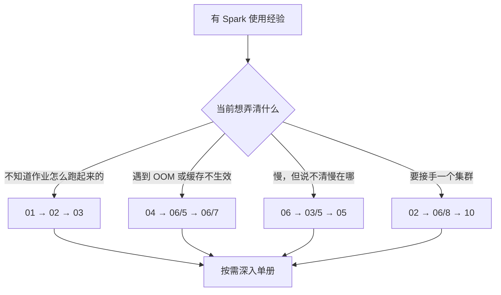

# Spark 内核剖析 · 专栏导览

## 专栏定位

这套专栏回答一个问题：**一次 `count()` 之后，集群里到底发生了什么。**

它不教怎么写 Spark，也不覆盖 DataFrame 的 API 用法——那些查文档更快。它要拆的是中间那层黑箱：Driver 怎么把一份代码变成一组 Task、资源从哪里来、数据在 Executor 之间怎么搬、失败之后谁负责重算。读它的前提是写过 Spark 作业并至少遇到过一次 "Executor lost" 或 "Fetch failed"；没有这个体感，很多章节会显得在讨论不存在的问题。

**技术版本**：Spark 4.3.0（2026-10-30 发布），预编译 Scala 2.13（2.12 已弃用）。文中默认值以该版本文档与源码为准，跨版本行为差异处会显式标注；无法确定的实现细节一律写「以对应版本文档或源码为准」，不猜。

## 结构：六个分册，47 篇

这套专栏不是 47 个并列的选题，而是六条从外到内的剖切面。每一册解决一类困惑，册与册之间有明确的分工边界。

| 分册 | 篇数 | 回答什么 | 代表性困惑 |
| :--- | ---: | :--- | :--- |
| 01 核心概念与基础 | 5 | 坐标系：抽象有几层、每层的作用域是什么 | "Job 和 Stage 到底谁包含谁" |
| 02 系统架构与运行机制 | 9 | 进程：Master/Worker/Driver/Executor 怎么起、怎么注册、怎么通信 | "提交了却没起来，卡在哪一步" |
| 03 调度与执行机制 | 10 | 决策：Stage 怎么切、Task 派给谁、结果怎么收 | "为什么并行度调大了还是慢" |
| 04 存储与容错机制 | 6 | 状态：内存怎么分、缓存怎么写、失败了谁兜底 | "OOM 了但堆没满，是哪里错了" |
| 05 Shuffle 核心机制 | 7 | 物化：宽依赖为什么必须落盘、文件怎么写怎么读 | "SortShuffle 到底排的是什么序" |
| 06 性能调优实战 | 10 | 落地：参数、算子、资源、倾斜的选择与代价 | "照抄模板参数为什么不对症" |

一条贯通的线索是：**每一层的边界都是一次状态转移**。抽象层的边界是对象与作业的转换，进程层的边界是注册与心跳，调度层的边界是 Stage 划分，存储层的边界是内存池的借用与驱逐，Shuffle 层的边界是落盘，调优层的边界是每一次把 CPU 换成内存或把内存换成网络。

## 各册要点

01 核心概念与基础（5 篇）建坐标系。四层抽象（Application / Job / Stage / Task）与三组件（Driver / Executor / ClusterManager）各自的创建者、持有者、计数单位与失败域；RDD 与 Dataset 的抽象对比与"该选哪个"的判据；Transformations 与 Actions 各按语义维度组织，而不是逐个算子罗列；最后一篇下沉到 RDD 的五个抽象方法与对象图。

02 系统架构与运行机制（9 篇）讲进程。Standalone 模式下 Master 的三张注册表与 HA 恢复、Worker 的资源切分与心跳、ExecutorBackend 向 Driver 的注册链路、Driver 在两种部署模式下的归属、Application 的提交与资源申请、直到 Task 结果怎么回传与 Executor 的下半场生命周期。

03 调度与执行机制（10 篇）讲决策。SparkContext 的生命周期与并发语义、惰性求值下的逻辑 DAG、物理计划的形态、DAGScheduler 的 Stage 划分、TaskSetManager 的本地性等待与降级、SchedulerBackend 的下发契约，以及一处横切视角——四方消息的线程与锁。

04 存储与容错机制（6 篇）讲状态。Executor 内存的四本账与归因方法、统一内存池的借用与驱逐方向、缓存的存储级别与物理路径、调度层容错的动作、容错这笔钱花在哪四本账上、以及 Checkpoint 的写路径与血缘截断。

05 Shuffle 核心机制（7 篇）讲物化。Shuffle 的代价模型、框架的读写契约、从 Hash 到 Sort 的演进决策线、HashShuffle 的源码实现、Sort-Based 的机制与三类 Writer、聚合与排序的内存结构、与 Storage 层的交界。

06 性能调优实战（10 篇）讲落地。序列化与对象模型、算子选择、资源配置算术、广播与累加器、JVM 与内存管理、Shuffle 的参数面与内存账、Spark on YARN，以及数据倾斜的判定与四类解法。

## 推荐阅读路径

- **顺序读**：01 → 02 → 03 → 04 → 05 → 06。前四册无前置依赖，05 建议在 03 之后读（否则 Stage 划分与 Shuffle 边界会混），06 放在最后——它的每一篇都在调用前面五册的结论。
- **按问题查**：先看 `06_性能调优实战` 的第 1 章（问题分类），它会指向真正该读的那一册。
- **不建议**：跳过 01 直接读 05。宽依赖与窄依赖的差别在 01 里就定死了，不了解会读成"两种 shuffle 实现"。

## 与其他专栏的关系

本专栏是「原理层」，与之相邻的几套专栏各管一段：

- `Spark-on-Kubernetes工程实践`：本专栏讲 Spark 自己怎么跑，那套讲作业跑在哪、平台侧怎么给资源。
- `Spark-调度系统与执行模型深度解析`、`Spark-Structured-Streaming流处理深度解析`：同一技术栈的另两条主线。
- `YARN`、`Kubernetes` 相关专栏：资源层的外部视角，本专栏只到 ClusterManager 的接口为止。

## 关联专栏

- [[大数据/Spark/Spark-on-Kubernetes工程实践/00 专栏导览|Spark on Kubernetes 工程实践]]：同一套内核在容器编排平台上的落地形态
- [[大数据/Spark/Spark-调度系统与执行模型深度解析/00 专栏导览|Spark 调度系统]]：调度层的另一种组织方式，可与本专栏 03 册对照
- [[大数据/Hadoop/Yarn/00 专栏导览|YARN]]：Standalone 之外的资源管理层
- [[可观测/指标/00 专栏导览|指标体系]]：作业运行时该看哪些指标

> [!note] 使用建议
> 这套专栏的每一篇都标了版本口径。跨大版本升级前，先看 06 册第 3、6 篇里关于默认值与改名的那几张表——它们记录了参数从哪里搬到哪里的历史，比翻阅旧博客快。