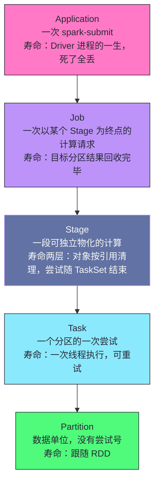
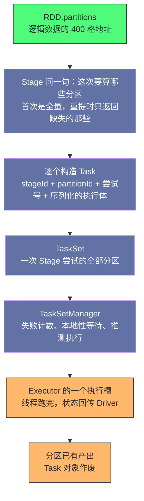
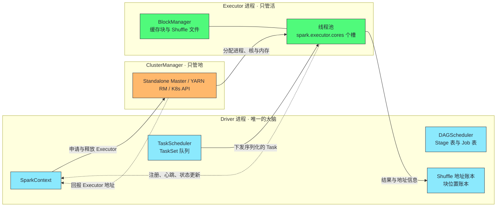
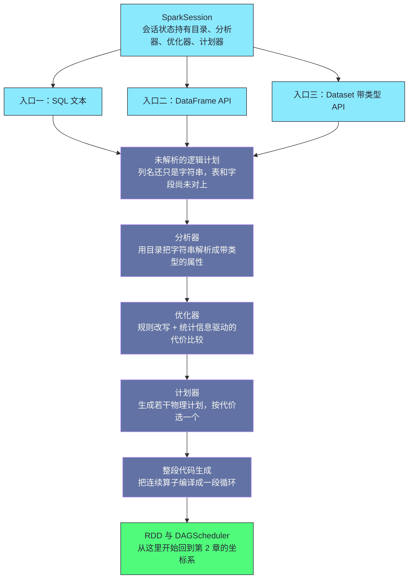

# 1. Spark 核心概念与系统架构：四层抽象、三个组件与一次编程模型演进

**摘要：**

2012 年，伯克利 AMPLab 在 NSDI 上给出一张血缘图，用"重算"替代"复制"来解释容错；两年之后 Spark 1.0 把这张图变成可以提交、可以部署的运行时；又过一年半，1.3 的 DataFrame 与 1.6 的 Dataset 把关系代数与编译期类型检查先后叠了上去。十几年间，同一套引擎上长出了四层抽象与三个组件，而它们在日常对话里被混着用：应用挂了、作业重跑了、阶段卡住了、任务歪了，说的往往不是同一件事。

这篇文章要回答两个问题：Application、Job、Stage、Task 这四层抽象各自的作用域与生命周期是什么，Driver、ClusterManager、Executor 这三个组件的边界又划在哪。文章先用一次凌晨复盘交代混用的代价，再逐层拆开四层抽象的"谁创建、谁持有、何时结束"，解释为什么最小调度单位是 Task 而不是 Partition；接着用"杀掉一个组件看谁还能活"的方式验证三组件的边界；然后把编程模型从 RDD 到 DataFrame、Dataset、SQL 的演进摊开，逐代交代动因与代价；最后单列边界与反例，并用一张版本锚点表把 1.0、1.3、1.6、2.0 这几个年份挂回坐标轴。全文口径为 Spark 4.3.0（2026-10-30 发布，4.x 预编译 Scala 2.13），涉及具体版本行为处，以对应版本文档或源码为准。

**关键词（Keywords）**: Application, Job, Stage, Task, Driver, Executor, ClusterManager, Catalyst, DataFrame, Dataset, SparkSession, Tungsten

---

## 第 1 章 四个词，一张被搅乱的地图

### 1.1 凌晨三点的那次复盘

一个每日履约时效报表晚点了四个小时。值班同事说"应用挂了"，开发同学说"作业重跑了两遍"，平台同学说"某个阶段卡在 99% 一直不动"，而真正的原因在第四句话里才浮出来：三台机器的 Executor 被同宿主的其他负载挤掉，那些已经被派出去、正在扫数据的任务失败后重试，重试次数耗尽，于是整批任务作废、阶段失败、作业失败，最后异常抛回 `main`，应用退出。

前三句话各说对了一部分，却指向三个不同的东西。值班说的"应用"是那个提交到集群上、有独立 ID 的运行时；开发说的"作业"是一次 Action 触发的那趟计算；平台说的"阶段"是一段在 Shuffle 边界之间可以独立重来的计算。而真正的故障单位是"任务"——某个分区在那台机器上的那一次尝试。这几个名词在源码里都有对应的类，但在口头语里被混成了一个词，于是复盘会开了四十分钟，前面三十分钟都在对齐"你说的挂是哪个挂"。

这就是本文要处理的问题。**四层抽象首先是四个作用域**，它们先在语义上把"什么一起开始、什么一起结束、什么算一次失败"切清楚，然后才谈得上各自怎么实现。把作用域搞混，读日志会读错层次，做优化会改错旋钮，估容量会算错分母。

### 1.2 抽象不是分类，是责任田的边界

初学者常把这四层当成一种分类法：应用里有很多作业，作业里有很多阶段，阶段里有很多任务，像文件夹套文件夹。这个理解没有错，但它只描述了"包含关系"，没有描述"责任关系"——而这四层真正值钱的地方在后一半。

换一个比方。一个装修项目里，业主签的那份合同、工长排的那张施工计划、每一道工序的验收单、以及工人手里的一张派工单，四者的关系并不只是"大包含小"。合同决定"这摊事什么时候算完、钱怎么结"，施工计划决定"哪些工序能并行、哪些必须等"，验收单决定"这一段坏了要不要返工、返工到哪一段"，派工单决定"今天谁去干、干哪一间"。四份文件的层级是包含的，但每一份都是一类责任的载体，谁也替代不了谁。

Spark 的四层也是这个结构。Application 管的是"这次押注什么时候收摊"，Job 管的是"这一次结果回收什么时候算完"，Stage 管的是"这一段重算的作用域有多大"，Task 管的是"这一格数据由谁在哪个线程上算一次"。**每一种抽象都是一次责任的转移**：越往下，责任越具体、越可重试；越往上，责任越全局、越不可恢复。

### 1.3 一个贯穿全文的作业

抽象讲多了会飘，先钉一个具体的作业。某电商的履约团队每天要出一张仓库-小时粒度的时效报表：从数仓读当天的履约事件流水（`warehouse`、`hour`、`delayMinutes` 三个字段有用），过滤掉仓库为空的事件，按仓库与小时累加延迟分钟数，换算成小时，写成按天分区的 Parquet；出完之后再 `take` 五行回来看一眼，确认没有整列为空。

用 RDD 写出来是这样，输入侧按 400 个分区读入：

```scala
// 三个字段就够，但 RDD 这一层拿不到"只有三列"这件事，整行都得解析
val events = sc.textFile("hdfs:///dw/fulfill_events/dt=2026-11-18", 400)
  .map(parseEvent)                       // 窄依赖：一行文本 → 一个事件对象
  .filter(_.warehouse.nonEmpty)          // 窄依赖：脏数据在源头剔掉
  .map(e => ((e.warehouse, e.hour), e.delayMinutes))

// 唯一一次 Shuffle：按 (warehouse, hour) 重分区后累加
val byWh = events.reduceByKey(_ + _).mapValues(_ / 60.0)

byWh.saveAsTextFile("hdfs:///dw/fulfill_sla/dt=2026-11-18")   // Action 一
val sample = byWh.take(5)                                     // Action 二
```

这段代码不长，但四层抽象全在里面：一个 Application（一次 `spark-submit`），两个到三个 Job（`take` 在数据稀疏时会分批提交，后文第 7 章会解释为什么），两个 Stage（一次 Shuffle 把它切成产出侧与消费侧），以及几百个 Task（map 侧按 400 个分区展开，reduce 侧按 `spark.default.parallelism` 展开）。数据单位则是分区：`events` 有 400 个，`byWh` 有另一批。

这个作业会在后文反复出现：第 2 章用它数四层的生命周期，第 3 章用它区分分区与任务，第 4 章用它看三个组件各自经手哪一段，第 5 章把它改写成 DataFrame 与 Dataset，比较三代写法在同一份逻辑上各自让出了什么、换回了什么。

### 1.4 本文的口径

讨论对象是 Spark 4.3.0（2026-10-30 发布），4.x 的预编译包按 Scala 2.13 编译、运行时要求 Java 17；集群管理器只取仍在维护的三条路径——Standalone、YARN、Kubernetes，Mesos 后端自 4.0 起已经移除。本文只处理抽象层的作用域与组件之间的职责边界，进程如何被拉起、消息如何编码、Endpoint 如何注册这些实现细节不在口径内；那些内容属于另一个层次的读法，混进本文只会把坐标系讲成流水账。个别行为在更早版本里不同，会单独标出年份。

---

## 第 2 章 四层抽象：谁创建、谁持有、谁结束

这一章按同一组问题过一遍四层：谁把它创建出来、谁在运行期持有它、它的计数单位是什么、它在什么条件下结束、它结束的时候会带走什么。五个问题问完，一层抽象的作用域就清楚了。

### 2.1 Application：一次 SparkContext 的押注

Application 的创建点在用户代码的第一行有效语句里。`spark-submit` 把 `main` 拉起来之后，`SparkSession.builder().getOrCreate()` 会在背后构造一个 `SparkContext`；`SparkContext` 的构造函数做四件事：建 `SparkEnv`（序列化器、`BlockManager`、`ShuffleManager`、内存管理器都在里面）、起 `HeartbeatReceiver`、按 `spark.master` 装配 `TaskSchedulerImpl` 与对应的 `SchedulerBackend`、建 `DAGScheduler`，最后让 `SchedulerBackend` 向集群管理器注册自己，开始要资源。

所以 Application 的边界不是"一个 jar 包"，也不是"一个 main 函数"，而是**一个 `SparkContext` 的生命周期**。这一点有个硬约束作为佐证：同一个 JVM 里不允许存在两个活跃的 `SparkContext`，`SparkContext.activeContext` 会把关，`getOrCreate` 的语义是"复用已有的"而不是"再建一个"。这意味着在同一台机器上连跑两段代码，如果它们共用了一个 `SparkContext`，那它们在语义上就是同一个 Application——共享缓存、共享广播变量、共享 Job 编号，也共享同一次死亡。

运行期持有它的是 Driver 进程：`SparkContext` 持有调度器与 `SparkEnv`，`SchedulerBackend` 持有 Executor 的注册表，`DAGScheduler` 持有 Stage 与 Job 的登记表。计数的单位只有一个：一次提交算一个 Application，它在集群侧有一个 ID（YARN 上是 `application_xxx`，Kubernetes 上是带 `spark-` 前缀的标识，与 Driver Pod 的名字同源），在 Spark UI 上体现为整个站点的标题。

结束条件有两种，主动与被动。主动是 `sc.stop()`：先停 `DAGScheduler`（拒绝新 Job），再停 `TaskScheduler`（取消还在排队的 TaskSet），然后停 `ListenerBus`，最后停 `SparkEnv`（关掉 `BlockManager` 与 Shuffle 服务），并向集群管理器注销。被动是 Driver 进程消失——被 kill、OOM、所在节点掉线，这时集群管理器按自己的规则回收全部 Executor。

它结束时带走的东西最多：所有未完成的 Job 一起作废，所有 Executor 被回收，内存里的缓存块与磁盘上的 Shuffle 输出一并失效（Shuffle 文件在 Executor 的本地目录里，Executor 没了文件也就没了）。**Application 是四层里唯一"死了就全丢"的一层**，这也是为什么长跑的流式作业要靠 checkpoint 而不是靠"重启一下接着跑"。

### 2.2 Job：一次结果回收，但不总与 Action 一一对应

Job 的创建点在 Action 上。`count()`、`collect()`、`saveAsTextFile()` 这类算子在 RDD 上最终都走到 `SparkContext.runJob`，再转成一条 `JobSubmitted` 事件投进 `DAGScheduler` 的事件循环；事件被处理时构造一个 `ActiveJob`，配一个 `JobWaiter` 等着结果，`jobId` 由 `nextJobId` 递增分配，这就是 UI 上那个从 0 开始的编号。

持有它的是 `DAGScheduler`：`jobIdToActiveJob` 与 `activeJobs` 两张表记着当前还活着的 Job，每个 `ActiveJob` 身上挂着一个布尔数组，长度等于本次要算的目标分区数，下标是 Job 内部的分区序号。这个数组就是 Job 的账本：第 i 个目标分区算完了就把第 i 格置真。

结束条件是"这个数组全真"，此时 `JobWaiter` 被唤醒，结果回传给调用线程。反方向的结束是任一目标分区在重试耗尽后仍失败，`jobFailed` 把异常抛回用户代码所在的线程。

这里有一个容易被"一次 Action 一个 Job"的简化说法盖掉的细节：**Job 的数量取决于 Action 的实现，而不是 Action 的名字**。`count`、`collect`、`foreach`、`saveAsTextFile` 都是一次 `runJob`，一个 Job；但 `take(n)` 的实现是循环——先算一个分区，不够就按 `spark.rdd.limit.scaleUpFactor`（默认 4）放大要扫描的分区数，再提交一次，直到凑够 n 条或者扫完。于是同一个 `take(5)`，数据密集时是一个 Job，数据稀疏时可能是三个。`takeOrdered` 与 `top` 复用了这套逻辑，同样会分裂成多个 Job。前文那个履约作业的第二个 Action 就是这种情形。

还有一类 Job 干脆没有对应的 Action：调度器内部会把"把某个 Shuffle 的产出算出来"当成一个 Job 提交，它的终点是一个产出侧 Stage 而不是结果 Stage，产出算完之后回调一份统计信息给上层，供运行期调整后续计划。这类 Job 说明了一件事——Job 的本质是"一次以某个 Stage 为终点的计算请求"，Action 只是它最常见的触发者。

Job 结束时的失败域比 Application 窄：Job 失败只意味着这一次结果回收失败。异常抛回用户线程之后，如果用户代码捕获了它，同一个 Application 里可以继续提交新的 Job，缓存和已完成的 Shuffle 输出都还在；如果没捕获，`main` 退出，`SparkContext` 被关闭，Application 才真正结束。这条链把"Job 失败"与"应用失败"之间的距离讲清楚了：**两者之间隔着用户代码的一个 try**。

### 2.3 Stage：一个对象，两种寿命

Stage 由 `DAGScheduler` 在给 Job 建执行图时创建：从一个 Action 的终点往前倒推，遇到需要重排数据的接缝就截断，截出来的每一段登记成 Stage，编号由 `nextStageId` 递增分配。划分规则本身不在本文的取景框里，这里只关心它的作用域：一段能独立重来、也能独立复用的计算，边界落在哪里、寿命有多长。

持有 Stage 的是 `DAGScheduler` 的两张表。`stageIdToStage` 记着所有建过的 Stage，按 id 索引；另有一张按 Shuffle 编号索引的表，让同一份 Shuffle 产出只对应一个 Stage 对象。第二张表的存在直接决定了 Stage 的一个特殊性质：它可以被多个 Job 共用。前文那个作业里，第二个 Action 提交时，产出侧那个 Stage 已经算完了，新 Job 只是把它的对象取出来复用，不必重算上游。

Stage 的寿命要分两层看，这是它与其他三层最不一样的地方。**对象寿命**指的是 Stage 这个数据结构在 Driver 内存里存活多久：它随建图产生，在 Job 结束后并不立刻消失，因为可能还有别的 Job 要读它的产出，要等 `DAGScheduler` 做一次按引用计数的清理，把不再被任何活跃 Job 引用的 Stage 摘掉。**尝试寿命**指的是"这一段计算被派出去跑一次"这件事：每次派发带一个递增的 `attemptId`，一批 Task 全部有了终态（成功、失败、被杀），这次尝试就结束了。

两层寿命分开之后，有一句容易反直觉的话才说得通：对象被清掉不等于产出被丢弃，产出还在不在，要看登记 Shuffle 输出的地址账本上那几格还在不在；反过来，尝试结束也不等于产出完整，某个 Task 成功写下的输出可能随着那台机器下线而一起消失。**Stage 的"完成"是一个关于地址的事实，而不是关于对象的字段**。

Stage 的计数单位是"一批 Task"：一个 Stage 有若干个分区，就有多少个 Task，Task 数由分区的划分决定，跟下游要多少分区无关。

### 2.4 Task：带尝试号的最小执行单元

Task 由 Driver 在派发阶段创建：`DAGScheduler` 问一句"这个 Stage 这次要算哪些分区"，对每一个缺失的分区构造一个 Task 对象，一批 Task 打成一个 `TaskSet`，连同 Stage 编号与尝试编号交给 `TaskScheduler`。Task 的类型只有两种：产出侧的那一种跑完把结果写成 Shuffle 文件并向 Driver 上报一份地址信息，结果侧的那一种跑完把结果通过回调送回 Driver。

持有 Task 的是 `TaskSchedulerImpl` 与 `TaskSetManager`。后者是这批 Task 的管家：记着哪些还在排队、哪些在跑、哪个分区失败过几次、下次派发时优先给谁、要不要等本地性、要不要启动推测执行。Task 被派到某个 Executor 之后，占用那个 Executor 的一个执行槽（slot），槽数由 `spark.executor.cores` 决定。

结束条件是"结果回来了"。Task 在 Executor 上跑完，通过状态更新把结果或失败原因报回 Driver；成功的结果进入结果处理流程，失败的按 `spark.task.maxFailures`（默认 4）重试，重试用尽则整个 `TaskSet` 判失败，进而这一层尝试失败。

Task 有一个别的东西都没有的字段：尝试号。同一个分区可能被算很多次——不同的 Job 各算一次，同一次尝试里失败重试再算一次，Stage 重提之后又算一次。每一次都是一个新的 Task 对象、一次新的线程执行，唯一不变的是 `partitionId`。**同一个分区可以有很长的执行史，而每一段执行史都是一个独立的 Task**。

### 2.5 四层并排看

把上面五组答案并排放，作用域的差异一目了然：

| 抽象 | 谁创建 | 谁持有 | 计数单位 | 何时结束 | 失败域 |
|---|---|---|---|---|---|
| Application | `SparkContext` 构造函数（用户 main 触发） | Driver 进程 | 一次提交 = 一个 `SparkContext` | `stop()` 返回，或 Driver 进程消失 | 全部作废，需重新提交 |
| Job | Action 调用 `runJob`，或调度器内部提交 | `DAGScheduler` 的活跃 Job 表 | 一次计算请求 = 一个 `ActiveJob` | 目标分区的布尔数组全真；或异常抛回用户线程 | 只丢这一次结果，捕获后应用可继续 |
| Stage | `DAGScheduler` 建图时 | `stageIdToStage` 与按 Shuffle 编号索引的表 | 一个 Stage = 一批 Task | 两层：对象按引用清理，尝试随 `TaskSet` 终态 | 重提，直到熔断转 Job 失败 |
| Task | 派发阶段按缺失分区构造 | `TaskSetManager` 与 `TaskSchedulerImpl` | 一个分区的一次尝试 | 状态更新回到 Driver | 重试，直到 `spark.task.maxFailures` 用尽 |

四层不是四个并列的框，而是四次收窄的责任。用一张图把"包含关系"与"每一层的寿命锚点"画在一处，可以看清为什么越往下越可重试：



图中最下面一格不是抽象层，而是数据单位。它之所以被画进来，是因为四层抽象最终都作用在它身上：Partition 不是调度对象，而是被调度的标的。第 3 章就从这个区别讲起。

### 2.6 三种层级错位的现场

作用域搞混的时候，症状往往出现在错误的那一层。三个常见现场可以当作练习。

第一种，"应用卡住了"。看 UI 上 Application 还在跑，Job 也在跑，但某个 Stage 的 Task 数长时间不涨。真实原因通常是并行度被槽位限住了：Stage 有 400 个分区要算，集群只给了 8 个执行槽，于是任何时刻只有 8 个 Task 在跑，剩下的在排队，Application 本身完全健康。此时去看 Application 层的心跳、看 Driver 的日志，什么都看不出来。

第二种，"任务在重复计算"。同一个分区被算了两遍，看着像调度器出了问题，其实是两个 Job 各自为它建了一个 Task，中间没有任何缓存。这是 Job 与 Partition 的关系没理顺：Job 之间不共享计算结果，除非有缓存或者上游 Shuffle 产出还能复用。

第三种，"内存一直涨"。跑了很多个 Job 之后，Driver 的堆慢慢涨上去，重启就好。这类问题的账记在 Application 上：缓存块、广播变量、累加器、监听器里的事件缓冲，都挂在 Application 的生命周期上，Job 结束不会自动回收。`unpersist` 是应用级的动作，不是作业级的。

---

## 第 3 章 Partition 与 Task：数据单位为什么不等于调度单位

### 3.1 分区是地址，不是身份

Partition 的定义朴素得几乎没有内容：它是 RDD 内部 `partitions` 数组里的一格，带一个下标，配一个计算函数。分区数由数据源或分区器决定——读 HDFS 时大致对应文件块数，从集合创建时对应切片数，Shuffle 之后由目标分区器决定。

分区身上没有"失败"这个概念。分区不会失败，会失败的是"算这个分区的那一次执行"；分区也没有"重试"这个概念，能重试的同样是执行。分区更没有"位置"的所有权：RDD 可以给出"这个分区的数据大概在哪几台机器上"的偏好，但那是给调度器做参考用的，真正被搬来搬去的是执行它的那个对象。

所以分区在系统里的角色更接近一个地址：`(rddId, partitionIndex)` 这个二元组能唯一定位一份逻辑数据，但它不携带任何执行上下文。**Partition 只有地址，Task 才有身份**。

### 3.2 Task 身上装的东西

Task 能被序列化、能通过网络送到另一台机器上执行，这件事决定了它必须自带全部上下文。一个 Task 里装的东西大致是五类：

一是归属信息，`stageId` 与 `partitionId` 说明它算的是哪一段的哪一格；二是尝试信息，它属于哪个 Stage 尝试、是第几次被派出去；三是执行体，用户写的闭包与它依赖的 RDD 一起被序列化成一段字节，这就是为什么闭包里捕获了不该捕获的东西（比如整个外部类实例）会带来额外的序列化开销；四是环境信息，job group、本地属性、广播变量的引用；五是记账用的结构，任务度量与累加器，跑完之后随结果一起报回 Driver。

这五类东西里，只有第一类与分区有关，其余四类都是"执行"这件事的成本。把分区直接当调度单位，这四类东西就无处安放——没有地方记失败次数，没有地方挂本地性偏好，也没有地方区分"第一次跑"与"第三次重试"。

两者的差别并排放，比读定义更清楚：

| 维度 | Partition（数据单位） | Task（调度单位） |
|---|---|---|
| 由谁决定 | RDD 的 `getPartitions`，或 Shuffle 的目标分区器 | Driver 在派发阶段按缺失分区逐个构造 |
| 数量口径 | 逻辑数据的切分数 | 本次要算的分区数，重提时可能只有 1 |
| 能否跨机器 | 是，数据块可以在任意节点上被读 | 是，Task 被序列化后投递到目标 Executor |
| 有无尝试号 | 无 | 有，随 Stage 尝试递增 |
| 失败语义 | 不存在 | 有，按 `spark.task.maxFailures` 重试 |
| 是否占用资源 | 否 | 是，占一个执行槽直到结束 |
| 在 UI 上对应 | Stage 页的"输入分区数" | Stage 页的 Task 列表与 Duration 分布 |

### 3.3 一个分区，多个 Task

把第 1 章那个履约作业摊开看：`events` 有 400 个分区，第一个 Job 派了 400 个 Task 去算它们；第二个 Job 只为结果侧的这批分区派 Task，分区数由 `spark.default.parallelism` 决定，与上游那 400 个无关。如果第一次派发里有三个 Task 因为 Executor 掉了而失败重试，那么在日志里会看到同一个 `partitionId` 出现两次，一次失败一次成功。如果第二个 Job 提交时上游产出侧 Stage 已经完成，那 400 个分区就不再派 Task，直接复用产出。

同一个分区在三处被三次触碰，对应三种不同的关系：第一次是"数据被计算"，第二次是"数据被重新计算"，第三次是"数据被复用而不计算"。这三件事在系统里由不同层的账本记录——第一次记在 Task 的状态更新里，第二次记在 `TaskSetManager` 的失败计数里，第三次记在 Shuffle 输出的地址账本上。分区本身对这些一无所知。

下图把"一个分区如何变成一次执行"这条路径画出来，重点是中间那一步：分区下标被逐个取出，每个下标配一个尝试号，才成为可执行的东西。



### 3.4 粒度为什么停在这一层

调度粒度是一个两端都不讨好的选择。

往细里走，比如按记录调度：一条数据一个任务，调度器要为十亿条数据做十亿次派发决策。派发本身是常数开销——查队列、挑机器、序列化、占槽、回传状态，哪怕压到微秒级，乘以十亿也是十几分钟起步。**调度开销与有效计算的比例必须足够小，粒度就不能细于"一次计算能摊薄调度成本"的量级**。

往粗里走，比如整个 Stage 一个任务：400 个分区由同一个线程顺序扫，集群的并行度退化成 1，再多的机器也帮不上忙。往上还有一个更硬的约束：任务失败要重试，重试范围必须比"整个作业"小得多，否则一次 OOM 就要重跑全部。

分区级恰好落在这两条线之间：它足够粗，调度开销可以被一次分区的扫描摊薄；它又足够细，失败重试的代价被限制在一格数据上。RDD 论文把这个选择叫"粗粒度变换"（coarse-grained transformation），强调的正是"每一条变换作用于整个数据集，而不是某几条记录"，因此可以靠血缘重算而不是靠细粒度检查点来容错。

由此可以给最小调度单位补一条判据：它必须可失败、可重试、可搬运。分区三条都不满足——它不会失败，谈不上重试，也不能被搬到另一台机器（能被搬的是它的数据块）。Task 三条全满足，所以它是调度单位。

### 3.5 分区数不等于并行度

有一个反直觉的推论常被忽略：分区数是并行度的上界，不是并行度本身。真正的并行度是三个数取最小——分区数、集群给这个应用的总执行槽数、以及数据在分区之间的分布是否均匀。

前两个好理解。`spark.executor.cores` 决定每个 Executor 能同时跑几个 Task，Executor 数与核数相乘得到总槽数；分区数超过槽数时，多出来的 Task 排队，Stage 的"并行度"就是槽数。第三个才是现场最难处理的那个：400 个分区里如果有 3 个各自装着两成的数据，剩下 397 个 Task 秒回，整个 Stage 卡在那 3 个上，UI 上表现为"Task 数 400，已完成 397，最后三个跑了两个小时"。分区之间本来是平等的，倾斜一出现，这种平等就没了，而调度器对此毫无办法——它只能按分区派任务，不能把一个分区切成两半。

另外两个小坑值得记一笔。其一是空分区：`filter` 之后某些分区可能一条数据都不剩，Task 照样被派出去、照样占槽、照样要回传一个空结果，一个 400 分区的 Stage 可能有一半是空转。其二是两套并行度旋钮：RDD 侧的 Shuffle 默认分区数取自 `spark.default.parallelism`（未显式设置时按总核数与 2 取大），SQL 侧取自 `spark.sql.shuffle.partitions`（默认 200），两者互不相干，把 SQL 那张表上的 200 当成 RDD 作业的默认值，会算错一整轮容量。

---

## 第 4 章 三个组件：大脑、物业与工人

四层抽象回答"算什么、算多少段"，三个组件回答"谁来决定、谁来给资源、谁来干"。这一章的核心命题只有一句：**账本在哪里，边界就在哪里**。

### 4.1 Driver：唯一的大脑，因为它持有唯一的那几本账

Driver 的特殊性不在它跑在哪个进程里，而在它持有四本账，而这四本账都只能是单写者。

第一本是调度账：`DAGScheduler` 里的 Stage 表、Job 表、活跃 Job 与 Stage 尝试的对应关系。第二本是地址账：Shuffle 的每一份产出在哪个 Executor 上，这份信息由 Driver 侧的一个追踪器维护，下游要读数据之前先来问它。第三本是数据位置账：缓存块分布在哪些 Executor 上，由 Driver 侧的块管理器主节点维护。第四本是资源账：当前有哪些 Executor 注册进来、每个上面还有几个空槽，由调度后端的注册表维护。

四本账的共同点是"必须全局唯一"。如果两个 Driver 各记一份 Stage 表，同一个 Shuffle 可能被算两遍，或者两边对"这一格有没有算完"给出相反答案；如果地址账分裂，下游会去一台根本没有那份文件的机器上取数。这不是实现上偷懒，而是分布式系统里最古老的一条经验：**同一份状态有两个写者，迟早会出现两个真相**。所以 Driver 天生不可水平扩展，它只能纵向变强（更快的 CPU、更大的堆）或者被复制成主备（Standby 不接活，只等接管）。

Driver 另一件常被忽略的事是它也在做计算，只不过做的是"收口"的那一步。每个分区的部分结果回到 Driver 之后，需要一个地方把它们合起来：`count` 是把各分区的计数相加，`reduce` 是把各分区的结果两两合并，`collect` 是把各分区的数组按序拼起来。这些合并都发生在用户的调用线程上，也就是说，**Driver 不只发号施令，它还是所有结果的最终汇聚点**。这解释了两件事：为什么 `collect` 一个大结果会把 Driver 打爆（受 `spark.driver.maxResultSize` 限制，默认 1g），以及为什么分区的部分结果必须小——它们要过一次网络，还要在 Driver 的堆里排一会儿队。

### 4.2 ClusterManager：只管地，不管活

集群管理器负责的事情可以用一句话概括：把 Executor 进程给出来，用完之后收回去。它看到的对象是"进程 + 额度"——一个 Executor 需要多少核、多少内存、跑在哪个节点上；它看不到 RDD，看不到 Stage，也不知道 Task 是什么。

这一点在三种实现上表现一致。Standalone 下由集群内的常驻主进程按各节点上报的空闲资源做分配；YARN 下是 ResourceManager 按队列与容器规格分配；Kubernetes 下干脆没有"Spark 的集群管理器"，Driver 自己充当申请方，向 API Server 创建 Executor Pod，由 K8s 调度器决定落在哪个节点。三种实现的共同边界是：**ClusterManager 分配的是进程，不是任务**。它能做的决策只有给、不给、收回，不能做的决策包括"这个任务该去哪个节点""这个任务失败了要不要重试""这两个 Stage 能不能并行"。

Mesos 后端在 4.0 被移除，这件事从侧面说明了这个位置的可替换性：换掉集群管理器，上层的四层抽象与 Driver/Executor 的分工一行都不用改。反过来，这也提醒我们不要把资源层的行为当成调度层的行为去期待——YARN 不会因为一个 Task 失败而重试它，Kubernetes 也不会因为一个 Pod 重启就把 Shuffle 数据还给你。

### 4.3 Executor：知道怎么做，不知道为什么

Executor 是真正干活的那一端。它是一个 JVM 进程，按 `spark.executor.cores` 开若干个执行槽，用一个线程池把槽管起来；每个 Task 进来就占一个槽，在一个线程里跑完，把结果或状态报回 Driver。它同时还兼着本地存储的职责：缓存块存在它这里，Shuffle 产出也写在它的本地目录里。

它不知道的事情比知道的多。它拿到的是一个序列化好的 Task 字节流，能解出"算第几个分区""执行体是什么"，但不知道这个 Task 属于哪个 Job、是第几次尝试、失败之后会不会再来一次、整个作业现在跑到哪一步。重试决策不在它这里，在 Driver 的 `TaskSetManager` 里；它只负责把这一次执行做完，报告成功或失败，然后把槽还回去。

**Executor 知道怎么做，不知道为什么做**。这条边界带来两个直接后果。其一，Executor 上的状态都是本地账本，别的组件看不到细节：缓存块丢了，Driver 只知道某个 Executor 不在了，不知道上面具体有哪些块；Shuffle 文件坏了，Driver 也只知道某个地址取不到数。其二，Executor 的失败处理天然是被动的：它不会自我修复，也不会把"我这里快没内存了"翻译成"请把任务挪走"，它只会失败，然后等 Driver 决定下一步。

### 4.4 三组件的边界并排看

| 维度 | Driver | ClusterManager | Executor |
|---|---|---|---|
| 持有的账本 | 调度账、Shuffle 地址账、块位置账、资源注册表 | 集群资源账（节点、空闲核与内存） | 本地账（缓存块、Shuffle 文件、正在跑的 Task） |
| 管理的对象 | Job、Stage、TaskSet、结果收口 | Executor 进程 | Task 的执行与本地数据 |
| 有没有决策权 | 有，全部调度决策在此 | 只有给不给资源 | 没有，只执行与上报 |
| 与谁通信 | 向下发任务，接收状态；向集群管理器要资源 | 与 Driver 或提交方交互 | 与 Driver 直连，注册、心跳、状态更新 |
| 能否多实例 | 不能，单写者账本 | 能，且有 HA 形态 | 能，数量按资源额度伸缩 |
| 失效的后果 | 应用终止 | 不能申请新资源，已分配的继续跑 | 其上 Task 重跑，本地数据丢失 |

把履约作业放进这张表，三方各自经手的部分窄得有点意外。Driver 手里的东西是两三个 Job 的记录、两个 Stage 的尝试号、一张 Shuffle 地址表，以及几百条 Task 状态更新；集群管理器经手的只有"N 个 Executor 的创建与回收"，从头到尾不知道这个应用里有 Shuffle；Executor 上则只有四百次扫描、若干次聚合、一批缓存块与写在本地的 Shuffle 文件。三方之间流动的消息只有两类：任务与状态，资源与注册。这个切分的干净程度，是后面所有可替换性的来源——换掉集群管理器，另外两方一行代码都不用动。

### 4.5 用"杀掉一个"来验证边界

判断边界最硬的办法是逐个拿掉，看谁还能活。下面这张矩阵比任何定义都直接：

| 被拿掉的组件 | 谁立刻受影响 | 什么会自动恢复 | 什么不会恢复 |
|---|---|---|---|
| Driver | 全部：Job 停止推进，结果无人收口 | 无（同一 Application 内无法自愈） | 缓存、Shuffle 产出随 Executor 回收一起失效，需重新提交 |
| 一个 Executor | 它上面的 Task、它持有的缓存块与 Shuffle 文件 | 其上 Task 由 Driver 重派（未超重试上限时） | 缓存块与 Shuffle 文件；下游若取数失败，要回到 Driver 触发上游重算 |
| ClusterManager | 新 Executor 的申请；Driver 的注册信息 | YARN 与 Kubernetes 有主备或控制器兜底，Standalone 需自身 HA | 已分配 Executor 上的计算不受影响，但无法再扩缩容 |

Standalone 那一格值得多说一句。Master 挂掉之后，已经在跑的作业不会立刻停下，因为 Executor 与 Driver 是直连的，Task 的下发不经过 Master；但应用再也申请不到新的 Executor，Driver 的注册记录也随 Master 的内存一起消失，Master 重启后需要靠持久化目录或外部选主把状态捡回来。这个"半活"状态最能说明边界在哪：**计算路径不经过集群管理器，资源路径才经过**。

下图把三条通信路径画在一张图上，实线是任务与状态，虚线是资源申请与注册回报。可以注意 Executor 与 Driver 之间的那条实线：它不经过集群管理器，这是"Master 挂了作业还能跑"的结构性原因。



### 4.6 边界装错的四种症状

第一种，把重计算放到 Driver 上。`collect` 一个几千万行的结果，看起来只是"拿回来看看"，实际是把所有分区的数据搬进 Driver 的堆，撞上 `spark.driver.maxResultSize` 之后报的错在 Driver 侧，跟 Executor 无关。收口这一步是必要的小合并，不是数据搬运通道。

第二种，把集群管理器当调度器用。看到 Task 失败就去翻 YARN 的容器日志，或者期待 Kubernetes 的 Pod 重启能把 Task 带回原状。资源层的日志只能告诉你"容器怎么没的"，说不出"任务为什么失败"。

第三种，把决策权交给 Executor。想靠 Executor 侧的本地缓存解决跨作业的重复计算，或者指望某个 Executor 自己发现"我这个分区太大了，分一半出去"。缓存的生命周期跟着 Application 走，跨 Application 不复用；分区一旦派出去就不会被切开，倾斜只能在计划层解决，执行层没有这个权力。

第四种，把 Driver 放在一个不该由它承担的位置上。客户端的部署模式下 Driver 就跑在提交机上，用一台随时可能休眠的笔记本去跑八小时的作业，作业的命运就绑在了那台机器的电源策略上。这不是 Spark 的限制，是选择部署模式时没把"谁的生命周期包含谁"想清楚。

---

## 第 5 章 编程模型的四代：从黑盒函数到可改写的表达式

前四章讲的是"一个作业怎么被组织"，这一章讲"一个作业怎么写出来"。四代编程模型——MapReduce、RDD、DataFrame、Dataset——不是四个功能越来越多的 API，而是同一件事的四次权衡：把多少表达力交给用户，把多少优化空间留给引擎。

### 5.1 MapReduce 的两阶段牢笼

2004 年 Google 的 MapReduce 论文给出了第一个被广泛接受的答案：程序员只写两个函数，一个把输入变成中间键值对，一个把同一键的值合并起来，剩下的分发、容错、排序、落盘全部由框架接管。这个设计在当时解决的是最痛的问题——让不会写分布式程序的人也能用上几千台机器。

代价则写死在模型里。计算被压成两个阶段，中间必须经过一次全量重排并落盘；稍复杂一点的逻辑（两次聚合、迭代、join）就得串成多个作业，作业之间的数据靠外部存储传递，每一步都是一次完整的读写。那几年里，Hive 把 SQL 翻译成一串 MapReduce 作业，Cascading 之类的库在客户端拼装作业图，做的都是同一件事：在框架外面补一层原本应该由框架提供的表达力。

### 5.2 RDD：用通用 DAG 换掉两阶段

2012 年那篇 RDD 论文换了一个起点：不再规定"只能两个阶段"，而是给出一组可组合的变换，让用户自己拼任意形状的有向无环图，容错则靠血缘重算而不是靠中间结果落盘。落到 2014 年的 Spark 1.0，这一层就是 `RDD[T]`——一个不可变的、分区的、带血缘的集合，变换是惰性的，只在 Action 时触发。

这一代把表达力还给了用户，同时把另一件东西也还给了用户：物理执行的责任。分区给多少个、join 用哪种实现、哪些中间结果要缓存、广播变量什么时候用，全在用户手里。引擎能做的优化只停留在调度层——切 Stage、挑本地性、决定任务顺序——因为它根本看不见用户的函数在做什么。

看不见的原因是结构性的。`map` 接收的是一个 `T => U` 的 JVM 函数对象，Driver 拿到的是它的字节码与闭包，没有任何语义信息可供推理。引擎无法判断这个函数只用了三个字段、无法判断这两个函数能不能合并、无法判断这个过滤能不能提前到数据源。**对优化器而言，RDD 上的每一个变换都是一个黑盒**。这也解释了为什么 RDD 时代的性能调优手册里全是"你自己要注意"的条目：那些本该由优化器做的判断，被移交给了使用者。

### 5.3 DataFrame：结构化信息让优化器有插手空间

2015 年 3 月发布的 Spark 1.3 做了一次关键的语义升级：把原来叫 `SchemaRDD` 的东西改名为 DataFrame，并为它配上一个以规则改写为主的优化器（Catalyst，代价相关的部分要到 2.2 才补上）。这次改名的实质不是换个好听的名字，而是把"列名与类型"提升为一等公民。

有了这层信息，一个变换不再是黑盒，而是一棵可以被读、被改、被重排的表达式树。`filter($"delayMinutes" > 0)` 在逻辑计划里不是函数调用，而是"属性 `delayMinutes` 大于字面量 0"这样的结构，优化器于是可以做很多在 RDD 上根本不可能的事：只读用到的列（列裁剪）、把过滤条件下推到数据源（谓词下推）、把常量表达式提前算掉（常量折叠）、在统计信息可用时调整 join 的顺序与实现（代价优化）、以及把连续的算子编译成一段循环（整段代码生成，2.0 起默认开启）。

**结构化信息不是给用户看的，是给优化器看的**。用户看到的是"我可以写 `$"col"`"，优化器看到的是"这一列的类型是 long，这个比较可以被下推，这个聚合可以走部分聚合再合并"。同一个履约报表，改成 DataFrame 写出来是这样：

```scala
import spark.implicits._
import org.apache.spark.sql.functions._

// 只读三个字段：列裁剪由优化器完成，RDD 版本做不到这一点
val events = spark.read.parquet("hdfs:///dw/fulfill_events/dt=2026-11-18")

val sla = events
  .filter($"warehouse".isNotNull)          // 谓词下推：能在扫描阶段过滤就不搬到内存里
  .groupBy($"warehouse", $"hour")
  .agg((sum($"delayMinutes") / 60.0).as("avgDelayHours"))

sla.write.parquet("hdfs:///dw/fulfill_sla/dt=2026-11-18")
```

这段代码在物理上仍然会变成 RDD、仍然由 `DAGScheduler` 切 Stage、仍然由 Executor 上的线程执行——第 2 章那套坐标系一个字都没变。变的是"从用户写的这段声明到那张执行图"之间多出来的几层：分析、优化、物理计划选择。这几层是 RDD 时代不存在的，因为它们需要 schema 作为输入。

### 5.4 代价：类型检查从编译期退到了分析期

换来优化空间的同时，这一代让出了一件在大型项目里很值钱的东西：编译期类型检查。

RDD 上写 `rdd.map(_.warehous)` 会编译失败，因为字段名拼错在 Scala 编译器眼里就是"没有这个成员"。DataFrame 上写 `df.select($"warehous")` 会编译通过，因为 `$"..."` 只是一个字符串，是不是有效列名要到运行时由分析器去查目录才知道，查不到就抛一个运行期异常。同理，`df.filter($"age" > "abc")` 这种类型不匹配，也要到分析阶段才被拦下。

这个代价的形态值得说清楚：它换来的是"优化的可能性"，付出的是"错误的发现时间"。在一次性脚本里，这个交换几乎总是划算的，因为脚本跑一次就完了，报错立即能看到；在几千行、几十个模块、多人协作的数据平台上，一个字段名在三个月后因为上游改表而失效，编译期拦下来和上线后半夜报警，是两个量级的代价。

同一代还让出了另一件东西：任意逻辑的表达能力。DataFrame 的表达力被收窄到关系代数——选择、投影、连接、聚合、窗口。想表达"按某个自定义规则把一批记录聚成不定长的一组"，就只能落回 RDD，或者用用户自定义函数（UDF）。后者虽然还能写在 DataFrame 上，但对优化器来说它又变成了一个黑盒：函数内部不可分析，代码生成在这里断开，跨语言场景下还要多一次进程间传递。

### 5.5 Dataset：把类型检查找回来，代价是对象边界

2016 年 1 月发布的 1.6 补上了类型这一块：Dataset 在 DataFrame 的结构化计划之上，加了一层编译期的元素类型。写 `ds.filter(_.warehouse.nonEmpty)` 时，字段名与类型由 Scala 编译器检查，拼错直接编译失败；同时它仍然走同一套优化器，因为元素类型与 schema 之间的映射是显式声明的。

这个映射就是编码器（Encoder）。编码器负责把 JVM 对象与引擎内部的二进制行格式互相转换，它知道 `case class Event(warehouse: String, hour: Int, delayMinutes: Long)` 的每一个字段怎么落到二进制布局上。有了它，Dataset 既能享受结构化计划带来的优化，又能让用户以对象的方式思考。

代价就藏在这层转换里，而且有两重。第一重是编解码本身：算子边界上要先反序列化成对象、执行用户的函数、再序列化回去，一来一回都是成本；相比之下，直接操作内部行格式的 DataFrame 路径可以把整段算子编成一段循环，中间不产生对象。第二重更结构性：带类型的变换在逻辑计划里会被包成一个"对象盒子"——反序列化进来、执行你的函数、序列化出去——盒子内部对优化器是不透明的。`filter(_.warehouse.nonEmpty)` 还能被识别成一种可下推的过滤，但 `map(e => 复杂的自定义逻辑)` 就是彻底的黑盒，盒子外面能优化的只有"别把没用的列搬进来"。

于是同一份逻辑用 Dataset 写出来，形态是这样：

```scala
import spark.implicits._

case class Event(warehouse: String, hour: Int, delayMinutes: Long)

// as[Event] 引入编码器；此后字段名由编译器检查，代价是算子边界上的编解码
val ds = spark.read.parquet("hdfs:///dw/fulfill_events/dt=2026-11-18").as[Event]

// 类型安全止步于"行"：一到聚合，仍要落回键值对与元组
val sla = ds
  .filter(_.warehouse.nonEmpty)
  .groupByKey(e => (e.warehouse, e.hour))
  .mapValues(_.delayMinutes)
  .reduceGroups(_ + _)
  .map { case ((warehouse, hour), total) => (warehouse, hour, total / 60.0) }
```

另外还有一条常被忘记的边界：这套类型安全只存在于有编译期的语言里。Python 与 R 没有静态类型，PySpark 里只有 DataFrame，没有 Dataset。所以"Dataset 比 DataFrame 更好"这个判断在跨语言的数据平台上根本无法成立——同一个团队里一半人写 Scala、一半人写 Python，API 的形态必然要向后者对齐。

### 5.6 2.0 的统一：三条入口，一棵树

2016 年 7 月的 2.0 做了一件收口的事：把 DataFrame 与 Dataset 合并成同一套类型体系——DataFrame 就是 `Dataset[Row]`，Dataset 就是带编码器的 DataFrame；同时用 `SparkSession` 取代了 `SQLContext` 与 `HiveContext` 并存的局面，成为唯一入口。

统一之后的格局可以用一句话概括：**三条入口，一棵树**。`spark.sql("select ...")` 写的是文本，`spark.table("t")` 与 `df.groupBy(...)` 写的是 API，`ds.map(...)` 写的是带类型的 API；三条路在解析之后汇入同一棵逻辑计划，之后的分析、优化、物理计划选择、代码生成、直到变成 RDD 交给 `DAGScheduler`，全部共用一套实现。换 API 不换引擎，这条性质是后面所有讨论的前提。


四代模型的关键差异并排放，能看清每次演进换走了什么：

| 模型 | 表达力 | 优化器可介入的空间 | 类型检查 | 主要代价 |
|---|---|---|---|---|
| MapReduce | 两个函数，固定两阶段 | 几乎没有，只有任务级调度 | 无 | 中间结果必落盘，复杂逻辑要串多个作业 |
| RDD | 任意 DAG，任意函数 | 仅调度层：Stage、本地性、缓存 | 编译期，元素级 | 变换是黑盒，物理执行责任全在用户 |
| DataFrame | 关系代数，加 UDF 兜底 | 计划层：列裁剪、谓词下推、join 重排、代码生成 | 运行期（分析阶段） | 列名与类型错误延迟暴露；任意逻辑要落回 RDD |
| Dataset | 关系代数，加类型化变换 | 计划层，但对象盒子内部不可分析 | 编译期，字段级 | 算子边界上的编解码；跨语言不可用 |

### 5.7 SQL 成为统一入口之后的分层

三条入口收敛之后，Spark 内部形成了清晰的分层：上面是三种写法，中间是计划与优化，下面是 RDD 与调度。这张分层图值得单独画一次，因为它解释了"为什么换写法不用换调优经验"——调优经验作用的那几层，对三条入口是共享的。



这张图里，横切线在"未解析的逻辑计划"与"分析器"之间。上面是三种写法各自的语法，下面是完全共享的语义处理。**统一入口收窄的是表达力，不是能力**：能写的东西少了（任意 lambda 需要落回 RDD 或用 UDF），但写出来的东西得到的优化是一样的——同样的规则、同样的统计信息、同样的自适应调整、同样的代码生成。这也解释了为什么"用 DataFrame 还是用 SQL"在实践中往往不是一个性能问题而是一个协作问题：分析型团队写 SQL 便于评审，工程团队写 DataFrame 便于测试，两者跑出来是同一张图。

反过来，从 RDD 出发的那条路是断开的：一旦落回 RDD，上面那几层计划处理全部不适用，剩下的只有调度层的优化。所以"先用 DataFrame 表达、实在表达不了才落回 RDD"是一个有依据的顺序，而不是风格偏好。

### 5.8 三个反例

第一个反例：以为 Dataset 一定比 DataFrame 快。在同一份逻辑下，Dataset 往往不快于 DataFrame，因为多了一次对象编解码；它换来的是编译期检查，不是性能。把"类型安全"当成"性能更好"来选型，通常会在压测时发现方向错了。

第二个反例：以为 SQL 是另一套引擎。SQL 与 DataFrame 共用同一棵逻辑计划树，同一个优化器，同一套执行。看到"SQL 慢、DataFrame 快"的对比时，真正不同的往往是写法（比如 join 顺序、过滤位置、是否有子查询没被改写），而不是入口。

第三个反例：以为 RDD 已经过时。RDD 仍然是所有 API 的最终执行形态——`DAGScheduler` 只认识 RDD，不认识 DataFrame；而且它仍然是唯一能直接表达自定义分区器、迭代算法、逐条副作用的入口。真正过时的是"用 RDD 写一切"的习惯，不是 RDD 本身。

---

## 第 6 章 版本锚点：每个年份留下的那一层

版本号不是年表，是坐标系的分层线：每一个关键版本都在四层抽象或三组件边界上加了一层东西，而后面所有的争论都建立在那一层之上。

2014 年 5 月的 1.0 是第一次"可以当作产品用"的发布：RDD 成为唯一的一等公民，Spark SQL 随核心一起发布（当时还叫 `SchemaRDD`），Standalone、YARN 与当时还在支持列表里的 Mesos 都能跑。这一版定下的是第 2 章那套坐标系：Application / Job / Stage / Task 四层，Driver / ClusterManager / Executor 三方。

2015 年 3 月的 1.3 把 `SchemaRDD` 改名为 DataFrame，并把 Spark SQL 的 API 稳定下来。这一版定下的是第 5 章那条分水岭：从"函数不透明"走向"表达式可改写"。2016 年 1 月的 1.6 加入 Dataset（当时标为实验特性），把编译期类型检查接了回来；同年 7 月的 2.0 完成统一，`DataFrame` 在 Java 与 Scala 里不再是一个独立的类，而 `SparkSession` 成为唯一入口，整段代码生成默认开启。

再往后，演进的重心从"抽象层"移到了"计划层"。2017 年的 2.2 让优化器开始使用表统计信息做代价比较；2020 年的 3.0 引入自适应查询执行，让计划在 Shuffle 之后还能再改一次；2025 年的 4.0 移除了 Mesos 后端，集群管理器收敛为三条仍在维护的路径。这些变化都没有动四层抽象与三组件的分工，动的是"从声明到执行图"之间那几层的智能程度。

| 年份 | 版本 | 标志事件 | 在坐标系里留下什么 |
|---|---|---|---|
| 2004 | — | MapReduce 论文 | 两阶段模型与"中间必落盘"的默认 |
| 2012 | — | RDD 论文 | 血缘容错与粗粒度变换，四层抽象的理论底稿 |
| 2014 | 1.0 | 首个正式版，Spark SQL 随核心发布 | RDD 成为唯一一等公民，三组件分工定型 |
| 2015 | 1.3 | `SchemaRDD` 改名 DataFrame | 结构化信息进入坐标系，优化器有了输入 |
| 2016 | 1.6 | Dataset（实验特性） | 编码器与编译期类型检查 |
| 2016 | 2.0 | `DataFrame = Dataset[Row]`、`SparkSession` | 三条入口合流，统一入口成立 |
| 2017 | 2.2 | 代价优化可用 | 计划层开始使用统计信息 |
| 2020 | 3.0 | 自适应查询执行 | 计划在运行期仍可调整 |
| 2025 | 4.0 | Mesos 移除、Scala 2.13 成为预编译口径 | 集群管理器收敛为三条路径 |
| 2026 | 4.3.0 | 本文口径 | 抽象层与组件边界与 2.0 相比没有结构变化 |

这张表最值得记住的是 2.0 那一行与最后一行之间的呼应：从 2.0 到 4.3，四层抽象的名字、创建者、持有者、结束条件一个都没变；变的是优化器能做的事、集群管理器的可选项、以及跨语言 API 的形态。判断一个"新版本特性"属于哪一类，只要问一句"它动的是坐标系，还是坐标系里那几个点"就够了。

---

## 第 7 章 边界与反例

前面几章把坐标系立起来了，这一章把它拆掉几个角，看看哪些直觉在这里会失效。

### 7.1 四层不是每次都必须齐全

`sc.parallelize(1 to 10).count()` 这样一行代码，同样能数出四层：一个 Application、一个 Job、一个 Stage、一批 Task。但此时四层的分布式含义已经退化——本地单核时只有一个 Executor、一个槽、一个分区，Stage 的边界不存在，Job 与 Task 的关系被压成一对一。这说明四层是**结构上的必然**，而不是**规模上的必需**：只要有 Driver 与 Executor 的分工，这四层就存在；至于每一层是不是"有意义"，取决于规模与拓扑。

反过来推，凡是看到"四层里有某一层消失了"的说法，基本都是观测角度的问题：Stage 可能因为全缓存而没有派任务，Job 可能因为内部提交而没有对应 Action，Task 可能在本地模式下退化成一个函数调用。它们不是不存在，是没有被观测到。

### 7.2 一个 Action 可能对应多个 Job

第 2 章提过 `take` 的分批行为，这里把它讲完整。`take(n)` 的实现是一个循环：先提交一个只扫少量分区的 Job，凑够 n 条就返回；不够就把要扫的分区数放大再提交一次。于是"我明明只写了一个 Action，UI 上却有五个 Job"是一个合法现象，尤其在数据稀疏、过滤很严的场景下。

这一类现象提醒我们：Job 是"一次结果回收"，不是"一次用户调用"。用户的一个调用可能对应多次回收，因为要回收的结果是分批凑出来的；反过来，调度器内部的一次提交也可能没有用户调用作为起点。判断 Job 的边界，看的是 `ActiveJob` 什么时候被创建、什么时候被收掉，而不是数代码里有几个 Action。

### 7.3 缓存的账记在 Application 上

缓存是应用级的账：一旦 `persist` 或 `cache`，这份数据就挂在当前 Application 的块管理器上，跨 Job 生效——第二个 Job 能直接读到第一个 Job 缓存的块；跨 Application 不生效——换一个 `SparkContext` 就是另一本账，前一进程的缓存块随进程一起消失。

这条边界有两个常见误用。其一是期待"两个作业共享缓存"：如果它们跑在同一个 Application 里，可以；如果是两次 `spark-submit`，不行。其二是期待"缓存让单次计算变快"：缓存省的是"重算"，不是"计算"，第一次算的时候一分钱都省不下来，只有在同一份数据被第二次、第三次读到时才开始回本。

### 7.4 重试与重提是两个作用域

任务失败的重试发生在执行层：`TaskSetManager` 记着这个分区失败过几次，没到上限就再派一次，整个过程 Driver 的 Stage 表不动，Stage 的尝试号也不变。而 Shuffle 产出丢失这类失败必须回到调度层：Driver 要在地址账本上把那一格划掉，再让上游补算，这才会产生一次新的 Stage 尝试。

两者的区别不在"重试几次"，而在"账本在谁手里"：任务级重试的账本在 `TaskSetManager`，它只管这一批；Stage 级重提的账本在 Driver 的 `DAGScheduler` 与地址追踪器，它管全局。**同一句"失败重试"，落在不同层就是不同的事**，日志里一边是 `Lost task` 开头的任务级告警，一边是 `ResubmitFailedStages` 这样的事件，混着读就会得出"重试没有生效"或"整个 Stage 又跑了一遍"的错误结论。

### 7.5 常见误判速查

| 现象 | 常见误判 | 实际落在哪一层 |
|---|---|---|
| UI 上应用还在跑，但没有任何 Task 在动 | 应用卡死 | 可能是 Stage 在等排队资源，也可能上游 Stage 尚未产出，应用层健康 |
| 只写了一个 Action，却出现多个 Job | 调度器重复提交 | `take` 一类算子按批提交，一个调用对应多次结果回收 |
| Stage 显示已被跳过 | Stage 不存在 | Stage 对象在，只是全缓存导致本次没有 Task，直接判定完成 |
| 换个 Application 后缓存不命中 | 缓存失效了 | 缓存账本挂在 Application 上，跨进程不复用 |
| 同一个分区在日志里出现两次 | 数据被算重了 | 可能是重试，也可能是另一个 Job 的独立计算，看尝试号区分 |
| 调大 `spark.sql.shuffle.partitions` 之后 RDD 作业没变 | 参数不生效 | 两套并行度旋钮，RDD 侧看 `spark.default.parallelism` |

### 7.6 边界会随部署形态漂移，抽象不会

最后一条边界最容易忘：四层抽象与三组件的职责在任何部署形态下都一样，变的是组件的进程归属。

客户端部署模式下，Driver 跑在提交机上，与集群之间隔着一层网络；集群部署模式下，Driver 被集群管理器当成一个需要资源的进程来调度，提交机只负责递一张单子。两种模式下"Driver 是唯一的大脑"这条不变，变的是"大脑放在谁的机房里、断网了会怎样"。再往前一步，把客户端搬到进程外的形态（4.x 里已经是一种可选路径）让 `SparkSession` 变成了一个远程句柄，四层抽象依旧，但"应用"的边界从此跨了两个进程。

所以判断一个部署方案是否合适，问的不该是"哪种更快"，而是"四层里哪一层的失败域会被这个方案放大"。Driver 落在不稳定的环境里，放大的是 Application 层；执行槽给得太少，放大的是 Stage 层的等待；分区数与数据分布不匹配，放大的是 Task 层。**先定位层，再谈调优**，这是本文那套坐标系最实用的一处。

---

## 第 8 章 落点

回到开头那两个问题。

四层抽象的作用域可以收成四句话：Application 是一次 `SparkContext` 的押注，死了全丢；Job 是一次结果回收，失败了只丢这一次，捕获之后应用还能继续；Stage 是一段可独立物化的计算，对象按引用清理、尝试随任务集结束，两层寿命不能混着说；Task 是一个分区的一次尝试，是唯一可失败、可重试、可搬运的单位。为什么最小调度单位是 Task 而不是 Partition，答案也在这里：分区只有地址，没有身份，而调度需要的恰恰是身份——尝试号、失败计数、本地性偏好、槽位占用，四样东西分区一样都没有。

三个组件的边界由账本决定。Driver 持有调度账、地址账、块位置账、资源注册表，四本账都只能单写，所以它是唯一的大脑，也因此在结构上不可水平扩展；ClusterManager 只持有资源账，分配的是进程而不是任务，所以它既不会重试任务，也不会替你保住 Shuffle 数据；Executor 只持有本地账，知道怎么做而不知道为什么做，所以它的失败天然是被动的。用"杀掉一个看谁还能活"去验证，三条路径的独立性一目了然：计算路径不经过集群管理器，资源路径才经过。

编程模型那四代，是一笔连续的交易。MapReduce 用表达力换"程序员不必懂分布式"；RDD 用"函数不透明"换通用 DAG 与血缘容错；DataFrame 用"编译期类型检查"换"优化器有插手空间"；Dataset 用"算子边界上的编解码"把类型检查买了回来；2.0 之后三条入口合流，选择 API 变成了选择"写法的成本"，而不是选择"引擎的能力"。**抽象层的每一次"更安全"，都换走一次"更自由"**，而每次交换是否划算，取决于写这段代码的人要维护它多久。

如果要把这套坐标系用到日常，笔者建议按三层提问。第一问：这个现象落在哪一层？看它由谁创建、由谁收掉，Application、Job、Stage、Task 的答案各不相同。第二问：这一层的账本在谁手里？调度账在 Driver，资源账在集群管理器，本地账在 Executor，账本在谁手里，责任就在谁手里。第三问：这本账的失效条件是什么？缓存跨不了 Application，Shuffle 地址跨不了 Executor 的生死，执行槽跨不了资源额度。

4.x 之后的演进重心已经不在抽象层：连接协议、执行计划的自适应性、跨语言 API 的形态，这些变化都在"计划层"与"部署层"发生，四层抽象的名字与边界反而越来越稳定。至于这种稳定会不会被下一代计算模型打破，目前仍然言之尚早——毕竟当年也没有人认为两阶段模型会被一张血缘图换掉。

---

## 专栏导航

- 下一篇：[[2. Spark的灵魂_深入理解RDD与DataSet]]

---

## 参考资料

1. Zaharia M., Chowdhury M., Das T., et al. Resilient Distributed Datasets: A Fault-Tolerant Abstraction for In-Memory Cluster Computing. NSDI 2012. https://www.usenix.org/system/files/conference/nsdi12/nsdi12-final138.pdf
2. Armbrust M., Xin R. S., Lian C., et al. Spark SQL: Relational Data Processing in Spark. SIGMOD 2015. https://doi.org/10.1145/2723372.2742797
3. Dean J., Ghemawat S. MapReduce: Simplified Data Processing on Large Clusters. OSDI 2004. https://research.google.com/archive/mapreduce-osdi04.pdf
4. Apache Spark 源码（4.3.0）：`core/src/main/scala/org/apache/spark/SparkContext.scala`，`SparkEnv` 构造、调度器装配、`runJob` 与唯一的活跃上下文约束。https://github.com/apache/spark/blob/v4.3.0/core/src/main/scala/org/apache/spark/SparkContext.scala
5. Apache Spark 源码（4.3.0）：`core/src/main/scala/org/apache/spark/scheduler/DAGScheduler.scala`，Job 与 Stage 的登记表、`ActiveJob` 的创建与清理。https://github.com/apache/spark/blob/v4.3.0/core/src/main/scala/org/apache/spark/scheduler/DAGScheduler.scala
6. Apache Spark 源码（4.3.0）：`core/src/main/scala/org/apache/spark/scheduler/TaskSchedulerImpl.scala` 与 `TaskSetManager.scala`，TaskSet 队列、失败计数与本地性等待。https://github.com/apache/spark/blob/v4.3.0/core/src/main/scala/org/apache/spark/scheduler/TaskSchedulerImpl.scala
7. Apache Spark 源码（4.3.0）：`core/src/main/scala/org/apache/spark/scheduler/Task.scala`，Task 携带的归属信息、尝试号与序列化执行体。https://github.com/apache/spark/blob/v4.3.0/core/src/main/scala/org/apache/spark/scheduler/Task.scala
8. Apache Spark 源码（4.3.0）：`core/src/main/scala/org/apache/spark/executor/Executor.scala`，执行槽、线程池与状态回传。https://github.com/apache/spark/blob/v4.3.0/core/src/main/scala/org/apache/spark/executor/Executor.scala
9. Apache Spark 源码（4.3.0）：`sql/core/src/main/scala/org/apache/spark/sql/SparkSession.scala`、`Dataset.scala`，会话状态、三条入口与带类型算子。https://github.com/apache/spark/blob/v4.3.0/sql/core/src/main/scala/org/apache/spark/sql/Dataset.scala
10. Apache Spark 源码（4.3.0）：`sql/catalyst/src/main/scala/org/apache/spark/sql/catalyst/analysis/Analyzer.scala`、`optimizer/Optimizer.scala`、`planner/SparkPlanner.scala`，分析、优化与物理计划选择。https://github.com/apache/spark/blob/v4.3.0/sql/catalyst/src/main/scala/org/apache/spark/sql/catalyst/optimizer/Optimizer.scala
11. Apache Spark 4.3.0 文档：Cluster Mode Overview（组件职责与部署形态）。https://spark.apache.org/docs/4.3.0/cluster-overview.html
12. Apache Spark 4.3.0 文档：RDD Programming Guide 与 Performance Tuning（并行度、缓存与算子选择）。https://spark.apache.org/docs/4.3.0/rdd-programming-guide.html
13. Apache Spark Release Notes：1.3.0（`SchemaRDD` 改名为 DataFrame）、1.6.0（Dataset 实验特性）、2.0.0（统一 Dataset 与 DataFrame、引入 `SparkSession`）。https://spark.apache.org/releases/spark-release-2-0-0.html
14. Apache Spark JIRA：SPARK-44442，4.0 移除 Mesos 支持。https://issues.apache.org/jira/browse/SPARK-44442
15. Apache Spark JIRA：SPARK-2243，同一 JVM 内多个 SparkContext 不被支持的讨论，最终沉淀为"一个 JVM 只允许一个活跃上下文"的约束。https://issues.apache.org/jira/browse/SPARK-2243

---

> [!note] 思考题
> 1. 四层抽象里只有 Task 带尝试号，Partition 不带。如果让 Partition 也记一次"尝试"，它会与"RDD 不可变"这条前提在哪一处冲突？
> 2. Driver 因为持有四本单写账本而无法水平扩展。若要把调度拆成多实例，最先必须外置的是哪一本账，代价又是什么？
> 3. `take` 会把一个用户调用拆成多个 Job，这个行为在什么场景下是优点，在什么场景下会让"作业耗时"的统计失真？
> 4. Dataset 用编码器换回了编译期类型检查，代价是算子边界上的编解码与对象盒子内的不可优化。什么样的作业形态会让这笔交换明显不划算？
> 5. 缓存挂在 Application 上、Shuffle 产出的存活取决于 Executor 的生死。把这两条边界放在一起，能推出"跨作业复用"在什么条件下才真正成立？