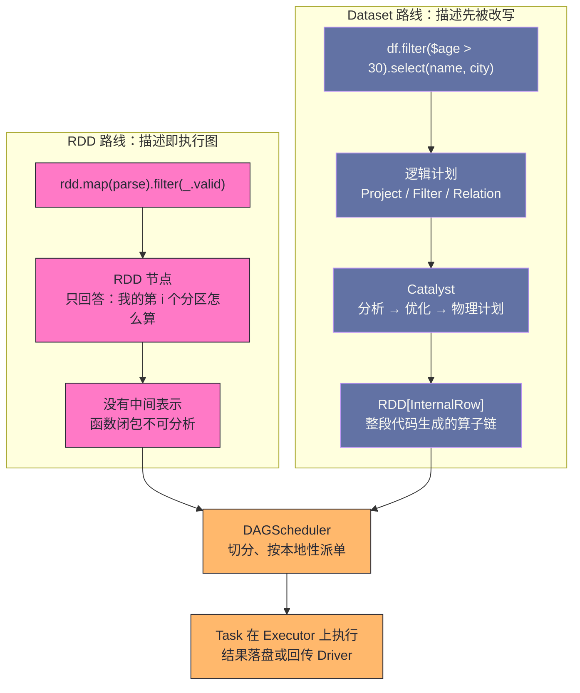
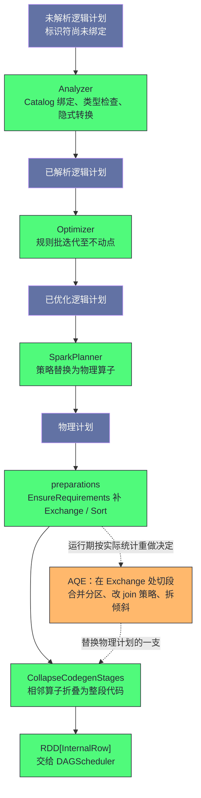
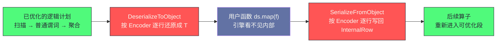
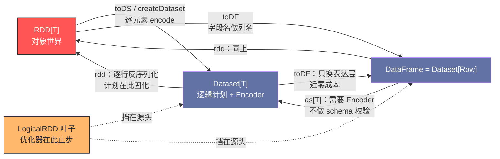
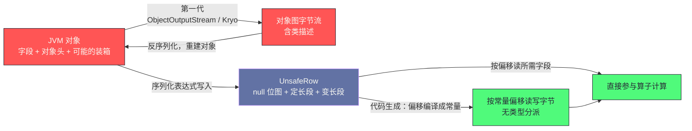
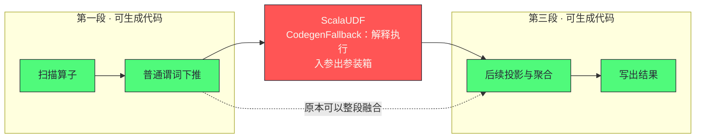

# 2. Spark 的灵魂：RDD 与 Dataset 的抽象对比

**摘要：**

同一份曝光日志，用 RDD 写是一个 `map` 接一个 `filter`，用 DataFrame 写是几行 `select` 与 `where`；前者把一段计算原样递给引擎，后者把一段可被读懂的描述递给引擎，两种写法跑出来的差距，根子不在 API 风格，而在"引擎到底看见了什么"。RDD 交出去的是函数与血缘，引擎只能照着执行；Dataset 交出去的是逻辑计划与 Encoder，引擎可以先改写再执行。本文不重复 RDD 的内部构造与算子清单，只沿这条线往前走：先看两种描述在引擎眼里分别长什么样；再说明优化器为什么只能站在结构化描述上，以及它在逻辑计划、物理计划、代码生成三个位置上各自动了什么手；随后把类型安全的账算清楚——强类型的代价是 Encoder 的编解码与内存布局，弱类型的代价是错误被推到运行期；`toDS`、`toDF`、`rdd` 三个转换各自往哪个方向走、收什么税；序列化路径的三代（Java 序列化、Tungsten 二进制、Encoder 生成）如何各占一段；最后解释 UDF 为什么是一道悬崖，并给出一张"该选哪个"的判据表。

**关键词（Keywords）**: RDD, Dataset, DataFrame, Catalyst, Encoder, Tungsten, WholeStageCodegen, LogicalRDD

文章口径为 Spark 4.3.0（4.x 预编译 Scala 2.13）；源码细节与配置默认值以对应版本文档或源码为准。

---

## 第 1 章 两种描述：函数与结构

### 1.1 递出去的是一段函数

写下 `rdd.map(parse).filter(_.valid)` 的时候，Driver 端发生的事少得出人意料：Spark 把 `parse` 与 `_.valid` 这两个函数对象分别包进一个新的 RDD 节点，记下"我这个节点是从哪个父节点来的"，然后就把控制权交回用户代码。数据一行都没有动，`parse` 一次都没有执行。惰性（Lazy Evaluation）常被解释成"延迟到 Action 才计算、省一次全量扫描"，这层解释没错，但它把惰性最要紧的作用说小了：**在 Action 触发之前，那张图还在被继续搭建，理论上还有被整体改写的机会**。

RDD 的麻烦在于，它有被改写的机会，却没有供改写的语言。节点里存的是 `Function1`、`Function2` 这样的函数值，它们的内核是一段只有 JVM 才认得的字节码；引擎能读到的元信息只有几样——有几个分区、父节点是谁、分区器是什么、数据偏好在哪些节点上。至于 `_.valid` 读的是第几个字段、会不会抛异常、是不是纯函数、能不能和上游交换顺序，全部无从得知。血缘（Lineage）在这里扮演了双面角色：容错靠它，因为函数还在，丢了的分区照着函数重算一遍就行；优化也被它挡住，同样因为函数还在，引擎不敢动这段计算的任何一步。

RDD 节点与血缘在源码层的组织方式属于 RDD 内部机制的范围（见 [[5. Spark_RDD内部机制深度解析]]），本文只把它当作抽象层面的事实引用。

这里值得把"RDD 图就是执行图"这句话说得更直白一些。一个 RDD 节点被问到"你的第 i 个分区怎么算"时，它能给出的唯一答案就是"调用我保存的这个函数，去消费父节点的第 j 个分区"。没有中间层，没有声明式算子的概念，也没有"先声明要做什么、再决定怎么做"的分工。用户写下的顺序就是执行的顺序，用户没做的决定（怎么分区、要不要缓存、用哪个聚合算子）就永远没有人做。

### 1.2 递出去的是一棵可读的树

换一种写法，`df.filter($"age" > 30).select("name", "city")`，Driver 端构建的东西性质完全不同：它不是一条函数链，而是一棵树，`Project(name, city)` 套在 `Filter(age > 30)` 外面，`Filter` 再套在一个表示数据源的关系节点上。树上的每个节点都是 `LogicalPlan` 的子类，节点里装的是表达式（Expression）：`AttributeReference` 表示"某一列"，`Literal` 表示常量，`GreaterThan` 表示比较，`And` 表示合取。这些对象可以被枚举、被比较、被替换，因为它们由引擎自己定义，而不是由用户的编译器生成。

这就是"结构化"三个字的技术含义：数据的形状（schema）被写进了计划，算子的语义被写成了表达式，两者都不是闭包。`AttributeReference` 上还挂着一个自增的 `exprId`，它让两张表里的同名列在计划里成为两个不同的对象——自连接之所以不会把 `a.id` 和 `b.id` 认错，靠的就是这个编号，而不是列名字符串。

Dataset 比 DataFrame 多带一件东西：编码器（Encoder）。它把 JVM 类型 `T` 与引擎内部的二进制行（`InternalRow`）之间的双向转换也写成了数据——一组序列化表达式加一组反序列化表达式，由代码生成编译成方法，而不是一段藏在反射里的隐式过程。于是 Dataset 的三个部件各管一件事：类型参数与编译期检查交给 Scala 编译器，逻辑计划交给优化器，Encoder 交给运行期。三者叠在一起，才构成"带结构描述"的完整意思。

### 1.3 差别不在写法，在能不能被改写

把两种描述并排看，容易得出的结论是"一个底层、一个高层"，或者"一个命令式、一个声明式"。这些说法都停在 API 风格上，解释不了性能差距的来源。真正的差别只有一句：**RDD 的图已经是可以直接执行的图，Dataset 的图是逻辑的图，两者之间隔着一道可以被反复穿越的门。**

有这道门，才谈得上"先改写再执行"：计划是一棵可以被遍历、被模式匹配、被替换子树的树，改写规则可以一条条写出来，改完还能比较两个计划哪个更省。没有这道门，任何"改写"都等于直接改执行语义，而执行语义是用户用闭包定义的，引擎无权替用户做主。

这条差别也能解释一批日常现象：为什么 RDD 需要用户自己 `persist`、自己 `repartition`、自己在 `reduceByKey` 与 `groupByKey` 之间做选择、自己估广播阈值？不是因为 Spark 懒，是因为在 RDD 这一层，这些决定所需要的信息（数据多大、键分布如何、哪一侧可以广播）根本不在引擎手上。**RDD 把性能责任留给了写代码的人，这是抽象层级的必然结果，不是设计缺陷。**

下图把两条路径并排放，可以看到它们在 DAGScheduler 之前分岔、又在 DAGScheduler 处汇合：无论走哪条路，最终都要变成 Task 交给调度器，差别只在"到达调度器之前，那张图有没有被人改过"。

图里左侧那条链路短得有点寒酸：从用户函数直接到调度器，中间没有任何环节。右侧那条多出来的三个方框，就是优化器全部的生存空间。

### 1.4 一个比喻：口述菜谱与点菜单

不妨把引擎想成后厨。RDD 递进去的是一段口述菜谱："把土豆削皮、切块、下锅、加盐、起锅"，厨师只能照着念，念到哪做到哪；他当然可以把工序安排得更顺（譬如同时烧水），但他没法把"加盐"提到"切块"之前，因为他不确定这两步在整段话里是不是有依赖。Dataset 递进去的是一张点菜单：一行行条目，每行写明菜名、份数、忌口。配菜员可以做很多口述菜谱做不到的事——把同锅的菜合并、把冷盘提前出、把三份相同的配料一次备齐，因为菜单上的东西是可以被归并、排序、重排的。

比喻要补一句技术限定：这里的厨师并不笨。DAGScheduler 会把菜谱切成段、会把任务派到数据所在的机器上、会在失败时只重做坏掉的那一段，这些都属于"调度级"的安排，RDD 一样享受得到。它做不了的只是"语义级"的改写——因为改写的对象（数据长什么样、算子到底在算什么）在这条路上从来没有被描述出来，没有描述，就没有可改的东西。

---

## 第 2 章 为什么需要第二套描述

### 2.1 通用性的红利与天花板

RDD 的抽象极其克制：任何能被表达成"分区上的迭代器变换"的计算，都可以写成 RDD。文本解析、图迭代、自定义采样、调用一个只认 JVM 对象的第三方库、按业务规则逐条打标，这些都能塞进去。它的容错方式也统一：不复制数据，只记录血缘，丢了就重算。这套抽象只有一条硬要求——你的计算得能被切到分区粒度上独立跑。

红利来自通用，天花板也来自通用。抽象越低，语义越少，能表达的东西越多，能被引擎理解的东西就越少。**优化需要语义，而 RDD 主动放弃了语义，把一切都压进了"函数"这个黑盒里。**于是所有"基于数据形状"的优化手段在 RDD 上都失了根基：列裁剪要有列，谓词下推要有列，连接重排要有表大小与等值键，代码生成要有算子的输入输出类型。这几样，RDD 一样都不提供。

更隐蔽的一层是执行契约。RDD 承诺"按你写的顺序、按分区执行"，用户函数可以带副作用（写外部存储、更新累加器、调远程接口）。这个承诺是 RDD 可预测性的来源，也是它不可重排的根源：一旦允许引擎自由交换两步的顺序，副作用的发生顺序就变了，语义随之改变。引擎没有能力判断哪个函数是纯的，于是只能假设全都不纯。

### 2.2 优化器需要一张能读的中间表示

剥掉实现细节，一个基于规则的优化器只做三件事：读计划、按规则改计划、比较两个计划哪个更省。这三件事的前提是同一个——计划必须是数据结构。规则本质上是树变换：匹配一个子树，替换成另一个子树，`PushDownPredicates`、`ColumnPruning`、`CollapseProject` 都是这个形状；代价模型则要读节点上的统计信息，譬如表有多少行、每行多少字节。函数闭包在这三步里都无处落脚：它不能被模式匹配，不能被替换，也没有统计信息可言。

所以第二套描述的出现，动机不是"让 API 更好看"，而是"让优化器有东西可读"。Schema 是入场券：有了列名与类型，才有列裁剪；有了列与函数的绑定，才有谓词下推；有了表和键，才有连接策略；有了类型的二进制表示，才有 Tungsten 那一整套内存布局。这四件事一环扣一环，缺了 schema 这一环，后面全是空谈。

这也能解释一个常被当成语法糖的现象：`toDS` 为什么一定要一个隐式的 `Encoder[T]` 才能编译通过？因为从强类型的对象世界到列式的二进制世界之间必须有一座桥，而这座桥不能靠猜。没有 Encoder，引擎不知道 `case class Person(name: String, age: Int)` 该摊成几列、每列什么类型、变长字段怎么放，它连"这行数据长什么样"都答不上来，谈何优化。

### 2.3 不这样会怎样：三笔可以算清的账

反事实推演最能说明问题。假设始终只有 RDD 这一套描述，下面三件事就没有任何办法做，而它们的代价都能落到具体的字节上。

第一笔是列裁剪。一张两百列的宽表，查询只用到三列。Parquet 这类列式存储本来可以只读那三列的数据页，其余一百九十七列连磁盘都不用碰；但 `sc.textFile` 或 `sc.sequenceFile` 读进来的是整行，两百列全部解析、全部实例化成对象、全部进堆。省下来的不是几毫秒，是百倍量级的 I/O 与内存分配。

第二笔是谓词下推。过滤条件只能留在内存里执行，意味着不满足条件的行也已经被读出来、反序列化、构造完对象，然后才被 `filter` 丢掉。选择率越低，浪费越大——一个只留千分之一行的过滤，等于白白搬运了一千倍的数据。

第三笔是代价估算。join 两边谁大谁小不知道，`spark.sql.autoBroadcastJoinThreshold` 这样的阈值判断无从谈起，只能按固定策略一条道走到黑。调度层当然还能优化（本地性、分区数、推测执行），但语义层的所有门都关着。

### 2.4 一张可分析性对照表

把两种描述在"引擎能看到什么"这个维度上逐项摊开，差距比想象中大：

| 维度 | RDD | Dataset / DataFrame |
|---|---|---|
| 节点是什么 | 函数闭包 + 父节点引用 | 逻辑算子节点 + 表达式树 |
| 数据形状 | 不描述，类型参数只给编译器看 | Schema 显式描述，列名与类型齐全 |
| 用户逻辑的形态 | `Function1` 字节码，不可分析 | 表达式或已注册函数，可枚举可替换 |
| 优化器可见性 | 不可见 | 可读、可改写、可比较 |
| 可改写的层次 | 只有调度层（切分、派单、重试） | 语义层（下推、裁剪、重排、生成代码） |
| 出错时机 | 编译期查函数签名，运行期查数据 | 分析期查列与类型，运行期查具体值 |
| 优化责任归属 | 写代码的人 | 引擎 + 统计信息 |

表里最容易被忽略的是最后一行。它说的不是"谁更先进"，而是"责任被放在了哪里"：RDD 把优化责任前移给开发者，换来的是完全的控制力与任意表达的余地；Dataset 把责任收归引擎，换来的是声明式写法与更好的默认性能，代价是必须在引擎能理解的范围内表达。

---

## 第 3 章 Catalyst 站在哪里

### 3.1 四段流水线

`QueryExecution` 里的几个惰性成员，就是这条流水线的四个站点。第一站是分析（Analyzer）：它拿着 Catalog 把计划里的标识符绑定成 `AttributeReference`，做类型检查、插入隐式转换、解析函数名，`AnalysisException` 通常在这一站抛出——列名写错、表不存在、类型对不上，都是这里发现。第二站是优化（Optimizer）：一批规则反复迭代到不动点，输出"已优化的逻辑计划"。第三站是物理计划（SparkPlanner）：一组策略把逻辑算子替换成具体的物理算子实现。第四站是准备（preparations）：`EnsureRequirements` 检查每个算子的分区与排序要求，不满足就插入 `Exchange` 与 `Sort`。

这条流水线与 RDD 时代"逻辑处理流程 → 物理执行计划"的两段式安排可以对照着看，差别正在于中间多出了可反复穿越的优化层（见 [[3. Spark逻辑处理流程详解]] 与 [[4. Spark物理执行计划]]）。四站的产物都是树，都可以用 `explain` 打印出来看，这本身就是一种设计态度：**优化过程是可观察、可复现、可逐段比对的，而不是黑箱里的一次性魔法。**对一个线上问题来说，"这段查询走到了哪一站、被哪条规则改成了什么样"是比任何性能数字都更有用的信息。

分析这一站值得多看两眼，因为它做的事情比"改名"复杂。Catalog 提供的是表、列、函数与视图的元数据，绑定过程要处理同名遮蔽、隐式类型转换、UDF 签名匹配，以及 `exprId` 的分配；一次自连接里 `a.id` 与 `b.id` 之所以不会串味，靠的就是两个不同的 `exprId`，而不是两段同名的字符串。这一步失败会抛 `AnalysisException`，它属于"代码或元数据写错了"，与"数据本身有问题"是两回事——把这两类错误分开，是排查线上查询问题的第一步。

优化这一站是规则批的迭代。批次（Batch）由若干条规则组成，一批跑完如果计划还有变化就再跑一遍，直到不动点或者触到 `spark.sql.optimizer.maxIterations`（默认 100）的上限。规则之间会互相影响：`CollapseProject` 先把两层投影压成一层，`PushDownPredicates` 才有机会把它继续往扫描层推；顺序反过来，下推就少走一步。这也解释了一个日常现象：同一条 SQL 换一种写法（多一层子查询、少一次别名），计划可能被改写成两个不同的形状，性能跟着不同。

下图把四个站点和一次运行期回环画在一起。注意最下面那条虚线：自适应执行（Adaptive Query Execution，AQE）不是第五站，它是把第三、四站的一部分决定推迟到运行期重做一遍。

### 3.2 优化器到底改写了什么

规则的名字听起来抽象，落到具体查询上却都很实在。谓词下推（`PushDownPredicates`）把过滤条件往数据源方向搬，越过投影、越过内连接，一直搬到扫描节点，让数据源在读取时就跳过不相关的分区与行组。但它有边界：外连接的下推会改变语义，所以 `PushPredicateThroughJoin` 只对 inner join 无条件下推，对 left/right join 要判断谓词引用的是哪一侧的列。列裁剪（`ColumnPruning`）从投影与聚合节点反推出"真正被引用的属性集合"，把扫描节点的输出缩到最小——这一步与谓词下推是乘法关系，两者叠加才把"读两百列、留千分之一行"变成"读三列、留千分之一行"。

常量折叠与条件化简（`ConstantFolding`、`SimplifyConds`）把 `1 + 2` 算成 `3`、把 `a AND false` 直接判成 `false`，看起来只是省了几次求值，实际影响的是后续规则能不能继续匹配——一个被判成恒假的分支被剪掉之后，整个子树都可能消失。投影合并（`CollapseProject`）把相邻两层投影压成一层，避免"算出来又丢掉"的中间列。

连接策略的选择是另一个量级的决定。`JoinSelection` 依据等值键与统计信息，在 BroadcastHashJoin、SortMergeJoin、ShuffledHashJoin 之间挑：小表能塞进广播阈值（`spark.sql.autoBroadcastJoinThreshold`，默认 10MB）就走广播，把一次 Shuffle 换成每个 Executor 本地的一份哈希表；塞不进去就走排序合并。这个决定的对错，直接决定作业是跑十分钟还是跑一小时。

聚合也会被拆。一条 `GROUP BY` 在物理计划里通常变成两阶段：map 端先做部分聚合（partial），把同键的局部结果压小，再走 Shuffle 做最终聚合（final）。这一拆的前提是聚合函数可分解，而"可分解"这件事只有表达式能告诉引擎——闭包不会。

最后是运行期的 AQE。它在 `Exchange` 处把查询切成段，等上游跑完、拿到实际的 `MapOutputStatistics` 之后，再决定下游怎么切：合并小分区（把大量几 KB 的小块压成少数正常大小的分区）、把排序合并连接换成广播连接（上游实际很小的时候）、把倾斜的分区拆开。这一整层只在 DataFrame/Dataset 上存在，因为它需要"计划的形状"作为操作对象。

可以用一句话概括这一整节：**优化器改写的不是代码，是计划的形状；它每改一次，目的都是让同样多的结果由更少的数据搬运出来。**

把这一节提到的改写按"作用对象"重新排一遍，能看出它们其实分布在计划的不同层：

| 改写 | 作用对象 | 省掉的是什么 | 失效条件 |
|---|---|---|---|
| 谓词下推 | 扫描节点之前的过滤链 | 读入不满足条件的行 | 谓词含 UDF、外连接方向不允许、数据源不支持 |
| 列裁剪 | 投影与聚合下方的属性集合 | 读入并解析整行宽表 | 投影含 `*`、UDF 需要全部输入列 |
| 常量折叠与条件化简 | 常量表达式与恒真恒假分支 | 无意义的分支与求值 | 表达式含不确定性函数 |
| 投影合并 | 相邻两层投影 | 中间列的物化 | 中间层带类型转换或不可合并的表达式 |
| 连接策略选择 | `Join` 两侧 | 一次 Shuffle 或一次全量扫描 | 统计信息缺失、连接条件不是等值 |
| 两阶段聚合 | `Aggregate` | 参与 Shuffle 的数据量 | 聚合函数不可分解 |
| 运行期分区合并 | `Exchange` 之后 | 大量小分区的调度开销 | 未开启 AQE |

前两行是"少读"，中间四行是"少算、少搬"，最后一行是"少调度"。优化器的全部收益都可以归到这三类里；一条改写如果说不清自己属于哪一类，多半也省不下什么。

### 3.3 物理计划与整段代码生成

逻辑算子换成物理算子之后，还有一道容易被忽略的工序：代码生成。`CollapseCodegenStages` 这条规则会把相邻的、可以生成代码的算子折叠成一个 `WholeStageCodegenExec`，然后为这一段生成一个 Java 方法：上游算子的输出直接作为下游算子的局部变量，中间不物化成行对象，也不经过虚方法分派。整条链被 Janino 编译成一个 class，加载进 JVM 执行。

这道工序的收益主要来自两处：一是省掉了算子之间的对象分配与函数调用，二是让 JVM 的 JIT 有机会把整段循环优化掉。代价是一次性的编译开销，所以有 `spark.sql.codegen.hugeMethodLimit` 这样的阈值——方法体太大就不生成，退化成逐算子解释执行。这个阈值的存在提醒我们：代码生成不是免费的午餐，它是在"编译成本"与"执行收益"之间做的一次折算。

更要紧的是 codegen 的**边界**。遇到不能生成代码的节点，`CollapseCodegenStages` 会在它两侧断开，一段查询被切成多段 `WholeStageCodegen`，段与段之间要把中间结果物化成 `UnsafeRow`。哪些节点会断开？典型的答案是：用户自定义函数。这一条留到第 7 章展开。

### 3.4 RDD 上为什么无从下手

现在可以正面回答"优化器为什么改不动 RDD"了。理由有三条，层层递进。

第一条是没有逻辑层。RDD 图本身就是执行图，改它就是改语义。Catalyst 能工作的前提是"逻辑"与"物理"分离——逻辑层说"要什么"，物理层说"怎么算"，两者之间可以反复商量；RDD 没有这个分离，它一出生就是"怎么算"。

第二条是节点不可读。闭包里没有字段引用、没有类型信息、没有可枚举的子表达式。规则要匹配一个 `GreaterThan(AttributeReference(age), Literal(30))`，可 RDD 里只有 `x => x.age > 30` 这个函数值。就算用字节码分析硬读，读出来的也是 JVM 指令，不是引擎能操作的表达式树。

第三条是数据不可寻址。RDD 的元素是 JVM 对象，对象里没有"第 k 列的偏移量"这个概念，列裁剪无从下手；对象之间也不共享内存布局，无法把一批行放进一段连续字节里按偏移读。Tungsten 那一整套东西，前提是"行是可寻址的字节"，而 RDD 主动放弃了这一点。

不妨做个反事实推演。假设非要在 RDD 上做谓词下推，把 `map(f).filter(g)` 改写成 `filter(g∘f).map(f)`。这需要两个前提：`f` 是纯函数（重算不会产生副作用），`g` 只依赖 `f` 的输出（不读外部状态）。两个前提引擎都无法验证，于是只能保守不动。**这不是"还没实现"，是"信息不足以下判断"**——两者在工程上的处理方式完全不同：前者等着升级版本，后者只能换一种描述。

调度层怎么把这张图切成 Stage、按分区派单，是另一条线索的题目（见 [[5. Spark_DAGScheduler_Stage划分]]），这里只把它当作既成事实引用。

还有一条岔路值得说清：如果让用户显式声明纯度、schema、统计信息，那得到的就是 Dataset。这个视角把 RDD 与 Dataset 的关系讲明白了——它们是同一件事的两种描述精度，不是新旧两代产品的替代关系。同一份数据，你需要多少语义，就交出多少描述；交得越多，引擎能替你做的事越多，你能表达的东西越少。

顺带澄清一个常见误解：RDD 上并非完全没有优化。调度层有数据本地性、有 Stage 切分、有分区级重试，这些都实打实地省时间。缺的是语义层改写，两个层次不要混为一谈——把"RDD 没有 Catalyst"说成"RDD 没有优化"，会让人在排查性能问题时找错方向。

---

## 第 4 章 类型的两种代价

### 4.1 强类型强在哪，不强在哪

Dataset 的卖点是编译期类型检查，`ds.map(_.age)` 里字段名拼错，编译直接不过。这一点确实值钱，尤其是领域模型复杂、分支多、重构频繁的代码。但它的覆盖范围比宣传语暗示的要窄，有三处是类型系统管不到的。

第一处是 `Column`。`df("age")` 或 `$"age"` 返回的是一个表达式对象，列名是字符串，写错了编译器一无所知，要等到分析期才抛 `AnalysisException`。第二处是 `Row.getAs[T]`，类型参数只是强转的语法包装，取错类型在运行期抛 `ClassCastException`。第三处最隐蔽：`df.as[T]` 不做 schema 校验。把一张 `(name, age)` 的表 `as[Person(name, salary)]`，编译通过、分析通过，直到反序列化那一刻才因为字段错位或类型不符炸掉。

所以"强类型"的准确说法是：**它只在用 lambda 的地方强，一旦回到 `Column` 或 `Row`，类型系统就提前退场。**而尴尬之处在于，恰恰是 lambda 那些算子，优化器看不见；`Column` 那些算子，优化器看得见。类型安全的边界与优化器可见的边界，几乎正好相反——这不是巧合，是同一个原因的两面：编译器能检查的东西，必然是编译期已知的东西；优化器能改写的东西，必然是运行期可描述的东西。

### 4.2 Encoder 的账：编解码与内存布局

强类型不是免费的，账单开在 Encoder 上。第一笔是编解码：进出对象世界的每一行都要过一遍序列化与反序列化。`ds.map(f)` 的物理计划里会出现一对节点——`DeserializeToObject` 把 `InternalRow` 按 encoder 的反序列化表达式逐字段还原成 `T`，用户函数 `f` 在对象世界里跑，`SerializeFromObject` 再把结果按序列化表达式逐字段写回 `InternalRow`。这两步都是逐行、逐字段的，行数越多越贵。

第二笔是内存布局。Encoder 的产物不是 JVM 对象，是一段有结构的字节（`UnsafeRow`）：一段 null 位图、一段定长字段区（每个字段占一个 8 字节槽位）、一段变长字段区（用偏移加长度描述）。好处是紧凑、可寻址、GC 压力小；代价是变长字段（字符串、数组、嵌套结构）必须拷贝，而且调试时看到的是字节而不是对象，出错时的堆栈信息可读性差。

第三笔最贵，也最容易被忽略：**计划被切断**。用户函数夹在两段可优化代码之间，优化器只能分别优化两头，中间那一段是黑盒。这一笔不是常数因子，是结构性的——它让"整段代码生成"退化成"生成、解释、再生成"，第 7 章会专门算这笔账。

下图把这段结构画出来。三段之间那两个节点不是可选的装饰，是强类型必须付的过路费。

### 4.3 弱类型的账：错误被推迟

DataFrame 的代价换来换去只有一件：错误发生的时间点被推后了。列名写错，推迟到分析期；`getAs` 取错类型，推迟到运行期；上游表结构改了而下游代码的假设没改，可能根本不报错，静默算出 null 或者错位的数据。

最贵的一类恰恰不是崩溃，是静默。崩溃至少有堆栈，静默只会让下游报表出现一批看起来合理、实际错误的数字，排查成本高出一个数量级。`Row` 的下标访问越界、`getAs` 遇到 null 时的行为（不同基础类型有不同默认）、`as[T]` 里字段顺序错位，都属于这一类。

但换来的是另一件东西：`Column` 全程留在计划里，优化器看得见、能下推、能裁剪、能生成代码。所以弱类型的账本可以写成一句话：**它把检查从编译期挪到了运行期，作为交换，把优化从运行期挪到了编译期。**两笔账方向相反，谁更划算取决于这段代码跑多少次、改多少次。

### 4.4 两边都是买保险

把两条路线的代价并排放，能看清它们其实是两种不同的保险：

| 维度 | Dataset（强类型） | DataFrame（弱类型） |
|---|---|---|
| 编译期检查 | 覆盖 lambda 内部 | 不覆盖，列名与类型全靠字符串 |
| 类型退场的地方 | 一旦用 `Column` 或 `Row` 即失效 | 从不生效 |
| 错误暴露时机 | 编译期（lambda）/ 运行期（反序列化） | 分析期（列名）/ 运行期（取值） |
| 优化器可见范围 | 被 typed lambda 切成三段 | 全程可见 |
| 主要额外开销 | Encoder 编解码 + 计划断点 | 无额外机器开销，有维护期风险 |
| 适合的代码 | 领域模型重、分支多、需要重构安全 | 分析型查询、宽表、聚合与连接 |
| 不适合的代码 | 热路径上的逐行 typed 算子 | 需要编译期契约的核心业务逻辑 |

这张表要读出两个结论。其一，"强类型更好"与"弱类型更快"都是对的，但它们说的不是同一件事，不能拿来做二选一。其二，存在一条中间路线：用 Dataset 的类型承载领域模型，把热路径写成 `Column` 表达式，只在真正需要对象语义的地方用 typed 算子。简单说就是**类型用于边界，表达式用于热路径**——入口把数据读成 `Dataset[Order]`，中间用 `$"amount" > 100` 这种表达式做聚合与连接，出口再决定要不要变回对象。

---

## 第 5 章 三个转换与一道边界税

### 5.1 进结构化世界：toDS 与 toDF

从 RDD 到 Dataset 有两条常用通道。`rdd.toDS()` 依赖一个隐式的 `Encoder[T]`（`import spark.implicits._` 会为 product 类型与基础类型提供），它做的事情有两步：把原 RDD 包成一个 `LogicalRDD` 叶子节点，并对每个元素施加 encoder 的序列化，得到一个 `RDD[InternalRow]`。`rdd.toDF()` 走的是同一条路，区别只在列名——对元组是 `_1`、`_2`，对 case class 是反射出来的字段名，也可以用 `toDF("a", "b")` 显式改名。

顺带把 `createDataFrame` 的几条入口分清楚，它们的计划形状并不相同。用 `RDD[Row]` 加显式 schema 构造，会生成 `LogicalRDD`；用 `RDD[case class]` 构造，先按 Encoder 把对象序列化成 `InternalRow`，再同样落到 `LogicalRDD`；而从 Driver 本地集合 `Seq[T]` 构造，走的是 `LocalRelation`——数据就在内存里、行数已知，统计信息是准的，本地聚合与常量下推都能正常发挥作用。同样是"把一批对象变成表"，一个在本地、一个在分布式侧，优化器对它们的信任程度完全不同。这也是"小表用 `Seq` 造、大表别用 `Seq` 造"背后真实的原因：不是内存问题，是计划形态问题。

这里有个反直觉的地方，值得单独强调：**RDD 转 DataFrame 拿到的不是"优化红利"，而是"把优化器挡在 RDD 外面"。**`LogicalRDD` 是计划树上的一个叶子，Catalyst 走到它就停：它没有实现 `PrunedFilteredScan` 之类的接口，谓词推不进去，列也裁不动；它的统计信息只有一个按"列数乘默认大小"估出来的 `sizeInBytes`，连接策略因此失去依据。换一种说法，转换之后你得到了声明式的写法和一张能进 Catalyst 的计划，但计划的源头仍然是一个不可下推的黑盒。

这条性质决定了一个实践上的判断：如果数据本来就在 Parquet、ORC、JDBC 这类支持下推的源上，直接从源读成 DataFrame，别先 `textFile` 再 `toDF`；后者等于主动放弃了源端下推，把一次本可以在 I/O 层完成的裁剪，变成了一次全量读入加内存过滤。

### 5.2 出结构化世界：rdd

反方向的 `ds.rdd`（以及 `df.rdd`）做两件事：先把逻辑计划执行成一个 `RDD[InternalRow]`，再逐行用 encoder 的反序列化把 `InternalRow` 还原成 `T`。对 `Row` 来说，这一步可能是对底层二进制行的一层视图；对 case class 来说，则是逐字段构造对象。具体形态随版本与类型而异，以对应版本源码为准。

它收两笔税。第一笔是逐行反序列化，行数越多越贵，而且构造出来的对象立刻成为 GC 的负担。第二笔更结构性：**计划在 `toRdd` 那一刻就固化了**。此后再接的 RDD 算子不在 Catalyst 管辖范围之内，AQE 也看不见它们；原本可能被优化掉的一段计算，从此只能按用户写的样子执行。所以 `.rdd` 不是一次简单的类型转换，它是一道单向门——从"有优化器"的一侧走到"没有优化器"的一侧。

如果还要从 RDD 侧再转回 DataFrame，那就要再逐行 encode 一次。往返一次，两次编解码加一个优化断点，这就是边界税的全额。

### 5.3 三个转换的方向与税费

把四个方向（`toDS`、`toDF`、`as`、`rdd`）摊成一张表，方向与代价一目了然：

| 转换 | 方向 | 前提 | 对计划的影响 | 主要开销 |
|---|---|---|---|---|
| `rdd.toDS` / `createDataset` | 对象 → 结构化 | 需要 `Encoder[T]` | 生成 `LogicalRDD` 叶子，优化器在此止步 | 逐元素序列化；源端下推全部失效 |
| `rdd.toDF` | 对象/元组 → 列 | 隐式 product encoder | 同 `toDS` | 同上，另加反射推导列名的一次性成本 |
| `ds.toDF` | 强类型 → 弱类型 | 无 | 无，同一份计划只换表达层 | 近零，只是把 `T` 擦成 `Row` |
| `df.as[T]` | 弱类型 → 强类型 | 需要 `Encoder[T]` | 无，但**不做 schema 校验** | 近零，风险在运行期反序列化 |
| `ds.rdd` / `df.rdd` | 结构化 → 对象 | 已有 Encoder | **计划在此固化**，后续算子脱离 Catalyst | 逐行反序列化；再转回要再 encode |

表里最容易被低估的是后两行的关系：`as[T]` 与 `toDF` 是"换表达层"，成本近零但不带来任何优化；`toDS` 与 `rdd` 是"跨世界"，成本肉眼可见，而且都会在计划上留下痕迹——一个把优化器挡在源头外，一个把优化器留在身后。

下图把四个方向画在一起，那个用虚线连到两侧的节点，就是这道门本身。

### 5.4 一条经验规则

转换本身没有错，错的是让它反复发生。可行的原则是**让边界只被穿越一次**：入口从支持下推的数据源直接读成 DataFrame，拿到列裁剪与谓词下推；中间全部用表达式做过滤、聚合、连接，让 codegen 与 AQE 有活干；真有一段引擎看不懂的算法（自定义状态机、外部服务调用、图迭代），在出口处 `rdd` 出去做完，然后接受"这一段没有优化器"这件事，不要再 `toDF` 回来继续写声明式查询。

反过来那些"RDD 与 DataFrame 混着写、来回转换"的作业，性能差不多总是最差的一档：既没享受到源端下推，又在每个边界上付了两次编解码，还把计划切成了几段互不相识的碎片。

---

## 第 6 章 序列化的三代

### 6.1 第一代：Java 序列化，把对象图连同类名写出去

最早的做法毫无悬念：用 `ObjectOutputStream` 把对象图整个写出去，读回来时用 `ObjectInputStream` 加反射重建。Spark 至今仍在两个位置默认使用它——`spark.serializer` 的默认值是 `JavaSerializer`，闭包序列化 `spark.closureSerializer` 的默认值也是它。

它有三个绕不开的成本。第一是类描述：流里要带类名与字段名（虽然有引用缓存，但首次仍要写），读回时要查 `ObjectStreamClass`，反序列化的开销与类的复杂度正相关。第二是对象头与装箱：一个 `int` 一旦被装箱成 `Integer`，光对象头就要占掉十几个字节，为了存 4 个字节的数值付出三四倍的代价。第三是 GC：反序列化出来的全是一批短命对象，堆越大、GC 越频繁。

Kryo 算这一代的改良版，靠注册表省掉类名、字段编码更紧凑，但本质没变——仍要构造对象，仍不能随机访问字段，只是把常数因子压低了一些。

这里有个常被忽略的推论：**你写的每一个 lambda 都是靠 Java 序列化被搬到 Executor 上的。**闭包捕获了什么，就要序列化什么；捕获了一个大字典或者一个不可序列化的连接，任务提交阶段就会卡住或者直接失败。这类问题跟数据量无关，只跟闭包的大小有关，所以它经常出现在"作业还没开始跑就报错"的场景里。

### 6.2 第二代：Tungsten 二进制，把行变成一段可寻址的字节

2015 年提出的 Tungsten 项目，目标是把 Spark 从"JVM 对象加虚方法"往"显式内存管理加生成代码"的方向推。落在数据表示上，就是 `UnsafeRow` 这套布局：开头一段 null 位图，接着一段定长字段区（每个字段占一个 8 字节槽位），最后一段变长字段区（用偏移与长度描述）。

这个布局带来三个后果。第一，字段可以按偏移直接读写，不需要先把整行反序列化成对象——列裁剪因此在二进制层有了落点：只读需要的那几个偏移，其余字段连碰都不用碰。第二，对象数量从"每行一个对象"降到"每批一段字节"，GC 要扫描的东西少了一个数量级。第三，它可以放在堆外，用 `MemoryBlock` 直接寻址，不受 JVM 堆大小和 GC 扫描的约束（`spark.memory.offHeap.enabled` 打开后走这条路）。

代价同样明确：变长字段（字符串、数组、嵌套结构）必须拷贝；类型必须落在 Encoder 支持的范围内，任意 JVM 对象塞不进去；调试时看到的是字节，出错信息的可读性下降。这是一次用"可读性"换"可寻址性"的交易，方向与第一代刚好相反。

### 6.3 第三代：Encoder 生成，把转换本身编译掉

第三代不再纠结"用什么格式序列化"，而是把"序列化这件事本身"编译成代码。`ExpressionEncoder[T]` 持有一组序列化表达式与一组反序列化表达式，代码生成阶段把它们编译成 Java 方法：把 `T` 的字段按编译期常量偏移直接写进 `UnsafeRow` 的字节数组，反向亦然。

相比第二代，它省掉的是通用行的类型分派——不需要查 schema、不需要按类型 switch，偏移是常量，类型在编译期就确定了。与整段代码生成合流之后，一条算子链可以做到"上游产出的字节直接成为下游的输入"，中间不物化、不装箱、不虚调用。

三代的差别可以用一句话概括：**第一代在对象层工作，第二代在字节层工作，第三代把"层与层之间的转换"编译掉。**它们的目标一致——让同一份数据在流水线上少被搬运几次。

### 6.4 三代不是替代关系

容易产生的误解是"有了第三代，前两代就淘汰了"。事实相反，三代至今同时在场，各自守着不同的位置：

| 维度 | 第一代 · Java / Kryo | 第二代 · Tungsten 二进制 | 第三代 · Encoder 生成 |
|---|---|---|---|
| 表示单位 | JVM 对象图 | `UnsafeRow` 字节段 | 编译期生成的方法 |
| 是否可随机访问字段 | 不能，读回即全量 | 能，按偏移寻址 | 能，偏移是编译期常量 |
| 类描述开销 | 有，靠流内引用或注册表 | 无 | 无 |
| 典型位置 | 闭包、`collect`、`df.rdd` | 算子间传递、缓存、Shuffle | 结构化数据的进出边界 |
| 主要代价 | 对象头、装箱、GC | 变长字段拷贝 | 编译开销、类型受限 |
| 仍然必要的原因 | 任意 JVM 对象只能这么搬 | 统一的行表示是算子间契约 | 把转换成本压到接近零 |

把这张表和第 5 章接起来看，会发现一件有意思的事：**每一处"引擎看不见"的边界，都是第一代重新登场的地方。**`collect` 把结果搬回 Driver、`df.rdd` 把行还原成对象、UDF 接收参数并返回结果、闭包从 Driver 飞到 Executor——这些位置都没有办法用编码器生成代码，只能回到最朴素的序列化。下图的箭头方向就是这个意思：越往右越"可寻址"，越往左越"可表达"。

---

## 第 7 章 UDF 为什么是悬崖

### 7.1 从表达式退化成函数调用

`udf((s: String) => s.trim)` 注册之后，在计划里是一个 `ScalaUDF` 表达式节点。它比 RDD 里的闭包多知道一点点东西——输入几列、输出什么类型、是否确定性——但它的内部仍然是一个 `Function1`。优化器能看见这个节点，看不见节点里的内容。

这一点点信息，决定了它"能被塞进计划"，而"不能被改写"。它能被塞进计划，是因为分析器知道它的输入输出类型，可以给它分配位置；它不能被改写，是因为没有任何规则能穿透 `Function1` 去判断"这个函数对 `col` 是不是单调的"、"它和另一条谓词能不能交换顺序"。

### 7.2 断掉的四件事

UDF 的代价不是"调用一次很慢"，而是它把四件事一起打断了。

第一件是谓词下推。`WHERE my_udf(col) = 1` 这个合取项下推不了，因为数据源不认识这个函数。但要说得准确一点：`PushDownPredicates` 会按合取式把谓词拆开，同一个 `AND` 里的普通条件仍然可以下推，只有 UDF 那一个合取项被留下。所以"UDF 让下推全断"是误判，"UDF 让下推断一条"才是准确的——这个区别在混合谓词的查询里很实际。

第二件是列裁剪。UDF 的输入列必须全部物化，如果整个投影都是 UDF，`ColumnPruning` 基本无事可做，宽表读进来的列一列都省不掉。

第三件是代码生成的融合。`ScalaUDF` 通常以 `CodegenFallback` 的方式退化为解释执行（具体以对应版本源码为准），`CollapseCodegenStages` 会在它两侧断开，一段查询被切成"生成 → 解释 → 生成"三段，段之间要把中间结果物化成 `UnsafeRow`；参数与返回值还要从二进制行里拆出来装箱。第 6 章那张表里"第一代重新登场"的位置，这里就有一处。

第四件最贵：连接策略。把 join key 包进 UDF，`ExtractEquiJoinKeys` 就认不出这是一个等值条件，`JoinSelection` 只能退到嵌套循环连接甚至笛卡尔积。这一刀从 `O(n log n)` 掉到 `O(n×m)`，代价与前面三件事不在一个量级上。

把受损的能力按代价量级排一下，顺序会很清楚：

| 被断掉的能力 | 计划上的表现 | 代价量级 | 是否可局部挽回 |
|---|---|---|---|
| 常量折叠 | 字面量输入仍可折叠，其余求值退化为解释 | 可忽略 | 是，尽量让入参为常量 |
| 列裁剪 | UDF 的输入列全部物化 | 常数倍，随宽表列数放大 | 部分，先投影出必要列再调用 |
| 谓词下推 | 该合取项留在扫描之后执行 | 常数倍，随选择率放大 | 部分，把它拆成可下推的等值条件 |
| 代码生成融合 | 整段被切成多段 `WholeStageCodegen` | 一个数量级以内 | 否，只能减少 UDF 的数量 |
| 等值连接识别 | 连接策略退化为嵌套循环或笛卡尔积 | 数量级跃迁，随两侧行数乘积放大 | 否，必须换掉连接键上的 UDF |

这张表解释了一个反复出现的现场：一段查询加了三个 UDF，两个在投影里、一个在连接条件上，性能掉了两个数量级，而三个 UDF 自身的执行时间加起来不到总耗时的百分之一。按"UDF 跑得快不快"去解释这个现象，永远解释不通。

### 7.3 为什么是悬崖不是斜坡

如果 UDF 只是"每行多花几微秒"，那它就该是一条可以靠加资源摊平的斜坡。事实不是，因为它挡掉的东西是阶跃式的：策略变了、下推没了、代码生成断了，这些都是"有无"的问题，不是"多少"的问题。

判断一次 UDF 的真实代价，要看它落在计划的哪个位置。落在投影里的 UDF 影响有限，无非是那一列的计算方式退化成解释执行；落在谓词里的 UDF 会影响选择率估计与下推，还可能让过滤发生在扫描之后；落在连接条件里的 UDF 直接改变物理策略，属于最坏的一档。

这解释了一个常见的困惑：同一段 UDF，有人说"几乎无感"，有人说"加了之后慢一倍"，两边都没说谎——UDF 自身的执行时间可能微不足道，被它挡掉的那部分优化才是大头。**判断标准不是 UDF 快不快，而是它站在哪儿。**

### 7.4 typed 算子就是引擎内的 UDF

现在可以把第 4 章埋的那条线索收回来了。`ds.map(f)` 的物理计划里有 `DeserializeToObject`、用户函数 `f`、`SerializeFromObject` 三个部分，这与 `udf` 的结构是同一个：一段黑盒，夹在两段可优化代码之间。

区别只有两个：typed 算子不跨进程、不需要注册成表达式。但它同样断掉代码生成的融合，同样要求输入列全部物化，同样让优化器在两侧各干各的。由此可以推出一个有点刺人的结论：**一个到处使用 `ds.map` 的流水线，本质上是一串 UDF 拼起来的 RDD 风格作业，只是外面套了一层 Dataset 的皮。**它的类型安全是真的，它的执行效率未必比 RDD 高——两条路都要为"引擎看不懂这段代码"付同样的钱。

这也把"Dataset 一定比 DataFrame 快"这个说法证伪了。Dataset 换来的是编译期检查，不是执行速度；在纯 typed 算子的流水线上，它往往比等价的 DataFrame 写法更慢，慢出来的那部分正是第 4 章算过的编解码与计划断点。

下图把一段查询被 UDF 切断的样子画出来。三段之间的两处切口，每一处都要物化一次中间结果。

### 7.5 替代路径

既然悬崖的位置由"计划里的位置"决定，绕开它的办法也就清楚了。首选内置函数：`functions` 里的 `when`、`regexp_extract`、`from_json`、`array_sort` 都是表达式，能被优化、能参与代码生成。需要复用一段逻辑时，先试着用表达式组合出来，实在组合不出再退到 UDF。

如果必须用 Python 生态，`pandas_udf` 用 Arrow 按批传输而不是按行序列化，跨进程开销被摊薄；`mapInPandas` 与 `applyInPandas` 也是批式接口。它们仍然有黑盒的性质，但至少不是"每行一次跨进程调用"。

如果逻辑必须逐行、且只能用 JVM 写，那就把 UDF 放到投影里而不是谓词与连接键上，并且用 `explain` 确认它没有把连接策略打下去。这一步检查的成本只有几秒钟，收益却可能是一个数量级。

---

## 第 8 章 判据与反例

### 8.1 一条元规则与一张判据表

选型问题容易被简化成"哪个快"，但两者快慢取决于场景，没有普适答案。更有用的是一条元规则：**看优化器有没有可能替你做事。**如果这段计算是声明式的、逐行或逐组的变换，数据有明确的列结构，那优化器能做的事远多于你能手工安排的，交给 DataFrame/Dataset；如果这段计算是算法性的，需要维护状态、调用外部服务、按特定顺序产生副作用，那优化器插手反而有害，交给 RDD。

| 场景 | 首选 | 理由 | 边界与反例 |
|---|---|---|---|
| 结构化 ETL、清洗、宽表加工 | DataFrame | 列裁剪 + 谓词下推 + 代码生成 | 源必须是支持下推的格式，`textFile` 起手即失效 |
| 聚合、join、窗口 | DataFrame | 连接策略、两阶段聚合、AQE 改写 | 连接键被 UDF 包裹时策略退化 |
| 机器学习特征工程 | DataFrame | `spark.ml` 的输入就是 DataFrame | 特征逻辑若逐行强类型，仍会退化成黑盒 |
| 领域模型贯穿的核心业务 | Dataset | 编译期检查覆盖 lambda | 热路径上避免 typed 算子，改用表达式 |
| 非结构化文本/二进制解析 | RDD | 没有列结构可描述，引擎无从下手 | 解析完若转 DataFrame，注意源头不可下推 |
| 图迭代、自定义采样、状态机 | RDD | 需要控制迭代与分区，副作用需可预期 | 每轮迭代的中间结果要自己管缓存 |
| 调用外部服务逐条打标 | RDD | 副作用无法被引擎重排 | 用 `mapPartitions` 摊薄连接开销 |
| 需要精确控制分区与执行顺序 | RDD | 调度层的控制力更直接 | 分区数仍受调度器与资源影响 |
| 流式处理 | Structured Streaming | 增量计划、状态管理、Exactly-once | DStream 是 RDD 时代的旧抽象，已属遗留 |

### 8.2 五个常见误判

第一个误判是"Dataset 一定比 DataFrame 快"。反例就在第 7 章：纯 typed 算子的流水线往往比等价 DataFrame 写法慢，慢在编解码与计划断点上。Dataset 的价值在编译期，不在运行时。

第二个误判是"RDD 一定慢"。对于纯 JVM 对象的复杂算法，RDD 少一层编解码与计划断点，反而可能更快。RDD 慢的场景集中在"结构化数据的扫描、过滤、聚合"——那些恰恰是优化器的主场。

第三个误判是"强类型等于类型安全"。`as[T]` 不校验 schema、`Row.getAs` 是运行期强转、`Column` 的列名是字符串，这三处都在类型系统之外。真正安全的写法是让类型在边界处收口，而不是相信类型参数能管住一切。

第四个误判是"UDF 一定慢"。落在投影里、数据量不大、选择率高的地方，UDF 的开销可能被其他部分掩盖。要判断它是否成问题，看 `explain` 出来的计划有没有少了 `WholeStageCodegen`、连接策略有没有变、谓词有没有留在扫描之后。

第五个误判是"`toDF` 是免费的"。它确实几乎不花机器时间，但它把 `LogicalRDD` 这个叶子放进了计划，源端下推与统计信息从此都没有了。免费的是 CPU，付掉的是优化空间。

### 8.3 混合编排的停靠点

真实作业很少纯用一种抽象，问题不在于混，而在于在哪里停。一条可操作的编排是：入口用 `spark.read` 从支持下推的源读成 DataFrame（拿到裁剪与下推），中段用表达式完成过滤、聚合、连接（拿到代码生成与 AQE），遇到引擎确实看不懂的那一小段算法时用 `rdd` 出去，做完就地结束，不再转回来继续写声明式查询。

算子层面怎么选、怎么写才能让优化器接得住，属于调优的题目（见 [[2. Spark算子调优最佳实践]]），本文只交代抽象层的判据。这条编排背后是一条判断：**每一层抽象都有自己的收费口，穿越一次付一次。**知道自己为什么穿、穿几次，比记住"哪个 API 更快"有用得多。

---

## 第 9 章 结语

回到开头那个对比。两段代码跑出来的差距，根子不在写法，在描述。RDD 交出去的是"函数加血缘"，引擎只能照着执行，容错因此便宜（丢了照血缘重算），优化因此昂贵（引擎看不懂函数在做什么）。Dataset 交出去的是"结构加编码器"，引擎可以先改写再执行，优化因此便宜，代价是必须把计算约束在引擎能理解的形状里——类型安全与优化可见性在此互为反面，一个在编译期收口，一个在运行期展开。

优化器的能力边界，由描述的精度决定。Catalyst 能做的事情，全部建立在"计划是数据结构"这个前提上：分析、下推、裁剪、选择连接策略、生成代码、运行期再改写，每一件都是对树的遍历与替换。RDD 上没有这棵树，只有一张已经可以执行的图，所以优化器无从插手——这不是实现上的欠缺，是抽象上的取舍。

序列化的三代，其实是同一个方向上的三次推进：把越来越多的东西从运行期搬到编译期。第一代在运行期反射重建对象，第二代把行压成可寻址的字节，第三代把转换编译成带常量偏移的方法。三代同时在场，各自守着"引擎看不见"的那些边界，也正好标出了抽象层级的接缝。

至于该选哪个，答案不是"新的更好"。需要复杂对象、低延迟、自定义逻辑，就选 RDD，并接受优化责任自负；需要聚合、连接、窗口、宽表扫描，就选 DataFrame/Dataset，并接受把计算约束成声明式。复杂性不会消失，只会转移——从引擎转移给开发者，或者从开发者转移给引擎，两种转移都要有人付账。这条判断标准，比记住任何一条 API 建议都更耐用。

---

## 参考资料

1. Zaharia M., Chowdhury M., Das T., et al. Resilient Distributed Datasets: A Fault-Tolerant Abstraction for In-Memory Cluster Computing. NSDI 2012. https://www.usenix.org/system/files/conference/nsdi12/nsdi12-final138.pdf
2. Armbrust M., Xin R. S., Lian C., et al. Spark SQL: Relational Data Processing in Spark. SIGMOD 2015. https://people.csail.mit.edu/matei/papers/2015/sigmod_spark_sql.pdf
3. Apache Spark 源码（4.3.0）：`sql/core/src/main/scala/org/apache/spark/sql/Dataset.scala`，`logicalPlan`、`exprEnc`、`rdd`、`toDF`、`as` 与 typed 算子的实现。https://github.com/apache/spark/blob/v4.3.0/sql/core/src/main/scala/org/apache/spark/sql/Dataset.scala
4. Apache Spark 源码（4.3.0）：`sql/core/src/main/scala/org/apache/spark/sql/execution/QueryExecution.scala`，`analyzed`、`optimizedPlan`、`sparkPlan`、`executedPlan`、`toRdd` 四段流水线。https://github.com/apache/spark/blob/v4.3.0/sql/core/src/main/scala/org/apache/spark/sql/execution/QueryExecution.scala
5. Apache Spark 源码（4.3.0）：`sql/catalyst/src/main/scala/org/apache/spark/sql/catalyst/encoders/ExpressionEncoder.scala` 与 `ScalaReflection.scala`，Encoder 的序列化/反序列化表达式与 product 类型推导。https://github.com/apache/spark/blob/v4.3.0/sql/catalyst/src/main/scala/org/apache/spark/sql/catalyst/encoders/ExpressionEncoder.scala
6. Apache Spark 源码（4.3.0）：`common/unsafe/src/main/java/org/apache/spark/unsafe/types/UnsafeRow.java`，null 位图、定长字段区与变长字段区的内存布局（4.x 的模块路径以仓库为准）。https://github.com/apache/spark/blob/v4.3.0/common/unsafe/src/main/java/org/apache/spark/unsafe/types/UnsafeRow.java
7. Apache Spark 源码（4.3.0）：`sql/core/src/main/scala/org/apache/spark/sql/execution/objects.scala` 与 `sql/catalyst/src/main/scala/org/apache/spark/sql/catalyst/plans/logical/LogicalRDD.scala`，typed 算子的 `DeserializeToObject`/`SerializeFromObject` 边界与 `LogicalRDD` 叶子节点。https://github.com/apache/spark/blob/v4.3.0/sql/core/src/main/scala/org/apache/spark/sql/execution/objects.scala
8. Apache Spark 源码（4.3.0）：`sql/catalyst/src/main/scala/org/apache/spark/sql/catalyst/expressions/ScalaUDF.scala`，`CodegenFallback` 与 UDF 表达式的可优化性边界。https://github.com/apache/spark/blob/v4.3.0/sql/catalyst/src/main/scala/org/apache/spark/sql/catalyst/expressions/ScalaUDF.scala
9. Apache Spark 源码（4.3.0）：`sql/core/src/main/scala/org/apache/spark/sql/execution/WholeStageCodegenExec.scala`，`CollapseCodegenStages` 的折叠与断开条件。https://github.com/apache/spark/blob/v4.3.0/sql/core/src/main/scala/org/apache/spark/sql/execution/WholeStageCodegenExec.scala
10. Apache Spark 4.3.0 文档：Dataset and DataFrame 导引与 Spark SQL Performance Tuning。https://spark.apache.org/docs/latest/sql-getting-started.html
11. Databricks Engineering Blog. Project Tungsten: Bringing Apache Spark Closer to Bare Metal. 2015. https://www.databricks.com/blog/2015/04/28/project-tungsten-bringing-spark-closer-to-bare-metal.html

---

> [!note] 思考题
> 1. 如果让 RDD 也提供一个"可选的 schema 声明"，Catalyst 就能对声明了 schema 的 RDD 做下推与裁剪——这个方案能成立吗？它和直接使用 Dataset 差在哪里？
> 2. `df.rdd` 之后再 `toDF`，中间那段 RDD 计算完全脱离了优化器。在什么情况下这个代价可以接受，什么情况下它会让整个作业的首尾都白优化？
> 3. `as[T]` 不做 schema 校验，`getAs[T]` 是运行期强转，强类型的安全边界到底落在哪里？如果一个团队想靠 Dataset 消除线上类型错误，还需要补什么约束？
> 4. UDF 落在投影、谓词、连接键三个位置，代价量级依次放大。如果把一个必然要用 UDF 的过滤逻辑挪到"先保留全部行、最后再过滤"，会变快还是变慢？
> 5. 序列化三代的方向是"把运行期搬到编译期"。按这个方向继续推，下一代还可能把什么搬到编译期？它的上限受什么约束？

---

上一篇：[[1. Spark核心概念与系统架构详解]]
下一篇：[[3. Spark核心Transformation操作详解]]