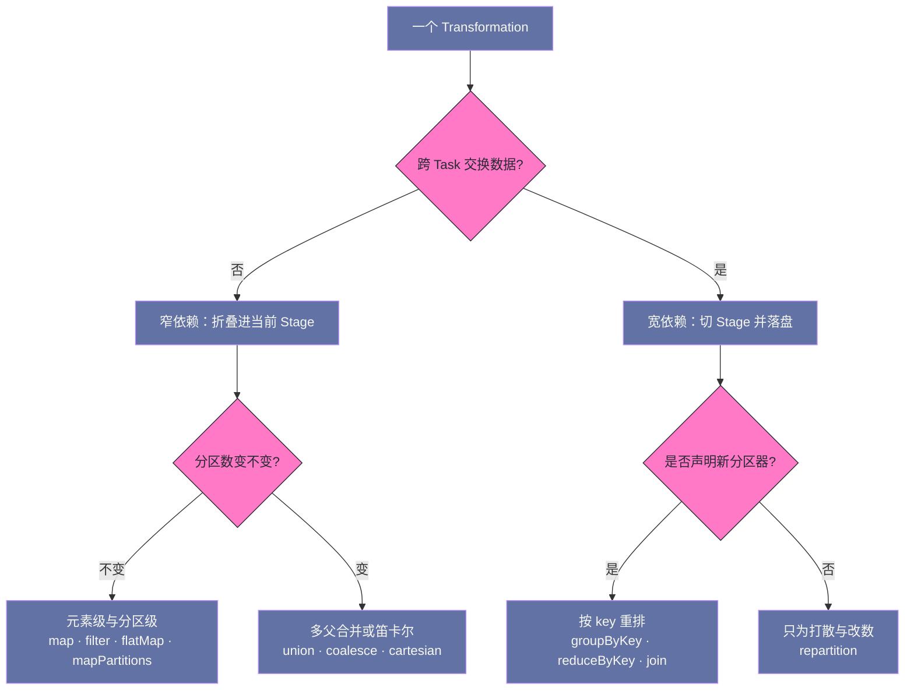
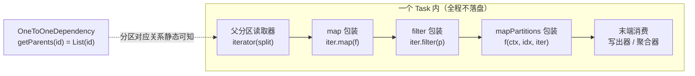
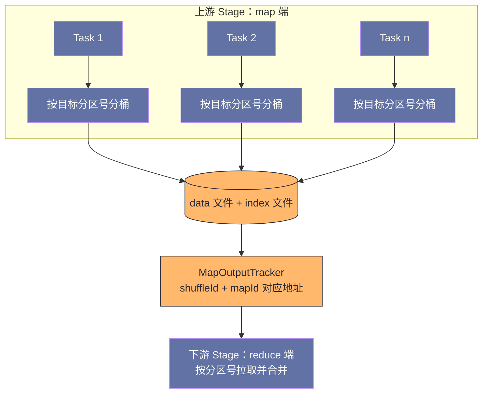
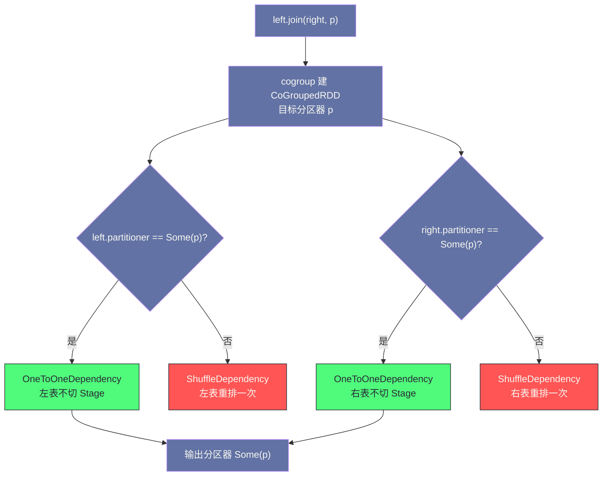
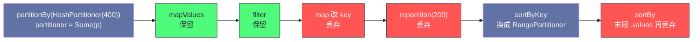
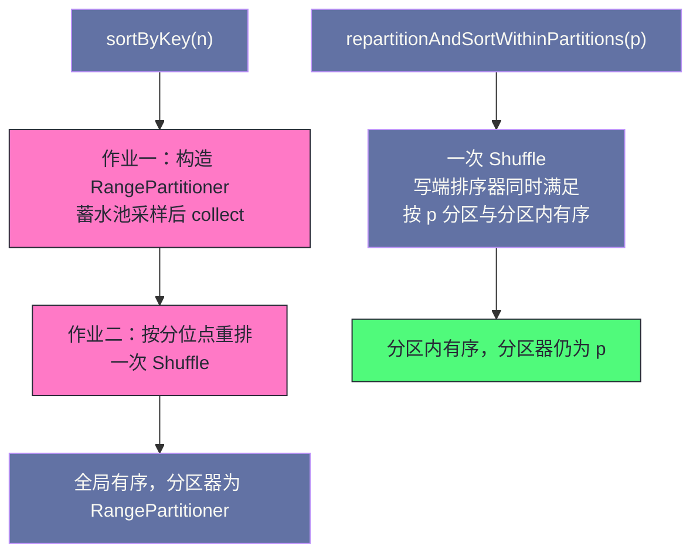

# 3. Spark 核心 Transformation：Shuffle、分区数与分区器三个坐标

**摘要：**

2012 年的 NSDI 上，伯克利 AMPLab 的 RDD 论文用一对词汇——窄依赖（Narrow Dependency）与宽依赖（Wide Dependency）——把"重算一个分区要付多少代价"写进了抽象本身。十多年过去，Spark 的 Transformation 从论文里的几个原型算子长成了上百个方法，但任何一个 Transformation 改动的物理事实仍然只有三件：要不要一次 Shuffle、输出分区数变不变、分区器（Partitioner）留不留。把算子按功能排成清单——映射、过滤、采样、分区、聚合、连接、调整——读起来顺，用起来却经常失灵：同一个 `join` 可能产生两个 Shuffle，也可能一个都不产生；同一个 `reduceByKey` 可能落盘，也可能只在分区内算一遍；同一个 `map` 会丢掉分区器，而 `filter` 反而保留。这篇文章不按算子名做目录，而是以三个坐标为骨架，把算子当作填进格子里的例证：先界定三个坐标与它们的组合，再解释窄依赖为什么能流水、宽依赖为什么必须落盘，然后说明依赖类型其实是在运行期由"父 RDD 的分区器是否等于本次目标分区器"这一句判定的，接着拆开分区器的保留与丢弃规则、`sortBy` 的采样作业与 `RangePartitioner`、`repartitionAndSortWithinPartitions` 如何把排序折进 Shuffle 写端，最后单列边界与反例。文章要回答两个问题：一个 Transformation 的代价究竟从哪来，以及为什么不能按算子名背结论。口径取 Spark 4.3.0（4.x 预编译 Scala 2.13）；涉及内部实现处，以对应版本文档或源码为准。

**关键词（Keywords）**: Transformation, 窄依赖, 宽依赖, 分区器, preservesPartitioning, combineByKey, mapSideCombine, RangePartitioner, repartitionAndSortWithinPartitions, distinct

---

## 第 1 章 三个坐标：一次变换改动的物理事实

### 1.1 一份清单解释不了的事

RDD 论文里对两种依赖的界定相当简洁：窄依赖指父 RDD 的每个分区最多被子 RDD 的一个分区使用，宽依赖指父 RDD 的一个分区可能被多个子分区依赖。论文用这条区分支撑容错论证——窄依赖链上一个分区丢了，只要重算它的父分区；宽依赖丢了，则要重算整段上游。这个区分后来成了 Spark 调度器划 Stage 的唯一依据，也成了所有讲 Transformation 的文章都要复述的一句话。

但复述这句话，与掌握它，是两件事。清单式写法把算子按功能分成几组并列，`map` 一段、`filter` 一段、`groupByKey` 一段，每段配一张数据流向图，读完之后脑子里得到的是一张"算子—功能"对照表。真正写作业时，用得上的是另一类问题：这段 `join` 会不会把上游两个几百个分区的分支都重排一遍；`partitionBy` 之后接了一个 `map`，下游的聚合还能不能省掉一次 Shuffle；`distinct` 到底是一次重排还是两次。这些问题没有一个能靠"算子属于哪一组"回答。

原因在于，**算子的名字是给人看的，依赖类型是给引擎算的**。同一个 API 出现在不同的上下文里，落到的物理动作可以完全不同，而 Spark 并没有为这种差异提供任何显式的语法，它藏在 RDD 的 `partitioner` 字段与几行 `if` 判断里。清单式写法最容易出错的地方，恰恰是把这些运行期判定当成了编译期的属性。

### 1.2 三件事与一个坐标系

把上面那些问题归结一下，任何一个 Transformation 对执行计划的影响都落在三个互相独立、但并不对等的量上。

第一个量是要不要跨 Task 交换数据，也就是是否产生一次 Shuffle。它决定 DAG 会不会被剪断、中间结果要不要落盘、要不要向 Driver 登记地址。这是三个量里唯一会改变 Stage 数量的，也是唯一会引入网络与磁盘的。

第二个量是输出分区数变不变。分区数决定下游提交多少个 Task，也决定并行的粒度；它可以在不移动任何数据的前提下改变（`union` 把两个 RDD 的分区拼起来），也可以在移动数据之后改变（`repartition`），还可以完全不改（绝大多数元素级算子）。

第三个量是分区器留不留。分区器是"键到分区号"的函数，它不改变这一次计算的数据量，只改变下一次计算能不能"同台换乘"：下游如果恰好需要同样的分区布局，就可以跳过重排。它与前两个量并不绑定——`map` 会丢掉分区器却不改分区数也不产生 Shuffle；`filter` 也不改分区数，却把分区器保留了下来。

三个量合起来，构成一个可以给任何 Transformation 定位的坐标系。用一句话概括三者的关系：**Shuffle 决定代价的量级，分区数决定并行的形状，分区器决定下一次要不要再付一次代价**。

### 1.3 一个承载全文的作业

为了让后面的讨论有具体的着力点，笔者设一个用户行为宽表作业 `ubt_wide`：从 HDFS 读入前一天的埋点事件（400 个分区），解析、过滤掉无效记录；按会话标识把同一会话的事件聚到一起；再与一张几万行的用户维表连接，补上渠道与地域；随后对用户去重，最后按事件时间排序并重分到 200 个分区，交给写出环节。

```scala
// 两条窄依赖链：map 丢分区器、filter 保留，两者都不产生 Shuffle
val evt = sc.textFile("hdfs:///dw/event/2026-11-18", 400).map(parseEvent).filter(_.valid)
val dim = sc.textFile("hdfs:///dw/dim/user").map(parseUser)      // 维表，userId 为键

// ① 宽依赖：同一会话的事件散落在不同分区，必须按 key 汇聚
val sess = evt.keyBy(_.sessionId).groupByKey(400)

// ② 改键的 map：分区器在这一步丢掉，下游 join 因此必然重排
val stat = sess.flatMapValues(calcSession).map { case (sid, s) => (s.userId, s) }

// ③ join：两侧是否已按同一分区器布局，决定 0/1/2 次 Shuffle
val wide = stat.join(dim)

// ④ distinct：一次重排，还是分区内去重，取决于上下文
val users = wide.map(_._2._1.userId).distinct()

// ⑤ sortBy：RangePartitioner 构造时先跑一个采样作业
val ordered = wide.sortBy(_._2._1.ts)

// ⑥ 只为写出文件数服务的重分区；真正的写出属于 Action，不在本篇范围
val finalRdd = ordered.repartition(200)
```

这段代码里每一步都踩在一个坐标上，后文每一章都会回到它：第 2 章看 `evt` 的两步为什么能折叠进一个 Task，第 3 章看 `groupByKey` 为什么非落盘不可，第 4 章看 `join` 的依赖类型怎么被运行期判定，第 5 章看 `map` 与 `filter` 对分区器的不同态度、看第 ② 步为什么让 `join` 无法同台换乘，第 6 章看 `sortBy` 为什么多出一次作业。

### 1.4 一个比喻：换乘与站台

把一条窄依赖链想成同一条地铁线路上连续的几站：乘客（记录）不下车，车（迭代器）一站站往前开，任何一站的站台都不需要把乘客全部清空再重新上车。宽依赖则是换乘站：要换线，就必须出站、走通道、重新排队，按新的线路分车；出站这一步就是落盘，站台编号就是分区，站台数量就是分区数。

分区器在这套比喻里是"站台对照表"：它记录哪个目的地对应哪个站台。对照表有效时，换乘可以同台完成，也就是下游不必重排；写了 `partitionBy` 之后接一个 `map` 把 key 改掉，相当于乘客在车上换了目的地，而对照表还是旧的那张，于是它只能被作废。

比喻的技术限定有两处：地铁的线路图是固定的，而 Spark 的"线路"由算子的依赖形状决定，`union` 会让同一个子分区同时挂在两条父线上；站台可以随便加，而 Spark 的分区数一旦确定，改一次就要付一次重排的代价。

### 1.5 把算子填进坐标矩阵

不妨先看三个坐标是如何分支的。下图把判定顺序画成一条决策路径，注意每个问号都对应引擎里的一次真实判断，而不是文章为了排版编出来的分类；最右一列才是最后的落地形态。



把常见的 Transformation 按三个坐标的组合摊开，能看出"算子名"与"物理动作"之间的错位有多普遍。下面这张表是全文的索引，后文的每一章都在解释其中某几行背后的机制；注意同一个算子可以出现在不止一行，这正是清单式写法覆盖不到的部分。

| 是否 Shuffle | 分区数 | 分区器 | 代表算子 | 代价落在哪 |
|---|---|---|---|---|
| 否 | 不变 | 丢弃 | `map`、`flatMap` | 每条记录一次闭包调用，布局信息丢失 |
| 否 | 不变 | 保留 | `filter`、`mapValues`、`flatMapValues`、`sample`、`sampleByKey` | 同样的调用开销，但下游可继续复用布局 |
| 否 | 相加 | 丢弃 | `union` | Task 数相加，无数据移动，但布局声明作废 |
| 否 | 相乘 | 丢弃 | `cartesian` | 分区数 m×n，扇出与 Task 数一起爆炸 |
| 否 | 减少 | 丢弃 | `coalesce(n)` | 并行度下降，原本隐形的倾斜显形 |
| 否 | 不变 | 保留 | `repartitionAndSortWithinPartitions(p)`（p 已匹配时） | 分区内排序，无重排 |
| 是 | 改变 | 新分区器 | `partitionBy`、`groupByKey`、`reduceByKey`、`join`（不匹配）、`distinct` | 落盘、网络、写端聚合缓冲 |
| 是 | 不变 | 新分区器 | `sortByKey` | 一次采样作业加一次全量重排 |
| 是 | 改变 | 丢弃 | `repartition`、`coalesce(n, shuffle = true)` | 一次纯打散的重排与索引文件 |

这张表有一处需要立刻说明：`reduceByKey` 被放进了"是 Shuffle"那一行，但它并不总是 Shuffle。当父 RDD 的分区器恰好等于本次指定的分区器时，它退化成一个窄依赖，一次数据移动都没有；`distinct` 也有类似的分支。第 4 章会给出判定式，这里先记住结论：坐标描述的是"这一次执行"，不是"这个算子"。

### 1.6 读法与路线

全篇的推进顺序仍是那五问：先界定三个坐标各自是什么、为什么它们不能互相替代（本章）；再回答窄依赖为什么能流水（第 2 章）与宽依赖为什么必须落盘（第 3 章），这两章是"不这样会怎样"的反事实论证；然后回答依赖类型在运行期如何被判定（第 4 章），这是全篇的技术枢纽；接着讲落地层面的两条规则——分区器的保留与丢弃（第 5 章）、排序与采样带来的额外作业（第 6 章）；最后单列边界与反例（第 7 章）并把结论收束到一条判断顺序上（第 8 章）。

---

## 第 2 章 窄依赖：流水线是怎么形成的

### 2.1 一个 Task 里发生了什么

窄依赖能"推着走"，根子在 RDD 的计算接口上。每个 RDD 只提供 `compute(split, context): Iterator[T]`，由 Task 在 Executor 上调用 `rdd.iterator(partition, context)` 触发。`iterator` 里只有两条分支：有存储级别时先去 `getOrCompute` 查缓存账本，否则走 `computeOrReadCheckpoint`；真正的计算永远返回一个尚未求值的迭代器，而不是一批数据。

`MapPartitionsRDD` 把这件事做成了套娃：它的 `compute` 只有一行，把父 RDD 的迭代器原样传进用户函数，返回用户函数给出的新迭代器。于是一条 `map → filter → mapPartitions` 的链在运行期展开成三层包装，最内层是文件或上游 Shuffle 的读取器，最外层是写出器或聚合器；驱动整个链的，是末端那个 `while (iter.hasNext)`。

下图把这个过程画成一个 Task 内部的形状。图里没有任何磁盘节点，这是窄依赖最关键的特征：中间结果从未被命名、被物化、被登记，它只以迭代器的形态存在。



### 2.2 流水的三个前提

把上面那张图当成结论去背是不够的，值得问一句：为什么偏偏是窄依赖能套娃？答案落在三个前提上，缺一个都不成立。

其一是**分区对应关系静态可知**。`OneToOneDependency.getParents(partitionId)` 直接返回 `List(partitionId)`，`RangeDependency` 用一次区间运算算出父分区下标，`CoalescedRDD` 则返回一组索引。引擎在提交 Task 之前就知道"这个子分区要读哪几个父分区"，于是可以只调度这一个子分区，让父分区的读取范围恰好覆盖所需数据。

其二是消费顺序与生产顺序可以对齐。记录一条条流过，下游不需要回头再要一遍已经流过的数据；一旦某个算子需要看见"同 key 的全部记录"或"全分区的排序结果"，流就断了，必须把数据攒起来，而攒起来就意味着物化。

其三是中间结果不需要跨 Task 共享。窄依赖链上，每个子分区只跟自己的父分区打交道，Task 之间没有任何数据交换，因此谁先跑、谁后跑都不影响结果。

反过来说，只要三条中有一条不成立，流水线就必须换成别的东西：第三条不成立，就是 Shuffle；第二条不成立，就是 `mapPartitions` 里那个把迭代器收成 `List` 的写法，它没有产生 Shuffle，却在 Task 内部制造了一次物化，内存峰值从 O(1) 变成 O(分区大小)。

### 2.3 窄依赖不止一种形状

清单式写法常把窄依赖讲成"一对一"，这是把 `OneToOneDependency` 当成了全部。实际上窄依赖有几种形状，`getParents` 的实现各不相同，代价也差得很远。

`union` 给每个父 RDD 建一个 `RangeDependency`，子分区号减去偏移量就得到父分区号，因此分区数是各父分区数之和，分区器则一律不声明——哪怕两个父 RDD 用的是同一个分区器，`UnionRDD` 也不会帮你保留这个信息。`coalesce(n)` 建的是 `CoalescedRDD`，它对每个输出分区返回"这一组合并了哪些父分区索引"的数组，`getParents` 直接返回这个数组；请求的分区数超过父分区数时，`CoalescedRDD` 在没有任何可用本地性信息的情况下会原样使用父分区，于是分区数不变，`coalesce` 成了一个空操作。`cartesian` 更特别，它给两个父 RDD 各建一个匿名 `NarrowDependency`，一个用分区号除以对方分区数，一个用取模，分区数是 m×n。

这些形状并排放在一起，能看清"窄"与"便宜"并不是同义词：

| 依赖子类 | `getParents` 形态 | 典型算子 | 分区数变化 | 需要留意的代价 |
|---|---|---|---|---|
| `OneToOneDependency` | `List(partitionId)` | `map`、`filter`、`flatMap`、`mapPartitions` | 不变 | 闭包调用次数，几乎无额外开销 |
| `RangeDependency` | 区间内做偏移运算 | `union` | 相加 | Task 数相加，分区器声明丢失 |
| `CoalescedRDD` 的 `NarrowDependency` | 返回合并组内的父分区索引数组 | `coalesce(n)` | 减少（请求更大时不变） | 并行度下降，倾斜被压到少数 Task |
| `CartesianRDD` 的匿名 `NarrowDependency` | 除法得左父下标，取模得右父下标 | `cartesian` | 相乘 | 分区数 m×n，`Int.MaxValue` 处直接抛错 |

所以，**窄依赖不等于一一对应，也不等于便宜**。`cartesian` 是标准的窄依赖，一分 Shuffle 都不付，但它把分区数从 m+n 变成 m×n，下游的 Task 数与调度开销一起放大；`coalesce` 也是窄的，但它用并行度换 Task 数，一旦数据本身倾斜，被合并的少数 Task 会成为长尾。

### 2.4 同一条流水线上的两种作用域

`map` 与 `mapPartitions` 是这份坐标里最容易被写成"性能优化对照"的一对。把它们放回流水线的结构里看，差别只有一个：函数被调用的作用域是元素还是分区，但这个差别顺着三条线放大。

第一条是调用次数。`map(f)` 对每条记录调用一次 `f`，一百万条记录就是一百万次闭包调用；`mapPartitions(f)` 对每个分区调用一次，固定开销被压缩到"分区数"这个量级上。源码上两者的区别不过是一层包装：`map` 传进去的是 `(_, _, iter) => iter.map(cleanF)`，`mapPartitions` 传进去的是 `(_, _, iter) => cleanedF(iter)`，真正被调用的是后者，前者每取一个元素才触发一次。

第二条是资源复用。分区级作用域可以在函数体外建立一次、在整个分区内复用：数据库连接、解析器、正则预编译、批量缓冲。逐条作用域做不到，因为函数每被调用一次就要从头来一遍。

第三条是内存形态。迭代器本身是流式的，把分区迭代器交给 `mapPartitions` 并不会自动把分区装进内存；危险的是函数体里那些"先把分区收完再算"的写法。`iter.toList`、`iter.toArray`、分区内排序、逐条塞进一个 `ArrayBuffer` 再统一写出，都会把内存峰值从 O(1) 抬到 O(分区大小)，而分区大小取决于上游的文件切分，HDFS 上一个块默认 128 MiB，换算成堆内对象是几百 MB 到数 GB。

一个共享资源又保持流式的写法大致是这样，关键在于迭代器一直在流，连接只在分区开始时建一次：

```scala
// 每分区建一次连接与预编译语句，记录始终逐条流过，不 materialize
evt.mapPartitions { iter =>
  val conn = openJdbc()
  val stmt = conn.prepareStatement("insert into ubt values (?, ?, ?)")
  try {
    iter.foreach { e =>
      stmt.setString(1, e.userId); stmt.setLong(2, e.ts); stmt.setString(3, e.channelId)
      stmt.addBatch()
    }
    stmt.executeBatch()
  } finally { stmt.close(); conn.close() }
  Iterator.empty            // 副作用型转换，输出为空迭代器，语义上仍是一次转换
}
```

三个维度的差异收进一张表：

| 观测点 | `map` | `mapPartitions` | `mapPartitionsWithIndex` |
|---|---|---|---|
| 函数类型（决定作用域） | `T => U` | `Iterator[T] => Iterator[U]` | `(Int, Iterator[T]) => Iterator[U]` |
| 闭包被调用的次数 | 记录数 N | 分区数 P | 分区数 P |
| 能否在两条记录之间持有对象 | 不能 | 能 | 能，还能按分区号区分 |
| 迭代器会不会被物化 | 不会 | 取决于函数体怎么写 | 同左 |
| 输出分区器 | 丢弃 | 默认丢弃，可显式声明保留 | 默认丢弃，可显式声明保留 |
| 在三个坐标上的位置 | 窄、分区数不变、丢布局 | 同左，布局可自愿保留 | 同左 |

### 2.5 反事实：如果每一站都落盘

假设不存在窄依赖这套套娃机制，每一步转换都要先把中间结果写下来再让下一步读，作业会变成什么样？一个 `map → filter → map` 的三步链，会变成三个 Stage、每个 Stage 各自 400 个 Task，Task 数按链长翻倍，每一步都要付出一次序列化、一次写盘、一次读盘；更糟的是，中间结果一旦落盘，就必须有名字和地址，也就要有人负责清理与失效，而这些成本全部落在与数据量成正比的位置上，而流水线的成本只与链长（常数）有关。

也正是因为这个机制，窄链上的一次失败要重算整链：中间结果从未被单独保存过，Task 一挂，它这一路算下来的所有元素都得从头再流一遍。这就是 `cache` 与 `checkpoint` 存在的意义——它们把一段窄链的中间结果变成有地址的东西，让重算范围可以被裁剪；这部分属于存储与容错的题目，见 [[5. Spark_RDD内部机制深度解析]]。

---

## 第 3 章 宽依赖：为什么非落盘不可

### 3.1 三条不落盘就做不到的事

窄依赖的三条前提，宽依赖一条都不满足，于是三条约束同时压过来。

第一条是 Task 数对不上。`groupByKey(400)` 的输出是 400 个分区，输入也是 400 个分区，数字看起来一样，但含义完全不同：输入的第 i 个分区装的是"文件第 i 块里的记录"，输出的第 i 个分区装的是"哈希到第 i 个桶的键"。同一个键的记录原本可能散在任意多个输入分区里，输出分区与输入分区之间没有任何可以先验确定的对应关系，`getParents` 无法写出一个静态的答案。

第二条是**同一个键的完整值集合不在一个 Task 里**。要按 key 聚合，必须先把所有同键记录凑到一处；而凑到一处的前提是"谁该去哪儿"这个判断对每条记录单独可算（键的哈希或区间），这已经是写端的事，不是读端能补的。

第三条是生产与消费必须在时间上解耦。下游 Task 的数量、起点、所在机器都由分区器决定，而上游 Task 的完成顺序不可控，中间必然存在一段时间窗口，下游已经可以开工、上游还没产出。这个窗口要么用等待填掉（Stage 之间严格串行），要么用一份可寻址的中间结果填掉。

Spark 选了后者：**落盘的不是"数据"，而是"可寻址的分区输出"**。每个 map 分区的输出写成 data 文件加 index 文件，索引里记录"第几个 reduce 分区从第几字节开始"，Driver 侧的 `MapOutputTracker` 记下 `(shuffleId, mapId)` 到机器与文件的映射。这份地址表才是宽依赖真正的产物；数据文件只是地址指向的内容。

下图把一次宽依赖的两端画出来。左边是上游 Stage 的 Task 各自按目标分区号分桶写出，右边是下游 Stage 凭地址表按分区号取数；中间那个圆柱既是数据也是索引，没有它，下游只能等上游整体完成，而有了它，下游可以按分区粒度去问"我要的那一段在哪儿"。



数据文件的结构、写端的排序与聚合、读端的拉取与合并，属于 Shuffle 机制的另一半题目，见 [[1. Spark_Shuffle机制深度解析]] 与 [[6. Spark_Shuffle聚合与排序结构]]，本篇只交代到 API 这一层：哪个算子会建出这样的依赖、依赖里带了什么参数。

### 3.2 `ShuffleDependency` 携带的五个字段

一条 `ShuffleDependency` 除了指向父 RDD，还带五个字段，每一个都对应一个 API 层的决策：

| 字段 | 谁设置 | API 体现 | 语义影响 |
|---|---|---|---|
| `partitioner` | 调用方显式传入，或由 `defaultPartitioner` 选出 | `partitionBy(p)`、`groupByKey(n)`、`reduceByKey(n)` | 决定输出分区数与"键到分区"的函数 |
| `serializer` | `ShuffledRDD` 按中间类型选择 | 内部；`mapSideCombine` 为真时按 C 选，否则按 V 选 | 决定写盘的字节格式与反序列化次数 |
| `keyOrdering` | `setKeyOrdering` | `sortByKey`、`repartitionAndSortWithinPartitions` | 让写端在分桶的同时把记录排好 |
| `aggregator` | `setAggregator` | 聚合族全部算子 | 提供"单值并入累加器"与"累加器合并"两个函数 |
| `mapSideCombine` | `setMapSideCombine` | `reduceByKey` 默认开，`groupByKey` 强制关 | 决定写端能否先做一次收缩 |

源码里有一道断言值得记：`mapSideCombine` 为真时 `aggregator` 必须存在，否则直接失败。这条约束说明二者不是两个独立的开关，而是"要不要在写端聚合"与"用什么聚合"的一体两面。至于写端具体怎么用这组参数组织哈希表与溢出文件，那是 `05_Shuffle核心机制` 的题目，本篇不重复。

### 3.3 `combineByKey` 是聚合族的公理

把聚合族的所有算子摊开看，会发现它们不是五个彼此独立的方法，而是同一个方法的五次代入。这个"母型"是 `combineByKeyWithClassTag`，它的签名里有三个函数与两个开关：`createCombiner: V => C` 负责给一个键建第一个累加器，`mergeValue: (C, V) => C` 负责把后续值并进去，`mergeCombiners: (C, C) => C` 负责合并不同分区的累加器，再加上 `partitioner` 与 `mapSideCombine`。

代入的方式如下：

```scala
// reduceByKey：累加器就是值本身，三个函数是同一个 func
combineByKeyWithClassTag[V]((v: V) => v, func, func, partitioner)

// foldByKey：零值经序列化克隆，保证每个 key 拿到独立实例
combineByKeyWithClassTag[V]((v: V) => cleanedFunc(createZero(), v), cleanedFunc, cleanedFunc, partitioner)

// aggregateByKey：createCombiner 里插入一次 zeroValue，两个函数可不同
combineByKeyWithClassTag[U]((v: V) => cleanedSeqOp(createZero(), v), cleanedSeqOp, cleanedCombOp, partitioner)

// groupByKey：中间类型是全量值缓冲，并且显式关闭写端 combine
combineByKeyWithClassTag[CompactBuffer[V]]((v: V) => CompactBuffer(v), _ += _, _ ++= _, partitioner, mapSideCombine = false)
```

把这几次代入并排放，能看清聚合族的全部差异只来自两个旋钮：中间类型 C 能不能比 V 收缩，以及写端 combine 开不开。

| 算子 | `createCombiner` | `mergeValue` | `mergeCombiners` | `mapSideCombine` | 中间类型 C |
|---|---|---|---|---|---|
| `combineByKey` | 用户给 | 用户给 | 用户给 | 默认开 | 用户给，最自由 |
| `reduceByKey` | 恒等 | `func` | `func` | 开 | 与 V 同类型 |
| `foldByKey` | `func(zero, v)` | `func` | `func` | 开 | 与 V 同类型 |
| `aggregateByKey` | `seqOp(zero, v)` | `seqOp` | `combOp` | 开 | 可与 V 不同 |
| `groupByKey` | 单元素缓冲 | 追加 | 拼接 | 强制关 | 全量值集合，不收缩 |

`groupByKey` 关掉写端 combine 这件事，源码注释里给了理由，值得原样体会：写端 combine 并不能减少要传输的数据量（值一个都不能少），却要求把所有 map 端数据先塞进哈希表，反而在老年代里造出更多对象。换句话说，**当中间类型不收缩时，写端聚合是一笔只付成本、不收获的买卖**。这也是 `combineByKey` 作为公理的实践含义：判断一个聚合写法贵不贵，先看它的 C 能不能收缩，再看它有没有必要开写端 combine，而不是看它名字里有没有 `ByKey`。

还有一条数学前提常被忽略：`reduceByKey` 的 `func` 必须满足交换律与结合律，因为 Shuffle 不保证同一键的值到达顺序；`aggregateByKey` 的 `zeroValue` 必须可以被重复应用而不改变结果，因为它不只被用一次。函数违反这两条时，Spark 不会报错，只会给出一个偶尔正确、偶尔错误的结果。

### 3.4 落盘之后，分区器是副产品

一次 Shuffle 结束后，`ShuffledRDD` 上挂着一句 `override val partitioner = Some(part)`。这句话是后文所有"分区器复用"的源头：一次昂贵的重排不仅产出了数据，还产出了一份可被下游检验的布局声明；下一段代码如果需要的正是这份布局，就不必再付一次代价。

同一件事还有代价的一面。`groupByKey` 的中间类型是 `CompactBuffer`，读端拿到的是一个 `Iterable`，一个键的全部值都得在内存里待着；键的分布一旦倾斜，单个 Task 的对象总量可以远超分区平均量，这才是 `groupByKey` 比 `reduceByKey` 危险的真正位置——不是"它多做了一次 Shuffle"，而是"它被迫把一个键的全部值同时握在手里"。

### 3.5 `join` 不是一个算子，而是 `cogroup` 的薄包装

`join` 的实现短得让人意外：先按给定的分区器做一次 `cogroup`，得到每个键两侧的值集合，再对两个集合做笛卡尔积。

```scala
def join[W](other: RDD[(K, W)], partitioner: Partitioner): RDD[(K, (V, W))] =
  this.cogroup(other, partitioner).flatMapValues { pair =>
    for (v <- pair._1.iterator; w <- pair._2.iterator) yield (v, w)
  }
```

这段实现解释了三件事。第一，`join` 的依赖类型不是一个，而是"每个父 RDD 一条"，左表和右表各自判定、各自决定是否重排，所以一次 `join` 的 Shuffle 次数可以是 0、1 或 2。第二，`leftOuterJoin`、`rightOuterJoin`、`fullOuterJoin` 与内连接共用同一个 `cogroup`，差别只在 `flatMapValues` 里怎么处理空集合，依赖层面完全一样。第三，连接结果的放大倍数由两侧同键记录数的乘积决定，倾斜在 `join` 里是乘法级放大，这比聚合里的加法级放大更凶。

`cogroup` 自己则把"每个键的多路值集合"装进 `CoGroupedRDD`，并由它逐个父 RDD 判定依赖。这正是下一章要拆的判定式。

### 3.6 反事实：让宽依赖不落盘

如果硬要让宽依赖也不落盘，会撞上什么？下游 Task 在另一个 Executor 上、在另一个时刻启动，它需要的数据在别人的堆里；想让数据不落盘就流过去，唯一可能是让上下游 Task 同时在场、按同一节奏推进——这就是后来那支流水线 Shuffle 的思路，它要同时接管资源准入、失败语义与背压三件事，代价是把"等"换成了"占资源"。它在 4.x 里仍是一条受限路径，具体约束以对应版本文档或源码为准；本文只取它的存在所证明的那句话：**默认路径上的落盘不是保守，而是用磁盘换掉了整组 Stage 必须同时起步的约束**。

---

## 第 4 章 依赖类型是运行期判定的

### 4.1 一句判定式

上一章说过，`join` 的依赖类型逐个父 RDD 判定。`CoGroupedRDD.getDependencies` 的做法只有几行：对每个父 RDD 检查 `rdd.partitioner == Some(part)`，成立就建 `OneToOneDependency`，否则建 `ShuffleDependency`。

```scala
rdds.map { rdd =>
  if (rdd.partitioner == Some(part)) new OneToOneDependency(rdd)
  else new ShuffleDependency(rdd.asInstanceOf[RDD[_ <: Product2[K, _]]], part, serializer)
}
```

这句话在 `join` 上的效果值得单独画一遍：一次 `join` 到底是零次、一次还是两次重排，完全取决于两个父 RDD 各自的分区器与目标分区器 `p` 是否相等，两侧的判定互不影响。



同一句话在聚合族里换了形态出现：`combineByKeyWithClassTag` 先看 `self.partitioner == Some(partitioner)`，成立就把整个聚合退化成一个 `mapPartitions`，在分区内部用 `combineValuesByKey` 把同键值合并掉，并声明 `preservesPartitioning = true`；不成立才建 `ShuffledRDD`。`partitionBy` 更彻底，分区器已经相同就直接返回 `self`，连一个新的 RDD 都不建。

**宽与窄不是算子名决定的，而是"父 RDD 的分区器"与"本次目标分区器"这一对决定的**。这个判定的合法性来自一个简单事实：如果父 RDD 已经按目标分区器布局，那么同一个键的全部记录必然在同一个分区里，分区内做一次聚合就等于全局聚合，一次数据移动都不需要。

### 4.2 同一个算子，四种结局

把这条判定式代进 `ubt_wide` 的 `join`，会得到四种完全不同的执行计划；同一套判定在别的算子上也会给出不同结局，一并列在表里。

| 算子 | 前提 | 依赖类型 | Shuffle 次数 | 对 Stage 图的影响 |
|---|---|---|---|---|
| `join` | 两侧都没有目标分区器 | 两个 `ShuffleDependency` | 2 | 两侧各切一刀，三个 Stage |
| `join` | 只有一侧已按 p 分区 | 一窄一宽 | 1 | 只切未分区的那一侧 |
| `join` | 两侧都按 p 分区 | 两个 `OneToOneDependency` | 0 | 不切，全部折叠进一个 Stage |
| `reduceByKey(n)` | 父分区器恰为 `HashPartitioner(n)` | 窄（`mapPartitions`） | 0 | 不切 |
| `reduceByKey(n)` | 其余情况 | 一个 `ShuffleDependency` | 1 | 切一刀 |
| `partitionBy(p)` | 分区器已是 p | 无新依赖（返回 `self`） | 0 | 不切，连 RDD 都不新建 |
| `distinct()` | 已有分区器且分区数不变 | 窄（分区内去重） | 0 | 不切 |
| `distinct()` | 其余情况 | 两段 `map` 夹一次 `reduceByKey` | 1 | 切一刀 |
| `sortByKey(n)` | 无（总是新建 `RangePartitioner`） | 一个 `ShuffleDependency` | 1（另有一次采样作业） | 切一刀 |

表里最反直觉的两行是 `distinct`。它的默认实现确实是"打上 `null` 值借 `reduceByKey` 去重、再 `map` 回原类型"，但在一个特殊分支里它退化成窄依赖：如果 RDD 本身已带分区器、且请求的分区数等于现有分区数，Spark 会直接在分区内用一个 `ExternalAppendOnlyMap` 去重，不需要任何重排。理由是同一个键在分区器保证下只会落在一个分区，分区内去重与全局去重等价。这个分支平时几乎不会被注意到，但它是"依赖类型由上下文决定"最干净的一个例证，也是清单式写法里几乎必然漏掉的一条。

`join` 那一侧的分区器从哪来？没有显式传入时走 `defaultPartitioner`：在两侧已有的分区器里挑分区数最大的一个（前提是它的分区数不小于默认并行度），否则新建一个 `HashPartitioner`。所以在星型模型里，如果维表已经 `partitionBy(HashPartitioner(400))`，而事实表也按同样的分区器分好，两侧的 `join` 就都是窄的；如果只有一侧分好，`defaultPartitioner` 会挑中这一侧的分区器，于是这一侧窄、另一侧重排，一次 `join` 只付一侧的代价。这套行为的实际用途很清楚：**把一次重排的结果反复用于多次连接，比每次连接都重排两张表划算得多**。

### 4.3 分区器的"相等"是契约问题

判定式里的 `==` 落在 `Partitioner` 的 `equals` 上，而 Scala 的 `==` 对引用类型默认就是 `equals`。`HashPartitioner` 重写了 `equals`，只比较 `numPartitions`，所以 `new HashPartitioner(400)` 与另一个 `new HashPartitioner(400)` 相等；`RangePartitioner` 重写的 `equals` 比较边界数组与排序方向，分区数由边界长度隐含。

自定义分区器是这里最常见的坑：如果只实现了 `getPartition` 而没有重写 `equals`，两次 `partitionBy` 传入"看起来相同"的两个实例，判定式会给出"不相等"，于是一次本可避免的 Shuffle 被照样执行。反过来，如果重写 `equals` 时把不该忽略的状态（譬如某个分桶的映射表）也忽略了，就会让两个实际布局不同的分区器被判成相等，下游按错误假设走窄依赖，结果错而不报。**分区器的相等，等价于"两个分区器对每一个键给出同一个分区号"这个更强的事实，代码里的 `equals` 只是它的近似**。

### 4.4 判错会怎样

把依赖类型的判定写死成"算子名 → 宽窄"，有两种错法，后果不对称。

把窄的判成宽的，只是多切一刀、多落一次盘，作业变慢但结果正确，排查时表现为"多了一个莫名其妙的 Stage"与"UI 上多了一次 Shuffle Read/Write"。把宽的判成窄的，则是读不到完整的键，聚合结果偏小、连接结果丢行，而且没有任何异常——没有报错、没有重试、没有 FetchFailed，只有对不上的数字。这也是为什么这类问题难查：DAG 看起来完全正常，只是某几行数据在某个分区里被当成了"这个键的全部"。

### 4.5 与 Stage 划分的分工

本篇只讲到"依赖类型决定 Stage 边界在哪里"这一层。边界如何被反向遍历找出来、两类 Stage 各记什么账、失败之后的重算范围怎么被裁剪到单个分区，都是调度器的话题，见 [[5. Spark_DAGScheduler_Stage划分]]。两篇之间有一条容易混的口径：数 Shuffle 算子不等于数 Stage 边界，`join` 一次可以带来零到两条边界，`union` 一条都不带来；而 Stage 的数量也不等于作业的耗时，一次窄链再长也只是一个 Stage。

---

## 第 5 章 分区器：保留与丢弃的规则

### 5.1 分区器从哪来

`RDD.partitioner` 是一个 `Option[Partitioner]`，只有两类 RDD 会真正声明它。第一类是 `ShuffledRDD`，它在构造时拿到分区器，并声明 `Some(part)`；第二类是 `CoGroupedRDD`，同理声明 `Some(part)`。此外还有 `MapPartitionsRDD` 与 `PartitionwiseSampledRDD`，它们自己不知道布局，只能按参数决定要不要从父 RDD 继承。

除此之外的 RDD 都沿用基类的默认实现，`partitioner` 是 `None`。这解释了一个常见困惑——`union`、`coalesce`、`cartesian`、`repartition` 的输出都没有分区器，哪怕它们的父 RDD 分区器一致。**分区器不是从数据里推断出来的，而是由 RDD 自己声明出来的**；没有声明就是没有，引擎不会替你去证。

### 5.2 保留规则

把常见算子的声明方式排成一张表，规则就清楚了：

| 算子 | 是否保留分区器 | 机制 |
|---|---|---|
| `map`、`flatMap`、`keyBy`、`groupBy`（首步 `map`） | 否 | `MapPartitionsRDD` 的 `preservesPartitioning` 取默认值 `false` |
| `filter` | 是 | 源码显式传 `preservesPartitioning = true`，因为只删记录不改编排 |
| `mapValues`、`flatMapValues` | 是 | 只动 value，键不变，声明合法 |
| `mapPartitions`、`mapPartitionsWithIndex` | 默认否 | 第二个参数需要调用方显式承诺 |
| `sample` | 是 | `PartitionwiseSampledRDD(..., preservesPartitioning = true)` |
| `sampleByKey`、`sampleByKeyExact` | 是 | `mapPartitionsWithIndex(..., preservesPartitioning = true)` |
| `union` | 否 | `UnionRDD` 不声明分区器，哪怕各父一致 |
| `coalesce(n)` | 否 | `CoalescedRDD` 不声明分区器 |
| `cartesian` | 否 | `CartesianRDD` 不声明分区器 |
| `repartition`、`coalesce(n, true)` | 否 | 尾巴上是 `.values`，即一次 `map` |
| `partitionBy(p)` | 是 | `ShuffledRDD` 声明 `Some(p)`；已是 p 则返回 `self` |
| `groupByKey`、`reduceByKey`、`aggregateByKey`、`foldByKey`、`combineByKey` | 是 | `ShuffledRDD` 声明 `Some(partitioner)`，或匹配时原地保留 |
| `join`、`cogroup` 及三种外连接 | 是 | `CoGroupedRDD` 声明 `Some(part)`，`flatMapValues` 继承 |
| `sortByKey` | 是 | 声明 `Some(RangePartitioner)` |
| `sortBy` | 否 | 末尾 `.values` 是一次 `map`，把 `RangePartitioner` 丢掉 |
| `distinct()` | 分支 | 有分区器且分区数不变时保留；否则末尾 `map(_._1)` 丢掉 |

把这张表放回一条真实的算子链上，能看清分区器是在哪一步消失的。下图中每个箭头是一次转换，箭头上的文字是它对布局声明的处置；注意丢掉分区器的那两步（`map` 与 `repartition`）恰好都是"看起来无害"的类型整理与分区整理。



### 5.3 为什么 `map` 会丢，`mapValues` 不会

保留分区器的充分条件只有一条：**键不变，或者记录只减不增**。分区器是"键到分区号"的函数，只要输出的键集合与输入的键集合在"每个键落在哪个分区"这一点上一致，声明就成立。

`mapValues` 与 `flatMapValues` 满足这条：函数签名只允许改 value，键必然原样传递（`flatMapValues` 会复制键，但复制出的键与原来相同）。`filter` 也满足：它只删记录，同键记录要么全在同一分区、要么全被删，不会出现跨分区。`map` 不满足：函数签名是 `T => U`，输出可能不是键值对，也可能是完全不同的键，`partitioner` 无从复用。`flatMap` 同理。`coalesce` 与 `cartesian` 不满足：它们改变了"分区号"本身的含义，一个把多个分区的数据并进一个，一个把两个 RDD 的分区组合成新编号，原布局无法映射到新编号上。

`union` 是最容易被误判的一个。两个都按 `HashPartitioner(400)` 分过区的 RDD 做 `union`，直觉上"每个键还是同一个哈希值，布局应该保得住"，但 `UnionRDD` 输出的分区是"左表 0~399 号分区 + 右表 0~399 号分区"，第 0 号分区里只有左表哈希到 0 的那部分，右表哈希到 0 的部分在 400 号分区里，同一个键被拆到了两个分区，布局声明自然不成立。要在 `union` 之后保住布局，只能用 `PartitionerAwareUnionRDD` 那类按分区器合并的实现（Spark 内部有，但公共 API 不直接暴露），或者干脆再 `partitionBy` 一次。

一句话总结这一节：**分区器是对键的一条承诺，不是一个可以随手复制的缓存标记**。

### 5.4 `preservesPartitioning` 是一条契约

`mapPartitions` 的第二个参数常年被当成"性能优化开关"使用，其实它是一句承诺：调用方声明自己的输出仍沿用父 RDD 的分区布局。引擎没有办法验证这句话，它只会照单全收，把它写进 `MapPartitionsRDD.partitioner`，然后让下游据此建立窄依赖。

违约的代价是静默错误。假设一个 `mapPartitions` 把键从 `userId` 改成了 `userId + ":" + channel`，却传了 `preservesPartitioning = true`，那么下游一个 `reduceByKey` 会认为"同键已在同分区"，直接做分区内聚合；实际上同一个 `userId` 的不同渠道现在落在不同分区，聚合结果被切成几份。作业正常结束，数字是错的。

正确的用法只有三种：函数确实不动键（只在 value 上加字段、做格式转换），传 `true`；函数动了键或改变了键的分布，传 `false`，让下游老老实实重排；不确定时传 `false`，用一次多余的重排换正确性。

### 5.5 分区器丢了的下场

分区器丢失不会影响当前这一步的结果，它的代价全部落在下游，而且往往要过几步才显形。

最直接的一种是重复 Shuffle。`repartition(200)` 之后接 `reduceByKey(_ + _)`，是两次 Shuffle：`repartition` 的 ShuffledRDD 确实建了 `HashPartitioner(200)`，但 `coalesce(shuffle = true)` 的返回表达式末尾是一次 `.values`，把分区器丢掉了，于是 `reduceByKey` 认为父 RDD 没有布局，再重排一次。想只付一次代价，应该直接写 `reduceByKey(_ + _, 200)`，把分区数交给聚合算子自己决定。

第二种是裁剪失效。`sortByKey` 之后接一个 `map` 把结果整理成 `(k, v)` 的形式，`RangePartitioner` 就丢了；再想用 `filterByRange(lower, upper)` 按范围裁剪分区，它拿不到 `RangePartitioner`，只能退化成对全部分区做普通 `filter`。源码里的分支很直白：分区器是 `RangePartitioner` 时用 `PartitionPruningRDD` 把扫描范围收窄到 `[getPartition(lower), getPartition(upper)]` 之间的分区，否则 `rddToFilter` 就是 `self`。也就是说，**`filterByRange` 的高效依赖上游那次排序留下的分区器，而不是它自己的名字**。

第三种是连接策略反复退化。一次 Shuffle 建好的布局本可以被多次连接复用，但中间任何一个 `map` 都会把它清掉；这种情况在长链 ETL 里非常常见，代价是每一次连接都重新重排两张表。

### 5.6 前提：只有键值对才有分区器

`partitionBy`、`groupByKey`、`combineByKey` 这些方法并不在 `RDD` 类上，而在 `PairRDDFunctions` 里，靠 Scala 的隐式转换挂上去。这意味着两件事：第一，只有元素类型为 `(K, V)` 的 RDD 才有分区器语义，非键值对 RDD 的 `partitioner` 恒为 `None`；第二，隐式转换是编译期行为，`RDD[T]` 上调不到这些方法，报错发生在编译期而不是运行期。写通用工具方法时如果参数类型写成 `RDD[T]`，就会出现"同一个函数对 `RDD[(K, V)]` 可用、对 `RDD[String]` 编译不过"的现象，这不是类型系统的毛病，而是分区器概念只对键值对成立的直接体现。

---

## 第 6 章 排序与采样：`sortBy` 的第二个作业

### 6.1 `RangePartitioner` 在构造时就要跑一个作业

`sortByKey` 的实现只有两行：先 `new RangePartitioner(numPartitions, self, ascending)`，再建 `ShuffledRDD` 并设置 `keyOrdering`。看起来是一次 Shuffle，但第一行里藏着一个完整作业。

`RangePartitioner` 的构造过程需要知道数据的键分布，才能在键空间上切出大致等量的区间；它拿不到统计信息，只能现场采样。采样通过 `sketch` 完成：对父 RDD 的键做一次 `mapPartitionsWithIndex`，每个分区用蓄水池采样（Reservoir Sampling）取一批样本，然后 `collect()` 回 Driver。`collect` 是 Action，于是从 Driver 的视角看，构造分区器这件事本身就触发了一个作业：它不属于用户写的那个 Job，却真实地跑在同一个 Application 里。

这就解释了一个常见现象：一个只调用了一次 `sortBy` 的作业，Spark UI 上会出现两个 Job，前一个的 Task 数与父 RDD 的分区数相同、Stage 里没有 Shuffle Write，后一个才是真正的排序。**`sortBy` 在 DAG 里是两个作业，不是一个**；清单式写法把它写成"一次 Shuffle"，漏掉的正是这次全量扫描。

### 6.2 采样参数与两个边界

采样不是"随便取几条"，它的参数与代价都值得摊开。样本总量取 `min(20 × 分区数, 1e6)` 个采样点，也就是每个输出分区大致 20 个点；为了抵消输入分区之间的不均衡，每分区按 `ceil(3 × 样本总量 / 分区数)` 过采样，用蓄水池算法在 O(每分区样本量) 的内存里完成。回到 Driver 之后，用 `fraction = 样本总量 / 总记录数` 估计每个分区的采样概率，权重取其倒数；如果某个分区的记录数远超平均（`fraction × n` 超过每分区采样上限），说明它被采得太稀，Spark 会再对它单独做一次按概率的 `sample` 并补采。最后按加权样本的排序结果取分位点，作为各分区的上界。

这套流程有两个边界我们得记住。

第一，**分区数可能小于请求值**。分位点的数量受候选样本数限制，当样本数少于请求的分区数时，`determineBounds` 只会切出能切的分区数。写了 `sortByKey(1000)` 却只得到 300 个分区，通常不是配置没生效，而是数据量或采样量撑不满 1000 个边界。

第二，均衡的是键空间，不是记录数。分位点基于采样估计，重尾分布下每个区间包含的记录数仍可能差出数倍；`RangePartitioner` 保证的是"区间之间键值范围大致等分"，不保证"记录数等分"，更不保证"每个 Task 耗时相近"。把 `sortBy` 当成解决倾斜的手段，方向就错了——它只解决"全局有序"，倾斜要靠加盐或拆分大键。

还有一条语义边界：排序只保证键有序，同一个键内部的值顺序不保证，而且每次求值可能不同；想要键内有序，得把次序信息编进键里，也就是下一节要讲的复合键方案。

### 6.3 `repartitionAndSortWithinPartitions` 省下的那一次

`repartitionAndSortWithinPartitions` 的源码同样是一个分支：分区器已匹配时，它只在每个分区内用一个 `ExternalSorter` 排序，一次 Shuffle 都不做；不匹配时，它建 `ShuffledRDD` 并 `setKeyOrdering`，把排序信息交给 Shuffle 写端。官方注释把收益说得很直白：这比"先 `repartition` 再在分区内排序"更高效，因为排序被下推进了 Shuffle 机制。

为什么能省？因为 Shuffle 写端本来就要按"目标分区号"给记录分桶，而实现分桶的那个排序器是以 `(partitionId, key)` 为排序键工作的；既然记录已经排过一遍，只要在比较器里把 key 的次序一并纳入，一次排序就同时满足"分区正确"与"分区内按键有序"两个要求。分开写就不行了：`repartition` 先把数据打散，这一步只关心分区号，不保证区内有序；要在之后得到区内有序，还得再来一次全量排序，而这次排序要么再借一次 Shuffle（`sortByKey` 会重新按 `RangePartitioner` 分区，把原来的分区器覆盖掉），要么在分区内物化排序（内存峰值抬到 O(分区)）。两种补救都比"一次做完"贵。

下图把两条路径并排画出来，左边是"采样作业 + 重排"的排序路径，右边是把排序折进写端的路径；右边少一次 Shuffle 的关键，是它把"排序"这个动作交给了本来就存在的分桶排序器。



| 写法 | Shuffle 次数 | 采样作业 | 有序范围 | 输出分区器 |
|---|---|---|---|---|
| `sortByKey(true, n)` | 1 | 有 | 全局有序 | `RangePartitioner(n)` |
| `sortBy(f, true, n)` | 1 | 有 | 全局有序 | 无（末尾 `.values`） |
| `repartition(n).sortByKey()` | 2 | 有 | 全局有序 | `RangePartitioner(n)` |
| `partitionBy(p).sortByKey()` | 2 | 有 | 全局有序 | 被换成 `RangePartitioner` |
| `repartitionAndSortWithinPartitions(p)` | 1 | 无 | 分区内有序 | `p`（原样保留） |
| `repartition(n)` + 分区内 `mapPartitions` 排序 | 1 | 无 | 分区内有序 | 无 |

这张表最实用的一行是最后一行与倒数第二行的对比：两者都只付一次 Shuffle，但前者要自己写物化排序，内存峰值不可控；后者由 Shuffle 写端顺带完成，内存由写端的溢出机制兜底。

复合键是这套机制的典型用法：把 `(userId, ts)` 作为键，用 `HashPartitioner` 做 `repartitionAndSortWithinPartitions`，得到的 RDD 里同一个 `userId` 的记录连续且按时间有序，下游可以用一个迭代器流式地把它们切成会话，不必 `groupByKey` 把所有值装进内存。这也是"二次排序"在 RDD 层的标准解法：一次重排，同时拿到分区与区内次序。

### 6.4 采样类算子的坐标位置

`sample` 与 `sampleByKey` 常常被归进"采样"这一类，按坐标看它们其实在窄依赖那一格：`sample` 建 `PartitionwiseSampledRDD`，构造时显式传入 `preservesPartitioning = true`；`sampleByKey` 走 `mapPartitionsWithIndex`，同样声明保留分区器，并且标记为 `isOrderSensitive`。它们都不产生 Shuffle，分区数不变，分区器保留，代价只有每条记录一次采样判断。

但采样类算子内部也有一条代价差：`sampleByKey` 是单趟分层抽样，用调用方给的每个键的采样概率，逐分区独立判断；`sampleByKeyExact` 的名字里多了个 exact，代价是额外的全量扫描——无放回时多一趟，有放回时多两趟，用来保证每个键的样本量精确到 `ceil(n × rate)`。两者在坐标上是同一格，在作业数量上却差着一到两个 Job。这再次说明坐标刻画的是"改动了什么"，不是"总共多贵"。

---

## 第 7 章 边界与反例

### 7.1 `coalesce` 增加分区是空操作

`coalesce` 不带 `shuffle` 时返回 `CoalescedRDD`，而它的分区数上限就是父 RDD 的分区数：请求的分区数大于父分区数时，`getPartitions` 会把父分区原样搬过来，实际分区数不变。这不是实现遗漏，窄依赖机制决定了它无法把一个分区的数据拆到两个分区去——拆分意味着"这个分区的记录要按某种规则分给两个下游分区"，而那个规则就是分区器，就是 Shuffle。想让分区数真正增加，只能 `coalesce(n, shuffle = true)` 或 `repartition(n)`。

### 7.2 `repartition` 不是按 key 重排

`repartition` 的实现是 `coalesce(n, shuffle = true)`，结构是"给每条记录生成一个递增的位置号 + `HashPartitioner(n)` 重排 + 合并 + `.values`"。位置号的起点是一个以分区号为种子的随机数，随后逐条递增（`XORShiftRandom(index).nextInt(n)`）。也就是说，这条路径按"随机游标"把记录均匀撒到各分区，**完全不看键**。它能把倾斜的数据摊平，却不会把同一个键聚到一处；如果下游需要按键聚合，仍然要再付一次 Shuffle。还有一个细节：`coalesce(n, shuffle = true)` 里没有"分区数相同就跳过"的判断，请求数与现有分区数相同时照样重排，这也是它常被用来"重新均衡分布"的原因。

### 7.3 `cartesian` 的窄依赖不等于低成本

`cartesian` 是窄依赖，分区数是 m×n，且源码在分区数超过 `Int.MaxValue` 时直接抛错。它不产生 Shuffle，但每个输出分区要把对应的两个父分区各读一遍，父分区被重复计算 m 次或 n 次；数据量稍大，Task 数与重复计算量会一起失控。把它当成"没有 Shuffle 所以便宜"是典型的按依赖类型误判成本。

### 7.4 分区器承诺的三种违约

第一种是 `preservesPartitioning` 传错，前面已经说过，后果是静默错误。第二种是自定义分区器不重写 `equals`，后果是该省的 Shuffle 没省，作业变慢但正确。第三种是把 `partitionBy` 之后的 `map` 当成"无害的类型转换"，结果分区器被丢掉，下游重新重排。三种违约里只有第二种会留下痕迹（UI 上多一次 Shuffle），另外两种都是安静的。

### 7.5 `mapPartitions` 的物化风险

`mapPartitions` 不会自动把分区收进内存，但函数体里任何一个"先收全"的动作都会。`iter.toList`、分区内排序、批量缓冲不设上限、把整个分区塞进一个连接的事务里，都会把内存峰值抬到 O(分区大小)。分区多大取决于上游怎么切，而 `spark.sql.files.maxPartitionBytes` 与 HDFS 块大小都在 128 MiB 这一档，一个分区换算成堆内对象可能是几百 MB。元素级算子几乎不会因为写法 OOM，分区级算子会。

### 7.6 到了 SQL 层，坐标系换了

上面全部讨论都基于 RDD API。走 DataFrame/Dataset 时，分区数、Shuffle 次数、连接方式由物理计划决定；开启自适应查询执行（Adaptive Query Execution，AQE，当前版本默认开启）之后，Shuffle 之后的实际分区数还会在运行期被改写，`spark.sql.shuffle.partitions` 只是初始值。RDD 的依赖在构造那一刻就定死了，AQE 不介入 RDD；把"数算子推 Shuffle"的方法直接搬到 SQL 上，通常会数错。

| 现象 | 常见误判 | 实际机制 |
|---|---|---|
| `join` 之后 Stage 数没涨 | "join 天然不切 Stage" | 两侧分区器已匹配，左右两表都走 `OneToOneDependency` |
| `reduceByKey` 没有 Shuffle Write | "聚合总是要落盘" | 父 RDD 分区器恰为目标分区器，退化成分区内聚合 |
| `coalesce(600)` 还是 400 个分区 | "参数没生效" | 无 Shuffle 的 `coalesce` 无法增加分区 |
| `repartition` 之后聚合仍很慢 | "已经重分区了，聚合不该再排" | `repartition` 丢掉分区器且不按 key 排，聚合再付一次 Shuffle |
| `sortByKey` 只调用一次，UI 上两个 Job | "作业被重复提交" | `RangePartitioner` 构造时先跑一次采样作业 |
| `filterByRange` 扫了全部分区 | "范围裁剪没生效" | `sortByKey` 之后接了 `map`，`RangePartitioner` 已丢 |
| `distinct` 没有 Shuffle Write | "distinct 必须重排" | 已有分区器且分区数不变，退化为分区内去重 |

---

## 第 8 章 落点

回到开头那两个问题。

一个 Transformation 的代价从哪来？它不来自算子的名字，而来自三个坐标：是否跨 Task 交换数据，决定要不要落盘与走网络；分区数变不变，决定下游有多少 Task；分区器留不留，决定下一次重排能不能省掉。三者之中，只有第一个会改变 DAG 的形状，只有第三个会被后续若干步继承或丢弃，而第二个最容易在调参时被单独拎出来当成"并行度"问题。把这三件事分开看，"这个算子快不快"就不再是一个可以脱离上下文回答的问题。

为什么不能按算子名背结论？因为依赖类型是运行期判定的事实。判定式只有一句：父 RDD 的分区器是否等于本次的目标分区器。同一句判定让 `join` 在 0、1、2 次 Shuffle 之间切换，让 `reduceByKey` 退化成一次 `mapPartitions`，让 `distinct` 在特定条件下完全不必重排。反过来，`union`、`coalesce`、`map` 这类看似无害的算子会安静地把布局声明抹掉，让下游多付一次代价。**清单式写法的问题不在于列得太多，而在于它把"这一次执行"写成了"这个算子的性质"**。

行文至此，可以给出一条读算子的顺序。看到一个 Transformation，先问它要不要 Shuffle：不需要，就看它是否改变了分区数与分区器，判断下游能否少排一次；需要，就看它的 `ShuffleDependency` 带了什么参数——分区器从哪来、有没有写端 combine、有没有 key 排序，这三样决定了这次重排的账单。再往下，才是并行度、序列化与内存这些参数问题。

这套坐标系也有它管不到的地方。它描述的是 RDD 的物理事实，不描述代价的绝对值：同样是宽依赖，几十万条记录的重排与几十亿条记录的重排，除了"都要落盘"之外没有共同语言；同样是窄依赖，一条全内存的 `map` 链与一条频繁溢出的聚合链，成本差着数量级。要判断绝对值，得回到数据量、倾斜与资源配置上，那是调优的题目，见 [[2. Spark算子调优最佳实践]]。

至于这套"三个坐标"的直觉会不会随着执行引擎演进而失效，目前仍然言之尚早。AQE 已经在 SQL 层把"分区数"变成了运行期变量，流水线 Shuffle 也在尝试把"宽依赖必须等"这条约束放宽；RDD 这一层的坐标暂时还是稳定的，因为它描述的不是某一种实现，而是分布式数据流本身的几种可能——数据要么不动，要么重新分布，要么换一种分布。这三种可能，恰恰就是三个坐标。

---

## 参考资料

1. Zaharia M., Chowdhury M., Das T., et al. Resilient Distributed Datasets: A Fault-Tolerant Abstraction for In-Memory Cluster Computing. NSDI 2012. https://www.usenix.org/system/files/conference/nsdi12/nsdi12-final138.pdf
2. Apache Spark 源码（4.3.0）：`core/src/main/scala/org/apache/spark/rdd/RDD.scala`，`map`、`filter`、`flatMap`、`mapPartitions`、`union`、`coalesce`、`distinct`、`sortBy`、`sample`、`groupBy` 与 `defaultPartitioner`。https://github.com/apache/spark/blob/v4.3.0/core/src/main/scala/org/apache/spark/rdd/RDD.scala
3. Apache Spark 源码（4.3.0）：`core/src/main/scala/org/apache/spark/rdd/PairRDDFunctions.scala`，`combineByKeyWithClassTag` 的两条分支、`groupByKey` 关闭写端 combine 的理由、`partitionBy` 的短路、`foldByKey` 的零值克隆、`sampleByKey` 与 `sampleByKeyExact`。https://github.com/apache/spark/blob/v4.3.0/core/src/main/scala/org/apache/spark/rdd/PairRDDFunctions.scala
4. Apache Spark 源码（4.3.0）：`core/src/main/scala/org/apache/spark/rdd/OrderedRDDFunctions.scala`，`sortByKey`、`repartitionAndSortWithinPartitions`、`filterByRange` 的分区器判定。https://github.com/apache/spark/blob/v4.3.0/core/src/main/scala/org/apache/spark/rdd/OrderedRDDFunctions.scala
5. Apache Spark 源码（4.3.0）：`core/src/main/scala/org/apache/spark/rdd/CoGroupedRDD.scala`，逐个父 RDD 判定 `OneToOneDependency` 与 `ShuffleDependency`。https://github.com/apache/spark/blob/v4.3.0/core/src/main/scala/org/apache/spark/rdd/CoGroupedRDD.scala
6. Apache Spark 源码（4.3.0）：`core/src/main/scala/org/apache/spark/rdd/MapPartitionsRDD.scala`，`preservesPartitioning` 如何决定 `partitioner`。https://github.com/apache/spark/blob/v4.3.0/core/src/main/scala/org/apache/spark/rdd/MapPartitionsRDD.scala
7. Apache Spark 源码（4.3.0）：`core/src/main/scala/org/apache/spark/rdd/UnionRDD.scala`、`CoalescedRDD.scala`、`CartesianRDD.scala`，`RangeDependency`、合并组索引与笛卡尔分区的 `getParents` 形态。https://github.com/apache/spark/blob/v4.3.0/core/src/main/scala/org/apache/spark/rdd/UnionRDD.scala
8. Apache Spark 源码（4.3.0）：`core/src/main/scala/org/apache/spark/Dependency.scala`，`NarrowDependency`、`OneToOneDependency`、`RangeDependency` 与 `ShuffleDependency` 的字段定义。https://github.com/apache/spark/blob/v4.3.0/core/src/main/scala/org/apache/spark/Dependency.scala
9. Apache Spark 源码（4.3.0）：`core/src/main/scala/org/apache/spark/Partitioner.scala`，`HashPartitioner` 的相等性、`RangePartitioner` 的 `sketch`、二次采样与 `determineBounds`。https://github.com/apache/spark/blob/v4.3.0/core/src/main/scala/org/apache/spark/Partitioner.scala
10. Apache Spark 源码（4.3.0）：`core/src/main/scala/org/apache/spark/rdd/ShuffledRDD.scala`，`partitioner` 声明与 `ShuffleDependency` 的构造参数。https://github.com/apache/spark/blob/v4.3.0/core/src/main/scala/org/apache/spark/rdd/ShuffledRDD.scala
11. Apache Spark 4.3.0 文档：RDD Programming Guide，Shuffle Operations 一节对宽依赖与落盘的描述。https://spark.apache.org/docs/latest/rdd-programming-guide.html
12. Apache Spark 4.3.0 文档：Configuration，`spark.default.parallelism` 等与分区、并行度相关的配置项。https://spark.apache.org/docs/latest/configuration.html

---

> [!note] 思考题
> 1. `join` 的 Shuffle 次数可以是 0、1、2。如果要求它在任何情况下都只产生 0 次 Shuffle，需要调用方付出什么代价？这个代价在什么场景下是划算的？
> 2. `distinct()` 在"已有分区器且分区数不变"时退化成分区内去重。这个优化依赖"同键同分区"这一条，如果分区器是自定义实现且 `equals` 写得过宽，会发生什么？
> 3. `repartition` 的结构是"随机游标 + `HashPartitioner` + `.values`"，它既打散数据又丢掉分区器。如果把它改成保留 `HashPartitioner` 的实现，会带来什么新的问题？
> 4. `sortByKey` 的采样作业读了一遍数据，真正的 Shuffle 又读了一遍。在什么条件下这两遍会变成三遍，又如何用 `cache` 或调整写法把重复扫描压回两遍？
> 5. `repartitionAndSortWithinPartitions` 把排序折进 Shuffle 写端，前提是写端本来就按 `(partitionId, key)` 排序。如果换成一种不排序的写端实现，这个算子还能省下那次排序吗？