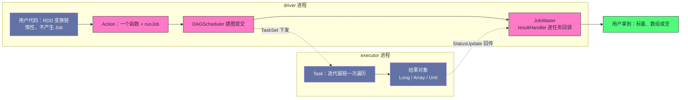
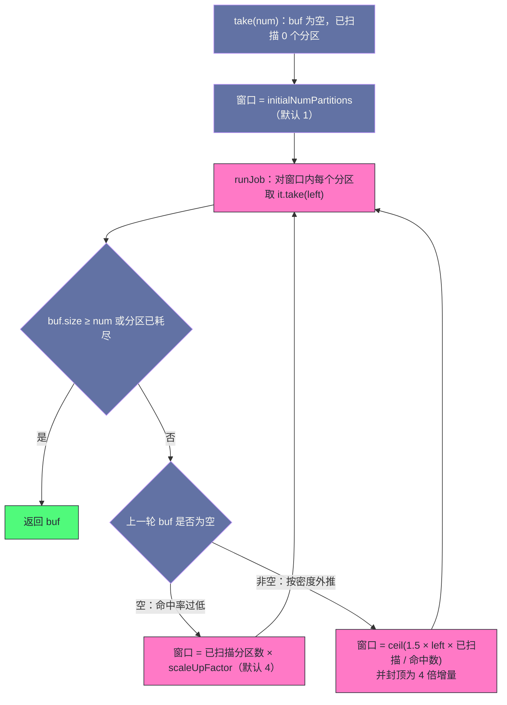
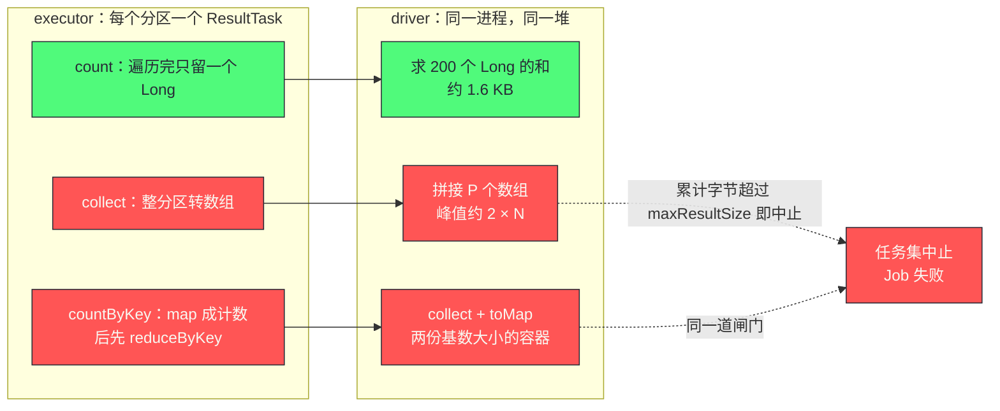
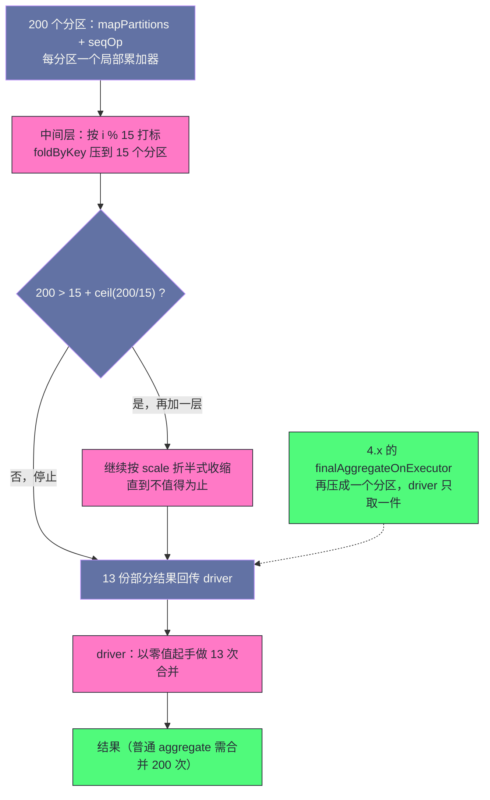
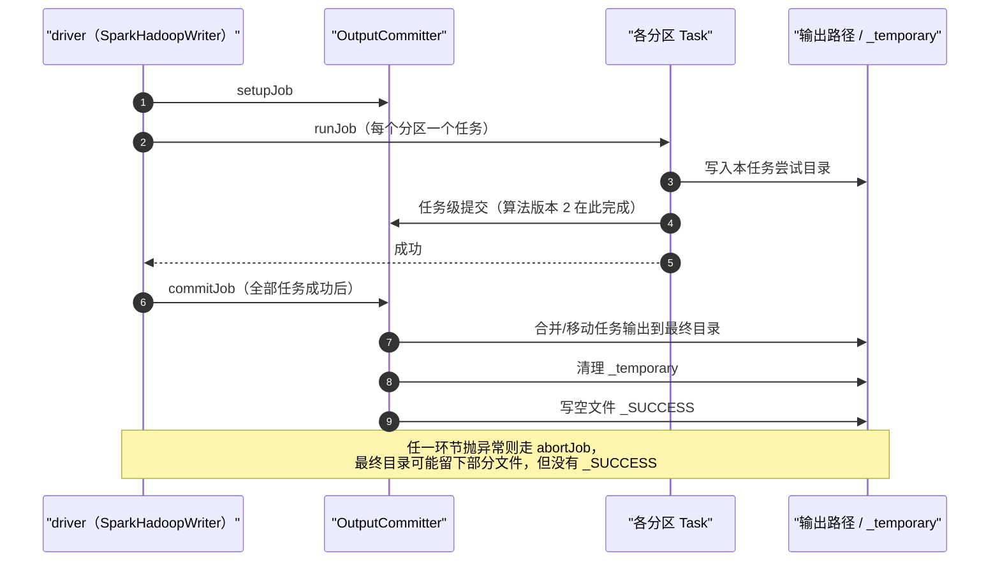
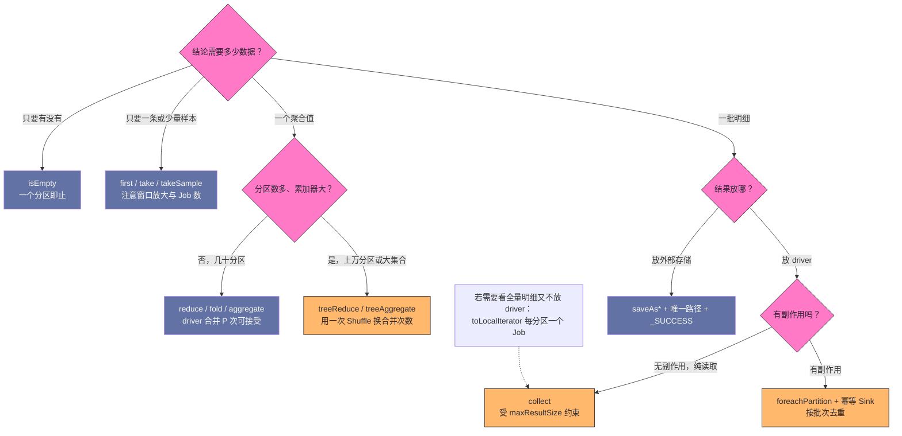

# 4. Spark RDD Action 深度解析：短路边界、结果规模与 Driver 侧代价

**摘要：**

Spark 的入门材料里有一句话被反复引用：Transformation 是惰性的，只有 Action 才会触发计算。这句话没有错，但它只回答了"什么时候算"，没有回答"算多少、搬多少、在哪里合并"。同一个 RDD 上，`first()` 与 `collect()` 都"触发了计算"，代价却相差几个数量级，而两行代码在语法上几乎一样。本文按代价与语义重排 Action，而不是按"统计类、收集类、遍历类"逐个罗列：先看求值边界如何由 `runJob` 收口、为什么一次 Action 未必只有一个 Job；再拆短路的真实粒度——`first` 与 `isEmpty` 只裁最后一个 Stage 的分区窗口，`take` 的窗口由 `spark.rdd.limit.initialNumPartitions` 起步、按 `spark.rdd.limit.scaleUpFactor` 逐轮放大，而上游的 `ShuffleMapStage` 一寸不让；接着把回传量分成三档，说明 `count` 每个分区只回一个 `Long`、`collect` 把全量搬回 driver 并受 `spark.driver.maxResultSize` 的任务集累计闸门约束、`countByKey` 的真正风险是键的基数而不是数据量；然后落到 driver 侧合并，`reduce`、`fold`、`aggregate` 的最终合并按任务完成顺序到达，`zeroValue` 会被用 P+1 次，`treeReduce` 与 `treeAggregate` 存在的理由是把 driver 要合并的份数从 P 压到几十；再讲副作用的语义——`foreach` 在 executor 侧执行且不保证恰好一次，`foreachPartition` 的收益是每个分区复用一次资源而不是每个元素；最后交代 `saveAs*` 的提交协议与 `_SUCCESS` 判据、`lookup` 与 `toLocalIterator` 的隐式代价，给出选型顺序与八条反例。全文口径为 Spark 4.3.0，落点是一句判断：Action 的成本不在"触发计算"这个动作上，而在它把结果回传到哪里、又由谁来做最后一次合并。

**关键词（Keywords）**: Action, 短路, scaleUpFactor, maxResultSize, treeAggregate, foreachPartition, _SUCCESS, 幂等

---

## 第 1 章 Action 是什么：一次显式的结算

### 1.1 惰性换来的不是省事，是优化空间

Spark 的 API 把"描述计算"与"执行计算"分开，这件事在教科书里通常被表述为一句"Transformation 惰性、Action 触发"，仿佛惰性只是为了让代码看起来更像函数式。真正的原因要朴素得多：只有把求值推迟到终点已知的那一刻，引擎才拿得到做决策所需的信息。一条 `map → filter → map` 的链，如果每一步都立即执行并物化，引擎看到的永远是"一个已经算完的中间结果"，它能做的只剩把它再读一遍；而如果链上什么都没算，引擎可以把三段压进同一个 Task 的迭代器链里，用一次遍历把三个函数依次套上去，中途不落一个字节。

这套设计的收益可以拆成三样，都不是"省一次函数调用"这个量级的：其一是算子融合，窄依赖链上的变换被折叠成一次遍历，中间对象在寄存器与栈上就消失了；其二是全局裁剪，只有看到终点才知道这次要算哪些分区，`first()` 只要一个，`saveAsTextFile` 要全部，同一个血缘图在两种终点下被剪成两种形状；其三是让"重算"成为可接受的容错手段，中间结果不落盘，失败时照着血缘重算即可，而重算的作用域由 Shuffle 的地址账本裁剪。

不妨做一个反事实：假设 `map` 每次调用都立即执行并落盘。一条十步的 ETL 会产生十次全量写与十次全量读，每一段都要等前一段彻底写完才能开工，流水线消失，Task 数量按步数翻倍；更麻烦的是语义层面的塌缩——`first()` 与 `collect()` 再没有任何区别，因为你无法在"只想要一条"的时候少算任何一段。**惰性不是性能优化的副产品，它是代价模型的入口：没有延迟求值，就没有"按终点裁剪"这回事。**

行文至此需要限定范围。Transformation 一侧的语义与依赖关系，已在 [[3. Spark核心Transformation操作详解]] 里按算子逐一交代；Action 触发之后 Job 如何排队、如何等待，属于 [[9. Spark_Job生命周期详解]] 的范围；任务算完之后结果如何序列化、走哪条通道回到 driver，已在 [[7. Spark_Executor启动与结果传递]] 里拆到字节级。本篇只做一件事：把 Action 当作一组代价承诺来读，看每个算子对"读多少数据、回传多少字节、在哪里合并、重复执行是否安全"这四件事各承诺了什么。

### 1.2 唯一入口：所有 Action 都落到 `runJob`

`RDD` 上的 Action 有二十来个，写法五花八门，但往下走一层就会汇到同一条路上。`collect()` 的实现是 `sc.runJob(this, (iter: Iterator[T]) => iter.toArray)`，`count()` 是 `sc.runJob(this, Utils.getIteratorSize _).sum`，`foreach(f)` 是 `sc.runJob(this, (iter: Iterator[T]) => iter.foreach(cleanF))`，`saveAsTextFile` 最终也走 `mapPartitions(...).saveAsHadoopFile(...)`，由 `SparkHadoopWriter.write` 内部调一次 `runJob`。**入口只有一个，差别全在传给它的那个函数上**——这个函数决定每个分区交出什么形状的结果，而结果的形状决定后面所有代价。

`SparkContext.runJob` 本身只做四件事：取调用点、清理闭包、把活交给 `DAGScheduler.runJob`、在返回前调用 `rdd.doCheckpoint()`。第三件事里，`DAGScheduler` 会建一个 `JobWaiter` 挂在 Job 上，把 `resultHandler` 注册进去，然后等 Job 结束；第四件事是 checkpoint 的物化时机——这一点在 1.3 节会引出一个反直觉的结论。

下图是这条链路的形状：左侧是完全惰性的描述，右侧是唯一一条把描述变成结果的通路，两条虚线分别是 Task 的下发与结果的回传。



图里左右两侧的连线只有两条：一条下发 Task，一条回传结果。Action 之间的全部差异，都体现在右侧那个结果对象的形状与大小上——这是本文后续所有分档的依据。

### 1.3 一次 Action 未必只有一个 Job

"一个 Action 对应一个 Job"是最常见的直觉，而它至少在两处是错的。

第一处是 `take`。它内部是一个 `while` 循环，每轮只对"这一轮窗口内的分区"调一次 `runJob`，窗口逐轮放大；因此 `take(1000)` 在结果稀疏时可能对应四五个 Job，而不是一个。第二处是 `toLocalIterator`，它的实现是"对每个分区单独跑一次 `runJob`，把数组摊平成迭代器"，源码注释写得很直白：这会产生多个 Spark Job，并建议先把上游缓存起来，否则宽依赖的输入会被反复计算。此外还有两个更隐蔽的：`takeSample` 会先做一次 `count()` 确定元素总量，再抽样并 `collect()`，当请求数量不小于总量时干脆直接 `collect()` 全量打乱后取前 k 个；`checkpoint` 本身不触发计算，但每个 Action 在 `runJob` 返回前都会调 `doCheckpoint()`，于是第一次 Action 结束时会额外提交一个物化 Job，而源码注释提醒，这个 Job 写下的快照可能与本次 Action 实际使用的数据不一致——底层算子不确定或发生过重试时就会这样，要拿到确定的快照，得先用一个显式的 Action 把它冲出来。

| Action | 背后的 Job 数 | 触发点 |
|---|---|---|
| `collect()`、`count()`、`reduce()`、`foreach()` | 1（外加可能的 checkpoint 物化 Job） | `sc.runJob` 一次调用 |
| `take(n)`、`first()`、`isEmpty()` | 1 到 log₄(P) 次，逐轮放大窗口 | `take` 内部 while 循环，每轮一次 `runJob` |
| `toLocalIterator` | 分区数 P 次 | 每分区一次 `runJob`，懒执行 |
| `takeSample(withReplacement, num)` | 至少 2 次（count + 抽样 collect） | 抽样不足时会重抽，次数更多 |
| `saveAsTextFile` 等输出 | 1 次 + 一次 driver 侧 commit | `SparkHadoopWriter.write` 内 `runJob` 与 `committer.commitJob` |

这张表最该记住的是第二行：短路的省与不省，是靠"多跑几个小 Job"换来的。每多一个 Job，就多一次建图、一次 Stage 划分、一次事件循环投递；当 `take` 的窗口长到几十轮时，调度开销本身就会出现在监控曲线上。

### 1.4 四个坐标轴：本文的组织方式

按"统计类、收集类、遍历类、聚合类、取样类、输出类"来分章，是把 API 文档的目录抄一遍，读者读到的是一份更长的清单。本篇换一种分法，对每个 Action 只问四个问题：

1. 能不能不读全量——短路能力，决定扫描的分区数与 Job 数；
2. 结果有多大——回传规模，决定网络流量与 driver 堆占用；
3. 在哪里合并——合并发生在 executor、driver 还是外部存储，决定单点压力；
4. 重复执行是否安全——有副作用的 Action 在重试、推测、Stage 重提下会不会做两遍。

| 坐标轴 | 它约束什么 | 最容易踩空的算子 |
|---|---|---|
| 短路能力 | 扫描分区数、Job 数、调度开销 | `take`、`first`、`isEmpty`、`lookup` |
| 结果规模 | 回传字节数、`maxResultSize` 是否触发 | `collect`、`countByKey`、`collectAsMap` |
| 合并位置 | driver 的 CPU 与堆、合并次数 | `reduce`、`fold`、`aggregate`、`takeOrdered` |
| 副作用语义 | 外部系统收到的重复写入 | `foreach`、`foreachPartition`、`saveAs*` |

这四个问题合起来，覆盖了"如何落地"与"边界在哪"这两问；"是什么"与"为什么出现"已在本章前两节交代；"不这样会怎样"会分散在各章的末节，用反事实的方式讲——把某个机制抽掉，看代价从哪里冒出来。

### 1.5 一个贯穿全文的作业

为了让代价有具体的着力点，笔者设想一个埋点清洗作业 `event_etl`：每天凌晨从 HDFS 读前一天的事件日志，按 200 个分区读入，逐条解析、丢弃字段缺失的脏数据，按 `(app, hour)` 聚合出计数与去重用户数，最后做三件收尾的事——取 20 条样本人工核对、算一次总量对账、把聚合结果按天分区写回 HDFS；另有一条旁路，用 `foreachPartition` 把解析失败的原始行推到告警通道。

```scala
// 输入 200 个分区，窄依赖链，末尾一次 reduceByKey 收口
val raw = sc.textFile("hdfs:///logs/event/dt=2026-11-18", minPartitions = 200)
val parsed = raw.map(parseEvent).filter(_.isDefined).map(_.get)
val agg = parsed
  .map(e => ((e.app, e.hour), e))
  .reduceByKey((a, b) => merge(a, b))          // 唯一的 Shuffle

agg.take(20).foreach(println)                   // 抽样核对
val total = parsed.count()                      // 总量对账
agg.saveAsTextFile("hdfs:///warehouse/event_agg/dt=2026-11-18")
parsed.filter(_.bad).foreachPartition(pushToAlertChannel)  // 旁路副作用
```

这个作业会在后面反复出现：第 2 章看 `agg.take(20)` 与 `parsed.count()` 在同一个作业里如何走出完全不同的路径，第 3 章比较 `count` 与假想中的 `collect` 相差多少字节，第 4 章看 `reduceByKey` 的尾部如果换成 `reduce` 会怎样，第 5、6 章分别看旁路与落盘的重复执行风险。

如果把 Action 比作仓库的盘点结算，Transformation 就是货物在货架之间的搬运——搬多少次都不产生账目；只有盘点那一刻才真正数货。而盘点方式差别极大：只想知道"还有没有货"，翻一个货架就够；要报总数，得数完但只记一个数字；想把货全搬到前台逐件清点，就得先腾出前台那块场地。比喻的技术限定在于：Spark 的"前台"是 driver 的堆，而"腾场地"这件事不由盘点的人决定，由一行配置（`spark.driver.maxResultSize`）事先定好上限，超了就整批退回。

---

## 第 2 章 短路：不是所有 Action 都跑全量

### 2.1 `take` 的分区窗口与两个放大参数

`take(num)` 的实现是一个循环，读源码比读文档更能看清它的脾气：

```scala
// RDD.take（4.3.0），去掉结果拼接后的主干
val scaleUpFactor = Math.max(conf.get(RDD_LIMIT_SCALE_UP_FACTOR), 2)
var partsScanned = 0
while (buf.size < num && partsScanned < totalParts) {
  var numPartsToTry = conf.get(RDD_LIMIT_INITIAL_NUM_PARTITIONS)   // 首轮窗口，默认 1
  val left = num - buf.size
  if (partsScanned > 0) {
    if (buf.isEmpty) {
      numPartsToTry = partsScanned * scaleUpFactor                   // 一无所获：按倍数放大
    } else {
      numPartsToTry = Math.ceil(1.5 * left * partsScanned / buf.size).toInt
      numPartsToTry = Math.min(numPartsToTry, partsScanned * scaleUpFactor)  // 命中：按比例插值
    }
  }
  val p = partsScanned.until(math.min(partsScanned + numPartsToTry, totalParts))
  val res = sc.runJob(this, (it: Iterator[T]) => it.take(left).toArray, p)   // 一轮一个 Job
  res.foreach(buf ++= _.take(num - buf.size))
  partsScanned += p.size
}
```

两个配置项在这里分工。`spark.rdd.limit.initialNumPartitions`（3.4.0 起，默认 1）决定第一轮看几个分区——这个默认值解释了为什么 `first()` 与 `isEmpty()` 在数据正常时几乎不花代价：第一轮只碰分区 0，拿到一条就收工。`spark.rdd.limit.scaleUpFactor`（2.1.0 起，默认 4，实现里再取 `max(值, 2)` 兜底）决定"一无所获时"窗口放大多少倍。

两种情形要分开看，它们的放大逻辑完全不同：

- 一无所获：`buf` 为空，说明这一批分区一条都没命中，于是窗口乘以 4，从 1 到 4、16、64、256 地指数铺开。这条路径的语义是"过滤率极高，必须更激进地试探"。
- 有所命中：`buf` 非空，说明已经知道命中密度，于是按 `ceil(1.5 × 剩余需求 × 已扫描 / 已命中)` 反推"还差多少个分区"，并再乘 1.5 倍冗余，最后封顶在 4 倍增量。这条路径的语义是"按密度外推，但别一步跨太远"。

| 状态 | 窗口公式 | 语义 | 不设这个约束会怎样 |
|---|---|---|---|
| 首轮 | `initialNumPartitions`（默认 1） | 先赌一把数据在头部 | 首轮就扫几十个分区，`first` 变成小 `collect` |
| 一无所获 | `partsScanned × 4` | 过滤率极高，指数试探 | 每轮只多试一个分区，Job 数退化成 O(P) |
| 有所命中 | `min(ceil(1.5 × left × 已扫描 / 命中数), 4 × 已扫描)` | 按命中密度外推 | 线性推进，稀疏数据上多跑十几轮 |
| 已扫完 | 结束，返回 `buf` | 数据总量不足 `num`，返回实际数量 | 抛异常或死循环 |

一个容易误解的地方是"`take` 只算一个分区"。只有 `first()` 在数据正常时接近这个说法；`take(1000)` 是"若干轮、每轮一批分区、每批一个 Job"。若上游有 Shuffle，第一轮 Job 就会把整个 `ShuffleMapStage` 跑完——短路发生在 Stage 内部的分区选择上，不在 Stage 图的结构上。

把两种放大逻辑画在一起，`take` 的控制流就不再是"取前 n 个"这么直白——它是在一条不断重估的窗口上反复试探，直到窗口覆盖了足量的数据，或者分区被耗尽：



### 2.2 `isEmpty` 与 `count`：一个分区的差别

`isEmpty` 的实现只有一行：`partitions.length == 0 || take(1).length == 0`。也就是说，它在非空情况下最多读一个分区（若分区 0 为空，则按 4 倍窗口继续试探），在完全为空时按 1、4、16……逐轮扫完所有分区。`count` 的实现同样只有一行：`sc.runJob(this, Utils.getIteratorSize _).sum`——它扫描每一个分区，只是每个分区只回传一个 `Long`。

```scala
// 常见的写法，代价是两次全量扫描（除非先 cache）
if (rdd.count() > 0) {
  rdd.collect().foreach(process)      // 第一个 Job 白扫一遍，第二个 Job 再扫一遍
}

// 语义等价、代价差一个数量级的写法
if (!rdd.isEmpty()) {
  rdd.collect().foreach(process)      // 判定只碰一个分区（非空即止）
}
```

两者的差别不在"读多少数据"的量级——`isEmpty` 在数据为空时依然要扫完全部 200 个分区——而在数据非空这个最常见的情形：一个是 1 个分区，一个是 200 个。如果这段判定位于一个调度循环里（每分钟一次），差距会被放大成 200 倍的扫描量，而且 `count()` 的结果除了"大于零"之外没有任何信息被用上。

判断"该用哪个"的标准其实不在语义而在下一步：如果接下来马上就要对同一份数据做一次全量 Action，那么先 `count` 再 `collect` 是两次全量；反过来，如果只是要决定"要不要启动后续流程"，`isEmpty` 是唯一正确的选择。真正需要总量时，`count` 就是那个唯一答案，此时它 200 个分区的扫描不是浪费——但别用它做布尔判断。

### 2.3 短路的边界：只裁最后一个 Stage

`first()` 在 Stage 层的效果是"`ResultStage` 只提交一个 Task"。这一点在源码里有一个不对称的细节：`ResultStage` 构造时传给基类的 `numTasks` 是 `partitions.length`（本次 Action 关心的分区子集），而基类的 `numPartitions` 取的是 `rdd.partitions.length`；`first()` 让前者等于 1，后者可能是一万（详见 [[5. Spark_DAGScheduler_Stage划分]] 第 3 章）。

但这只裁掉了最后一个 Stage。上游若有一个 `ShuffleMapStage`，它的 Task 数由父 RDD 的分区数决定，与下游只要几个分区无关。于是 `event_etl` 里的 `agg.take(20)` 与 `agg.collect()` 在 Shuffle 那一侧代价完全相同：`reduceByKey` 的 200 个 map 分区照样要全部算完、全部落盘登记，差别只在最后一步——一个只派 20 个分区以内的 `ResultTask`，一个派全部。

| 场景 | 最后一个 Stage 的 Task 数 | 上游 `ShuffleMapStage` | 短路是否真的省 |
|---|---|---|---|
| `rdd.filter(...).first()`（无 Shuffle） | 1 | 不存在 | 省，扫描量约 1/P |
| `rdd.map(...).take(20)`（无 Shuffle） | 1 到数个窗口 | 不存在 | 省，但 Job 数增加 |
| `rdd.reduceByKey(...).first()`（有 Shuffle） | 1 | 全量 | 只省最后一段读，Shuffle 一分不省 |
| `rdd.join(...).take(20)`（有 Shuffle） | 1 到数个窗口 | 两条全量 | 几乎不省，join 全量照跑 |
| `rdd.persist().reduceByKey(...).first()` | 1 | 首次全量，之后命中缓存 | 第二次起才省 |

这张表是本章最该带走的东西。**短路的收益与"Action 之前有没有宽依赖"强相关**：纯窄依赖链上，`first` 是真的只看一个分区的数据；一旦隔了 Shuffle，上游该算的仍然一个不少，你能省下的只是 shuffle 输出的读取量与最后一段的 Task 数。把 `first` 当成"整条链的快速通道"，在带 join 的作业上会得到完全错误的预期。

### 2.4 `takeOrdered` 与 `top`：有界归并，而不是全量排序

`takeOrdered(num)` 与 `top(num)` 是同一件事的两个方向（`top` 就是 `takeOrdered(num)(ord.reverse)`）。4.3.0 的实现分两段：先在每个分区内用 `collectionUtils.takeOrdered` 取本分区最小的 `num` 个，返回一个长度不超过 `num` 的数组（分区 0 若无数据也会返回一个空数组，保证空 RDD 上的 `reduce` 不至于无元素可合）；再用 `reduce` 把这些数组两两归并，每次归并只保留前 `num` 个。

这个形状决定了它的代价：**网络上是 `num × 分区数` 个元素，driver 内存峰值只有 `2 × num`**。前者随分区数线性增长，后者与分区数无关。`num` 取 10、分区 200 时，网络上只有 2000 个元素，可以忽略；`num` 取 10000、分区 10000 时，就是 1 亿个元素跨网络，而且这些数组本身还要走一遍序列化与 `maxResultSize` 的累计计量——这才是 `takeOrdered` 真正的上限，不是"排序慢"。

反过来设想一个更朴素的实现：每个分区把候选全部交给 driver，由 driver 排序后取前 `num`。它在小数据上结果一样，但 driver 侧的内存峰值变成 `num × P`，与分区数一起膨胀；一旦某个分区数据倾斜，交给 driver 的数组就会畸大。4.x 选择"分区内有界 + driver 归并"，省的是 driver 的内存峰值，付出的是网络上的 `num × P`；这笔交换只有在 `num` 很小时才划算，这正是文档反复提醒"结果数组要小"的原因。

### 2.5 反事实：把短路当成免费

短路不免费，它的成本藏在三个地方。第一是最坏情况下的全扫：`take(20)` 在过滤率极低时会把 200 个分区全部扫完，扫描量与 `collect` 相同，只是分批进行。第二是 Job 数：每一轮窗口都是一次完整的 `runJob`，都要建图、提交 `TaskSet`、走事件循环；`isEmpty` 在空数据上会跑 log₄(200) ≈ 4 个 Job，`take` 在稀疏数据上可能跑五六个。第三是重复读：若上游有 Shuffle 输出且未缓存，每一轮新 Job 都要重新读一遍 shuffle 文件，虽然不重算 map 段，但读盘与反序列化的开销按轮次累加。

因此正确的用法是：`take` 与 `first` 适合"数据大概率在前几个分区命中"的探查，或者"只需要少量样本"的核对；不适合当作"低成本采样"——它取的是分区顺序上的头部，天然带偏，且过滤率一低就退化成全扫。要采样请用 `takeSample` 或 `sample`，要全量请用 `collect` 或输出，别让 `take` 在这两种语义之间模糊着用。

---

## 第 3 章 结果规模：`count` 与 `collect` 的数量级差

### 3.1 三种量纲，别混着算

回传量有三个互不相干的口径，混在一起谈就会得出错误结论。第一个是单个任务的结果大小，它决定这个结果是随状态更新直传，还是先落进 BlockManager 只回一个块号；第二个是任务数，即有多少个结果要经过同一个 driver；第三个是累计字节数，`spark.driver.maxResultSize` 量的就是它。三个口径分别对应三个不同的失败形态：单任务过大是"一个任务寄不出去"，任务数过多是"driver 被大量小结果压住事件循环"，累计超限是"整批被总闸门拦下"。

| 量纲 | 回传形态 | 典型 Action | 回传字节量级 | driver 峰值 |
|---|---|---|---|---|
| O(1) 每分区 | 每分区一个标量 | `count`、`sum`、`min`、`max`、`fold`、`reduce` | 8 字节 × P 量级 | 一个累加器 + P 个标量 |
| O(num × P) 网络 | 每分区一个不超过 `num` 的数组 | `takeOrdered`、`top` | 元素宽度 × num × P | 约 2 × num 个元素 |
| O(num + 窗口) | 逐轮累积的数组 | `take`、`first`、`isEmpty` | 元素宽度 × num | num 个元素 |
| O(基数) | 一个 Map 或去重集合 | `countByKey`、`countByValue`、`collectAsMap`（含数组副本） | 键宽 × 基数 | 约 2 份 Map + 数组 |
| O(N) | 全量数组 | `collect` | 元素宽度 × N | 约 2 × N（拼接前后各一份） |
| O(单分区) | 逐分区数组，用完即弃 | `toLocalIterator` | 最大分区的宽度 × 记录数 | 一个分区的数组 |

### 3.2 `count`：全扫，但只回一个数

`count()` 的实现是 `sc.runJob(this, Utils.getIteratorSize _).sum`。它照样要把 200 个分区从头扫到尾，每一行都要经过解析、过滤、聚合那一整条链——**`count` 省的是回传，不是计算**。每个 `ResultTask` 交回的只是该分区的元素数（一个 `Long`），driver 收到 200 个 `Long` 求和，网络上是 1.6 KB，堆上是一个长度 200 的数组。

这一点值得单独强调，因为"`count` 很便宜"是另一种常见的误判。它便宜在三个地方：不搬数据、不用合并大对象、不依赖 driver 的剩余内存；它不便宜的地方只有一个，却往往是真正的成本大头：整条血缘链的 200 个 Task 一个不少地要跑完。一个需要 40 分钟才能算完的 `reduceByKey`，`count` 之后它依然要花 40 分钟；`collect` 之后也一样，区别只在最后那一步的搬运。真正便宜的是 `isEmpty` 与 `first`——它们连 Task 都只提交一个。

顺带说一句 SQL 层的差别：RDD 的 `count` 一定扫数据，而 DataFrame 上的 `count` 在部分数据源上可以走元数据或统计信息，"数得飞快"属于 SQL 层优化，不属于 RDD 的 `count`，两者同名不同物。

### 3.3 `collect`：全量搬运与一道只增不减的闸门

`collect()` 是 `sc.runJob(this, (iter: Iterator[T]) => iter.toArray)`，每个分区在 executor 上被整体转成数组，序列化后回传，driver 收到 P 个数组之后再做一次 `Array.concat` 拼成一个大数组。注意最后这一步：拼接前 driver 手里已经有 P 个分区数组，拼接后又要一份同样大小的连续数组，所以 `collect` 的峰值内存约等于结果大小的两倍，而不是一倍。这个细节在结果接近 `maxResultSize` 时是致命的——闸门放行的那一批字节，实际会以两倍的形态占住 driver 的堆。

闸门本身在 `TaskSetManager` 上，是任务集级的累计计量：每交付一个结果就把字节数累加上去，只增不减，超过 `spark.driver.maxResultSize`（1.2.0 起，默认 1g）就中止整个任务集；shuffle map 任务被豁免，因为它们交回的是 `MapStatus` 而不是用户数据。三个特征要记住：它是**流量指标而非存量指标**（只累计，不扣回）；判定发生在交付之前，网络与序列化的开销已经花掉；计数每个任务集一份，一个作业里多个 `ResultStage` 各从零开始。机制层面的细节（直传阈值、块中转、取件失败）已在 [[7. Spark_Executor启动与结果传递]] 里拆过，这里只留一条结论：**`maxResultSize` 改变的是"什么时候失败"，不改变"结果有多大"**，把它调大只是把明确的报错换成 driver 的 OOM。

`collectAsMap()` 是 `collect()` 之上再加一层：先拿到全量数组，再逐对塞进一个 `mutable.HashMap`，`sizeHint` 按数组长度预留。峰值因此是"数组 + Map"两份，Map 还有自己的桶数组与节点开销，实际占用往往比数组更大。它还有一个静默的语义陷阱：键重复时后者覆盖前者，而"后者"是谁取决于任务完成的先后，也就是说，同一个 `collectAsMap` 在两次运行里可能给出不同的值，且不会报任何错。

### 3.4 结果规模由基数决定，不由数据量决定

`countByKey()` 的实现是 `mapValues(_ => 1L).reduceByKey(_ + _).collect().toMap`：先做一次 Shuffle 聚合，再 `collect` 全量键值对，最后转成 Map。`countByValue()` 则是 `map(value => (value, null)).countByKey()`，同样带一次 Shuffle。两者的回传规模都等于**键的基数**，与记录总数无关。

这个性质把风险从"数据量"挪到了"基数"上，也解释了两种看似矛盾的现象：200 亿条记录、100 个 App 的 `countByKey` 只回传 100 个条目，driver 毫无压力；1 亿条唯一请求 id 的 `countByValue` 会回传 1 亿个条目，1 GB 的闸门瞬间打穿。前者慢在计算，后者死在搬运。判断一个 `countByKey` 会不会出事，看的不是输入有多少行，而是聚合之后的键有多少个——这个数字提前估不出来，就该先做一次 `distinct().count()`（或者用 `countApproxDistinct`）探一探量级，再决定要不要把它写到 HDFS 而不是搬回 driver。

把三条路径并排放，差别不在计算，而在回传的字节量与形态：



图里三条路径共用同一个 driver 进程与同一份堆，这是它们唯一的共同点：一旦某条路径把堆吃满，另外两条连报错的机会都没有——`OutOfMemoryError` 不会告诉你"是 `collect` 干的"，它只会把整个 `SparkContext` 带走。

### 3.5 核心矩阵：四个坐标轴上的 Action

把前四节的结论压进一张表，就得到本文的主表。"短路能力"一列写的是"能不能不读全量"，不是"快不快"；"结果规模"一列写的是回传 driver 的量纲；"driver 内存风险"一列写的是最坏情形下 driver 堆的处境。

| Action | 短路能力 | 结果规模（回传 driver） | driver 内存风险 | 备注 |
|---|---|---|---|---|
| `count` | 否，全扫 | O(1) 每分区，共 P 个 `Long` | 极低 | 计算量等于全量，回传量可忽略 |
| `first` / `take(n)` | 是，窗口按 4 倍放大 | O(n + 窗口内扫描) | 低到中，n 大时升高 | `take` 是多个 Job，最坏退化为全扫 |
| `isEmpty` | 是，非空即止 | O(1) | 极低 | 实现为 `take(1).length == 0` |
| `takeOrdered` / `top` | 否，全扫 | O(num × P) 网络，O(num) 峰值 | 中，随 `num` 与 P 增长 | 分区内有界数组 + driver 归并 |
| `reduce` / `fold` / `aggregate` | 否，全扫 | O(1) 每分区（累加器宽度） | 中，取决于累加器体积与合并次数 | 最终合并在 driver，按完成顺序 |
| `treeReduce` / `treeAggregate` | 否，全扫 + 一次 Shuffle | O(scale) 个部分结果 | 低于普通聚合 | 用一次 Shuffle 换 driver 合并次数 |
| `max` / `min` / `sum` / `mean` | 否，全扫 | O(1) 每分区 | 极低 | 内部就是 `reduce` 或 `fold` |
| `collect` / `collectAsMap` | 否，全扫 | O(N) 或 O(基数) | 极高，约 2 倍结果 | 受任务集累计闸门约束 |
| `countByKey` / `countByValue` | 否，全扫 + Shuffle | O(基数) | 高，基数不可控时不可预估 | 风险看键的基数，不看行数 |
| `toLocalIterator` | 否，但按分区流式 | O(最大分区) | 中高，且每分区一个 Job | 躲过总量闸门，躲不过单分区 |
| `foreach` / `foreachPartition` | 否，全扫 | O(1)，每个任务交回 `Unit` | 极低 | 副作用在 executor 侧，语义见第 5 章 |
| `saveAsTextFile` 等 | 否，全扫 | O(1)，数据落外部存储 | 低到中，`_SUCCESS` 与文件数另算 | 提交在 driver 侧，见第 6 章 |
| `lookup(key)` | 有分区器时是，单分区 | O(匹配条数) | 中高，热键时不可控 | 无分区器时退化为全扫 + `collect` |

---

## 第 4 章 driver 侧合并：`reduce`、`fold`、`aggregate` 的溢出

### 4.1 合并在哪里发生，按什么顺序发生

`reduce` 的分区函数只做一件事：把一个分区的元素用 `reduceLeft` 折叠成一个值（空分区返回 `None`）；随后在 `runJob` 的结果回调里，把每个分区交回的值与已有结果合并。这个回调不在某个单独线程里排队等所有结果，而是每个任务完成时被调用一次：`JobWaiter.taskSucceeded` 收到一个结果就调一次 `resultHandler(index, result)`，用 `synchronized` 保护互斥，但不按分区下标重排。

这一行决定了三件事。第一，driver 的合并是"流式"的：200 个分区就跑 200 次合并，内存里始终只有"当前累加器 + 刚到的那个值"。第二，合并的**顺序是任务完成顺序**，取决于调度、网络、数据倾斜，而不是分区顺序。第三，`resultHandler` 在 DAGScheduler 的事件线程上执行，合并慢了会占住事件循环，把其他任务的完成通知与心跳堵在队列里。

顺序这一点值得展开。`reduce` 的文档只要求函数满足结合律与交换律，很多人把它当成"结合律就够了"的忠告，实际约束更强：对一个不满足交换律的函数（譬如字符串拼接、列表 `:+`、自定义的"后到者覆盖先到者"），`reduce` 的结果会随任务完成顺序变化——同一份数据、同一份代码，两次运行可能得到两个不同的字符串。源码在 `fold` 的注释里把这句话写得很直接：对非交换的函数，结果可能与单机集合上的 `fold` 不同。**要求交换律不是为了并行效率，是为了让结果可复现。**

### 4.2 `zeroValue` 被用了几次

`fold` 与 `aggregate` 都带一个"中性值"。它在两处被用到：每个分区的折叠从它开始（P 次），driver 侧的合并也从它开始（1 次）。因此对分区数 P 的 RDD，`zeroValue` 一共参与了 P+1 次运算。只要它是真正的单位元（`0` 之于加法、`Nil` 之于拼接），多用几次没有区别；一旦不是，结果就会随分区数漂移——而且漂移量是分区数倍的零值，往往大到一眼能看出来，却一时想不到原因。

```scala
// 三个分区的 [1, 2, 3]，fold 的零值是 1 而不是 0
val rdd = sc.parallelize(Seq(1, 2, 3), 3)
rdd.fold(1)(_ + _)
// 每个分区：1+1=2、1+2=3、1+3=4
// driver 侧：1+2=3、3+3=6、6+4=10
// 结果 10 = 6（元素和）+ 4 × 1（零值用了 P+1 = 4 次）
```

`aggregate` 还多一层麻烦：它允许函数就地修改第一个参数（源码注释明确允许改 `t1`、禁止改 `t2`），这是为了省掉对象分配。driver 侧起手的累加器是 `zeroValue` 的一个克隆，所以用户手里的那个对象不会被写脏；但若 `combOp` 对 `t1` 做原地修改，而分区内部的 `seqOp` 也复用同一个实例，结果就会依赖"哪些合并恰好落在同一个对象上"。用可变容器当零值时，函数必须是纯的（要么返回新对象，要么保证只改自己的 accumulator），否则同一份代码在不同分区数下会给出不同答案。

### 4.3 溢出的两种形态

第一种是累加器体积。把 `aggregate` 的累加器写成 `Set`、`Map` 或 `ListBuffer`，每个分区交回的就是一个集合；driver 每次合并都可能复制一遍正在增长的集合，峰值是最终集合的大小，而**合并的 CPU 成本是 O(P × 集合大小)**——分区数翻十倍，合并工作量也翻十倍，全部压在一个线程上。这类写法的问题不是"结果太大"，而是"合并次数乘以每份结果的体积"。

第二种是合并次数对事件循环的占用。每次合并都发生在 `resultHandler` 里，而 `resultHandler` 被 `synchronized` 保护着，并与 DAGScheduler 的事件投递共用同一个线程。一个分区数上万、每份结果都要做一次序列化反序列化再合并的 Job，会在 driver 上制造一段又长又碎的停顿：任务早就跑完了，driver 还在一个个处理结果，监控上表现为"Stage 已经 100%，Job 却迟迟不结束"。`reduce` 的代价通常不在计算，而在最后那一段串行的收尾。

反过来设想没有这两个约束会怎样：如果 driver 不等所有结果、而是让 executor 之间先做合并，那么 `aggregate` 的语义就得引入"部分聚合的结果类型必须可再次合并"这一层，而 `seqOp` 与 `combOp` 的类型本来就允许不同（`T` 与 `U`）；要让 executor 之间能合并，就必须要求累加器自身可序列化、可合并，这恰恰是 `treeAggregate` 用一次 Shuffle 换来的东西。普通聚合把"合并的自由度"留给了用户，代价是全部合并都在 driver；树形聚合把自由度收窄成"必须可合并"，换来的是把合并搬到 executor 上。

### 4.4 `treeReduce` 与 `treeAggregate` 为什么存在

`treeAggregate` 的实现是一个"先算一层、再看要不要继续"的循环：

```scala
// RDD.treeAggregate（4.3.0），去掉收尾分支后的主干
val aggregatePartition = (it: Iterator[T]) => it.foldLeft(zeroValue)(cleanSeqOp)
var partiallyAggregated: RDD[U] = mapPartitions(it => Iterator(aggregatePartition(it)))
var numPartitions = partiallyAggregated.partitions.length
val scale = math.max(math.ceil(math.pow(numPartitions, 1.0 / depth)).toInt, 2)
// 只有当"多加一层"确实能减少 driver 要合并的份数时才加层
while (numPartitions > scale + math.ceil(numPartitions.toDouble / scale)) {
  numPartitions /= scale
  val curNumPartitions = numPartitions
  partiallyAggregated = partiallyAggregated
    .mapPartitionsWithIndex((i, iter) => iter.map((i % curNumPartitions, _)))
    .foldByKey(zeroValue, new HashPartitioner(curNumPartitions))(cleanCombOp)
    .values
}
partiallyAggregated.fold(copiedZeroValue)(cleanCombOp)   // 最后一段仍在 driver，但只有 scale 份
```

三处设计值得逐一交代。第一，`scale` 的取法是"分区数的 depth 次方根"，`depth` 默认 2，所以 200 个分区对应 `ceil(√200) = 15`：中间层把数据压到 15 个分区。第二，循环条件是"加这一层是否划算"，当分区数已经小于 `scale + ceil(分区数/scale)` 时循环停止——这不是数学上的收敛，而是对"多一次 Shuffle 是否值得"的显式判断，分区少的时候它干脆退化成普通 `aggregate`。第三，中间层用的是 `foldByKey` 而不是 `reduceByKey`，因为要带着那个中性值走；它带来一次 Shuffle，也带来每个分区数目的中间结果在 executor 之间完成合并。

算一下 200 个分区的账：普通 `aggregate` 在 driver 上做 200 次合并；`treeAggregate` 先在 executor 侧压成 15 份，driver 只做 13 次（`200 / 15` 取整）合并。**driver 的合并次数从 P 降到约 P^(1-1/depth)，代价是一次额外的 Shuffle 与一轮额外的 `mapPartitions`。** 当 P 是 200 时，这笔账明显划算；当 P 只有 10 时，多一次 Shuffle 的开销足以抵消收益，这正是那个 `while` 条件存在的理由。

下图把这个三层结构画出来，中间层压到几个分区由 `scale` 决定，而不是由用户指定：



4.x 还给 `treeAggregate` 加了一个 `finalAggregateOnExecutor` 参数：置为真时，最后一层也用 `foldByKey` 配一个 `ConstantPartitioner` 把所有部分结果收进单个分区，在 executor 上完成合并，driver 只取一个累加器。这一改动的针对性很明确——它消掉的正是 4.3 节说的第二种溢出：driver 的合并次数与合并时长。派上用场的场合是那些"结果本身就是个大集合"的聚合：与其把几十份集合搬到 driver 逐个合并，不如让某台 executor 合并完，driver 只收一件。

### 4.5 树形聚合的两个不划算

其一，累加器很小的时候。分区数 200、累加器是一个 `Long` 时，driver 合并 200 次的开销就是 200 次加法，微不足道；`treeAggregate` 却要为此付一次 Shuffle——写盘、读盘、拉取、反序列化。这是典型的"用大炮打蚊子"。

其二，分区数本来就少的时候。那个 `while` 条件会自动跳过加层，所以 `treeAggregate` 在小分区数下不亏；亏的是"分区数中等、累加器偏大但还能放下"的场景——多一层 Shuffle 的固定开销可能比省下的合并还贵。判断标准只有一条：**driver 侧合并的份数是否足够多、每份结果是否足够大**，两个条件同时成立，树形聚合才划算。

| 聚合 Action | 最终合并在哪 | driver 合并次数 | 额外 Shuffle | 适用场景 |
|---|---|---|---|---|
| `reduce` | driver 的 `resultHandler` | P | 无 | 满足交换律与结合律的小结果聚合 |
| `fold` | driver 的 `resultHandler` | P | 无 | 有中性值、结果类型不变 |
| `aggregate` | driver 的 `resultHandler` | P | 无 | 需要换结果类型（如 `(sum, count)`） |
| `treeReduce` | driver，但只收 `scale` 份 | 约 P^(1/2) | 一层到多层 | 分区多、元素大、函数可结合 |
| `treeAggregate` | driver（或 executor，见 `finalAggregateOnExecutor`） | 约 P^(1/2) | 一层到多层 | 分区多、累加器大（集合、直方图） |

表里最容易被忽略的是"额外 Shuffle"这一列：`treeReduce` 与 `treeAggregate` 不是"更好的 `reduce`"，而是"用一次 Shuffle 换 driver 合并次数"的另一种取舍。选它之前先确认两件事——driver 确实被合并压住了，且这次 Shuffle 的代价小于省下的合并。两条都成立时，它是对的；只成立一条时，它只是把 driver 的压力换成了网络与磁盘的压力。

---

## 第 5 章 副作用：`foreach` 的语义不是"执行一次"

### 5.1 重复执行的四个来源

`foreach(f)` 的实现是 `sc.runJob(this, (iter: Iterator[T]) => iter.foreach(cleanF))`：函数在 executor 上对每个元素执行，driver 拿到的是每个分区的 `Unit`。这里没有任何事务、没有回滚、也没有"成功才生效"的提交点——`f` 一旦被调用，它的效果就已经发生在这个世界上了。而 Spark 的执行模型里，同一个分区的函数可能被调用不止一次：

1. 任务失败重试：`spark.task.maxFailures`（默认 4）允许同一个分区的任务重试。第一次尝试在写第 500 条时抛了异常，前 499 条已经写进外部系统，第二次尝试从第 1 条重来。
2. 推测执行：`spark.speculation` 打开后，慢任务的副本会被同时启动，两个副本都可能执行成功并各自写一遍。默认关闭，一旦开启就必须假定重复。
3. executor 丢失导致的重算：节点掉线后，它上面未完成的分区会在别的机器上重算，副作用再来一遍。
4. 作业级重跑：上游数据迟到、调度系统重试、人工补数，都会让同一个 Action 在同一个输出上再跑一次。

把这些叠起来看，"恰好一次"（exactly-once）在 `foreach` 这一层是不可能由 Spark 保证的，它能给的只有"至少一次"（at-least-once）。这不是实现缺陷，而是语义边界：框架知道任务失败了要重算，但它不知道用户在那个函数里往哪个系统写了什么、能不能安全地写第二遍。**把副作用放进 Action 的那一刻，去重的责任就从框架转移到了 Sink 上。**

### 5.2 累加器是唯一的例外

有一类"写"是安全的：累加器（Accumulator）。官方文档给的保证很明确——在 Action 内部更新累加器，每个任务的更新只会被应用一次，重试的任务不会重复计数；在 Transformation 内部更新则可能被应用多次，因为那段代码可能随 Stage 重提或任务重试被反复执行。

这个差别来自提交时机：累加器的增量随任务的成功状态一起回传，失败尝试的增量不会被 driver 采纳；而 `foreach` 里对外部系统的写没有这层"提交"语义，它写的时候就写了。因此 `foreach` 里用累加器统计"处理了多少条脏数据"是可靠的，用累加器统计"往告警通道推了几条"就不一定——后者取决于推送这个动作本身是否幂等，而不是取决于计数准不准。

值得再强调一次：即使累加器在单个 Job 内恰好一次，用户自己重跑一次 Action，它还会再加一次。累加器保证的是"任务级重试不重复"，不是"作业级重跑不重复"。

### 5.3 `foreachPartition` 的收益在"每分区一次"，不在"每元素一次"

`foreachPartition(f)` 与 `foreach` 的差别只有一个：`f` 收到的是整个分区的迭代器，而不是单个元素。这个差别带来的是资源复用——一个分区开一次数据库连接、一个 HTTP 客户端、一个批量缓冲，而不是每条记录开一次。

它的边界同样值得逐条说清。**连接数是分区数，不是 executor 数**：200 个分区就是 200 次连接建立，只是并发受 slot 数限制；把它当成"每台机器一个连接池"会低估连接数。空分区也会被调用：`runJob` 对每个分区都起一个任务，迭代器为空时 `f` 依然被调用一次，于是空分区也会去建一次连接、发一次空批量——`foreach` 则不会，因为它按元素调用函数。资源必须挂到任务完成回调上：用 `TaskContext.get().addTaskCompletionListener` 关闭连接，否则任务被 kill 或抛异常时，连接会随 Task 一起泄漏在外。批量化要自己做：`iterator.grouped(1000)` 之后按批提交，比逐条往返快一到两个数量级，也是把"至少一次"的重复窗口收窄到批级的唯一办法。

```scala
// 每个分区复用一次连接，按批提交；关闭走任务完成回调，避免异常路径泄漏
parsed.foreachPartition { iter =>
  val ctx = TaskContext.get()
  val conn = openConnection()                       // 每分区一次，不是每元素一次
  ctx.addTaskCompletionListener[Unit](_ => conn.close())
  iter.grouped(1000).foreach { batch =>
    conn.upsert(batch)                              // 幂等写入，重复批次不会产生重复行
  }
}
```

反事实很直接：若用 `foreach` 逐元素建连接，200 个分区、每分区 10 万条记录，就是 2000 万次连接建立；即使每次只要 1 毫秒，也是五个多小时纯花在建连上，而这部分开销在监控里会伪装成"executor CPU 不高但任务极慢"，很难定位。

### 5.4 幂等落在 Sink 上：三种做法

既然框架只能给"至少一次"，幂等就必须由 Sink 承担。工程上有三种成熟做法，代价依次上升。

第一种是业务主键覆盖：目标表以业务主键做 upsert（HBase 的 `put`、JDBC 的 `ON CONFLICT`、KV 存储的同键覆盖），重复写入只是把同一行再写一遍。这是最便宜的做法，前提是幂等键存在且写路径支持覆盖。第二种是批次去重：写入时带上 `(作业标识, 分区号, 尝试号)` 或一个批次号，Sink 侧记录已提交批次，重复批次直接丢弃。代价是要维护一张去重表，且去重表本身的一致性又成了新问题。第三种是两阶段提交：`foreachPartition` 内开事务，按分区提交，配合 `commitProtocol` 与外部事务协调器，做到"分区内原子、跨分区最终一致"。它的代价最大，但能覆盖"必须整批可见"的场景。

| Sink 形态 | 重复写入的后果 | 需要的防护 | 典型手段 |
|---|---|---|---|
| 文件系统（`saveAs*`） | 目录已存在则报错，不会静默重复 | 唯一路径 + `_SUCCESS` 判据 | 按天分区、作业实例号做路径后缀 |
| KV 存储（HBase 等） | 同键覆盖，天然幂等 | 主键设计 | 业务主键 + 版本号 |
| 关系库 insert | 主键冲突或重复行 | upsert 或去重表 | `ON CONFLICT`、批次号去重 |
| 消息队列 | 重复消息 | 消费端幂等或生产端幂等 | 幂等 producer、消息键去重 |
| 告警/HTTP 通道 | 重复告警 | 事件 id 去重 | 事件指纹 + 短窗口去重 |

---

## 第 6 章 输出：`saveAs*` 的提交协议与幂等性

### 6.1 四步提交：任务先暂存，作业最后封箱

`saveAsTextFile` 最终落到 `SparkHadoopWriter.write`，它的注释把提交协议写成了四步：任务没有抛异常就提交该任务的输出，否则中止该任务；所有任务都提交之后，提交整个作业，否则中止作业；作业提交过程中抛异常，同样中止作业。落成代码就是 `committer.setupJob` → `runJob` → `committer.commitJob`，异常路径走 `committer.abortJob`。

这个协议的要害是"两段式可见性"：任务先把数据写进输出目录下的临时区（`_temporary` 下按任务尝试编号分的子目录），此时最终路径上什么都没有；只有 job commit 通过，临时区才会被合并或移动到最终目录，并在最后写一个空的 `_SUCCESS` 标记。**在封条贴上之前，柜门是开着的；`_SUCCESS` 就是那张封条。** 它的存在与否，比"目录里有没有文件"可靠得多——一个 Job 失败后，部分任务的输出可能已经提交，目录里已经有文件，但不会有 `_SUCCESS`。

提交协议展开成时序，四个参与方的动作顺序如下：



### 6.2 已存在的目录会报错，这恰恰是保护

写之前，`SparkHadoopWriter` 会调一次 `checkOutputSpecs`（由 `spark.hadoop.validateOutputSpecs` 控制，默认开启，SPARK-4835 提供了按次关闭的开关）。输出目录已存在时，Hadoop 的 `FileOutputFormat` 会抛 `FileAlreadyExistsException`，消息大意是"输出目录已存在"。

这条报错经常被当成麻烦，其实它是这套协议里最便宜的一道保护。如果允许覆盖，一次重跑就会把上一次可能已经成功的输出与这一次写了一半的输出混在同一个目录里，`_SUCCESS` 无法区分"哪一批文件属于哪一次运行"；更糟的是，正在读这个目录的下游作业会在运行中途看到文件数量变化。"目录不能已存在"把"覆盖"这个动作变成了一个显式的、由调度层决定的动作（先删或换路径），而不是一次 Action 的副作用。

于是"输出幂等"的落点不在 `saveAsTextFile` 上，而在路径规划上：按天/小时分区的路径天然不重复；需要重跑同一天时，要么先删目标分区（确认下游不在读），要么把结果写到带实例号的新路径再原子切换（Hive 的 `INSERT OVERWRITE` 在 SQL 层做的就是这件事）。**Action 本身不幂等，幂等是调用方用路径与提交协议构造出来的。**

### 6.3 跨文件并不原子

有一句流传很广的话是"输出操作是原子的，要么全部成功，要么全部失败"，这句话需要修正。原子性只在任务级成立（一个任务要么提交要么中止），job commit 阶段则是逐文件、逐目录的操作：算法版本 1 下，driver 在 commit 时逐个把任务目录合并进最终目录；算法版本 2 下，任务自己完成提交，driver 只做收尾。无论哪个版本，**跨文件的"一次改名"并不存在**，HDFS 上单个 rename 是原子的，多个 rename 的组合不是。

所以 commit 中途失败时，最终目录里可能留下一部分文件，而且没有 `_SUCCESS`；此时读方若只按"目录存在"判断，就会读到残缺数据。这就是下游必须检查 `_SUCCESS` 的原因，也是很多数据管道在读取前先 `fs -test -e .../_SUCCESS` 的原因。`_SUCCESS` 是否写入由 Hadoop 的 `mapreduce.fileoutputcommitter.marksuccessfuljobs` 控制（默认 true）；把它关掉的人，通常是为了避开"目录里多一个文件"对某些工具的干扰，代价是失去这个唯一的完整性判据。

顺带说 Hadoop 3 的一个默认值变化：`mapreduce.fileoutputcommitter.algorithm.version` 的默认值已经是 2，任务在完成时就提交自己的输出，driver 只在最后做一次收尾。对分区数上千的作业，这个差别很实际——算法 1 把上千次合并塞在 driver 的 commit 阶段串行完成，算法 2 把它摊到各个任务上并行做掉。"driver 侧提交是单点"这句话在算法 1 下是主要矛盾，在算法 2 下退化成一个短的收尾动作。

### 6.4 文件数、空分区与压缩

`saveAsTextFile` 的文件数等于分区数：每个任务写一个 `part-0000x`。空分区也会留下一个 0 字节的 part 文件，因为任务照样启动了、`OutputFormat` 照样创建了 writer。这个性质把"分区数"与"小文件数"直接绑在一起，也让 `coalesce(1)` 变成一个诱人但危险的动作：它把 200 个文件合成 1 个，代价是只剩一个任务写全部数据，并行度归零，任务内部仍是流式读取，但写盘带宽成为单点。需要控制文件数时，`coalesce` 适合"减少分区但不做 Shuffle"，`repartition` 适合"重新分布但接受 Shuffle"，两者都不改变"文件数 = 任务数"这条等式。

压缩走 Hadoop 侧配置（`mapreduce.output.fileoutputformat.compress` 与对应的 codec），与 `saveAsTextFile(path, codec)` 的重载等价；`saveAsObjectFile` 是"每 10 个元素打一组、序列化成 `BytesWritable`、写 SequenceFile"，它是 Spark 自己的中间格式，绑定了序列化器与 JVM 类型，不适合作为跨系统交换格式；`saveAsSequenceFile` 要求键值对能转成 Hadoop `Writable`；`saveAsHadoopFile` 是通用出口，指定 `OutputFormat` 与键值类型即可接任何 Hadoop 生态的存储。

| 输出 Action | 数据形态 | 底层格式 | 主要限制 |
|---|---|---|---|
| `saveAsTextFile` | 任意元素，`toString` 后写文本 | `TextOutputFormat` | 元素不能为 `null`（源码显式 `require`）；文件数 = 分区数 |
| `saveAsObjectFile` | 任意可序列化对象 | SequenceFile + `BytesWritable`，每 10 个一组 | 绑定 Spark 序列化器，不适合跨版本/跨语言 |
| `saveAsSequenceFile` | `(K, V)` 且可转 `Writable` | `SequenceFileOutputFormat` | 需要显式转换键值类型 |
| `saveAsHadoopFile` | 任意 `(K, V)` | 指定的 `OutputFormat` | 需自行保证 OutputFormat 与类型匹配 |
| `saveAsNewAPIHadoopFile` | 任意 `(K, V)` | 新版 `OutputFormat` API | 同上，接口版本不同 |

---

## 第 7 章 隐式代价：`lookup`、`toLocalIterator` 与重复计算

### 7.1 `lookup`：一次不存在的 Shuffle 与一次必须的 Shuffle

`lookup(key)` 看起来是"按 key 查值"，直觉上应该走索引；它的实现却只有两个分支。有分区器时，用 `partitioner.getPartition(key)` 算出目标分区，只对这个分区跑一个 Job，在 executor 上把匹配的 value 收进 `ArrayBuffer` 后整体回传。没有分区器时，它退化成 `filter(_._1 == key).map(_._2).collect()`——全分区扫描，再把所有匹配结果搬回 driver。

所以 `lookup` 本身不产生 Shuffle，一次都没有；但要让它在第二个分支上变成第一个分支，你必须先做一次 `partitionBy`——**那才是这次查询真正的 Shuffle，而且它发生在 `lookup` 之前、由你亲手写下**。更麻烦的是，`partitionBy` 的结果如果不 `persist`，下一次 `lookup` 会重新执行整条血缘（包括那次 Shuffle），于是"按 key 查询"变成了"每次查询都重排全表"。这就是"隐式"二字的由来：Shuffle 不在 `lookup` 里，但在使用 `lookup` 的正确姿势里。

还有两个边界。其一，分区器必须与 RDD 实际的分区方式一致，`map`、`filter` 之后分区器会丢失，`lookup` 静默回到全扫分支。其二，热点键会把该分区里所有匹配值堆在 executor 的 `ArrayBuffer` 里再整体回传，匹配条数不受 `num` 约束——一个 key 对应百万条时，这是单任务结果过大，而不是查询慢。

### 7.2 `toLocalIterator`：每分区一个 Job 的流式读取

`toLocalIterator` 的实现是"对第 i 个分区跑一次 `runJob` 拿数组，摊平成迭代器"，源码注释明说这会产生多个 Spark Job，并建议先缓存宽依赖的输入。它的收益是内存：driver 一次只持有一个分区的数组，峰值与"最大分区"成正比，而不是与全量成正比；它的代价有三层——分区数个 Job 的调度开销、每个 Job 一次的建图与事件投递、以及"懒执行"带来的错误时机：异常会在迭代到某个分区时才抛出，此时前面的分区已经处理完了。

它还有一个容易被误用的性质：`toLocalIterator` 绕过了 `maxResultSize` 的总量闸门（每个 Job 只有一个分区结果，累计量很小），却绕不过单分区的体量——如果一个分区有 5 GB，driver 依然要一次性装下这个数组。**能躲过总闸门，不等于不会 OOM；闸门管的是"账"，内存管的是"货"。**

### 7.3 多次 Action 与重复计算

前七章讨论的都是单个 Action 内部的代价，而生产代码里更常见的是同一份数据上连着几个 Action：先 `count` 对账、再 `take` 抽样、最后 `saveAsTextFile` 落盘。没有缓存时，这是三次完整的血缘重算——如果链上有 Shuffle，就是三次完整的 Shuffle 读（写只发生一次，因为 `ShuffleMapStage` 的输出按 `shuffleId` 复用），如果链上没有 Shuffle，就是三次全量解析。

缓存的边界也要说清：`persist` 把分区留在 executor 的存储内存里，`MEMORY_ONLY` 下内存不足会丢块，丢了就按血缘重算；executor 掉线时缓存随之消失；`cache` 不改变 Action 的语义，只改变"重算几次"。checkpoint 则是另一回事——它截断血缘、把数据写到可靠存储，代价是第一次 Action 结束后多一个物化 Job（见 1.3 节），且这个快照与本次 Action 用的数据可能不一致。

### 7.4 并发 Action：可以，但要付两份代价

`AsyncRDDActions` 提供了 `countAsync`、`collectAsync`、`takeAsync`、`foreachAsync`，返回 `FutureAction`。它们说明同一 `SparkContext` 上并发提交多个 Job 是被支持的，风险不在正确性而在资源：两个 Job 争抢同一批 slot，各自的 Stage 互相等待；若它们读同一份未缓存的上游，Shuffle 输出可以复用，但 map 段会各算一遍。

| 写法 | 直觉 | 实际代价 | 替代 |
|---|---|---|---|
| `lookup(key)` 无分区器 | 按 key 查，很快 | 全扫 + `collect` 匹配结果 | 先 `partitionBy` 并 `persist`，或改 `join` 小表 |
| `lookup(key)` 有分区器 | 一次索引查找 | 单分区 Job，热键时单任务结果过大 | 限制匹配条数、或改用 `filter` + 聚合 |
| `toLocalIterator` | 流式读，省内存 | 分区数个 Job，单分区仍全量进堆 | 先 `cache`，或直接写文件后流式读文件 |
| 连续多个 Action 无缓存 | 数据已经在内存里 | 每次都重算血缘 | `persist` + 用完 `unpersist` |
| `collect` 后本地过滤 | 少搬一次 | 搬了全量再筛选 | 先在 RDD 上 `filter` 再 `collect` |

---

## 第 8 章 选型：把代价矩阵换成五个问题

### 8.1 五问的先后顺序

第一问：这次的结论需要多少数据？只需要"有没有"就 `isEmpty`，只需要"一条长什么样"就 `first`，需要"若干条样本"就 `take` 或 `takeSample`。这一问决定要不要短路，也决定 Job 数。

第二问：结论是一个聚合值还是一批明细？聚合值走 `count`、`reduce`、`aggregate`、`min`、`max`，回传量是每分区一个标量；一批明细走 `collect`、`toLocalIterator` 或直接输出，前者受 `maxResultSize` 约束，后者不受。

第三问：合并发生在哪里、份数有多少？分区数上万而累加器又大时，普通聚合会把 driver 变成一个串行合并器，此时 `treeAggregate` 才值得引入；分区数只有几十时，引入树形聚合只是多一次 Shuffle。

第四问：这个动作有没有副作用？有副作用就要假定至少一次，先确认 Sink 是否幂等，再决定要不要批次去重或两阶段提交；`foreach` 里打印日志、写数据库、发消息都属于这一类。

第五问：结果最终放在哪？放 driver 的堆就用收集类算子并接受闸门；放外部存储就用 `saveAs*` 并规划路径与 `_SUCCESS`；两者都要就先写外部再读回小结果，不要用 `collect` 当中转。

这五个问题串起来，其实是一条决策树。图中的每一条分支都对应前面各章的一个结论，走完一遍，大部分"该用哪个 Action"的争论会消失，剩下的只是参数选择。



### 8.2 参数与默认值

下面这张表把散落在各章的配置项集中起来。它们不是"调优参数"，而是"改变语义边界"的参数——调之前要先想清楚自己是在调整失败时机，还是在调整失败概率。

| 配置项 | 默认值 | 它约束什么 | 调大的后果 | 调小的后果 |
|---|---|---|---|---|
| `spark.driver.maxResultSize` | `1g`（1.2.0 起） | 一个任务集累计回传字节数 | 明确的报错变成 driver OOM | 结果稍大就整批失败 |
| `spark.rdd.limit.initialNumPartitions` | `1`（3.4.0 起） | `take`/`first` 首轮扫描的分区数 | 首轮就多算，短路变成小全扫 | 稀疏数据上多跑几轮 |
| `spark.rdd.limit.scaleUpFactor` | `4`（2.1.0 起，实现取 `max(值, 2)`） | 一无所获时窗口的放大倍数 | 单轮扫描量骤增，可能白算 | 轮数变多，Job 数上升 |
| `spark.task.maxFailures` | `4` | 单个任务的重试次数 | 慢失败，副作用重复窗口变大 | 抖动更容易让 Job 失败 |
| `spark.speculation` | `false` | 是否启用推测执行 | 副作用重复的概率上升 | 慢任务拖尾无法缓解 |
| `spark.hadoop.validateOutputSpecs` | `true` | 输出目录存在性校验 | 允许覆盖，下游可能读到混批数据 | 保持"已存在即报错"的保护 |
| `mapreduce.fileoutputcommitter.algorithm.version` | Hadoop 3 起为 `2` | 任务提交还是 driver 提交 | 回到算法 1，driver 侧串行合并 | 保持任务侧并行提交 |
| `mapreduce.fileoutputcommitter.marksuccessfuljobs` | `true` | 是否写 `_SUCCESS` | 保持完整性判据 | 下游失去唯一的"完整"标志 |

### 8.3 三条工程约定

其一，不要把 Action 写进循环。`for (day <- days) rdd.filter(_.dt == day).count()` 是每个分区都要扫一遍全量数据的写法，200 天就是 200 次全扫；正确做法是一次 Action 带上 `groupBy`/`reduceByKey`，在分布式侧算出所有天的统计。Action 的粒度应该与"结论的粒度"对齐，而不是与"业务循环的粒度"对齐。

其二，不要在 driver 侧做本该分布式做的合并。`collect` 回来再用 Scala 的 `groupBy` 聚合，等于把 Shuffle 的工作搬到 driver 上串行做一遍，还要多付一次全量回传；`reduceByKey` 与 `aggregateByKey` 存在的意义就是把这件事留在 executor 侧。

其三，**先估基数与体量，再选算子**。`countByKey` 的风险取决于键的基数，`collect` 的风险取决于结果的字节数，`treeAggregate` 的收益取决于分区数与累加器体积——这三个量都能在跑之前粗估，估不出来就先跑一个小分区样本。选型失败大多不是算子选错，而是这三个量没估。

---

## 第 9 章 边界与反例

### 9.1 反例一：先 `count` 再 `collect`

```scala
// 两次全量：第一次只为判断非空，第二次才取数据
if (rdd.count() > 0) rdd.collect().foreach(process)
```

代价是双倍扫描加双倍 Shuffle 读（若上游有 Shuffle），而判断非空只需要一个分区。正确写法是 `if (!rdd.isEmpty())`，或者在 `collect` 之后判断数组是否为空——后者把两次读合并成一次，代价只是多搬一次可能为空的数组（空数组的搬运成本近似为零）。

### 9.2 反例二：把 `takeOrdered` 当排序用

`takeOrdered(n)` 的语义是"最小的 n 个"，代价是 `n × 分区数` 个元素跨网络。把它当"取排序后的前 n 个"的替代品，在 `n` 很大时（譬如取前 10 万条）会同时踩两个坑：网络上是千万级元素，driver 收到的每个任务结果都要过累计闸门。真要排序，用 `sortBy` 之后 `take`，或者直接 `saveAsTextFile` 落盘；`takeOrdered` 只适合 `n` 小到能放在屏幕上核对的场合。

### 9.3 反例三：用 `foreach(println)` 找输出

`println` 在 executor 的 stdout 里，不在 driver 的控制台。本地模式下两者是同一个进程，所以"本地跑得好好的、上集群就什么都看不到"是最常见的困惑。要看少量数据回 driver 用 `take`，要看全量日志去 executor 日志里找，要收集到可观测系统用带幂等的 Sink。

### 9.4 反例四：以为 `saveAsTextFile` 可以重跑

同一个路径跑第二次会抛 `FileAlreadyExistsException`；把 `spark.hadoop.validateOutputSpecs` 关掉之后确实能跑，但两次运行的文件会混在同一个目录里，`_SUCCESS` 无法区分批次。幂等的正确形态是"按分区规划路径 + 需要重跑时先删目标分区（确认下游不在读）+ 用 `_SUCCESS` 做完整性判据"，而不是把校验关掉。

### 9.5 反例五：`reduce` 依赖顺序、`fold` 用非中性零值

`reduce` 的 driver 侧合并按任务完成顺序到达，非交换函数的结果不可复现；`fold` 与 `aggregate` 的零值被用 P+1 次，非中性零值会让结果随分区数漂移。两者都不会报错，只会在某次扩缩容之后悄悄变化——这类"结果不稳定"的问题比崩溃难查得多，因为没有人会怀疑一行 `fold(0)(_ + _)`。

### 9.6 反例六：`first` 之后以为整条链只算了一个分区

`first` 只让最后一个 Stage 少派任务，上游的 `ShuffleMapStage` 该算的一个不少。带 join 或 `groupByKey` 的链上，`first` 与 `collect` 在 Shuffle 侧的花费完全相同，差别只在最后一段的读取量。把 `first` 当作"整条链的快速试跑"，在最需要它省时间的作业上恰恰省不下来。

### 9.7 反例七：`toLocalIterator` 躲过了闸门

它每个 Job 只有一个分区结果，累计字节数很小，不会触发 `maxResultSize`；但单个分区的数组仍然要整个装进 driver 的堆。分区大小不均时，"最大分区"决定了它会 OOM 还是会跑完——闸门管账，内存管货，两件事。

### 9.8 反例八：把 RDD 的经验搬到 SQL 与 Connect 上

三处口径不同。其一，DataFrame 的 `count` 在部分数据源上可以走元数据或统计信息，RDD 的 `count` 永远扫数据。其二，开启自适应查询执行（Adaptive Query Execution，AQE）之后，Shuffle 之后的分区数可能在运行期被合并或拆分，"这个 Stage 有多少个 Task"在 SQL 作业里是动态的，`spark.sql.shuffle.partitions` 只是初始值。其三，Spark Connect 下结果还多走一条客户端-服务端的消息通道，结果大小另有一套上限，具体阈值以对应版本文档为准。三种口径混着用，最容易得出"同一个 `count` 在两边速度差十倍"的结论，而差异根本不在 `count` 上。

### 9.9 反例速查

| 现象 | 常见误判 | 实际机制 |
|---|---|---|
| driver 在 Job 尾声 OOM | 某个算子的实现有问题 | `collect`/`collectAsMap` 的峰值约为结果的两倍，且闸门只管账不管货 |
| `take(20)` 跑了五分钟 | `take` 只算一个分区 | 过滤率极低时窗口按 4 倍放大，最坏退化为全扫，且每轮一个 Job |
| `first` 很慢 | `first` 应该最快 | 上游有 Shuffle 时 `ShuffleMapStage` 仍要全量计算 |
| `fold` 的结果随分区数变化 | `fold` 与 `reduce` 等价 | 零值被用 P+1 次，非中性零值会累积 |
| 重跑输出目录报错 | Spark 不够幂等 | `checkOutputSpecs` 的保护，幂等要靠路径规划 |
| 下游读到半个目录 | 输出是原子的 | 跨文件不原子，必须等 `_SUCCESS` |
| 写库出现重复行 | `foreach` 执行了两次 | 任务重试、推测执行、Stage 重算导致的至少一次语义 |
| `lookup` 慢得不像查询 | 没有走索引 | 无分区器时退化为全扫 + `collect` |

---

## 第 10 章 落点

回到开头那个判断：Action 是触发求值的唯一途径，这句话成立，但它只界定了"何时算"，没有界定"算多少、搬多少、谁来收尾"。把后半句补上，就得到本文的三条主线。

第一条，短路是分区级的能力，不是算子级的福利。`first`、`isEmpty`、`take` 能让最后一个 Stage 少派任务，甚至让扫描停在前几个分区；但它们裁不动上游的 Shuffle，也裁不动"过滤率极低"这个现实。短路的收益与"Action 之前有没有宽依赖""数据是否集中在头部"两件事强相关，任何把 `first` 当成整链快速通道的预期，在带 join 的作业上都会落空。

第二条，结果规模由基数与形状决定，与数据量只是相关。`count` 每个分区回一个 `Long`，`collect` 把全量拼成数组，`countByKey` 回传的是键的基数——三者的差别不是常数倍的优化空间，而是数量级的台阶。`spark.driver.maxResultSize` 站在这条台阶的末端，它能做的是"及时失败"，做不了"变小"；真正决定结果大小的，是聚合发生在哪一侧。

第三条，合并位置决定了单点在哪里。普通聚合把 P 份结果交给 driver 串行合并，树形聚合用一次 Shuffle 把份数压到 P^(1/2) 量级，`finalAggregateOnExecutor` 再把它压到一份；`saveAs*` 把提交放在 driver，算法版本决定这个单点是"上千次 rename"还是"一次收尾"。没有哪种选择普适更优，只有"这个作业的单点在哪里、它是否承受得起"。

于是面对一个 Action，可以按三步过一遍：先问它需不需要读全量，再问它把多少字节搬回 driver，最后问它在哪一侧做最后一次合并。三步走完，绝大多数"这个 Action 为什么慢"会落到一个具体机制上，而不是停在"加内存"或"调并行度"这类无法验证的建议上。

Action 的边界也在移动。流水线 Shuffle 试图让下游不必等上游全部产出，AQE 让 Stage 的划分在运行期还能改，Spark Connect 把结果回传又加了一层通道——它们各自在改写本文某一条结论的前提。但这些改动会不会让"Action 的代价"这件事变简单，目前仍然言之尚早；至少在 RDD 这一层，读全量、搬结果、单点合并这三笔账，仍然要一笔一笔地算。

---

## 参考资料

1. Zaharia M., Chowdhury M., Das T., et al. Resilient Distributed Datasets: A Fault-Tolerant Abstraction for In-Memory Cluster Computing. NSDI 2012. https://www.usenix.org/system/files/conference/nsdi12/nsdi12-final138.pdf
2. Apache Spark 源码（4.3.0）：`core/src/main/scala/org/apache/spark/rdd/RDD.scala`，`take`、`isEmpty`、`takeOrdered`、`reduce`、`fold`、`aggregate`、`treeAggregate`、`collect`、`toLocalIterator`、`saveAsTextFile` 的实现。https://github.com/apache/spark/blob/v4.3.0/core/src/main/scala/org/apache/spark/rdd/RDD.scala
3. Apache Spark 源码（4.3.0）：`core/src/main/scala/org/apache/spark/rdd/PairRDDFunctions.scala`，`lookup`、`countByKey`、`collectAsMap` 的实现。https://github.com/apache/spark/blob/v4.3.0/core/src/main/scala/org/apache/spark/rdd/PairRDDFunctions.scala
4. Apache Spark 源码（4.3.0）：`core/src/main/scala/org/apache/spark/SparkContext.scala`，`runJob` 与 `rdd.doCheckpoint()` 的调用位置。https://github.com/apache/spark/blob/v4.3.0/core/src/main/scala/org/apache/spark/SparkContext.scala
5. Apache Spark 源码（4.3.0）：`core/src/main/scala/org/apache/spark/scheduler/JobWaiter.scala`，`taskSucceeded` 对 `resultHandler` 的逐任务回调。https://github.com/apache/spark/blob/v4.3.0/core/src/main/scala/org/apache/spark/scheduler/JobWaiter.scala
6. Apache Spark 源码（4.3.0）：`core/src/main/scala/org/apache/spark/scheduler/TaskSetManager.scala`，`canFetchMoreResults` 的累计计量与 shuffle map 任务豁免。https://github.com/apache/spark/blob/v4.3.0/core/src/main/scala/org/apache/spark/scheduler/TaskSetManager.scala
7. Apache Spark 源码（4.3.0）：`core/src/main/scala/org/apache/spark/internal/io/SparkHadoopWriter.scala`，两段式提交与 `checkOutputSpecs` 调用点。https://github.com/apache/spark/blob/v4.3.0/core/src/main/scala/org/apache/spark/internal/io/SparkHadoopWriter.scala
8. Apache Spark 源码（4.3.0）：`core/src/main/scala/org/apache/spark/internal/config/package.scala`，`spark.rdd.limit.initialNumPartitions`、`spark.rdd.limit.scaleUpFactor`、`spark.driver.maxResultSize` 的默认值与引入版本。https://github.com/apache/spark/blob/v4.3.0/core/src/main/scala/org/apache/spark/internal/config/package.scala
9. Apache Hadoop 源码（3.x）：`FileOutputCommitter.java`，`_SUCCESS` 标记（`SUCCEEDED_FILE_NAME`、`mapreduce.fileoutputcommitter.marksuccessfuljobs`）与 `mapreduce.fileoutputcommitter.algorithm.version` 的默认值。https://github.com/apache/hadoop/blob/trunk/hadoop-mapreduce-project/hadoop-mapreduce-client/hadoop-mapreduce-client-core/src/main/java/org/apache/hadoop/mapreduce/lib/output/FileOutputCommitter.java
10. Apache Spark 4.3.0 文档：RDD Programming Guide，Action 列表与累加器在 Action 内恰好一次的说明。https://spark.apache.org/docs/latest/rdd-programming-guide.html
11. Apache Spark 4.3.0 文档：Configuration，`spark.driver.maxResultSize`、`spark.rpc.message.maxSize`、`spark.speculation` 等默认值。https://spark.apache.org/docs/latest/configuration.html
12. Apache Spark JIRA：SPARK-4835（输出目录校验开关）。https://issues.apache.org/jira/browse/SPARK-4835

---

> [!note] 思考题
> 1. `first` 只让最后一个 Stage 少派任务，上游 `ShuffleMapStage` 一寸不让。如果要求"只算一个分区就能拿到第一条结果"在带 Shuffle 的链上成立，需要改动的是 Stage 划分、Shuffle 读取，还是提交协议？
> 2. `reduce` 的 driver 侧合并按任务完成顺序到达，因此非交换函数的结果不可复现。既然要求交换律已经能保证正确性，为什么 Spark 不额外把结果按分区顺序重排？
> 3. `treeAggregate` 的默认 `depth = 2`，200 个分区被压到 15 个中间分区。若把 `depth` 调到 4，driver 合并次数会更少，代价是什么？那个 `while` 条件为什么用"是否值得"而不是"是否还能再加一层"？
> 4. `saveAsTextFile` 在 commit 中途失败会留下部分文件且没有 `_SUCCESS`。如果要求"下游永远读不到残缺批次"，除了依赖 `_SUCCESS`，提交协议还能怎么改？
> 5. `toLocalIterator` 每分区一个 Job，绕过了 `maxResultSize` 的总量闸门，却可能因单个超大分区 OOM。要同时限制"总量"与"单分区"，应该在哪一层加约束？
> 6. `foreach` 的副作用不保证恰好一次，而累加器在 Action 内恰好一次。为什么框架能对累加器给出保证，却不能对用户自定义的副作用给出同样的保证？
