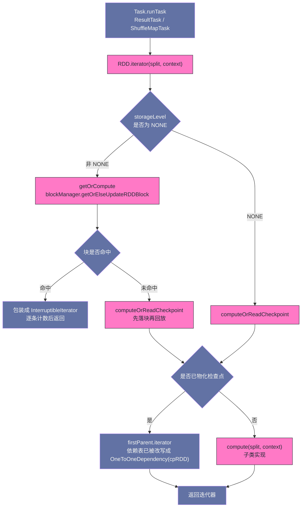
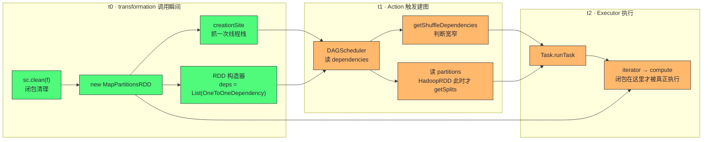
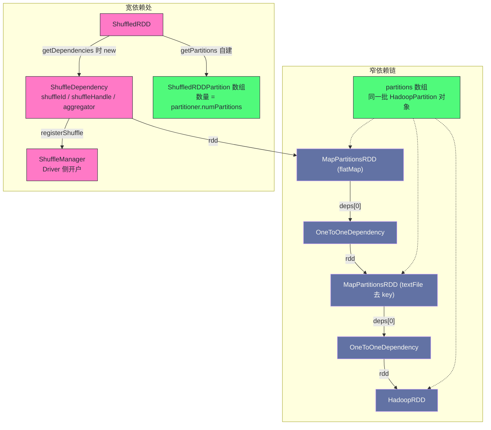
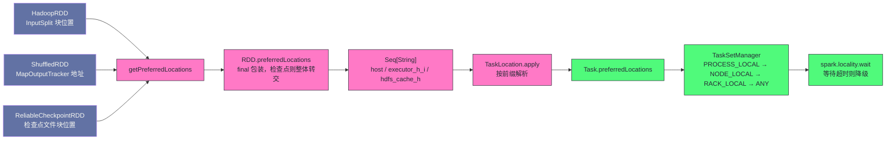
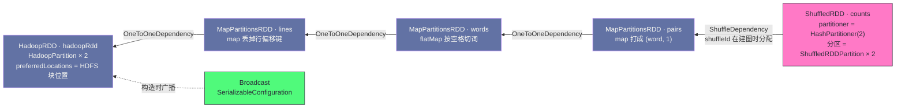
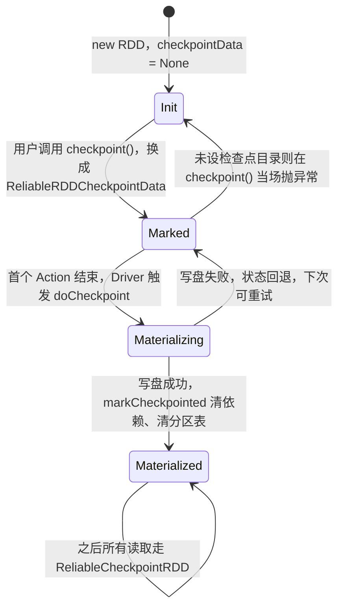

# 5. Spark RDD 内部机制：五要素契约、依赖对象与一次转换的成本

**摘要：**

2012 年 4 月，伯克利 AMPLab 在 NSDI 上给弹性分布式数据集（Resilient Distributed Dataset，RDD）下定义时，只用五行枚举交代了它的内部构成：一组分区、一个作用于每个分区的计算函数、一张依赖表、一个可选的分区器、一组可选的优先位置。十几年过去，Spark 4.3.0 的 `RDD.scala` 类注释里这五行一字未改，变的只是五行背后那层被 final 包住的契约。这篇文章要回答两个问题：五个要素在源码层各自归谁实现、又分别被谁消费；以及一次 transformation 落到内存里，究竟新建了哪些对象、代价记在哪一栏账上。

行文沿五问推进：先把五要素两侧的"实现者"与"消费者"摊开，说明基类为什么非要用 final 把三个元信息方法包起来；再走一遍 `**compute**` 的调用链，把"每次调用只产出该分区"拆成几条可验证的子句，并交代 `**iterator**` 与 `computeOrReadCheckpoint` 的分工；然后把一次 `map` 拆成对象清单，算清它的真实成本，解释 immutable 与"转换只建对象"之间的关系；接着对比 `OneToOneDependency` 与 `ShuffleDependency` 在内存中的字段形状，指出 `**ShuffledRDD**` 把依赖构造推迟到 `**getDependencies**` 意味着什么；之后处理 `partitioner` 与 `preferredLocations` 这两个可选属性——它们排在最后，代价却最贵；最后用 WordCount 的对象图把前述机制串成一个可以数出来的结构，并单列边界与反例：被改写的依赖表、`Range**Partitioner**` 在构造期跑的那个 Job，以及自定义 RDD 最容易踩的三处。文章口径是 Spark 4.3.0（默认 Scala 2.13 构建），源码细节以对应版本文档或源码为准。

**关键词（Keywords）**: **getPartitions**, compute, OneToOneDependency, ShuffleDependency, ShuffledRDD, **MapPartitionsRDD**, Partitioner, preferredLocations, computeOrReadCheckpoint, RDDOperationScope, **惰性求值**

---

## 第 1 章 五要素：一份被 final 包住的契约

### 1.1 论文里的五行，源码里的五个成员

2012 年那篇论文对 RDD 的构成给了一个极为克制的枚举，而这份枚举至今仍是理解 Spark 的入口。它说的不是"RDD 是一个分布式集合"这类比喻，而是"一个 RDD 由这五样东西刻画"，五样东西合起来足以让一台机器把这个数据集重新算出来。Spark 4.3.0 的 `RDD.scala` 类注释原样保留了这五条，紧接着往下三十行，就是它们在 Scala 里的形态：

```scala
// 五要素的源码形态（RDD.scala，去掉注解与文档）
def compute(split: Partition, context: TaskContext): Iterator[T]
protected def getPartitions: Array[Partition]
protected def getDependencies: Seq[Dependency[_]] = deps
protected def getPreferredLocations(split: Partition): Seq[String] = Nil
@transient val partitioner: Option[Partitioner] = None
```

这五行的形状本身就透露了分工。`compute` 是唯一的抽象方法、也是唯一公开的入口；其余四个里，`getDependencies` 与 `**getPreferredLocations**` 都带了默认实现，`partitioner` 干脆就是一个默认 `None` 的 val。换句话说，一个 RDD 只要实现 `getPartitions` 与 `compute` 就能跑起来，另外三样是在需要时才被覆写的——`parallelize` 造出来的 `ParallelCollectionRDD` 没有分区器、没有优先位置，照样能算出结果。

但这个"够用即可"的印象会误导人。四个"可选"要素恰恰是 Spark 全部调度优化的着力点：没有 `getDependencies`，DAGScheduler 无从划 Stage；没有 `partitioner`，`reduceByKey` 只能退化成一次无条件 Shuffle；没有 `getPreferredLocations`，HDFS 上的任务会被随机撒到集群各处，把本地读变成跨机架传输。可选不等于次要，它只表示这些信息有合理的缺省值。

### 1.2 谁实现，谁消费

把五要素两侧摊开，会发现"实现者"永远是具体子类，而"消费者"散布在 Driver 与 Executor 两侧，并且消费的时机完全不同。这张表是后文所有讨论的索引：

| 要素 | 源码形态 | 由谁实现 | 被谁消费 | 消费时机 |
|---|---|---|---|---|
| 分区表 | `getPartitions` | 每个具体 RDD：`HadoopRDD` 调 `getSplits`，`MapPartitionsRDD` 直接返回父的数组 | `RDD.partitions`（final，带下标校验）→ DAGScheduler 算 Stage 的分区数与 Task 数 | 建图阶段，Driver 端，一次 |
| 计算函数 | `compute(split, context)` | 每个具体 RDD，无默认值 | `computeOrReadCheckpoint` → `iterator` → `Task.runTask` | 执行阶段，Executor 端，每分区每次尝试 |
| 依赖表 | `getDependencies` | 具体 RDD；窄依赖链默认由构造器塞入 `deps` | `RDD.dependencies`（final）→ DAGScheduler 划 Stage、Task 端 `**firstParent**` | 建图与执行两侧都读 |
| 分区器 | `partitioner` | 可覆写的 val，默认 `None` | `Partitioner.defaultPartitioner`、`partitionBy` 的相等判断、`CoGroupedRDD` 的宽窄判定 | Transformation 调用瞬间，Driver 端 |
| 优先位置 | `getPreferredLocations` | 默认 `Nil`，`HadoopRDD`／`ShuffledRDD` 覆写 | `RDD.preferredLocations`（final）→ `TaskLocation` → `TaskSetManager` 的本地性级别 | 提交 Task 之前，Driver 端，每分区一次 |

### 1.3 final 包装的三件事

上表第三列都写了 final，这不是风格洁癖。基类把 `partitions`、`dependencies`、`preferredLocations` 三个方法封成 final 之后，才可能在子类实现之上统一加三样东西：缓存、校验、以及检查点带来的覆写。

缓存这层最直白。`partitions` 用一个 `partitions_` 字段记住 `getPartitions` 的返回值，`dependencies` 用 `dependencies_` 记住 `getDependencies` 的返回值，两者都在 `stateLock` 下做双重检查。源码注释明说"这个方法只会被调用一次，因此可以在里面做耗时的计算"，`HadoopRDD.getPartitions` 正是这么干的——它会真的去连 NameNode、列文件、切分片。

校验这层藏得比较深，但很值得记：

```scala
// RDD.partitions，4.3.0
partitions_ = getPartitions
partitions_.zipWithIndex.foreach { case (partition, index) =>
  require(partition.index == index,
    s"partitions($index).partition == ${partition.index}, but it should equal $index")
}
```

分区数组的下标必须等于分区自己的 `index` 字段，这一条是契约而不是约定，违反了会在第一次访问 `partitions` 时抛异常。它的意义在第 2 章会显现：`compute(split, context)` 拿到的 `split` 就是这个数组里的元素，而 `MapPartitionsRDD` 会把 `split.index` 当成"分区号"传给用户函数。

覆写这层是检查点机制的全部机关，也是本文第 7 章要回到的地方：三个 final 方法的第一行都是同一个模式——若 `checkpointRDD` 存在，就不看子类的实现，改看检查点 RDD。

```scala
final def partitions: Array[Partition] =
  checkpointRDD.map(_.partitions).getOrElse { /* 走子类实现 + 缓存 */ }

final def dependencies: Seq[Dependency[_]] =
  checkpointRDD.map(r => List(new OneToOneDependency(r))).getOrElse { /* 走子类实现 + 缓存 */ }

final def preferredLocations(split: Partition): Seq[String] =
  checkpointRDD.map(_.getPreferredLocations(split)).getOrElse { getPreferredLocations(split) }
```

### 1.4 反事实：不封 final 会怎样

假如基类不做这层包装，让每个子类自己实现 `partitions`，最先坏掉的是检查点。检查点要在不改变 RDD 身份的前提下，把"这个 RDD 的数据从哪来"整体换成一份落盘文件；如果 `dependencies` 由各子类各写一遍，那么"检查点之后依赖表指向哪里"这件事就得在几十个子类里各改一次，漏一个就出现"血缘截短了、但某个算子仍按老父 RDD 去读"的错位。

其次是位置信息会分叉。`preferredLocations` 一旦交给子类自定义，`ReliableCheckpointRDD` 那种"按检查点文件在 HDFS 上的块位置给建议"的逻辑就没法被透明接管——检查点后的 RDD 仍会返回原始数据源的位置，把任务调度到早已不是数据所在的地方。调度器不会报错，它只会安静地做一次全网络读取。

最后是校验会消失。`require(partition.index == index)` 这一行只在基类里写一次才有意义；交给子类就等于交给每个 RDD 作者，而自定义 RDD 的 `index` 写错是最常见的低级错误之一。

顺带说清 `partitioner` 为什么是 `val` 而不是 `def`。它必须在 RDD 构造完成的那一刻就可比较——`partitionBy` 的相等判断、`CoGroupedRDD` 的宽窄判定、`preservesPartitioning` 在 `MapPartitionsRDD` 构造期的继承，读的都是这个字段。若写成方法，每次读都要重算一遍；更重要的是，窄依赖链上"分区器有没有丢"这件事必须在建对象时就定下来，否则下游拿到的是"稍后可能变"的答案。`MapPartitionsRDD` 里那一行 `override val partitioner = if (preservesPartitioning) firstParent[T].partitioner else None` 就是把这个判断固化进字段的实例。

### 1.5 构造器的两个参数

`RDD` 的构造器只有两个参数，且都带 `**@transient**`：

```scala
abstract class RDD[T: ClassTag](
    @transient private var _sc: SparkContext,
    @transient private var deps: Seq[Dependency[_]])
  extends Serializable with Logging
```

`_sc` 之所以是 `@transient`，是因为 Executor 端不需要、也不该拿到 Driver 的 `SparkContext`：任务序列化时会跳过这个字段，反序列化之后的 RDD 在 Executor 上 `_sc` 为 null。源码对 `sc` 的访问走一个私有 getter，一旦 `_sc == null` 就直接抛 "RDD lacks a SparkContext"。用户在 `map` 的函数体里写 `rdd.context`、或者调 `rdd.count()`，看到的正是这个错误——它不是配置问题，而是"Driver 专有对象被带到了 Executor"的必然结果。

`deps` 同样是 `@transient`，但理由不同：依赖表是 Driver 端的调度信息，Executor 只需要 `compute`。两个参数的含义也划分了两种 RDD 的建法——`new MapPartitionsRDD(this, f)` 走单参重载，父 RDD 被塞进 `deps`，依赖在构造时就有了；`new ShuffledRDD(prev, part)` 显式传 `Nil`，依赖表留空，等 `getDependencies` 再填。同一个基类，两种填表方式，前者对应窄依赖，后者对应宽依赖，这条分界会在第 4 章被展开。

## 第 2 章 `compute` 的调用契约

### 2.1 一条从 Task 到迭代器的链

`compute` 不在 Driver 上被调用，也不由任何算子直接调用。它的唯一常规调用方是 Executor 端的 `RDD.iterator`，而 `iterator` 由 Task 的 `runTask` 触发：`ResultTask` 是 `func(context, rdd.iterator(partition, context))`，`ShuffleMapTask` 是把 `rdd.iterator(partition, context)` 交给 shuffle writer 写盘。`iterator` 本身只有一次分叉：

```scala
// RDD.iterator，4.3.0
final def iterator(split: Partition, context: TaskContext): Iterator[T] = {
  if (storageLevel != StorageLevel.NONE) {
    getOrCompute(split, context)             // 有缓存：先查块，未命中再算并落块
  } else {
    computeOrReadCheckpoint(split, context)  // 无缓存：直接算，或读检查点
  }
}

private[spark] def computeOrReadCheckpoint(split: Partition, context: TaskContext) =
  if (isCheckpointedAndMaterialized) firstParent[T].iterator(split, context)
  else compute(split, context)
```

这两段合起来回答了一个常见疑问：`iterator` 是调度侧与计算侧的唯一接口，`computeOrReadCheckpoint` 是它的第二层分叉，`compute` 只是最后那个真正干活的分支。缓存、检查点、直接计算三种情形在这里被压成一个"返回迭代器"的签名，Task 那一侧完全不必知道当前走的是哪条路。

`computeOrReadCheckpoint` 里那句 `firstParent[T].iterator(...)` 值得单独停一下。`firstParent` 的实现是 `dependencies.head.rdd`，而第 1 章那张表里 `dependencies` 是 final 的，检查点之后它返回的是 `List(new OneToOneDependency(checkpointRDD))`。于是"读检查点"不会被写成一个显式分支：依赖表被改写之后，`firstParent` 自动变成了检查点 RDD，`iterator` 递归下去自然就落到 `ReliableCheckpointRDD.compute` 上，从 HDFS 读文件。一行 if 背后是一次依赖表的整体替换，这是 RDD 里最优雅的一处设计。

下图把 `iterator` 的三条路径与五要素的落点画在一起。注意三条路径最终都收敛到"返回一个迭代器"这个契约上，而它们的差别只在数据从哪里来。



### 2.2 契约的四条子句

"每次调用要产出且只产出该分区"这句话太短，短到容易被当成一句正确的废话。把它展开，是四条互相独立的约束。

第一条是空间约束：只算 `split` 指定的那一个分区，不许多算。这条听起来平凡，但它排除了"顺便把相邻分区也算出来缓存着"这种自作聪明的做法：多算出来的分区不会被任何下游消费，纯属白烧算力；更麻烦的是缓存块按 `(rddId, partitionIndex)` 命名，两个 Task 都去顺手算同一分区时，块里最终是哪一份取决于谁先写完，正确性就挂在了时序上。

第二条是时间约束：返回迭代器而不是集合，且允许被惰性消费。这不是性能优化，是可行性前提。`filter` 后面接 `take(10)` 时，Task 只需要从迭代器里取够十个元素就能收手；若 `compute` 返回的是 `List`，那么"只取前十"和"扫完全量"就没有区别，`first()` 的语义也随之崩塌。

第三条是状态约束：不得跨分区共享可变状态。这条约束在单分区单 Task 的常态下像是学术洁癖，但 `coalesce` 会把它变成真问题——`CoalescedRDD` 在一个 Task 里依次对多个父分区调用 `iterator`，源码在 `HadoopRDD.compute` 的字节统计回调里专门留了一句注释（SPARK-13071）说明这件事：同一个 Task、同一个线程里连续算多个分区时，前一个分区写下的线程局部统计必须清理，否则会污染后一个分区。用户函数里的累加器式写法（在闭包外捕获一个 `var` 计数器）踩的就是同一条线。

第四条是次数约束：不假设自己被调用几次。同一个分区在一次尝试里通常只算一次，但下面几种情形都会让它多算：同一 RDD 上先后两次 Action、缓存块被淘汰后的重算、Stage 重提。因此 `compute` 里不能有"第一次运行时建表、之后复用"这类依赖调用次数的逻辑。

### 2.3 一个真实的坑：迭代器被消费两次

四条约束里最容易被忽略的是第二条的下半句——迭代器只能被消费一次。在不缓存的路径上，`iterator` 把 `compute` 的返回值原样交出去，谁拿到谁遍历，遍历完就没了；在缓存的路径上，`getOrCompute` 把同一个迭代器交给 `getOrElseUpdateRDDBlock`，由 BlockManager 完整消费一遍写进块，然后从块里回放一个新的迭代器给调用方。源码里那个 `readCachedBlock` 标志就是在区分这两件事：命中已有块要计输入指标，自己刚算出来的块则不必重复计。

这解释了一个常见的现象：给一个 RDD 加上 `cache()` 之后，某些任务的耗时反而从"一遍"变成"一遍半"。不是缓存偷了算力，而是原来那条"边算边吐"的流水线被迫先走完落块这一步才回放。缓存的收益要在这之后才出现。

还有一条隐含契约值得补上：`compute` 抛出异常时，调用方拿不到"算了一半"的迭代器，这个分区的产出整体作废，重试会从 `compute` 的第一行重新开始。因此它里面不能放不可重复的副作用——往外部系统写一条记录、给累加器加一次数，都会在重试时被重复执行。Spark 对此没有防护，只在文档里提示：累加器在 Task 重试或 Stage 重提下可能被重复累加，不能当精确一次计数器用。"能重算"这个前提不只约束数据，也约束写数据的人。

### 2.4 比喻：传送带与仓库

把 `compute` 想成一道工序的工位：上游把料一件件放到传送带上推过来，工位只负责处理经过自己面前的料，处理完继续往下推，不负责囤货。工序之间没有中间仓库，因为料从没落地；某个工位慢了，上游会被传送带堵住，但整条线不需要停下来对齐库存。

比喻的技术限定在于：真实的传送带只有一条，Spark 的"传送带"是按分区切开的多条并行支线，每条支线在各自的 Task 里独立运行，彼此之间唯一的耦合是 `partitioner` 决定的键归属。一旦这条耦合被打破——也就是发生 Shuffle——传送带就必须断开，因为下游的工位要按另一套规则重新分配料，而这套规则只能在整个上游都产完之后才能落实。Shuffle 的物理形态与代价，属于另外两篇的范围（见 [[5. Spark_DAGScheduler_Stage划分]] 与第 5 章的分区器讨论），这里只交代它在对象层的表现。

### 2.5 分区号从哪里来

`mapPartitionsWithIndex` 常被当成"能拿到分区号的魔法"，其实分区号的来源朴素得没有任何悬念：

```scala
def mapPartitionsWithIndex[U: ClassTag](
    f: (Int, Iterator[T]) => Iterator[U],
    preservesPartitioning: Boolean = false): RDD[U] = withScope {
  val cleanedF = sc.clean(f)
  new MapPartitionsRDD(
    this,
    (_: TaskContext, index: Int, iter: Iterator[T]) => cleanedF(index, iter),
    preservesPartitioning)
}

// MapPartitionsRDD 侧
override def compute(split: Partition, context: TaskContext): Iterator[U] =
  f(context, split.index, firstParent[T].iterator(split, context))
```

`compute` 把 `split.index` 当成第二个参数交给内部函数，`mapPartitionsWithIndex` 做的只是把用户的二参数函数包成三参数、把 `TaskContext` 丢掉。所以分区号就是 `Partition.index`，而它在第 1 章那条 `require` 里已经被校验过"必须等于数组下标"。`mapPartitions` 的实现在此基础上再剥一层——它的函数签名里没有下标，因为它不需要。

另一条获取途径是 `TaskContext.get().partitionId()`，返回的是"本次 Task 要算的那个分区号"。两者常态下相等，但不等价：`TaskContext` 记的是最终 RDD 的分区号，`split.index` 记的是当前这个 RDD 的分区序号。`coalesce` 这类让一个 Task 连续算多个分区的场景下，它们会分叉——`reduceByKey` 在分区器相同时退化出来的那段 `mapPartitions` 用的正是 `TaskContext.get()`，因为它要的是"当前任务上下文"，而不是"哪个分区"。

## 第 3 章 转换只建对象

### 3.1 三行源码里的全部动作

`map`、`flatMap`、`filter` 是使用频率最高的三个转换，它们的实现加起来不到二十行，去掉注解之后是这样：

```scala
def map[U: ClassTag](f: T => U): RDD[U] = withScope {
  val cleanF = sc.clean(f)
  new MapPartitionsRDD[U, T](this, (_, _, iter) => iter.map(cleanF), preservesPartitionSizes = true)
}

def flatMap[U: ClassTag](f: T => IterableOnce[U]): RDD[U] = withScope {
  val cleanF = sc.clean(f)
  new MapPartitionsRDD[U, T](this, (_, _, iter) => iter.flatMap(cleanF))
}

def filter(f: T => Boolean): RDD[T] = withScope {
  val cleanF = sc.clean(f)
  new MapPartitionsRDD[T, T](this, (_, _, iter) => iter.filter(cleanF), preservesPartitioning = true)
}
```

三个方法的骨架几乎一致：清理闭包、造一个 `MapPartitionsRDD`、把父 RDD 与一个三参数函数传进去，差别只在末尾几个"保留什么性质"的开关上。数据一行没动，分区一个没算。这种"只登记不算账"的写法就是惰性求值的全部秘密，但它同时也带来一个具体问题：这次调用到底在内存里留下了什么？

### 3.2 一次 `map` 的对象清单

把这条语句拆开，Driver 端新建的东西可以逐项数出来。数量级一栏是笔者按"单个对象几十到几百字节"的常数量级估的，不代表精确测量：

| 对象 | 数量 | 谁持有 | 成本量级 |
|---|---|---|---|
| `MapPartitionsRDD` | 1 | 用户代码里的变量 | 数百字节，含父引用与闭包 |
| `OneToOneDependency` | 1 | 新 RDD 的 `deps` 构造参数 | 数十字节，只存父引用 |
| `RDDOperationScope` | 1 | `SparkContext` 的本地属性（序列化成 JSON 字符串） | 一次线程栈截取 + 一次 JSON 序列化 |
| `CallSite` | 1 | 新 RDD 的 `creationSite` 字段 | 一次线程栈截取 |
| RDD id | 一个自增整数 | `SparkContext.nextRddId` | 一次原子自增 |
| 清理后的闭包 | 1 | 新 RDD 的字段 | `ClosureCleaner` 的一次对象图遍历 |

这张表里有两项值得单独说明。其一是 `OneToOneDependency` 的来路：它不在 `getDependencies` 里创建，而是由 `RDD` 的辅助构造器 `this(oneParent)` 塞进 `deps` 参数——`MapPartitionsRDD` 继承的是 `RDD[U](prev)` 这个单参重载，它内部会调主构造器并传入 `List(new OneToOneDependency(prev))`，因此"建依赖"这个动作发生在 `new` 的同一行，早于任何方法调用。

其二是两次线程栈截取。`withScope` 会调 `RDDOperationScope.withScope`，后者为了给这次操作起一个名字（Spark UI 上 DAG 可视化里那个框的名字），要对当前线程 `getStackTrace` 然后找调用者方法名；而 RDD 的 `creationSite = sc.getCallSite()` 为了记下"这行 RDD 是谁在哪一行代码里创建的"，再截一次栈。一次 `map` 的真实成本并不是"零"，而是"两个对象加两次抓栈加一次闭包遍历"——它便宜到可以忽略，但并非免费，这个精确口径在后面讨论"能不能在循环里建几万个 RDD"时会有用。

还有一处细节藏在 `map` 的最后一个参数里：`preservesPartitionSizes = true`。这是 4.x 加进来的字段，含义是"元素一对一映射、分区内行数不变"，它被用来优化 `zipWithIndex`——统计行数时可以越过当前 RDD，到更便宜的祖先上去数。`flatMap` 不传这个参数，因为它确实会改变行数。把"可证明的性质"编码进对象字段，这个手法在 `preservesPartitioning` 上已经用过一次，是 Spark 对象层建模的一贯作风。

顺带交代 UI 上那张 DAG 图是怎么来的：`RDDOperationScope` 通过 `SparkContext` 的本地属性往下传，同一作用域内建的 RDD 会在可视化里被折进同一个框。这也是为什么一段 `map` 接 `flatMap` 的代码在 UI 上常常只显示一层——不是一个 RDD，而是它们被归进了同一个 scope。想看真实的对象图，该看 `toDebugString`（它按依赖逐层打印，缩进就是深度），而不是看 UI 的框。

### 3.3 三个不建对象的例外

"转换只建对象"是一条有例外的规律，而例外往往比规律更能说明设计意图。

第一个例外是 `partitionBy`：当目标分区器与当前 RDD 的分区器相等时，它直接返回 `self`，一个对象都不建。这个写法初看像偷懒，实则是一次语义判断——分区器相同意味着数据布局已经满足要求，再做一次 Shuffle 只会白白搬运一遍。

第二个例外是 `reduceByKey`：当 `self.partitioner == Some(partitioner)` 时，`combineByKeyWithClassTag` 不进 Shuffle 分支，而是退化成一次 `mapPartitions(preservesPartitioning = true)` 的本地聚合。也就是说，同一个算子在不同上下文里建出来的对象可以完全不同——算子的名字不决定对象图，运行期的分区器状态才决定。

第三个例外最值得警惕：`RangePartitioner` 的构造器会真的跑一个 Job。它的 `rangeBounds` 是一个在构造期初始化的字段，为了切出等频的边界，它必须对父 RDD 采样：

```scala
// RangePartitioner 构造器里（节选）
val (numItems, sketched) = RangePartitioner.sketch(rdd.map(_._1), sampleSizePerPartition)
// sketch 内部对 mapPartitionsWithIndex 的结果调 collect()，这是一次真实的 Job
```

因此 `sortByKey` 这一行代码在"还没触发 Action"的时候就已经向集群提交了一个采样作业。惰性求值说的是"数据变换不立即执行"，不是"任何情况下都不执行"——为了确定分区边界这种元信息，Spark 允许在 Driver 端先跑一个只读的小 Job。这条例外会把 3.5 节关于"代价后置"的讨论推向一个更细的口径。

### 3.4 immutable 指的是什么

"RDD 是不可变的"这句话经常被误读成"RDD 对象不可变"。源码里恰恰相反：`storageLevel` 是 `private var`、`checkpointData` 是 `Option` 字段、`dependencies_` 与 `partitions_` 是带锁的可变缓存、`name` 也可以被 `setName` 改。不可变的是分区里的数据与"这个 RDD 由谁算出来"这层血缘关系，而不是对象自身的字段。

这个区分不是文字游戏。它解释了为什么 `persist` 与 `checkpoint` 都返回 `this`：它们改的是这个 RDD 的元信息，改完之后你还是拿着同一个对象，只是它从此多了个存储级别、或多了一份落盘替身。它也解释了为什么分区里的数据必须不可变——一旦允许原地修改，`compute` 每次返回的"同一个分区"就可能不是同一份内容，缓存的分区与重算的分区会打架，检查点前后也会出现两个版本。

### 3.5 代价后置换来了什么

惰性求值把成本从"写代码时"挪到了"跑作业时"，这笔交易换来三样东西：整条链可以在建图阶段被折叠成 Stage、被调度器按依赖形状统一安排，而不用每写一行就落地一次；执行时可以在窄依赖链内做成流水线，一个元素从头推到尾；失败时可以有明确的重算作用域。

代价同样明确。第一，错误暴露时间后移：闭包里引用了不可序列化的对象、路径不存在，这些问题都要等到第一个 Action 才炸，栈里看到的是 Task 的异常，跟写出问题的那一行隔着几十层调用。第二，Driver 端的内存会随链长增长：每个 RDD 都挂着自己的 `creationSite` 与 `scope`，一个几百步的 ETL 会攒下几百份栈快照。第三，`first()` 之类"只要一点"的 Action 依旧要沿整条链配置一遍执行流程，虽然 Task 只跑一个分区，但建图、分区表求值、位置查询一样不少。

下图把一次 `map` 从"用户写下一行代码"到"对象被消费"的时间线画出来，可以看到对象在 t0 就全部建好，而它们真正被读取分别发生在 t1（建图）与 t2（执行）。



## 第 4 章 依赖对象的两种形状

### 4.1 基类只有一个方法

`Dependency` 这个类族小得出奇。抽象基类只有一个成员 `def rdd: RDD[T]`——它要回答的唯一问题是"我依赖谁"。`**NarrowDependency**` 在此之上加了一个 `def getParents(partitionId: Int): Seq[Int]`，用来回答"子 RDD 的第 i 个分区对应父 RDD 的哪几个分区"。宽依赖则连这个方法都没有，因为它的答案永远是"全部"。

```scala
abstract class Dependency[T] extends Serializable { def rdd: RDD[T] }

abstract class NarrowDependency[T](_rdd: RDD[T]) extends Dependency[T] {
  def getParents(partitionId: Int): Seq[Int]
  override def rdd: RDD[T] = _rdd
}

class OneToOneDependency[T](rdd: RDD[T]) extends NarrowDependency[T](rdd) {
  override def getParents(partitionId: Int): List[Int] = List(partitionId)
}

class RangeDependency[T](rdd: RDD[T], inStart: Int, outStart: Int, length: Int)
  extends NarrowDependency[T](rdd) {
  override def getParents(partitionId: Int): List[Int] =
    if (partitionId >= outStart && partitionId < outStart + length)
      List(partitionId - outStart + inStart)
    else Nil
}
```

`OneToOneDependency` 的全部内容就是 `List(partitionId)`——子分区 i 依赖父分区 i。这个"映射"简单到近乎没有信息量，但它的存在让"窄依赖"成为一种可被类型系统识别的东西，从而让 DAGScheduler 可以只看依赖类型就决定要不要切 Stage，而不必去分析用户函数。

`RangeDependency` 是 `union` 用的形状：四个参数把"父 RDD 从 inStart 开始的 length 个分区，贴上 outStart 这个偏移"这件事编码进对象。`union` 三个 RDD 时会产生三条 `RangeDependency`，各自带不同的偏移；`getParents` 对落在自己区间外的分区返回 `Nil`，表示"这个子分区与我无关"。依赖对象不仅能表达"依赖谁"，还能表达"依赖哪一段"。

### 4.2 宽依赖对象里有什么

`ShuffleDependency` 的字段多了一个数量级，而且它的构造过程带副作用——这是本文最需要说清的一处。去掉校验与日志之后，构造器里至少有四个动作：

```scala
// ShuffleDependency 构造期的动作（节选，4.3.0）
val shuffleId: Int = _rdd.context.newShuffleId()                 // 1) 从 Driver 领一个全局自增号

private[this] val numPartitions = rdd.partitions.length         // 2) 触发父 RDD 的分区表求值

val shuffleHandle: ShuffleHandle =                               // 3) 向 ShuffleManager 注册
  _rdd.context.env.shuffleManagerFor(this).registerShuffle(shuffleId, this)

_rdd.sparkContext.cleaner.foreach(_.registerShuffleForCleanup(this))  // 4) 登记给上下文清理器
```

第 1 步与第 3 步合起来说明一件事：宽依赖对象一旦被创建，这次 Shuffle 就已经在 Driver 上"开户"了——`shuffleId` 全局唯一且只增不减，`shuffleHandle` 由 `ShuffleManager` 按 reduce 分区数、`mapSideCombine` 等条件当场选定（走 bypass 合并、走序列化排序、还是走基础句柄）。这些不是"等有数据了再说"的信息，而是建图阶段就要定下来的。

第 2 步容易被忽略：`rdd.partitions.length` 会触发父 RDD 的分区表求值，而分区表可能正是第一次被访问。`HadoopRDD` 的 `getSplits` 就在这一刻发生——它要去连 NameNode、列目录、算分片，路径不存在而配置允许忽略缺失文件时还会返回一个空数组。这就是为什么一次 `AccessDeniedException` 会以"建图失败"的形态出现，而不是"任务失败"：位置在 Driver 的建图线程里，不在 Executor 的任务里。

### 4.3 依赖为什么被推迟到 `getDependencies`

`ShuffledRDD` 的构造器把 `deps` 显式传成了 `Nil`，真正的 `ShuffleDependency` 要到 `getDependencies` 里才 `new`：

```scala
class ShuffledRDD[K: ClassTag, V: ClassTag, C: ClassTag](
    @transient var prev: RDD[_ <: Product2[K, V]],
    part: Partitioner)
  extends RDD[(K, C)](prev.context, Nil) {          // ← 注意这里是 Nil

  override def getDependencies: Seq[Dependency[_]] = {
    val serializer = userSpecifiedSerializer.getOrElse { /* 按 mapSideCombine 选序列化器 */ }
    List(new ShuffleDependency(prev, part, serializer, keyOrdering, aggregator, mapSideCombine))
  }
  // setSerializer / setAggregator / setMapSideCombine / setKeyOrdering 都是一行赋值 + return this
}
```

原因是链式的：`ShuffleDependency` 需要 `aggregator`、`serializer`、`keyOrdering` 三个参数，而它们由调用方在 `new ShuffledRDD(...)` 之后用 setter 补上——`reduceByKey` 就是 `new ShuffledRDD(...).setSerializer(...).setAggregator(...).setMapSideCombine(...)` 这么写的。若依赖在构造器里就建，那时 aggregator 还是 `None`，`require(aggregator.isDefined)` 会当场炸掉。

这个延迟带来一个连锁后果，而它恰好是本文的立论支点：`dependencies` 是 final 且带 memoize 的，所以 `ShuffleDependency` 的构造（以及 `shuffleId` 的分配、`registerShuffle` 的调用）发生在第一次有人读 `dependencies` 的时候。谁会第一个读它？不是用户的 transformation，而是 Action 触发之后 DAGScheduler 建图时调用的 `getShuffleDependencies`。于是"转换只建对象"这句话在宽依赖处依然成立，但要说准：转换建的是 `ShuffledRDD` 这个空壳，Shuffle 的注册被推到了建图阶段。

### 4.4 窄与宽的对象对照

| 维度 | `OneToOneDependency` | `ShuffleDependency` |
|---|---|---|
| 父 RDD 引用 | `_rdd`，普通字段 | `@transient _rdd`，不随任务序列化 |
| 分区映射 | `getParents(i) = List(i)` | 无此方法，语义上依赖全部 map 分区 |
| 承载的额外信息 | 无 | `partitioner`、`serializer`、`keyOrdering`、`aggregator`、`mapSideCombine` |
| 构造期副作用 | 无 | 分配 `shuffleId`、注册 `shuffleHandle`、登记清理器 |
| 构造时机 | `new RDD` 的同一行 | 第一次读 `dependencies`，通常是建图阶段 |
| 是否切 Stage | 否 | 是 |
| 重算的作用域 | 所在 Task 的这一个分区 | 由 `MapOutputTracker` 地址账本裁剪出的缺失 map 分区 |

下图把两类依赖放在同一张对象图里对照。左边是窄依赖链，父 RDD 与子 RDD 之间只有一条引用，`Partition` 数组是同一批对象；右边是宽依赖，父 RDD 之上多出 `ShuffleDependency`、`ShuffleHandle` 与 Driver 侧的一次注册。



### 4.5 序列化时依赖表断在宽依赖处

任务下发时，Driver 把 `(rdd, func)` 或 `(rdd, shuffleDep)` 序列化成任务二进制并广播出去。这里有一条容易被忽略的性质：窄依赖链上的父 RDD 会跟着任务一起被序列化，而跨过 Shuffle 的那条引用会被 `@transient` 掉。

原因是字段的 transient 声明。`RDD._sc` 与 `ShuffleDependency._rdd` 都是 `@transient`，序列化时被跳过；`OneToOneDependency` 持有的 `_rdd` 没有这个标记，于是窄依赖链会一路被序列化下去，直到撞上一个宽依赖才停下。一个 Stage 的 Task 二进制里因此只装着"从本 Stage 起点到终点"的那一小段图，Executor 反序列化之后能独立把这段图跑完，中途不需要回 Driver 问任何事。这也解释了为什么 Stage 内的链可以长到几百步而调度开销不变——代价在建图时就被切好了，每一段 Task 只背自己那一段图。

反过来看，这条性质也解释了 Shuffle 界面的角色。宽依赖的 `_rdd` 被跳过之后，Executor 端拿到的 `ShuffleDependency` 是一个"没有父 RDD 的句柄"，它只带 `shuffleId`、`partitioner`、`aggregator` 与序列化器。要读数据，走 `ShuffleManager.getReader(dep.shuffleHandle, ...)` 去拉文件；要写数据，按 `partitioner` 决定写到哪个 reduce 分区。跨过这条界面的所有通信都必须经过磁盘与网络，因为对象图在这里被物理截断了。

## 第 5 章 分区器与优先位置

### 5.1 两个方法，一条确定性要求

`Partitioner` 抽象类只有两个方法：`numPartitions` 与 `getPartition(key)`。类注释里有一句常被跳过的话——"partitioner 必须是确定性的，即同一个 key 必须永远返回同一个分区号"。这句话不是礼貌提醒，它是整个 Shuffle 正确性的地基：如果同一个键在两次调用里被分到不同分区，那么 `reduceByKey` 会在两个分区里各算出一半结果，而 Spark 不会有任何报错。

```scala
abstract class Partitioner extends Serializable {
  def numPartitions: Int
  def getPartition(key: Any): Int
}
```

确定性的要求顺带解释了为什么 `HashPartitioner` 对数组键是被明确禁止的：Java 数组的 `hashCode` 基于对象标识而不是内容，同一份内容在不同 JVM、不同次运行里会得到不同的哈希值，分区号自然就不确定。源码在 `combineByKeyWithClassTag` 里用两个 `require` 把这条堵死——数组键既不许做 map 端合并，也不许配 `HashPartitioner`。

### 5.2 三个实现

Spark core 里可以直接拿来用的实现只有两个，第三个位置留给用户自己写：

| 实现 | 分部规则 | 构造期是否跑 Job | 适用与代价 |
|---|---|---|---|
| `HashPartitioner` | `Utils.nonNegativeMod(key.hashCode, numPartitions)`，`null` 归 0 号分区 | 否 | 均匀性依赖键的哈希分布，键本身倾斜时无能为力 |
| `RangePartitioner` | 在 `rangeBounds` 上做查找，边界数 ≤128 时线性扫描，否则二分 | 是，构造器里采样父 RDD | 输出分区之间近似等量，适合排序与范围查询；代价是一次采样 Job |
| 自定义 `Partitioner` | 由实现决定，须满足确定性 | 由实现决定 | 表达业务语义（如按租户、按小时）；须自己保证不倾斜 |

内部还有 `PartitionIdPassthrough`、`ConstantPartitioner`、`KeyGroupedPartitioner` 这几个私有实现，服务于分区号直通、单分区写、键分组这类内部场景，不对外暴露。

`RangePartitioner` 的采样规模与分区数挂钩：`samplePointsPerPartitionHint` 默认 20，总采样量按"分区数 × 20"估算（上限一百万条），再按输入分区数摊分并留出三倍余量；采样之后还要处理倾斜分区（某个分区条目数远超均值时按概率二次采样）。所以它的构造不是一次纯粹的内存操作，而是一次完整的小型作业——这也是为什么把 `sortByKey` 写在循环里是一件危险的事。

`HashPartitioner` 的 `equals` 只比 `numPartitions`，这个细节决定了分区器的比较是"语义相等"而非"对象同一"。`partitionBy` 里那句 `if (self.partitioner == Some(partitioner)) self` 之所以能省掉一次 Shuffle，靠的正是这个 `equals`。

### 5.3 `defaultPartitioner` 的复用判据

`reduceByKey` 不带分区参数时调用 `defaultPartitioner(self)`，而它并不是简单地"给个 200 了事"。逻辑分三段：先在输入 RDD 里找已有分区器且分区数最大的那个；再算一个默认分区数（`spark.default.parallelism` 有配置就用它，否则取上游最大分区数）；最后判断能不能直接沿用那个已有分区器。

判断条件是"够用"两条：新分区器的分区数与上游最大分区数相差不到一个数量级（`log10(max) - log10(existing) < 1`，源码里对应 SPARK-23207 的修正），或者已有分区器的分区数不少于默认分区数。两条满足其一，就直接复用，避免一次完全多余的 Shuffle。

这里能看出分区器的真正地位：它不是实现细节，而是可以被下游读取并据以做决策的语义声明。一个 RDD 声称自己是按 `HashPartitioner(2000)` 分区的，下游就可以据此省掉一次重排；声称错了，代价是数据错乱而不是性能下降。

顺带交代一个常被追问的细节：`textFile(path, minPartitions)` 里的 `minPartitions` 只是给 `InputFormat` 的建议值，真正的分区数由存储层决定——HDFS 上通常等于文件块数，所以把它调大并不会把 128MB 的块切开（除非换成 `CombineFileInputFormat` 这类实现）。`textFile` 的默认值取 `sc.defaultMinPartitions`，它等于 `min(spark.default.parallelism, 2)`：本地测试至少两个分区，集群模式下这个下限低得几乎不构成约束。另外 `HadoopRDD` 默认会过滤掉长度为 0 的分片（`spark.hadoopRDD.ignoreEmptySplits`，自 2.3.0 起默认 true），空文件不占 Task，这解释了对齐文件分区数时"分区数少于块数"的常见现象。

### 5.4 分区器如何改写依赖类型

分区器对下游的意义，在 `CoGroupedRDD` 里表现得最直接：`join`、`cogroup` 在构建依赖时逐个检查父 RDD 的分区器，与目标分区器相同就建 `OneToOneDependency`，不同才建 `ShuffleDependency`。同一行 `join` 代码，可能产生两个宽依赖、一个宽依赖、甚至零个。

这正是"数 Shuffle 算子不等于数 Stage"的根源。写过 `rdd.partitionBy(p).join(other.partitionBy(p))` 的人常说"这样能避免 Shuffle"，准确的说法是：提前统一分区器，让 `join` 的依赖退化成窄依赖，于是多出来的 Stage 消失了。算子的语义没变，对象图变了。

分区器还会通过 `preservesPartitioning` 在窄依赖链上传递。`filter` 传的是 `preservesPartitioning = true`（它不动键），`map` 传的是默认的 `false`（它可能改键），`MapPartitionsRDD` 的 `partitioner` 因此是 `if (preservesPartitioning) firstParent.partitioner else None`。一个 `map` 就能让整条链丢失分区器信息，这不是保守，而是无法证明。

### 5.5 优先位置：一个必须廉价的接口

`getPreferredLocations` 的默认实现返回 `Nil`，但它被调用的方式决定了它不能随便实现。提交 Stage 之前，DAGScheduler 对 Stage 起点 RDD 的每一个分区调用 `getPreferredLocs`，后者做完三件事：先查这个分区的缓存位置，再问 RDD 自己的 `preferredLocations`，两者都空就沿着窄依赖向父 RDD 递归。整个过程全在 Driver 的单线程里，调用次数与分区数同阶。它必须是纯内存查表，绝不能触发计算或远程调用。

它返回的是字符串，而字符串有三种编码，由 `TaskLocation` 负责解析：

| 返回形式 | 解析结果 | 本地性含义 |
|---|---|---|
| `host1` | `HostTaskLocation` | 该主机上有数据副本，对应 `NODE_LOCAL` |
| `executor_host1_3` | `ExecutorCacheTaskLocation` | 指定主机上的指定 Executor 持有缓存块，对应 `PROCESS_LOCAL` |
| `hdfs_cache_host1` | `HDFSCacheTaskLocation` | 该主机上 HDFS 的短路径缓存命中了这一块数据 |

`HadoopRDD` 是这三种编码的实际使用者。它先看输入分片是否实现了带位置信息的接口，能拿到 `SplitLocationInfo` 就把"是否在内存中"也编码进字符串（`hdfs_cache_` 前缀），拿不到就退回 `getLocations` 并过滤掉 `localhost`：

```scala
// HadoopRDD.getPreferredLocations（节选）
val hsplit = split.asInstanceOf[HadoopPartition].inputSplit.value
val locs = hsplit match {
  case lsplit: InputSplitWithLocationInfo => HadoopRDD.convertSplitLocationInfo(lsplit.getLocationInfo)
  case _ => None
}
locs.getOrElse(hsplit.getLocations.filter(_ != "localhost").toImmutableArraySeq)
```

`ShuffledRDD` 走的是另一条路：它问 `MapOutputTracker`"这次 Shuffle 的 map 输出分布在哪些主机上"，依据是各 map 分区的 `MapStatus`。因此 reduce 端拿到的优先位置来自上游的真实产出地，而不是任何静态配置。检查点之后呢？`RDD.preferredLocations` 的 final 包装把它转给了 `ReliableCheckpointRDD`，后者去问 HDFS"这个检查点文件的块在哪些节点上"，并把结果缓存若干分钟（默认行为由配置控制）。三种数据来源——输入分片的块位置、Shuffle 输出的登记地址、检查点文件的块位置——共用同一个返回类型。

这里有一个容易误判的地方：`MapPartitionsRDD` 根本不覆写 `getPreferredLocations`，它返回的是 `Nil`。一段 `textFile().map().filter()` 的链，中间两个 RDD 对"数据在哪台机器上"这件事一无所知。位置信息并没有丢，是调度器替它们记住了——`getPreferredLocsInternal` 拿到空结果后，按 `getParents` 给出的父分区逐个再问一遍，一层层往上游走，直到在 `HadoopRDD` 那里问到 HDFS 的块位置为止。它用一个 `visited` 集合记录"已经问过的 (RDD, 分区)"，避免在多条分支汇合处做出指数级的重复回溯（SPARK-695）。

这条回溯也解释了"为什么本地性会随链长变模糊"：链越长，一次位置查询要走的分支越多，而每一层都只取第一个返回非空结果的父分支，不做传输量比较。源码注释里承认了这个粗糙处——"理想情况下应该按传输大小选，但目前这样够用"。

下图把优先位置从 RDD 一路走到 Task 本地性级别的路径画出来，注意中间那次字符串到 `TaskLocation` 的解析是所有来源的共同出口。



## 第 6 章 WordCount 的对象图

### 6.1 五行代码

把前面所有机制落到一个具体作业上。下面这五行是最小可运行的 WordCount，输入按两个分区读入：

```scala
val lines  = sc.textFile("hdfs:///data/words.txt", 2)   // ① 两个 RDD
val counts = lines.flatMap(_.split(" "))                // ② 一个
                  .map(w => (w, 1))                    // ③ 一个
                  .reduceByKey(_ + _)                  // ④ 一个 ShuffledRDD
counts.collect()                                        // ⑤ 触发
```

### 6.2 逐个 RDD 交代

第①行其实建了两个 RDD。`textFile` 的实现是 `hadoopFile(...).map(pair => pair._2.toString)`：先由 `hadoopFile` 造出 `HadoopRDD`（键是行偏移、值是整行），再由 `map` 造一个 `MapPartitionsRDD` 把键丢掉。此外 `hadoopFile` 里还有一个动作容易被忽略——它把 Hadoop 配置广播出去（`broadcast(new SerializableConfiguration(...))`），因为一份配置有十来个 KB，随任务分发不划算。

| # | RDD 对象 | 类 | 分区从哪来 | 依赖 | `partitioner` | `preferredLocations` |
|---|---|---|---|---|---|---|
| 1 | `hadoopRdd` | `HadoopRDD[LongWritable, Text]` | `getSplits` 切出 2 个 `HadoopPartition` | 无（数据源） | `None` | HDFS 块所在主机 |
| 2 | `lines` | `MapPartitionsRDD[String, (LongWritable, Text)]` | 直接复用 ① 的数组 | `OneToOneDependency` | `None`（`map` 不保留） | `Nil` |
| 3 | `words` | `MapPartitionsRDD[String, String]` | 复用 ① 的数组 | `OneToOneDependency` | `None` | `Nil` |
| 4 | `pairs` | `MapPartitionsRDD[(String, Int), String]` | 复用 ① 的数组 | `OneToOneDependency` | `None` | `Nil` |
| 5 | `counts` | `ShuffledRDD[String, Int, Int]` | 自建 2 个 `ShuffledRDDPartition` | `ShuffleDependency` | `Some(HashPartitioner(2))` | 上游 map 输出所在主机（问 `MapOutputTracker`） |

这五行代码在 Driver 端留下的静态结构，可以精确地数出来：5 个 RDD 对象、4 条依赖（3 条 `OneToOneDependency` 加 1 条 `ShuffleDependency`）、1 个 `HashPartitioner`、1 个 `Aggregator`（`reduceByKey` 在 `combineByKeyWithClassTag` 里造的三函数聚合器）、1 个 `Broadcast`、2 个 `HadoopPartition` 加 2 个 `ShuffledRDDPartition`。其中第 5 个 RDD 的分区对象是自己造的，前四个共用第 1 个 RDD 的那两个 `HadoopPartition`——`MapPartitionsRDD.getPartitions` 直接返回 `firstParent.partitions`，连数组都没有拷贝。

依赖的宽窄在这里也一目了然：前三条依赖的 `getParents(i)` 都是 `List(i)`，第 4 条没有 `getParents`，因为它依赖全部上游分区。DAGScheduler 只要看到第 4 条是 `ShuffleDependency`，就在这里剪一刀，得到两个 Stage。Stage 划分的反向遍历与提交顺序，属于调度那一篇的主题（见 [[5. Spark_DAGScheduler_Stage划分]]），这里只需要记住一件事：切在哪个对象上，就是在哪条依赖上切。

下图把这 5 个对象、4 条依赖与各自的分区器状态画成对象图。注意箭头方向是"子指向父"，与 DAG 可视化的方向相反；`partitioner` 在宽依赖之后才第一次出现 `Some(...)`，而这个 `Some` 正是下游可能省掉 Shuffle 的依据。



### 6.3 多写一行会多什么

在 `reduceByKey` 后面接一个 `.sortByKey()`，对象图会多出三样东西：一个 `RangePartitioner`、一个 `ShuffledRDD`、以及它那条新的 `ShuffleDependency`。`RangePartitioner` 自己也不干净——构造期除了跑一次采样 Job，还顺带造出一个采样用的 `MapPartitionsRDD`（`rdd.map(_._1)`），遇到倾斜分区时再加一个 `PartitionPruningRDD`。Stage 数从两个变成三个，而那次采样 Job 发生在"第一个 Action 之前"——若把这段代码写在函数里反复调用，采样就会反复发生。

再看另一类"多出来"的东西：`counts.cache()` 只加一行，对象图一个节点都不多，但它在 `SparkContext.persistentRdds` 里登记了一项，并把 `storageLevel` 从 `NONE` 改成 `MEMORY_ONLY`。这就是第 3 章那句区分的具体形态——加了缓存，图上没变，状态变了。

### 6.4 换成分区数 N，哪些数字会变

把上面那张表里的 2 换成 N，就能分清哪些量随数据规模增长、哪些不随。

位置查询是第一个例子。Stage 0 的起点是 `pairs`，它自己没有优先位置，调度器要回溯三层才在 `HadoopRDD` 上问到答案，所以每个分区大约 4 次查询；Stage 1 的起点是 `counts`，它直接问 `MapOutputTracker` 就有答案，每个分区 1 次。合起来是 5N 次，全部在 Driver 的单线程里串行完成——这解释了为什么分区数与链深同时放大时，建图耗时会一起变长。

`partitions` 只在第一次被访问时求值，之后全部命中 `partitions_` 缓存；`ResultTask` 提交 N 个，每个 Task 里 `compute` 调一次（`coalesce` 场景可能多次）；RDD 对象的数量与 N 完全无关，始终是 5；`Partition` 对象的数量是 2N。

这条区分有实用价值。想压 Task 数量，改的是分区数，改完对象数量不变；想让 Driver 端建图更快，改的是链长，因为每个对象都要截线程栈、都要参与一次依赖遍历。两者是不同的旋钮，调错方向就是白忙。顺带一提，`ShuffledRDD` 的分区数是 `partitioner.numPartitions` 决定的，与父 RDD 的分区数可以完全不同——`repartition(1)` 把一个 N 分区的 RDD 收成一个分区，对象图上的 RDD 数量不变，Partition 对象却从 N 个变成 1 个。

## 第 7 章 边界与反例

### 7.1 `persist` 与 `checkpoint` 改的是自身状态

这两个方法经常被并列讨论，但在对象层它们做的是同一类事：改当前 RDD 的字段，而不是交出另一个 RDD 让调用方接住。`persist` 返回 `this`，`checkpoint` 返回 `Unit`，两种签名都在说同一句话——你手里这个对象没被替换。

| 维度 | `persist(level)` | `checkpoint()` |
|---|---|---|
| 返回值 | `this` | `Unit` |
| 改的字段 | `storageLevel`（`private var`） | `checkpointData`（`Option`） |
| 是否新建 RDD | 否 | 否（Action 跑完后由 `doCheckpoint` 另建检查点 RDD） |
| Driver 端是否跑 Job | 否 | 是，`doCheckpoint` 会物化整个 RDD 并写盘 |
| 生效时机 | 下一次 `compute` 时，结果落块 | 第一个 Action 结束之后 |
| 对依赖表的影响 | 无 | 物化后依赖表被换成 `OneToOneDependency(cpRDD)` |
| 对分区表的影响 | 无 | 物化后 `partitions_` 清空，改由检查点 RDD 提供 |

`persist` 的实现短到只有几行：若已有存储级别且与新的不同就抛异常（不允许改），若是第一次设置就向 `SparkContext` 登记（`persistRDD`），最后一行 `storageLevel = newLevel`。它没有任何"新建 RDD"的动作——缓存不是一个新数据集，而是这个 RDD 的一个状态位，由 `iterator` 在运行时读取并据此改走 `getOrCompute`。

`checkpoint` 的第一步同样轻：把 `checkpointData` 从 `None` 换成 `Some(new ReliableRDDCheckpointData(this))`，如果没设过检查点目录则当场抛异常。真正重的事情发生在第一个 Action 结束之后：`doCheckpoint` 递归处理祖先（按配置决定是否连带处理），然后 `ReliableRDDCheckpointData` 物化数据、写盘、生成 `ReliableCheckpointRDD`，最后调 `rdd.**markCheckpointed**()`。

`markCheckpointed` 是整个机制的收口，也是本文前几章伏笔的回收处：

```scala
private[spark] def markCheckpointed(): Unit = stateLock.synchronized {
  legacyDependencies = new WeakReference(dependencies_)  // 旧依赖留一个弱引用备用
  clearDependencies()                                    // 子类覆写会把父引用也置空
  partitions_ = null                                     // 让 partitions 改从 checkpointRDD 取
  deps = null                                            // 连构造参数也一并忘掉
}
```

三个字段被清空或改写，加上第 1 章那三个 final 方法里的 `checkpointRDD` 分支，就完成了"血缘截断"这个动作的全部实现。注意这里没有任何"新 RDD 替换旧 RDD"的动作：旧对象还在原地，只是它从此不再指向祖先。`MapPartitionsRDD.clearDependencies` 里那句 `prev = null` 尤其关键——父 RDD 的强引用断了，整条被截断的血缘才可能被垃圾回收。

顺带说明 4.3.0 里那个 `legacyDependencies` 弱引用：血缘截断之后，有些诊断与调试路径仍然想看"这个 RDD 原来依赖谁"，弱引用让这份旧信息在没人用的时候能被回收，在有人问的时候还在。这类细节不影响正确性，但它说明"截断"是逻辑上的而非物理上的。

检查点这套动作有一个三段式状态机，把"什么时候改状态"这个问题固定了下来。下图是它的形状，两次跃迁的触发者完全不同：一次是用户调用，一次是 Driver 在 Action 收尾时的回调。



三个状态里只有 `Marked` 是"用户以为生效了、其实还没生效"的阶段，混淆大多出在这里：调完 `checkpoint()` 之后立刻看 `dependencies`，看到的仍是原来的父依赖，因为物化要等第一个 Action 跑完。

这里只交代"它改了什么状态"。检查点作为容错手段值不值得用、什么时候该用、与自己重算相比谁更省，属于存储与容错那一组以及本系列调度组第 1 篇的范围（见 [[1. Spark核心调度与容错机制]]），本文不重复论证。

### 7.2 "转换只建对象"的四类失效

第一类由算子本身造成：`partitionBy` 在分区器相同时返回 `self`，`reduceByKey` 在分区器相同时退化成 `mapPartitions`。这两处的共同点是"用对象层的事实消掉了一次本该发生的重排"。

第二类由分区器造成：`RangePartitioner` 在构造期跑 Job。同类风险还包括任何在 Driver 端对 RDD 求值的自定义 `Partitioner`——它们会在建图之前就触发执行，把"惰性"这件事撕开一个口子。

第三类由 RDD 嵌套造成：在 `map` 的函数体里再调用 `rdd.count()` 或 `rdd.collect()`，会在 Executor 上试图去用 Driver 的 `SparkContext`。Spark 为此只在建 RDD 时打一行警告（"Spark does not support nested RDDs"，SPARK-5063），不会抛异常——于是这类错误往往以序列化失败或空指针的形态出现，排查时看不出根因。

第四类由 SQL 层造成：走 DataFrame/Dataset 时，用户写的是一套逻辑计划，最终生成哪些 RDD、有没有 Shuffle、分区器是什么，都由物理计划在运行期决定。把 RDD 时代"我数得清有几个对象"的直觉搬到 SQL 上，通常数错。RDD 与 Dataset 的抽象对比属于本组另一篇（见 [[2. Spark的灵魂_深入理解RDD与DataSet]]），算子语义分类见 [[3. Spark核心Transformation操作详解]] 与 [[4. Spark_RDD_Action_操作深度解析]]。

### 7.3 自定义 RDD 的三处坑

第一处是 `getPartitions` 返回的数组必须满足"下标等于 `index`"。这条由基类的 `require` 强制，但它只在第一次访问 `partitions` 时检查，若自定义 RDD 在构造后立刻被用于建图，异常会以"建图失败"的形式抛出，看起来和分区无关。

第二处是 `compute` 里复用可变对象。Hadoop 的 `RecordReader` 就是典型：它对每条记录复用同一个 `Writable` 实例，所以 `HadoopRDD.compute` 返回的迭代器里，`next()` 交出来的是同一个对象被反复赋值。直接 `cache()` 一个 `HadoopRDD`，缓存里会是几百份指向同一对象的引用；这也是 `HadoopRDD.persist` 被覆写、在反序列化存储级别下打警告的原因。

第三处是分区器的确定性。自定义 `Partitioner` 若依赖了运行期会变的东西（当前时间、随机数、外部配置的版本），Shuffle 端与 reduce 端可能对同一个键得出不同分区号，结果不会报错，只会少算或重复算。`Partitioner` 的确定性要求写在类注释里而不在类型系统里，这类约束只能靠读注释和写测试来守。

### 7.4 反例速查

| 现象 | 常见误判 | 实际机制 |
|---|---|---|
| UI 上 DAG 图里两个 `map` 之间没有边 | 依赖丢了 | 依赖在 `deps` 里，UI 按 `scope` 折叠显示 |
| 自定义 RDD 第一次运行就抛分区下标异常 | `compute` 写错了 | `partitions` 的 `require(partition.index == index)` 拦截 |
| `sortByKey` 之前就出现一个 Job | 惰性求值失效 | `RangePartitioner` 构造期采样，属于设计允许的例外 |
| `join` 没有触发 Shuffle | `join` 不需要重排 | 两侧分区器已一致，依赖退化成 `OneToOneDependency` |
| `cache()` 之后任务耗时反而略增 | 缓存没有生效 | 缓存路径要先写块再回放，收益在第二次使用才兑现 |
| checkpoint 之后血缘没变短 | 检查点没生效 | 只有第一个 Action 结束后才 `markCheckpointed`，之前依赖照旧 |
| 在 `map` 里调 `collect()` 报序列化错误 | 集群配置有问题 | 嵌套 RDD 不被支持（SPARK-5063），Driver 端对象被序列化下发 |

### 7.5 对象图什么时候被回收

补一句生命周期，因为它是"对象层设计"里最少被讨论、账单却最长的一环。被 `persist` 的 RDD 会登记进 `SparkContext.persistentRdds`，上下文关闭时统一释放；`ContextCleaner` 另有一股弱引用盯着这些 RDD，一旦用户代码不再持有它们，就异步去删缓存块。

检查点更重一些。数据写在 HDFS 上，不随 Executor 消失，清理走的是另一条路径：只有当 RDD 本身被回收、且开启了引用追踪下的检查点清理配置时，`ReliableRDDCheckpointData.cleanCheckpoint` 才会去删掉 `rdd-<id>` 那个目录。反过来说，一个长期运行的应用反复创建检查点 RDD 却不释放引用，HDFS 上的检查点目录会一直长下去——对象层的滞留变成存储层的账单，而这条链条在两个模块里各写了一半，只看其中任何一半都发现不了。

## 第 8 章 落点

回到开头那两个问题。

五要素各自归谁实现、被谁消费，答案可以收成一句：实现永远在子类，消费永远在基类的 final 包装之后。`getPartitions` 是子类的事，`partitions` 是基类的事；`getDependencies` 是子类的事，`dependencies` 是基类的事；`getPreferredLocations` 是子类的事，`preferredLocations` 是基类的事。中间那层 final 包装承担了三件不能交给子类的工作——缓存一次求值结果、校验分区下标、在检查点之后整体改写数据来源。三个"可选"要素之所以可选，靠的正是这层包装给出的缺省值；而它们之所以重要，是因为调度器的全部优化都建立在这三个值上。

一次 transformation 建了什么，答案比"什么都没做"要精确：两三个对象、两次线程栈截取、一次闭包清理。宽依赖处的对象是空壳，`ShuffleDependency` 与它带来的 `shuffleId`、`ShuffleHandle` 被推到建图阶段才创建。这条"延迟创建"的链不是随手写的，而是被 setter 的执行顺序逼出来的：依赖需要 aggregator，aggregator 在构造之后才设。设计的形状往往就是这样被约束推着长成的，不是被规划出来的。

代价后置这件事，值得用一句话收束：Spark 把"算"的成本挪到了 Action 之后，同时把"知道"的成本留在了写代码的当下。每个 RDD 都记着自己的创建位置与操作作用域，这些信息让 UI 能画出 DAG、让报错能指回用户代码，也构成了 Driver 端随链长增长的那部分内存。这套账在几百步的 ETL 里是划算的，在几万步的循环建 RDD 里就不划算了——判断标准不是"惰性好不好"，而是这条链会不会被反复执行、会不会被反复解释。

最后给一个读 RDD 源码的顺序。看到一个新算子，先问它建的是什么子类的 RDD（决定 `compute` 的形态），再问它把 `preservesPartitioning` 设成什么（决定分区器会不会丢），然后问它的依赖是窄是宽、宽依赖的构造被推迟到了哪里（决定 Stage 边界与 `shuffleId` 的分配时机），最后问它的 `getPreferredLocations` 返回什么形态的字符串（决定任务落到哪一级本地性）。四个问题问完，这个算子在对象层的全部形状就摆在那里了，剩下的只是数据怎么流。

至于"转换只建对象"这条规律会不会被彻底改写，目前仍然言之尚早。结构化 API 已经在把对象图的构造权从用户手里收走，流水线 Shuffle 这类机制又在试图松动 Stage 之间的硬边界；但无论上层怎么演进，`compute` 只算一个分区、依赖表可以被整体替换、位置信息必须廉价可查这三条契约，仍然是所有机制共同踩的那块地基。

---

## 参考资料

1. Zaharia M., Chowdhury M., Das T., et al. Resilient Distributed Datasets: A Fault-Tolerant Abstraction for In-Memory Cluster Computing. NSDI 2012. https://www.usenix.org/system/files/conference/nsdi12/nsdi12-final138.pdf
2. Apache Spark 源码（4.3.0）：`core/src/main/scala/org/apache/spark/rdd/RDD.scala`，五要素抽象成员、`partitions`/`dependencies`/`preferredLocations` 的 final 包装、`iterator`、`computeOrReadCheckpoint`、`persist`、`checkpoint` 与 `markCheckpointed`。https://github.com/apache/spark/blob/v4.3.0/core/src/main/scala/org/apache/spark/rdd/RDD.scala
3. Apache Spark 源码（4.3.0）：`core/src/main/scala/org/apache/spark/Dependency.scala`，`Dependency`/`NarrowDependency`/`OneToOneDependency`/`RangeDependency` 与 `ShuffleDependency` 的字段与构造期副作用。https://github.com/apache/spark/blob/v4.3.0/core/src/main/scala/org/apache/spark/Dependency.scala
4. Apache Spark 源码（4.3.0）：`core/src/main/scala/org/apache/spark/rdd/MapPartitionsRDD.scala`，`partitioner` 的 `preservesPartitioning` 继承与 `compute` 的三参数函数调用。https://github.com/apache/spark/blob/v4.3.0/core/src/main/scala/org/apache/spark/rdd/MapPartitionsRDD.scala
5. Apache Spark 源码（4.3.0）：`core/src/main/scala/org/apache/spark/rdd/ShuffledRDD.scala`，`deps` 传 `Nil`、延迟构造 `ShuffleDependency` 与 setter 链。https://github.com/apache/spark/blob/v4.3.0/core/src/main/scala/org/apache/spark/rdd/ShuffledRDD.scala
6. Apache Spark 源码（4.3.0）：`core/src/main/scala/org/apache/spark/Partitioner.scala`，`Partitioner` 抽象、`defaultPartitioner` 的复用判据与 `HashPartitioner`/`RangePartitioner` 实现。https://github.com/apache/spark/blob/v4.3.0/core/src/main/scala/org/apache/spark/Partitioner.scala
7. Apache Spark 源码（4.3.0）：`core/src/main/scala/org/apache/spark/rdd/HadoopRDD.scala`，`getPartitions` 的分片过滤、`compute` 的 `NextIterator` 与 `getPreferredLocations` 的位置编码。https://github.com/apache/spark/blob/v4.3.0/core/src/main/scala/org/apache/spark/rdd/HadoopRDD.scala
8. Apache Spark 源码（4.3.0）：`core/src/main/scala/org/apache/spark/scheduler/TaskLocation.scala`，`HostTaskLocation`/`ExecutorCacheTaskLocation`/`HDFSCacheTaskLocation` 三种编码与解析。https://github.com/apache/spark/blob/v4.3.0/core/src/main/scala/org/apache/spark/scheduler/TaskLocation.scala
9. Apache Spark 源码（4.3.0）：`core/src/main/scala/org/apache/spark/scheduler/Task.scala` 与 `ShuffleMapTask.scala`，`runTask` 中 `rdd.iterator(partition, context)` 的唯一调用点。https://github.com/apache/spark/blob/v4.3.0/core/src/main/scala/org/apache/spark/scheduler/Task.scala
10. Apache Spark 源码（4.3.0）：`core/src/main/scala/org/apache/spark/rdd/RDDCheckpointData.scala` 与 `ReliableRDDCheckpointData.scala`，检查点状态机与 `markCheckpointed` 的调用顺序。https://github.com/apache/spark/blob/v4.3.0/core/src/main/scala/org/apache/spark/rdd/RDDCheckpointData.scala
11. Apache Spark 源码（4.3.0）：`core/src/main/scala/org/apache/spark/rdd/RDDOperationScope.scala`，`withScope` 通过线程栈获取调用方法名。https://github.com/apache/spark/blob/v4.3.0/core/src/main/scala/org/apache/spark/rdd/RDDOperationScope.scala
12. Apache Spark 4.3.0 文档：RDD Programming Guide，Resiliency 与 Partitions 一节。https://spark.apache.org/docs/latest/rdd-programming-guide.html
13. Apache Spark JIRA：SPARK-5063（不支持嵌套 RDD）、SPARK-13071（同一 Task 内多分区计算的字节统计清理）、SPARK-23207（分区器复用判据的修正）。https://issues.apache.org/jira/browse/SPARK-5063

---

> [!note] 思考题
> 1. 五个要素里有三个被基类用 final 包装成了"缓存 + 校验 + 检查点覆写"的形态。如果只允许保留其中一项包装（缓存、校验、检查点覆写三选一），你会保留哪一项，另外两项缺失后最先坏掉的是什么？
> 2. `ShuffledRDD` 把 `ShuffleDependency` 的构造推迟到了 `getDependencies`，而 `MapPartitionsRDD` 在构造器里就把 `OneToOneDependency` 建好了。这个不对称是设计意图还是被 setter 顺序逼出来的结果，两者的边界在哪里？
> 3. `computeOrReadCheckpoint` 用 `firstParent[T].iterator(...)` 读检查点，而 `firstParent` 就是 `dependencies.head.rdd`。如果要求"检查点之后仍能回溯原始血缘用于调试"，这条路径要改哪里，代价是什么？
> 4. `RangePartitioner` 在构造期跑采样 Job，打破了"转换不触发执行"的直觉。为什么 Spark 允许这一处例外，而不把边界划分推迟到第一次 Shuffle 时再做？
> 5. `getPreferredLocations` 的返回类型是 `Seq[String]`，靠前缀编码三种位置语义。假如重构成一个密封类型（`sealed trait`）会有哪些好处，又会破坏哪些兼容性？
> 6. 你在自己的代码里定义的 RDD，`getPartitions` 与 `compute` 的契约各守住了几条？如果要给团队写一份自定义 RDD 的检查清单，你会把哪三条放在最前面？