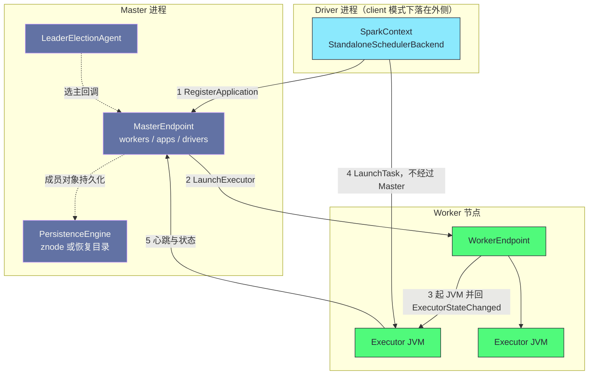
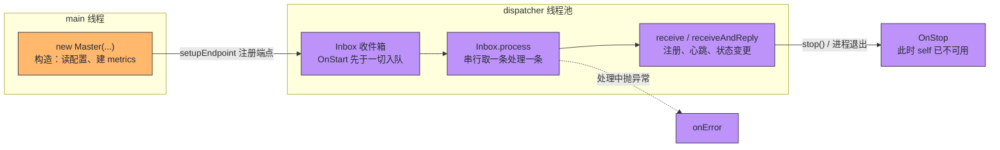
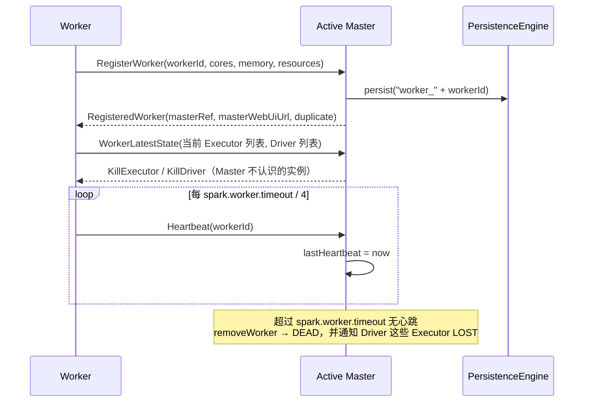
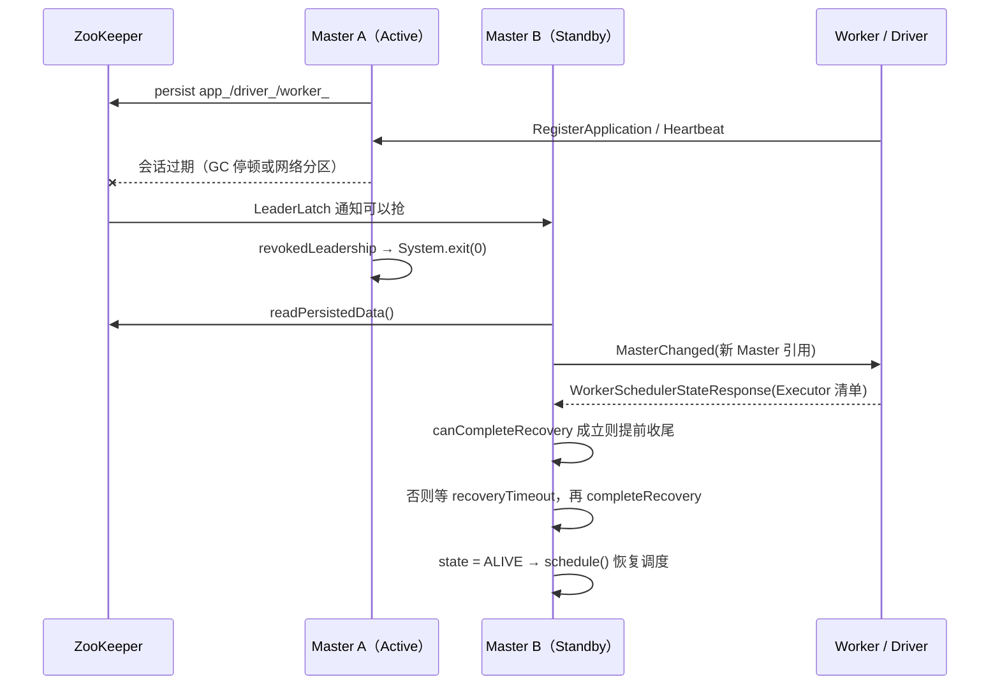
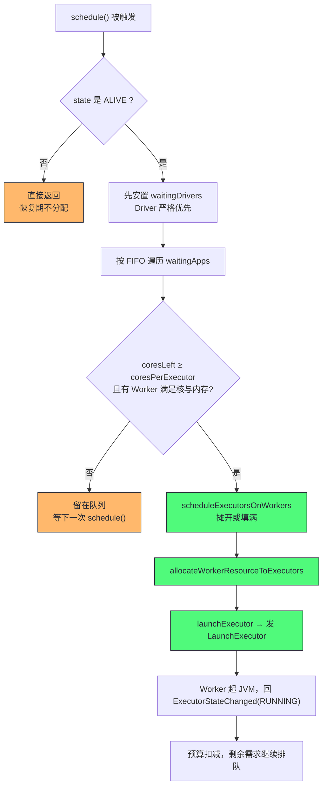

# 1. Spark Master 核心机制：三张注册表、两条分配路径与一次恢复

**摘要：**

2013 年，Spark 0.8.1 的代码里第一次出现了 `spark.deploy.recoveryMode` 这个配置项，它的版本注解一直留到今天；在这之前，Standalone 集群的 Master 进程一退出，谁在集群里、谁占了哪些核、哪个应用还在等资源，就全部无从查起。这篇文章要回答的正是这条线索延伸出来的两个问题：一个只有几千行代码的调度器，凭什么把"集群状态"这件事说清楚；以及当它自己成为单点时，凭什么还能让已经跑起来的作业不受影响。

文章沿着五问推进：先用"账本"的视角界定 Master 到底在管什么，把它与 YARN、Kubernetes 的分工画清楚；再拆开 RpcEndpoint 的生命周期与 Dispatcher 的线程模型，说明为什么 Master 的注册表不需要额外加锁、又为什么一条慢消息会拖住整个调度；接着逐张过一遍 applications、drivers、workers 三张注册表的状态机，指出它们的不对称是刻意设计而非疏漏；然后把 Standalone HA 的持久化引擎与选主流程完整走一遍，逐项交代哪些状态能恢复、哪些一定丢；之后落到资源分配的两条路径上，讲清 Driver 优先、FIFO、spreadOut 与资源不足时的等待；最后处理两处容易被含糊过去的边界——Master 单点与脑裂在 Standalone 下的成因与防护，以及 Spark Connect 把客户端搬到进程外之后，Master 与 Driver 的关系到底变了什么。

**关键词（Keywords）**: RpcEndpoint, Standalone HA, 脑裂, ZooKeeper, 幽灵Executor, Spark Connect

---

## 第 1 章 集群的账本

### 1.1 一个只有三个集合的调度器

2010 年，加州大学伯克利分校的 AMPLab 在 NSDI 上发表了关于弹性分布式数据集（Resilient Distributed Datasets，RDD）的论文，其中描述的集群抽象只关心一件事：怎么让一批不可变的分区在机器之间流动。论文没有花篇幅讨论"由谁来记住哪台机器还有几个核"，因为这个问题的答案在当年的实现里相当朴素——Standalone 模式自带一个 Master，它把整个集群的状态放进三个内存集合里。

这三个集合分别是 `workers`、`apps` 与 `drivers`，每一个都配了两张辅助索引：`workers` 配 `idToWorker` 与 `addressToWorker`，`apps` 配 `idToApp`、`addressToApp` 与 `endpointToApp`，`drivers` 配 `idToDriver`。索引的用途很直白：按 ID 找是为了处理消息里的标识，按地址找是为了在连接断开（`onDisconnected`）时能反查是谁掉了线。加起来不到十个字段，却要承担集群里所有"谁在哪里、占了多少、还能不能再塞一个"的判断。

**Master 并不执行任何计算**，它甚至不知道 RDD 是什么。它做的事情更接近一个码头的泊位调度室：船（应用）进港要登记，泊位（Worker 的核与内存）要记账，装卸队（Executor）由它派工，但它从不碰集装箱。理解这个定位之后，后文的设计取舍都会变得可解释：调度室越简单，被重启与被复制的成本就越低；而它一旦成为单点，损失也恰好集中在"登记"这件事上，而不是计算上。

把这三类角色与它们的通信方向画成一张图，可以看清一件事：Master 只参与"批准"，从不参与"执行"。



图中第 4 步是关键：Task 由 Driver 直接下发给 Executor，压根不经过 Master。这条边一旦确立，后面"Master 挂了作业照跑"就不再是巧合，而是拓扑上的必然。

### 1.2 记账的两套单位

账本里只有两种资源：核（cores）与内存（memory）。这两种资源在 Standalone 里的记账方式并不对称：核是整数、可整除、必须整块分配；内存以兆字节计、按 Executor 的申请值整块扣减，但无法在运行期真正切割。

不对称的根源在于 Spark 的资源模型是"以 Executor 为容器"的。一个 Executor 是一个独立的 JVM 进程，它的核数由 `spark.executor.cores` 决定，内存由 `spark.executor.memory` 加上 `spark.executor.memoryOverhead` 得到；Master 从 Worker 的资源里扣掉的正是这两个已经加总过的值。也就是说，Master 记的账是"申请额度"，而不是"实际用量"——一个申请了 4 GB、实际只用了 1.2 GB 的 Executor，在账本上依然占着 4 GB，直到它退出。这一点在后文讨论资源碎片与"集群看起来很空却排不进作业"时会反复出现，因为它解释了为什么 Standalone 的资源利用率总是偏保守。

### 1.3 与 YARN、Kubernetes 的分工

Standalone 常被当成"玩具集群管理器"，这个判断在只有一个 Spark 版本的场景里是错的，在多框架共存的场景里又是对的。差别不在实现质量，而在职责边界。

| 维度 | Standalone Master | YARN ResourceManager | Kubernetes |
|---|---|---|---|
| 资源单位 | Worker 的核与内存，静态上报 | 节点上的容器，含队列与标签调度 | Pod 的 request/limit，按节点可分配量 |
| 分配决策者 | Master 自己，FIFO 一条队列 | RM 的调度器（Capacity/Fair） | kube-scheduler 与 Spark 的申请逻辑 |
| 进程由谁拉起 | Worker 按 `LaunchExecutor`/`LaunchDriver` 起 JVM | NodeManager 起容器 | kubelet 起 Pod |
| 多框架共存 | 不支持，只服务 Spark | 支持，可混部 | 支持，作为通用编排层 |
| 应用状态可见性 | Master UI 一屏看全 | RM UI 加 ApplicationMaster | K8s 资源视图与 Spark UI 分离 |
| 故障恢复粒度 | Master 恢复元数据，Worker 与 Executor 不动 | RM 重启后 AM 重连，容器可保 | Pod 重建，Executor 全换 |
| 适用判断 | 纯 Spark 计算集群、自建机房 | 已有 Hadoop 体系的混部 | 已有容器平台、追求弹性 |

表格里最值得停留的是"进程由谁拉起"这一行。YARN 与 Kubernetes 是"资源管理器给出容器，进程自己长出来"，Standalone 是"Master 让某个 Worker 去起一个 JVM"，Worker 是 Master 的手和脚。这个差别决定了恢复语义：只要 Worker 还活着，Executor 就不受 Master 生死的影响——这正是"Master 故障不影响运行中作业"的物理基础。

### 1.4 一个贯穿全文的案例

为了让后面的机制不至于悬空，笔者设想一个具体的作业：某电商的业务方每天凌晨两点提交一个名为 `order_daily` 的 Spark SQL 作业，读取前一天的订单明细，按省份与品类聚合，写入数仓的宽表。集群是自建的 Standalone，六台 Worker，每台 32 核、128 GB，Worker 给 Spark 的内存上限是 120 GB；`order_daily` 配置 `spark.executor.cores=4`、`spark.executor.memory=8g`，并限制 `spark.cores.max=96`。

这个作业会在后文反复出现：第 5 章看它如何被摊开成二十四个 Executor，第 6 章看它的 Master 挂掉后集群短暂的样子，第 7 章看一次不干净的 Master 重启如何留下三个没人认领的 Executor 进程。

### 1.5 一个比喻：泊位调度室

把 Master 比作码头的泊位调度室，这个比喻在后面几章还能继续用。调度室里挂着三块牌子：一块写船期（applications），一块写引航员（drivers），一块写泊位（workers）。船进港时先在船期牌上登记，调度员按牌面找空泊位；引航员是另一类资源，他们要先上船才能把船带进来，所以调度员总是先安排引航员、再安排泊位；泊位牌上写着每个泊位的长度与吃水，扣减之后就不再重复卖。

比喻的技术限定在于：调度室不掌握船上的作业进度，也不知道哪条船其实已经空载。这个信息差，就是后文资源碎片与幽灵 Executor 这两处麻烦的来源。

---

## 第 2 章 启动链路与 RpcEndpoint 的生命周期

### 2.1 脚本只做三件事

`sbin/start-master.sh` 这层壳很薄，做的事情只有三件：补默认值、拼参数、交给 `spark-daemon.sh` 去后台起 JVM。默认值的来源在脚本里写得清清楚楚——`SPARK_MASTER_PORT` 缺省 7077，`SPARK_MASTER_WEBUI_PORT` 缺省 8080，`SPARK_MASTER_HOST` 缺省用 `hostname -f` 取全限定域名而不是 IP。

最后一处选择值得多说一句。用主机名而非 IP，原因不在美观：`spark://HOST:PORT` 会被 Worker 与 Driver 持久化，也会写进 ZooKeeper 的 znode；若标识是 IP，换网段、改 NAT、容器重建都会让旧地址失效，而已注册的成员还在拿它回连。用主机名至少留了一层"改 DNS 就能搬家"的余地，代价是集群内 DNS 必须可靠。

脚本最终落到的命令是这样的：

```bash
# sbin/start-master.sh 的最后一段：参数由环境变量拼出，然后交给 spark-daemon.sh
"${SPARK_HOME}/sbin"/spark-daemon.sh start org.apache.spark.deploy.master.Master 1 \
  --host "$SPARK_MASTER_HOST" --port "$SPARK_MASTER_PORT" \
  --webui-port "$SPARK_MASTER_WEBUI_PORT" $ORIGINAL_ARGS
```

`spark-daemon.sh` 用 `nohup` 起一个独立 JVM，进程名里带 `Master`，pid 默认落在 `/tmp`。这一步之后，Master 与脚本再无关系——它既不是由某个父进程托管的子进程，也没有守护进程会替它重启；所谓"高可用"，全部要靠第 4 章的选举与持久化来补。

### 2.2 main 方法只做三件事

入口 `Master.main` 同样克制，把参数解析、RPC 环境搭建、阻塞等待拆成三步：

```scala
def main(argStrings: Array[String]): Unit = {
  Utils.initDaemon(log)
  val conf = new SparkConf
  // 1. 解析命令行与环境变量，并加载 conf/spark-defaults.conf
  val args = new MasterArguments(argStrings, conf)
  // 2. 建 RPC 环境，注册 Master 这个 RpcEndpoint，并问出实际绑定的端口
  val (rpcEnv, _, _) = startRpcEnvAndEndpoint(args.host, args.port, args.webUiPort, conf)
  // 3. 主线程就此挂起，直到 RPC 环境终止
  rpcEnv.awaitTermination()
}
```

### 2.3 构造、注册、再问一次

真正把 Master 变成"能被别人找到的端点"的，是下面这段：

```scala
def startRpcEnvAndEndpoint(host: String, port: Int, webUiPort: Int, conf: SparkConf)
    : (RpcEnv, Int, Option[Int]) = {
  val securityMgr = new SecurityManager(conf)
  val rpcEnv = RpcEnv.create(SYSTEM_NAME, host, port, conf, securityMgr)
  // 注意：这里只是"注册"，onStart 会在 dispatcher 线程上被异步调用
  val masterEndpoint = rpcEnv.setupEndpoint(ENDPOINT_NAME,
    new Master(rpcEnv, rpcEnv.address, webUiPort, securityMgr, conf))
  // 用一个同步 ask 把启动过程"拉平"：拿到 Web UI 与 REST 实际绑定的端口
  val portsResponse = masterEndpoint.askSync[BoundPortsResponse](BoundPortsRequest)
  (rpcEnv, portsResponse.webUIPort, portsResponse.restPort)
}
```

这段代码里藏着一个容易被读错的时序。`new Master(...)` 只是构造，构造器里读写配置、建 metrics 系统、准备线程池，这些动作发生在 `main` 线程上；`setupEndpoint` 把这个实例登记进 Dispatcher 的端点表，并把一条 `OnStart` 消息塞进它的收件箱；真正的 `onStart()` 要等到 dispatcher 的消息循环把这条消息取出来才执行。换句话说，**构造在调用方线程、`onStart` 在 dispatcher 线程**，两者之间隔着一次投递。最后那个 `askSync` 是同步的，它阻塞 `main` 线程直到 `onStart` 里绑定完端口并回话，于是"启动完成"这件事对调用方变成了一个确定的时刻——这也是为什么后面很多初始化逻辑可以放心地写在 `onStart` 里。

`onStart` 负责的初始化有五块，顺序不重要但缺一不可：绑定 Master Web UI（8080，可被 `spark.master.ui.port` 覆盖）、起一个单线程的调度器定期给自己发 `CheckForWorkerTimeOut`、按需启动 REST 服务（`spark.master.rest.enabled` 默认为真，端口 6066）、启动两套 metrics 系统并把它们的 servlet 挂到 Web UI 上、按 `spark.deploy.recoveryMode` 组装持久化引擎与选主代理。

### 2.4 生命周期四段与线程模型

`RpcEndpoint` 的文档注释把生命周期写得很死：`constructor -> onStart -> receive* -> onStop`，并额外说明 `receive` 可能被并发调用；想让它串行，就要混入 `ThreadSafeRpcEndpoint` 这个标记。下图把这条生命周期与消息投递的路径画在一起：



图里那条"串行取一条处理一条"是理解 Master 并发行为的关键。Dispatcher 为每个端点维护一个收件箱，消息循环从队列里取出端点、交给线程池处理；同一个端点的消息能不能并行，取决于端点是不是 `ThreadSafeRpcEndpoint`。实现上，收件箱有一个 `enableConcurrent` 开关，端点处理完 `OnStart` 时若发现它不是 `ThreadSafeRpcEndpoint` 就把开关打开，多个循环线程于是可以同时进入同一个收件箱；反之开关始终关闭，**同一时刻只有一个线程在处理它的消息**。

Master 与 Worker 都实现为 `ThreadSafeRpcEndpoint`，这个选择的收益是注册表可以放心用普通 `HashSet` 与 `HashMap`——前一条消息的写入对后一条天然可见，不需要 volatile，也不需要加锁。代价写在它的注释里：只保证"一条处理完再处理下一条"，既不保证同一条消息由同一线程执行，也不保证"慢消息不挡住后面的消息"；源码里那句"这里不能等 ask 结果，否则会阻塞 dispatcher"，说的就是这笔代价。

### 2.5 一次心跳的旅程

把上述模型放进一次具体交互里会更清楚。Worker 每 `spark.worker.timeout / 4`（默认 60 秒的四分之一，即 15 秒）发一次心跳：

```
Worker → Heartbeat(workerId, self) → Master 收件箱 → receive → idToWorker.get(workerId) → lastHeartbeat = now
```

正常情况下这一来一回只做一次时间戳更新，连回复都没有——心跳是单向消息，走 `receive` 而不是 `receiveAndReply`。但异常分支更有信息量：如果 `idToWorker` 里查不到这个 workerId，Master 会先看 `workers` 集合里是否还有同名成员（例如刚被标记 DEAD 还没被清出集合），若有就回一条 `ReconnectWorker` 让它重新注册，若连集合里都没有，就打一条"从未注册过，忽略"的日志。

同一条链路上还有另一条消息值得对照。RPC 层在连接断开时会向所有端点投递 `RemoteProcessDisconnected`，Master 的 `onDisconnected` 收到后先按地址查 `addressToWorker`，查到就直接 `removeWorker` 判死，再查 `addressToApp`，查到就 `finishApplication`。这意味着 Master 对"掉线"有两条判据：心跳超时是慢判据（默认 60 秒），连接断开是快判据（立刻）。两条并存并不冗余，前者兜住"机器断电但 TCP 没断"，后者兜住"进程还在但连接被重置"。

### 2.6 三条不该踩的边界

第一条是不要在 `receive` 里做阻塞操作。Master 处理注册、调度、恢复全在同一条串行队列上，任何一次同步 IO 或同步 ask 都会把后面所有消息推后；第 4 章的恢复流程因此特意把"等 Worker 回话"做成定时器加消息，而不是在 `receive` 里原地等待。

第二条是 `onStop` 里不能用 `self`。RpcEndpoint 的文档写得很明确：`onStop` 被调用时 `self` 已经是 null，任何"退出前给自己发条消息"的写法都会抛异常。Master 的 `onStop` 因此只做清理——取消定时任务、停 Web UI、停 REST、关持久化引擎与选主代理。

第三条是 `receiveAndReply` 必须且只能回一次。这类请求包括提交、杀驱动、查询集群状态；某条分支忘了 reply，客户端只能在超时后放弃，回了两次则第二次抛异常被 `onError` 兜住。这类错误不会让 Master 崩溃，只会让某个客户端莫名其妙地超时，排查成本远高于错误本身。

---

## 第 3 章 三张注册表

### 3.1 workers：四个状态与一条终态

Worker 的状态只有四个取值：`ALIVE`、`DEAD`、`DECOMMISSIONED`、`UNKNOWN`。四者之间的迁移路径不多，但每一条都对应一次资源账目的变化。

| 状态 | 进入条件 | 资源是否计入调度 | 离开路径 |
|---|---|---|---|
| ALIVE | 注册成功，或恢复期被确认 | 计入 | 心跳超时转 DEAD；主动下线转 DECOMMISSIONED |
| UNKNOWN | 恢复期从持久化数据重建，尚未收到 Worker 回话 | 不计入（恢复期本就不调度） | 收到 `WorkerSchedulerStateResponse` 转 ALIVE；超时被清掉 |
| DEAD | 心跳超时、连接断开、恢复超时 | 不计入 | 停留 `(spark.dead.worker.persistence + 1) × spark.worker.timeout` 后从集合移除 |
| DECOMMISSIONED | 收到下线请求（信号或 REST） | 不再新分配，存量 Executor 逐步退出 | 最终随成员移除而消失 |

表里最容易忽略的是 DEAD 那一行的"停留时间"。`spark.dead.worker.persistence` 默认 15，意味着一个死掉的 Worker 会在 UI 与内存里停留十六个心跳周期（默认十六分钟）才被真正清出集合。这个设计是为了让人在 Web UI 上看见"刚刚掉了一台机器"，代价是这段时间里 `workers` 集合包含了一批不参与调度的成员，任何遍历都必须先过滤状态——源码里到处出现的 `workers.filter(_.state == WorkerState.ALIVE)` 就是在还这笔债。

**DEAD 是终态但不会被立即遗忘**——这句判断可以当作读 Standalone 源码的一条口诀：状态转换负责语义，集合清理负责内存，两者刻意解耦。

### 3.2 applications：六个状态与一个临时态

应用的状态有六个：`WAITING`、`RUNNING`、`FINISHED`、`FAILED`、`KILLED`、`UNKNOWN`。听起来像一个标准的生命周期，但真正的读法要按"谁写入的"来分：`WAITING` 与 `RUNNING` 由 Master 在分配过程中写入——应用注册后进 `waitingApps` 队列，第一次拿到 Executor 时被置为 `RUNNING`；三个终态由 Master 在收尾时写入；而 `UNKNOWN` 只在一种场景下出现，就是 Master 从持久化状态里恢复出一个应用、但还没收到它的回话时。

**`UNKNOWN` 是恢复期的临时态**，它的存在本身就是一条设计声明：Master 不相信持久化下来的"上次我是 RUNNING"，只相信"现在我还能不能联系上你"。这与很多分布式系统的恢复策略不同——那些系统倾向于信任持久化的最后状态，再用租约或版本号去校正；Spark 的选择更保守，把"未知"显式建模成一个状态，让恢复流程可以在一个明确的时间窗口里做取舍（第 4 章会看到这个窗口由 `spark.deploy.recoveryTimeout` 兜底）。

### 3.3 drivers：八个状态与一次换号

Driver 的状态最多，八个：`SUBMITTED`、`RUNNING`、`FINISHED`、`RELAUNCHING`、`UNKNOWN`、`KILLED`、`FAILED`、`ERROR`。多出来的两个状态各有一条来历：`UNKNOWN` 同样是恢复期产物，`RELAUNCHING` 则对应"监管重启"这个动作。

`RELAUNCHING` 的用法值得单独说。一台 Worker 死掉时，它上面如果有 `--supervise` 提交的 Driver，Master 不会直接判死，而是走 `relaunchDriver`：把旧 Driver 置为 `RELAUNCHING` 并从 `drivers` 移出，再创建一个新的 driver id 加入等待队列。为什么不复用原 ID？源码注释给的理由很实际：网络分区下旧 Driver 可能还活着，若新老共用一个 ID，旧 Driver 迟到的 `DriverStateChanged(KILLED)` 会把新 Driver 一起带走。换号是最便宜的隔离手段——多记一个 ID，胜过设计一套版本比较协议。

### 3.4 注册的三段式

Worker 的注册不是一个来回，而是三个来回，缺了第三个来回就会留下隐患。下图把这三段与时序画在一起：



第一段是注册本身：Worker 带着自己的核数、内存、资源发现结果来登记，Master 先按地址查重（同一地址要么是旧成员以 UNKNOWN 身份留在恢复期，要么直接拒绝），再写入 `workers`、`idToWorker`、`addressToWorker` 三处，**先持久化、后应答**，最后回一条 `RegisteredWorker` 告诉它新的 Master 引用与 Web UI 地址。

```scala
// 三处写入都在同一个 ThreadSafeRpcEndpoint 上完成，不会与别的消息交错
workers += worker
idToWorker(worker.id) = worker
addressToWorker(worker.endpoint.address) = worker
```

第二段是状态上报：Worker 收到 `RegisteredWorker` 之后，把手上所有 Executor 与 Driver 列成清单发给 Master。这一段的语义常被误读成"Master 借它恢复 Executor"，其实恰好相反——Master 拿到清单后做的是反向清理：它不认识的 Executor 直接回 `KillExecutor`，不认识的 Driver 回 `KillDriver`。这段握手的目的不是"恢复"，而是"对齐并清理"。

第三段才进入稳态的心跳。三段拆开的好处是故障语义清晰：第一段失败意味着"这台机器进不了集群"，第二段失败意味着"集群里多了一批没人认领的进程"，第三段失败意味着"这台机器要判死"；压成一个来回，运维就只能看到一句含糊的"注册失败"。

### 3.5 状态机为什么不对称

三张表放在一起看，会浮现出一个刺眼的不对称：Worker 有 `DEAD`，应用却没有；应用有 `FINISHED`，Worker 却没有；Driver 有八个状态，比另外两张表加起来还热闹。这不是历史遗留的随意，而是三种实体的"生死语义"不同。

Worker 是一个进程，死亡是物理事件，对它自己而言没有"完成"这回事——机器不会因为跑完作业而退出，所以它只需要 `DEAD`。应用是一次需求，一定会有结束的一天，所以需要区分正常与异常结束，但它的宿主是否还活着不由它决定，因此不需要物理态。Driver 是唯一同时具备"进程身份"与"任务身份"的实体：可能被杀、可能自己失败、可能因宿主机故障被监管重启、也可能因缺 jar 进入 `ERROR`，于是它的状态表成了另外两张的并集再加两个。

**状态机的不对称**因此可以当作一个通用判据：如果一个实体的状态表里既有物理态又有业务态，说明它同时承担了两种身份，而这两种身份的清理时机往往不同——这正是后面幽灵 Executor 问题的形式化表述。

### 3.6 保留量与内存的边界

Master 的内存不是无限的，两个 `retained` 参数因此存在：`spark.deploy.retainedApplications` 与 `spark.deploy.retainedDrivers`，默认都是 200。它们限制的是"已完成"列表的长度，超出后按比例丢弃最旧的一批，Master UI 上那一栏历史记录就来自这里。

这两个数字看起来无关紧要，却在两种场景下变成故障放大器。其一是高频短作业的集群：每天几万个小作业，200 条历史意味着 UI 上只能看见最近几分钟，排查"昨天下午那个失败的应用"只能靠事件日志。其二是长跑集群的内存占用：每条 `ApplicationInfo` 都带着命令行、环境变量与 jar 列表，几 KB 不算夸张，但若为了"多留点历史"把它调到十万，Master 堆内存会被这份历史悄悄吃掉——而它由 `SPARK_DAEMON_MEMORY` 控制，默认只有 1 GB。

---

## 第 4 章 Standalone HA：持久化与选主

### 4.1 五种恢复模式的配置面

`spark.deploy.recoveryMode` 从 0.8.1 活到今天，可选值已经从一个变成了五个：`NONE`、`FILESYSTEM`、`ZOOKEEPER`、`ROCKSDB`、`CUSTOM`。其中 `ROCKSDB` 是 4.x 新增的单机方案，把状态存进 RocksDB 而不是文件目录；`CUSTOM` 允许通过 `spark.deploy.recoveryMode.factory` 指定一个实现 `StandaloneRecoveryModeFactory` 接口的类，自己决定持久化与选主怎么做。

`onStart` 里这一段分派决定了后续所有行为，它把"持久化引擎"与"选主代理"当成一对组件一起装配：

```scala
// Master 在 onStart 里按 recoveryMode 装配一对组件：持久化引擎 + 选主代理
val (persistenceEngine_, leaderElectionAgent_) = recoveryMode match {
  case "ZOOKEEPER"  => (new ZooKeeperPersistenceEngine(conf, serializer),
                        new ZooKeeperLeaderElectionAgent(this, zk))
  case "FILESYSTEM" => (new FileSystemPersistenceEngine(dir, serializer),
                        new MonarchyLeaderAgent(this))
  case "ROCKSDB"    => (rdbFactory.createPersistenceEngine(), rdbFactory.createLeaderElectionAgent(this))
  // CUSTOM：工厂由 spark.deploy.recoveryMode.factory 反射构造，此处从略
  case "CUSTOM"     => (factory.createPersistenceEngine(), factory.createLeaderElectionAgent(this))
  // 默认分支即 NONE：黑洞持久化 + 君主制选主，等价于"没有 HA"
  case _            => (new BlackHolePersistenceEngine(), new MonarchyLeaderAgent(this))
}
```

| recoveryMode | 持久化介质 | 选主方式 | 故障后自动接管 | 主要代价 |
|---|---|---|---|---|
| NONE（默认） | 无，`BlackHolePersistenceEngine` | `MonarchyLeaderAgent`，启动即自封 | 否，必须重启集群 | Master 一挂，元数据全丢 |
| FILESYSTEM | 本地或共享目录，一对象一文件 | 同上，仍是自封为王 | 否，需人工在新节点启动 | 重启即进恢复期，可能多等一轮超时 |
| ROCKSDB | 本地 RocksDB | 同上，自封为王 | 否，需人工启动 | 单机语义，换节点要搬数据 |
| ZOOKEEPER | ZooKeeper 的 znode | `LeaderLatch` 抢占 `/leader_election` | 是，秒级到分钟级 | 多一套 ZK 要维护 |
| CUSTOM | 自实现 | 自实现 | 取决于实现 | 要自己保证正确性 |

这张表里最有迷惑性的一行是 FILESYSTEM。它的"持久化"是真的，"自动接管"却是假的——因为文件系统模式没有真正的选主，任何用同一个恢复目录启动的 Master 都会认为自己就是主人。官方文档把这一点写成了使用提示：`stop-master.sh` 不会清理恢复状态，所以每次重启 Master 都会进入恢复流程，可能多花最多一分钟等旧成员超时。换言之，它买到的只是"重启后不用重建集群"，买不到"故障后自动接管"。

### 4.2 持久化引擎的接口

不管介质是什么，Master 只依赖一个很薄的抽象：

```scala
abstract class PersistenceEngine {
  def persist(name: String, obj: Object): Unit
  def unpersist(name: String): Unit
  def read[T: ClassTag](prefix: String): Seq[T]
  def close(): Unit = {}

  // 三对便捷方法是 final 的，名字前缀就是约定：app_ / driver_ / worker_
  final def addApplication(app: ApplicationInfo): Unit = persist("app_" + app.id, app)
  final def addWorker(worker: WorkerInfo): Unit = persist("worker_" + worker.id, worker)
  final def addDriver(driver: DriverInfo): Unit = persist("driver_" + driver.id, driver)
  // removeApplication / removeWorker / removeDriver 对应 unpersist
}
```

这套接口的注释里有一段话，几乎就是第 4.6 与 4.7 两节的提纲：注册与持久化的顺序被约定为"先持久化、再完成注册"，而删除允许在任何时刻发生；两条约定合起来意味着恢复时看到的一定是"可能多、绝不会少"的成员集合，所以每个恢复出来的成员都必须重新验证存活性。

三个前缀也解释了"持久化的是什么"：只有应用、驱动、Worker 三类成员对象，没有 Executor，也没有"谁在哪个 Worker 上"的映射。**持久化的是"成员"，不是"关系"**——这条边界决定了恢复流程必须依赖 Worker 主动上报来重建关系，也决定了下面几节所有的"能恢复/必丢失"清单。

### 4.3 ZooKeeper 版：znode 布局与反序列化防线

ZooKeeper 引擎的布局直接对应接口：根目录取 `spark.deploy.zookeeper.dir`（缺省 `/spark`），下面建一个 `master_status` 节点，每一个成员是它的一个子节点，节点名就是 `app_<id>`、`driver_<id>`、`worker_<id>`，节点内容是对象序列化后的字节。读取时先 `getChildren` 拿到所有子节点，按前缀过滤，再逐个反序列化。删除就是删节点，删除失败会被当成"它已经不在了"。

序列化用的是 Master 构造时传入的 `JavaSerializer`，所以 znode 里躺的是 Java 序列化流。这一点在 Spark 4.3.0 之后多了一道防线：`spark.deploy.recoverySerializationFilter` 是一个 JEP-290 过滤器，默认只放行 `java.**`、`scala.**`、`org.apache.spark.**`，其余类一律拒绝。被拒绝的 znode 不会被删除，只会被跳过并打日志——文档特意说明"跳过的 znode 不会被 Master 清理，每次切换都会再报一次，需要人工检查后删除"。反过来，如果某个 znode 是真的损坏（不是被过滤器拒的），引擎会删掉它以免卡住恢复。

这段设计有两个可迁移的点。其一是威胁模型的定位：ZooKeeper 是共享存储，能写 znode 的人就能往新当选的 Master 里注入任意对象，所以恢复路径上的反序列化必须过滤，而文件系统模式没有这层过滤，理由是暴露面更小。其二是失败处理的分寸："跳过而不是删除"，因为过滤器配置写窄了（譬如只写 `org.apache.spark.*` 却漏掉子包）会把整个恢复状态误删。

### 4.4 文件系统版：一对象一文件

`FileSystemPersistenceEngine` 把对象写进 `spark.deploy.recoveryDirectory` 指定的目录，一个对象一个文件，文件名同样带前缀。它与 ZK 版的差异集中在三处。

第一处是写入的原子性靠"创建新文件"实现：写之前先检查同名文件是否存在，存在就抛 `IllegalStateException`，创建成功后如果序列化过程中出错，会把刚建的文件删掉，避免留下半截文件。这个手法的效果等价于"临时文件加改名"，只是更省事；代价是并发的写同一个名字会互相踩。

第二处是损坏文件的处理方式：读取时若反序列化失败，不是删除而是改名为 `corrupted_<原名>`。改名之后它不再匹配 `app_`、`driver_`、`worker_` 前缀，于是既不会阻塞恢复，也保留了现场供人排查。

第三处是 4.x 新增的压缩：`spark.deploy.recoveryCompressionCodec` 支持 none、lz4、lzf、snappy、zstd，但只对 FILESYSTEM 生效。这个限制本身是一条信息：ZK 的 znode 有大小上限，压缩与否对它是另一套权衡，引擎作者没有把两者混为一谈。

### 4.5 选主：LeaderLatch 与"自封为王"

ZooKeeper 模式的选主用 Curator 的 `LeaderLatch`，抢占的路径是 `<zookeeper.dir>/leader_election`，latch 的 ID 用 Master 自己的 `spark://host:port`。抢到 latch 的 Master 收到 `electedLeader` 回调，转成一条 `ElectedLeader` 消息发给自己；失去 latch 的 Master 收到 `revokedLeadership`，转成 `RevokedLeadership` 消息。这两条消息在 Master 的 `receive` 里分别对应"开始恢复"与"立刻退出"——后者在源码里是 `System.exit(0)`，日志写的是"领导权已被撤销，Master 正在关闭"。

`NONE`、`FILESYSTEM`、`ROCKSDB` 三种模式用的是另一个实现：`MonarchyLeaderAgent`，它在启动时直接调一次 `electedLeader()`，此后不再关心任何外部信号。名字取得很传神——君主制，没有选举，先起来的那个就是君主。它和 `BlackHolePersistenceEngine` 是一对：一个不选主、一个不持久化，合起来就是 Standalone 的默认形态。

### 4.6 一次完整的恢复

把持久化、选主、注册三件事串起来，就得到下面这张恢复时序图。它与第 2 章的注册图是"同一套消息、不同顺序"：恢复时是 Master 主动去找 Worker，而不是 Worker 来找 Master。



流程可以拆成五步。第一步是状态重建：新 Master 选举出来后先调 `readPersistedData` 把三类成员读进内存，应用与 Worker 一律先标 `UNKNOWN`，Driver 先放进集合等 Worker 认领。第二步是广播：对每个读出来的应用与 Worker 发送 `MasterChanged`，告诉它们领导换人了。第三步是回话：Worker 把手上所有 Executor 与 Driver 连同资源一起报回来，Master 只接受属于已知应用的 Executor，并挂回对应的 `ApplicationInfo` 与 `WorkerInfo`。第四步是收尾判定：`canCompleteRecovery` 的判据很简单——没有任何 Worker 处于 `UNKNOWN`、也没有任何应用处于 `UNKNOWN`，条件一旦成立就提前结束恢复，不必等满超时。第五步是清账与恢复调度：把仍是 `UNKNOWN` 的成员一律清掉，状态置为 `ALIVE`，调用 `schedule()`。

**恢复期不分配资源**这件事值得单独确认一次。`schedule()` 的第一行就是 `if (state != RecoveryState.ALIVE) return`，所以从选举成功到 `completeRecovery` 之间的整个窗口里，所有注册与状态上报只会更新账本，不会产生任何新的 Executor 或 Driver。这个选择避免了最坏的情况——在还不知道哪些资源已被占用时就往外分配，把同一份核卖两次。代价是这段窗口里新提交的作业必须等待，官方文档给出的经验值是整个恢复过程一到两分钟，且明确说明"只影响新应用的调度"。

### 4.7 能恢复什么，一定丢什么

把上面几步对着数据结构核一遍，就能列出一张恢复能力的清单。

| 状态对象 | 是否持久化 | 恢复来源 | 一定丢失的部分 |
|---|---|---|---|
| Worker 成员 | 是（id、地址、核、内存、资源） | znode 或文件 | 恢复瞬间的实时空闲量，要等上报后才准 |
| Application 成员 | 是（id、描述、提交时间、状态） | 同上 | 提交时的应答已经发过了，客户端不会重收 |
| Driver 成员 | 是（id、描述、`--supervise` 标记） | 同上 | Driver 与 Worker 的绑定关系，靠 Worker 认领 |
| Executor 及其归属 | 否 | Worker 上报 | 未被任何 Worker 认领的 Executor 记录 |
| 等待队列顺序 | 否 | 按持久化 ID 重建 | 原始到达顺序，可能与原队列不一致 |
| 恢复窗口内的新提交 | 否 | 无处可恢复 | 提交方会收到"处于待命状态"的拒绝或超时 |

表里有两行需要展开。其一是等待队列的顺序：应用按持久化 ID（本质是提交时间）读回来，队列大体还原成提交顺序，但恢复期间被拒绝的提交不在其中，于是"谁先谁后"可能发生一次微妙的插入，FIFO 在恢复后的一小段时间里会短暂偏离公平。

其二是 Driver 的重启语义。恢复时 Master 只读回 Driver 的描述，读不回"它此刻在哪个 Worker 上"；某个 Worker 没能在窗口内回话，它上面的 Driver 就处于"没有 worker"的状态。`completeRecovery` 对这类 Driver 分两路：带 `--supervise` 的重新入队（换新 ID），不带的直接置 `ERROR` 并移除。换句话说，**监管标记的含义不是"会自动重启"，而是"恢复时我愿意再付一次调度成本"**；没有这个标记的 Driver，一次 Master 故障就足以让它从账本上消失，哪怕进程还活着。

### 4.8 超时窗口的两端

4.0 引入了 `spark.deploy.recoveryTimeout`，缺省值跟随 `spark.worker.timeout`（默认 60 秒），定义的是"最多等多久"；`canCompleteRecovery` 定义的是"可以多早结束"，两个机制一推一拉，把恢复窗口夹在"全员回话"与"超时放弃"之间。

这个设计在小集群上几乎无感，在几百台 Worker 的集群上却是可调的关键。窗口太短，慢半拍的 Worker 会被误判为失联，它上面的 Executor 被标 LOST、作业被迫重算；窗口太长，恢复期间的提交只能干等。调参取决于一个判断：集群里"慢回话"的概率与"提交等待"的代价，哪个更贵；笔者的经验是，只在遇到过误判 LOST 之后才去调大它。

---

## 第 5 章 两条资源分配路径

### 5.1 Driver 与 Executor 是两种资源

Master 的调度入口只有一个 `schedule()`，但它要同时服务两类需求：给提交上来的 Driver 找一个能跑进程的 Worker，给已注册的应用分配 Executor。这两件事在资源单位上完全不同——Driver 要的是"一个能装下 `spark.driver.cores` 与 `spark.driver.memory` 的槽位"，Executor 要的是"按应用预算切出来的若干份 4 核 8 GB"。

源码对这个差别的处理方式很直接：先跑 Driver 的循环，再跑 Executor 的循环，注释只有一句话——"Driver 严格优先于 Executor"。优先级的意思是，只要等待队列里还有 Driver，Master 就会先尝试为它找 Worker，找不到才继续往下走；一个刚提交的 Driver 不会因为集群里排着一堆等着扩容的应用而被饿死。

```scala
private def schedule(): Unit = {
  if (state != RecoveryState.ALIVE) return   // 恢复期不分配，见第 4.6 节
  // 第一段：先安置 Driver（严格优先），spreadOutDrivers 默认为真则按轮转找活 Worker
  for (driver <- waitingDrivers.toList) {
    // 逐个尝试，条件是 canLaunchDriver：核、内存、自定义资源三者都够
  }
  // 第二段：再给应用分配 Executor
  startExecutorsOnWorkers()
}
```

Driver 这一段的实现里有两个细节值得一提。其一是"活集群也无处可放"时的日志：代码会判断当前遍历到的 Worker 是否既没有 Driver 也没有 Executor（即整台机器空闲），如果是，就打一条"这个 Driver 需要的资源超过了任何 Worker 能给的上限"。这条日志的价值在于区分两种"永远等不到"：集群忙是暂时的，单机装不下是永久的，前者会自己好，后者只能改配置。其二是 4.0 新增的 `spark.deploy.maxDrivers`（默认不限制），它给 Driver 数量加了全局上限——此前一个失控的提交脚本可以灌进任意多个 Driver，把每台机器的槽位占满。

### 5.2 Executor 分配：FIFO、预算与摊开

第二段才是重头戏。`startExecutorsOnWorkers` 按 `waitingApps` 的顺序逐个处理，这就是官方文档说的"简单 FIFO 调度"：排在队首的应用只要还有 `coresLeft`，就会被一直优先满足，后面的应用只能等它拿够或者拿不到。

每个应用的预算由两个配置共同决定：`spark.cores.max`（或 Master 侧的 `spark.deploy.defaultCores`，默认 `Int.MaxValue`）减去已分配的核，得到 `coresLeft`。**`coresLeft` 是应用的自有预算**，它独立于集群总容量——这也解释了为什么在共享集群上不设 `spark.cores.max` 是一件危险的事：默认值意味着"我要全集群"，第一个提交的作业会把所有核占满，后面的作业排在队列里看似在等资源，其实在等前一个作业跑完。

分配粒度由 `spark.executor.cores` 是否设置决定。设置了就按这个值切分，一个 Worker 上可以塞多个 Executor；没设置就按"一个 Worker 一个 Executor"处理，并且这个 Executor 把该 Worker 上所有空闲核一口吃掉。后者带来一个容易踩的坑：同一台机器上前后两次调度可能给同一个应用留下两个 Executor——前一个应用释放的核被后一轮调度全吃掉，两次分配并不在同一个轮次里完成。

`spark.deploy.spreadOutApps`（别名 `spark.deploy.spreadOut`）决定的是"摊开"还是"填满"，默认摊开。

| 维度 | spreadOutApps = true（默认） | spreadOutApps = false |
|---|---|---|
| 单轮行为 | 每个 Worker 只放一个 Executor，然后轮到下一个 | 先把一个 Worker 的核吃满，再换下一个 |
| 数据本地性 | 好，Executor 分散在各数据节点上 | 差，数据可能集中在少数机器 |
| 资源碎片 | 少，几乎每台机器都能分到一点 | 多，容易出现"每台都剩几个核"的局面 |
| 适合的负载 | 读 HDFS 或对象存储、IO 密集 | 计算密集、几乎不读远程数据 |
| 与 `workerSelectionPolicy` 的关系 | 排序决定先摊给谁 | 排序决定先填满谁 |

表格最后一行对应 4.0 的新参数 `spark.deploy.workerSelectionPolicy`，可选 `CORES_FREE_ASC`、`CORES_FREE_DESC`（默认）、`MEMORY_FREE_ASC`、`MEMORY_FREE_DESC`、`WORKER_ID`。在 4.0 之前，这个排序是写死的"空闲核多的排前面"；现在它变成了一个可调策略，于是"把应用优先摊到空闲机器"与"把应用优先摊到空闲内存大的机器"可以分开选择——这两种取向在内存型负载与 CPU 型负载上会给出完全不同的分布。

### 5.3 逐轮推进与一次著名的教训

`scheduleExecutorsOnWorkers` 的主体是两个嵌套循环。外层是"只要还有 Worker 能容纳新 Executor 就继续"，内层对每个候选 Worker 反复分配，直到它装不下为止。摊开模式下，内层每轮只给同一个 Worker 分一份就跳出，于是所有 Worker 齐头并进；填满模式下，内层一直给同一个 Worker 加到满为止。

分配单位是"一次一个 `coresPerExecutor`"，而不是"一次一个核"。这个选择背后有一个具体的教训，源码注释里用 SPARK-8881 标注了它：假设四台 Worker 各 16 核，用户要 3 个 Executor、每个 16 核（`spark.cores.max=48`、`spark.executor.cores=16`），如果按"一次一个核"去凑，每台机器会先被分到 12 核，而 12 小于 16，于是三个 Executor 一个都起不来；按"一次 16 核"去切，第一台机器刚好凑够一个。**按整份分配**因此不是性能优化，而是正确性要求——它避免了"看起来资源够、实际上谁也凑不齐"的死锁式等待。

分配完成之后，`allocateWorkerResourceToExecutors` 把某个 Worker 上分到的核折算成 Executor 数量：设置了 `coresPerExecutor` 就用整除，没设置就一个 Executor 吃掉全部。随后 `launchExecutor` 做三件事：把 Executor 记到 `WorkerInfo` 与 `ApplicationInfo` 两边、给 Worker 发 `LaunchExecutor`、给 Driver 发 `ExecutorAdded`。应用状态在这一刻被置为 `RUNNING`。

### 5.4 资源不足时的等待

下图把一次调度决策的分支画全，重点在"什么都不做"这条路径上：



图里 `E1` 那条分支是整个调度器最容易被误解的地方：资源不足时 Master 不会报错、不会排队超时、不会通知应用，它只是不做任何事，等下一次 `schedule()` 被调用时再看一眼。`schedule()` 的触发点只有几处——Worker 注册、应用注册、Executor 状态变化、Driver 状态变化、恢复完成，以及应用主动请求调整 Executor 数量。这意味着一个作业能否等到资源，取决于集群里还有没有别的状态变化；如果集群彻底安静下来，一个因资源不足而排队的应用会一直安静地等下去。

源码里对这种情况有一处专门提示：当等待队列里只有一个应用、它一个 Executor 都没有、且没有 Worker 能满足它时，Master 会打一条"这个应用需要的资源超过了任何 Worker 能给的上限"。这条日志是区分"排队"与"永远排不上"的唯一线索——它一旦出现，再等也不会好，只能改 `spark.executor.memory` 或加机器。

### 5.5 记账口径与资源碎片

回到第 1 章那个 `order_daily` 的例子。六台 Worker、每台 32 核、Spark 可用内存 120 GB，`spark.executor.cores=4`、`spark.executor.memory=8g`。`spark.cores.max=96` 意味着这个应用最多要 24 个 Executor、占满全部六台机器。摊开模式下第一轮每台机器分一个 4 核 Executor，第二轮再各分一个，直到预算用尽。看起来很整齐，但第三轮就可能开始不整齐：某个 Executor 启动失败退出后，它占的 4 核被释放，下一轮调度会把这个缺口补给"当前空闲核最多"的机器，分布开始偏斜。

偏斜本身不是问题，问题是偏斜之后留下的碎片。假设某台机器上残留一个 2 核的空闲，这 2 核既不够一个 4 核的 Executor，也不会被其他应用看上，于是成了账面上的死资源，直到那台机器上有 Executor 退出。**资源碎片在 Standalone 里是账本机制的必然产物**，因为核必须整份分配而"整份"由应用自己定，集群并不知道怎样切才不浪费；缓解办法很有限，要么让所有应用用同一个 `spark.executor.cores`，要么接受一定比例的浪费。

内存的口径同样值得核对一遍。`memoryFree` 比较的是应用申请的 `memoryPerExecutor`，它等于 `spark.executor.memory` 加上 `spark.executor.memoryOverhead`（缺省 max(384MB, 0.1 × executor memory)），不是 JVM 的堆上限。这个差别在调参时很实在：把 `spark.executor.memory` 从 8g 调到 9g，账面扣掉的可能是 10.1g，若 Worker 只报 120 GB，能起的 Executor 数量可能与直觉差一个。

---

## 第 6 章 单点与脑裂

### 6.1 单点的三笔账

官方文档对 Standalone 的单点写得很坦率：默认情况下 Master 是单点，它挂掉之后无法创建新应用。这句描述其实只说了一半，把损失拆开看是三笔账。

第一笔是提交路径的断裂：新的 `spark-submit`（cluster 模式）会失败，因为提交客户端找不到能接受 `RequestSubmitDriver` 的 Master；已经注册的应用如果再请求扩容 Executor，请求会石沉大海。第二笔是调度路径的断裂：正在运行的应用不受影响，因为它们的 Task 在 Executor 里跑、由 Driver 调度，整条链路不经过 Master；但一旦有 Executor 退出、需要补新的，就补不上。第三笔是观测路径的断裂：Master UI 消失，集群的实时视图没有了，只剩各个 Worker 的 UI 能看见本机的进程。

三笔账的严重程度差别很大，这也解释了为什么很多团队在 Standalone 上"裸奔"多年也没出事——作业不多、运行不长、扩容不频繁时，Master 挂掉的窗口可能正好落在没人提交的深夜。但只要出现"每天几百个提交"或"作业动辄跑几小时还要动态扩缩"，单点就会从概率问题变成必然问题。

### 6.2 脑裂的三种成因

**脑裂的根源是"两个 Master 都认为自己活着"**。在 Standalone 的语境里，这个局面的成因有三种，性质完全不同。

第一种是配置缺失导致的"各自为政"，官方文档专门把它写成一条风险提示：如果集群里有多个 Master，但没有把它们都正确配置成连同一个 ZooKeeper，这些 Master 会互相发现不了、各自认为自己是 leader，于是各自独立调度。这种脑裂不是故障引起的，而是部署引起的，表现是"两个 UI 的资源统计对不上"。

第二种是 ZooKeeper 会话超时。Master 与 ZK 之间靠会话保活，会话一过期 ZK 就认为 leader 死了，让别的 Master 抢到 latch；但旧 Master 的进程可能还活着，要等 `revokedLeadership` 回调到达、执行 `System.exit(0)` 才真正退出。这段"它还没退、新 leader 已上任"的窗口就是典型的脑裂窗口，诱因通常是长时间 GC 停顿或网络分区——前者让会话续不上而进程没死，后者让 Master 与 ZK 断连而与其他组件仍可通信。Master 与 ZK 之间靠会话保活，一旦会话过期，ZK 就认为这个 leader 死了，于是让别的 Master 抢到 latch；但旧 Master 的进程可能还活着，它要等到 `revokedLeadership` 回调到达、执行 `System.exit(0)` 才真正退出。这段"它还没退、新 leader 已经上任"的窗口，就是典型的脑裂窗口。诱因通常是长时间 GC 停顿或网络分区——前者让会话续不上但进程没死，后者让 Master 与 ZK 断连但与其他组件仍可通信。

第三种是文件系统模式下的"人工脑裂"：两个 Master 用同一个 `spark.deploy.recoveryDirectory` 启动，两个都会读到同一份状态、都认为自己该接管。这个场景在日常运维里比想象中常见——运维在原机器上重启 Master 的同时，别人在备用机上又起了一个"以防万一"，于是两个都进了恢复期，都把状态读进内存，都开始往外分配资源。

### 6.3 四道防线

Spark 对脑裂的处理不是靠"预防"，而是靠"让错误的一方尽早失效"。四道防线分布在 Master、Worker、客户端三侧。

第一道是 `RevokedLeadership` 直接退出进程：失去 latch 的 Master 不做任何"退位让贤"的优雅交接，直接 `System.exit(0)`。这个选择的理由是，一个已经不被 ZK 承认的 Master，任何"先检查再动作"的逻辑都可能因为时序问题而失效；让进程消失是最干脆的撤销方式。

第二道是 **Standby 一律不回应**。处于 `STANDBY` 状态的 Master 收到 `RegisterApplication` 时不回任何消息（注释写的是"忽略，不要回复"），收到 `RegisterWorker` 时回 `MasterInStandby`；所有需要 `ALIVE` 状态的请求（提交 Driver、杀 Driver、请求 Executor）都会被拒绝，并在拒绝信息里带上"待命 Master"的提示。于是客户端不会误以为注册成功，Worker 也会继续向其他地址重试。

第三道是 **`masterUrl` 校验**，它落在 Worker 一侧。Master 下发的 `LaunchExecutor`、`KillExecutor`、`KillDriver` 消息里都带着自己的 `masterUrl`，Worker 处理前先比对："这条命令来自我现在认的 Master 吗？"不一致就打一条"无效 Master 试图启动 Executor"的日志并丢弃。这条防线对付的正是"旧 Master 还活着、还能发消息"的那种脑裂——即便旧 Master 真的把命令发出来了，Worker 也不会执行。

第四道是恢复期不调度。`schedule()` 在非 `ALIVE` 状态下直接返回，这既是防止超卖，也限制了脑裂的破坏面：一个刚抢到 latch、还在恢复的 Master 不会在状态未明时把资源分配出去。

### 6.4 反事实：如果这些防线不存在

不妨做个反事实推演。假设没有 `masterUrl` 校验，那么在一次 ZK 会话抖动之后，旧 Master 在退出前的几十秒里仍可能给 Worker 发 `LaunchExecutor`；Worker 照单执行，于是同一个应用在两个 Master 的账本上各有一批 Executor，而 Driver 只认识其中一批——多出来的那批变成纯粹的浪费，且没有任何组件会去回收它们。

假设 Standby 会回应注册，Worker 启动时向多个 Master 广播注册就可能被同时接受，两边都写了 `worker_<id>` 的持久化记录；等其中一方真正当选，它读到的状态里就有一个"已在别处登记"的成员，地址去重会把其中一个判为非法，但它上面的 Executor 已经起来了。

假设失去 latch 后不退出而是继续服务，那么集群会长期处于"两个 Master 同时调度"的状态，且没有任何迹象——Master UI 各自正常，作业各自能提交，只有资源莫名其妙地超卖。这种故障最难查，因为它不产生错误日志，只产生"集群容量比物理容量大"的错觉。

由此可见，四道防线的共同取向是**把脑裂转化为"一方立刻死亡"而不是"双方协商一致"**：牺牲可用性（进程直接退出，必须有新 Master 顶上），换来状态不分叉。在 Standalone 这种没有共识组件的场景里这个交换划算；需要更强保证时，正确的做法不是给 Standalone 加协商，而是换 YARN 或 Kubernetes——那里的资源状态由本身就具备高可用与一致性的组件持有。

---

## 第 7 章 Master 重启之后

### 7.1 三种重启语义

"Master 重启"这个词被用得太宽，它至少包含三种语义，三者的后果差别极大。

第一种是进程重启但状态还在：ZK 模式或 FILESYSTEM 模式下，Master 进程被重启，持久化数据完好，新进程通过恢复流程把状态读回来。第二种是进程重启且状态已丢：`NONE` 模式下，Master 重启等于从零开始，集群里的 Worker 与 Driver 都还在跑，但新 Master 谁也不认识。第三种是整机故障：Master 所在的机器彻底没了，这种情况必须靠 ZK 模式的自动接管，否则就只能人工在新机器上按恢复流程拉起。

三种语义在"已运行作业是否受影响"这一点上是一致的：都不受影响。差异全部集中在"重启后的账本能否与物理世界对齐"这件事上——而这正是幽灵 Executor 出场的地方。

### 7.2 重注册与反向清理

Master 重启之后，Worker 并不会立刻知道。它们继续按 15 秒的节奏发心跳，而心跳是单向消息，没人收也不会报错；直到某次心跳真的到达新 Master（地址没变时这很容易发生），Master 在 `idToWorker` 里查不到这个 ID，回一条 `ReconnectWorker` 让 Worker 重新注册。

Worker 重走注册流程之后，就回到第 3.4 节那条三段式的第二段：它会把自己手上所有 Executor 与 Driver 报上来。**`WorkerLatestState` 的反向清理**在这里发挥作用——新 Master 对这些 Executor 一律不认识（`NONE` 模式下它没有任何应用记录），于是逐个回 `KillExecutor`。结果是：Master 重启后，旧应用留在各 Worker 上的 Executor 会被逐个杀掉，而 Driver 侧会收到 Executor 丢失的通知，再按自己的逻辑重新申请。

这条路径对付的是"Master 认得这个 Worker 但不认得这些 Executor"的场景。另一种是恢复模式下的：Master 从持久化里读出了应用，于是 Worker 报上来的 Executor 中属于已知应用的被接受并挂回账本，剩下的被回 `KillExecutor`。两条路径判据不同，目的相同——让物理世界里存在的进程集合收敛到账本里记录的集合，而且收敛方向永远是"杀掉多余的"，因为账本记录的是"我批准过的"。

### 7.3 幽灵 Executor 的三种形态

即便如此，仍然会有对不齐的时候。所谓幽灵 Executor，指的是"还在消耗资源、但已经不在任何账本上"的进程。它有三种形态，成因各不相同。

第一种是 Master 视角的幽灵：Worker 因网络分区被 Master 判死，Master 把它上面的 Executor 全部标记 `LOST` 并通知 Driver；但 Worker 进程活着、Executor 也活着，只是连不上 Master。这时 Driver 已在别处重新申请了 Executor，旧的那批还在跑，可能还在处理作废的 Task、甚至往输出目录写数据。这是最危险的一种：它不只浪费资源，还可能污染结果。

第二种是 Worker 视角的孤儿：某个 Worker 自身重启后换了新的 workerId（ID 里带时间戳），旧 ID 还留在持久化数据里；恢复时它被读出来、发 `MasterChanged` 无人应答、超时后清掉，而它上面那批 Executor 进程可能还在（Worker 进程被手工杀掉而 work 目录下的子进程未清理时就会这样）。

第三种是操作系统视角的僵尸：Executor JVM 收到 `KillExecutor` 后退出，父进程没及时回收，留下僵尸进程。它不占 CPU 只占进程表项，危害是让 `ps` 里的 Executor 数量看起来比实际多，误导排查。

三种形态的共同点是**账本与物理世界之间缺了一次对账**。Spark 的对账机制有两个：注册时的 `WorkerLatestState` 反向清理，以及心跳超时后的 `removeWorker` 连带清理；前者处理"Master 不认识 Executor"，后者处理"Master 不认识 Worker"。两者都覆盖不到的才是幽灵——它们要么发生在对账窗口之外（分区期间），要么发生在对账对象之外（进程表而非 Executor 表）。

### 7.4 为什么 NONE 模式必须重启集群

官方文档对 `NONE` 模式的表述是"不启用恢复"，但它没有说清后果。从机制上看，后果是三层叠加的。

第一层是应用的身份丢失。`NONE` 模式下 Master 重启后没有任何应用记录，而已在运行的 Driver 仍持有旧 appId；连接断开后客户端会重试注册，于是它以一个全新的 appId 重新登记，旧 appId 下的 Executor 全部变成"Master 不认识的进程"，等待被反向清理。第二层是资源账目的重置：新 Master 认为所有 Worker 都是全空的，在回收旧 Executor 之前可能已经把同一份核分配给了新提交的应用，短暂超卖。第三层是 Driver 的归属丢失：`cluster` 模式下由 Master 拉起的 Driver 重启后没有任何记录，`--supervise` 无从生效，那个进程变成没人管理的孤儿。

三层叠加的结果，就是文档那句"必须重启集群"的真实含义：不是技术上不能继续用，而是继续用下去的状态不可信。重启集群能把三层一次性清干净，代价是杀掉所有运行中的作业；这个取舍在测试环境无所谓，在生产环境则倒逼团队至少上 FILESYSTEM 模式——它买不到自动接管，但买到了"重启后账本还在"。

### 7.5 熔断与同步上报

面对反复失败的 Executor，Master 有一个熔断器：`spark.deploy.maxExecutorRetries`，默认 10。它的语义在文档里写得很精确：**连续失败**次数超过阈值、且期间没有任何 Executor 成功进入 `RUNNING`、且当前没有任何存活的 Executor，三个条件同时成立时，Master 才会把这个应用移除并标为失败。任何一个 Executor 成功启动都会把计数器清零（`resetRetryCount`），只要还有一个 Executor 活着就不会移除应用。把参数设成 `-1` 可以关掉这个熔断。

这三个"且"字值得逐个看："连续"防止了"偶发失败累积十次就杀应用"的误杀；"没有成功过"排除了"应用能跑但某个 Executor 反复挂"的情况，那种情况该换机器而不是杀应用；"没有存活"保证了下手时应用确实无可救药。合起来的效果是：熔断只对"完全起不来"的应用生效，不对"起得不顺"的应用生效。

与熔断配套的是上报路径的可靠性。Worker 上报 Executor 状态变化时，用的是 `ask` 而不是 `send`，也就是要等 Master 确认收到；失败会重试，重试到上限才放弃并退出 Worker 进程。这个改动（源码注释标为 SPARK-34245）针对的是一个具体故障：如果最后一条 `ExecutorStateChanged` 因为网络抖动丢了，Master 会永远认为那个 Executor 还活着，应用则会因为"Executor 数不够"而卡住。**用 `ask` 换一次额外的往返，换掉的是"账本永久性偏差"这种无法自愈的故障**，这笔交易在状态上报这种低频路径上显然是划算的。

### 7.6 Worker 也终将放弃

对账的另一侧是 Worker。它并不是无限期地重试：4.0 之后，`spark.worker.initialRegistrationRetries`（默认 6）次重试的间隔在 5 到 15 秒之间随机，之后转为 `spark.worker.maxRegistrationRetries`（默认 16）次、间隔 30 到 90 秒随机；全部用尽后打一条"所有 Master 都无响应，放弃"，然后 `System.exit(1)`。随机化的目的是避免几百台 Worker 在同一秒集体重连，把刚起来的 Master 打垮。

这个"放弃"其实是一种保护：Master 若永远不回来，Worker 继续持有 Executor 只会把幽灵问题无限期延长；退出时 `onStop` 会杀掉本机所有 Executor 与 Driver，把资源还回去。只是时间尺度很宽——按默认值估算可能长达半小时，足够一批幽灵 Executor 跑完手上的活并写出结果。

---

## 第 8 章 Spark Connect 改变了什么

### 8.1 客户端被搬到了进程外

2023 年，Spark 3.4 引入 Spark Connect，把客户端与 Driver 拆成两个进程，中间用 gRPC 传协议缓冲区编码的未解析逻辑计划。到 4.x，这条路径已是官方推荐的客户端形态之一：客户端把 DataFrame 操作翻译成逻辑计划，服务端再把计划翻译回 Spark 算子，结果按 Arrow 格式流式回传。

对本文的主题而言，最要紧的一句话是：**Spark Connect 把客户端搬到了进程外**，这一步打破了原来"客户端与 Driver 同进程"的许多隐含假设。客户端再也拿不到 `SparkContext`、拿不到静态配置，也不能通过 Py4J 去摸 Driver 的 JVM 内部，它只拥有一个会话（Session）。

### 8.2 Master 的视野没有变

那么 Master 看到了什么变化？答案是几乎什么都没变。**Master 的视野没有变**：它依然只认三类实体——Worker、Application、Driver。Connect 服务端本身仍然是一个 Spark Driver 进程，它内部照样创建 `SparkContext`、照样通过 `StandaloneSchedulerBackend` 向 Master 注册应用、照样按 `spark.cores.max` 与 `spark.executor.cores` 申请 Executor。gRPC 的那一层对 Master 完全不可见。

这个"不变"本身是一条设计结论：集群管理层与客户端形态是解耦的，客户端怎么变，只要最后落到"一个 Driver 进程 + 一个 Application 注册"，Master 就不需要改；反过来，任何试图在 Master 层做"客户端感知"的改造，都是把两件本该无关的事耦合在一起。：Spark 的集群管理层与客户端形态是解耦的，客户端怎么变，只要最后落到"一个 Driver 进程 + 一个 Application 注册"，Master 就不需要改。反过来说，任何试图在 Master 层做"客户端感知"的改造，都是把两件本该无关的事耦合在一起。

### 8.3 服务端就是那个 Driver

变化的真正落点在生命周期上。经典模式下，Driver 的生命周期等于"一次提交"：作业跑完，Driver 退出，Application 从 Master 的账本上被移除。Connect 模式下，服务端的生命周期等于"一个常驻服务"：它由 `sbin/start-connect-server.sh` 拉起（默认监听 15002），一直活着等客户端来连；一个客户端断开，服务端不受影响，只是那个会话结束。

于是 Master 账本上出现了一种新的应用形态：**长期 `RUNNING`、长期持有 Executor、却常常没有作业在跑的应用**。这对 Standalone 的影响很实：其一，资源占用变成常态，服务端申请了 24 个 Executor，就会在没有查询时也占着 96 核，而 FIFO 调度器不会因为"应用空闲"收回资源，它只看 `coresLeft`；其二，`--supervise` 的语义变了，常驻服务"挂了就重拉"听起来合理，但重拉之后客户端会话全部失效；其三，应用只有在 Driver 显式注销或进程死亡时才被移除，常驻服务两样都不常发生。

如果以 cluster 模式把 Connect 服务端提交到 Standalone，"Master 拉起 Driver"这一步在物理上就是把服务端进程拉起；此后客户端的所有提交都只是发往这个进程的 gRPC 请求，与 Master 再无关系。哪些版本支持哪几种部署组合、`spark-submit` 的参数如何映射到 Connect 服务端，以对应版本文档为准。

### 8.4 运维含义的四点变化

第一，容量规划的口径要改：经典模式按"峰值并发作业数 × 每作业核数"算，Connect 模式要按"常驻服务数 × 每服务申请的核数"算，因为空闲服务不释放资源。经典模式下"峰值并发作业数 × 每作业核数"就是容量需求；Connect 模式下要按"常驻服务数 × 每服务申请的核数"来算，因为空闲的服务不会释放资源。第二，动态分配变得更必要：资源不会被 FIFO 自动回收，就得靠 `spark.dynamicAllocation` 让 Executor 在空闲时退出，而这需要外部 shuffle 服务配合。第三，故障定位的层次变多：一次失败可能出在客户端、gRPC 链路、服务端 Driver、Executor 四层，而 Master 的 UI 只能看见后两层。第四，多租户的边界从"提交权限"变成了"会话权限"——谁能连上 15002，谁就能用这个服务端的资源，这已经不在 Master 的管辖范围内。

---

## 第 9 章 边界与反例

### 9.1 把 Standalone 当 YARN 用

Standalone 只有一条 FIFO 队列，没有队列配额、没有公平调度、没有抢占。多个团队共用一个 Standalone 集群时，一个不设 `spark.cores.max` 的作业就能把整个集群吃掉，且没有任何机制能把它请出去。要做多租户隔离，正确的做法是换 YARN 或 Kubernetes，或者给每个团队一套独立的 Standalone 集群。

### 9.2 以为配了 ZooKeeper 就等于高可用

ZK 模式解决"Master 单点"，不解决"提交路径单点"与"客户端配置单点"。若提交脚本里只写了一个 `spark://host:port`，切换期间的提交依然会失败——必须把所有 Master 地址都列进 `spark://host1:port1,host2:port2`。文档里有一句容易被跳过的话：注册与运行是两回事，注册成功后应用"就在系统里"了，新 leader 会主动联系它，但注册本身需要客户端找到当前 leader。

### 9.3 多个 Master 却只配了一个的 ZK 目录

不同 Master 用不同的 `spark.deploy.zookeeper.dir`，等于各自维护一份互不相干的状态。表现是"每个 Master 的 UI 都只有一部分 Worker"，而且每个都坚信自己是对的；这类问题的排查成本很高，因为没有任何报错，直到有一天你发现集群容量莫名其妙地翻倍。

### 9.4 把 `spark.deploy.defaultCores` 当成限额

它只在应用没有设置 `spark.cores.max` 时生效，不是硬上限。一旦某个应用显式写了 `spark.cores.max=1000`，这个默认值对它没有任何约束力。真正的限额要靠外部手段（提交网关、YARN 队列）来保证。

### 9.5 以为 Master 重启会恢复 Executor

持久化的只有成员，没有 Executor 与归属关系。恢复时 Executor 的视图完全来自 Worker 上报，未被上报的一律视为不存在；账本不会"记起"任何 Executor。指望 Master 重启后继续使用原有 Executor 的设想，在 Standalone 里没有任何实现基础。

### 9.6 把 `--supervise` 当成万能重启

它只在 `cluster` 模式下有意义，只对 Driver 进程生效，且不保证"重启后能接着跑"——它只是让 Master 在 Driver 非零退出或宿主 Worker 失联后重新调度一次。对状态在内存里的应用，重启等于从头再来。而缺省不开监管时，一次 Worker 故障就足以让 Driver 被置为 `ERROR` 并从账本移除。

---

## 第 10 章 落点

回到开头那个问题：一个只有三个集合的调度器，凭什么把集群状态说清楚？

答案在于它把状态切成了两层：成员被持久化，关系被重建。成员是 Worker、应用、Driver 这三类实体，信息量小、变化慢、写一次可以放很久；关系是"谁占了哪台机器的几个核"、"哪个 Executor 属于哪个应用"，信息量大、变化快、且永远可以从物理世界重新问出来。这个切分不是偶然，而是 Standalone 在无法承担分布式共识成本时的必然选择——它把一致性要求压到最低，只保证成员集合可能多、不会少，剩下的交给恢复期的对账。

由此可以推出 Standalone 的能力边界，而这些边界不是缺陷而是定位：它以极低的运维成本换来"Master 故障不影响运行中作业"这个相当强的性质，代价是无法给你自动接管、多租户隔离与精细的资源回收。要不要为这些能力付出 YARN 或 Kubernetes 的复杂度，取决于集群里跑的是谁的作业、故障的代价落在谁头上，而不是取决于哪个"更先进"。

**恢复的边界是"成员可重建、关系必丢失"**，这句话可以当作判断任何 Standalone 故障处置方案的起点。看到"Master 挂了怎么办"这类问题时，先问三个问题：Worker 还在吗、Driver 还在吗、账本还在吗。三者的答案组合基本决定了处置方案——三者都在，等一分钟；账本丢了，准备重启集群；Worker 丢了一半，先去查网络分区，因为那才是幽灵 Executor 的温床。

---

## 参考资料

1. Apache Spark 源码（4.x 分支）：`core/src/main/scala/org/apache/spark/deploy/master/Master.scala`，调度、注册、恢复主流程。https://github.com/apache/spark/blob/master/core/src/main/scala/org/apache/spark/deploy/master/Master.scala
2. Apache Spark 源码：`core/src/main/scala/org/apache/spark/deploy/master/PersistenceEngine.scala`，持久化抽象与 `app_/driver_/worker_` 命名约定。https://github.com/apache/spark/blob/master/core/src/main/scala/org/apache/spark/deploy/master/PersistenceEngine.scala
3. Apache Spark 源码：`core/src/main/scala/org/apache/spark/deploy/master/ZooKeeperPersistenceEngine.scala` 与 `FileSystemPersistenceEngine.scala`，两种介质的实现差异。https://github.com/apache/spark/blob/master/core/src/main/scala/org/apache/spark/deploy/master/ZooKeeperPersistenceEngine.scala
4. Apache Spark 源码：`core/src/main/scala/org/apache/spark/deploy/worker/Worker.scala`，心跳、重注册、`WorkerLatestState` 上报与 `masterUrl` 校验。https://github.com/apache/spark/blob/master/core/src/main/scala/org/apache/spark/deploy/worker/Worker.scala
5. Apache Spark 源码：`core/src/main/scala/org/apache/spark/rpc/RpcEndpoint.scala`、`rpc/netty/Dispatcher.scala`、`rpc/netty/Inbox.scala`，端点生命周期与线程模型。https://github.com/apache/spark/blob/master/core/src/main/scala/org/apache/spark/rpc/RpcEndpoint.scala
6. Apache Spark 源码：`core/src/main/scala/org/apache/spark/internal/config/Deploy.scala` 与 `config/Worker.scala`，本文引用的参数默认值均出自此处。https://github.com/apache/spark/blob/master/core/src/main/scala/org/apache/spark/internal/config/Deploy.scala
7. Apache Spark 4.3.0 文档：Spark Standalone Mode，含 High Availability、资源调度与 Master 参数表。https://spark.apache.org/docs/latest/spark-standalone.html
8. Apache Spark 4.3.0 文档：Spark Connect Overview，客户端与服务端的职责划分。https://spark.apache.org/docs/latest/spark-connect-overview.html
9. Apache Spark 4.3.0 文档：Configuration，Standalone 相关配置项与版本引入标记。https://spark.apache.org/docs/latest/configuration.html
10. Zaharia M., Chowdhury M., Das T., et al. Resilient Distributed Datasets: A Fault-Tolerant Abstraction for In-Memory Cluster Computing. NSDI 2012. https://www.usenix.org/system/files/conference/nsdi12/nsdi12-final138.pdf
11. Apache Spark JIRA：SPARK-4592（Worker 重复注册竞态）、SPARK-34245（Executor 状态上报改为 ask）。https://issues.apache.org/jira/browse/SPARK-34245

---

> [!note] 思考题
> 1. Master 的注册表不需要加锁，靠的是 `ThreadSafeRpcEndpoint` 的哪一条保证？这条保证又付出了什么代价？
> 2. 持久化引擎的接口注释说"恢复时看到的一定是可能多、绝不会少的成员集合"，这个约定如何决定了 `completeRecovery` 必须清理 `UNKNOWN`？
> 3. 为什么 Worker 的重注册流程里要加一段 `WorkerLatestState` 反向清理？如果没有这段，幽灵 Executor 会以什么方式暴露出来？
> 4. Standalone 有四道脑裂防线，它们分别作用在 Master、Worker、客户端哪一侧？如果让你只保留两道，你会保留哪两道？
> 5. Spark Connect 让 Master 的视野"没有变"，但让应用的生命周期语义变了；这种变化对容量规划和动态分配各提出了什么新要求？
