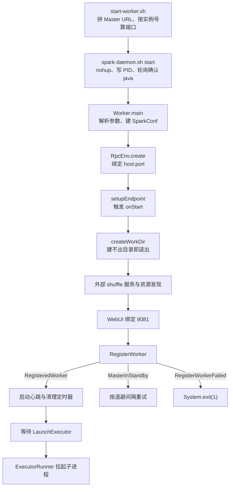
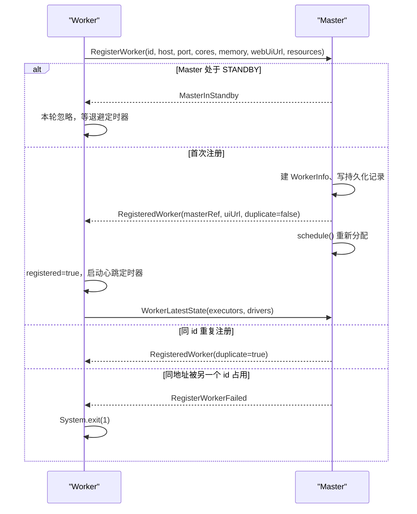
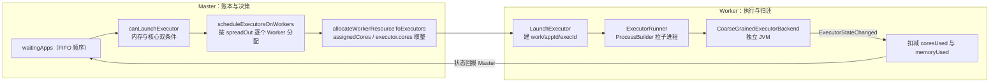
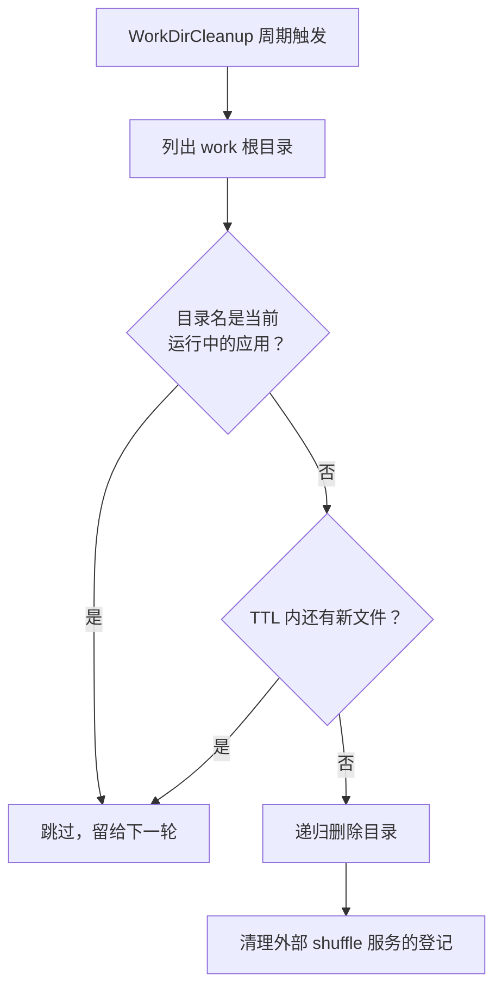
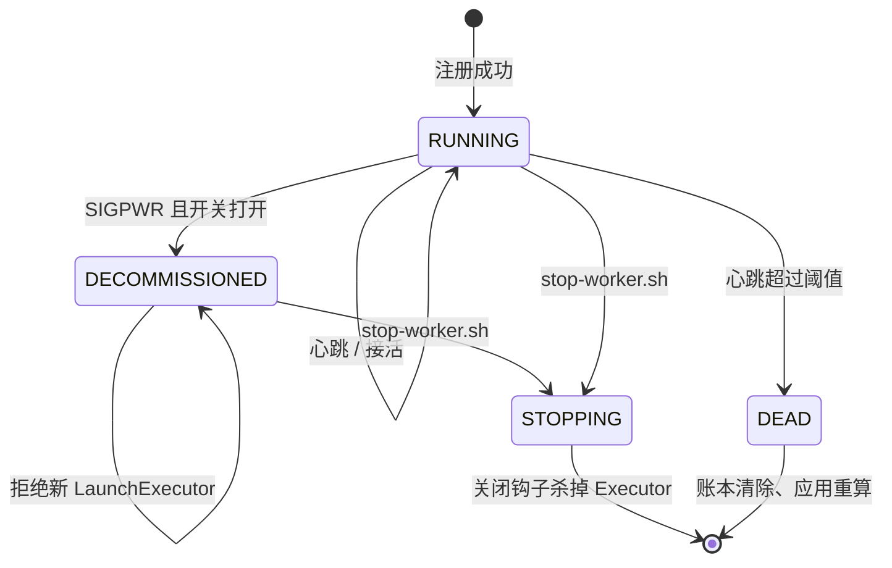

# 2. Spark Worker 启动原理：从进程注册到 Executor 托管的节点代理

**摘要：**

Standalone 模式里，Worker 是唯一一个"脚踩在物理机上、又要在集群账本里报数"的进程，它既不是调度器，也不是执行器，却同时决定了资源如何被申报、Executor 由谁拉起、节点失联由谁判定。本文按"它是什么 → 为什么必须由它注册 → 启动链条怎样落地 → 边界在哪里"推进。先限定范围：4.x 的 Worker 只存在于 Standalone，YARN 与 Kubernetes 已各自接管节点侧职责，脚本也从 `start-slave.sh` 换成了 `start-worker.sh`；随后拆解从脚本到 JVM、从 `RpcEnv` 绑定到 `onStart` 五步初始化、从 `RegisterWorker` 握手到失败退避的完整序列；再进入资源侧，说明 `cores` 与 `memory` 这两个整数的性质、Master 如何按 Application 切分、`ExecutorRunner` 如何把一次分配落成一个子进程；继而讨论 `spark.worker.timeout` 所定义的心跳与 60 至 120 秒的失联窗口、`work/app-*/` 两级目录与两种清理、一个 Worker 承载多个应用时的隔离与争抢、`stop` 与 `decommission` 两条退出路径以及 Worker 被 SIGKILL 之后孤儿 Executor 的结局。全文以 4.3.0 的源码与脚本行为为准，凡 3.x 与 4.x 默认值不同之处，均在正文单独标注。落点是三处权衡：账本粗则误判少而利用率低，切分细则碎片多而可控，退避慢则抖动量小而恢复慢。

---

## 第 1 章 节点代理的三重身份

### 1.1 范围限定：只有 Standalone 才有 Worker

2010 年那篇讲 working sets 的 Spark 论文把计算放在 worker nodes 上，2012 年的 RDD 论文把 worker 上的长驻进程命名为 Executor，2013 至 2014 年间 Standalone 模式把"谁拉起 Executor、谁向集群汇报节点资源"这两件事固化成一个独立 JVM 进程，也就是本文要拆的 `org.apache.spark.deploy.worker.Worker`。此后 YARN 的 NodeManager 与 Kubernetes 的 kubelet 各自长出了节点管理能力，Worker 的生存空间就收窄到 `spark://` 这一种 master URL 上；到 4.x，`sbin` 目录里的启动入口是 `start-worker.sh`、`start-workers.sh`、`decommission-worker.sh` 与 `stop-worker.sh`，旧名 `start-slave.sh` 已经不存在，主机清单默认读 `conf/workers`，`conf/slaves` 只在脚本的兼容分支里作为遗留路径被提及。

范围之外的两件事先说清楚：在 YARN 上找不到 Worker，容器由 NodeManager 按 ApplicationMaster 的请求分配；在 Kubernetes 上同样找不到 Worker，Executor 是一个独立的 Pod，生命周期由 kubelet 与 Spark 的 Pod 模板共同决定。两者都不需要"节点代理先向集群报数"这个环节，因为资源清单本来就在资源管理器手里。本文的版本口径取当前稳定的 Spark 4.3.0（2026-10-30 发布），4.x 的预编译包只提供 Scala 2.13（2.12 已在 4.0 弃用），涉及行为差异时以对应版本文档为准。

### 1.2 三重身份

**Worker 的第一重身份是注册者**：进程起来之后主动向 Master 发一条 `RegisterWorker`，把自己能提供的 `cores`、`memory` 以及发现的 GPU、FPGA 等地址化资源一次性报上去，Master 据此在内存里建一条 `WorkerInfo` 记录，从此这份账本由 Master 单方维护，Worker 自己不再持有"集群还剩多少"的判断。

第二重身份是执行者：Master 决定在哪个 Worker 上开几个 Executor、每个几核几 G 之后，发一条 `LaunchExecutor` 过来，Worker 负责建目录、拼命令行、用 `ProcessBuilder` 拉起子 JVM，并把子进程的 stdout、stderr 重定向到工作目录下的两个文件，然后通过 `ExecutorRunner` 持续盯着这个子进程的存活状态。

第三重身份是守望者：每 15 秒向 Master 发一次心跳，让 Master 知道这台机器还活着；在开启了清理开关的集群上，它还按固定周期扫一遍 `work` 目录，把不属于任何运行中应用的陈年目录删掉；Web UI 在 8081 端口上把本机的核心数、内存余量、运行中的 Executor 与它们的日志页一并暴露出来。

### 1.3 为什么不反过来：Master 主动拉取为何不可行

一个自然的设问是：为什么不让 Master 主动去探测节点，而要节点自己找上门来？

原因藏在启动顺序里。Master 无法预知集群里会出现哪些机器，管理员在扩容时也不想为了"让 Master 认识新机器"而重启 Master 或改它的配置文件；反过来，新机器上只有一条 `start-worker.sh spark://master:7077`，注册完就进了集群，Master 重启之后所有 Worker 也会自动重连，账本随之重建。**推模式（Push）用一条命令换掉了中心节点的配置管理**，代价是 Master 必须相信节点报上来的数字，它没有任何独立手段去核实那台机器是不是真有 64 核、256 G。

**这条信任关系的风险点在扩容季最常见**：管理员为了"多塞几个 Executor"把 `SPARK_WORKER_CORES` 调高、把 `SPARK_WORKER_MEMORY` 也调高，Master 照着账本派活，Executor 真的被拉起来，然后在运行期被操作系统的 OOM Killer 杀掉——账本上一切正常，机器上却在杀进程。第 4 章会把这件事的边界讲透。

### 1.4 一个比喻：码头与船代

把 Worker 比作码头，Master 比作港务调度，Executor 比作靠港作业的船，会更容易看清三者的分工。码头申报自己的泊位数（cores）与堆场面积（memory），调度据此安排哪条船靠哪个码头、占几个泊位；船代只负责带缆、接水电、记录作业进度，不参与"哪条船该来"的决策。

比喻需要一处限定：真实的码头在船靠泊期间不会把泊位重新分配给别人，而 Worker 的资源账本是由 Master 在分配那一刻扣减的，Executor 退出时再按上报的状态归还；如果 Executor 异常退出而上报丢失，账本会短暂地"记着一个已经不存在的占用"，这正是第 5 章要用 `WorkerLatestState` 与状态对账来兜底的原因。

### 1.5 节点级与任务级的边界

把 Worker 与另外两个进程放在一起比较，各自的边界会清楚很多。Driver 是应用级的，一个应用一个，负责把 DAG 切成 stage 与 task；Executor 是任务级的，一个应用一批，负责在 JVM 里用线程池跑 task；Worker 是节点级的，一个节点一个（或多实例），既不理解 DAG 也不理解 task，只理解"这台机器上还能放下几个进程"。

三种失联的判定主体也不同：Driver 失联由应用侧感知，cluster 模式下还要靠 Master 重新拉起；Executor 失联由 Master 与 Driver 共同判定；Worker 失联只有 Master 判定。分清这三层，才能理解为什么"节点失联"不会立刻让作业失败——期间任务还在等 Executor 的超时——而"Driver 失联"往往意味着作业直接结束。

---

## 第 2 章 从脚本到进程

脚本层只负责把 JVM 拉起来，进程内部的顺序则由 `onStart` 固定；把两层画在同一张图上，能看出每一步失败都会终止启动，而不是留下一个"起来了但不在账本里"的半成品节点。



### 2.1 三个脚本的分工

单机启动的入口是 `sbin/start-worker.sh`，它的职责只有三件：拼出 Master URL、决定本机上要起几个实例、把参数交给 `spark-daemon.sh`。`spark-daemon.sh start` 负责守护化：用 `nohup` 把 `spark-class` 拉起来并重定向到 `$SPARK_LOG_DIR/spark-$USER-worker-<instance>-<HOSTNAME>.out`，把子进程号写进 `$SPARK_PID_DIR`（默认 `/tmp`）下的 `spark-$USER-worker-<instance>.pid`，再轮询几秒确认这个进程确实变成了 java 进程。

| 脚本 | 职责 | 关键动作 |
|---|---|---|
| `start-worker.sh` | 单机启动一个或多个实例 | 解析 Master URL、按实例号递增端口、调用 `spark-daemon.sh` |
| `start-workers.sh` | 按 `conf/workers` 批量启动 | 逐个主机 SSH 执行 `spark-daemon.sh`，依赖免密登录 |
| `workers.sh` | 在全部 worker 主机上执行任意命令 | 把 `conf/workers` 的行当作主机清单，逐行 SSH |
| `stop-worker.sh` | 停止本机实例 | 读 PID 文件后 `kill`，等价于 SIGTERM |
| `decommission-worker.sh` | 让本机实例进入排空态 | 读 PID 文件后 `kill -s SIGPWR`，可加 `--block-until-exit` |

`start-worker.sh` 里有一小段逻辑值得单独看，因为它解释了"同一台机器上为什么端口可以连着用"：

```bash
# start-worker.sh：实例号决定端口偏移，而不是随机碰运气
function start_instance {
  WORKER_NUM=$1; shift
  if [ "$SPARK_WORKER_PORT" = "" ]; then
    PORT_FLAG=; PORT_NUM=                      # 不指定则交给 RpcEnv 绑随机端口
  else
    PORT_FLAG="--port"
    PORT_NUM=$(( $SPARK_WORKER_PORT + $WORKER_NUM - 1 ))
  fi
  WEBUI_PORT=$(( $SPARK_WORKER_WEBUI_PORT + $WORKER_NUM - 1 ))
  "${SPARK_HOME}/sbin"/spark-daemon.sh start $CLASS $WORKER_NUM \
     --webui-port "$WEBUI_PORT" $PORT_FLAG $PORT_NUM $MASTER "$@"
}
```

### 2.2 从 main 到参数对象

脚本最终落到 `Worker.main`，它做的事很少：初始化守护进程日志、构造 `SparkConf`、交给 `WorkerArguments` 解析、拉起 RPC 环境并把 `Worker` 端点挂上去、最后阻塞在 `awaitTermination` 上。这段代码之所以短，是因为所有"决定"都被推给了参数对象与配置系统。

```scala
def main(argStrings: Array[String]): Unit = {
  // 守护进程模式下日志要能落到文件，先重置结构化日志
  Utils.resetStructuredLogging()
  Utils.initDaemon(log)
  val conf = new SparkConf
  val args = new WorkerArguments(argStrings, conf)
  // 注意：Web UI 端口在 main 之后还要被 conf 里的设置再覆盖一次
  val rpcEnv = startRpcEnvAndEndpoint(args.host, args.port, args.webUiPort, args.cores,
    args.memory, args.masters, args.workDir, conf = conf,
    resourceFileOpt = conf.get(SPARK_WORKER_RESOURCE_FILE))
  rpcEnv.awaitTermination()
}
```

`WorkerArguments` 的默认值值得逐项记住，因为它们决定了"什么都不配"时的集群形态：

| 参数或环境变量 | 默认值 | 语义与后果 |
|---|---|---|
| `--host` / `-h` | 本机主机名 | 绑定地址，也是 Master 回连的地址 |
| `--port` / `-p` | 0 | 0 表示由 `RpcEnv` 绑随机端口，重启后端口可能变化 |
| `--cores` / `-c` | 逻辑 CPU 数 | 申报给 Master 的核心额度，**并不绑定物理核** |
| `--memory` / `-m` | 物理内存减 1 G | 申报给 Master 的内存额度，未扣除页缓存与堆外开销 |
| `--work-dir` / `-d` | `$SPARK_HOME/work` | Executor 的落盘根目录 |
| `--webui-port` | 8081 | Worker 自己的 UI，多实例时按实例号递增 |
| `SPARK_WORKER_INSTANCES` | 1 | 单机实例数，必须在一次调用中给出 |

这里有一处容易被忽略的优先级：环境变量先读、命令行后解析，所以命令行一般覆盖环境变量；但 `spark.worker.ui.port` 是在参数解析之后才从 `conf` 里覆盖 `webUiPort` 的，换句话说不论命令行写了什么，`spark-defaults.conf` 里的这一项都有最终否决权。

### 2.3 端口绑定与"失败即退出"

`startRpcEnvAndEndpoint` 做了两件不可逆的事：用 `RpcEnv.create` 在 `host:port` 上绑定监听，再 `setupEndpoint` 把 `Worker` 实例挂成名为 `Worker` 的端点。`setupEndpoint` 会立即触发端点的 `onStart`，因此任何初始化异常都会沿着这条调用链抛回 `main`，进程随即退出。

**Worker 没有"半启动"这种状态**：目录建不出来，`System.exit(1)`；端口被占用，绑定异常直接终止；Web UI 绑不上 8081，同样致命。这种 fail fast 的选择在集群运维里是有利的——一个起不来的 Worker 比一个"起来了但收不到活"的 Worker 更容易被发现，后者会在监控图上表现为"节点在线但资源永远空闲"，排查成本高得多。

### 2.4 onStart 的五步顺序

`onStart` 里的调用顺序本身就是一份依赖声明：

```scala
override def onStart(): Unit = {
  assert(!registered)
  logInfo(...)                                   // 打出 cores 与 memory，便于事后对账
  createWorkDir()                                // 1. 目录先于一切：后面所有东西都要落盘
  startExternalShuffleService()                  // 2. 开了外部 shuffle 服务才起，失败直接退出
  setupWorkerResources()                         // 3. 发现 GPU/FPGA 等地址化资源
  webUi = new WorkerWebUI(this, workDir, webUiPort)
  webUi.bind()                                   // 4. UI 先绑，因为注册消息要带上它的 URL
  registerWithMaster()                           // 5. 最后才亮身份
  metricsSystem.registerSource(workerSource)
  metricsSystem.start()
  metricsSystem.getServletHandlers.foreach(webUi.attachHandler)
}
```

顺序背后的理由可以逐条反推。目录若晚于注册，Master 可能在目录还没建好时就把 `LaunchExecutor` 发过来，Worker 会在 `mkdirs` 上失败并把 Executor 报成 FAILED；UI 若晚于注册，注册消息里的 `workerWebUiUrl` 就是空串，Master 页面上的 Worker 链接会指向无意义的地址；度量系统放在最后，是因为它要把 servlet 挂到已经绑定的 UI 上。启动序列的顺序不是风格问题，而是"谁依赖谁"的显式声明。

### 2.5 多实例部署的两处硬约束

同一台机器上跑多个 Worker 实例，靠的是 `SPARK_WORKER_INSTANCES` 加实例号递增。第一处约束来自 PID 文件：文件名里带实例号，`spark-daemon.sh start` 发现同名 PID 文件里的进程还是 java 就拒绝启动并打印 `Stop it first`，所以多实例必须在一次脚本调用中给出实例数，分多次调用第二、第三次只会撞上第一次的 PID 文件。

第二处约束来自外部 shuffle 服务：一旦 `spark.shuffle.service.enabled` 打开，`Worker.main` 会断言实例数不超过 1，理由是同一个 7337 端口在一台机器上只能被一个进程监听（4.x 的 `main` 里直接 `require` 了这条约束）。**`SPARK_WORKER_INSTANCES` 本身在 4.x 的脚本注释里已被标记为废弃**，实践上的推荐做法是一台机器（或一个容器）一个 Worker，需要拆分粒度时用 Executor 的尺寸参数而不是多实例。

### 2.6 启动完成后的第一分钟

启动完成的判据不是进程存在，而是三处证据同时成立：worker 日志里出现 `Successfully registered with master`；Master 页面上出现这台机器的 id、cores 与 memory；8081 的 Worker UI 能打开且 `coresUsed` 为 0。三者缺一，说明启动只是"看起来完成"。此后 Worker 进入稳态：心跳每 15 秒一次、清理每 30 分钟一次，其余时间只是在等 `LaunchExecutor`。值班时这段稳态有三项值得固化进巡检脚本：端口是否显式固定（默认的随机端口在重启后会变，防火墙规则与监控采集都可能失准）、`work` 目录所在分区还剩多少空间、申报的 memory 与物理内存之间留了多少余量。

### 2.7 外部 shuffle 服务的启动与失败语义

`spark.shuffle.service.enabled` 打开时，Worker 会在自己的 JVM 里起一个 `ExternalShuffleService`，监听 7337 端口。它的作用是让 Executor 退出之后，它写下的 shuffle 文件仍能被下游读取，这也是动态分配能在 Standalone 上工作的前提。不过启动失败的处理很硬：异常直接导致 `System.exit(1)`，因为一个"起来了但没有 shuffle 服务"的 Worker 会让应用在下游 fetch 阶段才失败，那种失败的定位成本远高于启动时退出。端口固定带来第二个后果，就是 2.5 节那条"一台机器只能一个 Worker"的硬约束。

### 2.8 参数从哪来：环境变量与配置文件的边界

申报用的 `cores`、`memory`、`workDir` 在 4.x 里没有对应的 `spark.*` 配置项，只能经环境变量或命令行传入；`spark-defaults.conf` 能影响的只有行为参数，譬如 `spark.worker.timeout`、`spark.worker.cleanup.*`、`spark.decommission.enabled` 与 `spark.worker.decommission.signal`。这条边界在容器化部署时经常被踩：镜像里写了 `SPARK_WORKER_CORES`，编排层又用 `spark-defaults.conf` 覆盖了一部分行为参数，两处配置的来源不同、生效时机也不同，排查时先确认改的是哪一层，比逐行核对参数更快。

---

## 第 3 章 注册：一次握手与三条退路

### 3.1 注册消息里到底有什么

`RegisterWorker` 携带的信息比想象中多：除了 `id`、`host`、`port`、端点引用、`cores`、`memory`、Web UI URL 之外，还有 Worker 自己发现的资源清单与它所连接的 Master 地址。其中 `id` 由 Worker 在启动时按 `worker-<yyyyMMddHHmmss>-<host>-<port>` 的模板生成，这意味着**进程重启之后它就是一个新身份的 Worker**，Master 里那条旧记录只能靠心跳超时进入 DEAD 状态，再等巡检把它从 UI 上清掉。

资源清单这一项在 3.x 之后才变得重要：Standalone 支持把 GPU 之类的设备按地址切成资源，Worker 启动时通过 `spark.worker.resource.*` 或资源文件发现本机有哪些设备，随注册一起上报，Master 的账本因此在 `cores` 与 `memory` 之外多了一层"地址化资源"。

### 3.2 Master 侧的处理与查重

Master 收到注册后要走三个分支：

| 响应 | 含义 | Worker 的动作 |
|---|---|---|
| `RegisteredWorker` | 注册成功 | 置 `registered`、记录 Master 引用、启动心跳与清理定时器、上报 `WorkerLatestState` |
| `MasterInStandby` | 当前 Master 还在恢复中 | 忽略，等下一轮重试；这是 HA 下的常态 |
| `RegisterWorkerFailed` | 同一地址已有不同 Worker，或注册被拒 | 记录错误并 `System.exit(1)` |

正常路径上，Master 会新建 `WorkerInfo`、写一条持久化记录（开启了恢复模式时）、回 `RegisteredWorker`，然后立刻调用一次 `schedule()`——因为新资源入账意味着可能有排队中的应用可以被满足了。重复注册的处理要温和一些：同一个 `id` 再次注册时若状态是 UNKNOWN 就改回 ALIVE，回一个 `duplicate=true` 的响应；但同一地址被另一个 `id` 抢先占用时不做让步，直接回 `RegisterWorkerFailed`。

**注册失败不是降级运行，而是拒绝启动**，这条设计的含义是：一个没进集群账本的 Worker 留在那里只会白占端口与内存，退出反而让管理员一眼看到问题。

把四个分支画成时序图，可以不漏掉"重复注册"和"地址被占"这两种容易被当成成功的情形：



### 3.3 注册成功后的三件事

```scala
case RegisteredWorker(masterRef, masterWebUiUrl, masterAddress, duplicate) =>
  if (duplicate) logWarning("Duplicate registration at master ...")
  registered = true
  changeMaster(masterRef, masterWebUiUrl, masterAddress)

  // 心跳只在尚未排程时启动一次：断连重连不应该叠加出多条心跳链
  if (heartbeatTask.isEmpty) {
    heartbeatTask = Some(forwardMessageScheduler.scheduleAtFixedRate(
      () => Utils.tryLogNonFatalError { self.send(SendHeartbeat) },
      0, HEARTBEAT_MILLIS, TimeUnit.MILLISECONDS))
  }
  // 清理定时器同理，按 CLEANUP_INTERVAL_MILLIS 周期投递 WorkDirCleanup
  // 最后把本机正在跑的 Executor 与 Driver 报给 Master，供其恢复时对账
  val execs = executors.values.map { e => new ExecutorDescription(e.appId, e.execId, e.rpId,
    e.cores, e.memory, e.state) }
  masterRef.send(WorkerLatestState(workerId, execs.toList, drivers.keys.toSeq))
```

三件事里，`WorkerLatestState` 最能体现设计者的谨慎：Master 有可能刚从崩溃或主备切换中醒来，它的账本里没有这些 Executor，而 Worker 手上的子进程是实实在在活着的。这条消息让 Master 能在不杀进程的前提下把状态补回来，避免"重启一次 Master 就把全集群的 Executor 判成孤儿"。

### 3.4 重试退避与放弃

注册不是一次性的。Worker 维护一个重试计数，前 6 次用 5 至 15 秒的抖动间隔，之后改用 30 至 90 秒的抖动间隔，累计 16 次仍连不上就打印 `All masters are unresponsive! Giving up.` 并退出。抖动系数是在 0.5 到 1.5 之间随机取的，目的很具体：防止一次 Master 重启之后，整集群上百个 Worker 在同一秒涌上来把新建的 Master 压住，也就是常说的惊群。

退避的代价也要算清楚：从第一次失败到放弃大约要几分钟，这段时间里 Worker 是"活着但不在账本里"的状态，它手上已有的 Executor 仍在跑，但 Master 若在这段时间里把它判了超时，Driver 侧就会收到 LOST 并触发重算。**退避越长，恢复窗口越宽、副作用窗口也越长**，这条取舍没有普适解，取决于集群规模与网络抖动的时间尺度。

### 3.5 注册与 Master 恢复

HA 部署下，注册还要与 Master 的恢复过程对齐。Master 从 ZooKeeper 或文件系统里恢复状态时处于 RECOVERING，此时收到的注册一律回 `MasterInStandby`，恢复窗口由 `spark.deploy.recoveryTimeout` 控制，默认取 `spark.worker.timeout` 的值；恢复完成之后 Master 调 `schedule()`，再把旧 Worker 列表与新注册对齐。Worker 侧在收到 `MasterChanged` 时会主动上报已有 Executor 与 Driver 的状态（`WorkerSchedulerStateResponse`），让新 Master 不必等心跳就能认领这些进程。这条设计把"Master 换主"与"Worker 重启"区分开来：前者不改变 Worker 身份，后者必然产生新 id，两种情形在页面上的表现完全不同。

### 3.6 注册失败之后

注册失败在日志里长得很像网络问题，实际成因通常只有四类：Master URL 写错或端口不是 7077；防火墙放行了 7077 却没有放行 Worker 自己的端口（注册成功后 Master 与 Driver 都要回连这个端口，默认随机，不固定就会到处碰壁）；同一台机器上残留的 PID 文件让新实例以为旧进程还在；同一个地址上已有不同 id 的 Worker，Master 直接拒绝。

处置顺序也照这四类走：先用 `spark-daemon.sh status` 核对 PID 与进程是否一致，再看 worker 日志里的第一个异常，最后在 Master 日志里搜同一个 worker id。把 Worker 端口显式固定下来，能消掉其中两类问题，这也是 2.6 节把"端口是否固定"列进巡检项的缘由。

---

## 第 4 章 资源账本

### 4.1 申报量与申请量

Worker 侧只有两个整数：`cores` 与 `memory`（单位 MB），来源是启动参数或环境变量。应用侧则是另一组数字：`spark.executor.cores`、`spark.executor.memory`、`spark.cores.max`，再加上资源描述里的自定义资源。Master 要做的事，是把后者切成若干份、每份记到某个前者的头上，并在 Executor 退出时把这份占用还回去。

| 层 | 数量来源 | 是否硬约束 | 备注 |
|---|---|---|---|
| Worker 申报的 cores | `--cores` 或 `SPARK_WORKER_CORES` | 否 | 超过物理核数也允许，等于自愿超卖 |
| Worker 申报的 memory | `--memory` 或 `SPARK_WORKER_MEMORY` | 否 | 默认取物理内存减 1 G，未扣页缓存 |
| Executor 申请的 cores | `spark.executor.cores` | 是（逻辑槽位） | 未设置时按"一个 Executor 吃满本轮分配"处理 |
| Executor 申请的 memory | `spark.executor.memory` | 是（记账口径） | `spark.executor.memoryOverhead` 不计入账本 |

### 4.2 Worker 侧的两个整数

Worker 自己不判断"还能不能开一个 Executor"，它只做加减：每接一个 `LaunchExecutor` 就把 `coresUsed`、`memoryUsed` 加上去，每收一个 Executor 的终止状态就减回来；`coresFree` 与 `memoryFree` 只是这两个数的派生值，供 UI 展示。**决策在 Master，执行在 Worker**，这是理解整套机制的第一把钥匙——Master 的 `WorkerInfo` 里也有同名的一组计数，两份账面之所以能对上，靠的是每条 `LaunchExecutor` 与每条 `ExecutorStateChanged` 都走同一条 RPC 链。

这也解释了一类事故：如果 `ExecutorStateChanged` 因为网络问题丢了，Worker 与 Master 各记各的账，Worker 认为资源已被占满，Master 认为还有余量继续派活，最终在机器上表现为"启动失败、退出码 1"，而 Master 的页面上一切正常。3.x 之后这类消息改用 `ask` 同步确认并带重试，正是为了让两份账本不至于长期分叉。

### 4.3 切分算法

Master 派活的入口是 `startExecutorsOnWorkers`：先按 FIFO 顺序取出排队的 Application，再用 `canLaunchExecutor` 过滤出"内存与核心都够"的 Worker，然后进入 `scheduleExecutorsOnWorkers` 做逐个 Worker 的分配，最后 `allocateWorkerResourceToExecutors` 把分配结果翻译成一条条 `LaunchExecutor`。

```scala
// Master 侧的准入判断：先看内存，再看核心，任何一项不够整个 Worker 出局
private def canLaunch(worker: WorkerInfo, memoryReq: Int, coresReq: Int, ...): Boolean = {
  val enoughMem = worker.memoryFree >= memoryReq
  val enoughCores = worker.coresFree >= coresReq
  enoughMem && enoughCores && ResourceUtils.resourcesMeetRequirements(...)
}

// 分配循环里的双条件：coresToAssign 是全局剩余，assignedCores(pos) 是该 Worker 已分到的
def canLaunchExecutorForApp(pos: Int): Boolean = {
  val enoughCores = usableWorkers(pos).coresFree - assignedCores(pos) >= minCoresPerExecutor
  if (launchingNewExecutor) {
    val assignedMemory = assignedExecutorNum * memoryPerExecutor
    enoughMemory = usableWorkers(pos).memoryFree - assignedMemory >= memoryPerExecutor
    ...
  } else {
    // 往已有 Executor 身上追加核心，此时不再检查内存
    keepScheduling && enoughCores
  }
}
```

从"排队"到"子进程"是一条单向链，Master 负责每一步的判断，Worker 只负责最后两步的落地，这条分界画清楚之后，两份账本各自记什么也就不言自明：



### 4.4 oneExecutorPerWorker 的语义

`spark.executor.cores` 未显式设置时，分配循环会走上 `oneExecutorPerWorker` 分支：第一轮给某个 Worker 记一个 Executor，后续轮次只往这个 Executor 上追加核心，最后 `allocateWorkerResourceToExecutors` 用 `coresPerExecutor.map(assignedCores / _).getOrElse(1)` 算出实例数——**没有尺寸参数时就是一个 Executor 抓走本轮分配的全部核心**。这也是"同一个应用在同一个 Worker 上出现两个 Executor"的来由：不是同一轮里开了两个，而是下一轮调度时前一个已经吃满了当时的空闲核，后来又有 Executor 退出腾出核心，于是又开了一个。

尺寸参数一旦显式给出，行为就变得可预测：分配结果按 `assignedCores / coresPerExecutor` 取整，余数留在 Worker 上闲着。这个取整就是第 9 章资源碎片的算术来源。

### 4.5 账本的三处乐观

第一处是 `spark.executor.memoryOverhead` 不计入账本，Master 只按 `spark.executor.memory` 记账，而执行器的实际驻留内存是堆、堆外、元空间与本地库内存之和；第二处是默认的 `SPARK_WORKER_MEMORY` 取物理内存减 1 G，那 1 G 在 64 G 以上的机器上偏保守、在 8 G 的机器上又偏紧，譬如一台 8 G 的机器申报出去 7 G，留给页缓存与堆外的只剩零头，页缓存与操作系统自身的开销从未被正式扣除；第三处是 `cores` 允许虚报，虚报的核心不会变成算力，只会让更多 Executor 抢同一批 CPU 时间片。

**账本越粗，越不容易误判；账本越细，开销与配置复杂度越高**，Standalone 选了粗的那一端，代价由运维在参数上补回来，这也解释了为什么这个模式在生产上通常要求把 `SPARK_WORKER_MEMORY` 显式写成物理内存的 80% 左右，而不是依赖默认值。

### 4.6 Driver 也在这本账上

cluster 部署模式下，Driver 同样跑在 Worker 上，由 `DriverRunner` 拉起，占用 `spark.driver.cores` 与 `spark.driver.memory`，并出现在 Worker UI 的 Driver 列表里。它对账本有两处影响：一是 Driver 的占位会挤掉 Executor 的空间，一台机器上能开的 Executor 数因此少一个；二是 `spark.driver.supervise` 为 true 时，受监管的 Driver 异常退出后会被 Master 重新排队拉起（新 id），Worker 只负责把旧进程的退出状态报上去。client 模式下 Driver 在提交机上，这本账里就没有它——同一份 `spark-submit` 在两种模式下拿到的资源数不一样，原因之一就在这里。

### 4.7 一次分配过程的走查

把数字放进一个具体场景，会比看算法更快理解 FIFO 与 spreadOut 的合力。假设集群三台 Worker，每台申报 32 核 128 G；某个应用提交时设 `spark.executor.cores=4`、`spark.executor.memory=16g`、`spark.cores.max=24`。第一轮 `schedule` 从 `waitingApps` 取出它，过滤出三台都能放下的 Worker，按 spreadOut 的默认行为每台先给一个 Executor，用掉 12 核；第二轮再各给一个，用掉 24 核，达到 `cores.max`，调度停止。结果是三台机器各 2 个 Executor、每台占 8 核 32 G，剩下 24 核 96 G 留给后来者。

若中途某台机器只剩 2 核空闲，它会在第一轮就被 `canLaunchExecutor` 过滤掉，另外两台各拿 3 个，形成不均衡分布。不均衡本身不是问题，问题在于它会让后续应用更难找到连续空间——同一个应用在不同节点上的 Executor 数量不一样，往往就是某一轮调度时某台机器恰好差一点。

---

## 第 5 章 心跳与失联判定

### 5.1 三个数字

心跳机制可以只用三个数字讲完：`spark.worker.timeout` 默认 60 秒，是判定失联的阈值；Worker 的心跳间隔取阈值的四分之一，即 15 秒；Master 的巡检周期等于阈值本身，即每 60 秒扫一次账本。三者组合出来的检测窗口是 60 到 120 秒——Worker 在第 1 秒死掉，最早也要到第 120 秒才被巡逻发现，最晚不会超过第 120 秒。

| 参数 | 默认值 | 作用 |
|---|---|---|
| `spark.worker.timeout` | 60 秒 | 判定 Worker 失联的阈值，同时决定心跳间隔与巡检周期 |
| Worker 心跳间隔 | 阈值的 1/4 | Worker 向 Master 发送 `Heartbeat` 的周期 |
| Master 巡检周期 | 等于阈值 | `CheckForWorkerTimeOut` 的投递周期 |
| `spark.worker.initialRegistrationRetries` | 6 | 短间隔重连次数（5 至 15 秒抖动） |
| `spark.worker.maxRegistrationRetries` | 16 | 重连总次数上限，用尽后退出 |

### 5.2 Master 的巡检与移除动作

```scala
// Master 侧：按阈值过滤出"太久没心跳"的 Worker，逐个移除
private def timeOutDeadWorkers(): Unit = {
  val currentTime = System.currentTimeMillis()
  val toRemove = workers.filter(_.lastHeartbeat < currentTime - workerTimeoutMs).toArray
  for (worker <- toRemove) {
    if (worker.state != WorkerState.DEAD) removeWorker(worker, s"Not receiving heartbeat for ...")
    else if (worker.lastHeartbeat < currentTime - ((reaperIterations + 1) * workerTimeoutMs)) {
      workers -= worker   // 已经在 UI 上挂了足够久的死节点，从内存里彻底抹掉
    }
  }
}
```

`removeWorker` 的动作依次是：把 Worker 状态置为 DEAD、从 `idToWorker` 与 `addressToWorker` 两张索引里摘掉、给该 Worker 上每个 Executor 的所属应用发 `ExecutorUpdated(LOST, "worker lost: ...")`、把受监管的 Driver 重新排入等待队列（非受监管的 Driver 直接判 ERROR）、向所有未完成应用广播 `WorkerRemoved`、清理持久化记录，最后再调一次 `schedule()` 把腾出来的需求重新分配到别的节点上。

这条链路把"节点死了"翻译成了三件应用层能理解的事：**Executor 丢了、Driver 可能需要重启、资源需要重新排队**。翻译的代价是延迟，60 至 120 秒的窗口里，Driver 并不知道那些 Executor 已经死了，任务还在等它们的超时——所以真正影响作业恢复时间的往往不是调度器，而是 `spark.network.timeout` 与任务重试策略，这两者与本文的心跳参数需要分开看。

### 5.3 Worker 侧的断连处理

Worker 这一侧的处理是"重连"而不是"退出"：`onDisconnected` 一旦发现断开的是当前 Master，就把 `connected` 置为 false，随后调用 `registerWithMaster` 重新走一遍第 3 章的流程；心跳消息在 `connected` 为 false 时直接丢弃，不会向一个已经不存在的 Master 空发。Master 侧若还活着但发现某个 Worker 的 `id` 不在账本里，会用 `ReconnectWorker` 让它立刻重新注册，而不是干等它自己的重试定时器。

这种"双向补救"在 HA 切换时特别有用：新 Master 从持久化存储恢复出一个不完整的 Worker 列表，靠 Worker 的重试补全；Worker 则靠 Master 的 `ReconnectWorker` 缩短重连间隔。

### 5.4 误判从哪来

**心跳只证明进程还活着，不证明它还能干活**，这是误判的总根源。三类典型情形：一是长 GC 暂停，Worker 的 JVM 在 stop-the-world 期间无法处理定时器投递的 `SendHeartbeat` 自消息；二是 Worker 的 `receive` 是串行处理的（`ThreadSafeRpcEndpoint` 加 `synchronized`），当 `LaunchExecutor` 一次性涌入大量请求、每条都要 `mkdirs` 并启动子进程时，队列里的心跳消息会被推迟；三是工作目录放在慢速网络存储上，`mkdirs` 与日志写入把处理线程拖住。

三种情形的共同点是"Worker 并没有死，只是慢了"，而 Master 的判据只有时间戳。调大 `spark.worker.timeout` 能降低误判概率，代价是真实故障的发现更晚；把 `work` 目录放到本地盘、把一次性的 Executor 拉起数量控制在合理范围，则是在不改判据的前提下消除诱因——后者更值得投入。

### 5.5 两个心跳不是一回事

Worker 心跳与 Executor 心跳是两条独立的链。前者走 Worker 到 Master，判据是 `spark.worker.timeout`，回答"节点还在不在"；后者走 Executor 到 Driver 的心跳接收器，判据是 `spark.executor.heartbeatInterval`（默认 10 秒）与 `spark.executor.heartbeat.maxFailures`（默认 60 次），回答"执行器还能不能收任务"。两条链的参数不能互相顶替：把 `spark.worker.timeout` 调大不会让丢任务的 Executor 更快被发现，把 Executor 心跳调快也不会让 Master 更早把死节点移出账本。值班时先分清"任务卡住"属于哪条链，再决定动哪个参数，能省掉大半无效试错。

### 5.6 失联之后的连锁反应

Worker 被判失联之后，应用侧要还的债比"重跑几个 Task"多。Executor 丢失会让它写下的 shuffle 文件同时失效，下游 stage 在 fetch 时抛 FetchFailed，DAGScheduler 据此把上游 map stage 整段重算，重算又需要新的 Executor 与新的 shuffle 写盘。连续失败有上限：同一 stage 连续失败达到 `spark.stage.maxConsecutiveAttempts`（默认 4）次，作业直接失败。

3.4 之后还有一处默认打开的开关 `spark.stage.ignoreDecommissionFetchFailure`，它让"因排空而起的 fetch 失败"不计入连续失败次数，避免一次正常的滚动下线把作业推向失败。这个开关从侧面说明，未经排空的直接停机与排空下线，在应用侧看来是两种性质不同的事件：前者是事故，后者是计划。

---

## 第 6 章 工作目录

### 6.1 三处落盘位置

Worker 相关的磁盘路径有三处，各有各的生命周期：

| 位置 | 内容 | 生命周期 |
|---|---|---|
| `$SPARK_WORKER_DIR`（默认 `$SPARK_HOME/work`） | 每个应用一个目录，其中每个 Executor 一个子目录，存放 stdout、stderr 与资源文件 | 由清理定时器按 TTL 决定，与应用结束无必然关系 |
| `spark.local.dir` 或 `SPARK_LOCAL_DIRS` | 每盘每应用一个随机名目录，作为 Executor 的 `SPARK_EXECUTOR_DIRS`，shuffle 溢写与 block 落这里 | 应用结束时由 Worker 主动删除 |
| `$SPARK_LOG_DIR` 与 `$SPARK_PID_DIR` | Worker 自身的 stdout 日志与 PID 文件 | 由日志轮转与脚本管理 |

### 6.2 work 目录的两级结构

`LaunchExecutor` 到达时，Worker 的第一件事是 `new File(workDir, appId + "/" + execId)` 并建目录，因此目录结构是两级：外层是应用 ID（形如 `app-20261119093000-0007`），内层是 Executor 编号（0、1、2……）。不少运维文档按语义把它写作 `work/app-*/executor-*/`，指的就是这两级；实际落盘的内层目录名是编号而不是带前缀的字符串，查日志时以 `app-*` 下的数字子目录为准，具体命名以对应版本源码与文档为准。

Executor 子进程的工作目录被设为这个 Executor 目录（`builder.directory(executorDir)`），stdout 与 stderr 分别重定向到其中的 `stdout`、`stderr` 两个文件，`stderr` 的开头还会写入一段完整的启动命令——排查"参数到底传了什么"时，这个文件头比任何配置文件都可靠。这也是 Standalone 模式下最容易定位问题的地方：Driver 侧的日志只说任务失败，Executor 真正抛出的异常通常在 `work/app-*/<execId>/stderr` 里。

### 6.3 两种清理

清理分两条独立的路径。第一条是应用级的：某个应用的 Executor 全部退出、应用也被标记为结束后，Worker 会把 `appDirectories` 里记录的 `SPARK_LOCAL_DIRS` 子目录删掉，并把应用从外部 shuffle 服务的注册表里摘除。第二条是目录级的：`spark.worker.cleanup.enabled` 打开时，Worker 每 30 分钟扫一遍 `work` 根目录，按条件删掉陈年应用目录。

**这两条路径的时间尺度差得很远**：`SPARK_LOCAL_DIRS` 里的东西应用结束就删，`work` 下的 stdout、stderr 却要等到 TTL 到期（默认 7 天）。4.0 之前这个开关默认关闭，于是长期运行的集群里 `work` 目录会一直涨，直到磁盘写满、Worker 建不出目录、启动失败；4.0 起默认值改成了开启，这一改动本身就说明"日志目录不清"是比"误删日志"更常见的问题。3.x 上的集群需要显式打开它，默认值以对应版本文档为准。

```scala
// 清理决策：三个条件同时成立才删
val appIds = (executors.values.map(_.appId) ++ drivers.values.map(_.driverId)).toSet
appDirs.filter { dir =>
  dir.isDirectory &&
  !appIds.contains(dir.getName) &&                                  // 不是当前在跑的应用
  !Utils.doesDirectoryContainAnyNewFiles(dir, APP_DATA_RETENTION)   // 目录内最近没有新文件
}.foreach(dir => Utils.deleteRecursively(dir))
```

清理的判定逻辑只有三个条件，把它们连成流程图之后会发现"跳过"的分支比"删除"的分支多：



### 6.4 清理的三个条件

三个条件对应三种误删风险，缺一不可。按目录名排除运行中的应用，避免把正在写日志的目录删掉；按目录内最新文件的修改时间判断是否超过 TTL，避免在应用刚结束、日志还没被收集走的时候动手；把删除动作放到独立的单线程执行器上，避免递归删除这类耗时操作卡住 RPC 线程——**清理是后台事务，不能和心跳抢同一根线程**。第三点在目录很大时尤其明显：删一个装满小文件的 Executor 目录可能需要几十秒，如果它发生在 `receive` 里，Master 那边看到的就是一次心跳延迟。

### 6.5 日志怎么被读走

Worker UI 的日志页并不复制文件，它按 appId 与 execId 定位到 `work` 目录下对应的 `stdout`、`stderr`，边读边渲染并支持下载；Executor 启动时还会拿到 `SPARK_LOG_URL_STDERR` 与 `SPARK_LOG_URL_STDOUT` 两个环境变量，日志框架据此把"日志的 HTTP 地址"写进自己的元数据。集群里收集日志通常有两条路：从 `work` 目录批量采集，按应用归档，应用结束后还能回溯到 TTL 到期；或者从 UI 的日志页实时拉取，方便单点排障但不便批量。前者要求 TTL 足够长，后者要求 8081 对值班网段可达，两条路对网络策略的要求不同，选型前先想清楚是"排障时看"还是"审计时查"。

### 6.6 磁盘规划的三条经验

`work` 目录与本地盘的规划有三条经验值得前置。其一，`work` 与 `SPARK_LOCAL_DIRS` 分盘放置，前者是顺序写的小文件，后者是随机写的溢写文件，混在一块盘上会互相拖累；其二，按目录数而不是按文件大小估算 inode 消耗，每个 Executor 一个目录、每个应用一批目录，长期运行之后 inode 往往先于容量告罄；其三，把 TTL 与磁盘容量挂钩，TTL 越长、可回溯的窗口越大、占用的空间越不可控，容量紧张的节点上宁可缩短 TTL 并配合外部日志归集。

---

## 第 7 章 一个 Worker 上的多个 Application

### 7.1 隔离的三层

一个 Worker 同时承载多个应用时，能拿到的隔离只有三层，而且没有一层是硬件级的：

| 隔离维度 | 实现手段 | 强度 |
|---|---|---|
| 进程 | 每个应用每个 Executor 一个独立 JVM | 硬隔离（地址空间、类加载、GC 互不影响） |
| 目录 | `work/app-*/` 与 `SPARK_LOCAL_DIRS` 下的应用子目录 | 逻辑隔离（同一块盘，共享 IO 与页缓存） |
| 调度配额 | Master 按应用扣减 cores 与 memory | 记账隔离（可超卖，不强制） |
| CPU、内存上限、磁盘 IO | 无 | 无隔离 |

**进程隔离是真的，资源隔离是记账式的**，这句话决定了 Standalone 在混部场景下的上限。两个应用的 Executor 各自有堆，不会互相串数据，但它们的堆加起来超过物理内存时，操作系统的 OOM Killer 并不会区分谁更重要；它们的 shuffle 溢写落在同一批盘上时，一个应用的写放大能拖慢另一个应用的所有溢写。

### 7.2 争抢的四个来源

第一是 FIFO 排队：Master 按 `waitingApps` 的顺序逐个满足，一个先提交的大应用会先把空闲资源拿走，后到的应用只能等——**Standalone 没有公平调度，也没有抢占**，队头阻塞是设计使然，不是缺陷。

第二是 Executor 尺寸：尺寸定得大，单个应用更容易吃满一台机器，留给别人的碎片更少；尺寸定得小，单机 Executor 数量多、启动开销与心跳数量随之上升。

第三是外部 shuffle 服务：它按主机只有一个实例，所有应用的溢写文件共享同一份索引与同一组线程，一个应用的溢写高峰会影响同机其他应用的 fetch 延迟。

第四是页缓存与磁盘带宽：`work` 与 `SPARK_LOCAL_DIRS` 都落在本地盘，多个应用同时溢写时，读写放大叠加，表现为"任务本身不慢，但 shuffle 阶段整体变慢"。

### 7.3 落地上的四个取值

把隔离与争抢的结论落到参数上，通常只有四件事值得先做：一是 `SPARK_WORKER_MEMORY` 显式写成物理内存的 75% 至 80%，给页缓存与堆外留出空间，别依赖"减 1 G"的默认值；二是 `spark.executor.memory` 与 `spark.executor.memoryOverhead` 成对设置，前者决定 Master 的账本扣减，后者决定实际能开出多大的堆外；三是 `spark.cores.max` 按应用的重要程度封顶，防止单应用吃满整台机器；四是保持 `spark.deploy.spreadOut` 为默认的 true，让 Executor 尽量铺开，牺牲一点本地性换取更好的碎片利用率。

```bash
# 单机 Worker 的一组保守取值，重点是"申报值小于物理值"
export SPARK_WORKER_DIR=/data/spark/work        # 别放在系统盘，日志会涨
export SPARK_WORKER_CORES=24                    # 32 核机器留 8 核给系统与页缓存
export SPARK_WORKER_MEMORY=100g                 # 128 G 机器留出堆外与缓存
export SPARK_WORKER_OPTS="-Dspark.worker.cleanup.enabled=true"
```

### 7.4 动态分配与账本的互动

开启 `spark.dynamicAllocation.enabled` 时，Executor 的数量由 Driver 按负载请求增减，但申请仍要经过 Master 的账本：Driver 通过调度后端告诉 Master 想要多少 Executor，Master 在下一轮 `schedule` 里按可用资源满足或部分满足。动态分配改变的是"要多少"，不是"怎么给"，资源不足时请求排队，UI 上表现为实际 Executor 数少于目标值。另一个前提是外部 shuffle 服务：Executor 被释放后，它写下的 shuffle 文件要靠外部服务继续提供，否则下游 stage 会重算，所以 Standalone 上开启动态分配几乎总要同时打开 `spark.shuffle.service.enabled`，而这又回到"一台机器一个 Worker"的约束上。

### 7.5 一个混部场景的取值

设想一台 64 核 256 G 的机器同时承载两类负载：凌晨的批处理与白天的临时查询。批处理设 8 核 32 G 的 Executor，一台机器最多 8 个、用满 256 G 的账面；临时查询设 4 核 12 G，容易在批处理留下的空隙里找到位置。申报侧把 `SPARK_WORKER_CORES` 写成 56、`SPARK_WORKER_MEMORY` 写成 200g，留出的 8 核与 56 G 给操作系统、页缓存与堆外。

这套取值的取舍很清楚：批处理拿不到满血机器，换来的是临时查询不必等到批处理结束。混部场景里"谁都能跑"通常比"谁跑得最快"更重要，而这条判断只能由业务侧给出——调度器不知道哪个查询是老板在看。

---

## 第 8 章 退出：信号、边界与孤儿进程

### 8.1 stop：优雅的是脚本，不是进程

`stop-worker.sh` 最终执行的是 `kill <pid>`，也就是 SIGTERM。Worker 的 JVM 会跑关闭钩子，而每个 `ExecutorRunner` 在启动子进程时都注册了一个钩子，钩子里做的事很直接：把状态改成 FAILED，然后 `killProcess("Worker shutting down")`，向子进程发终止信号、最多等 10 秒、超时就强杀，最后把 `ExecutorStateChanged` 报给 Master。

这意味着"优雅停止 Worker"其实会连带杀掉它上面所有 Executor，正在跑的任务全部作废，由 Driver 重新调度重算。停机的优雅只体现在两个细节上：子进程先收到 SIGTERM 而不是 SIGKILL，给了它一点收尾时间；状态被如实上报，Master 的账本不会留下幽灵占用。

### 8.2 decommission：只排空，不停机

真正用来"体面下线"的入口是 `decommission-worker.sh`，它调用 `spark-daemon.sh decommission`，后者向 PID 对应的进程发 `SIGPWR`。Worker 在启动时若发现 `spark.decommission.enabled` 为真，就会为 `spark.worker.decommission.signal`（默认 `PWR`）注册处理器，收到信号后做三件事：把内部标记置为已排空、向 Master 发 `WorkerDecommissioning`、此后拒绝任何新的 `LaunchExecutor`。

Master 收到之后把该 Worker 状态改成 DECOMMISSIONED，给这个 Worker 上每个 Executor 的所属应用发 `ExecutorUpdated(DECOMMISSIONED, "worker decommissioned", Some(host))`，并从持久化记录里摘掉它；带上 host 是为了让 Driver 在收到 Executor 丢失事件时，能顺带把该主机上的 shuffle 状态一并注销。开关默认关闭，不开时收到 SIGPWR 只会打一条"decommission feature is disabled"的警告，然后什么事都不发生。

这里有一条容易误判的边界：**decommission 排空但不退出**。Worker 进程不会因为排空而自行关闭，它还在发心跳、还在 UI 上显示为 DECOMMISSIONED，必须再执行一次 `stop-worker.sh` 才会真正结束。流程上的正确顺序是先 `decommission-worker.sh`、观察该节点上的 Executor 自然完成或迁移、再 `stop-worker.sh`；跳过后一步，节点会长期占着一个"不接活但也不下线"的位置。存储层的块迁移由 `spark.storage.decommission.*` 控制，默认并不迁移，因此 decommission 在默认配置下只是"不再接新活"，而不是"把已有的活搬走"。



### 8.3 SIGKILL：父子关系断在操作系统

Executor 是 `ProcessBuilder` 拉起的独立 JVM，与 Worker 之间只有"父进程—子进程"这一层操作系统关系，外加一个 `waitFor()` 的监控线程。Worker 被 `kill -9`、JVM 崩溃、宿主机掉电时，关闭钩子不会执行，于是**父子关系只存在于 Worker 存活期间，Worker 一死，Executor 就被 init 收养，继续活着**。

接下来的链路是：Master 在 60 至 120 秒后把 Worker 判为 DEAD，向 Driver 发 `ExecutorUpdated(LOST)`；Driver 把这些 Executor 从可调度集合里移除，任务重算；而机器上那些孤儿 Executor 进程仍在占着内存，它们与 Driver 的 RPC 连接也还在，Driver 侧只是把它们当作"已移除的 Executor"处理，不会主动去杀。**孤儿 Executor 是 Standalone 里少数需要人肉介入的故障形态**，尤其是在磁盘与内存双重吃紧的节点上，若不做清理，下一次启动会撞上端口与内存不足。

容器化部署时这条边界会好一些：Pod 被删除时容器运行时会对整个 PID 命名空间发信号，孤儿 Executor 随 Pod 一起消失。这也是 K8s 模式在"进程治理"上比裸机 Standalone 更省心的原因之一。

清理孤儿没有专门命令，运维上通常分两步：先用 `jps -l` 找出 `CoarseGrainedExecutorBackend` 的 PID，与 Master 页面上本机的 Executor 列表核对，账本里不存在的就是孤儿；再按 PID 逐个终止。把"节点上的 java 进程数"纳入监控，能让孤儿在被发现之前就暴露出来，这个指标比内存使用率更直接，也更早。

### 8.4 三种结局的对照

| 入口 | 信号 | Worker 行为 | Executor 结局 |
|---|---|---|---|
| `stop-worker.sh` | SIGTERM | 关闭钩子逐个杀子进程，上报 FAILED | 收到终止信号，10 秒内退出，否则强杀 |
| `decommission-worker.sh` | SIGPWR | 置排空标记、通知 Master、拒绝新活，进程不退出 | 已存在的继续跑；块迁移默认不启用 |
| `kill -9` / 宕机 | SIGKILL | 无钩子，进程立即消失 | 成为孤儿进程，需人工或容器运行时清理 |
| 正常关机（systemd 等） | SIGTERM | 与 `stop-worker.sh` 相同 | 同上 |

### 8.5 一次滚动重启的顺序

滚动重启可以拆成五步：先用 `decommission-worker.sh` 让节点停止接新活并通知 Master；再观察该节点上的 Executor 是否按预期结束，默认不迁移 block，正在跑的任务会失败重算，所以要挑作业空档；然后用 `stop-worker.sh` 结束进程，关闭钩子会把残余子进程清掉；接着升级或改配置后 `start-worker.sh` 重新注册；最后在 Master 页面上核对新 Worker 的 id、cores 与 memory 是否符合预期。跳过第一步直接用 stop 也能停，但 Master 要在 60 至 120 秒后才发现节点消失，这段时间里提交的新应用仍可能被派到这台机器上，随后随进程一起失败。

### 8.6 容器化部署的一处差异

把 Worker 放进容器时，8.1 节的结论要加一个前提：关闭钩子能不能跑，取决于 java 进程有没有收到 SIGTERM。如果容器入口是 bash 脚本、java 是它的子进程而脚本没做信号转发，`docker stop` 发出的 SIGTERM 会落在 bash 上，java 收不到，等待超时后容器运行时发 SIGKILL，关闭钩子根本没机会执行，Executor 又变成孤儿。Spark 官方镜像用 `spark-class` 直接 `exec` 拉起 java，原因之一就在这里：让 java 成为容器的 1 号进程，信号才能直达。

---

## 第 9 章 资源碎片与分配失败

### 9.1 四种失败形态

"应用一直在等"是 Standalone 最常见的告警，但它的成因有四种，处理方式完全不同：

| 形态 | 现象 | 判据 | 处置 |
|---|---|---|---|
| 单节点不满足 | 有 Worker 空闲，应用仍不入 RUNNING | 任一 Worker 的 `memoryFree` 或 `coresFree` 单独不达标 | 调小 Executor 尺寸，或扩容单机资源 |
| 总量够但碎片化 | 汇总空闲很多，无一台能放下一个 Executor | 集群总空闲核心大于 `executor.cores`，但每台都小于 | 缩小 Executor，或让 `spreadOut` 生效 |
| 队头阻塞 | 先提交的应用占满，后提交的长时间 WAITING | 排在前面的应用仍在等资源 | 用 `cores.max` 封顶，或调整提交顺序 |
| 账本乐观 | 分配成功但 Executor 反复退出 | Master 显示已分配，节点上出现 OOM 或退出码 1 | 下调申报内存，补 `memoryOverhead` |

第一种与第二种是几何问题，第三种是策略问题，第四种是度量问题。把"等待"笼统归因为"Master 不调度"是最常见的误判：Master 的调度是事件驱动的，新应用注册、Executor 退出、Worker 上下线都会触发一次；如果应用一直等，说明每次触发时条件都不满足，而不是调度器没被唤醒。

Master 在日志里给过一条线索：当只有一个应用在排队且没有任何可用 Worker 时，它会打印"requires more resource than any of Workers could have"，看见这句话就基本可以确定是单节点不满足，而不是排队问题。

### 9.2 一个取模的算术

碎片不是玄学，它就是一个取模。设单个 Worker 申报 32 核、128 G，Executor 尺寸为 5 核 16 G：核心允许 6 个（30 核），内存只允许 8 个（128 G），但受核心约束最终只能开 6 个，用掉 30 核、96 G，剩下 2 核与 32 G 对这台机器而言永远凑不出一个 Executor。换成 6 核 20 G：核心允许 5 个（30 核），内存允许 6 个（120 G），最终 5 个，剩 2 核 28 G；换成 4 核 16 G，可以开 8 个，用满 32 核与 128 G。

再换一组数字看同一件事：某机型 16 核 64 G，Executor 定 3 核 10 G，核心允许 5 个（15 核），内存允许 6 个（60 G），实际只能开 5 个，剩 1 核 14 G；若改成 4 核 12 G，核心允许 4 个、内存允许 5 个，最终 4 个，正好用满 16 核 48 G，余下的 16 G 比余下的 1 核更容易被下一个尺寸档位利用。两组数字说明同一件事：余数的大小不如余数的形状重要，能被下一档吃掉的余数才叫余量，吃不掉的只能叫浪费。

**碎片的本质是"申报量对 Executor 尺寸取模的余数"**，所以尺寸不是越小越好、也不是越大越好，而是要让 `cores / executor.cores` 与 `memory / executor.memory` 这两个商尽量接近，且余数都能被下一个尺寸档位利用。运维上常用的一招是按机型成组配置：同一批机器申报同样的量、给同一批应用同样的尺寸，让取模结果稳定，而不是让调度器在每次分配时都重新算一遍余数。

### 9.3 判据与处置

| 现象 | 先看什么 | 典型成因 |
|---|---|---|
| 应用一直 WAITING | Master UI 的 Worker 空闲值、日志里的 `requires more resource` | Executor 尺寸大于任一台 Worker 的空闲量 |
| Executor 启动即失败 | `work/app-*/<execId>/stderr` 的文件头与堆栈 | 目录权限、磁盘写满、JVM 参数不合法 |
| Worker 起来就退出 | `$SPARK_LOG_DIR` 下的 worker 日志、PID 文件 | Master 不可达、8081 被占用、`work` 目录建不出来 |
| Worker 反复上下线 | 心跳时间间隔、GC 日志、`work` 目录所在存储 | GC 暂停、网络抖动、慢速存储拖住 RPC |
| 账本显示占用但节点无进程 | Worker 页面与 `jps` 的对照 | `ExecutorStateChanged` 丢失导致两边记账不一致 |

排查顺序上，笔者习惯先看 Executor 侧的 `stderr`，再看 Worker 日志，最后才看 Master 页面——因为 Master 只掌握"分配意图"，真正的事实发生在节点上。**先看事实，再看意图**，能省掉很多在错误层面上找原因的工夫。

### 9.4 调度循环什么时候被触发

`schedule()` 的触发点可以枚举：新应用注册、应用请求更多 Executor、Executor 状态变化、Worker 注册或移除、Driver 上下线、Master 完成恢复。它不按固定周期运行，也不会在资源"看起来够"时主动重试，因此"等一会儿就会好"在 Standalone 上通常不成立——如果触发点都过去了条件仍不满足，再等也不会有新事件推动它。观察的重点应该是触发之后的结果：每次 `schedule` 都会把 `waitingApps` 走一遍，同一个应用在多次触发后仍无进展，问题就在资源几何或排队顺序上，而不在调度频率上。

### 9.5 一次"加机器没用"的排障推演

不妨假设一个场景：某应用长期停在 WAITING，运维加了两台机器仍无改善。第一步看 Master 页面上新机器的 cores 与 memory 是否入账，未入账说明注册没成功，问题在网络或 Master 可达性；已入账则第二步比对 Executor 请求与单机容量，若 `spark.executor.memory` 大于任何一台机器的 `memoryFree`，加机器永远无效，因为准入判断是逐台做的；第三步看排队顺序，若前面还有更大的应用在等，新机器会先满足它；第四步才怀疑调度器，检查日志里 `schedule` 是否被触发过。

四步走完，绝大多数"加了机器没用"会落在第二步——容量不足是几何问题，不是数量问题。把这条推演写成检查单，比在群里反复问"Master 是不是卡了"有用得多。

---

## 第 10 章 边界与反例

### 10.1 八条反例

一、把 Worker 当容器编排器。它不做 CPU 绑核、不做内存 cgroup、不做磁盘 IO 配额，能提供的隔离只有进程与目录两层；需要硬隔离时应换到 YARN、K8s 或直接在容器里跑。

二、用虚报 `SPARK_WORKER_CORES` 的方式"扩容"。核心数是配额不是算力，虚报只会让更多 Executor 抢同一批时间片，任务变慢而账本好看，最终表现为"资源利用率很高、作业却更慢"。

三、以为 `stop-worker.sh` 会等任务跑完。它发 SIGTERM，关闭钩子逐个杀 Executor，正在跑的任务直接作废；要排空应该先 `decommission-worker.sh`。

四、把 decommission 当停机。它只让 Worker 拒绝新活并通知 Master，进程本身不下线，必须再 stop 一次。

五、只看 Master 页面上的 ALIVE 判断节点健康。心跳只证明进程还在，磁盘写满、网络半通、GC 频繁的节点在页面上照样是 ALIVE。

六、以为 Executor 会随 Worker 一起死。SIGTERM 路径下会，SIGKILL 与宕机路径下不会，孤儿 Executor 需要额外清理。

七、把 `work` 目录的清理想象成"应用结束即删"。应用结束删的是 `SPARK_LOCAL_DIRS` 里的目录，`work/app-*/` 走的是 TTL（默认 7 天），4.0 之前清理开关默认还是关的。

八、在 YARN 或 Kubernetes 上找 Worker。那两个环境里没有这个进程，对应职责由 NodeManager 与 kubelet 承担，拿 Standalone 的参数去调它们只会得到"配置未生效"的结果。

### 10.2 与 YARN、Kubernetes 的职责对照

把三套节点侧实现并排放在一起，缺什么一目了然：

| 能力 | Standalone Worker | YARN NodeManager | Kubernetes kubelet |
|---|---|---|---|
| 资源申报 | Worker 自报 cores 与 memory | NodeManager 按配置上报 | 节点状态由 kubelet 上报 |
| 进程拉起 | ExecutorRunner | ContainerExecutor | 容器运行时 |
| 隔离手段 | 进程与目录 | cgroup | cgroup 与 namespace |
| 失联判定 | Worker 心跳 | RM 与 NM 心跳 | Node Lease |
| 排空下线 | SIGPWR 排空 | NM 下线与队列 | cordon 与 drain |

Worker 缺的正是隔离与统一编排这两块：它用进程替代了 cgroup，用目录替代了 namespace，用一条心跳替代了租约与节点控制器。缺这两块的后果不是"不能用"，而是"用起来要靠人守规矩"——这也是 Standalone 至今仍被定位为开发、测试与无编排器环境的原因。

### 10.3 三处仍然成立的前提

把结论的适用前提摊开，能避免把"简单"当成"永远够用"。第一，集群规模要小到人还能记住节点的量级，几十台以内 FIFO 与手工调参管得过来，上百台之后排队与碎片的手工治理成本会超过 Standalone 带来的简单性收益。第二，作业要可重算，Standalone 的容错建立在"丢了就重算"上，对不能重算的流式作业或幂等性差的写入，一次节点失联的代价会远超预期。第三，节点资源要均质，同一批机器申报同样的 cores 与 memory，取模算术才稳定；异构机器混在一个 Standalone 集群里，碎片会从"算术问题"退化成"每次都要重算的排列问题"。

三条前提都成立时，Worker 这套机制简单而可靠；任何一条不成立，换到 YARN 或 Kubernetes 都不是追新，而是把不匹配的边界换掉。

### 10.4 落点

回到开头那个问题：Worker 到底是什么？它不是调度器，不决定任何一个 Executor 落在哪；它也不是执行器，不跑任何一个 Task。它是 Standalone 里的**节点代理**，用一个进程把"本机有多少资源、能拉起谁、还活着吗"这三件事说清楚，剩下的全交给 Master。

**这套设计用最少的机制换了一份可解释的账本**：没有抢占、没有公平调度、没有硬件隔离，只有申报、扣减、心跳与清理，因此它的行为可以从几十行代码里推出来，故障面也小；代价是粗粒度——资源错配要靠人调参数，失联要靠时间窗判定，碎片要靠尺寸算术。这与 YARN、Kubernetes 的方向恰好相反：后者把资源切成容器与 Pod，隔离更硬、调度更细，但引入了更多需要理解的组件与更长的故障链。

2009 年前后人们讨论"集群操作系统"时，默认答案是一个大而全的调度器；十多年过去，真正留下来的形态是"每个环境各自有一个够用的节点代理"，Standalone 的 Worker 属于其中最朴素的一支。笔者以为它的价值不在于性能或功能，而在于它把权衡摊开给人看：**账本越粗，误判越少而利用率越低；切分越细，碎片越多而可控性越强；退避越慢，抖动量越小而恢复越慢**。理解了这三处取舍，再去看 K8s 模式里 Executor Pod 的生命周期管理，会发现换的只是执行者，取舍本身并没有消失。

---

## 参考资料

1. Apache Spark 4.3.0 文档：Spark Standalone Mode. https://spark.apache.org/docs/latest/spark-standalone.html
2. Apache Spark 文档：Configuration（`spark.worker.*`、`spark.decommission.*`、`spark.storage.decommission.*`）. https://spark.apache.org/docs/latest/configuration.html
3. Apache Spark 源码：`core/src/main/scala/org/apache/spark/deploy/worker/Worker.scala`（启动、注册、心跳、清理、排空）. https://github.com/apache/spark/blob/master/core/src/main/scala/org/apache/spark/deploy/worker/Worker.scala
4. Apache Spark 源码：`core/src/main/scala/org/apache/spark/deploy/worker/WorkerArguments.scala`（参数与默认值）. https://github.com/apache/spark/blob/master/core/src/main/scala/org/apache/spark/deploy/worker/WorkerArguments.scala
5. Apache Spark 源码：`core/src/main/scala/org/apache/spark/deploy/worker/ExecutorRunner.scala`（子进程、日志重定向、关闭钩子）. https://github.com/apache/spark/blob/master/core/src/main/scala/org/apache/spark/deploy/worker/ExecutorRunner.scala
6. Apache Spark 源码：`core/src/main/scala/org/apache/spark/deploy/master/Master.scala`（注册、超时巡检、`removeWorker`、排空）. https://github.com/apache/spark/blob/master/core/src/main/scala/org/apache/spark/deploy/master/Master.scala
7. Apache Spark 源码：`core/src/main/scala/org/apache/spark/internal/config/Worker.scala` 与 `internal/config/package.scala`（`spark.worker.timeout` 等默认值）. https://github.com/apache/spark/blob/master/core/src/main/scala/org/apache/spark/internal/config/Worker.scala
8. Apache Spark 源码：`sbin/start-worker.sh`、`sbin/start-workers.sh`、`sbin/spark-daemon.sh`、`sbin/decommission-worker.sh`（脚本层行为与 PID/日志命名）. https://github.com/apache/spark/tree/master/sbin
9. Apache Spark JIRA：SPARK-20624（executor/worker 排空机制）、SPARK-13519（Driver 主动停止被移除的 Executor）、SPARK-34245（`ExecutorStateChanged` 改用 ask 保证送达）. https://issues.apache.org/jira/browse/SPARK-20624
10. Zaharia, M. et al. Spark: Cluster Computing with Working Sets. HotCloud 2010；Resilient Distributed Datasets: A Fault-Tolerant Abstraction for In-Memory Cluster Computing. NSDI 2012.

---

> [!note] 思考题
> 1. Worker 与 Master 的两份资源账本分别在哪里维护，什么情况下会分叉？为什么 `ExecutorStateChanged` 要用 ask 而不是 send？
> 2. 心跳间隔取失联阈值的四分之一，而 Master 的巡检周期等于阈值本身，这个不对称设计带来了多长的检测窗口，又换来了什么？
> 3. `decommission` 与 `stop` 各自解决了什么问题？为什么排空之后还需要再停一次？
> 4. 一台 64 核 256 G 的机器上，Executor 配成 7 核 24 G 和配成 8 核 32 G，哪一种留下的碎片更难利用？请用取模的算式说明。
> 5. 如果把 `work` 目录放在 NFS 上，Worker 的心跳与 Executor 的启动分别会受什么影响？