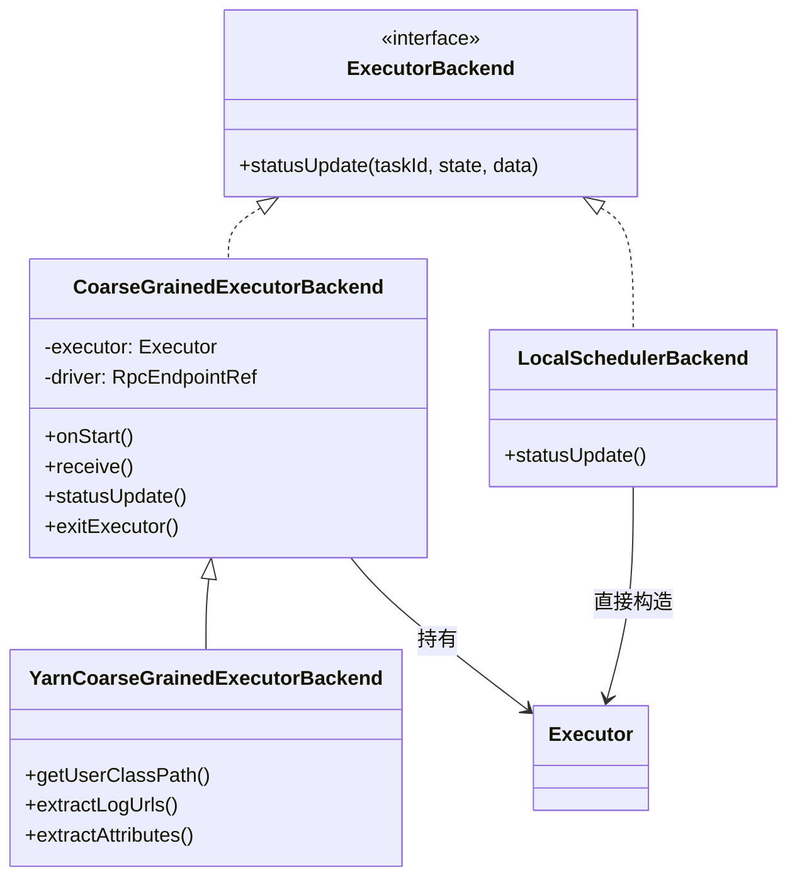
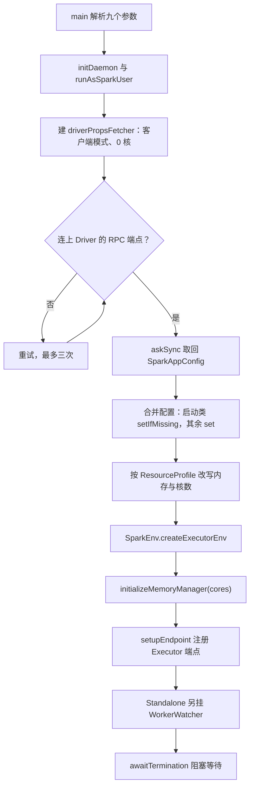
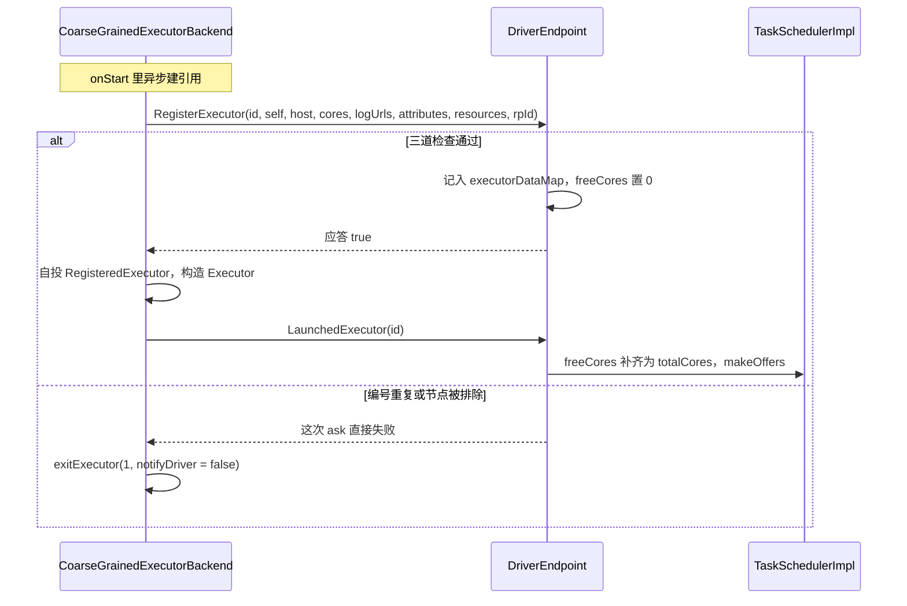
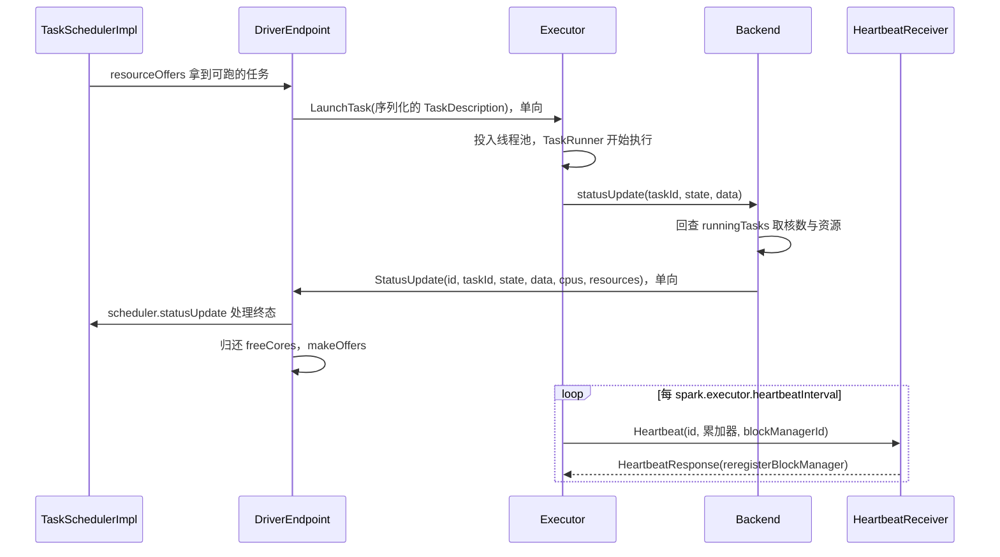
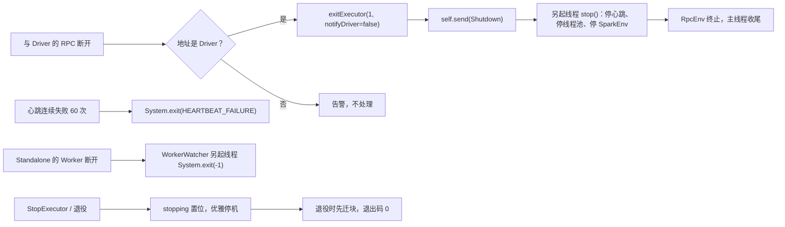

# 3. Spark ExecutorBackend 启动原理

**摘要：**

集群里跑着几千个 Executor 进程，它们大多在启动后几十秒内就被调度器当作"可用资源"，但很少有人追问这几十秒里到底发生了什么：进程是谁拉起的、命令行里那九个参数是谁写的、SparkConf 是从哪份文件读的、向谁注册、注册成功之后为什么还不能接任务。本文把 ExecutorBackend 当作一个"进程的守门人"来拆：先界定这条只有一个方法的接口到底承诺了什么，再沿 `main` 的调用链走完引导取配置、建 SparkEnv、起 RPC 端点、向 Driver 注册、构造 Executor 对象的全过程；随后把 `LaunchTask`/`StatusUpdate` 这对单向协议与心跳通道分开来看，解释为什么 Driver 从不等 Executor 的确认；再把 Driver 断连、心跳连败、Worker 消失、主动下线四条退出路径逐条走一遍，并对照 client 与 cluster 两种部署模式下"谁负责重来"的差别。文章后半段回到历史，讲粗粒度与 Mesos 细粒度模式当年的取舍，以及这条接口今天真正的可插拔边界在哪里。全文以 Spark 4.3.0（2026-10-30 发布）为口径，4.x 的预编译包基于 Scala 2.13；凡是版本间有出入的地方，以对应版本文档为准。

---

## 第 1 章 一条只有一个方法的接口

### 1.1 接口的全部内容

如果只看类型定义，`ExecutorBackend` 简单到近乎寒酸。它是一个 `private[spark]` 的 trait，只有一行抽象方法：

```scala
// core/src/main/scala/org/apache/spark/executor/ExecutorBackend.scala
// 注释原文：A pluggable interface used by the Executor to send updates to the cluster scheduler.
private[spark] trait ExecutorBackend {
  def statusUpdate(taskId: Long, state: TaskState, data: ByteBuffer): Unit
}
```

一个方法，三个参数，返回 `Unit`。没有注册、没有心跳、没有启停，只有"把某个任务的某个状态连同数据交给上层"。Spark 把这条接口单独抽出来，动机并不复杂：Executor 在执行任务的过程中会不断产生状态变化（开始、完成、失败、被杀），这些变化必须送到调度器，而"送到哪里、怎么送"取决于跑在哪种集群管理器上。把这一件事抽成接口，Executor 就只剩下计算，不必知道自己脚下是 Standalone、YARN 还是 Kubernetes。

请注意这条接口承诺的范围：**只承诺"上报状态"**，不承诺"接收任务"。接任务的路径根本不在 ExecutorBackend 上，而在实现类自己身上——`CoarseGrainedExecutorBackend` 是一个 RPC 端点（RPC endpoint），Driver 往它的引用上 `send(LaunchTask(...))`，消息落到它的 `receive` 方法里。接口管下行之外的那一半，实现类顺带管了另一半，这个不对称是理解整篇文章的第一把钥匙。

### 1.2 名字里的三重含义

"ExecutorBackend" 这个词在三个层次上被使用，混淆了就会看不懂日志。

第一层是接口，也就是上面那个 trait，它描述的是"能力"。第二层是进程，`org.apache.spark.executor.CoarseGrainedExecutorBackend` 这个主类被 `java -cp ... ` 拉起时，进程名、`jps` 输出、容器命令行里出现的都是它，它描述的是"实体"。第三层是角色，在 Driver 的视角里，Executor 有两张脸：一张是"注册上来的那个 RPC 引用"（用于下发任务），另一张是"报告状态的那个来源"（通过 `statusUpdate` 回流）——后者才是 Backend 这个角色。

三层含义对应三种不同的排障入口。进程起不来，查命令行与容器日志；进程起来了但注册被拒，查 Driver 端的 `executorDataMap` 与排除规则；注册成功但任务迟迟不下发，查的其实是调度器那一侧的核数记账与数据本地性，跟 Backend 已经没关系了。分清这三层，能省掉大量"在错误的日志里找错误"的时间。

下图把这条接口与它的实现谱系摆在一起：接口在最上面，实现类分两族，一族是跨进程的 Executor 后端，一族是同进程的本地调度后端。



### 1.3 通信在前，计算在后

`CoarseGrainedExecutorBackend` 的 `onStart` 与 `Executor` 的构造被有意排成了先后两段：先起 RPC 端点、先注册，注册被接受之后才 `new Executor(...)`。这个顺序不是随手写的，而是被两类约束同时钉住的。

一类约束是"上报必须有去处"。Executor 一旦开始跑任务，`statusUpdate` 就会被调用，而 `statusUpdate` 的实现是 `driver match { case Some(ref) => ref.send(msg); case None => logWarning("Drop ...") }`——它不缓存、不回放，连接没建好就只留下一行告警然后把消息丢掉。第二类约束是"资源配置必须以 Driver 的裁决为准"。Executor 的内存、核数、资源（GPU、FPGA 之类）不是进程自己算出来的，而是从 Driver 转发过来的 `SparkAppConfig` 与命令行参数里读出来的，也就是说**通信在前、计算在后**，是因为计算所需的参数本身就藏在通信的那一端。

这两条约束合起来，把启动切成了一段"还没有计算能力、但已经能说话"的窄窗口。整个启动过程的复杂性，几乎全部堆在这段窗口里。

### 1.4 一个比喻：外包工的入场手续

把 Executor 进程想象成一名被派进园区的驻场外包工，会更容易记住各环节的分工。

挂牌（注册）是去 Driver 的调度台报工号，工号重复的会被拒之门外，因为同一工号只能对应一个人。工牌上的部门编号（`resourceProfileId`）决定他被安排在哪个工种组，同一个人可以被派到不同组，但一次只能挂一个组。工具箱（`userClassPath`）必须由他自己扛进来，而不是让调度台送过去，所以 Driver 只告诉他"工具箱在哪个路径"，不替他搬。领料单（`LaunchTask`）是调度台直接递到手上的，递过来就算发了，不问"收到没有"。日报（`StatusUpdate`）由他自己写、自己送，送丢了自己负责。

最关键的一条：这个工人不负责找活，也不负责跳槽。工厂搬了、调度台塌了，他的处理方式是原地停工（自杀），而不是自己去找下一个厂——重新招募是包工头（集群管理器）的事。这条规矩解释了后文所有关于退出与重连的行为。

### 1.5 本篇的边界

以下内容不在本篇展开：任务在 Executor 内部怎么执行（`TaskRunner` 的线程模型、内存页管理、Shuffle 写出），结果怎么被 `TaskResultGetter` 反序列化并交回 DAGScheduler，以及动态分配如何决定扩缩容。这些属于"计算"与"调度"两条线。本篇盯住的是"进程"这条线：一个 JVM 从被拉起，到能接第一个任务，中间经过了什么。

---

## 第 2 章 进程的第一次呼吸

### 2.1 入口与九个参数

`CoarseGrainedExecutorBackend` 的伴生对象里有两个入口：`main` 给 JVM 用，`run` 给需要复用同一套流程的子类用。`main` 做的事极少——解析参数、造一个工厂函数、调 `run`、最后 `System.exit(0)`；真正的启动逻辑全在 `run` 里。这种"薄入口、厚流程"的写法是为了让 YARN 之类的子类能共用流程而只换实现（第 10 章展开）。

参数解析是手写的一个 `while` 循环，逐段匹配字符串，没有用任何配置框架。九个参数如下表。

| 参数 | 由谁填 | 作用 |
|---|---|---|
| `--driver-url` | Driver 侧生成 | Driver 的 RPC 端点地址，形如 `spark://CoarseGrainedScheduler@host:port` |
| `--executor-id` | Worker / 容器分配器 | Executor 的唯一编号，Driver 用它做去重与记账 |
| `--hostname` | 调度侧决定 | 对外宣告的主机名，写进 `Executor` 与 BlockManagerId |
| `--bind-address` | 通常省略 | 监听地址，缺省时取与 `hostname` 相同的值 |
| `--cores` | 资源分配结果 | 该 Executor 可用的核数，决定调度器每次能塞几个任务 |
| `--app-id` | Driver 侧生成 | 应用编号，用于 BlockManager 初始化与日志归档路径 |
| `--worker-url` | Standalone 专有 | Worker 的 RPC 地址，用于"命运共同体"式的联动退出 |
| `--resourcesFile` | Worker 侧生成 | 资源配置的 JSON 文件路径，携带 GPU 等自定义资源的地址列表 |
| `--resourceProfileId` | Driver 侧生成 | 资源规格编号，决定回取哪一份 `SparkAppConfig` |

这张表值得多看两眼的地方是：九个参数里没有一个与"算力"真正相关，它们全是身份、通信与配额。Executor 不接收"你该跑哪些任务"这类信息，任务会稍后通过另一条通道推过来。启动参数只回答"我是谁、我在哪、我能用几个核、我去找谁报到"。

另外一处细节：`--resourcesFile` 用的是驼峰命名，与其余连字符风格的参数不一致。这类命名上的不整齐是长期演进的常见残留，改一次要动 Driver、Worker、Executor 三处，收益又只是审美，于是就一直留着了。

### 2.2 参数是模板，占位符由 Worker 填

Standalone 模式下，这串参数不是拼好字符串再逐层传下去的，而是一个带占位符的模板。`StandaloneSchedulerBackend.start()` 里直接写：

```scala
// 注意 {{...}} 占位符：Driver 只知道"哪些位置要填"，不知道"填什么"
val args = Seq(
  "--driver-url", driverUrl,
  "--executor-id", "{{EXECUTOR_ID}}",
  "--hostname", "{{HOSTNAME}}",
  "--cores", "{{CORES}}",
  "--app-id", "{{APP_ID}}",
  "--worker-url", "{{WORKER_URL}}",
  "--resourceProfileId", "{{RESOURCE_PROFILE_ID}}")
```

模板随后被塞进 `Command` 对象，经 Master 的 `LaunchExecutor` 消息下发到 Worker。Worker 里的 `ExecutorRunner` 负责替换：`{{EXECUTOR_ID}}` 换成自己分配的编号，`{{HOSTNAME}}` 换成本机名，`{{CORES}}` 换成 Master 批给这个 Executor 的核数，`{{WORKER_URL}}` 换成自己的 RPC 地址。替换完再交给 `CommandUtils.buildProcessBuilder`，与 `javaOpts`、classpath、环境变量一起拼成真正的命令行。

这个"模板 + 局部填充"的设计有一个直接好处：语法只有一份，值的来源可以有很多份。Standalone 的值来自 Master 与 Worker，YARN 的值来自 ApplicationMaster 里的分配器，Kubernetes 的值来自 Driver 侧的 Pod 模板——三者拼出的命令行长得几乎一样，因为模板是同一条。它还解释了为什么 `--driver-url` 里没有占位符：那个地址在模板生成的那一刻就已经确定了，它是整个启动过程中唯一"天生就知道"的外部坐标。

### 2.3 谁在 Driver 侧写这串参数

同一个模板在不同调度器下的差别，主要落在"谁填值"和"额外注入什么"上。

Standalone 侧，`StandaloneSchedulerBackend` 填完模板，把 `Command` 交给 `AppClient`，再由 Master 挑 Worker、Worker 造 `ExecutorRunner`，最后由 `ExecutorRunner` 补上 `--resourcesFile` 并替换占位符。YARN 侧，`ExecutorRunnable` 直接把值写死在命令行里（`--driver-url` 传的是 `masterAddress`），并额外做一件事：把 `spark.aut*`、`spark.rpc*`、`spark.network*`、`spark.ssl*`（不含口令类）以及所有 `spark.*.port` 这类"启动相关配置"逐个转成 `-Dkey=value` 塞进 `javaOpts`。这个动作与第 3 章要讲的 `setIfMissing` 是同一套设计的两端，一处在容器启动时注入，一处在 Executor 里守着不被覆盖。

### 2.4 不这样会怎样

不妨设想另一种做法：让 Executor 自己推断身份与配额。它可以从环境变量里读核数，可以从 `/etc/hosts` 里猜主机名，可以从本地 `spark-defaults.conf` 里读内存配置。这条路看起来省事，代价却很高。

身份必须由外部给定，否则"同一个 Executor 被重复拉起"就无法被发现——重启后新进程会认为自己是一个全新的合法成员，而 Driver 那边的旧账还挂着，结果就是两份资源算一个人头上。配额也必须由外部给定，否则"Executor 报 8 核、实际只分到 4 核"这类错配无法在调度时被察觉。至于配置，本地文件在集群里几乎必然与 Driver 侧不一致（版本、覆盖文件、动态注入的 `-D` 各有各的来源），一旦 Executor 以本地配置为准，同一份作业就会在不同节点上表现出不同的行为。

所以这九个参数的本质是：**身份与配额由外部裁定**，从进程内部搬到进程外部，由唯一有全局视角的那一端说了算。这是分布式系统里反复出现的手法，代价是启动路径变长。

---

## 第 3 章 借来的连接与拿到的配置

### 3.1 一个不会收消息的 RpcEnv

`run` 的第一步并不是建"正式的"RpcEnv，而是先建一个临时环境，专门用来向 Driver 要配置。源码里它叫 `driverPropsFetcher`，创建时把 `numUsableCores` 传成 0、把 `clientMode` 传成 true：

```scala
// 这个 RpcEnv 只用来发一次 ask，所以不占核、不监听对外服务
val fetcher = RpcEnv.create(
  "driverPropsFetcher", arguments.bindAddress, arguments.hostname,
  -1, executorConf, new SecurityManager(executorConf),
  numUsableCores = 0, clientMode = true)
```

为什么要多建一个再拆掉？因为"正式"的 RpcEnv 由 `SparkEnv.createExecutorEnv` 创建，而它需要一份已经知道全部 `spark.*` 配置的 `SparkConf`；可这份配置偏偏只能从 Driver 那里取，而取配置又需要一个能发 RPC 的东西。于是就有了这个先有鸡还是先有蛋的破解方案：先用一份空配置建一个只跑客户端的轻量环境，取回配置后立刻 `shutdown()`，再用取回的配置建正式的 SparkEnv。

这个临时环境的两个参数值得留意。`numUsableCores = 0` 表示它不参与任何需要按核数分配的组件初始化（比如 Netty 的线程数），`clientMode = true` 表示它不监听入站连接、只发出站请求。两者合起来说明它就是一个一次性的"信使"，用完之后连端口都不留。

### 3.2 三次重试

取配置之前要先连上 Driver 的 RPC 端点。这一步写成一个小循环：

```scala
var driver: RpcEndpointRef = null
val nTries = 3
for (i <- 0 until nTries if driver == null) {
  try {
    driver = fetcher.setupEndpointRefByURI(arguments.driverUrl)
  } catch {
    case e: Throwable => if (i == nTries - 1) { throw e }
  }
}
```

**三次重试**，失败三次就把异常抛出去，进程结束。这个次数谈不上讲究，它对应的场景很具体：Executor 被拉起的那一刻，Driver 的 RPC 端点可能刚好在切换端口、刚好被 GC 卡住、或者刚好在重启的瞬间。三次、每次几千毫秒的超时，足够覆盖这类瞬态问题，又不至于让一个注定连不上的进程长期占着容器。

这里还藏着一处"为什么是三次而不是无限重试"的判断：无限重试会让故障从"进程退出、集群管理器重来"退化成"进程挂着、资源被占着、状态不明"。对一个生命周期完全由外部管理的进程来说，快速失败并把决定权交回去，通常比死撑更划算。这条取向在后文所有退出路径上都会重复出现。

### 3.3 SparkAppConfig 里有什么

连上之后，Executor 发一条 `RetrieveSparkAppConfig` 请求，拿到一个 `SparkAppConfig`。这个对象是 Driver 与 Executor 之间唯一一次"整包交接"，内容大致是：全部 `spark.*` 配置、I/O 加密密钥、Hadoop 委托凭据、资源规格（`ResourceProfile`）、用户凭据及其版本号、以及日志级别。

这份交接的意义在于，**Driver 只转发配置，不代理计算**。Executor 拿到配置之后，与 Driver 之间就只剩控制面通信（注册、任务、状态、心跳），数据面全部靠自己：读 HDFS 用自己的凭据，读 Shuffle 数据直接连上游 Executor 的 BlockManager，写结果也直接落盘或推送。这种"控制面集中、数据面分散"的形态，是 Spark 在大规模下还能把网络开销压在可接受范围内的主要原因之一。

值得单独提一句的是凭据部分。`SparkAppConfig` 里带的凭据是"某个版本号下的快照"，而之后每次下发任务，`TaskDescription` 会顺带携带更新的凭据版本，所以就算 Executor 在启动时拿到的是旧版本，也不会长期用错——这条兜底路径在源码注释里写得很坦白。

### 3.4 两类配置的待遇差异

拿到配置之后，代码并没有简单地 `new SparkConf().setAll(props)`，而是按 key 分了两条路：

```scala
for ((key, value) <- props) {
  // 启动相关的配置以"已经在进程里生效的值"为准，不回填
  if (SparkConf.isExecutorStartupConf(key)) {
    driverConf.setIfMissing(key, value)
  } else {
    driverConf.set(key, value)
  }
}
```

`isExecutorStartupConf` 的判定范围是：`spark.auth*`（但不含认证密钥本身）、`spark.rpc*`、`spark.network*`、`spark.ssl*`（不含口令类）、以及所有以 `.port` 结尾或 `spark.port.` 开头的端口配置。对这几类，用 `setIfMissing`——如果进程启动时已经通过 `-D` 传进来了值，就用进程里的那份，Driver 转发的副本不覆盖它。

**启动类配置以本地为准**，这条规矩解决的是一个非常实际的问题：RPC 超时、SSL 开关、端口号这类配置，直接决定了这个进程能不能连上 Driver；而它们是由容器启动环境（YARN 的 `-D` 注入、Standalone 的 `sparkJavaOpts`、K8s 的 Pod 环境）在进程创建那一刻定下的，跟 Driver 内存里那份配置可能已经不同步。如果允许 Driver 的副本覆盖它们，就会出现"用 A 配置连上了 Driver，然后被 B 配置改掉了连接参数"的荒诞结果。

其余配置则一律以 Driver 为准，`set` 覆盖。这条区分背后的判断是：**能否通信看现场，如何计算看全局**。两者混在一起处理，无论偏向哪边都会出问题。

### 3.5 资源规格改写内存与核数

紧接着还有一段容易忽略的代码：如果 `resourceProfileId` 不是默认值，就从 `ResourceProfile` 里把堆内内存、堆外内存、内存开销、核数这几项读出来，逐项写进 `driverConf`。这意味着在自定义资源规格的场景下，`--cores` 与 `spark.executor.memory` 这些数字的真正来源是资源规格，而不是用户写在命令行上的那一份。

顺序很重要：先按 `--cores` 与配置建出 `SparkConf`，再让 `ResourceProfile` 覆盖，最后才 `SparkEnv.createExecutorEnv`。如果把覆盖放在 SparkEnv 之后，内存管理器与 BlockManager 就已经按旧值算完了，改配置也只是改了台账。

把前面三步串起来，一个 Executor 从进程入口到可以注册，走的是下面这条链。



---

## 第 4 章 SparkEnv：Executor 侧的半个世界

### 4.1 建了什么

`SparkEnv.createExecutorEnv` 是整套运行时的"组装车间"，它在 Executor 上建出的东西与 Driver 上几乎同名，但实现形态不同。下面这张表把主要组件的两侧形态摆在一起。

| 组件 | Driver 侧形态 | Executor 侧形态 |
|---|---|---|
| RpcEnv | `sparkDriver`，监听入站 | `sparkExecutor`，同样监听本机端口 |
| Serializer / SerializerManager | 同一套实现 | 同一套实现，可被 `spark.serializer` 改写 |
| BroadcastManager | 负责写与分发 | 只负责取，块由 BlockManager 管 |
| MapOutputTracker | `MapOutputTrackerMaster` | `MapOutputTrackerWorker`，向 Driver 查 |
| BlockManagerMaster | 本地端点 | 一个指向 Driver 的引用 |
| BlockManager | 本机存储 | 本机存储，构造时即建成 |
| MemoryManager | 驱动侧内存 | `UnifiedMemoryManager`，按核数初始化 |
| ShuffleManager | 驱动侧无实际数据 | 按 `spark.shuffle.manager` 实例化 |
| MetricsSystem | 带 Servlet 与 UI | 纯指标收集与上报 |
| OutputCommitCoordinator | Driver 独占 | 一个客户端引用 |

表里最容易被忽略的是中间三行：`MapOutputTracker` 与 `BlockManagerMaster` 在 Executor 上都是"代理"。Executor 想知道某个 Shuffle 的输出位置，要问 Driver 的 MapOutputTracker；Executor 想注册自己的 Block，要发给 Driver 的 BlockManagerMaster。这两个代理的存在说明一件事：Executor 上的 SparkEnv 不是 Driver 环境的复制品，而是一个把"全局状态"替换成"远端引用"的**同构体**。

### 4.2 MemoryManager 为什么要单独初始化

注意 `createExecutorEnv` 的最后一步并不是返回就完了，它还多做了一次调用：

```scala
val env = create(conf, executorId, bindAddress, hostname, None,
                 isLocal, numCores, ioEncryptionKey)
// 内存管理器要在拿到核数之后才能定参数，所以单独初始化
env.initializeMemoryManager(numCores)
SparkEnv.set(env)
```

内存管理器的构造被单独摘出来，原因是它的构造签名里带着"可用核数"：`UnifiedMemoryManager(conf, numUsableCores, isDriver)`。而核数在 `create` 的返回之前就已经确定（来自 `--cores` 与资源规格），所以这一步只能放在后面。

这个细节解释了一个常见的困惑：为什么改 `spark.executor.cores` 会影响内存表现？因为在统一内存管理模型下，执行内存与存储内存共享一块池子，而池子的切分与"同时有多少任务在抢"直接相关，后者又恰好由核数决定。核数不只是并发度，它也是内存竞争的参与人数。

### 4.3 地址与端口的两处区分

SparkEnv 里建 RpcEnv 时传了两个地址参数：`bindAddress` 与 `hostname`（在 `create` 里叫 `advertiseAddress`）。前者是"监听在哪张网卡上"，后者是"对外告诉别人我是谁"。在单网卡机器上两者通常相同，但在这两类节点上必须分开：有多个网卡的机器（一个内网、一个数据网），以及跑在容器里、Pod 网段与宿主网段不同的节点。配错了的表现是"进程起来了、日志里地址看着对、Driver 却收不到注册"——这类问题从 Executor 侧看几乎无迹可循，得在 Driver 的注册日志里找。

在 Executor 侧，`--hostname` 还会被写进 `Executor` 的构造参数与 `BlockManagerId`，于是它同时承担了"我是谁"与"别人该怎么找我"两个职责。这也是为什么 K8s 环境下必须让 `spark.driver.host` 之类配置与 Pod 网络可达性对齐：地址一旦写错，写进全局状态之后就只能靠重启纠正。

### 4.4 不这样会怎样

反过来说，如果 Executor 不复用 Driver 的配置、而是各自建一套（譬如读本地 `spark-defaults.conf`），会出现三种具体故障。其一是序列化器不一致：Driver 用 Kryo、Executor 用 Java 序列化，Shuffle 数据在跨节点时直接反序列化失败。其二是广播变量失效：`BroadcastManager` 的块大小上限与压缩开关两侧不同，广播发出去但解不开。其三是凭据与加密错配：一侧开了 I/O 加密、另一侧没开，读出来的块全部校验失败。

这三种故障的共同特征是它们都不在启动时报错，而是在第一个跨节点数据交换时爆掉。这也正是"配置必须由 Driver 统一转发"这条设计的价值所在：它把一类只能在运行时暴露的配置漂移，压成了"启动时一次整包同步"。

---

## 第 5 章 注册：向 Driver，而不是向 Master

### 5.1 两条上报通道

Spark 里关于 Executor 的状态，实际有两条互不相干的上报链路，混为一谈就会看不懂日志。

一条是**计算状态链**：Executor → Driver（`CoarseGrainedScheduler` 端点）。任务开始、完成、失败、被杀，走这条。另一条是**资源状态链**：ExecutorRunner → Worker → Master。Worker 在进程状态变化时向 Master 发 `ExecutorStateChanged`，Master 据此更新应用的资源账本。

两条链的存在不是冗余，而是分工：**谁能裁决，状态就报给谁**。任务该重试几次、该不该把整个 Stage 判死，是 Driver 里 DAGScheduler 的事；某台机器上还剩多少核可以卖给下一个应用，是 Master 的事。Executor 自己只认识 Driver，它连 Master 的地址都没有——`--worker-url` 是给 WorkerWatcher 用的，不是用来注册的。这一点是理解本章的起点：Executor 的"户口"落在 Driver 上，Master 那边看到的 Executor 是 Worker 替它报的。

### 5.2 RegisterExecutor 的载荷

`onStart` 里做的事情不多，但每件都关键：

```scala
rpcEnv.asyncSetupEndpointRefByURI(driverUrl).flatMap { ref =>
  driver = Some(ref)
  env.executorBackend = Option(this)   // 让 Executor 能找到上报通道
  ref.ask[Boolean](RegisterExecutor(executorId, self, hostname, cores,
    extractLogUrls, extractAttributes, _resources, resourceProfile.id))
}(ThreadUtils.sameThread).onComplete {
  case Success(_) => self.send(RegisteredExecutor)
  case Failure(e) => exitExecutor(1, s"Cannot register with driver: $driverUrl", e,
                                  notifyDriver = false)
}(ThreadUtils.sameThread)
```

载荷里有八项，各自的分量不同：

| 字段 | 用途 | 缺失或错误的后果 |
|---|---|---|
| `executorId` | 全局唯一编号，Driver 记账的主键 | 重复则被拒 |
| `self`（RPC 引用） | Driver 之后所有下行消息的目的地 | 任务无法下发 |
| `hostname` | 数据本地性判断与排除规则匹配 | 本地性失效、排除失效 |
| `cores` | 可并发任务数上限 | 调度器按错数派活 |
| `logUrls` | Web UI 上的日志跳转 | 只影响可观测性 |
| `attributes` | 调度用的自定义标签 | 标签调度失效 |
| `resources` | GPU 等资源的地址清单 | 资源感知调度失效 |
| `resourceProfileId` | 对应哪份资源规格 | 记账错位 |

`extractLogUrls` 与 `extractAttributes` 的实现是"扫环境变量"：前者收集所有 `SPARK_LOG_URL_` 前缀的变量，后者收集 `SPARK_EXECUTOR_ATTRIBUTE_` 前缀的变量。这个设计让日志地址与标签不必走 RPC 参数，而由容器环境注入——YARN 的子类正是覆盖了这两个方法（第 10 章）。

### 5.3 Driver 侧的三个判断

Driver 端收到 `RegisterExecutor` 后先做三道检查，任何一道不过都直接拒绝。

第一道是重复编号：`executorDataMap.contains(executorId)` 为真就拒绝。这条规则挡的是"同一编号被两个进程同时使用"，常见于容器重建后编号复用、或 Driver 重启后旧 Executor 还在。

第二道是排除规则：如果 `hostname` 在排除节点集合里，或者这个 Executor 已被标记排除（`isExecutorExcluded`），同样拒绝。这条规则的动机很实在——排除决定是在 Driver 侧做出的，但集群管理器可能已经提前给这个节点分配了容器，与其让它跑起来再杀，不如在注册时直接挡掉。

第三道不是检查，而是兜底：如果 Executor 的 RPC 引用没有对外地址（`executorRef.address` 为 null），就用这条连接的发送方地址（`context.senderAddress`）作为它的地址。这个兜底照顾的是"Executor 不监听入站连接、只能通过已有连接回话"的部署形态。

三道都过之后，Driver 做三件事：把 Executor 记进 `executorDataMap`、累加核数总量、向监听总线发一条 `SparkListenerExecutorAdded`。注意这里没有发生的两件事：没有立刻把它标记为可调度，也没有向它推任何任务。这两件事被推迟到了下一个环节。

### 5.4 注册成功不等于可调度

这里有一处设计上的精细之处，值得单独讲。看 Driver 侧构造 `ExecutorData` 时的参数：

```scala
val data = new ExecutorData(executorRef, executorAddress, hostname,
  0,          // freeCores 初始为 0
  cores,      // totalCores 是注册时报上来的核数
  ...)
```

空闲核数被初始化成 0，可用总量是注册报上来的核数。也就是说，Executor 即便注册成功，在调度器眼里仍然是一个"零核可用"的对象，`makeOffers` 不会给它派任何任务。直到 Backend 把 `Executor` 对象构造完成，主动发一条 `LaunchedExecutor(executorId)`，Driver 才把 `freeCores` 补齐成 `totalCores` 并触发一次 `makeOffers`。

这个两段式设计的意图很清楚：**注册保证"能通信"，`LaunchedExecutor` 保证"能计算"**。如果注册即视为可用，那么从注册到 Executor 构造完成之间会有一个几百毫秒到几秒的窗口（要建 BlockManager、注册指标源、起心跳线程），窗口里派下来的任务会撞上 `executor == null`，而 Backend 对这种情况的处理是 `exitExecutor(1, "Received LaunchTask command but executor was null")`——直接自杀。两段式把这个竞态从"偶发自杀"变成了"根本不会发生"。

这个演进不是一开始就有的。早前的实现里 `ExecutorData` 的两处核数参数填的是同一个值，注册即意味着可用；引入 `LaunchedExecutor` 之后，"注册"与"可调度"才被拆成两个独立状态。这类拆分在成熟系统里很常见：把一个模糊的"好了"，换成两个明确的"到这一步了"。

### 5.5 拒绝与重试的三层

注册链路上的失败处理分三层，粒度不同。

最内层是引导阶段的三次重试（第 3.2 节），只针对"连不上 Driver 的 RPC 端点"这一种情况。中间层是注册本身：这次 `ask` 一旦失败（无论是 RPC 超时、Driver 拒绝，还是 Driver 用 `sendFailure` 把异常塞回客户端），就走 `exitExecutor(1, notifyDriver = false)`——注意 `notifyDriver = false`，因为 Driver 本来就知道（拒绝是它自己发的），再去通知一遍会形成无谓的往返。最外层是心跳：注册成功之后的存活判断交给心跳线程，连续失败到阈值才退出（第 7.5 节）。

三层之间没有"退避重试注册"这一环。这个取舍值得记住：**注册失败即身份不成立**，重试也变不出合法身份。要重来，得由外面重新拉起一个进程、重新分配一个编号。



图里有一处容易看错的时序：`RegisteredExecutor` 这条消息在新版实现里是 Backend 发给自己的，而不是 Driver 推过来的。早期版本由 Driver 在应答前直接 `send(RegisteredExecutor)`，新版把"什么时候开始构造 Executor"的决定权收回到 Backend 自己手里（两者切换的具体版本以对应版本文档为准）。两种做法在正常情况下看不出差别，但在 Driver 应答成功而消息丢失的边界上，前者的表现是"注册成功却永远不构造 Executor"，后者则不会。

---

## 第 6 章 Executor 对象的构造

### 6.1 谁造谁

`new Executor(executorId, hostname, env, userClassPath, isLocal = false, resources)` 这一行背后有一张分工表，弄清楚"谁造的"是理解启动顺序的关键。

| 部件 | 由谁创建 | 何时生效 | 构造失败的后果 |
|---|---|---|---|
| RpcEnv | SparkEnv | 引导完成后 | 进程退出 |
| MemoryManager | SparkEnv（显式初始化） | `initializeMemoryManager` | 进程退出 |
| BlockManager（对象） | SparkEnv | 建 SparkEnv 时 | 进程退出 |
| BlockManager（注册） | Executor 构造时 | `initialize(appId)` | Executor 构造失败，自杀 |
| 任务线程池 | Executor 构造时 | 构造即刻 | Executor 构造失败，自杀 |
| 心跳线程 | Executor 构造时 | `heartbeater.start()` | 启动后立即失败 |
| 指标源 | Executor 构造时 | `registerSource` | 指标缺失，计算不受影响 |

这张表的读法是：**构造在 SparkEnv、初始化在 Executor**。BlockManager 是最典型的例子——对象在 SparkEnv 里就建好了（因为它被 SparkEnv 的其他组件依赖），但"用哪个 appId 去 Driver 那边注册自己"这件事要等到 Executor 构造时才做，因为 appId 这时才从配置里落实。顺序不能反：先注册、后拿到 appId，注册会带着上一份编号。

### 6.2 线程池不是配额

任务线程池的创建方式值得专门讲，因为它经常被误解：

```scala
// 缓存池，不设上限；真正的并发上限在 Driver 的核数账本上
private[executor] val threadPool = {
  val threadFactory = new ThreadFactoryBuilder()
    .setDaemon(true)
    .setNameFormat(s"$TASK_THREAD_NAME_PREFIX-%d")
    .setThreadFactory((r: Runnable) => new UninterruptibleThread(r, "unused"))
    .build()
  Executors.newCachedThreadPool(threadFactory).asInstanceOf[ThreadPoolExecutor]
}
```

**线程池不是配额**。它是一个缓存池，来多少任务就开多少线程，空闲线程超时回收。真正限制并发的机制在 Driver 侧：每个 Executor 有一本核数账，派一个任务扣 `task.cpus`，任务结束（`StatusUpdate` 到达且状态为终态）再补回来，账上不够就不派。换句话说，**配额在 Driver 的账本上**，线程池只是执行载体。

这个分工带来两个实际后果。好处是执行侧不需要为"配额"做任何同步：线程池永远不阻塞、不排队，任务来了就有线程。坏处是配额一旦记账出错（比如某个 `StatusUpdate` 丢了），Executor 侧会真的跑超量的任务——它没有办法自己踩刹车。所以 `spark.executor.cores` 这个参数调小不会让 Executor 拒绝任务，只会让 Driver 少派任务；如果 Driver 那本账算错了，Executor 会老实执行。

线程工厂里用 `UninterruptibleThread` 包装任务线程，是为了让任务里的代码不被 `Thread.interrupt()` 打断。注释里点了两个具体的坑（Kafka 与 Hadoop 里各有一类方法在被中断时会永久挂起），这类"历史遗留必须包一层"的写法在数据系统里很常见：中断语义在第三方库之间从不统一，唯一的通用办法是自己兜住。

### 6.3 指标系统：四个源

指标注册发生在 Executor 构造的过程中，一共四个来源：`ExecutorSource`（线程池状态、任务计数、GC 时间等）、`JVMCPUSource`（进程 CPU）、`ExecutorMetricsSource`（峰值内存，可被 Driver 轮询）、以及 BlockManager 的 Shuffle 指标源。

它们全部注册到 `env.metricsSystem` 上，而不是各自维护一套。这个做法的好处是输出通道统一：无论配置成 JMX、Prometheus Servlet 还是自定义 Sink，都只需要配置一次。坏处是指标源的生命周期与 SparkEnv 绑定，SparkEnv 一停，指标就没了——这也是为什么容器被杀之后，最后几秒的指标往往查不到。

`ExecutorMetricsSource` 有一个额外的作用：它的峰值内存数据可以被 Driver 主动拉取，用于判断"这个 Executor 是不是快 OOM 了"。这条链路的存在，让 Driver 有可能在 Executor 真正崩掉之前先把它换掉，属于"用观测换稳定性"的典型手法。

### 6.4 未捕获异常与心跳线程

构造过程的最后还设了两个"安全阀"。一个是未捕获异常处理器：非 local 模式下，任何线程因未捕获异常而终止，都会直接让整个 Executor 进程退出。这个选择的理由写在源码注释里——避免"某个线程死了但进程还活着"这种最难排查的挂起状态。另一个是心跳线程，它在构造末尾启动，之后按固定间隔向 Driver 报告累加器与 BlockManager 标识。

这两个安全阀的共同取向是：**宁可整体死掉，不要半死不活**。前者会触发集群管理器的重建逻辑，后者会占着资源、报着心跳、却什么也不干。对一个由外部全权管理的进程来说，这个取向是对的。

### 6.5 构造失败的后果

如果 `new Executor(...)` 抛异常，Backend 的处理是 `exitExecutor(1, "Unable to create executor due to ...")`，并且这次会通知 Driver（`notifyDriver` 取默认值 true），于是 Driver 收到 `RemoveExecutor`，把这个编号从账本上划掉，再决定是否重新申请。

最常见的构造失败原因是 BlockManager 初始化失败（`initialize(appId)` 内部要向 Driver 注册、要绑定端口），而端口被占、Driver 已停止响应都会导致它失败。这类失败的日志通常只有一行 `Unable to create executor due to ...`，真正的原因要往下面的堆栈里翻——这也是为什么"Executor 启动即退出"这类问题的排查，得先看完整堆栈而不是看最后一行。

---

## 第 7 章 LaunchTask 与 StatusUpdate

### 7.1 三个消息

Executor 与 Driver 之间的任务相关通信只有三种消息：`LaunchTask`、`KillTask`、`StatusUpdate`。前两者下行，后者上行。

`LaunchTask` 携带一段序列化后的 `TaskDescription`，包含任务编号、所属 Stage、序列化的任务体（闭包与依赖）、本地性信息、以及该任务要占用的 CPU 核数与资源地址。`KillTask` 携带任务编号、是否中断线程、以及杀死原因。`StatusUpdate` 携带 Executor 编号、任务编号、状态、数据（成功时是序列化后的结果，失败时是失败原因）、占用的核数与资源。

三种消息全部是单向 `send`，没有 `ask`。**单向消息，没有应答**——这是理解这对协议的关键。

### 7.2 为什么都是单向

如果每次下发任务都要等 Executor 回一个"收到了"，Driver 就要为每个任务维护一个待确认状态，Executor 也要为此排队回复，两侧的复杂度都会上升一个量级。而收益其实很小：任务丢了怎么办？Driver 有另一套机制兜底——核数账本会因为 `StatusUpdate` 不来而一直不归还，动态分配与任务超时检测最终会发现异常，实在不行还有 `spark.network.timeout` 级别的整体判定。

所以这对协议的设计取向是：控制面不追求逐条可靠，把可靠性交给资源的记账与上层的超时。背压也由此而来——**背压靠核数记账**实现，而不是靠消息队列的长度或线程池的拒绝策略。这个取向的代价是：消息丢失不会立刻被发现，而是表现为"核数迟迟不归还"，最终以"任务卡住"的形式暴露。

`StatusUpdate` 也是单向的，同样没有应答。Driver 收到之后不会确认，它只是把状态交给 `TaskSchedulerImpl`，然后归还核数、重新 `makeOffers`。如果 Executor 发出去了但 Driver 没收到，Executor 那边的任务已经结束、线程已经回收，它会以为一切正常；Driver 那边则永远等不到终态，直到任务超时。这类"单向消息 + 上层超时"的组合，是分布式控制面里最常见也最容易被低估的形态。

### 7.3 消息大小有一个硬上限

`LaunchTask` 下发前有一段检查，值得单独提：

```scala
val serializedTask = TaskDescription.encode(task)
if (serializedTask.limit() >= maxRpcMessageSize) {
  // 不是让 Executor 报错，而是直接把整个 TaskSet 判死
  taskSetMgr.abort(msg)
}
```

`maxRpcMessageSize` 取自 `spark.rpc.message.maxSize`，默认 128MB。超限的处理方式很重：不是丢掉这一个任务，而是 `taskSetMgr.abort`，把整个 TaskSet 一起废弃。

为什么这么狠？因为任务描述过大通常意味着闭包捕获了不该捕获的东西（一个大集合、一张查找表、一个包装了整个 DataFrame 的对象）。这类问题不会只出现在一个任务上，同一个 TaskSet 的所有任务都会带同样的闭包。与其让它们逐个失败、逐个重试，不如一次性判死并给出明确错误——让用户去改代码，而不是让调度器陪着重试。

这条限制的实践含义是：超过几十 MB 的共享数据应该走广播变量，而不是闭包捕获。广播变量走的是 BlockManager 与 P2P 分发通道，与 RPC 消息大小上限完全解耦。

### 7.4 statusUpdate 的两级消费

Executor 侧调用 `statusUpdate` 时，Backend 做的第一件事不是转发，而是先回查任务：

```scala
override def statusUpdate(taskId: Long, state: TaskState, data: ByteBuffer): Unit = {
  val taskDescription = executor.runningTasks.get(taskId).taskDescription
  val cpus = taskDescription.cpus
  val msg = StatusUpdate(executorId, taskId, state, data, cpus, resources)
  driver match {
    case Some(driverRef) => driverRef.send(msg)
    case None => logWarning(s"Drop $msg because has not yet connected to driver")
  }
}
```

这里从 `runningTasks` 里取回 `cpus` 与资源信息，是为了让 Driver 在归还时能"按原样还"。如果只是笼统地还 1 核，遇到 `spark.task.cpus = 2` 或者自定义资源的场景就会记账错位，久而久之表现为"核数越跑越少"。

Driver 侧收到之后是第二级消费：先交给 `scheduler.statusUpdate(taskId, state, data)` 让调度器处理任务状态（成功入队、失败重试、Stage 收尾），然后如果状态是终态，就归还 `freeCores` 与资源、调用 `makeOffers(executorId)`。这两步的先后不能换：先让调度器知道任务结束了，再让它知道资源回来了，否则可能派出去一个"资源已归还但任务还在跑"的新任务。

### 7.5 心跳是另一条通道

任务协议之外还有一条心跳通道，容易被当成"任务的传输带"。实际不是。Executor 的心跳消息只装三样东西：Executor 编号、各任务的累加器更新、以及 BlockManager 标识。Driver 的应答更简单——`HeartbeatResponse` 里只有一个布尔值 `reregisterBlockManager`。

**心跳只回答一个问题**：BlockManager 要不要重新注册。任务下发走的是 `LaunchTask` 那条独立通道，不搭心跳的车。`HeartbeatResponse` 的字段里没有任何任务字段，这就是最直接的证据：心跳只管存活与累加器，任务只管下发。

心跳的失败处理值得一提。默认间隔 10 秒（`spark.executor.heartbeatInterval`），连续失败 60 次（`spark.executor.heartbeat.maxFailures`）就 `System.exit`，源码注释里算过这笔账：10 秒 × 60 次约等于 10 分钟。也就是说，Driver 完全失联 10 分钟后，Executor 主动了断。这个时间的选取有一个隐含的约束：它必须大于 Driver 侧可能的最长 GC 或最长故障切换时间，否则会出现"Driver 只是卡了一下，Executor 全跑光了"的灾难性放大。



图里两条通道是并行的：上面那条负责"任务与状态"，下面那条负责"活着与累加器"。把它们画在一张图里，是为了看清一个事实——任务的生死不依赖心跳，心跳的存活不依赖任务。这种"通道分离"的设计让两侧的故障可以独立演化：心跳抖动不会影响任务下发，任务积压也不会拖慢心跳（心跳是独立线程）。

### 7.6 一个容易问的问题

如果 Driver 在任务执行期间换了地址（比如集群模式下的 AM 重试），Executor 会跟着换吗？不会。`driver` 这个引用在 `onStart` 里绑定一次，之后不再更新；旧地址断开就触发 `onDisconnected`，进程退出。重来的是新的 Executor，带着新的编号、连新的地址。这个"不跟随"的选择，与第 8 章要讲的退出策略是同一套逻辑的两面。

---

## 第 8 章 断连之后的四条路

### 8.1 路径一：Driver 断连即自杀

`onDisconnected` 的逻辑短得出人意料：

```scala
override def onDisconnected(remoteAddress: RpcAddress): Unit = {
  if (stopping.get()) {
    logInfo(s"Driver from $remoteAddress disconnected during shutdown")
  } else if (driver.exists(_.address == remoteAddress)) {
    exitExecutor(1, s"Driver $remoteAddress disassociated! Shutting down.", null,
                 notifyDriver = false)
  } else {
    logWarning(s"An unknown ($remoteAddress) driver disconnected.")
  }
}
```

三个分支对应三种情况：正在主动停机（忽略）、断的确实是 Driver（自杀）、断的是别人（告警）。第二个分支的 `notifyDriver = false` 是必然的——对方已经不在了，通知没有意义。

**断连即自杀**这个选择，要放在"谁是资源的所有者"这个问题下才能理解。Executor 占着的 CPU 与内存，是 Driver 代表某个应用申请的；应用没了、Driver 没了，这份占用就失去了合法性。如果 Executor 选择"扛着等重连"，那么在这段等待里，Master/AM 会认为资源已被占用、不会再分配给别人，而实际的计算能力却无处可用——集群会出现"看起来满载、实际空转"的状态。自杀是最快把资源还给集群的方式。

不过要注意 `exitExecutor` 在这条路径上并不直接 `System.exit`，它做的是：置 `stopping` 标志、发 `RemoveExecutor`（如果 `notifyDriver` 为真）、然后给自己发一条 `Shutdown`。`Shutdown` 的处理是另起一个线程调用 `executor.stop()`，后者依次停指标轮询、停心跳、停线程池、停 SparkEnv；等 RpcEnv 终止，主线程从 `awaitTermination` 返回，进程才真正结束。中间那次"另起线程"的写法，是为了避免在 RpcEnv 自己的线程里等 RpcEnv 停——那会死锁，源码注释里点了这个历史问题。

### 8.2 路径二：心跳连败到阈值

第二条路是心跳失败累积到阈值（默认 60 次）之后的 `System.exit(HEARTBEAT_FAILURE)`。它与第一条路的触发条件不同：第一条是"连接被明确判定断开"，第二条是"每次请求都失败但连接没被判死"。两者对应不同的网络故障形态——前者是对方进程没了或端口关了，后者往往是网络抖动、防火墙静默丢包、或者对方进程活着但不响应。

两条路并存的意义在于覆盖完整：只靠断连事件，遇到静默丢包就永远发现不了；只靠心跳失败，遇到正常关闭也要等 10 分钟。两条一起，才能在"快"与"准"之间取得平衡。

### 8.3 路径三：Worker 消失

Standalone 模式多一条路。Backend 启动时如果拿到了 `--worker-url`，会额外注册一个 `WorkerWatcher` 端点，去连 Worker 的 RPC。一旦这个连接断开，WorkerWatcher 会在独立线程里 `System.exit(-1)`。

这个行为的名字叫"命运共同体"（fate-sharing）：Executor 的进程是 Worker 拉起的，Worker 没了，这个进程就成了孤儿，与其让它继续跑（Master 那边已经把它算作丢失），不如立刻结束。这也解释了为什么 Standalone 下杀 Worker 进程会让它名下的所有 Executor 一起消失——不是 Master 下令杀的，而是每个 Executor 自己发现的。

### 8.4 路径四：主动收场

与前三条"故障退出"不同，第四条是 Driver 主动要求 Executor 退场，有两种形态。

一种是 `StopExecutor`：Driver 决定不再需要这个 Executor（缩容、应用结束、被替换），直接下发这条消息。Backend 收到后置 `stopping`，走与断连相同的收尾流程，但这次是"优雅停机"，不通知 Driver 移除自己（因为移除是 Driver 发起的）。

另一种是 `DecommissionExecutor`：在 `spark.decommission.enabled` 打开的前提下，Driver 或外部信号触发下线，Backend 进入"退役"状态——先让 BlockManager 把 RDD 块与 Shuffle 块迁移到别的 Executor，然后等所有任务跑完、迁移完成后，用退出码 0 退出并通知 Driver 是"正常退役"而非"故障丢失"。这条路径的存在说明一件事："退出"这件事在 Spark 里不是二值的，至少有"故障死""被杀死""正常退役"三种语义，而它们对上层调度的影响完全不同——只有正常退役，才不会触发失败计数与重算。



### 8.5 没有人负责重连

四条路径都不包含"重连 Driver"。这是一个明确的设计取舍，不是遗漏。

原因在于 Executor 的编号是外部分配的、资源是外部记账的、任务状态是外部持有的。一个"重连成功"的 Executor 会是什么状态？它手上的任务还在跑（但 Driver 可能已经判它们失败并在别处重跑），它占的资源还挂在旧编号上（但 Master 可能已经把它标记为丢失），它的 BlockManager 里还有一堆块（但 Driver 已经让别的 Executor 重新算了一遍）。要恢复一致，需要一次完整的状态协商——而做成这件事的成本，远高于直接重来一个干净进程。

所以**没有人负责重连**，重连的职责被上移了：Standalone 由 Master 重新调度，YARN 由 AM 重新申请容器，Kubernetes 由 Driver 重新建 Pod，动态分配则由 ExecutorAllocationManager 在核数不够时再申请。这些机制都在进程之外，它们才是"重试"的真正所在地。

### 8.6 client 与 cluster 的差别

部署模式的选择，对 ExecutorBackend 的内部行为几乎没有影响，但对"断连之后会发生什么"影响极大。两者的差别集中在一张表里。

| 维度 | client 模式 | cluster 模式 |
|---|---|---|
| Driver 进程位置 | 提交作业的客户端机器 | 集群内的 AM 或 Driver Pod |
| `--driver-url` 指向 | 客户端机器的 RPC 端点 | 集群内 AM / Driver 的 RPC 端点 |
| 网络可达性要求 | Executor 必须能反向连回客户端 | 只需集群内互通 |
| 客户端退出后 | Driver 消失，所有 Executor 自杀 | Driver 在集群内继续运行 |
| 谁负责拉起 Executor | 集群管理器（AM / Master） | 同左，与部署模式无关 |
| 失败重来的主体 | 用户重新提交 | AM 重试或 K8s 重启 Pod |

**两种部署模式的差别不在 Executor 内部**——同一条 `main`、同一套参数、同一个注册流程。差别全在外部：Driver 在不在集群里，决定了"Executor 该往哪连"以及"连不上时谁负责收拾"。

client 模式最典型的坑就在网络可达性上：Driver 跑在笔记本或跳板机上，Executor 在集群内，反向连接要穿过 NAT、防火墙、多网卡。这时候必须显式设 `spark.driver.host` 与 `spark.driver.bindAddress`，让 Driver 宣告一个 Executor 能访问到的地址。配置不当的表现是"提交成功、Executor 全部注册失败、作业卡在 `WAITING`"，而客户端侧的日志里只有一行 `Cannot register with driver`。这也是为什么生产环境更倾向 cluster 模式：它把 Driver 也放进集群，网络拓扑只剩一种。

### 8.7 一个反例：把 Executor 当作会自愈的组件

最常见的误解是认为 Executor 会自己恢复。实际上它的自愈能力是零：注册失败就退出，构造失败就退出，Driver 断连就退出，心跳连败就退出，Worker 消失也跟着退出。它的全部韧性都来自"能被重新拉起"这件事，而这件事由集群管理器负责。

理解这一点，就能理解几个运维现象：为什么一次 Driver 的长时间 Full GC 可能让整批 Executor 消失（断连即自杀），为什么调大 `spark.executor.heartbeatInterval` 会同时推迟"发现故障"与"误杀"（同一个阈值管两头），以及为什么 Executor 的日志里经常出现"自我退出"却查不到谁杀了它（是它自己）。

---

## 第 9 章 粗粒度与细粒度的取舍

### 9.1 两种模式的定义

"粗粒度"（coarse-grained）与"细粒度"（fine-grained）这对词来自 Mesos 时代。细粒度模式下，Spark 向 Mesos 申请的每一个 Mesos task 对应一个 Spark 任务：任务开始前申请资源，任务结束后立刻归还。粗粒度模式下，Spark 向 Mesos 申请的每一个 Mesos task 对应一个 Executor 进程：进程在整个应用生命周期内一直占着资源，Spark 在自己的进程内部再调度任务。

这个差别听起来只是"申请粒度"，实际改变的是整个运行时的形态。细粒度模式没有长驻 Executor，也就没有长驻的 BlockManager、没有跨任务的 JVM 复用、没有可缓存的 RDD；粗粒度模式反过来，一切以"进程能活多久"为前提。

### 9.2 细粒度的账

细粒度模式的优势在于资源利用率：多个框架共享一个集群时，谁的活干完了就把资源还回去，别人可以立刻用上。这对"多租户、多框架混部"的集群很有吸引力，也是 Mesos 当年主打的场景。

它的代价则全部落在启动开销上。每个任务都要申请资源、等 offer、拉起 JVM、加载类、执行、销毁——细粒度输在启动开销。对于一个只跑几百毫秒的任务，这套流程的成本可能是执行时间的好几倍。而在迭代式计算与交互式查询里，任务数量动辄上万，这个成本会被成倍放大。

还有一笔隐性成本：没有长驻进程，就没有跨任务的缓存。RDD 缓存、广播变量、Shuffle 输出的本地性全部失效，每一次重算都要从头来。对于机器学习这类反复扫描同一份数据的负载，这几乎是致命的。

### 9.3 粗粒度的账

粗粒度模式把成本结构倒了过来。进程启动一次，之后所有任务复用同一个 JVM：类只加载一次、堆只建一次、BlockManager 只注册一次，任务执行的边际成本大幅下降。Shuffle 数据可以留在本地磁盘等下游来取，RDD 可以缓存，广播变量可以常驻。

代价是资源占用方式的改变：**资源的账从"用完就还"变成"占着不放"**。一个应用申请了 100 个核，即便它某一刻只有 10 个任务在跑，另外 90 个核也还挂在它名下。这在独占集群里无所谓，在混部集群里就是实打实的浪费——**粗粒度把调度单位从任务抬到进程**，同时也把资源回收的粒度从"任务级"抬到了"应用级"。

### 9.4 演进线

这条演进线的方向很清楚：从细到粗，然后粗粒度自身不断被打补丁。

| 阶段 | 形态 | 动因 |
|---|---|---|
| 早期 | Mesos 细粒度为主 | 多框架混部、资源按需归还 |
| 1.2 前后 | 引入粗粒度模式 | 启动开销与缓存复用成为主要矛盾 |
| 2.x | 粗粒度成为默认，细粒度标记弃用 | 长驻 Executor 的收益被普遍认可 |
| 3.1 | 引入退役（decommission） | 粗粒度下"优雅归还资源"的需求浮现 |
| 3.2 | Mesos 支持被标记弃用 | 容器化调度成为主流，Mesos 生态萎缩 |
| 4.0 | Mesos 支持整体移除 | 维护成本高于剩余价值 |

表中 1.2、2.x 这类节点是大致位置，具体版本以对应版本文档为准。表格最后两行说明一件事：粗粒度赢了细粒度，但赢的方式不是"消灭对手"，而是"等对手的宿主消失"。Mesos 在容器化浪潮里退场，两种模式一起被带走，赢家只是活得久一点。

### 9.5 粗粒度不是免费的

粗粒度胜出之后，它自身的问题并没有消失，只是被转移了。资源占用从"任务级"变成"应用级"，于是需要一套新机制来假装资源还是按需分配的——这就是动态分配（dynamic allocation）：空闲 Executor 在 `spark.dynamicAllocation.executorIdleTimeout`（默认 60 秒）之后被释放，需要时再申请。它把"进程级占用"重新细化成"分钟级的按需"，代价是申请延迟（新 Executor 从申请到可用通常要几秒到几十秒）。

退役机制则是另一块补丁。粗粒度模式下 Executor 是长驻的，下线时直接把进程杀掉会丢掉它缓存的 RDD 块与 Shuffle 输出，下游要么重算、要么报错。退役机制让进程在退出前先把块迁走，把"杀进程"变成"搬完家再走"。这也是为什么退役要用退出码 0——它要让上层知道"这是正常离开，别算失败"。

### 9.6 落在哪一条规律上

这场取舍最终落在一条很朴素的规律上：性能的账要按"单位工作的总成本"算，而不是按"单次操作的成本"算。细粒度在单次资源申请上更"公平"，粗粒度在整体吞吐上更划算；当任务变多、任务变短、缓存变得重要时，后者的优势会指数级放大。

而"公平"这一侧并没有被放弃，只是换了实现方式：动态分配与退役机制都是为粗粒度补上"按需"与"优雅"这两个属性。这也提示了一个判断方式：看到某个设计"放弃了某种优雅"，先别急着评价，去看看它是否在别处用更笨但更有效的方式把那个属性补了回来。

---

## 第 10 章 可插拔的真实边界

### 10.1 接口最小，扩展点另设

`ExecutorBackend` 只有一个方法，看起来扩展能力很弱。但真正需要"按集群管理器定制"的东西，从来不是 `statusUpdate`，而是另外几件事：日志地址从哪来、用户 classpath 从哪来、进程退出时要不要通知别人、资源配置从哪读。这些被放进了实现类可覆盖的方法里，由子类按需改写。

**接口最小，扩展点另设**，这条设计的好处很直接：Executor 只依赖那一个方法，所以换实现不会牵动计算逻辑；而定制需求集中在少数几个钩子上，子类只需要覆盖它关心的那几个。

### 10.2 四个可覆盖点

从源码看，`CoarseGrainedExecutorBackend` 暴露的定制点主要有四个：`getUserClassPath`（用户 classpath，默认空）、`extractLogUrls`（默认扫 `SPARK_LOG_URL_` 环境变量）、`extractAttributes`（默认扫 `SPARK_EXECUTOR_ATTRIBUTE_` 环境变量）、`exitExecutor`（退出行为，注释明确说"子类可以改变退出方式，例如某些后端不希望连带父进程一起退出"）。

第四个点值得多说一句。它的存在暗示了一种场景：某些部署形态下，Executor 进程的生死不该由自己决定，而该由容器管理。把退出做成可覆盖，等于把"谁有权结束这个进程"这个问题留给了具体后端——这是把策略外置的典型做法。

### 10.3 YARN 子类的例子

YARN 的实现是 `YarnCoarseGrainedExecutorBackend`，它只覆盖了三个方法：`getUserClassPath` 改成从集群侧的 classpath 取（`useClusterPath = true`），`extractLogUrls` 与 `extractAttributes` 改成从 YARN 容器信息里取（`YarnContainerInfoHelper`）。启动流程完全复用，通过 `run(args, createFn)` 传入一个工厂函数来注入不同的实现类。

```scala
// 同一个 run，不同的 createFn；YARN 只是换了一个实现类
val createFn = { case (rpcEnv, args, env, rp) =>
  new YarnCoarseGrainedExecutorBackend(rpcEnv, args.driverUrl, args.executorId,
    args.bindAddress, args.hostname, args.cores, env, args.resourcesFileOpt, rp)
}
CoarseGrainedExecutorBackend.run(backendArgs, createFn)
```

这个模式值得记住：**流程共享、实现注入**。它比"继承一个巨大的基类然后到处覆盖"更轻，也比"复制一份流程改几行"更稳——流程只有一份，修 bug 时不会漏掉某个分支。

### 10.4 local 模式：不需要独立进程

本地模式下根本没有独立的 Executor 进程。`LocalSchedulerBackend` 直接 `extends SchedulerBackend with ExecutorBackend`，在 Driver 的 JVM 里混入了这条接口，`LocalEndpoint` 直接构造一个 `isLocal = true` 的 Executor。所有"启动、注册、心跳、退出"的机制在这里全都不存在，因为它们要解决的问题（跨进程通信、进程失效）在单进程里不存在。

| 宿主 | 实现类 | 是否独立进程 | 断连语义 |
|---|---|---|---|
| Standalone | `CoarseGrainedExecutorBackend` | 是 | Driver 断连自杀，Worker 消失也自杀 |
| YARN | `YarnCoarseGrainedExecutorBackend` | 是 | 同左，日志与 classpath 走 YARN 容器信息 |
| Kubernetes | `CoarseGrainedExecutorBackend` | 是（Pod 内） | 同左，重来由 Driver 重建 Pod |
| local | `LocalSchedulerBackend`（混入接口） | 否 | 无此概念 |

从这张表能看出这条接口的真正边界：它抽象的是"跨进程的状态上报"，而不是"集群管理器"。同一种实现可以服务多个管理器（Standalone、K8s 用同一个类），同一个管理器也可以只要一个子类（YARN 只是补了日志与 classpath）。接口的抽象层级选对了，适配成本就落在很薄的一层。

### 10.5 为什么细粒度没能留下实现

细粒度模式曾经对应 `MesosExecutorBackend` 的实现——每个任务一个 Mesos task，进程随任务生灭。这条实现消失的方式很说明问题：它不是因为"被更好的实现替代"而消失，而是随宿主（Mesos）一起退场。这也提示了"可插拔"的另一面：**接口能隔离实现，隔离不了宿主的死亡**。一条接口再优雅，如果它只有一两个实现者，而那一两个宿主都不再流行，接口本身也就只剩下历史价值。

---

## 第 11 章 边界与反例

### 11.1 反例一：把 Backend 当 Worker

Backend 与 Worker 是两种完全不同的角色：Worker 是长期驻留的资源提供者，向 Master 注册、按 Master 的指令拉起 Executor；Backend 是随 Executor 生灭的通信端点，向 Driver 注册、按 Driver 的指令接收任务。它们的相似之处只有"都跑在集群节点上"。

混淆的表现是：在 Backend 的日志里找"为什么没有分配到资源"，或者在 Worker 的日志里找"为什么任务执行失败"。两者的日志里都不会有对方的信息，因为两条上报链路根本不交叉。

### 11.2 反例二：以为 Executor 注册到 Master

Standalone 的日志里经常同时出现 Master、Worker、Driver、Executor 四种角色，很容易形成"Executor 向 Master 注册"的印象。实际上 Executor 只认识 Driver：`--driver-url` 是它唯一的外部坐标，`--worker-url` 只用于死亡联动。Master 那边看到的 Executor 状态，全部是 Worker 替它上报的。

这个误解的实际后果是排查方向错误：注册被拒要去 Driver 的日志里找 `RegisterExecutor` 与排除规则，而不是去 Master 的 Web UI 上找。

### 11.3 反例三：以为 `spark.executor.cores` 是线程池大小

线程池是缓存池，不设上限。`spark.executor.cores` 影响的是 Driver 侧那本核数账，进而影响每次能派几个任务。把它理解成"线程池大小"，会导致两个错误推论：一是以为调大它会让 Executor 开更多线程（实际由任务数决定），二是以为它只影响并发度（实际还影响内存管理器的初始化与任务粒度）。

### 11.4 反例四：以为 Executor 会重连

四条退出路径里没有重连，这是设计而非缺陷。期望它重连的人，通常会在调大 `spark.network.timeout` 或 `spark.executor.heartbeatInterval` 之后发现故障恢复变慢——因为这两个参数同时管着"发现故障"的灵敏度。

### 11.5 反例五：把退出码 0 当正常

退出码 0 在 Spark 的 Executor 上有特定含义：退役完成（`ExecutorLossMessage.decommissionFinished`）。而"故障自杀"走的是 `exitExecutor(1, ...)`，虽然最终收尾路径可能相同，但语义与上报的丢失原因不同。把两者混为一谈，会在分析"Executor 为什么批量消失"时得出错误结论。

### 11.6 反例六：只调心跳间隔

心跳间隔是两侧共用的参数，它同时决定了 Driver 多久感知一次 Executor 的累加器、Executor 多久判定自己失联、以及 Driver 多久发现一个 Executor 不再响应。单方面调大它，会让误杀变少，但故障发现变慢；单方面调小，反过来。在 GC 停顿较长的负载上，正确做法通常是调大间隔并同步检查 `spark.network.timeout` 的整链路一致性，而不是只改一个值。

### 11.7 反例七：在 Executor 日志里找驱动地址

Executor 的启动日志里会打印 `Connecting to driver: spark://...`，但这条日志在注册失败时会随进程一起消失，容器日志轮转之后往往只剩最后几行。要确认"Executor 究竟连了哪个地址"，更可靠的办法是看 Driver 侧的命令行生成日志（`Launch command: ...`，参数经过脱敏）或看容器详情里的完整命令行。

---

## 第 12 章 落点

回到开头那个问题：一个 Executor 进程在被拉起之后的几十秒里，到底发生了什么。

它先借一个临时 RpcEnv 去 Driver 那里领一份配置，领不到就重试三次，三次不成便退出；拿到配置后按"启动类以本地为准、其余以 Driver 为准"的规矩合并，再按资源规格改写内存与核数；然后用这份配置建出 SparkEnv——一个把全局状态替换成远端引用的同构体，内存管理器单独按核数初始化；接着起正式的 RPC 端点、向 Driver 注册、把 id、主机、核数、资源清单一次报上去；注册被接受之后自己给自己发一条消息，才构造 Executor，建线程池、初始化 BlockManager、注册四个指标源、起心跳线程；一切就绪，再补一条 `LaunchedExecutor` 告诉 Driver"现在可以派活了"。

这条链路长、环节多、失败点密，但它换来的是三件事：身份与配额由外部裁定，所以资源账不会算错；配置由 Driver 统一转发，所以跨节点行为一致；进程只负责通信与计算，不负责重来，所以退出逻辑可以简单到"任何异常都自杀"。

**一个进程，三重身份**——它是通信端点（只认 Driver）、是生命周期的守门人（决定什么时候构造 Executor、什么时候去死）、也是故障域的边界（它死了，损失被限制在它缓存的数据与正在跑的任务上）。这三重身份叠在一起，恰好解释了这个组件为什么只有一行接口，却能承担整个执行体系的入口。

如果要从中抽一条可迁移的判断方式，笔者会留下这一条：当一个组件的职责是"让别的东西能开始工作"，它的设计重点就不再是功能，而是顺序、幂等与失败语义。启动顺序决定了竞态，注册的幂等决定了重复拉起是否安全，退出语义决定了上层能不能区分"正常离开"与"意外死亡"。这三件事做对了，功能本身反而是最简单的部分——就像这条接口，一个方法就够了。

---

## 参考资料

1. Apache Spark 源码（4.x 主线）：`core/src/main/scala/org/apache/spark/executor/CoarseGrainedExecutorBackend.scala`、`ExecutorBackend.scala`、`Executor.scala`。
2. Apache Spark 源码：`core/src/main/scala/org/apache/spark/SparkEnv.scala`、`SparkConf.scala`、`HeartbeatReceiver.scala`。
3. Apache Spark 源码：`core/src/main/scala/org/apache/spark/scheduler/cluster/CoarseGrainedSchedulerBackend.scala`、`StandaloneSchedulerBackend.scala`。
4. Apache Spark 源码：`core/src/main/scala/org/apache/spark/deploy/worker/ExecutorRunner.scala`、`WorkerWatcher.scala`。
5. Apache Spark 源码：`resource-managers/yarn/src/main/scala/org/apache/spark/executor/YarnCoarseGrainedExecutorBackend.scala`、`deploy/yarn/ExecutorRunnable.scala`。
6. Apache Spark 配置参考：`spark.executor.heartbeatInterval`、`spark.executor.heartbeat.maxFailures`、`spark.rpc.message.maxSize`、`spark.network.timeout`、`spark.decommission.enabled`。https://spark.apache.org/docs/latest/configuration.html
7. Apache Spark 集群模式总览（Standalone / YARN / Kubernetes 的部署模式差异）。https://spark.apache.org/docs/latest/cluster-overview.html
8. Apache Spark 作业调度文档（任务下发与状态上报的调度侧视角）。https://spark.apache.org/docs/latest/job-scheduling.html
9. Apache Spark 运行于 Mesos 的历史文档（粗粒度与细粒度模式的说明，3.2 起标记弃用）。https://spark.apache.org/docs/3.1.3/running-on-mesos.html
10. Apache Spark 4.0 发布说明：移除 Mesos 资源管理器支持。

---

> [!note] 思考题
> 1. `ExecutorBackend` 只有 `statusUpdate` 一个方法，为什么"接收任务"没有被放进这条接口？
> 2. 引导阶段要先用一个临时 RpcEnv 去取配置，再去建 SparkEnv——这个顺序能否反过来？反过来会出现什么问题？
> 3. 注册成功后 Driver 把 `freeCores` 置 0、等 `LaunchedExecutor` 才补回，这个两段式设计消除了哪一个竞态？
> 4. `LaunchTask` 与 `StatusUpdate` 都是单向消息，Driver 靠什么发现"任务丢了"？
> 5. 四条退出路径里没有一条包含重连，如果把"重连"加进去，需要额外解决哪些一致性问题？
> 6. 粗粒度模式把调度单位从任务抬到进程，付出的资源占用代价后来由哪些机制补回？
