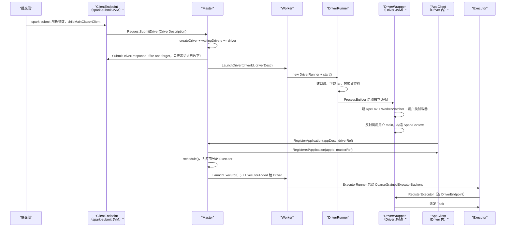
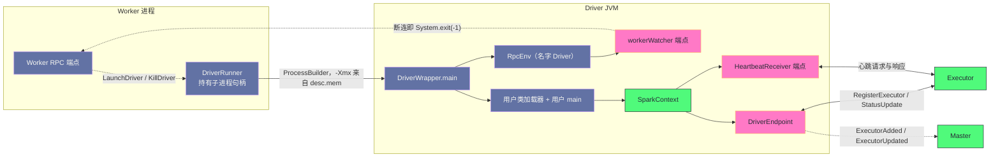
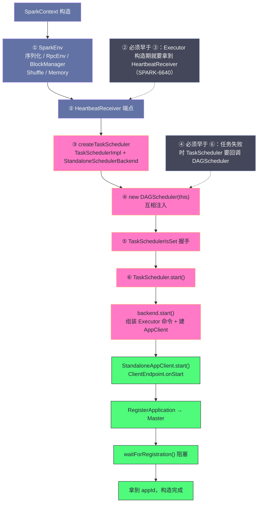
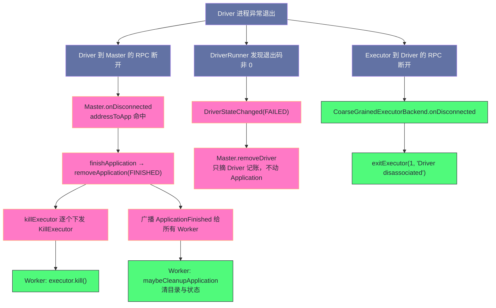

# 4. Spark Driver启动与Master交互

**摘要：**

Spark 的 Driver 是一个被两种身份压在同一名词上的东西：它既是"跑用户 main 方法的那段代码"，又是"持有 `SparkContext`、向集群管理器要资源、把 DAG 拆成任务派下去的主控进程"。这两个身份在 `--deploy-mode client` 与 `--deploy-mode cluster` 之下落在完全不同的进程里，于是同一个 Driver 概念派生出两套启动链路、两套注册协议与两种故障后果。本文从"Driver 的进程归属"这条线切入，先对比两种模式的拓扑与断连行为，再沿 cluster 模式把整条路走完：`spark-submit` 起 `Client`、`ClientEndpoint` 发 `RequestSubmitDriver`、Master 把 Driver 优先于 Executor 地调度到某个 Worker、`DriverRunner` 用 `ProcessBuilder` 拉起 `DriverWrapper`，随后是 Driver 侧 `SparkContext` 的初始化顺序为何不能重排，`StandaloneAppClient` 与 Master 之间那组消息各自管什么，Application 如何在 `WAITING` 与 `RUNNING` 之间被资源供给推着走。之后讨论心跳与探活的三层结构、Driver 异常退出后 Master 与 Executor 各自的清理动作，并把 Spark Connect 带来的边界变化放在旁边对照。文末用一张探活矩阵与一张清理链路图把散落的信号收拢，并列出八条常见误判。全文回答两个问题：Driver 到底在哪、谁对它的生死负责；当 Driver 不在客户端侧时，前面那些机制里哪些仍然成立、哪些失效。

---

## 第 1 章 一个名词，两种身份

### 1.1 从版本号读出的分水岭

把 Driver 从提交机上挪进集群内部，这件事在 Spark 1.3 前后就已经固化成了常规能力。证据不在文档的描述里，而在 `spark.driver.cores` 与 `spark.driver.supervise` 这两个配置项的版本号上——它们都标注着 `1.3.0`，而前者的说明明确写着"only in cluster mode"。也就是说，从那个版本起，Spark 承认了一件事：Driver 可以是集群里的一个"被调度对象"，它需要核数、需要内存额度、需要有人在它崩了之后决定要不要重新拉起。

这个承认带来的第一个后果，就是"Driver"这个词开始指代三个不同的东西。

其一，指用户 `main` 方法所在的那个 JVM——这是最朴素的所指，也是 `ps` 命令能看见的东西；在 client 模式下它就是 `spark-submit` 启动的那个进程，在 cluster 模式下它是由 Worker 以子进程方式拉起来的一个独立 JVM。

其二，指 `SparkContext` 的持有者：一个进程里可以先后创建多个 `SparkContext`（虽然不推荐），也可以一个都没有（譬如只做提交、不承担执行），因此判断谁是 Driver，看的是"谁持有 `SparkContext`，并且它的 `TaskScheduler` 已经向集群注册成功"，而不是看进程名。

其三，指 Master 内存里的一条记录：cluster 模式下，Master 的 `drivers` 集合里会有一条 `DriverInfo`，它有独立的 ID（形如 `driver-20261119...-0000`）、有 `DriverState`、有落点 `WorkerInfo`；client 模式下这条记录根本不存在——Master 只认识 Application，不认识 Driver。

三个所指混在一句话里，就会产生"Driver 已经启动但应用还没注册""应用在跑但 Master 上没有 Driver 记录""Driver 显示 FINISHED 但 App 还在 RUNNING"这类看起来矛盾的观测。本文后面所有机制，都要挂到这三个身份中的某一个上，才不会串。

### 1.2 Driver 手里握着什么

抛开身份，Driver 承担的工作是可以清点出来的：它解析用户代码并把它变成 RDD（Resilient Distributed Dataset）的血缘图；它把血缘图按宽窄依赖切分成 Stage；它把 Stage 展开成 TaskSet 交给 `TaskScheduler`；它维护 `SparkEnv`（序列化器、`RpcEnv`、`BlockManager`、`ShuffleManager`、`MemoryManager` 都在里面）；它还要对外暴露一个 RPC 端点，让 Executor 反过来向它注册、上报状态、取任务。

最后这一项容易被忽略：**Driver 不只是发号施令的一方，它同时是一个 RPC 服务端。** Worker 上的 `CoarseGrainedExecutorBackend` 启动之后，第一步就是拿着 `--driver-url` 去连 Driver 的 `RpcEndpoint`。这意味着 Driver 的地址必须能被所有 Worker 反向访问，也意味着 Driver 一旦消失，Executor 会立刻从连接层面感知到——第 10 章那三条清理链里有两条就以此为基础。

### 1.3 一个类比：驻场项目经理

把 Driver 比作"驻场项目经理"，比"大脑"之类的说法更贴近它的处境。

项目经理手里有三样东西：图纸（用户代码）、材料清单（资源申请）、以及一支施工队（Executor）。他不亲自砌砖，但每一块砖的位置由他决定；施工队只认他这个接口，材料由公司（集群管理器）调拨。

client 模式相当于项目经理坐在甲方办公室里远程指挥：办公室一断电，工地立刻停摆，因为所有指令都要经他中转；而且办公室的网络必须让工地能反向打进来。

cluster 模式相当于公司给项目在工地边上租了间办公室：甲方只负责打一份委托单（`spark-submit`），签完就可以走人，项目经理自己进场、自己领料、自己验收。但这间办公室是工地的一部分——工地被拆（Worker 进程退出），办公室也保不住，这一条后文会以 `WorkerWatcher` 的形式出现。

### 1.4 本文的走法

笔者先把范围限定清楚：讨论对象是 Standalone 集群管理器，版本口径是当前稳定的 Spark 4.3.0（2026-10-30 发布），4.x 的预编译包默认 Scala 2.13；任务级调度（`TaskScheduler` 如何选 Executor、延迟调度如何退化）不在本篇，本篇只走到"Executor 注册进来、可以接任务"为止。源码引用以 4.3.0 的 `core` 模块为准，个别行为在更早版本里不同，会单独注明年份或版本。

---

## 第 2 章 Driver 站在哪：client 与 cluster

### 2.1 一条命令的两种后果

`spark-submit` 的两个部署模式，差别不在参数多少，而在"谁的生命周期包含谁"。client 模式下，Driver 的生命周期被提交进程包含；cluster 模式下，Driver 的生命周期被集群包含，提交进程反而成了它的"委托人"。

下表把这条主线拆成可以逐项核对的事实。

| 维度 | client 模式 | cluster 模式 |
|---|---|---|
| Driver 所在进程 | `spark-submit` 拉起的 JVM，与用户 `main` 同进程 | Worker 上由 `DriverRunner` 拉起的独立 JVM |
| 谁负责启动 Driver | 用户自己（shell、CI、调度系统） | Master 调度 + Worker 启动 |
| Master 是否持有 `DriverInfo` | 否，只有 Application 记录 | 是，进入 `drivers` 与 `waitingDrivers` |
| `spark.driver.cores` / `memory` | 不进入集群资源记账 | 参与 Worker 资源记账，并作为调度判据 |
| 提交进程退出后 | Driver 随之消失，应用终止 | 应用继续运行，Driver 不受影响 |
| 关掉终端 / 拔网线 | Executor 因 Driver 失联全部退出 | 只要 Worker 到 Driver 可达就无影响 |
| 反向网络要求 | 所有 Worker 必须能连到提交机 | 只需集群内部可达 |
| Driver 日志 | 提交机的控制台或被重定向的文件 | `workDir/driverId/stdout` 与 `stderr` |
| 崩溃后谁来重启 | 外部脚本、systemd、YARN 或 K8s | `spark.driver.supervise` 交给 `DriverRunner` |
| 典型场景 | 交互式分析、notebook、调试 | 长跑作业、生产、提交机不稳定 |

这张表里最容易被跳过的是第四行：`--driver-cores` 在 client 模式下会被安静地忽略，因为 Driver 不在集群的资源池里，它占的是提交机的 CPU；而在 cluster 模式下，`1` 个核（`spark.driver.cores` 的默认值）会被 Master 从某个 Worker 的 `coresFree` 里扣掉，扣不到就不启动。**同一个参数在两种模式下的语义完全不同：一个是本地 JVM 的配置，一个是集群调度的输入。**

### 2.2 client 模式：Driver 就是你的提交进程

client 模式的启动链路短得几乎不值得画图。`spark-submit` 解析完参数后，把 `childMainClass` 直接设成用户的主类，然后反射调用它的 `main`。用户代码里 `new SparkContext(...)` 一执行，`SparkContext` 的构造过程就会创建 `StandaloneSchedulerBackend`，后者再创建 `StandaloneAppClient` 并向 Master 注册 Application。

也就是说，client 模式下并不存在"提交 Driver"这一步。Master 从头到尾没有见过这个 Driver，它只见到一个 Application 在某个地址上注册了 Driver 端点。这个"注册"不是形式上的登记，而是把 `RpcEndpointRef` 交给了 Master——Master 后面要靠这个 ref 把 `ExecutorAdded`、`ExecutorUpdated`、`ApplicationRemoved` 推回 Driver。

这条链路解释了一个常见困惑：client 模式下 `Master` 的 Web UI 里 Application 列表是正常的，但"Completed Drivers"页面永远是空的。那不是 UI 的缺陷，而是语义上的事实——本来就没有 Driver 被提交过。

### 2.3 cluster 模式：Driver 是集群里的一间工位

cluster 模式下，提交进程只做三件事：把用户 jar 放到一个 Worker 能取到的位置、把启动参数打包成 `DriverDescription`、把这份描述发给 Master。发完之后它的默认行为是退出——`spark.standalone.submit.waitAppCompletion` 的默认值是 `false`，提交完就走。

真正的 Driver 是 Worker 上的一个子进程：它由 `DriverRunner` 用 `ProcessBuilder` 拉起，主类是 `org.apache.spark.deploy.worker.DriverWrapper` 而不是用户主类；`DriverWrapper` 先给这个进程建立起自己的 `RpcEnv`（名字就叫 `driver`），再设置好用户 jar 的类加载器，最后才反射调用用户的主类。这个"外壳"的存在理由很直接：Driver 进程需要一个 RPC 环境来接收 Executor 的连接，而这份 RPC 环境的初始化不能依赖用户的 `main` 何时执行，也不能依赖用户记不记得关掉它。

### 2.4 断连之后会发生什么

反事实的检验方式很朴素：把提交机的网络拔掉，观察集群。

client 模式下，提交机的 RPC 连接断开，Executor 的 `CoarseGrainedExecutorBackend` 会收到 `onDisconnected` 回调，进而调用 `exitExecutor(1, "Driver ... disassociated! Shutting down.")` 自行退出；Master 侧的 `onDisconnected` 也会看到 Driver 端点失联，把对应的 Application 从 `apps` 里移除，并通知所有 Worker 做清理。整个应用随即灰飞烟灭——不是因为任务算错了，而是因为 Driver 那间"甲方办公室"断电了。

cluster 模式下同样拔掉提交机的网线，集群毫无反应。提交进程早就退出了，Driver 在 Worker 上照常跑，Executor 照常连它。这个对比是两种模式全部取舍的源头：**client 模式把 Driver 的可用性绑在提交环境上，换来的是调试方便与零启动开销；cluster 模式把 Driver 的可用性交给集群，代价是多一层调度、多一次 jar 分发、以及"日志不在自己机器上"的不便。**

### 2.5 三处容易漏掉的差异

第一处是 `spark.driver.host`：cluster 模式下 Driver 跑在 Worker 上，它向 Master 和 Executor 宣告的地址由 `spark.driver.host` 决定，默认取本机主机名。多网卡、容器 NAT、或者主机名不可解析的环境里，这个默认值会让 Executor 连不上 Driver，症状是 Driver 日志停在 "Connected to Spark cluster"，而 Executor 侧反复报连接失败。client 模式下这个值同样重要，但至少提交机通常有稳定的对外地址。

第二处是日志位置：cluster 模式的 Driver 日志被 `DriverRunner` 重定向到 `workDir/<driverId>/stdout` 与 `stderr`，同时在环境变量里塞进 `SPARK_DRIVER_LOG_URL_STDOUT`、`SPARK_DRIVER_LOG_URL_STDERR`，指向 Worker UI 的 `logPage`。排查"Driver 没起来"时，`stderr` 文件开头会有一行 `Launch Command:`，后面跟着被脱敏过的完整命令行——这句话比任何猜测都可靠，它能直接看出 `-Xmx` 是多少、类路径对不对、主类有没有写错。

第三处是提交通道其实有两条：`spark-submit` 默认走 RPC 通道（`childMainClass` 被设成 `org.apache.spark.deploy.Client`），如果 Master 开了 REST 网关（`spark.master.rest.enabled`）还可以走 `RestSubmissionClientApp`；两条通道最后都收敛到 Master 的 `RequestSubmitDriver`，但环境变量的转发规则不同——RPC 通道受 `spark.standalone.submit.filterEnvironment` 控制（该键 4.3.0 引入，默认只转发 `SPARK_*` 前缀的变量），REST 通道则一律过滤，于是提交脚本里依赖自定义环境变量的应用，在这两条通道之间的行为并不一致。

### 2.6 两种拓扑并排看

把两种模式的进程边界画在一起，比读十行文字更省事。

```mermaid
%%{init: {'theme': 'dracula'}}%%
graph TB
    subgraph CM["client 模式：Driver 在提交进程里"]
        C0["终端 / SSH 会话"] --- C1["spark-submit JVM<br/>（Driver 就在这里）"]
        C1 -->|"RegisterApplication"| C2["Master"]
        C2 -->|"LaunchExecutor"| C3["Worker"]
        C3 --> C4["Executor"]
        C4 -. "回调 spark.driver.host:port" .-> C1
    end
    subgraph KM["cluster 模式：Driver 在 Worker 里"]
        K1["spark-submit JVM<br/>（Client，提交完即退出）"]
        K1 -->|"RequestSubmitDriver"| K2["Master"]
        K2 -->|"LaunchDriver"| K3["Worker"]
        K3 --> K4["DriverWrapper<br/>独立 JVM"]
        K4 -->|"RegisterApplication"| K2
        K2 -->|"LaunchExecutor"| K3
        K3 --> K5["Executor"]
        K5 -. "回调 Driver" .-> K4
        K4 -. "WorkerWatcher 盯住 Worker" .-> K3
    end
    classDef submit fill:#6272a4,stroke:#bd93f9,color:#f8f8f2
    classDef ctrl fill:#ff79c6,stroke:#ffb86c,color:#282a36
    classDef proc fill:#50fa7b,stroke:#282a36,color:#282a36
    class C0,C1,K1 submit
    class C2,K2,K3 ctrl
    class C3,C4,K5,K4 proc
```



图里右侧那条虚线是 cluster 模式独有的：Driver 进程里有一个 `workerWatcher` 端点盯着 Worker，Worker 一死，Driver 就 `System.exit(-1)`。这条"同生共死"的绑定在后文还会出现两次，它是理解"为什么 Worker 重启会连带杀掉 Driver"的钥匙。

---
## 第 3 章 提交：两个 ClientEndpoint 与一次请求

### 3.1 `spark-submit` 其实只做了一件事

把 `spark-submit` 的参数解析、配置合并、jar 打包都略过之后，它真正决定的东西只有一个：子进程里那个 `main` 方法属于哪个类。

`prepareSubmitEnvironment` 里有一处很直白的分支：`deployMode == CLIENT` 时 `childMainClass = args.mainClass`，用户的主类被直接执行；而 Standalone 的 cluster 模式下 `childMainClass = org.apache.spark.deploy.Client`，用户主类被降级成一个字符串参数，塞进 `childArgs` 里传下去。同一份用户代码，在两种模式下走的入口类完全不同——这不是实现上的偷懒，而是"Driver 要不要被别人调度"这个问题的必然结果：只要 Driver 的位置由 Master 决定，提交进程就不可能直接执行用户代码，它只能先变成一个"委托人"。

顺带说一句，这个入口类的选择还解释了 `--verbose` 输出里为什么两种模式打印的 "Main class" 不一样。看到 `org.apache.spark.deploy.Client` 就知道是 cluster 模式，看到自己的类名就是 client 模式，这比查配置快。

### 3.2 `ClientEndpoint` 与 `DriverDescription`

`Client` 进程起来后只做一件事：建一个 `RpcEnv`，把 `ClientEndpoint` 挂上去，而这个端点在 `onStart` 时构造 `DriverDescription` 并发出 `RequestSubmitDriver`——换句话说，它不参与任何后续执行，只负责把请求送到、把回包收下。

```scala
// org.apache.spark.deploy.Client，简化并保留关键字段
override def onStart(): Unit = driverArgs.cmd match {
  case "launch" =>
    // 真正被 Worker 执行的主类是 DriverWrapper，不是用户主类：
    // Worker 才能提供 {{WORKER_URL}} 与本地 jar 路径，所以这里必须留占位符
    val mainClass = "org.apache.spark.deploy.worker.DriverWrapper"
    val command = new Command(
      mainClass,
      Seq("{{WORKER_URL}}", "{{USER_JAR}}", driverArgs.mainClass) ++ driverArgs.driverOptions,
      DriverEnvironment.forSubmission(conf, sys.env),   // 4.x：在提交侧快照环境变量
      classPathEntries, libraryPathEntries, javaOpts)

    val driverDescription = new DriverDescription(
      driverArgs.jarUrl, driverArgs.memory, driverArgs.cores,
      driverArgs.supervise, command, driverResourceReqs)

    asyncSendToMasterAndForwardReply[SubmitDriverResponse](
      RequestSubmitDriver(driverDescription))
}
```

三点值得停留。

第一，`{{WORKER_URL}}` 与 `{{USER_JAR}}` 是占位符，不是真实值。提交进程无法预知 Driver 会落在哪个 Worker 上，也不知道那个 Worker 的 RPC 地址，更不知道 jar 被下载到本地哪个路径——这两个变量只有 Worker 自己知道。这种"由执行方填空"的设计是 Spark 部署层反复使用的手法，Executor 的启动命令里也有一整套 `{{EXECUTOR_ID}}`、`{{HOSTNAME}}`、`{{APP_ID}}` 占位符。

第二，`DriverEnvironment.forSubmission` 说明用户环境变量是在提交侧被快照下来的。4.x 之前这件事是隐式的（整个环境变量表随进程传下去），4.0 之后单独抽成了 `DriverEnvironment`，并在 4.3.0 配了一个开关 `spark.standalone.submit.filterEnvironment` 控制过滤策略。它解决的是一个真实痛点：提交机上有一堆 `AWS_*`、`HTTP_PROXY`、公司内部变量，全部透传到 Worker 的 Driver 进程里，既可能覆盖集群侧的配置，也可能把不该外泄的东西带到别的机器上。

第三，`DriverDescription` 的字段就是"一份资源申请单"：jar 地址、内存 MB、核数、是否 supervise、启动命令、自定义资源需求。Master 后面做调度判断时，用的就是这几个数字；Worker 后面记账时，用的也是这几个数字。从这行代码开始，"Driver 是个进程"的叙事变成了"Driver 是一张资源申请单"的叙事，直到 `launchDriver` 才又变回去。

### 3.3 Master 收到请求之后

Master 处理 `RequestSubmitDriver` 的动作可以按顺序念出来：若自身处于非 `ALIVE` 状态（HA 的 standby），直接回一个 `success = false` 的响应；否则 `createDriver` 生成 `DriverInfo`，写入持久化引擎（`persistenceEngine.addDriver`，为 HA 恢复留档），加入 `waitingDrivers` 队列，加入 `drivers` 集合，最后调一次 `schedule()`。

紧接着是回包：`SubmitDriverResponse(self, true, Some(driver.id), "Driver successfully submitted as ...")`；源码在这里留了一句相当诚实的注释——"It might be good to instead have the submission client poll the master to determine the current status of the driver. For now it's simply 'fire and forget'"，也就是说，**这份回包只说明"请求已收下"，不说明"Driver 已经起来"，更不说明"应用已经在跑"**，把它当成启动确认是排查中最常见的误判之一。

### 3.4 两个都叫 client 的端点

Driver 在 Worker 上启动之后，会创建第二个叫 client 的端点：`StandaloneAppClient` 内部的 `ClientEndpoint`（端点名 `AppClient`）。它和提交进程里那个 `ClientEndpoint` 名字撞了，但它们是两个进程、两条连接、两套职责。

下面的时序图把整个流程铺开，右侧两条是 cluster 模式独有的。



图里有一处顺序容易被读错：`SubmitDriverResponse` 是在 `ClientEndpoint` 发完请求后立刻返回的，与 Driver 是否启动成功无关；`RegisteredApplication` 则要等 Driver 内部的 `SparkContext` 走到 `StandaloneAppClient` 才发生。两者之间隔着"Master 调度 + Worker 起进程 + JVM 启动 + 用户代码执行"四段，任何一段出问题，观测到的都是"提交成功但应用没出现"。

### 3.5 提交链路上的几处边界

HA 下的重复提交是设计内行为：`ClientEndpoint` 会向所有 Master 地址广播 `RequestSubmitDriver`，谁先应答就用谁；备 Master 会回一个带 `BACKUP_STANDALONE_MASTER_PREFIX` 前缀的失败响应，`Client` 侧靠这个前缀把它识别为"备用实例的回答"并忽略。所以日志里出现两条提交请求，不代表你手抖提交了两次。

standby 状态下的拒绝是硬性的：在 `state != RecoveryState.ALIVE` 时，Master 连排队都不排，直接回失败；这条约束配合 Worker 的心跳超时，决定了 HA 切换窗口里"提交会失败一段时间"，而不是"提交会卡住"。

jar 的可达性是提交方的责任：`DriverDescription.jarUrl` 只是一个 URL，Worker 用 `Utils.fetchFile` 去取；`file://` 路径意味着"所有 Worker 本地都得有这份文件"，`hdfs://` 则要求 Worker 侧有对应的 Hadoop 配置。cluster 模式里"jar 找不到"是一个高频故障，症状是 Driver 进程根本没起来，`stderr` 里一行 `ClassNotFoundException`，而提交侧早已打印过 "successfully submitted"。

---

## 第 4 章 Master 如何为 Driver 选一个 Worker

### 4.1 一段注释定下的优先级

`Master.schedule()` 的第一行有效代码之后紧接着一句注释：`Drivers take strict precedence over executors`；这句话不是文档里的宣传语，而是调度顺序的硬约束——先把所有 `waitingDrivers` 处理完，再调 `startExecutorsOnWorkers()`。

```scala
// Master.schedule()，4.3.0，删去了非核心分支
private def schedule(): Unit = {
  if (state != RecoveryState.ALIVE) return
  // Drivers take strict precedence over executors
  if (spreadOutDrivers) {                       // spark.deploy.spreadOutDrivers，4.0 引入，默认 true
    val shuffledAliveWorkers = Random.shuffle(workers.toSeq.filter(_.state == WorkerState.ALIVE))
    var curPos = 0
    for (driver <- waitingDrivers.toList) {
      var launched = (drivers.size - waitingDrivers.size) >= maxDrivers
      var numWorkersVisited = 0
      while (numWorkersVisited < shuffledAliveWorkers.size && !launched) {
        val worker = shuffledAliveWorkers(curPos)
        numWorkersVisited += 1
        if (canLaunchDriver(worker, driver.desc)) {   // mem / cores / 自定义资源三项都够
          driver.withResources(worker.acquireResources(driver.desc.resourceReqs))
          launchDriver(worker, driver)
          waitingDrivers -= driver                    // 出队
          launched = true
        }
        curPos = (curPos + 1) % shuffledAliveWorkers.size   // 轮转，不从头再找
      }
    }
  }
  startExecutorsOnWorkers()                     // Executor 只能吃 Driver 剩下的资源
}
```

这二十行里有三个决定成败的细节。

其一，Driver 的资源是"独占预留"的。`canLaunchDriver` 检查 Worker 的 `memoryFree`、`coresFree` 和自定义资源余量，只要不够就不选这个 Worker，Driver 留在队列里等下一轮。它不会"先给一半"，也不会"排在某个 Executor 后面等资源释放"——因为 Executor 的调度在 `schedule()` 的后半段，天然拿不到被预留的部分。

其二，轮转起点会接着上一次的位置。源码注释说得清楚：对每个 Driver，从"上一个被分配的 Worker 的下一个位置"开始找，直到把存活 Worker 走一圈。这个细节的目的是让连续提交的多个 Driver 散开，而不是全挤在同一个 Worker 上。4.0 起这条路走法有了名字与开关（`spark.deploy.spreadOutDrivers`），关掉之后退化成"按 Worker ID 排序、取第一个装得下的"。

其三，`spark.deploy.maxDrivers` 是硬上限：同样 4.0 引入，默认 `Int.MaxValue`，意味着默认不限制，而集群一旦对外提供提交入口，这个默认值就等于没有闸门——任何能提交的人都可以把 Driver 堆到 Worker 上把资源占满。

### 4.2 资源不够时，Driver 停在哪里

答案是停在 `waitingDrivers` 里、状态为 `DriverState.SUBMITTED`：它不会超时，不会失败，也不会给提交方任何回调，只是安静地等着下一次 `schedule()`。

下一次 `schedule()` 由谁触发？Master 在几个地方调它：Worker 注册成功、Worker 心跳超时被移除、应用注册、Executor 状态变化（包括退出）、应用的 `RequestExecutors`、Driver 被移除。换句话说，只要集群的资源账面发生变化，排队的 Driver 就再被看一眼。这也是为什么"资源不足"在 Standalone 上表现为"Driver 迟迟不启动"而不是"提交报错"——它期待的是一个最终会到来的资源释放事件。

这里有一处设计上的空白：如果 Driver 需要的资源超过了单个 Worker 的总量（譬如一台 16 核的机器上申请 32 核 Driver），它永远不会被启动，而 Master 只在"集群完全空闲"时打一条 warning（`Driver ... requires more resource than any of Workers could have.`）。这条 warning 的条件是"被检查时集群一个 Driver 一个 Executor 都没有"，忙碌集群里连这条线索都看不到。

### 4.3 `launchDriver` 与 Driver 状态机

选中 Worker 之后，Master 的动作只有三行：把 Driver 加到 Worker 的账上、记住落点、发消息。

```scala
// Master.launchDriver
private def launchDriver(worker: WorkerInfo, driver: DriverInfo): Unit = {
  worker.addDriver(driver)                 // Worker 侧资源记账（Master 视角）
  driver.worker = Some(worker)             // 记住落点，供 removeDriver 摘账
  worker.endpoint.send(LaunchDriver(driver.id, driver.desc, driver.resources))
  driver.state = DriverState.RUNNING       // 注意：这里就置 RUNNING 了
}
```

最后一行的时机值得单独说：**Master 在发出 `LaunchDriver` 的同一瞬间就把状态置成 `RUNNING`，此时 Worker 上的进程还没创建。** 所以 `DriverState.RUNNING` 的含义是"已被分配到 Worker"，不是"进程正在运行"，更不是"应用已注册"。这三个语义分别由 `DriverState.RUNNING`、Worker 的进程存在性、以及 Application 的 `RUNNING` 承载，混用会导致完全错误的判断。

| 状态 | 谁写入 | 真实含义 | 常见误读 |
|---|---|---|---|
| `SUBMITTED` | `createDriver` | 已收到提交请求，尚未分配 Worker | 以为已开始启动 |
| `RUNNING` | `launchDriver` | 已分配 Worker 并发出 `LaunchDriver` | 以为进程已就绪 |
| `RELAUNCHING` | 恢复流程 | HA 恢复期间状态暂缺 | 以为在自动重启 |
| `FINISHED` | `DriverRunner` | 进程以 0 退出 | 以为应用成功 |
| `FAILED` | `DriverRunner` | 进程非 0 退出且未 supervise | — |
| `KILLED` | `DriverRunner` 或 `Master` | 被显式 kill | — |
| `ERROR` | `DriverRunner` | 无法启动（jar 取不到等） | 以为资源不足 |

`FINISHED` 那一行的误读代价最大：Driver 进程以 0 退出只说明"那个 JVM 正常结束了"，应用的数据是否写对、作业是否真的完成，Master 一概不知。

### 4.4 谁在抢谁的资源

把 Driver 与 Executor 放在同一张资源账上，是 Standalone 的一个特征，也是它与 YARN、Kubernetes 最大的结构差异。

在 YARN 上，Driver 跑在 ApplicationMaster 的容器里，Executor 跑在普通容器里，两者都由 ResourceManager 分配，但 AM 容器有独立的资源队列语义；在 Kubernetes 上，Driver 是一个 Pod，Executor 是另一些 Pod，资源由调度器统一处理。而在 Standalone 上，Driver 就是一个"占 1 核 + 1G 的进程"，它和 Executor 抢同一个 `WorkerInfo` 的 `coresFree` 与 `memoryFree`，只是抢的顺序被那句 `strict precedence` 固定住了。

这个差异会在两种场景里显形：一是小集群上提交多个 Driver，Driver 之间会把 Worker 占满，导致应用注册成功却一个 Executor 也拿不到（第 8 章会专门讲这种 `WAITING` 的僵局）；二是 Worker 数量少而 Driver 内存设得大，Driver 直接把一个 Worker 的余量吃掉一半，后续 Executor 只能挤在剩下的空间里。

---

## 第 5 章 Worker 侧：`DriverRunner` 与 `DriverWrapper`

### 5.1 `LaunchDriver` 到达 Worker

Worker 收到 `LaunchDriver` 后做的事很朴素：新建一个 `DriverRunner`，放进 `drivers` 这个 Map，调用 `start()`，然后立刻把这笔资源记到自己的账上。

```scala
// Worker 处理 LaunchDriver，4.3.0
case LaunchDriver(driverId, driverDesc, resources_) =>
  val driver = new DriverRunner(conf, driverId, workDir, sparkHome,
    driverDesc.copy(command = Worker.maybeUpdateSSLSettings(driverDesc.command, conf)),
    self, workerUri, workerWebUiUrl, securityMgr, resources_)
  drivers(driverId) = driver
  driver.start()
  coresUsed += driverDesc.cores      // 记账先于进程实际启动
  memoryUsed += driverDesc.mem
  addResourcesUsed(resources_)
```

记账先于进程启动，这个顺序是有意的：Worker 对 Master 的心跳里带着 `coresUsed`/`memoryUsed`，如果等进程真正起来再记账，中间那几秒里 Master 可能把这个 Worker 当成"还有余量"，把资源重复许给别的应用。先用悲观记账锁住额度，再用进程的实际结果去修正，是分布式资源管理里反复出现的模式。

### 5.2 `prepareAndRunDriver` 的五个动作

`DriverRunner.start()` 起一个名为 `DriverRunner for <driverId>` 的线程，线程体只调一次 `prepareAndRunDriver()`，然后根据退出码决定 `finalState`（0 是 `FINISHED`，被 kill 是 `KILLED`，其余 `FAILED`，抛异常是 `ERROR`），最后把 `DriverStateChanged` 发回 Worker。

`prepareAndRunDriver` 的动作可以按顺序列出来：

1. 建工作目录 `workDir/<driverId>`，存在就复用；
2. 下载用户 jar：`Utils.fetchFile(driverDesc.jarUrl, driverDir, ...)`，取不到就抛 `IOException`，最终变成 `DriverState.ERROR`；
3. 替换占位符：把命令里的 `{{WORKER_URL}}` 换成 `workerUrl`、`{{USER_JAR}}` 换成刚下载的本地路径；
4. 构造 `ProcessBuilder`：`CommandUtils.buildProcessBuilder(command, securityManager, driverDesc.mem, sparkHome, substituteVariables)`，这里的 `driverDesc.mem` 会被翻译成 `-Xmx`，也是 Driver 内存额度的真正落点；
5. 启动进程并重定向输出：`stdout` 与 `stderr` 各写一个文件，`stderr` 开头写入 `Launch Command:` 与脱敏后的完整命令行。

第 5 步那行 `Launch Command:` 在实际排障中的价值被严重低估——它是唯一一份"集群实际执行的命令"的现场记录，`-Xmx` 是不是你设的值、`--driver-class-path` 里有没有你期望的 jar、kerberos 相关的 `-D` 参数有没有被 `maybeUpdateSSLSettings` 改写，全在这一行里。

### 5.3 `DriverWrapper` 的四件事

`DriverWrapper` 是一个只有几十行的 `object`，但它决定了 Driver 进程的骨架。

```scala
// org.apache.spark.deploy.worker.DriverWrapper，保留主干
object DriverWrapper extends Logging {
  def main(args: Array[String]): Unit = args.toList match {
    case workerUrl :: userJar :: mainClass :: extraArgs =>
      val conf = new SparkConf()
      // 1) 建立独立 RpcEnv：名字就叫 "Driver"，端口取 spark.driver.port（默认 0，即随机）
      val rpcEnv = RpcEnv.create("Driver", Utils.localHostName(),
        sys.props.getOrElse(config.DRIVER_PORT.key, "0").toInt, conf, new SecurityManager(conf))
      // 2) 挂上 WorkerWatcher：与 Worker 同生共死
      rpcEnv.setupEndpoint("workerWatcher", new WorkerWatcher(rpcEnv, workerUrl))
      // 3) 换类加载器：用户 jar 必须能被加载
      val currentLoader = Thread.currentThread.getContextClassLoader
      val loader = new MutableURLClassLoader(Array(new File(userJar).toURI.toURL), currentLoader)
      Thread.currentThread.setContextClassLoader(loader)
      setupDependencies(loader, userJar)
      // 4) 反射调用用户主类
      val clazz = Utils.classForName(mainClass)
      clazz.getMethod("main", classOf[Array[String]]).invoke(null, extraArgs.toArray[String])
      rpcEnv.shutdown()
    case _ => System.exit(-1)
  }
}
```

四件事里最不显眼的是第二件。`WorkerWatcher` 在 `onStart` 时异步连上 Worker 的 RPC 端点，一旦发现连接断开（`onDisconnected`）或连接不上（`onNetworkError`），就在一个独立线程里执行 `System.exit(-1)`。源码注释称之为 "fate sharing"：**Driver 的命与它所在 Worker 的命绑在一起。**

这种绑定需要一个理由，理由就藏在 Worker 退出的方式里：Worker 正常退出时会走 shutdown hook，而被 `kill -9` 打死时钩子不会执行，子进程就成了孤儿——它还在跑，还在持有 `SparkContext`，但它的 Executor 全部随着 Worker 消失了，任何一次任务提交都会挂死，与其让它变成僵尸，不如让它自己退出，让 Master 通过断连感知到应用该结束了。

第三件事的细节值得补一句：`spark.driver.userClassPathFirst` 为真时，`DriverWrapper` 会用 `ChildFirstURLClassLoader` 取代默认的 `MutableURLClassLoader`，从而让用户 jar 与 Spark 自带 jar 冲突时用户侧优先。这个开关存在本身就说明 classpath 冲突是常态，尤其在用户把 Jackson、Guava 之类的基础库打进 uber jar 时。

### 5.4 Driver 进程的内部结构

把 Driver JVM 拆开来看，它不是一个"用户程序"，而是"一层外壳 + 一组端点 + 用户代码"，下图是这层关系的静态视图。



图中的四条外部连线各有归属：`WR` 那条是命运绑定，`DE` 那两条是任务通道，`HR` 那条是心跳通道，`MA` 那条是资源通道。理解了"四条线各管一件事"，再去看 Driver 日志里混杂的信息，就容易分拣了。

### 5.5 进程的三种死法与 `supervise`

Driver 进程的结束方式决定了 Master 看到什么。

正常结束（`sc.stop()` 之后 `main` 返回，JVM 以 0 退出）：`DriverRunner` 报 `FINISHED`，Master 的 `removeDriver` 把 `DriverInfo` 移入 `completedDrivers`，Worker 把自己的资源账减回去。注意这条路径下应用通常是先自行 `UnregisterApplication` 的，所以 Application 也会干净地进入 `FINISHED`。

异常结束（抛异常、被 OOM Killer 杀、被 `kill -9`）：`DriverRunner` 报非 0 退出码，`finalState` 是 `FAILED`（若被显式 kill 则是 `KILLED`）。此时应用侧的清理不走 Driver 主动注销，而是走 RPC 断连，第 10 章展开。

无法启动（jar 取不到、命令构造失败、子进程起不来）：`prepareAndRunDriver` 抛异常，`finalState` 是 `ERROR`，这条路径最容易被误判为"资源不足"，因为从提交方看只有一句"Driver 没起来"。

`spark.driver.supervise = true` 会改变第二种死法的后续：`runCommandWithRetry` 在 `supervise && exitCode != 0 && !killed` 成立时重新启动同一个命令，间隔从 1 秒开始指数退避，如果上一次运行超过 5 秒则退避重置为 1 秒。它没有次数上限——只要进程一直在短时间内崩溃，它就会一直重启下去。

这条机制救的是"进程崩了"，不是"作业进度"。重启出来的是一个全新的 JVM，会重新执行用户 `main`、重新构造 `SparkContext`、重新向 Master 注册（新的应用 ID）。把 `--supervise` 当作长跑作业的容错手段，往往会得到"作业重启了十几次、每次都从头来过"的结果；真正的进度恢复要靠 checkpoint 或上游重跑，这一点与部署模式无关。

### 5.6 Driver 自己的看门狗

4.0 起多了一个反向的机制：`spark.driver.timeout`（单位分钟，默认 `0min` 表示不限）配合 `spark.plugins=org.apache.spark.deploy.DriverTimeoutPlugin`，可以在 Driver 运行超过时限后以退出码 124 自行终止。

它的定位很清楚：不是心跳，不是健康检查，而是一个自设的死线。集群侧无法判断"Driver 活着但业务已经卡死"，只能由 Driver 自己在启动时接受一个期限，到点自杀。退出码 124 是从 `timeout(1)` 命令借来的约定，看到 124 就应该想到"被时间限制杀死"，而不是"业务异常"。

---

## 第 6 章 Driver 侧 `SparkContext` 的初始化顺序

### 6.1 顺序本身就是设计

`SparkContext` 的构造函数是一份被精心排过序的清单：把 4.3.0 的顺序抽出来、只保留与集群交互有关的部分，就得到下面这段骨架。

```scala
// SparkContext 构造期关键顺序（4.3.0）
_conf = config.clone(); _conf.validateSettings()
_statusStore = AppStatusStore.createLiveStore(conf, appStatusSource)
_env = createSparkEnv(_conf, isLocal, listenerBus)   // ① 必须最先
SparkEnv.set(_env)

_heartbeatReceiver = env.rpcEnv.setupEndpoint(          // ② 早于 TaskScheduler
  HeartbeatReceiver.ENDPOINT_NAME, new HeartbeatReceiver(this))
_plugins = PluginContainer(this, _resources.asJava)
_env.initializeShuffleManager(); _env.initializeMemoryManager(...)

val (sched, ts) = SparkContext.createTaskScheduler(this, master)  // ③ backend + scheduler
_schedulerBackend = sched
_taskScheduler = ts
_dagScheduler = new DAGScheduler(this)                 // ④ 互相引用
_heartbeatReceiver.ask[Boolean](TaskSchedulerIsSet)    // ⑤ 握手

_taskScheduler.start()                                  // ⑥ 触发向 Master 注册
_applicationId = _taskScheduler.applicationId()          // ⑦ 注册完才有 appId
```

### 6.2 为什么 `SparkEnv` 必须最先

`SparkEnv` 里装着 Driver 与 Executor 两侧都必须一致的运行时组件：序列化器、`RpcEnv`、`BlockManager`、`ShuffleManager`、`MemoryManager`、广播与累加器。这些东西的初始化顺序不能挪到调度器之后，因为调度器本身就要用 `RpcEnv` 建端点；也不能挪到用户代码之后，因为 Driver 必须先能接收 Executor 的连接，用户代码才有意义。

换句话说，`SparkEnv` 不是"给用户代码准备的环境"，而是"给集群协议准备的运行时"。它先于任何集群交互存在，是 Driver 之所以能成为一个 RPC 服务端的前提。

### 6.3 为什么 `HeartbeatReceiver` 要早于 `TaskScheduler`

源码里这行注释几乎是在回答面试题："We need to register `HeartbeatReceiver` before `createTaskScheduler` because Executor will retrieve `HeartbeatReceiver` in the constructor. (SPARK-6640)"。

翻译过来：Executor 进程启动时会向 Driver 的 `HeartbeatReceiver` 端点发起注册（它需要知道心跳往哪发），如果 Driver 的 `TaskScheduler` 已经启动但 `HeartbeatReceiver` 还没挂上，早到的那批 Executor 就会注册失败。这是一个"反向依赖"——正常情况下是 Driver 找 Executor，但心跳这一环是 Executor 找 Driver，所以被依赖的一方必须先就位。

### 6.4 为什么 `DAGScheduler` 与 `TaskScheduler` 要互相引用

`DAGScheduler` 的构造里会把 `this` 交给 `TaskScheduler`（`taskScheduler.setDAGScheduler(this)`），而 `TaskScheduler` 在派发任务失败、需要 `failedStages` 标记时必须回调 `DAGScheduler`。两个对象互相持有引用，意味着必须有一方先构造、后注入。

Spark 的选择是：先 `createTaskScheduler`（此时 backend 已经创建，但还没 `start`），再 `new DAGScheduler(this)` 完成注入，然后调 `TaskSchedulerIsSet` 告诉 `HeartbeatReceiver`"调度器已经就绪"。第三步的握手是必要的，因为 `HeartbeatReceiver` 可能已经收到了 Executor 的心跳注册，它需要知道什么时候可以把这些心跳转给调度器。

### 6.5 `start()` 里的三级连锁

`_taskScheduler.start()` 是这条链的扳机，它内部做三件事——调 `backend.start()`、把 `taskScheduler` 自己注册给 `HeartbeatReceiver`、启动推测执行与黑名单相关的定时任务。

`backend.start()` 在 Standalone 下是 `StandaloneSchedulerBackend.start()`：先调父类 `CoarseGrainedSchedulerBackend.start()`（做 token manager 之类的初始化），然后如果是 client 模式就连接 launcher backend，接着构造 Executor 的启动命令（`CoarseGrainedExecutorBackend`，带一整套 `{{...}}` 占位符），再构造 `ApplicationDescription`，创建 `StandaloneAppClient` 并 `start()`，最后阻塞在 `waitForRegistration()`。

最后这一步是全篇最关键的一处同步点：`waitForRegistration()` 用一个 `Semaphore` 等待 `connected(appId)` 回调，而 `connected` 只在收到 Master 的 `RegisteredApplication` 时才被调用。所以 `new SparkContext(...)` 这行代码在 cluster 模式下可能阻塞几秒到几十秒，阻塞期间 Driver 的日志会停在 "Connecting to master ..." 附近。很多"Spark 启动很慢"的体感来自这里，而它的本质是"构造期同步注册"，不是"懒加载"。

### 6.6 初始化顺序的图示



如果把顺序颠倒会怎样？把 `SparkEnv` 放到调度器之后，`StandaloneSchedulerBackend` 拿不到 `RpcEnv` 建不了端点；把 `DAGScheduler` 放到 `start()` 之后，`TaskScheduler` 在 `start()` 期间就开始接收 Executor 的 `RegisterExecutor`，此时回调链是空的，任务状态无处上报，异常会直接冒到派发路径上；把 `waitForRegistration` 拿掉，`SparkContext` 会在没有 `appId` 的情况下返回，用户代码里第一句 `sc.applicationId` 就取到 `null`。**这条顺序不是编码习惯，而是一条由依赖关系推出来的唯一拓扑序。**

---

## 第 7 章 注册协议：`StandaloneAppClient` 与 Master 说了什么

### 7.1 注册是一场多轮广播

`StandaloneAppClient` 的 `ClientEndpoint.onStart` 只做一件事：`registerWithMaster(1)`，而这个方法的实现是一个"多线程广播 + 定时器重试"的组合。

```scala
// StandaloneAppClient，注册重试（4.3.0）
private val REGISTRATION_TIMEOUT_SECONDS = 20
private val REGISTRATION_RETRIES = 3

private def tryRegisterAllMasters(): Array[JFuture[_]] =
  masterRpcAddresses.map { addr =>
    registerMasterThreadPool.submit(() => {
      val masterRef = rpcEnv.setupEndpointRef(addr, Master.ENDPOINT_NAME)
      masterRef.send(RegisterApplication(appDescription, self))
    })
  }

private def registerWithMaster(nthRetry: Int): Unit = {
  registerMasterFutures.set(tryRegisterAllMasters())
  registrationRetryThread.schedule(() => {
    if (registered.get) { /* 成功，收工 */ }
    else if (nthRetry >= REGISTRATION_RETRIES) markDead("All masters are unresponsive! Giving up.")
    else registerWithMaster(nthRetry + 1)
  }, REGISTRATION_TIMEOUT_SECONDS, TimeUnit.SECONDS)
}
```

三个数字值得记住：广播线程池的长度等于 Master 地址数量（保证能同时连所有 Master）、单轮超时 20 秒、最多 3 轮。三轮都失败之后的动作不是重试，而是 `markDead`——回调 `StandaloneSchedulerBackend.dead`，最终 `sc.stopInNewThread()`，整个应用自杀。

**"连不上 Master"在 Standalone 上被当作致命错误，而不是可降级状态。** 这一条与"Master 失联但应用继续跑"并不矛盾，区别在于时机：注册阶段连不上，说明这个 Driver 从来没进入过集群，没有 Executor、没有状态可保；而运行阶段失联，Executor 已经在跑，杀应用反而是更大的损失。设计上按"能不能继续干活"来决定生死，而不是按"连接是否完好"。

### 7.2 `RegisterApplication` 与 `RegisteredApplication`

`ClientEndpoint` 发出的是 `RegisterApplication(appDescription, self)`，第二个参数是 Driver 的 `RpcEndpointRef`；Master 收到后先判断自身是否 `STANDBY`（是则直接忽略、连响应都不发，让 Driver 等到超时换下一个 Master），然后 `createApplication`、`registerApplication`，写持久化，回 `RegisteredApplication(app.id, self)`，最后调 `schedule()`。

`registerApplication` 里有一处去重：用 `app.driver.address` 作为 key，如果同一个地址已经注册过应用，直接 `return`。这个判断是为网络重传准备的——同一次注册可能被重复投递，没有这道闸门就会出现同一个 Driver 在 Master 上挂两个应用。

回包里的第二个参数是 Master 自己的 ref，Driver 侧把它存下来，后续所有主动请求（`RequestExecutors`、`KillExecutors`、`UnregisterApplication`）都发给它。这也是 Master 发生切换时 Driver 必须收到 `MasterChanged` 的原因：ref 换了，不更新就再也发不出去。

### 7.3 协议消息的完整分工

下表按 4.3.0 的 `DeployMessage.scala` 分组整理，方向与语义都按源码注释归类。

| 消息 | 方向 | 语义 | 谁消费 |
|---|---|---|---|
| `RegisterApplication` | AppClient → Master | 注册应用，携带 Driver 端点与 `ApplicationDescription` | `Master.receive` |
| `RegisteredApplication` | Master → AppClient | 注册成功，回带 appId 与 Master 端点 | `ClientEndpoint.receive` |
| `MasterChangeAcknowledged` | AppClient → Master | HA 切换后确认新 Master | `Master.receive` |
| `MasterChanged` | Master → AppClient/Worker | 通知新 Master 地址 | `ClientEndpoint.receive` |
| `ExecutorAdded` | Master → AppClient | 资源已批给该应用，附 `execId/workerId/hostPort/cores/memory` | `StandaloneSchedulerBackend.executorAdded` |
| `ExecutorUpdated` | Master → AppClient | Executor 状态变化，附 `ExecutorState` 与退出码 | `executorRemoved` / `executorDecommissioned` |
| `ApplicationRemoved` | Master → AppClient | 应用被 Master 强制移除（非正常结束） | `ClientEndpoint.receive` → `markDead` |
| `ApplicationFinished` | Master → Worker | 应用已结束，Worker 清理该应用的目录与状态 | `Worker.maybeCleanupApplication` |
| `UnregisterApplication` | AppClient → Master | Driver 主动注销（正常结束时） | `Master.finishApplication` |
| `RequestExecutors` / `KillExecutors` | AppClient → Master | 动态调整 Executor 目标数 / 指定 kill | `Master.handleRequestExecutors` |
| `LaunchDriver` / `LaunchExecutor` | Master → Worker | 指令启动进程 | `Worker.receive` |
| `DriverStateChanged` | Worker → Master | Driver 进程终态，附异常 | `Master.removeDriver` |
| `ExecutorStateChanged` | Worker → Master | Executor 状态上报 | `Master` → 转 `ExecutorUpdated` 给 Driver |
| `RegisterExecutor` | Executor → Driver | Executor 进程就绪，请求加入调度 | `CoarseGrainedSchedulerBackend.DriverEndpoint` |

### 7.4 三处容易搞反的语义

**第一处：`ExecutorAdded` 不等于 Executor 可用。** Master 在 `launchExecutor` 里就把 `ExecutorAdded` 推给 Driver 了，此时 Worker 上的进程还没起。Driver 侧的 `StandaloneSchedulerBackend.executorAdded` 实现只有一行 `logInfo`——它不往调度池里加任何东西。真正让 Executor 进入可调度集合的，是 Executor 自己发来的 `RegisterExecutor`，由 `CoarseGrainedSchedulerBackend` 的 `DriverEndpoint` 接收并触发 `makeOffers`。**两件事分别叫"资源已批"和"进程就绪"，中间隔着一次进程启动与一次反向连接。**

第二处：`ApplicationRemoved` 只在异常移除时发——源码里那句 `if (state != ApplicationState.FINISHED) app.driver.send(ApplicationRemoved(...))` 的意思是，正常结束时 Driver 已经自己注销了、再发也没人收，只有失败、被杀、超时移除这类场景，Master 才需要主动踢一下 Driver，让它收到后 `markDead` 并停止。

**第三处：`ApplicationFinished` 的接收方是 Worker，不是 Driver。**这个命名容易让人以为是"通知 Driver 结束了"，实际是 Master 广播给所有 Worker，让它们清理该应用在本地留下的目录与状态（`finishedApps` / `maybeCleanupApplication`）；Driver 侧对应的消息是 `ApplicationRemoved`，把这两个搞反，会在读日志时得出完全错误的结论——Driver 日志里永远不会出现 `ApplicationFinished`。

### 7.5 `AppClient` 这个名字的来历

协议消息的注释分组里写着 "AppClient to Master" 与 "Master to AppClient"，但在 4.3.0 的源码树里，`core/.../deploy/client` 目录下只有 `StandaloneAppClient.scala` 与 `StandaloneAppClientListener.scala` 两个文件，没有 `AppClient`。

这不是文档没更新，翻一下历史版本会更清楚：1.6.x 的同一目录下有 `AppClient.scala` 与 `AppClientListener.scala`，`AppClient` 是一个抽象层，理论上允许别的集群管理器复用同一套"应用侧客户端"；到 2.0.0，这两个文件消失，只剩 `StandaloneAppClient` 与其 Listener，抽象被收敛进具体实现。消息协议本身没有变，变的是承载它的类结构。

这段沿革解释了一个实践现象：搜到的老文章里讲的 `AppClient` 协议，在 4.x 里仍然成立；但照着老文章去源码里找 `AppClient` 这个类，会找不到。协议与类名是两条不同的时间线，混在一起讨论就会得出"文档错了"的错觉。

---

## 第 8 章 Application 的两种状态与排队

### 8.1 `WAITING` 是怎么来的

Master 的 `ApplicationInfo` 在 `init()` 里把状态置成 `ApplicationState.WAITING`，然后才被放进 `waitingApps`，这个初始值的含义很明确：**Driver 已经在 Master 这里注册成功，但还没有任何一个 Executor 被下发。**

把"注册"与"运行"拆成两个状态，是 Standalone 对"资源不是即时可得"这件事的正面承认。Driver 注册成功只证明它活着、它能收消息；应用能不能干活，取决于 Master 手里有没有可分的资源。

### 8.2 什么时候变成 `RUNNING`

状态翻转发生在 `allocateWorkerResourceToExecutors` 里，而且是在每个 Executor 下发之后立刻置一次：

```scala
// Master.allocateWorkerResourceToExecutors
for (i <- 1 to numExecutors) {
  val allocated = worker.acquireResources(resourceDesc.customResourcesPerExecutor)
  val exec = app.addExecutor(worker, coresToAssign, resourceDesc.memoryMbPerExecutor,
    allocated, rpId)
  launchExecutor(worker, exec)
  app.state = ApplicationState.RUNNING          // 下发一个就翻一次，重复赋值无副作用
}
```

所以 `RUNNING` 的准确语义是"至少下发过一个 Executor"，而不是"所有 Executor 都就绪"，更不是"正在执行任务"。一个应用可能在 `RUNNING` 状态下空等很久——Executor 进程起不来、注册不上 Driver、或者注册上来就立刻失败，Master 的视角里它依然是 `RUNNING`，因为它已经"给过资源"了。

### 8.3 `waitingApps` 这个名字的误导

`waitingApps` 在 `registerApplication` 时加入，在 `removeApplication` 时移除——中间不会因为状态变成 `RUNNING` 而被剔除。也就是说，一个跑得好好的应用，依然躺在名为 `waitingApps` 的队列里。

这不是命名失误，而是它的真实用途：**这份队列是"还有资格继续接受资源分配的应用"集合。** `startExecutorsOnWorkers()` 每一轮都遍历它，为每个应用计算还能不能再给几个 Executor，靠的是 `app.coresLeft`（`spark.cores.max` 减去 `coresGranted`）。一个已经在跑的应用如果没拿到足额的核，它就该继续留在这个队列里等着。

理解了这一点，"应用在 `waitingApps` 里但状态是 `RUNNING`"这种日志就不再是矛盾而是常态，反过来，真正能判断"应用是否结束"的是 `ApplicationInfo.isFinished`：`state != WAITING && state != RUNNING`。

### 8.4 资源不足的三种排队形态

第一种是等 Worker 余量：`canLaunchExecutor` 逐个检查 Worker 的 `memoryFree`、`coresFree` 与自定义资源，一个都不满足时 `usableWorkers` 为空，这一轮就什么也不分配，Driver 与应用都还在，只是没地儿放。

第二种是等够一个 Executor 的核数：`startExecutorsOnWorkers` 里有一句 `if (app.coresLeft >= coresPerExecutor)`，不满足就整轮跳过，于是 `spark.cores.max = 2` 而 `spark.executor.cores = 4` 时，`coresLeft` 永远是 2、永远小于 4，应用永远停在 `WAITING`，而集群可能完全空闲，日志里只有一条 "Start scheduling for app ..." 反复出现，没有任何报错。

第三种是应用要的比任何单个 Worker 都多。Master 只在"队列里只有这一个应用、它一个 Executor 都没有、且可用 Worker 为空"时才打一条 `App ... requires more resource than any of Workers could have.`。这条 warning 的条件相当苛刻，忙碌集群里根本不会触发，于是"某个应用永远起不来"就成了只能靠人对账发现的问题。

### 8.5 FIFO 与队头效应

`startExecutorsOnWorkers` 的注释写得很坦白："Right now this is a very simple FIFO scheduler. We keep trying to fit in the first app in the queue, then the second app, etc."

FIFO 在这里的具体后果是：排在前面的应用先把它能拿的资源拿走（受 `spark.cores.max` 与 `spark.deploy.maxDrivers` 约束），后面的应用只能等它释放，不过 Spark 并没有在 Standalone 上提供公平调度或优先级队列——FAIR 调度器管的是同一个应用内部的 Stage 与池，管不了跨应用，于是多租户场景下这一条决定了 Standalone 必须靠外部手段（多个独立集群、或者干脆换 YARN/K8s）做隔离，而不是靠配置。

### 8.6 状态总表

| 状态 | 进入条件 | 是否会出队 | 观测含义 |
|---|---|---|---|
| `WAITING` | `ApplicationInfo.init()` | 否 | 已注册，未拿到任何 Executor |
| `RUNNING` | 首个 Executor 下发 | 否 | 至少有资源被批给该应用 |
| `FINISHED` | Driver 主动注销或断连 | 是 | 正常或有损结束，已失去 Driver |
| `FAILED` | Executor 重试超限等 | 是 | 应用被判失败 |
| `KILLED` | 显式 kill | 是 | 人为终止 |
| `UNKNOWN` | HA 恢复期间 | 是（恢复后重判） | 状态未知，等待 Worker 上报重建 |

`FAILED` 的进入条件里有一条容易忽略的路径：`spark.deploy.maxExecutorRetries`（默认 10）统计的是"非正常退出且非 decommission 的 Executor 启动次数"，达到上限且没有任何 Executor 处于 `RUNNING` 时，Master 直接 `removeApplication(appInfo, ApplicationState.FAILED)`。也就是说，反复起不来的 Executor 会把整个应用拖下水。

---

## 第 9 章 心跳与探活：谁在盯着谁

### 9.1 三层结构

Standalone 里没有一个统一的"心跳协议"，而是三套机制各自负责一段，另外还有两个容易与之混淆的周边机制，一并列在下表里；把它们混在一起讨论，就会问出"Driver 多久给 Master 发一次心跳"这种没有答案的问题。

| 探测方向 | 机制 | 周期 / 超时 | 超时后果 |
|---|---|---|---|
| Worker → Master | `Heartbeat(workerId, worker)` | 每 `spark.worker.timeout / 4`（默认 15s） | `spark.worker.timeout`（默认 60s）后移出集群 |
| Executor → Driver | Executor 主动上报的 `Heartbeat` | `spark.executor.heartbeatInterval`（默认 10s） | `spark.network.timeout`（默认 120s）后判 Executor 丢失 |
| Driver ↔ Master | RPC 连接本身（无应用层心跳） | 无周期，由 TCP 断开触发 | `Master.onDisconnected` 移除应用 |
| 提交端 → Master | `RequestDriverStatus` 轮询 | 5s 后开始，每 10s 一次 | 仅用于展示/退出判断，不影响集群 |
| Driver 自设死线 | `spark.driver.timeout` + `DriverTimeoutPlugin` | 默认关闭 | 退出码 124 |

### 9.2 Worker → Master：唯一真正的周期心跳

Worker 的定时器建得很简单：`HEARTBEAT_MILLIS = conf.get(WORKER_TIMEOUT) * 1000 / 4`，默认 60 秒的四分之一，即 15 秒一次 `SendHeartbeat`。Master 侧在 `Heartbeat` 处理里只更新 `workerInfo.lastHeartbeat`，另有一个 `CheckForWorkerTimeOut` 的自我定时消息调用 `timeOutDeadWorkers()`，把 `lastHeartbeat < now - workerTimeoutMs` 的 Worker 交给 `removeWorker`。

`removeWorker` 的连带效应很大：该 Worker 上所有 Driver 的 `DriverInfo`、所有 Executor 的 `ExecutorDesc` 都会被摘掉，应用可能因此回到 `WAITING` 甚至被判定失败。**所以"Worker 心跳超时"在 Standalone 上不是单机故障，而是"这台机器上的所有进程和资源一起消失"的批量事件。**

### 9.3 Executor → Driver：心跳的接收方是 Driver

`HeartbeatReceiver` 是 Driver 侧的 RPC 端点，方向是 Executor 主动推：Executor 侧每 `spark.executor.heartbeatInterval`（默认 10 秒）发一次 `Heartbeat`，Driver 回一个 `HeartbeatResponse`，同时把 `executorLastSeen` 刷新为当前时刻。判定死亡的是另一条定时线——`ExpireDeadHosts` 按 `spark.network.timeoutInterval` 周期巡检，把"最后一次心跳早于时限"的 Executor 交出去杀掉，时限默认取 `spark.network.timeout`（120 秒），可用 `spark.storage.blockManagerHeartbeatTimeoutMs` 覆盖。之后由 `TaskScheduler` 重跑它没做完的任务、必要时把主机加入黑名单。

这条链路与 Master 无关：Executor 心跳丢了，Master 不一定知道，它知道的路径是 Worker 上报的 `ExecutorStateChanged`，于是两套观测经常互相打架——Driver 日志说 "Lost executor 3"，而 Master UI 上 Executor 3 还显示 RUNNING，直到 Worker 的进程管理器发现进程退出并上报为止。

### 9.4 Driver ↔ Master：没有心跳，靠连接

这是全篇最反直觉的一处：Standalone 的 Driver 不会周期性地给 Master 发任何东西，`StandaloneAppClient` 里唯一的定时器是注册重试用的那个，注册成功后就被取消了。

Master 判断应用死活的依据有两条：一是 Driver 的 RPC 连接断开（`onDisconnected` 回调），二是 Worker 上报的 `DriverStateChanged`。**这两条都是"事件驱动"而非"轮询"，也就是说，没有事件就不会有判断。**

这个设计在正常进程退出时表现良好：进程一死，TCP 连接立刻关闭，Master 马上感知。但它在网络异常时的表现很差：如果连接是"半开"的（对端主机掉电、防火墙静默丢包），TCP 可能长时间不报错，Master 就会一直认为这个应用还活着，Executor 也会一直认为 Driver 还在。要等操作系统层面的 keepalive 或超时机制介入，时间尺度可能是几十分钟甚至几小时。这一点与 YARN、Kubernetes 的差异很明显——后者有 ApplicationMaster 的续约与容器状态作为第二判据。以对应版本文档为准，Standalone 没有为这种情况提供可调的应用级探活参数。

### 9.5 失联方向不同，后果也不同

一个有意思的不对称：**Master 失联不会杀死 Driver，而 Driver 失联会杀死应用。**

Driver 侧的 `ClientEndpoint.onDisconnected` 在发现 Master 连接断开时，只做两件事：记一条 "Connection to spark://... failed; waiting for master to reconnect..."，然后调 `markDisconnected` 通知 listener。它不退出、不重试注册、不清空状态，只是等着。在 HA 部署下，新 Master 会发来 `MasterChanged`，Driver 回一个 `MasterChangeAcknowledged` 就完成了重新握手。在非 HA 部署下，如果 Master 重启成了一个空实例，这个应用就成了孤儿：Executor 还在跑、任务还能执行、但再也申请不到新资源，也不会出现在 Master 的 UI 里。

反方向的失联则干脆得多：Driver 的 RPC 一断，Master 立刻 `finishApplication`，Executor 立刻自杀（第 10 章），没有任何等待窗口。"谁更需要谁"在这个不对称里体现得很清楚：应用离不开 Master 的资源，但 Master 并不依赖某个具体应用的存在。

### 9.6 一条实践推论

因为探活全靠事件，Driver 的日志与 Master 的日志在时间上会出现"看起来矛盾"的错位：Driver 已经写完最后一行并退出，Master 可能还要几十秒才把应用标记为结束；反过来，Master 已经把应用移除了，Driver 的进程可能还活着（譬如在 `System.exit` 的 shutdown hook 里慢慢收尾）。笔者建议不要拿两侧的时间戳做严格的因果推断，而要按"事件"去对齐：Driver 侧的 `Connected to Spark cluster with app ID`、`Application has been stopped`，Master 侧的 `Registering app`、`Removing app`、`Removing driver`，才是同一批事件的两端。

---

## 第 10 章 Driver 之死：清理与连带销毁

### 10.1 三条并行的清理链

Driver 异常退出后，集群里会同时发生三件事，它们彼此独立，靠各自的信号触发。把这三条链画在一起，比按代码顺序读更清楚。



### 10.2 第一条链：RPC 断开触发应用清理

Master 的 `onDisconnected(address)` 是所有 RPC 端点断开时的统一回调，它的逻辑只有四行：先看这个地址是不是 Worker，是就 `removeWorker`；再看是不是某个应用的 Driver，是就 `finishApplication`。

```scala
// Master.onDisconnected
override def onDisconnected(address: RpcAddress): Unit = {
  addressToWorker.get(address).foreach(removeWorker(_, s"$address got disassociated"))
  addressToApp.get(address).foreach(finishApplication)
  if (state == RecoveryState.RECOVERING && canCompleteRecovery) completeRecovery()
}
```

`finishApplication` 是 `removeApplication(app, ApplicationState.FINISHED)` 的简写，而这个 `FINISHED` 值得停一下：Driver 崩了，应用状态却被标成 `FINISHED` 而不是 `FAILED`。原因是这条路径只能观测到"连接断了"，无法区分"正常退出后的连接关闭"与"进程崩溃"——真正能区分的那条信息在 Worker 手里（退出码），走的是第二条链。**一条链负责回收资源，另一条链负责判定死因，两者不共享结论。**

`removeApplication` 的收尾动作很完整：从 `apps`/`idToApp`/`endpointToApp`/`addressToApp` 四处摘除索引，把应用移入 `completedApps`（供 UI 与 REST 查询，受 `spark.deploy.retainedApplications` 限制），从 `waitingApps` 移除，对每个 Executor 调 `killExecutor`（下发 `KillExecutor` 给 Worker，并把状态置为 `KILLED`），标记结束时间，最后向所有 Worker 广播 `ApplicationFinished(app.id)`。

### 10.3 第二条链：`DriverStateChanged` 只做记账

`DriverRunner` 的线程结束时会把 `DriverStateChanged(driverId, finalState, finalException)` 发给 Worker，Worker 在 `handleDriverStateChanged` 里做两件事：把状态转发给 Master，以及把 `DriverRunner` 从自己的 `drivers` Map 移到 `finishedDrivers`、减掉 `coresUsed` 与 `memoryUsed`。

Master 收到后走 `removeDriver`：从 `drivers` 移除、按 `spark.deploy.retainedDrivers` 修剪 `completedDrivers`、从持久化引擎删除、把状态与异常记到 `DriverInfo` 上、`worker.removeDriver(driver)`、最后调一次 `schedule()`。

这里没有任何与 Application 相关的动作：`removeDriver` 不知道、也不关心这个 Driver 属于哪个应用——`DriverInfo` 与 `ApplicationInfo` 在 Master 的数据结构里没有关联字段，应用的存活完全由第一条链负责。这也解释了为什么有些故障场景里 Master UI 上"Driver 已消失、Application 仍在"，或者反过来：两条链的进度本来就可能不一致。

### 10.4 第三条链：Executor 自己退出

`CoarseGrainedExecutorBackend` 的 `onDisconnected` 实现只有三段判断，其中第二段是关键：

```scala
// CoarseGrainedExecutorBackend.onDisconnected
override def onDisconnected(remoteAddress: RpcAddress): Unit = {
  if (stopping.get()) { /* 正常关闭，忽略 */ }
  else if (driver.exists(_.address == remoteAddress)) {
    exitExecutor(1, s"Driver $remoteAddress disassociated! Shutting down.", null,
      notifyDriver = false)     // Driver 已经没了，没必要再通知
  } else { logWarning("An unknown driver disconnected.") }
}
```

这条逻辑给了"连带销毁"一个进程级证据：Executor 不会尝试重连、不会换一个 Driver、也不会进入"等待恢复"状态，它直接以退出码 1 结束。设计理由是它没有别的选择——Executor 的全部工作（接任务、上报状态、写 shuffle 文件、汇报结果）都指向那个 Driver 端点，Driver 没了它就是一段无处可去的代码。

`notifyDriver = false` 这个参数同样有意义：既然 Driver 已经失联，跳过"通知 Driver 我退出了"这一步，可以避免退出流程卡在一次注定失败的 RPC 上。

### 10.5 Worker 与 Driver 的双向同生共死

前面提过 `WorkerWatcher` 这一向：Worker 死，Driver 自杀；反方向的绑定在 `DriverRunner.start()` 里——线程启动时用 `ShutdownHookManager.addShutdownHook` 注册了一个内容为 `kill()` 的钩子，于是 Worker 进程正常退出（收到 SIGTERM 并走完 shutdown hook）时会主动杀掉它管的所有 Driver 进程。

两个方向的组合结果是：**Worker 正常退出 → Driver 被钩子杀掉；Worker 被 `kill -9` → 钩子不执行，Driver 靠 `WorkerWatcher` 的断连检测自杀。** 两条路覆盖了不同的死法，缺一条就会留下孤儿进程。这种"两条冗余路径覆盖两种失效模式"的做法，在进程管理里比"一条完备路径"更可靠——因为不存在一条能覆盖 `kill -9` 的钩子。

### 10.6 正常结束走的是另一条路

`sc.stop()` 之后的正常结束不依赖任何断连检测：`StandaloneSchedulerBackend.stop()` 会调 `client.stop()`，后者向 `ClientEndpoint` 发 `StopAppClient`，端点在 `receiveAndReply` 里先 `sendToMaster(UnregisterApplication(appId))` 再 `this.stop()`，Master 收到 `UnregisterApplication` 后 `finishApplication`，同样落到 `FINISHED`。

这条路径与异常路径的差别不在结果（都是 `FINISHED`），而在顺序与确定性：正常路径里 Driver 先注销、再退出，Master 有充分时间做完清理；异常路径里两件事同时发生，Master 只能从"连接断了"倒推。如果关心应用结束时的状态是否准确，`sc.stop()` 与 `System.exit()` 的差别就在这里。

### 10.7 一个类比：总闸、物业与租户

把 Driver 想成整栋楼的总闸，Master 是物业，Executor 是租户。

总闸一断，物业的第一反应不是查原因，而是先贴封条（把应用从名册上划掉）、再挨家通知搬离（`KillExecutor`）、最后清扫公共区域（`ApplicationFinished`）。与此同时，每一户发现自家断电了，会自己收拾东西走人（`exitExecutor`）——不需要物业挨个来赶。而"总闸为什么断"这件事，要等电工的报告（`DriverStateChanged` 里的退出码与异常），物业自己看不出来。

这个分工的合理性在于：清理不需要原因，只需要"确定不会再恢复"这个判断。而 RPC 断连恰好能提供这个判断，退出码只能提供"为什么"，不能提供"还会不会恢复"。

### 10.8 清理链上的竞态

三条链并行，就一定有竞态。常见的两种：

第一种是 `removeApplication` 与 `removeDriver` 的先后。如果 Driver 的 RPC 先断、`DriverStateChanged` 后到，Master 先移除了应用、再移除 Driver；如果反过来，`removeDriver` 会先执行，此时应用还在，等到断连事件到来才移除。两种顺序的最终状态一致，但中间态不同，UI 上会看到不同的过渡画面。

第二种是 `KillExecutor` 与 Executor 自杀的重复：Master 下发 `KillExecutor` 时，Executor 可能已经因为 Driver 断连自杀了，Worker 收到 `KillExecutor` 找不到对应进程，只打一行 "Asked to kill unknown executor"，这类日志是竞态的正常产物而不是故障。

---

## 第 11 章 Spark Connect：Driver 不在客户端侧之后

### 11.1 3.4 起的那一刀

Spark 3.4 引入的 Spark Connect 把客户端与 Driver 之间切开，协议换成"未解析的逻辑计划（unresolved logical plan）"：客户端把 DataFrame 操作翻译成逻辑计划，用 protobuf 编码、经 gRPC 发到服务端；服务端的 Connect 端点把它还原成 Spark 的逻辑计划算子，之后走的是与 classic 完全相同的解析、优化、执行链路；结果以 Arrow 编码的行批回流给客户端。

这一刀切掉的正是前文反复出现的那个耦合：**客户端不再持有 `SparkContext`，也不再与 Driver 同进程。** 官方文档列出的三条差异可以概括为——客户端不能通过 Py4J 摸到 Driver 的 JVM（`df._jdf` 之类全部失效）、协议只覆盖 DataFrame/Plan 而不支持 RDD、客户端拿不到静态配置与 `SparkContext`。

### 11.2 对 Driver 生命周期的影响

回到本篇的主线，Connect 改变了三个此前被当作前提的事实。

第一，client 模式与 cluster 模式的区分在 Connect 下失去意义——那个区分问的是"Driver 在提交机上还是在集群里"，而 Connect 的客户端根本不承载 Driver，它可能是一个 notebook、一个 IDE 插件、一个应用服务器进程，Driver 永远在服务端，客户端连的是 gRPC 端点。

第二，客户端断开不再连带销毁 Driver 与 Executor：client 模式里拔网线等于杀死应用，Connect 里拔网线只是让一个 session 失联，服务端的应用还在，其他客户端还能连上来。这条变化把"提交机可用性"从应用的可用性依赖里彻底摘了出去。

第三，Driver 的启动与注册链路被挪到了服务端内部。`spark-submit` 不变，Master 与 Worker 不变，`DriverRunner` 与 `DriverWrapper` 也还在——它们只是不再与"用户敲命令的那台机器"有任何直接联系。前文第 3 章到第 10 章讲的所有机制，在服务端那侧依然逐条成立。

### 11.3 `spark.api.mode`：渐进迁移的那半刀

Spark 4.0 起多了一个配置项 `spark.api.mode`，取值 `classic`（默认）与 `connect`。官方说明是："For Spark Classic applications, specify whether to automatically use Spark Connect by running a local Spark Connect server."

这句话信息量很大：`connect` 模式下，一个 classic 应用（仍然是 `spark-submit` 提交、仍然有 Driver、仍然向 Master 注册）会在 Driver JVM 内部起一个本地 Connect Server，用户代码拿到的 `SparkSession` 是 Connect 客户端，操作经 gRPC 绕一圈回到同一个进程里的 Server。

这个设计的定位是迁移工具，不是架构升级。它让存量代码可以先"把 API 面换成 Connect"，验证代码是否依赖了客户端与 Driver 同进程这件事（譬如有没有访问 `SparkContext` 的私有字段、有没有用 RDD、有没有依赖静态配置），而不必同时承担"Driver 搬到远端"的运维改动。等代码干净了，再把 `spark.connect.remote` 指向真正的远端服务端，才是完整的那一步。

把这半刀当成完整方案，会得到一个错误的安全感：进程隔离、稳定性、可升级性这些 Connect 的卖点，在 `spark.api.mode=connect` 下一条都没有实现——客户端与 Driver 还在同一个 JVM 里，客户端 OOM 照样杀死 Driver。

### 11.4 三种形态对照

| 形态 | Driver 在哪 | 客户端与 Driver 同进程 | 客户端断开的影响 | 协议 | 典型用途 |
|---|---|---|---|---|---|
| classic + client | 提交机 | 是 | 应用终止 | 进程内调用 | 交互分析、调试 |
| classic + cluster | 集群 Worker | 否（但同集群） | 无影响 | 进程内调用 | 长跑作业、生产 |
| `spark.api.mode=connect` | 集群 Worker（仍是 classic Driver） | 是（同 JVM 内起 Server） | 应用终止 | 本地 gRPC | API 面迁移过渡 |
| Connect 远端 | 服务端集群 | 否（跨进程跨机器） | session 失联，应用存活 | 远程 gRPC | 多租户、notebook、IDE |

### 11.5 哪些结论还成立

我们不妨把它换成一个更可操作的说法：只要 Driver 还存在，"Driver 是一个 RPC 服务端"这条性质就不会变——Connect 只是把"Executor 连 Driver"之外又加了一条"客户端连 Server"，两条连接各有各的心跳与超时；只要 Master 还管资源，`DriverInfo` 的调度与记账就还在，只是记账的对象换成了服务端的进程。只有在"Driver 被彻底托管、客户端只发计划"这一层，前文关于"提交进程与 Driver 生命周期绑定"的讨论才失效。

判断某个机制在 Connect 下是否还成立，有一个简单问法：**它依赖的是"客户端与 Driver 同进程"这个事实，还是"Driver 是一个接收 RPC 的进程"这个事实？** 前者在 Connect 下全部失效，后者全部保留。

---

## 第 12 章 边界与反例

### 12.1 反例一：把 client 模式当生产部署

client 模式的 Driver 与提交终端共享命运：SSH 断线（如果没配 `nohup`/`tmux`）、笔记本合盖、CI 任务超时、跳板机会话清理，任何一个都会让应用灰飞烟灭。这不是"偶发"，而是设计使然。

### 12.2 反例二：把 `SubmitDriverResponse` 当启动成功

回包只表示"Master 收下了请求"，真正的启动确认要么看 Driver 日志里的 `Connected to Spark cluster with app ID`，要么在 Master UI 的 Completed Drivers 里等状态从 `SUBMITTED` 变 `RUNNING`，要么在 cluster 模式下让提交端轮询 `RequestDriverStatus`。

### 12.3 反例三：把 `--supervise` 当容错

它重启的是进程，不是进度：重启出来的新 Driver 会重新构造 `SparkContext`、重新注册应用，之前的 stage、accumulator、缓存的 RDD 全部重置。流式作业依赖它做容错，结果通常是一轮一轮从头消费。

### 12.4 反例四：以为 `ExecutorAdded` 意味着可以派任务

Master 推 `ExecutorAdded` 时进程还没起，Driver 侧只打一行日志，任务真正能派下去要等 Executor 的 `RegisterExecutor` 到达 `DriverEndpoint`；看日志时把两者分开，才能解释"分批到资源了但任务还在等"。

### 12.5 反例五：以为 cluster 模式就不用管驱动端口

cluster 模式下 Driver 在 Worker 上，`spark.driver.host` 默认取主机名。容器、多网卡、NAT 环境里主机名不可解析或解析错，Executor 就永远连不上，症状是 Driver 日志停在注册成功之后再无进展，Executor 反复重启并被 Master 计入重试次数，最终把应用拖成 `FAILED`。

### 12.6 反例六：把 `ApplicationFinished` 当给 Driver 的消息

它是 Master 广播给 Worker 的清理通知，Driver 侧对应的消息是 `ApplicationRemoved` 且只在异常移除时发送，因此在 Driver 日志里找 `ApplicationFinished` 永远找不到。

### 12.7 反例七：把 `spark.driver.cores` 当性能参数

它在 cluster 模式下只影响"能不能被调度到一个 Worker 上"以及"从这个 Worker 扣几核"，与 Driver 能不能算得更快无关。Driver 的 CPU 消耗主要来自 DAG 切分与任务派发，1 核通常够用；真正该调的是堆大小，而那是 `spark.driver.memory`。

### 12.8 反例八：以为 Standalone 能可靠检测网络分区

探活全靠事件：连接断、进程退。半开连接与静默丢包下，Master 可能长时间认为应用还活着。需要强隔离保证的场景，靠 Standalone 自身的心跳是不够的。

---

## 第 13 章 落点

回到开头的问题：Driver 到底在哪，谁对它的生死负责？

答案取决于部署模式，而模式的选择本身是一次权衡。client 模式把 Driver 交给提交环境，换来的是启动快、调试直接、日志在眼前；代价是应用的可用性被绑在了一台可能随时休眠的笔记本上。cluster 模式把 Driver 交给集群，换来的是提交与运行解耦；代价是多一层调度、多一次 jar 分发、以及"Driver 成了一个需要抢资源的进程"——它会和 Executor 抢同一个 Worker 的核与内存，也会因为 `spark.deploy.maxDrivers` 这类没有默认闸门的配置把集群塞满。

这套机制的演进方向也清楚：从"Driver 只能跟着提交进程活"，到"Driver 成为集群里可被调度的对象"，再到 Connect 把 Driver 彻底推到服务端、让客户端只负责发计划。每一步都在做同一件事——**把"谁的生命周期包含谁"这个问题重新回答一遍**。而每一层新的解耦都不是免费的：`WorkerWatcher` 的同生共死、`waitForRegistration` 的构造期阻塞、`waitingApps` 的 FIFO 与队头效应，都是解耦留下的接缝。

因此判断一个部署方案是否合适，与其问"哪种模式更快"，不如问三个更具体的问题：提交环境是否稳定到可以承载 Driver 的生命周期？集群的资源是否允许 Driver 与 Executor 混抢？故障发生时，你需要的是"立刻全部结束"，还是"留下痕迹慢慢收尾"？前两个问题决定模式，第三个问题决定你要看哪条清理链的日志。

---

## 专栏导航

- 上一篇：[[3. Spark_ExecutorBackend_启动原理]]
- 下一篇：[[5. Spark_Application_提交机制]]

---

## 参考资料

1. Apache Spark 4.3.0 源码：`core/src/main/scala/org/apache/spark/deploy/client/StandaloneAppClient.scala`、`deploy/worker/DriverWrapper.scala`、`deploy/worker/DriverRunner.scala`、`deploy/worker/WorkerWatcher.scala`、`deploy/worker/Worker.scala`、`deploy/master/Master.scala`、`deploy/master/ApplicationInfo.scala`、`deploy/DeployMessage.scala`、`deploy/Client.scala`、`deploy/SparkSubmit.scala`、`SparkContext.scala`、`scheduler/cluster/StandaloneSchedulerBackend.scala`、`scheduler/cluster/CoarseGrainedSchedulerBackend.scala`、`executor/CoarseGrainedExecutorBackend.scala`、`HeartbeatReceiver.scala`.
2. Apache Spark 4.3.0 配置项源码：`core/src/main/scala/org/apache/spark/internal/config/package.scala`、`config/Deploy.scala`、`config/Worker.scala`、`config/Network.scala`.
3. Apache Spark. Cluster Mode Overview. https://spark.apache.org/docs/4.3.0/cluster-overview.html
4. Apache Spark. Submitting Applications（`--deploy-mode`、`--supervise` 的行为说明）. https://spark.apache.org/docs/4.3.0/submitting-applications.html
5. Apache Spark. Spark Standalone Mode（`spark.worker.timeout`、`spark.deploy.*` 等配置）. https://spark.apache.org/docs/4.3.0/spark-standalone.html
6. Apache Spark. Configuration（`spark.api.mode`、`spark.driver.timeout`、`spark.standalone.submit.waitAppCompletion` 等）. https://spark.apache.org/docs/4.3.0/configuration.html
7. Apache Spark. Spark Connect Overview（unresolved logical plan、gRPC、Arrow、与 classic 应用的差异）. https://spark.apache.org/docs/4.3.0/spark-connect-overview.html
8. Apache Spark JIRA. SPARK-6640：Executor 构造期需要 `HeartbeatReceiver` 已注册，决定了 `SparkContext` 的初始化顺序. https://issues.apache.org/jira/browse/SPARK-6640
9. Apache Spark 4.0.0 Release Notes：`spark.api.mode`、Connect 相关变更. https://spark.apache.org/releases/spark-release-4.0.0.html

---

> [!note] 思考题
> 1. cluster 模式下 `DriverState.RUNNING` 在 `LaunchDriver` 发出的同一刻就被置上，这个时机选择会让哪些观测产生误判？
> 2. 如果 Driver 的注册发生在 `SparkContext` 构造函数里并以阻塞方式等待，把 `waitForRegistration()` 改成异步会带来什么后果？
> 3. Standalone 没有 Driver 到 Master 的应用层心跳，这个空白在什么故障模式下最致命？YARN 与 Kubernetes 用什么补上了它？
> 4. `spark.api.mode=connect` 与"远程 Connect 服务端"都能让 `SparkSession` 变成客户端，两者在进程隔离上差在哪一步？
> 5. `waitingApps` 里既有 `WAITING` 也有 `RUNNING` 的应用，这个命名与真实语义的偏差会如何影响你对 Master 行为的推断？
