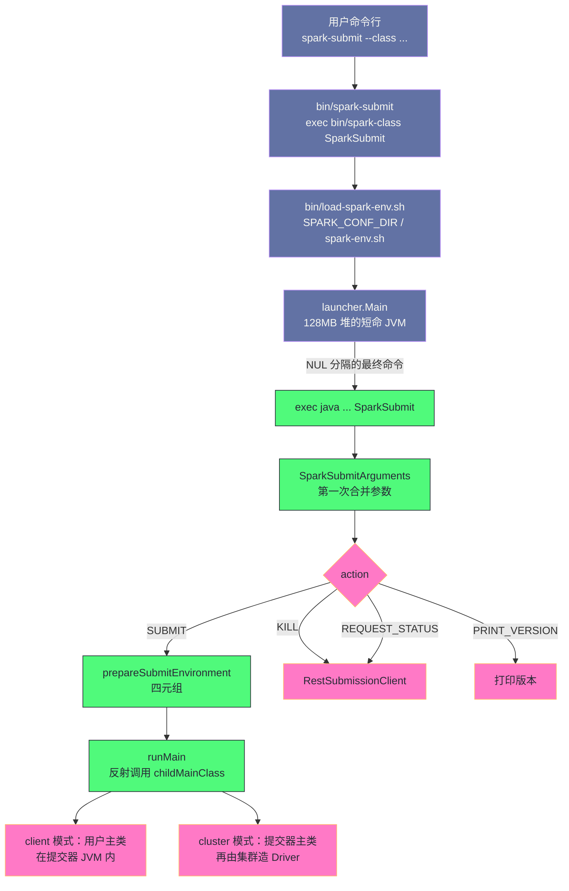
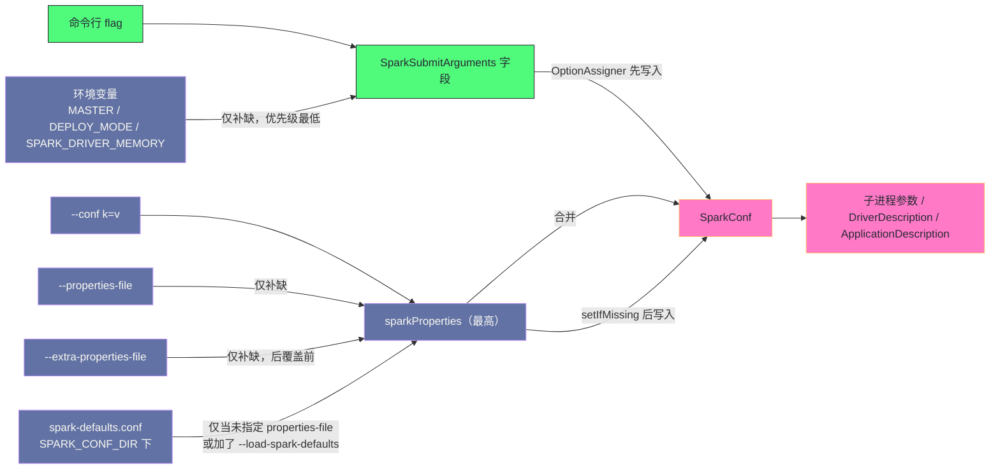
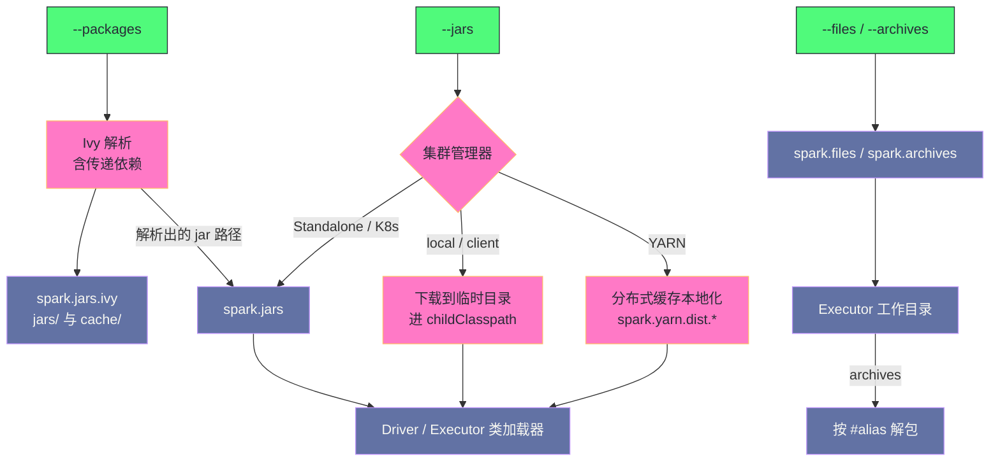
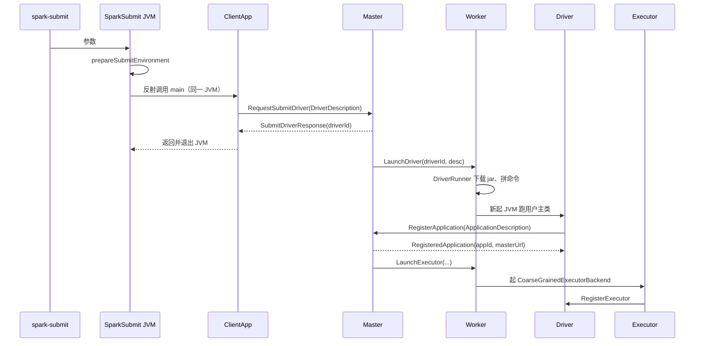
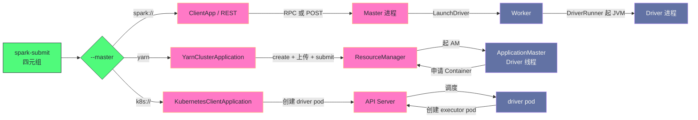

# 5. Spark Application 提交机制

**摘要：**

`spark-submit` 是 Spark 与外界之间唯一稳定的契约：用户敲下的那一串参数，要在几秒钟之内变成若干台机器上的进程、一个目录里的 jar、一份被反复解析的配置，以及一条发往集群管理器的消息。本文沿着这条链路走一遍：先说明那五行脚本之后为什么还叠着启动器、提交器与子主类三层，以及"两次参数解析"如何分工；再把 `SparkSubmitArguments` 的账本摊开，讲清 `--master`、`--deploy-mode`、`--class`、`--jars`、`--files`、`--archives`、`--conf` 各自落到哪个配置项或哪段子进程参数上，并给出命令行、属性文件、`spark-defaults.conf` 与环境变量之间的真实优先顺序（其中"配置文件压过环境变量"这一条与多数人的直觉相反）；随后拆解 `prepareSubmitEnvironment` 返回的四元组、两套位图掩码与 `childMainClass` 的四种取值；再把依赖分发的三条通道逐条对照；之后落到 `ApplicationDescription` 的字段与两条发给 Master 的消息，并对照 Standalone、YARN、Kubernetes 在"提交"这一层的差异；最后收在五类失败形态与六个反例上。全文回答两个问题：参数最终去了哪里，以及"cluster 模式下 SparkSubmit 进程变成 Driver"这句流传很广的话错在哪里。

---

## 第 1 章 一次提交要穿过几道门

### 1.1 五行脚本与它身后的四层

一个最常见的提交长这样：

```bash
bin/spark-submit \
  --class org.example.WordCount \
  --master yarn \
  --deploy-mode cluster \
  --jars hdfs:///libs/guava-33.3.1-jre.jar \
  --files hdfs:///conf/app.properties \
  --archives hdfs:///conf/pyenv.tar.gz#python-env \
  --conf spark.executor.memory=8g \
  hdfs:///apps/wordcount.jar \
  hdfs:///data/input
```

`bin/spark-submit` 这个脚本本身几乎没有逻辑，它定位 `SPARK_HOME`、把 `PYTHONHASHSEED` 固定为 0，然后一行 `exec` 把控制权交给 `bin/spark-class`，后者再以 `org.apache.spark.deploy.SparkSubmit` 为目标类启动 JVM。它不解析参数，不做校验，也不关心集群在哪一台机器上，因为这些事它做不了：一个 shell 脚本既没有反射，也没有 `Hadoop FileSystem`，更没有配置项的默认值表。

真正接下这串参数的，是四层结构。第一层是 `spark-class`：它负责环境，先 `source` 一遍 `bin/load-spark-env.sh`（这一步决定了 `SPARK_CONF_DIR` 与 `spark-env.sh` 的命运），再定位 `JAVA_HOME`、拼出包含 `jars/*` 的类路径、把 `SPARK_SUBMIT_OPTS` 之类的 JVM 选项塞进去。第二层是启动器 `org.apache.spark.launcher.Main`：一个只给 128MB 堆的短命 JVM，它唯一的产出是一条最终命令行。第三层是提交器 `org.apache.spark.deploy.SparkSubmit`：语义层，决定这次提交是提交、杀死还是查询，决定部署模式与集群管理器怎么组合，决定依赖往哪里放。第四层是子主类（childMainClass）：真正执行动作的类，在 client 模式下是用户自己的主类，在 cluster 模式下是某个集群管理器专用的提交器。

这四层不是一开始就有的。2014 年 2 月的 0.9.0 是一个分水岭：那个版本让 Standalone 集群第一次支持"把 Driver 提交到集群里运行，而不是跑在提交它的那台机器上"，实现入口是 `org.apache.spark.deploy.Client`。当 Driver 可以不在本机时，"提交"这件事就从"调用一个 main 方法"变成了"在远端造一个进程"，而造进程需要的知识（jar 在哪、环境变量是什么、启动命令怎么拼）必须由一个程序来持有，脚本承担不了。提交脚本收敛成统一的 `spark-submit`，正是这次语义变化的副产品。

### 1.2 启动器：为了一句拼得对的命令行

启动器存在的理由听起来很不"架构"：**为了拼对一条命令行**。

JVM 的启动参数是空格分隔的字符串数组，用户参数里却可能有空格、引号、通配符、换行、中文路径。用 shell 拼这条命令，会陷入无穷无尽的转义问题，Windows 上还要另写一套 `spark-class2.cmd`。Spark 的做法是把拼命令这件事搬进 Java：启动器按内部命令构建器（`SparkSubmitCommandBuilder` 与 `SparkClassCommandBuilder`）的规则算出完整的 `java` 命令行（包括 `-Xmx`、`-D` 系统属性、`-cp` 类路径、目标主类与全部参数），把这串参数以 NUL 字节分隔写到标准输出，再让 `spark-class` 用 `while IFS= read -d ''` 逐个读回数组，最后 `exec` 执行。

这个设计有三个可以观测到的后果。其一，`ps` 里永远看不到名为 `spark-submit` 的进程，只能看到 `java`，因为 `exec` 用目标进程替换了 shell 本身。其二，启动器把自身的退出码附在输出末尾，父脚本读完之后先检查退出码再决定是否 `exec`，于是"启动器失败"与"应用失败"在退出码上能分得开。其三，启动器对内存的处理是独占的：client 模式下 `-Xmx` 只由启动器计算，取值顺序是显式配置（含 `--driver-memory`）、属性文件、`SPARK_DRIVER_MEMORY` 环境变量、`SPARK_MEM` 环境变量，最后才是默认值；源码注释里还特意写明"不希望由用户在 `SPARK_SUBMIT_OPTS` 里写 `-Xmx`"，因为那会和 `--driver-memory` 打架。

把启动器想成机场的值机柜台比较容易理解它的位置：真正登机的是乘客（JVM 进程），但柜台决定了走哪个登机口、行李怎么挂、超重费怎么收；而机票上的目的地（cluster 还是 client）不归柜台管，那是下一层的事。

### 1.3 两次参数解析：JVM 怎么起，与应用怎么交

同一串参数会被解析两次，两次的视角不同。启动器关心的是"这台 JVM 该怎么起"：`--driver-memory` 变成 `-Xmx8g`，`--driver-java-options` 变成若干个 `-D`，`--driver-class-path` 变成类路径的一部分，`--conf spark.driver.extraJavaOptions` 同样被折进 `-D`。提交器关心的是"应用该怎么交"：`--executor-memory` 变成 `spark.executor.memory` 发给集群，`--num-executors` 变成 `spark.executor.instances`，`--queue` 变成 `spark.yarn.queue`。

两次解析之所以必要，是因为 cluster 模式把这个边界拉得很开：client 模式下 Driver 就是提交器这一台 JVM，`-Xmx` 当场生效；cluster 模式下 Driver 在远端，`-Xmx` 只能作为描述传给集群管理器，由后者在远端拼出一条新命令行。启动器管眼前这台 JVM，提交器管远方那个进程，两者的输入相同、关心点不同。

第一次解析也解释了 `spark-submit` 的一个常见困惑：为什么 `--driver-memory` 与 `--conf spark.driver.memory=2g` 同时出现时只有一个生效。它们在启动器里落进同一个配置键，源码的取值顺序把"显式配置"排在前面，而命令行 flag 被归入显式配置，于是 `--driver-memory` 赢。到了 JVM 内部，`spark.driver.memory` 又会被 `SparkSubmitArguments` 读一次，用于在 cluster 模式下拼 `DriverDescription`，此时它取的是合并后的值，两条路殊途同归。

### 1.4 四个动作，而不是一个

`SparkSubmitAction` 定义了四种动作：`SUBMIT`、`KILL`、`REQUEST_STATUS`、`PRINT_VERSION`。缺省是 `SUBMIT`，其余三个由 `--kill <submissionId>`、`--status <submissionId>`、`--version` 触发。`KILL` 与 `REQUEST_STATUS` 只在 Standalone 的 REST 网关或 legacy 网关上有效，实际调用的是 `RestSubmissionClient`；在 YARN 与 Kubernetes 上，杀死应用要用 `yarn application -kill` 或删除 driver pod，Spark 不会替你做这件事。

这个"动作少而集中"的设计有一处实用价值：四种动作共用同一套参数解析与校验，因此 `--verbose`、`--properties-file` 这些诊断手段在四个动作上行为一致。第 2 章会看到，正是这套共用的解析器把"参数从哪来"这个问题变得可回答。

下表把四层结构各自的输入与产物对齐，可以看出"谁决定什么"这条职责线其实很清楚。

| 层 | 承担者 | 输入 | 产物 |
|---|---|---|---|
| 脚本层 | `bin/spark-submit`、`bin/spark-class`、`bin/load-spark-env.sh` | 用户参数、`SPARK_HOME`、`SPARK_CONF_DIR` | 含 `spark-env.sh` 的进程环境、启动器命令行 |
| 启动器层 | `org.apache.spark.launcher.Main` | 上述参数 | 最终 `java` 命令（`-Xmx`、`-D`、`-cp`、主类） |
| 语义层 | `org.apache.spark.deploy.SparkSubmit` | 同一串参数 | 四元组（子参数、类路径、`SparkConf`、子主类） |
| 执行层 | `childMainClass` | 四元组 | 用户主类或集群提交器的 `main` |

下面这张图把一次提交经过的进程与类连起来，三类配色分别对应脚本层、语义层与分支层，其中语义层那三处正是后面四章要逐层拆开的地方。



图中最需要留意的是 `K` 这一层：名字叫 `runMain`、参数叫 `childArgs`、主类叫 `childMainClass`，但**并没有任何子进程被创建**。在 client 模式下，用户主类就是在提交器这个 JVM 里被反射调用的，所谓"child"是 Spark 1.x 之前的命名遗留；真正在远端被创建的新进程，只出现在 cluster 模式，而且不是由 `SparkSubmit` 直接 `fork`，是交给集群管理器去造的。第 5 章会把这处命名与事实的错位展开。

### 1.5 交互式工具：同一个入口的五个壳

Spark 发行版里的 `spark-shell`、`pyspark`、`sparkR`、`spark-sql`、`run-example` 都只是"壳"：它们不实现自己的提交逻辑，只把参数拼好再转手给 `spark-submit`。理解这一点，就等于理解了为什么在 shell 里遇到的启动问题与批作业遇到的问题遵循同一套规则。

| 工具 | 脚本里最关键的那一行 | 主资源 |
|---|---|---|
| `spark-shell` | `spark-submit --class org.apache.spark.repl.Main --name "Spark shell"` | 无，走内部类 |
| `pyspark` | `spark-submit pyspark-shell-main --name "PySparkShell"` | 特殊主资源名，被识别为 PySpark shell |
| `sparkR` | `spark-submit sparkr-shell-main` | 特殊主资源名 |
| `spark-sql` | `spark-submit --class org.apache.spark.sql.hive.thriftserver.SparkSQLCLIDriver` | 无，走内部类 |
| `run-example` | `spark-submit --master $EXAMPLE_MASTER --class $EXAMPLE_CLASS $SPARK_EXAMPLES_JAR` | 示例 jar |

表里 `pyspark` 与 `sparkR` 那两行的"特殊主资源名"值值得一提：`pyspark-shell-main`、`sparkr-shell-main` 并不是真实文件，而是提交器里约定的哨兵值，`isPython` / `isR` 一旦命中它们，主类就会被改写成对应的 runner，主资源则被当作"无需分发"。这套约定让交互式入口不必额外传一个脚本路径，代价是"主资源"这个概念在这两行里名不副实。

"同一个入口"还有一条硬边界：**cluster 模式不支持任何交互式工具**。`spark-shell`、`spark-sql`、Thrift Server 在 cluster 模式下的组合会被提交器直接拒绝，报错文本分别是"Cluster deploy mode is not applicable to Spark shells."与"...not applicable to Spark SQL shell."。理由很实际：交互式会话需要一个能随时读写的终端，而 cluster 模式下 Driver 在远端，标准输入输出根本连不回你的窗口。这条边界说明"统一入口"并不等于"统一能力"，入口统一之后，能力的边界仍要由部署模式来划。

---

## 第 2 章 参数解析：一本要摊开的账

### 2.1 七个参数各自的落点

`SparkSubmitArguments` 的构造函数在做四件事，顺序固定：先用 `parse` 把命令行读成字段，再用 `mergeDefaultSparkProperties` 把属性文件与 `spark-defaults.conf` 合进 `sparkProperties`，接着用 `ignoreNonSparkProperties` 剔除非 `spark.` 前缀的键，最后用 `loadEnvironmentArguments` 按"命令行 → 属性文件 → 环境变量"的顺序补齐缺失字段。这四步决定了下面这张表里每一行的去向。

| 参数 | 解析后落在 | 最终去向 |
|---|---|---|
| `--master` | `maybeMaster`，缺省回落到 `spark.master`、环境变量 `MASTER` | 写进 `spark.master`，并解码成集群管理器位 |
| `--deploy-mode` | `deployMode`，缺省取 `spark.submit.deployMode`、环境变量 `DEPLOY_MODE` | 决定启动器是否算 `-Xmx`、决定子主类 |
| `--class` | `mainClass`，未给时从主 jar 的清单读 `Main-Class` | client 模式直接作为主类；cluster 模式进子进程参数 |
| `--jars` | `jars`，缺省取 `spark.jars` | client 模式下载后进类路径；Standalone/K8s 写 `spark.jars`；YARN 走本地化 |
| `--files` | `files`，缺省取 `spark.files` | 写 `spark.files`，由 Executor 拉到工作目录 |
| `--archives` | `archives`，缺省取 `spark.archives` | 写 `spark.archives`，由 Executor 解包到工作目录 |
| `--conf` | `sparkProperties`（键值对） | 以 `setIfMissing` 并入 `SparkConf` |

这张表里最容易读错的是 `--conf` 那一行的"`setIfMissing`"。它不是"优先级最低"，恰恰相反：命令行 flag 在更早的一步里已经被 `OptionAssigner` 直接写进 `SparkConf`，等到 `--conf` 与属性文件的内容以 `setIfMissing` 补入时，同名的键已经存在，于是后到的被丢弃。因此 `--executor-memory 4g --conf spark.executor.memory=8g` 的结果是 4g，而不是 8g。**这条规则可以概括成一句话：命令行 flag 比 `--conf` 硬，`--conf` 比属性文件硬。**

`--class` 那一行还有一个常被忽略的能力：如果主 jar 的清单里写了 `Main-Class`，`--class` 可以省略。解析器会用 `JarInputStream` 打开主资源读清单，读不到就报 "No main class set in JAR; please specify one with --class."。这个能力在 client 模式下没有实际收益（反正要写类名更清楚），但在 cluster 模式下能省掉一次参数传递，因为主类名需要从提交机传到远端。

### 2.2 属性的三层合并

`mergeDefaultSparkProperties` 的实现值得逐句读一遍，因为它把"配置从哪来"这个问题回答得比官方文档更精确。第一步，把已经被 `--conf` 填好的 `sparkProperties` 克隆一份作为"不可覆盖集合"。第二步，读 `--properties-file` 指定的文件，只在键不存在时写入，因此 `--conf` 永远赢。第三步，若还给了 `--extra-properties-file`，按给出的顺序读，后读的覆盖先读的，但仍不覆盖 `--conf`。第四步，只有当没有给 `--properties-file`，或者显式加了 `--load-spark-defaults` 时，才去读 `spark-defaults.conf`。

第四步是 4.x 上一处不太显眼但会咬人的行为：一旦用了 `--properties-file`，`spark-defaults.conf` 就不再被读取。这个设计的初衷是让"我给了一份完整配置"成为一种可预期的语义，避免部署级的默认值悄悄混进来；代价是从 3.x 迁移过来、习惯"两者叠加"的作业会突然丢配置。`--load-spark-defaults` 就是为这类迁移准备的开关，官方文档明确写了它"即使在指定了 `--properties-file` 时也加载 `conf/spark-defaults.conf`"，且属性文件里的同名键优先。

### 2.3 环境变量与配置文件，谁压谁

多数人的直觉是环境变量更贴近现场，因此应当更优先。源码给出的顺序恰好相反。`loadEnvironmentArguments` 里每一个字段都是 `Option(命令行值).orElse(sparkProperties.get(键)).orElse(env.get(变量))` 的形状，也就是**命令行第一、配置文件第二、环境变量第三**。这意味着当 `spark-defaults.conf` 里写了 `spark.executor.memory=8g`，而 `spark-env.sh` 里 `export SPARK_EXECUTOR_MEMORY=2g` 时，生效的是 8g。官方文档那句"显式设置在 `SparkConf` 上的值优先级最高，其次是命令行 flag，再次是默认配置文件"只覆盖了前两段，第三段与"环境变量排在最后"这条补充，要读源码才看得到。

| 层级 | 具体来源 | 覆盖关系 | 典型用途 |
|---|---|---|---|
| 一 | 代码里的 `SparkConf.set` | 最高，`spark-submit` 无法覆盖 | 应用强绑定参数 |
| 二 | 命令行 flag（`--executor-memory` 等） | 覆盖同名 `--conf` 与文件项 | 本次作业的差异 |
| 三 | 命令行 `--conf k=v` | 覆盖属性文件与 `spark-defaults.conf` | 零散参数、试验性调整 |
| 四 | `--properties-file` 指定的文件 | 优先于 `spark-defaults.conf`；未加 `--load-spark-defaults` 时后者干脆不被读取 | 团队/项目级配置包 |
| 五 | `spark-defaults.conf` | 覆盖环境变量 | 部署级默认值 |
| 六 | 环境变量（`MASTER`、`DEPLOY_MODE`、`SPARK_DRIVER_MEMORY` 等） | 只补缺，不覆盖 | 机器级/容器级注入 |
| 七 | 代码内置默认值 | 兜底 | 框架行为 |

表里第二层压倒第三层这件事，还有一个反直觉的推论：`--conf` 不能用来覆盖 `--master`。因为 `spark.master` 是在 `OptionAssigner` 里由 `--master` 的值写入的，而 `--conf spark.master=...` 要等到后面的 `setIfMissing` 才尝试写入，此时键已存在。想换集群只能改 `--master`，或者在 `spark-defaults.conf` 里写 `spark.master` 并省略 `--master`。

### 2.4 `SPARK_CONF_DIR`：一个目录，两个消费者

`SPARK_CONF_DIR` 是这条链路上唯一同时被 shell 与 JVM 读取的环境变量，这个"一物两主"的结构是很多配置不一致问题的根源。

shell 侧的消费者是 `bin/load-spark-env.sh`：它先把 `SPARK_CONF_DIR` 设成 `${SPARK_CONF_DIR:-$SPARK_HOME/conf}`，再以 `set -a` 的方式 `source` 该目录下的 `spark-env.sh`，让脚本里所有变量自动变成导出变量，其中包括 `JAVA_HOME`、`SPARK_MASTER_IP`、`SPARK_WORKER_CORES`、`SPARK_DAEMON_MEMORY` 这些"进程怎么起"的参数。JVM 侧的消费者是 `Utils.getDefaultPropertiesFile`：它按同一个 `SPARK_CONF_DIR` 去找 `spark-defaults.conf`，供 `mergeDefaultSparkProperties` 读取。

两侧共享同一个目录，但读的是不同文件（`spark-env.sh` 对 `spark-defaults.conf`），因此有一个必须遵守的纪律：`spark-env.sh` 只在 shell 侧生效，写进去的 `export SPARK_EXECUTOR_MEMORY=2g` 只能通过环境变量这条最弱的通道进入 JVM，一旦 `spark-defaults.conf` 里出现同名键就会被压掉。反过来，在 `spark-env.sh` 里改 `SPARK_CONF_DIR` 也没有意义，因为 `load-spark-env.sh` 是先定目录再 `source` 的，改完之后 JVM 侧确实会看到新值，但 shell 侧已经用旧目录加载过一轮了。

还有一个细节值得记住：`spark-env.sh` 是用 `set -a` 载入的，因此它里面的变量会继承给后续 `exec` 出来的 JVM，包括提交器与 client 模式下的 Driver。这条继承链解释了为什么"在 `spark-env.sh` 里写 `export HADOOP_CONF_DIR=...`"能生效：`HADOOP_CONF_DIR` 不是 Spark 配置项，它在 `validateSubmitArguments` 里被检查（`--master yarn` 时要求它或 `YARN_CONF_DIR` 存在），然后由 Hadoop 客户端从进程环境里读走。

### 2.5 想看真相，加 `--verbose`

`--verbose` 会把两段东西打到日志里：一是 `SparkSubmitArguments.toString` 的完整字段快照（master、deployMode、内存、核数、jars、files、archives、packages、propertiesFile 等），二是 `sparkProperties` 的排序列表，其中敏感值会被 `Utils.redact` 脱敏。到了 `runMain` 还有一份更细的输出：子主类名、子参数、合并后的 `SparkConf` 全量、类路径元素。

诊断"参数去哪了"这个问题，`--verbose` 是唯一不需要读源码的入口。它输出的 `Main class:` 一行尤其有用，因为它是解析之后的子主类，能直接告诉你"我这次提交究竟被解释成了 client 还是 cluster、走的是 REST 还是 legacy"。

下面这张图把七个来源的汇入关系画出来，箭头旁的注释就是各自生效的条件，读图比读表更容易看出"谁只补缺、谁能覆盖"。



图中三条汇入 `SparkConf` 的箭头方向不同：`OptionAssigner` 是"先占位"，`setIfMissing` 是"只补空位"，环境变量则更早一步被折进字段。理解了这三条箭头的先后，"为什么我改的配置没生效"这类问题就能在三十秒内定位。

---

## 第 3 章 组装：四元组与两套位图

### 3.1 位图：把"集群管理器 × 部署模式"压成两个整数

`prepareSubmitEnvironment` 的第一件事是把字符串形式的 master 与 deploy mode 解码成整数。集群管理器用位图：`YARN = 1`、`STANDALONE = 2`、`LOCAL = 8`、`KUBERNETES = 16`，四者或起来就是全集；部署模式用另一套位图：`CLIENT = 1`、`CLUSTER = 2`。两套位图数值相同但语义空间不同，代码里靠上下文区分。

这里有一处笔者必须纠正的口径。很多笔记（不少旧笔记亦然）会写"Spark 支持 Standalone、Mesos、YARN 三种集群管理器"，并把 `MESOS = 4` 列进位图。4.x 的源码里已经没有这一位了：Mesos 支持在 4.0 被整体移除（`SPARK-44442`），随之消失的还有 `org.apache.spark.deploy.mesos` 包与 `--master mesos://` 分支。因此在 4.3.0 上讨论提交，集群管理器的全集是 Standalone、YARN、Kubernetes 三者，加上 `local` 与 `local-cluster` 两个调试用的伪集群。`local-cluster[N,C,M]` 值得单独提一句：它在同一个 JVM 里起 N 个 Worker、每个 C 核 M 兆内存，专门给单元测试用，是理解"提交流程"最便宜的环境——不需要 ZooKeeper，不需要 HDFS，也不需要容器运行时。

还有一处与部署模式相关的细节容易被忽略：`--deploy-mode` 除了决定 `childMainClass`，还会被写回 `spark.submit.deployMode` 传给 Driver，让远端的 `SparkContext` 知道自己是以哪种模式启动的。Kubernetes 上这一项更绕一层：当 `spark.kubernetes.submitInDriver=true` 时，Driver 容器里会再跑一次 `spark-submit`，而那一轮的部署模式是 client——因为对它来说 Driver 已经在本地了。源码里为此专门识别了"K8s cluster 模式下的 driver 进程"，否则 `--proxy-user` 的处理路径会走进错误分支。

### 3.2 `OptionAssigner`：一张被掩码过滤的映射表

解码之后，`prepareSubmitEnvironment` 会遍历一张 `OptionAssigner` 列表，对每一项做同一个判断：

```scala
if (opt.value != null &&
    (deployMode & opt.deployMode) != 0 &&
    (clusterManager & opt.clusterManager) != 0) {
  // 写子进程参数，或写 SparkConf
}
```

也就是说，每个参数都携带"我在哪些集群管理器上、在哪些部署模式下有效"两个掩码，不匹配就被静默跳过。这解释了几个长期被误认为"文档没写清"的现象。

| 参数 | 掩码 | 影响 |
|---|---|---|
| `--num-executors` | 仅 YARN、Kubernetes | Standalone 上给了也不报错，只是不生效 |
| `--total-executor-cores` | 仅 Standalone | 在 YARN 上被忽略 |
| `--executor-cores` | Standalone、YARN、Kubernetes | 默认值由各后端自定：Standalone 吃满 Worker，YARN/K8s 默认 1 |
| `--supervise` | 仅 Standalone + CLUSTER | 其他组合下静默失效 |
| `--driver-cores` | Standalone、YARN、Kubernetes + CLUSTER | client 模式下无意义，因为没有远端 Driver 可分配 |

"静默跳过"是这套设计里最容易被吐槽的地方，但它的动机是合理的：同一条命令要在多套环境里跑（开发用 `local[*]`、测试用 Standalone、生产用 YARN），如果每遇到一个不适用的参数就报错，作业脚本就得按环境分叉。掩码的代价是"参数给了但没生效"这件事只能靠 `--verbose` 或读源码发现，这也是笔者建议在动手排查提交问题之前先读一遍 `OptionAssigner` 表的原因。

### 3.3 四元组：把决定收束成四个返回值

遍历掩码表之后，`prepareSubmitEnvironment` 返回一个四元组：`(childArgs, childClasspath, sparkConf, childMainClass)`，分别对应"子进程参数""子进程类路径""合并后的配置""子进程主类"。函数注释里还留了一句"exposed for testing"，说明这个边界是Spark 自己测试用的稳定切口，也因此成了外部理解提交机制最好的观察点。

`childMainClass` 的取值由部署模式与集群管理器共同决定，四种组合对应四个值。

| 组合 | `childMainClass` | 说明 |
|---|---|---|
| 任意 + CLIENT | 用户主类 | 在提交器 JVM 内反射调用，Driver 即本进程 |
| Standalone + CLUSTER | `org.apache.spark.deploy.ClientApp` | 默认走 legacy RPC 网关 |
| Standalone + CLUSTER，且 `spark.master.rest.enabled=true` | `RestSubmissionClientApp` | 走 REST 网关，端口通常是 6066 |
| YARN + CLUSTER | `org.apache.spark.deploy.yarn.YarnClusterApplication` | 在提交器内直接跑 YARN 客户端逻辑 |
| Kubernetes + CLUSTER | `org.apache.spark.deploy.k8s.submit.KubernetesClientApplication` | 在提交器内调用 API Server |

表里第二、三行有一处与流行说法不一致的地方。不少资料写"Standalone 的 cluster 模式自 1.3 起默认走 REST"，但 4.x 源码里 `useRest` 的取值是 `sparkProperties.getOrElse("spark.master.rest.enabled", "false")`，**缺省为 false**，因此默认走的是 legacy 的 `ClientApp`；只有在显式打开该配置后，才由 `RestSubmissionClientApp` 接管。历史上确实出现过"默认 REST、连不上就回落到 legacy"的设计，`submit` 方法里至今保留着捕获 `SubmitRestConnectionException` 后把 `useRest` 置 false 再重试的分支，但那条分支要等 `useRest` 为真才会被走到。旧口径与 4.x 行为的差异，正是"版本敏感"这四个字的具体含义。

### 3.4 类路径：先父后子，且可翻转

`runMain` 拿到四元组之后，第一件事是造一个类加载器：

```scala
val loader =
  if (sparkConf.get(DRIVER_USER_CLASS_PATH_FIRST)) {
    new ChildFirstURLClassLoader(new Array[URL](0),
      Thread.currentThread.getContextClassLoader)
  } else {
    new MutableURLClassLoader(new Array[URL](0),
      Thread.currentThread.getContextClassLoader)
  }
```

默认是 `MutableURLClassLoader`，即**父优先**：Spark 自带的 jar 与 `spark-class` 拼好的 `jars/*` 先被查到，`childClasspath` 里追加的用户 jar 排在后面。`spark.driver.userClassPathFirst=true` 会被换成 `ChildFirstURLClassLoader`，让用户 jar 优先。这个开关的存在本身就是对"依赖冲突"的承认：父优先意味着用户带的 guava、jackson、netty 会被 Spark 自己的版本遮盖；翻转之后用户版本赢，但 Spark 内部的代码可能反过来被用户的版本破坏。第 7 章会把这条利弊拆开讲。

`childClasspath` 里的元素是逐个 `addJarToClasspath` 进去的，而不是拼成一个字符串，这一点很小但很关键：它意味着 `--jars` 里的每个 jar 都是独立的 URL 条目，JDK 的类加载器会按条目顺序查找，因此"jar 的先后"在类路径层面是有意义的，这也是 `--driver-class-path` 与 `--jars` 同时存在时会出现"同名类不同版本"的原因之一。

---

## 第 4 章 依赖：三条通道，三种命运

### 4.1 第一条通道：`--jars` 进类路径

用户代码依赖的第三方 jar 走 `--jars`，逗号分隔，不支持目录展开（官方文档明确写了 "Directory expansion does not work with --jars"）。它在这一层的行为随集群管理器变化，这是整篇里最需要按环境区分的一段。

在 `local` 与 client 模式下，提交器会先用 `downloadFile` / `downloadFileList` 把远端 URL 拉到本地临时目录，再把本地路径塞进 `childClasspath`，随后由 `addJarToClasspath` 加进类加载器。在 Standalone 与 Kubernetes 上（两种部署模式都算），`--jars` 被 `OptionAssigner` 写进 `spark.jars`，由后面的 `SparkContext` 依次 `addJar` 到 Driver 与 Executor，Executor 侧的 jar 会被下载到各自的工作目录。在 YARN 上，`--jars` 不进 `spark.jars` 这条主路，而是被写进 `spark.yarn.dist.jars`，交给 YARN 的分布式缓存做本地化；同时源码里有一段专门处理："若是 YARN client 模式，因为前面已经把远端资源下载到本地，这里只需要把本地路径替换回原值"，避免下载两次。

`--jars` 最容易出的错是路径可见性。主 jar 与 `--jars` 的 URL 必须"在集群内全局可见"，这是官方文档的原话：可以是 `hdfs://`，可以是所有节点上都存在的 `file://`，也可以是 `local://`（每个 Worker 上同一路径存在，常见于 NFS 或预置目录）。用提交机上独有的 `file:///home/me/app.jar`，在 client 模式下能跑（因为只有本机需要它），一旦换成 cluster 模式就会在 Driver 启动时报找不到 jar——而报错发生在远端日志里，提交机这一侧往往只看到"应用已提交"。

### 4.2 第二条通道：`--files` 与 `--archives` 进工作目录

`--files` 分发的不是类路径，而是**文件**：它们会被放到每个 Executor 的工作目录下，用 `SparkFiles.get(fileName)` 取绝对路径。`--archives` 分发的也不是文件，而是**压缩包**：会被解包到工作目录，落名可以用 `#alias` 指定，例如 `hdfs:///conf/pyenv.tar.gz#python-env` 解出来的目录就叫 `python-env`。

两个参数在 YARN 上的落点也与 `--jars` 同构：分别写进 `spark.yarn.dist.files` 与 `spark.yarn.dist.archives`，由分布式缓存分发而不是由 Driver 端逐个推送。

这两者的语义差异经常被混淆。把 tar.gz 写进 `--files`，得到的是一个躺在工作目录里的压缩包，不会自动解开；把单个配置文件写进 `--archives`，得到的是一个"解包失败或解出一堆同名文件"的诡异目录。判据很简单：**要在运行时按路径读的，用 `--files`；要当目录树用的（Python 虚拟环境、R 包、配置目录），用 `--archives`。**

Kubernetes 的 cluster 模式在这里有一处实现上的补偿：driver 跑在集群里，如果 `--files` 只在 Executor 侧落地，driver 就读不到自己的配置文件，所以源码里有一段把 files、jars、archives、pyFiles 统统下载到 driver 当前工作目录的逻辑，并把 `.` 加进类路径，落名同样尊重 `#alias`。这段逻辑后来加了开关（`spark.kubernetes.*` 下控制是否绕过下载），原因是资源很大而 Executor 很多时，让每个 Executor 都从 driver 拉一遍会把 driver 的网络打满，干脆让 Executor 直接从远端 URL 拉。

清理是这条通道的长期成本。官方文档写得很直白：jar 与文件会被复制到每个 Executor 节点上每个 `SparkContext` 的工作目录，时间长了会占掉可观的磁盘；YARN 上由框架自动清理，Standalone 上要靠 `spark.worker.cleanup.appDataTtl` 配置自动清理。

### 4.3 第三条通道：`--packages` 走 Ivy 与本地仓库

`--packages` 接受的是 Maven 坐标（`groupId:artifactId:version`，多段用逗号分隔），它不解压、不落地到工作目录，而是在提交端用 Ivy 做一次依赖解析，把传递依赖一并拉下来，再把解析出的 jar 路径合并进 `spark.jars`。

解析入口是 `DependencyUtils.resolveMavenDependencies(packagesTransitive = true, exclusions, packages, repositories, ivyRepoPath, ivySettingsPath)`。参数含义很直白：`packagesTransitive=true` 表示拉传递依赖，`exclusions` 对应 `--exclude-packages`（形如 `groupId:artifactId`，用于排除与 Spark 自带版本冲突的传递依赖），`repositories` 对应 `--repositories`（额外的仓库地址），`ivyRepoPath` 与 `ivySettingsPath` 分别对应 `spark.jars.ivy` 与 `spark.jars.ivySettings`。

本地仓库的布局是理解这条通道的关键。`spark.jars.ivy` 缺省指向用户主目录下的 `.ivy2`，解析出来的 jar 副本会放到其下的 `jars` 目录（文件名形如 `com.google.guava_guava-33.3.1-jre.jar`），而 Ivy 的元数据缓存留在 `cache` 目录。两个目录的分工带来两个实用推论。其一，同一个坐标第二次提交时不会重新下载，因为 jar 副本已经在 `jars` 里，这就是"第一次提交很慢、后面很快"的原因；其二，如果换了一个用户（提交机上的账号变了、容器里的 `HOME` 变了），本地仓库就是另一个，于是"昨天还好好的作业今天又开始下载"。

`--packages` 还有一处随集群管理器变化的边界：Standalone 的 cluster 模式会**跳过**提交端的解析（`if (!isStandAloneCluster)` 这个判断），把坐标原样交给 Driver，让 Driver 在自己那边解析。判断的依据也在映射表里：`spark.jars.ivy` 这个配置只对 Standalone + CLUSTER 组合生效，正是为了让远端 Driver 知道仓库在哪。这条设计的理由是"Standalone 的 Driver 跑在 Worker 上，提交机上解析出来的本地路径对 Worker 没有意义"，代价是依赖解析的错误会在 Driver 侧才暴露，提交机这一层看不到。

### 4.4 Python 与 R 的提交旁路

Python 与 R 应用把主资源换成了脚本文件而不是 jar，提交器对它们有一套并行的处理，这套处理值得单独看，因为它说明"三条通道"真正的划分依据是"进 classpath"还是"进工作目录"，语言只决定谁来消费。

在 client 模式下，`primaryResource` 是一个 `.py` 文件，`mainClass` 会被改写成 `org.apache.spark.deploy.PythonRunner`，主文件路径与 `--py-files` 一起被塞进子参数；`--py-files` 还会被合进 `spark.files`（YARN 除外，因为 YARN 对 Python 文件有一套独立的分发逻辑），并写入 `spark.submit.pyFiles` 供 Executor 侧设置 `PYTHONPATH`。到了 cluster 模式，YARN 的子参数换成 `--primary-py-file`，同时给配置打上 `spark.yarn.isPython=true` 的标记，让 YARN 侧知道要多分发一套 Python 库。

这条旁路上有一处硬边界：Standalone 的 cluster 模式不支持 Python 应用，也不支持 R 应用，提交端会直接报错退出（"Cluster deploy mode is currently not supported for python applications on standalone clusters"）。原因是 Standalone 的 Driver 由 Worker 起，而 Worker 端的启动命令里没有安排 Python 解释器的位置。这个理由与"Standalone 不支持 Kerberos 的 `--principal`/`--keytab`"属于同一类：原生集群管理器只实现了最小可用的提交协议，复杂能力留给 YARN 与 Kubernetes。

对 Python 依赖来说，通道选择还有一层现实约束：`.py` 直接分发不打包，`.zip` 与 `.egg` 则把整个依赖树压成一个文件再进 `PYTHONPATH`。多个零散 `.py` 会让工作目录里堆满文件且容易重名，因此官方建议依赖多时打包成 zip 或 egg，这与 Java 侧"主 jar 要打 uber jar"是同一条经验的两种语言版本。

### 4.5 三条通道的边界对照

| 维度 | `--jars` | `--files` / `--archives` | `--packages` |
|---|---|---|---|
| 谁解析 | 提交器解析 URL | 提交器解析 URL | 提交器用 Ivy 解析坐标 |
| 放在哪里 | 类路径（client 临时目录、Executor 工作目录） | Executor 工作目录；archives 会解包 | 本地 Ivy 仓库，路径并入 `spark.jars` |
| 谁可见 | Driver 与 Executor 的类加载器 | 只有拿到路径的代码可见 | 同 `--jars` |
| 生效时机 | 类加载时 | 任务运行时按路径读 | 类加载时 |
| 典型失效 | 路径在集群内不可见、类冲突 | 压缩包放错通道、落名不含 `#alias` | 坐标写错、仓库不可达、传递依赖冲突 |

三条通道之外还有一层"URL 方案"的语义，值得单列：`file:` 由 Driver 的 HTTP 文件服务器分发，Executor 从 Driver 拉；`hdfs:`、`http:`、`https:`、`ftp:` 按协议直接下载；`local:` 表示每个 Worker 上本来就有这个文件，不产生网络 IO，适合大 jar 或 NFS 共享。这四种方案与三条通道是正交的——`--jars` 可以用 `local:`，`--files` 也可以用 `hdfs:`，选错方案不会报"参数错误"，只会在运行时表现为"下载慢"或"文件不存在"。

下面这张图把三条通道从参数入口到落地位置连起来，可以看到只有 `--packages` 会引入"外部仓库"这个第三方依赖。


---

## 第 5 章 描述：从子进程参数到 Master 的两次投递

### 5.1 `runMain`：四元组交出去之后

`runMain` 的前两行就是把四元组接住，然后做三件事：造类加载器、把 `childClasspath` 逐个加进去、用 `Utils.classForName` 加载子主类。加载失败的两条路径被分开处理：`ClassNotFoundException` 打一行 `Failed to load class <名字>.`，紧跟着再抛一个带 `CLASS_NOT_FOUND` 退出码的应用异常；`NoClassDefFoundError` 则额外判断消息里是否含 `org/apache/hadoop/hive`，若是就提示"这份 Spark 可能没有编译 Hive 支持"。仓库里那类"提交之后立刻退出、日志只有三行"的现象，多半停在这一步。

加载成功之后还有一层分派：如果子主类实现了 `SparkApplication` 接口，就反射无参构造并调用 `start(childArgs, sparkConf)`；否则包一层 `JavaMainApplication`，用 `getMethod("main", Array[String])` 找静态 main 再 `invoke`。这一层抽象的用意是让 Spark 自己的提交器（`ClientApp`、`YarnClusterApplication`、`KubernetesClientApplication`）能拿到结构化的参数表与配置对象，而普通用户主类只拿到字符串数组与一份被忽略的 `SparkConf`——后者在用户代码里通常又从 `SparkSession.builder` 重新读环境。**同一个入口，两种契约**，这是 Spark 在兼容性上做的妥协：不能要求所有用户主类都实现 `SparkApplication`。

### 5.2 一个 JVM，两次 main：cluster 模式的真相

"cluster 模式下 `SparkSubmit` 进程会变成 Driver"这句话是流传最广的一处误解，它把两个不同的进程混成了一个。实际发生的顺序是：

第一段，提交机上 `SparkSubmit.main` 起来，解析参数、组装四元组，然后通过反射调用提交器主类的 main。注意这一步仍然在同一个 JVM 里，没有 `fork`，也没有 `ProcessBuilder`。第二段，提交器主类开始与集群管理器打交道，把应用描述发出去，发完之后这个 JVM 就退出了。第三段，集群管理器在远端造出 Driver，那是另一个进程，与提交机上的 JVM 没有任何父子关系。

于是"提交进程变成 Driver"只在 client 模式下成立：client 模式下 `childMainClass` 就是用户主类，它被反射调用时所在的 JVM 就是提交器 JVM，`SparkContext` 在这个 JVM 里创建，Driver 自然就是它。cluster 模式下提交器进程的使命在"消息发出"那一刻就结束了，剩下的生命周期属于远端。

远端那个 Driver 以什么形态存在，三套集群的答案完全不同，这也是第 6 章要对照的核心：

| 集群 | Driver 的载体 | 谁创建 | 依赖怎么到那儿 |
|---|---|---|---|
| Standalone | Worker 上的一个独立 JVM | `DriverRunner` 用 `ProcessBuilder` 起 | `DriverRunner` 先从 `jarUrl` 下载主 jar |
| YARN | ApplicationMaster 进程里的一个用户线程 | ResourceManager 起的 AM | 资源已上传到 staging 目录，由分布式缓存本地化 |
| Kubernetes | driver pod 里的一个容器进程 | 提交器调用 API Server | 镜像内预置，或从远端 URL 拉 |

把这三行并排看，"cluster 模式"这个词其实覆盖了三种截然不同的实现：**线程、进程、容器**。它们的共同点只有一个——Driver 不在提交机上；而"Driver 与提交进程同生共死"这件事，只在 client 模式成立。

### 5.3 `ApplicationDescription`：应用要什么

`ApplicationDescription` 是应用向 Master 自我介绍的那份单据，字段不多但每个都对应一个配置项或一次计算。

| 字段 | 内容 | 来源 |
|---|---|---|
| `name` | 应用名 | `--name`、`spark.app.name`，缺省取主类名或主资源文件名 |
| `maxCores` | 应用可占用的总核数上限 | `spark.cores.max`，Standalone 专用 |
| `memoryPerExecutorMB` | 每个 Executor 的内存 | `spark.executor.memory` |
| `coresPerExecutor` | 每个 Executor 占几个核 | `spark.executor.cores`，缺省吃满 |
| `command` | 启动 Executor 的命令 | 由 Driver 侧的环境与类路径拼出 |
| `proxyUser` | 代理用户 | `--proxy-user` |
| `resourceReqs` | 资源画像（GPU 等） | `spark.executor.resource.*` |

有三样东西不在这份单据里，而恰恰是新手最想在里头找到的。其一是主 jar 的 URL：它在 `Command` 的类路径与参数里，因为"怎么启动"和"要多少资源"是两件事。其二是 Executor 的个数：Standalone 不预先约定个数，Master 按"尽量铺开"或"尽量集中"的策略，在 `maxCores` 与 `coresPerExecutor` 的约束下自己算。其三是队列：队列是 YARN 的概念，Standalone 的 Master 没有队列，自然也不会在单据里出现。

Standalone 侧的资源计算值得补充一句，因为它解释了"为什么单据里没有 Executor 个数"。Master 的调度按 `spark.deploy.spreadOut`（缺省为 true）分两种策略：铺开模式尽量把 Executor 分到更多 Worker 上，集中模式则优先塞满已有 Worker。两种策略都在 `maxCores` 与 `coresPerExecutor` 的约束下计算"每个 Worker 分几个 Executor、每个 Executor 用几个核"，因此 Executor 的总数是算出来的结果而不是输入。这也意味着在 Standalone 上指望"精确控制 Executor 数量"是徒劳的：能控的只有 `spark.cores.max` 与 `spark.executor.cores` 两个上界，剩下的交给调度策略。

### 5.4 `Command`：把环境固化成一行命令

`Command` 的结构是 `javaHome`、`mainClass`、`arguments`、`javaOpts`、`classPathEntries`、`libraryPathEntries`、`environment` 七项。前六项都直观，第七项值得单独说：`environment` 是**Driver 进程启动那一刻的环境变量快照**。

这份快照解释了一个经常被误判的现象。在 `spark-env.sh` 里写了 `export HADOOP_CONF_DIR=/etc/hadoop/conf`，提交时它被载入提交器进程，进而被写进 `Command.environment`；Executor 启动时拿到的就是这份快照，而不是 Worker 节点自己的环境。于是"在 Worker 上改 `/etc/profile` 里的变量"对已经提交的应用没有任何影响，因为那个变量从一开始就不在快照里。反过来，"在 `spark-env.sh` 里加一个变量然后重启提交"是生效的，因为快照是在提交时拍的。

`javaOpts` 与 `classPathEntries` 同理：它们是把 Driver 侧的决定"冻结"成字符串，交给一个不一定与自己同构的远端环境去执行。这也解释了为什么 `Command` 里存的是 `javaHome` 而不是"用 PATH 里的 java"——远端机器的 PATH 不可信，只有显式路径才可预期。

### 5.5 两次投递：`RequestSubmitDriver` 与 `RegisterApplication`

cluster 模式下，应用名要经过两次投递才能从"用户命令行"变成"Master 里的一条 ApplicationInfo"。

第一次投递发生在提交器与 Master 之间，携带的是 `DriverDescription`（`jarUrl`、`mem`、`cores`、`supervise`、`command`），消息名是 `RequestSubmitDriver`；走 REST 网关时换成一个 `POST /v1/submissions/create`，返回 `submissionId` 与 `driverState`。这一次投递的语义是"请帮我造一个 Driver"，此时 Master 还不知道这个应用叫什么、要多少 Executor。

第二次投递发生在 Driver 内部。Driver 起来后创建 `SparkContext`，在创建 `StandaloneSchedulerBackend` 时构造出 `ApplicationDescription`，再由 `StandaloneAppClient` 的 `ClientEndpoint` 向 Master 发 `RegisterApplication(applicationDescription, self)`；Master 回 `RegisteredApplication(appId, masterUrl)`，随即调用 `schedule()` 开始分配 Executor。这一次投递的语义才是"我到了，按这份单据给我资源"。

| 维度 | 第一次投递 | 第二次投递 |
|---|---|---|
| 发起者 | 提交器（`ClientApp` 或 REST 客户端） | Driver 内的 `StandaloneAppClient` |
| 消息 | `RequestSubmitDriver(DriverDescription)` | `RegisterApplication(ApplicationDescription, endpoint)` |
| 载体 | 主 jar 的 URL、Driver 内存/核数、启动命令 | 应用名、总核数、单 Executor 内存、Executor 启动命令 |
| 失败后果 | Driver 造不出来，应用从未存在 | Driver 已占用资源，注册失败则应用挂在 `WAITING` |

两跳之间隔着"Driver 进程启动"这段不可控的时间，因此**提交成功不等于注册成功**：提交器打印 `Driver successfully submitted as driver-2026...` 之后退出，如果 Driver 起不来（jar 下不到、内存不够、端口冲突），Master 那边只会看到一次 `DriverStateChanged` 到 `ERROR`，而提交机的日志早就结束了。这类问题的排查只能去 Master 日志或 Worker 的 `work/app-*/` 目录里找。

下面这张时序图把两次投递与三次进程的关系画在一起，注意 `SparkSubmit` 与 `ClientApp` 在同一个 JVM 里，而 `Driver` 是远端的新进程。



图中 `C-->>S: 返回并退出 JVM` 这一行是整条链路的分水岭：在此之前，一切都在提交机上；在此之后，一切都在集群里。理解这条分界线，就不会再把"提交器的日志"当成"应用的日志"去读。

---

## 第 6 章 三套集群，三种提交面貌

### 6.1 Standalone：两扇门，一道硬约束

Standalone 的提交目标是一个常驻的 Master 进程，默认端口 7077。门有两扇：legacy 的 RPC 网关（`ClientApp`，4.x 默认）与 REST 网关（`RestSubmissionClientApp`，需要 `spark.master.rest.enabled=true`，端口通常 6066）。两扇门做的是同一件事——把 `DriverDescription` 送进 Master 的 `waitingDrivers` 列表，等待 `schedule()` 找到有空闲资源的 Worker。

Standalone 在提交层最硬的约束是**主 jar 必须集群可见**。因为 Driver 是 Worker 起的，Worker 需要自己去拿 jar，它不认识提交机的文件系统。可选方案只有三种：`hdfs://`、所有节点都存在的 `file://`、每个 Worker 上同路径的 `local://`。这条约束的代价是"提交前必须先上传"，收益是"提交机可以随时下线"——一旦 Driver 在集群里跑起来，提交机的存在与否就不再重要，这也是 `--deploy-mode cluster` 的原始动机。

`--supervise` 是 Standalone 独有的一项能力：Driver 以非零码退出时，Worker 会把它重新拉起来。它的语义是"重启 Driver 进程"，不是"恢复应用状态"，所以对需要精确一次语义的作业并没有帮助，反而可能让一个必然失败的作业反复重启。

### 6.2 YARN：提交是三步握手

YARN 的提交没有"Master 进程"可打，它是一串对 ResourceManager 的操作：先在 RM 上 `createApplication` 拿到 application id，再把主 jar、`--files`、`--archives`、`spark.yarn.dist.*` 指定的资源上传到 staging 目录（通常是 HDFS 上的一个临时路径），最后 `submitApplication` 请 RM 起 ApplicationMaster。

AM 起来之后，用户主类在 AM 进程里被调用——**Driver 是 AM 里的一个线程**，而不是一个新进程。这个细节解释了 YARN 上几个典型现象：Driver 的日志与 AM 的日志在同一份 `container_..._000001` 日志里；`--driver-memory` 影响的是 AM 容器的内存，因此它必须小于 NodeManager 允许的单容器上限；`spark.yarn.submit.waitAppCompletion` 决定提交器是否留在前台等应用结束（缺省等），所以"提交命令卡住不动"在 YARN cluster 模式下是正常现象。

在依赖分发上，YARN 走的是分布式缓存：`--jars`、`--files`、`--archives` 都先上传到 staging，再由每个容器本地化。源码里那段"forceDownloadSchemes"的逻辑就是为这件事准备的——某些 URL 方案（譬如对象存储的自定义 scheme）Hadoop 的 FileSystem 不认识，必须先下载到本地再进分布式缓存。

### 6.3 Kubernetes：提交是创建对象

Kubernetes 的提交最不像"提交"：`KubernetesClientApplication` 通过 API Server 创建一批对象（driver pod、可选的 service、config map），把 driver 镜像、命令、环境变量、挂载写进 pod spec，然后要么留在前台观察 pod 状态（`spark.kubernetes.submission.waitAppCompletion` 缺省为 true），要么建完就走。

Driver 是 driver pod 里的容器进程，Executor 是后续创建的 executor pod。这里没有中心化的"Master 进程"参与调度，资源分配交给 kube-scheduler，Spark 只负责"声明我要什么"。因此提交层的失败形态也变了：不是"连不上 Master"，而是 `pods is forbidden`（RBAC 不足）、`ImagePullBackOff`（镜像拉不到）、`Pending`（资源或配额不足）。依赖分发的重心也从"本地化"移到了"镜像里有没有"：`--jars` 仍然可用，但生产上更常见的做法是把依赖烘进镜像，因为每次提交都从远端拉几十兆 jar 会拖慢 driver pod 的启动。

### 6.4 提交层对照

| 维度 | Standalone | YARN | Kubernetes |
|---|---|---|---|
| 提交目标 | Master 进程（7077/6066） | ResourceManager | API Server |
| 第一跳 | `RequestSubmitDriver` 或 REST POST | `createApplication` + 上传 + `submitApplication` | 创建 driver pod |
| Driver 载体 | Worker 上的独立 JVM | AM 里的用户线程 | driver pod 里的容器进程 |
| 资源单元 | Executor 进程占用的核与内存 | Container | Pod |
| 依赖落点 | 集群可见 URL，Worker 下载 | staging 目录 + 分布式缓存 | 镜像为主，URL 为辅 |
| 提交器是否常驻 | 否（发完即退） | 取决于 `waitAppCompletion` | 取决于 `waitAppCompletion` |
| 典型提交失败 | 连不上 Master、jar 不可见 | 队列无权限、staging 写不了 | RBAC、镜像、配额 |

下面这张图把三条提交路径并排画出，三者的分岔点只有一处——`--master` 的字符串匹配，而分岔之后连"失败"的含义都不再相同。



图中三条分支的分岔点在 `--master` 的字符串匹配上，而分岔之后的路由完全不同：Standalone 是一次 RPC 到一个已知进程，YARN 是一串对 RM 的异步操作加一次资源协商，Kubernetes 是若干次声明式对象创建。同样是"提交一个 Spark 应用"，底下的语义差别大到连"失败"的含义都不一样。

---

## 第 7 章 五类失败形态

### 7.1 类找不到：三种根因，一种报错

最典型的报错是 `Failed to load class <名字>.` 加一个 `CLASS_NOT_FOUND` 退出码。它有三个根因，而报错文本完全相同。

其一是 `--class` 拼错，包括包名写全、类名大小写、以及把 object 的伴生类名写成了 `WordCount$`。其二是主 jar 在集群内不可见，Driver 或 Executor 下载不到那个 jar，于是类加载器里根本没有这个类。其三是依赖没被带进去：主类在主 jar 里，但它 `implements` 的某个接口在 `--jars` 里没给，此时报的可能是 `NoClassDefFoundError` 而不是 `ClassNotFoundException`，两者的区别只在"类是否存在"与"类能否被初始化"。

区分三者的办法是看报错发生在哪一侧。提交机上报 `Failed to load class`，说明子主类（用户主类或提交器）本身没加载上，根因在一二之间；Driver 日志里报，说明主类加载上了但它的依赖缺，根因在第三；Executor 日志里报 `NoClassDefFoundError`，说明任务闭包里引用了没分发到的类。这三种位置对应三份不同的日志，混着看会得出错误结论。

### 7.2 依赖冲突：类路径顺序的代价

依赖冲突的典型形态是提交成功、任务跑到一半抛 `NoSuchMethodError` 或 `AbstractMethodError`。它的成因不是"缺类"，而是"同名类被加载了错误版本"：类加载器默认父优先，Spark 自带的 guava、jackson、netty 会先被查到，用户 jar 里的新版本永远排在后面。

处置方式有三条，代价各不相同。最干净的是把冲突依赖排掉，譬如用 `--exclude-packages` 剔掉传递依赖，或改用与 Spark 自带版本兼容的版本，代价是可能要降级业务库。其次是 `spark.driver.userClassPathFirst=true` 与 `spark.executor.userClassPathFirst=true`，把加载顺序翻过来，代价是 Spark 内部的代码开始使用用户版本，可能出现"修好一处、坏掉另一处"。第三条是重定位（shade 打包时把包名改掉），代价是构建复杂度上升。

这三条里，第二条最容易被当作"银弹"，因为它一行配置就能翻盘，但它同时把"被破坏的那一侧"从用户代码换成了 Spark 自身。**这不是一个可以靠调参解决的顺序问题，而是一个必须靠打包纪律解决的边界问题**：能进 cluster 的第三方库，版本应当先与 Spark 的依赖树对齐。

### 7.3 master URL：三种错法

`--master` 的错误分三类，报错位置完全不同。

第一类是方案名不在白名单里。解码逻辑匹配的是 `yarn`、以 `spark` 开头、Kubernetes 的 `k8s://`、以 `local` 开头，其余一律落到 `error("Master must either be yarn or start with spark, k8s, or local")`。注意这句报错文本在 4.x 里已经不提 mesos 了，这正是第 3 章那条"版本敏感"的又一证据。写成 `spark://host` 而漏了端口不会走到这里，因为字符串仍以 `spark` 开头，只是连不上默认端口。

第二类是连不上。Standalone 会表现为连接超时或 `All masters are unresponsive`；YARN 则根本不用 URL，`--master yarn` 之后靠 `HADOOP_CONF_DIR` 或 `YARN_CONF_DIR` 找集群，两个都没设时校验阶段就会失败并提示"要么设 HADOOP_CONF_DIR 要么设 YARN_CONF_DIR"。这一类里最隐蔽的是 HA 配置：`spark://h1:7077,h2:7077` 需要 ZooKeeper 里的 master 列表一致，若不一致会表现为"有时能提交、有时不能"。

第三类是部署模式与 master 不兼容。`local` 加 `--deploy-mode cluster` 会被直接拒绝（`Cluster deploy mode is not compatible with master "local"`），shell 与 Thrift Server 也不允许 cluster 模式。这类错误发生在提交端、信息明确，反而是最容易处理的一类。

### 7.4 队列与权限：两侧不同的门禁

YARN 侧的门禁是队列。`--queue` 落进 `spark.yarn.queue`，缺省是 `default`；队列不存在、队列已停用、用户不在队列的 ACL 里，都会在 `createApplication` 或 `submitApplication` 这一步被 RM 拒绝。常见陷阱是 `spark-defaults.conf` 里写了一个团队共用的队列，某个用户在自己机器上又被覆盖成了另一个不存在的队列名，于是"同一个脚本别人能跑、我不能"。

Kubernetes 侧的门禁是 RBAC。提交器需要在该 namespace 下创建 pod、service、config map 的权限，缺哪一项就报哪一项，典型报错是 `pods is forbidden: User "..." cannot create resource "pods"`。与 YARN 的差别在于：YARN 的拒绝是"逻辑上的不许可"，K8s 的拒绝是"API 层面的 403"，后者可以在提交端立刻看到，前者往往要等 RM 的响应。

`--proxy-user` 与 `--principal` 是另一个维度：两者互斥（`Only one of --proxy-user or --principal can be provided.`），前者是替别人提交，后者是用 Kerberos 身份提交。在 cluster 模式下，`--proxy-user` 还受一个额外约束：它不允许改变提交器的类路径，因为改变类路径等于让代理用户执行任意代码。这条约束在源码里有一个专门的断言，触发时的报错文本是"Classpath of spark-submit should not change in cluster mode if proxy user is specified"。

### 7.5 提交成功而应用失败

最后一类最容易被误判。client 模式下，Driver 就是提交器进程，SSH 会话一断、`nohup` 没加、终端被关，Driver 随之消失，Master 那边看到的是 `DriverStateChanged` 到 `DISCONNECTED`。这类失败的表象是"任务跑到一半没了"，日志里没有任何异常，因为进程是被信号杀掉的。

cluster 模式下则相反：提交器退出不代表失败，只代表"消息发出去了"。YARN 与 K8s 上如果 `waitAppCompletion` 为 true，提交器会留在前台直到应用结束；如果被显式关掉，提交器退出后必须换一种方式确认状态（`yarn application -status`、`kubectl get pod`，或看 Spark Master/History Server）。把"提交命令返回 0"当作"作业成功"是这个环节最常见的错觉。

| 形态 | 报错/现象特征 | 根因 | 处置方向 |
|---|---|---|---|
| 类加载失败 | `Failed to load class`，秒退 | `--class` 错、jar 不可见、依赖缺失 | 看报错发生在提交机还是 Driver 日志 |
| 依赖冲突 | `NoSuchMethodError`、`AbstractMethodError` | 父优先加载到旧版本 | 对齐版本、排除传递依赖、谨慎翻转 `userClassPathFirst` |
| master 错 | `Master must either be yarn or ...` 或连接超时 | 方案不在白名单、端口错、HA 列表不一致 | 核对 URL 形态与环境变量 |
| 队列/权限 | `Queue ... not found`、`pods is forbidden` | 队列 ACL、RBAC、代理用户约束 | 找平台侧确认配额与权限 |
| 提交成功但失败 | 提交器返回 0，应用中途消失或从未注册 | driver 进程被杀、jar 下载失败、注册超时 | 查 Master/Worker 日志与容器状态 |

### 7.6 一次"提交返回 0、UI 里没有应用"的推演

把前五类串成一条可执行的排查路径。假设现象是提交命令正常返回、退出码为 0，但 Master 页面或 History Server 里找不到这个应用。

第一步，确认子主类。加 `--verbose` 重跑，读 `Main class:` 一行：如果是用户主类，说明这次是 client 模式，Driver 就在本机，日志在终端里；如果是 `ClientApp`、`YarnClusterApplication`、`KubernetesClientApplication` 之一，说明是 cluster 模式，提交机的日志到此为止，后面要去集群侧找。

第二步，去集群侧确认 Driver 是否被创建。Standalone 看 Master 页面的 Active/Completed Drivers，YARN 用 `yarn application -list -appStates ALL` 找 application id，Kubernetes 用 `kubectl get pods` 找带 `spark-role=driver` 标签的 pod。这一步的结论只有两种：Driver 从未存在，或者 Driver 存在过但已退出。

第三步，若 Driver 从未存在，问题在第一次投递。Standalone 上查 jar URL 是否集群可见、Driver 内存是否超过 Worker 的可用量、请求的核数是否超过单机核数；YARN 上查 staging 目录能否写入（权限或 HDFS 配额）、队列是否存在；Kubernetes 上查 RBAC 与镜像。

第四步，若 Driver 存在但从未注册，问题在第二次投递。Driver 起来后会按退避策略反复尝试 `RegisterApplication`，日志里能看到多轮重试；一直失败通常意味着 Driver 侧访问不到 Master，最常见的原因是 `--master` 里写的是提交机能解析、Worker 解析不了的主机名。这类问题在 client 模式下不会暴露，因为那时 Driver 与提交机是同一台机器。

第五步，若已注册但 Executor 起不来，问题已经从"提交"移到"资源"，判据是 Master 的 `LaunchExecutor` 是否发出、Worker 的 `work/app-*/` 目录下有没有 Executor 日志。这一步之后要查的是 Worker 的剩余内存、`spark.executor.memory` 与 `spark.executor.cores` 的组合是否超过单机容量，以及 Worker 工作目录的权限。

五步的价值在于把"提交返回 0"这句话展开成五个互斥的判定点。它同时说明一件事：**提交器只对到"消息发出"这一秒负责，之后的每一层判断都要换一份日志源**。把这条分界线记住，比记住五类报错的文本更有用。

---

## 第 8 章 六个反例

### 8.1 反例一：以为 cluster 模式下提交进程会"变成"Driver

第 5.2 节已经拆过这条。它的实际危害是让人在错误的日志里找线索：以为提交器的 stdout 就是 Driver 的 stdout，于是对着"提交成功"三个字排查一个其实发生在集群里的失败。判断方法很简单——看子主类是谁，`--verbose` 的 `Main class:` 一行会直接告诉你。

### 8.2 反例二：以为 `--conf` 能覆盖命令行 flag

`--executor-memory 4g --conf spark.executor.memory=8g` 的结果是 4g。原因在第 2.1 节：flag 先经 `OptionAssigner` 写入，`--conf` 后到且只能 `setIfMissing`。同理 `--conf spark.master=...` 覆盖不了 `--master`。排查这类问题的正确姿势是先 `--verbose` 看合并后的 `SparkConf`，而不是猜哪一条"应该"赢。

### 8.3 反例三：把 `--packages` 写进代码里

`SparkSession.builder.config("spark.jars.packages", "org.example:lib:1.0")` 不会生效。依赖解析发生在提交器里、`SparkContext` 创建之前，等代码跑到 `builder.config` 时，解析窗口早已关闭。这个反例的普遍性来自一个合理的期待——"配置项都能用代码设置"——而 `spark.jars.packages` 恰恰是一个必须在提交阶段消费的配置，它属于提交器的输入，不属于运行时的配置。

### 8.4 反例四：cluster 模式下用提交机的本地路径

`--jars file:/home/me/lib.jar` 在 client 模式下能跑，因为在同一台机器上；换成 cluster 模式后，Executor 或 Driver 在别的机器上，那个路径不存在。`file:` 方案的真实语义是"由 Driver 的 HTTP 文件服务器分发"，而 cluster 模式下 Driver 在集群里，它指的就是集群里那台机器的本地文件，不是提交机的。要用本机文件，必须先上传到 HDFS 或用 `--files` 随作业分发。

### 8.5 反例五：`--files` 与 `--archives` 混用

把 tar.gz 放进 `--files`，得到的是一个不会自动解开的压缩包；把配置文件放进 `--archives`，得到的是一个解包失败的目录或一堆同名文件。判据是"运行时是否需要按路径读到它"：需要 `SparkFiles.get` 取绝对路径的用 `--files`，需要当目录树用的用 `--archives`，且记住 `#alias` 决定落地名字。

### 8.6 反例六：沿用"三种集群管理器"的旧口径

Mesos 在 4.0 已被移除，`MESOS = 4` 这个位不再存在，位图里的 `KUBERNETES = 16` 与 `LOCAL = 8` 才是当前口径。继续按旧笔记去读源码，会在 `ALL_CLUSTER_MGRS` 的定义处对不上号，进而把后面的掩码判断全部读错。**版本口径不是学术洁癖，它直接决定你能否正确解读一段条件分支。**

---

## 第 9 章 落点

回到开头那两个问题。

参数最终去了哪里？一半进了提交器的内存——被解析成字段、被掩码过滤、被折进 `SparkConf`；另一半被固化成字符串——`Command` 里的命令行、`--files` 的 URL、`ApplicationDescription` 里的内存与核数。这两半的分界线是 `prepareSubmitEnvironment` 的返回值：在它之前，参数还是"用户的意图"；在它之后，参数变成了"可传输的指令"。理解了这条分界，就能理解为什么有些配置"写了不生效"（它落在被掩码过滤掉的那一半），为什么有些配置"改了不生效"（它落在提交时就拍好的快照里）。

"SparkSubmit 进程变成 Driver"错在哪？错在把"同一个程序的两个阶段"当成了"同一个进程的两个身份"。client 模式下确实是同一个 JVM，cluster 模式下提交器只是信使，Driver 是远端被造出来的新东西，而在 YARN 上它甚至不是一个独立进程，只是 AM 里的一个线程。三种集群、三种载体，唯一的共性是"Driver 不在提交机上"。

这条链路上真正的设计取向可以收成两条。第一条是**把差异收在设计层，而不是散在执行层**：两套位图掩码、四个 `childMainClass`、三条依赖通道，都是把"集群管理器不同"这件事压缩成几个离散的枚举值，让上层代码不必按环境分叉。第二条是**让提交端的责任在某个时刻彻底结束**：无论是 Standalone 的 `waitingDrivers`、YARN 的 `submitApplication`，还是 K8s 的 pod 创建，提交器都在一个明确的点之后与作业脱钩。这个脱钩既是 cluster 模式的价值，也是它的代价——脱钩之后，提交端的日志不再能回答"作业为什么失败"。

Spark 4.x 在提交层的演进方向也顺着这两条走：4.0 把 Scala 提到 2.13、JDK 提到 17，让"预编译包只有一种"成为默认，减少了"本地与集群版本不一致"这类提交层故障；移除 Mesos 则砍掉了一个只剩维护成本的分支。至于未来会不会出现"提交即声明"的更彻底的形态（例如全部交给 Kubernetes Operator），目前仍然言之尚早，毕竟 Standalone 与 YARN 上还有大量存量作业依赖那条"发完即走"的轻提交路径。

---

## 参考资料

1. Apache Spark 4.3.0 Documentation. Submitting Applications. https://spark.apache.org/docs/latest/submitting-applications.html
2. Apache Spark 4.3.0 Documentation. Cluster Mode Overview. https://spark.apache.org/docs/latest/cluster-overview.html
3. Apache Spark 4.3.0 Documentation. Configuration（`spark.jars.ivy`、`spark.driver.userClassPathFirst`、`spark.worker.cleanup.appDataTtl` 等）. https://spark.apache.org/docs/latest/configuration.html
4. Apache Spark 4.3.0 Documentation. Running Spark on YARN. https://spark.apache.org/docs/latest/running-on-yarn.html
5. Apache Spark 4.3.0 Documentation. Running Spark on Kubernetes. https://spark.apache.org/docs/latest/running-on-kubernetes.html
6. Apache Spark 4.3.0 Documentation. Spark Standalone Mode. https://spark.apache.org/docs/latest/spark-standalone.html
7. Spark 源码 4.x：`core/src/main/scala/org/apache/spark/deploy/SparkSubmit.scala`（`doSubmit`、`prepareSubmitEnvironment`、`runMain`、位图常量与 `optionAssigner` 表）.
8. Spark 源码 4.x：`core/src/main/scala/org/apache/spark/deploy/SparkSubmitArguments.scala`（`mergeDefaultSparkProperties`、`ignoreNonSparkProperties`、`loadEnvironmentArguments`、`validateSubmitArguments`）.
9. Spark 源码 4.x：`launcher/src/main/java/org/apache/spark/launcher/Main.java` 与 `SparkSubmitCommandBuilder.java`（启动模式、`-Xmx` 取值顺序、`SPARK_DRIVER_MEMORY` / `SPARK_MEM` 回退链）.
10. Spark 源码 4.x：`bin/spark-submit`、`bin/spark-class`、`bin/load-spark-env.sh`（`SPARK_CONF_DIR` 设置、`spark-env.sh` 载入、`SPARK_SCALA_VERSION`）.
11. Apache Spark 4.0.0 Release Notes（Scala 2.13 默认、JDK 17 默认、移除 Mesos 支持）. https://spark.apache.org/releases/spark-release-4-0-0.html
12. Apache Spark 0.9.0 Release Notes（Standalone 集群模式提交 Driver 的起点）. https://spark.apache.org/releases/spark-release-0-9-0.html

---

> [!note] 思考题
> 1. `--verbose` 打印的 `Main class:` 一行，在 client 与 cluster 两种模式下分别会是什么？如果这一行是用户主类，说明什么？
> 2. `spark-defaults.conf` 里的 `spark.executor.memory` 与 `spark-env.sh` 里的 `SPARK_EXECUTOR_MEMORY` 同时存在，哪一个生效？这条顺序与"环境变量更贴近现场"的直觉为什么相反？
> 3. 为什么 Standalone 的 cluster 模式会跳过提交端的 Ivy 解析，而 YARN 不会？如果两种模式都改成"交给 Driver 解析"，会引入什么新问题？
> 4. `--files` 与 `--archives` 的落地位置都是 Executor 工作目录，为什么不能合并成一个参数？试从"是否需要解包"与"落名规则"两个角度回答。
> 5. 在一个既有 `spark-defaults.conf` 又有 `--properties-file` 的团队里，某次升级从 3.x 到 4.x 后作业集体丢配置，最可能的原因是什么？
