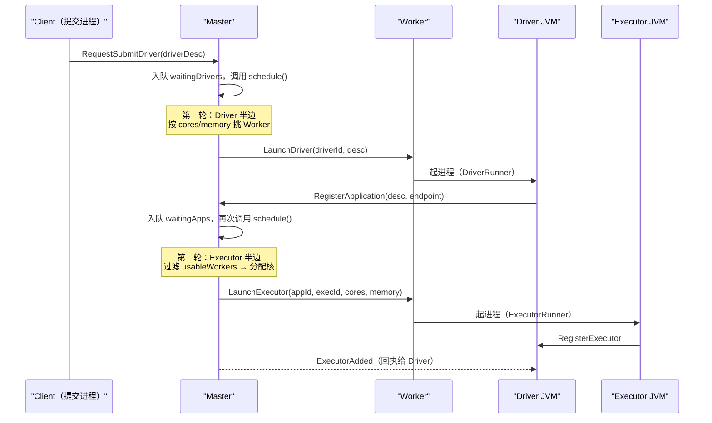
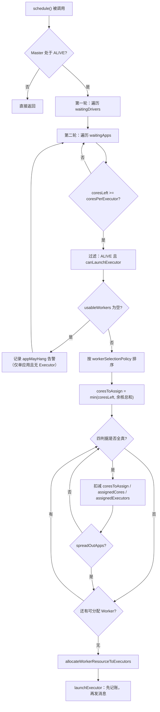
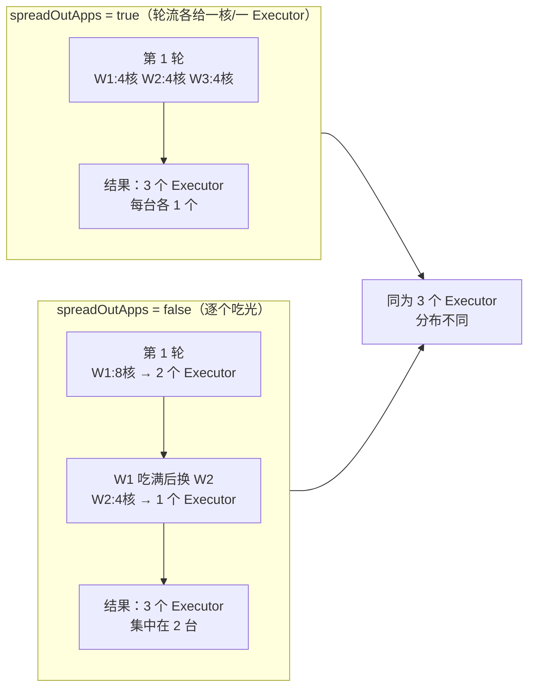
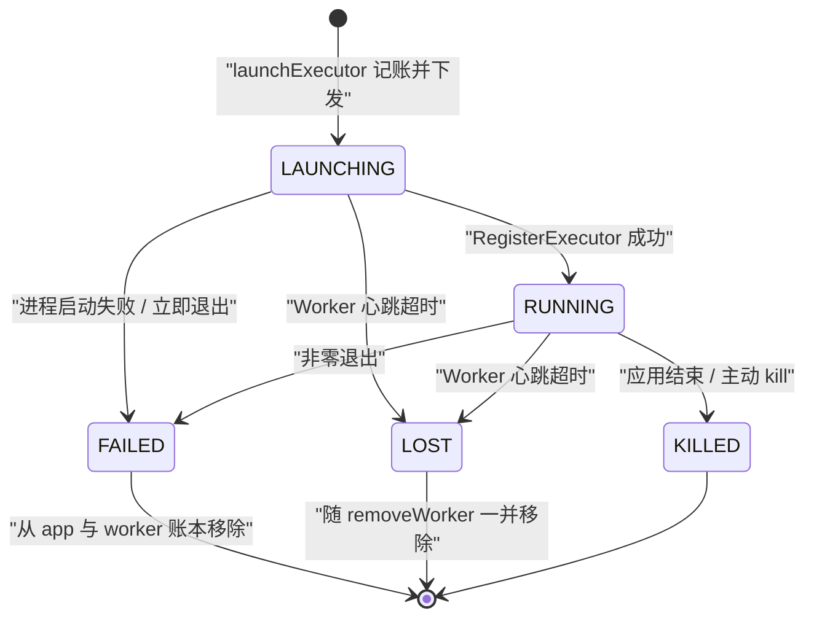
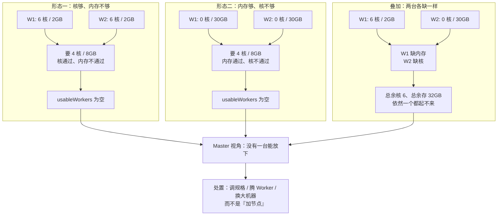

# 6. Spark Application资源申请机制

**摘要：**

Standalone 模式的资源申请，最容易被压缩成一句话——「Master 找到有空的 Worker，把 Executor 放上去」。把这句话拆开，会看到一套并不对等的账本：Worker 交上来的是核数与内存两个数字，应用报上来的却可能是核数预算、单 Executor 规格或实例个数三种不同口径的愿望，而 Master 只用一条减法把两者对齐。本文按「谁在记账 → 两轮申请如何排队 → 匹配算术怎么落 → 为什么总核数够仍然起不来 → 申请成功之后如何回收」推进：先厘清每个提交参数落到哪个配置项、又在哪种模式下被过滤，说明 `--total-executor-cores` 只在 Standalone 映射为 `spark.cores.max`，而 `--num-executors` 在 Standalone 根本不生效；再拆解 `schedule()` 里 Driver 与 Application 两个队列的先后关系，以及 `spark.deploy.spreadOutApps` 如何改变分配节奏；随后用五个算例解释「总核数够、单个 Worker 凑不出规格」的失败形态，并划清它与 `spark.driver.maxResultSize` 的阶段边界；最后是动态资源分配在 Standalone 的三处局限、碎片与超卖造成的两种死锁，以及与 YARN、Kubernetes 资源模型的结论级对照。贯穿全篇的判据其实只有一条：账本上记了什么，以及它刻意没有记什么——前者决定申请能不能成功，后者决定成功之后能撑多久。

---

> [!info] 版本口径
> 本文以 Spark 4.3.0（2026-10-30 发布）为基准，4.x 系列的预编译包基于 Scala 2.13；源码引用同以 4.3.0 分支为准，4.0.0 起才出现的配置项在正文中单独标注版本。涉及尚未发布的改动、或各版本行为可能不同的细节，以对应版本文档为准。

---

## 第 1 章 一条只在这一种模式下出现的日志

### 1.1 两条日志，两个层次

如果只允许笔者保留一个排查 Standalone 资源问题的入口，会选下面这条：

```text
Initial job has not accepted any resources; check your cluster UI to ensure
that workers are registered and have sufficient resources
```

它由 Driver 侧的 `TaskSchedulerImpl` 每隔 `spark.starvation.timeout`（默认 15 秒）打一次，条件是「已经收到 TaskSet，但至今没有启动过任何 Task」。与之配对的另一半在 Master 侧：

```text
App app-20261119103000-0007 requires more resource than any of Workers could have.
```

后者由 `startExecutorsOnWorkers()` 在一种很窄的情形下打出：队列里只有一个应用、它连一个 Executor 都还没有、并且过滤后的可用 Worker 列表为空。

两条日志放在一起看，才构成一次完整的「申请落空」：Master 说「我找不到能放下你的 Worker」，Driver 说「我一个 Task 都没能发出去」。缺了任何一条，判断都会偏——只看到 Driver 那条，容易以为是 Task 调度的问题；只看到 Master 那条，容易以为是 Worker 掉线的问题。

### 1.2 申请不是一次，而是两个队列

**Standalone 的资源申请分两段，先 Driver 后 Executor，而这两段并不是两次独立的调度回合。** 它们在同一次 `schedule()` 调用内部按固定次序完成：先遍历 `waitingDrivers` 给 Driver 找位置，再遍历 `waitingApps` 给 Executor 找位置。这一点在代码里没有注释强调，却决定了后面所有的现象。

第一段只在 cluster 部署模式下出现：`spark-submit` 先把 Driver 描述交给 Master（`RequestSubmitDriver`），Master 把它塞进 `waitingDrivers`，等某个 Worker 凑得出 `spark.driver.cores`（默认 1）与 `spark.driver.memory`（默认 1g）时，才发 `LaunchDriver` 让 Worker 起一个 JVM。第二段要等这个 JVM 真正跑起来、`SparkContext` 完成初始化、`StandaloneAppClient` 把 `RegisterApplication` 发回 Master 之后才开始。

client 模式下只有第二段，因为 Driver 就跑在提交节点上，不占集群的账；代价是 Driver 与集群之间的网络往返、以及提交进程退出后 Driver 也随之消失。

### 1.3 账本，以及它的三个特点

Master 分配资源时不看任何实际用量，只看自己维护的两组数字：每个 `WorkerInfo` 的 `coresFree` 与 `memoryFree`。这台「账本」有三个特点，后面所有的困惑几乎都能追到它们身上。

其一，核是硬记账：核数在分配那一刻就从 `coresFree` 里扣掉，Executor 结束后再加回来，中间不做任何折算。其二，内存是软记账：`memoryFree` 只减 `spark.executor.memory` 这一项，堆外、JVM 自身的开销一概不入账（第 10 章展开）。其三，Worker 自愿申报：账本的上限来自 Worker 启动参数 `--cores` 与 `--memory`，默认取机器全部逻辑核与「物理内存减 1GB」，与真实硬件之间隔着一层人为约定。

**Master 从不到桌边核对账本，它只相信小本子上的数字。** 把 Master 想象成餐厅门口的领位员会更直观：他不进餐厅看哪张桌子真的空着，只在纸上按「每桌几个位」划勾，纸上划满了就说没位子，纸上还有位就放人进去。纸上准不准，取决于最初报桌位的人有没有说谎，以及客人会不会偷偷拼桌。

### 1.4 为什么是 FIFO，而不是公平调度

Standalone 的 Master 只给了一个 FIFO 队列：`waitingApps` 按注册顺序被扫描，没有优先级、没有配额、没有抢占。这个取舍要放回它的来历里看：`spark.deploy.spreadOutApps` 的版本字段标注为 0.6.1，而 `spark.deploy.spreadOutDrivers` 与 `spark.deploy.workerSelectionPolicy` 直到 4.0.0 才被单独拆出来——中间十余年里，这套分配逻辑只做过局部增补，基本形状没有变过。

不做公平调度的理由在于职责分层：应用内部的多个 Job 之间，Spark 用 `spark.scheduler.mode=FAIR` 的调度池处理；应用之间的资源分配则外包给集群管理器。Standalone 是自带的轻量实现，它承诺的只有「先到先得、互不抢占」；需要配额与抢占的场合，设计上就是让人换 YARN 或 Kubernetes。反过来说，不设任何上限的后果也很直接——一个应用就能吃满整个集群（第 4.6 节），而 Standalone 没有任何机制把它拉回来。

### 1.5 这条主线要回答什么

后面的篇幅围绕五个问题铺开：这套账本由哪些数字构成、两轮申请各自排在什么队列、匹配算术的判据与节奏是什么、账本上明明有余量却分不出去的情形从哪来、以及申请成功之后失败的那部分资源由谁回收。不弄清这条主线，代价是具体的：把正常排队误判为故障去扩机器，把结果集超限误判为资源不足去调核数，或者反过来把「单机规格不足」当成「集群不够大」而一直加节点却始终凑不出一个能启动的 Executor。

---

## 第 2 章 账本：三个数字与一条等式

### 2.1 Worker 申报的数字

Worker 注册时向 Master 上报两个整数：`cores` 与 `memory`。前者默认是 `Runtime.getRuntime.availableProcessors()`，后者默认是「物理内存减去 1GB」，给操作系统留出余量。这两个值都可以在启动时改写，方式是 `sbin/start-worker.sh --cores N --memory 8g`，或环境变量 `SPARK_WORKER_CORES`、`SPARK_WORKER_MEMORY`。

需要留意的是这两个数字粒度的差异：核是离散的、可整除的，内存在账本里也是整数 MB，但它对应的是 JVM 的堆上限，而不是进程的常驻内存。也就是说，账本从一开始就是一份名义账本——它记的是「我答应给出去多少」，不是「我实际会花掉多少」。

### 2.2 应用申报的三种愿望

应用提交时，真正进入 `ApplicationDescription` 的字段可以归成四类：`maxCores`（核数上限）、`defaultProfile` 里的 executor 核数、`defaultProfile` 里的 executor 内存、以及可选的初始 Executor 个数上限。它们在 `spark-submit` 层面由不同参数写入，而写入过程本身带模式过滤，这是最容易踩空的一层。

| 提交参数 | 写入的配置项 | 生效的集群管理器 | 在 Standalone 的含义 |
|---|---|---|---|
| `--total-executor-cores N` | `spark.cores.max` | 仅 Standalone | 本应用最多占用 N 个核（全集群合计） |
| `--executor-cores N` | `spark.executor.cores` | Standalone / YARN / Kubernetes | 每个 Executor 固定要 N 个核 |
| `--executor-memory M` | `spark.executor.memory` | Standalone / YARN / Kubernetes | 每个 Executor 向账本报 M 内存 |
| `--num-executors N` | `spark.executor.instances` | 仅 YARN / Kubernetes | 参数被过滤，不产生任何效果 |
| （Master 侧）无 | `spark.deploy.defaultCores` | 仅 Standalone | 应用未设上限时的默认核预算 |

这张表里最反直觉的一行是第四行。Spark 的参数解析不是「先全收下再各取所需」，而是由 `SparkSubmit` 里一张 `OptionAssigner` 表按「集群管理器位掩码 + 部署模式」逐条筛选：`--num-executors` 的位掩码只包含 YARN 与 Kubernetes，Standalone 提交时这个值连 `spark.executor.instances` 都不会写入。**`--num-executors` 在 Standalone 下根本不生效，写多少都不影响结果。**

### 2.3 一条减法

`ApplicationInfo` 里与申请有关的只有一行算式：

```scala
private val requestedCores = desc.maxCores.getOrElse(defaultCores)
private[master] def coresLeft: Int = requestedCores - coresGranted
```

`maxCores` 就是 `spark.cores.max`，未设置时回落到 Master 侧的 `spark.deploy.defaultCores`，而这个配置的默认值是 `Int.MaxValue`——所以官方文档里那句「默认情况下应用会占满集群所有核」不是修辞，就是这一行的直接后果。`coresGranted` 则是该应用当前所有 Executor 的核数之和，随 `addExecutor` 增加、随 `removeExecutor` 减少。

**于是一句可以背下来的话是：Standalone 的申请语义是「核数预算」，Executor 个数是预算除出来的商，而不是申请的输入。** 这一点与 YARN、Kubernetes 相反：在那两者里 `spark.executor.instances` 直接就是「我要几个容器 / 几个 Pod」，Spark 不做除法。

### 2.4 Executor 个数在什么情况下才会成为输入

确实是有的，但只在一个前提下：开启动态资源分配（Dynamic Resource Allocation，DRA）。此时 `StandaloneSchedulerBackend` 会把初始 Executor 上限置为 0，随后由 Driver 侧的 `ExecutorAllocationManager` 用 `RequestExecutors` 消息把目标个数发给 Master，Master 把它写进 `targetNumExecutorsPerResourceProfileId`，成为分配循环里 `underLimit` 判据的比较对象。

静态模式下这个上限是 `Int.MaxValue`，所以个数判据恒真，真正约束分配的只有核数与内存两个判据。这解释了一个常见的困惑：为什么某些人在 Standalone 上设了 `spark.executor.instances=10` 却看到 20 个 Executor——因为静态模式下这个参数根本不参与仲裁，Executor 个数完全由「Worker 有几个、每个 Worker 能给多少核、每 Executor 切几核」三者共同决定。

---

## 第 3 章 第一轮：先给 Driver 找个位置

### 3.1 严格优先

Master 的 `schedule()` 开头有一段几乎不会被注意到的顺序约定：

```scala
// Drivers take strict precedence over executors
if (spreadOutDrivers) { ... } else { ... }
startExecutorsOnWorkers()
```

Driver 的分配不仅排在 Executor 之前，而且在同一次调用里独占整段 Worker 扫描。等到 `startExecutorsOnWorkers()` 开始时，已被 Driver 占用的核与内存早已从 `coresFree`、`memoryFree` 里扣掉。**Driver 占掉的核在 UI 上不显眼，但它先扣——这是「总核数够却少一个」的第一个来源。**

### 3.2 从提交到进队列

cluster 模式下，提交进程（`org.apache.spark.deploy.Client`）向 Master 发 `RequestSubmitDriver`，Master 的处理只有四步：创建 `DriverInfo`、持久化、加入 `drivers` 与 `waitingDrivers`、调用 `schedule()`。注意 RPC 的回复是「已提交」（`SubmitDriverResponse(success = true)`），而不是「已启动」；提交成功与拿到资源是两件事，中间隔着排队。

### 3.3 两种挑 Worker 的打法

`spark.deploy.spreadOutDrivers` 是 4.0.0 才拆出来的独立开关（默认 `true`），在此之前 Driver 与 Executor 共用一套「分散」语义。打开时，Master 先把存活 Worker 打乱顺序，然后从上次分配结束的位置开始轮流试探，让 Driver 尽量落在不同节点；关闭时，按 Worker ID 排序后取第一个装得下的节点，把 Driver 尽量堆到少数机器上。

这个开关的默认值值得留意：文档给的理由是「分散有利于 HDFS 数据本地性，集中对计算密集型更高效」。但 Driver 本身几乎不读数据，它主要做 DAG 编排与结果汇总，分散它的实际收益主要是「不与最大的那个 Executor 抢同一台机器的内存」，而不是本地性。

### 3.4 「集群空着却放不下」的判据

Driver 循环里有一个容易被忽略的标记：

```scala
var isClusterIdle = !launched
...
isClusterIdle = worker.drivers.isEmpty && worker.executors.isEmpty
...
if (!launched && isClusterIdle) {
  logWarning(log"Driver ${...} requires more resource than any of Workers could have.")
}
```

它表达的是：遍历完所有 Worker 都没放下，而且最后访问的那台 Worker 上什么也没有。反过来说，这条告警只在「集群看起来是空的、却依然装不下这个 Driver」时出现，因此它是「单机规格不足」的判据，而不是「正在排队」的判据。真实集群上更常见的是后者：集群很忙，Driver 静静躺在 `waitingDrivers` 里，一条日志都没有。

### 3.5 提交成功不等于拿到资源

`RequestSubmitDriver` 的回复是一条 `SubmitDriverResponse(success = true)`，它只表示「请求进队列了」。此后 `spark-submit` 的行为取决于 `spark.standalone.submit.waitAppCompletion`（默认 `false`）：为假时，提交进程在拿到 Driver ID 之后就退出，Driver 与它的资源申请都留在集群里继续；为真时，客户端进程会轮询 Driver 状态直到应用结束。

这个默认值解释了一类现场：提交命令很快返回、终端里没有任何报错、Master UI 上却有一个永远 WAITING 的应用。提交进程的退出并不意味着资源已经到手，它只意味着「请求已投递」。若想看 Driver 是否真的起来了，要看的是 `waitingDrivers` 是否清空、以及 Worker 上有没有对应的 `DriverRunner` 进程。

### 3.6 为什么必须先有 Driver

绕回结构上看，这个次序不是风格问题，而是因果问题：Executor 的启动命令要带上 Driver 的地址，Executor 起来之后要反向注册到 Driver 的 `DriverEndpoint`。没有 Driver 就没有注册目标，所以第一轮不是「顺便先做」，而是第二轮的前置条件。**两个队列、两次机会，但只有一条因果链。**

下面这张图把两轮申请放回同一条时间线上，可以看清两次 `schedule()` 分别由什么事件触发。



图中有一处不对称值得留意：`LaunchExecutor` 发出去了，`ExecutorAdded` 也回给 Driver 了，但这两条消息都不代表 Executor 真的跑起来了——第三阶段才由 Executor 自己向 Driver 注册。这个时间差正是第 8 章要处理的回收窗口。

---

## 第 4 章 第二轮：Executor 的匹配算术

### 4.1 三道门

`startExecutorsOnWorkers()` 对每个还在排队的应用（准确说是 `waitingApps` 里的每个应用）做同一套动作。第一步是筛人：

```scala
val aliveWorkers = workers.toArray.filter(_.state == WorkerState.ALIVE)
  .filter(canLaunchExecutor(_, resourceDesc))
```

`canLaunchExecutor` 检查三件事：`memoryFree >= memoryMbPerExecutor`、`coresFree >= coresPerExecutor.getOrElse(1)`、以及自定义资源（GPU、FPGA 之类）是否够。三道门是合取，任何一道不过，这台 Worker 就直接出局，连参与后续「能分几核」的讨论的资格都没有。

第二步是排序，由 `spark.deploy.workerSelectionPolicy` 决定，4.0.0 起可配，默认 `CORES_FREE_DESC`——剩余核最多的排前面。在此之前这是硬编码的 `sortBy(_.coresFree).reverse`，4.0 把它变成 `CORES_FREE_ASC`、`MEMORY_FREE_DESC`、`WORKER_ID` 等五选一，好处是可以人为制造「装箱」效果（选剩余最少的先塞满），减少碎片。

### 4.2 先截断，再均分

分配循环里的第一行是预算截断：

```scala
var coresToAssign = math.min(app.coresLeft, usableWorkers.map(_.coresFree).sum)
```

**`coresToAssign` 先被截断，再被均分。** 截断的含义是「这次最多只能花掉这么多核」，它同时受应用预算 `coresLeft` 与集群当前空闲核总量两个上限约束；均分发生在后面的循环里，每次扣掉一个 `minCoresPerExecutor`。

`minCoresPerExecutor` 的取值决定了后面的全部形态：它等于 `spark.executor.cores`，未设置时为 1。这个「未设置时为 1」看似只是兜底，实际上改变了整个分配模型——第 6 章会看到，它同时把「一个 Worker 上起几个 Executor」这件事也一并改写了。

### 4.3 四个判据

能否在某台 Worker 上再放一个 Executor，由四项合取决定：

| 判据 | 表达式 | 不成立时的现象 |
|---|---|---|
| 预算未耗尽 | `coresToAssign >= minCoresPerExecutor` | 本轮不再分配，应用保持部分满足 |
| 余核足够 | `coresFree - assignedCores >= minCoresPerExecutor` | 该 Worker 本轮出局 |
| 余存足够 | `memoryFree - assignedMemory >= memoryPerExecutor` | 该 Worker 本轮出局 |
| 未达个数上限 | `assignedExecutors.sum + 已有数 < executorLimit` | 停止加新 Executor |

**四个判据是合取关系，任一条不成立就不发一个 Executor。** 其中「余存足够」只在新起一个 Executor 时才检查，「未达个数上限」同理；如果当前动作是给已有的 Executor 追加核，代码只检查「余核足够」这一项，另外两项被显式跳过。这个不对称是理解「Executor 会长大」的钥匙。

### 4.4 两种节奏

循环体里有一行决定节奏的开关：

```scala
if (spreadOutApps) {
  keepScheduling = false
}
```

`spreadOutApps` 来自 `spark.deploy.spreadOutApps`（旧名 `spark.deploy.spreadOut`，两者等价），默认 `true`。为真时，每台 Worker 每轮只分一次就换下一台，像发牌一样一人一张；为假时 `keepScheduling` 保持为真，`while` 会在这台 Worker 上一直分到分不动为止，把它吃干净再换下一台。

**逐个吃光与轮流各给一核，差别只在 `keepScheduling` 这一行。** 但这一行的后果不小：分散模式下 Executor 铺满更多节点，读取 HDFS 块时更多 Task 能命中本地副本；集中模式下网络传输更少，但节点故障时一次丢掉的 Executor 更多。

### 4.5 从核数到个数

分配决策的产物是一个数组：每台 Worker 分到几个核。真正起进程的是随后的一次折算：

```scala
val numExecutors = coresPerExecutor.map { assignedCores / _ }.getOrElse(1)
val coresToAssign = coresPerExecutor.getOrElse(assignedCores)
```

设了 `spark.executor.cores=4`、某台 Worker 分到 10 核，那么起 2 个 Executor（每个 4 核），剩下 2 核不参与分配；没设时，一台 Worker 只起 1 个 Executor，把这个 Worker 分到的全部核数一次拿走。余数被直接丢弃——这是核碎片最直接的制造源，也是为什么「把核数设成 Worker 核数的整数分之一」是一条实用建议。

下面的流程图把 `scheduleExecutorsOnWorkers` 的判定顺序摊平，可以看到「三道门」与「四个判据」在流程中的位置差异。



### 4.6 一次调用能走多远

有一个容易低估的性质：这个 `while (freeWorkers.nonEmpty)` 循环会一直转到没有任何 Worker 能再放为止，而不是「满足第一轮需求就收手」。所以一次 `schedule()` 就足以让一个不限核数的应用吃掉整个集群的空闲资源，而排在它后面的应用在同一轮里拿到的是 0。

这就解释了一个常见疑问：为什么第二个应用提交后一直 WAITING，而第一个应用的 Executor 数还在涨。答案不是「第二个应用配置错了」，而是它排在队尾，而队首那个应用每次资源释放都会在同一轮里再次吃满。Standalone 只有 FIFO，没有公平调度，也没有抢占（第 7 章展开）。

---

## 第 5 章 总核数够，为什么还是起不来

### 5.1 五个算例，一条主线

判断「资源够不够」时，人习惯把集群的总空余核数加起来与需求对比；而 Master 从不相加，它逐台 Worker 检查。这个错位产生了绝大多数「明明够却起不来」的困惑。下面五个算例对应真实集群上反复出现的形态，参数是假设的，算式是确定的。

假定集群有 10 台 Worker，每台 8 核 32GB，当前全部空闲，即每台 `coresFree=8`、`memoryFree=32768MB`，总余核 80。

### 5.2 形态一：规格大于单机余量

提交时设 `--executor-cores 16`、`--executor-memory 8g`。三道门里的核判据要求 `coresFree >= 16`，而每台只有 8，于是 10 台 Worker 全部出局，`usableWorkers` 为空。80 核的总余量一个也借不出来，Master 打出 `requires more resource than any of Workers could have`，应用停在 WAITING。

这是最纯粹的一种：**需求的单位是「一台机器上的一个 Executor」，而供给的单位也是一台机器；总量再大，跨不过机器边界。** 类比装船：船舱总容积够，但每个隔舱门宽 2 米，而箱子 3 米宽，箱子就是上不了船。

Spark 自己的源码注释里还留着一处更隐蔽的变体（`SPARK-8881`）：集群 4 台 16 核、请求 3 个 Executor、`spark.cores.max=48`、`spark.executor.cores=16`。如果按「每次只加 1 核」的方式分配，48 核会在 4 台之间轮转均分、每台 12 核，而 12 小于 16，结果一个 Executor 都起不来。所以现在的实现坚持「一次按每 Executor 的核数为单位发放」——这条修改本身就在说明，分配是「按规格」而不是「按核数」的。

### 5.3 形态二：预算小于规格

第二个算例只需要改两个参数：`--total-executor-cores 3` 与 `--executor-cores 4`。外层有一道门：

```scala
if (app.coresLeft >= coresPerExecutor) { ... }
```

`coresLeft` 一开始等于 3，小于 4，于是这个应用在每一轮调度里都被直接跳过，一个 Executor 也不会启动。它连「可用 Worker 为空」的告警都不会触发，因为代码根本没走到过滤 Worker 那一步。

**这是一处静默的配置冲突：核预算比单 Executor 规格还小，等价于宣告「不要给我任何资源」。** 它的可观测特征只有 Driver 侧那条 15 秒重复的 starvation 日志，以及 Master UI 上一个一直 WAITING、Executor 数为 0 的应用。

### 5.4 形态三：账本上的内存不够

内存判据比对的是 `memoryFree` 与 `memoryMbPerExecutor`，两者都在 MB 量级上记整数。仍以 10 台 8 核 32GB 为例，若每台已有 3 个 8GB 的 Executor（共 24GB），`memoryFree` 只剩 8GB，那么 `--executor-memory 8g` 尚可，`--executor-memory 10g` 就不行。

这里最容易被忽略的是内存在账本里是「按 Executor 一次性预留、随 Executor 结束才归还」的。一个长期驻留的 Executor 即使完全空闲，它占的 8GB 也不会释放给别的应用。于是会出现「集群很闲、内存却拿不出来」的景象：机器上的 Executor 都在空转，账本上的 `memoryFree` 却是 0。

### 5.5 形态四：Driver 先扣一笔

cluster 模式下，Driver 自己是一个要占账本的进程：默认 `spark.driver.cores=1`、`spark.driver.memory=1g`。它占掉的那台 Worker 上，`coresFree` 减 1、`memoryFree` 减 1024。如果恰好每台 Worker 的余量都卡在边界上（比如 8 核里计划起 2 个 4 核 Executor），Driver 落下之后某台 Worker 就变成 7 核，`8 / 4 = 2` 立刻退化成 `7 / 4 = 1`，全局少一个 Executor。

譬如把 `--driver-memory` 设成 4g、`--driver-cores` 设成 2 的作业，就更容易撞上这件事，因为 Driver 可能落在那台「本来刚好能放下最后一个 Executor」的机器上。

### 5.6 形态五：别人不放手

前四种都是自身规格与供给的错配，第五种是时序问题。Standalone 只有 FIFO 一个调度策略，`waitingApps` 里的应用按注册顺序被扫描，没有抢占、没有回收、没有优先级。一个不限核数的应用在第一次调度里就能吃满全集群（第 4.6 节），后续应用只能等它结束。

这里有个常被误读的细节：等的不只是「应用结束」，也可能是「它的某个 Executor 因失败而退出」。每一次 `ExecutorStateChanged` 都会让 Master 末尾再调一次 `schedule()`，于是队尾应用偶尔会突然拿到一个 Executor，然后再次停滞——看起来像抖动，实际是别人掉了一个 Executor 留下的空隙。

### 5.7 一条判断链

把五种形态压成一条可执行的判断链：先确认应用在 Master UI 上是 WAITING 还是 RUNNING（WAITING 意味着一个 Executor 都没接到），再看 Master 日志里有没有 `requires more resource than any of Workers could have`，然后逐个核对 `spark.executor.cores`、`spark.executor.memory`、`spark.cores.max` 与 Worker 的 `--cores`、`--memory` 是否构成形态一至形态三，最后才考虑排队与 Driver 占位。

| 形态 | 判据位置 | 可观测证据 | 处置方向 |
|---|---|---|---|
| 形态一：规格大于单机余量 | 三道门中的核判据 | Master 日志 `requires more resource` 加 Worker 全空 | 调小 `executor.cores` 或扩单机核数 |
| 形态二：预算小于规格 | 外层 `coresLeft >= coresPerExecutor` | 应用恒 WAITING、Executor 数 0、无 Master 告警 | 调大 `spark.cores.max` 或调小规格 |
| 形态三：内存不够 | 三道门中的内存判据 | 同上告警，Worker 列表为空 | 降 `executor.memory` 或清理长驻 Executor |
| 形态四：Driver 占位 | 第一轮已扣账 | UI 上 Driver 所在节点的余量与预期差 1 核 | 预留余量，或改 client 模式 |
| 形态五：队尾饥饿 | FIFO 顺序 | 队首应用 Executor 数持续增长 | 给应用设 `spark.cores.max` 分账 |

这张表的用法不是「逐行试」，而是按从上到下的顺序排除——因为前四种在 Master 侧的证据形态不同，而第五种没有 Master 侧证据，只能靠对比队首应用看出来。

---

## 第 6 章 spreadOut 与「一 Worker 一 Executor」

### 6.1 两种节奏的图形差异

把同一份需求（3 台 Worker、每台 8 核、请求 4 核的 Executor、预算 12 核）分别用两种节奏铺开，差别会立刻显现。



两条路径的产物数量可以相同，分布完全不同。这个差别对 Shuffle 阶段尤其明显：Executor 越集中，Shuffle 数据跨节点的比例越高；而读取 HDFS 时反过来，Executor 越分散，命中本地副本的概率越高。

### 6.2 「一 Worker 一 Executor」的真实条件

关于 Standalone 有一条流传很广的说法：「每个 Worker 上只能有一个 Executor」。它只在 `spark.executor.cores` 未设置时成立，因为此时 `oneExecutorPerWorker` 被置为真：

```scala
val oneExecutorPerWorker = coresPerExecutor.isEmpty
```

默认情形正是如此：`spark.executor.cores` 在 Standalone 下的默认语义是「占用 Worker 上所有可用的核」，于是每个 Worker 上自然只需要一个 Executor，它会把分配到的核全部收走。一旦显式设置了这个值，`oneExecutorPerWorker` 变成假，同一台 Worker 上就可以出现多个同应用的 Executor，前提是余核与余存都够。

**「每个 Worker 至多一个 Executor」只在一次调度迭代内成立**，而且只是「本次迭代不再新起」。源码注释补上了另一半：假设 appA 与 appB 在 worker1 上各有 1 个 Executor，之后 appB 结束并释放了 worker1 的核，那么下一次调度里 appA 完全可能在 worker1 上再起一个新 Executor——因为对 appA 而言这是新一轮迭代，`assignedExecutors(pos)` 又回到了 0。所以真实的不变式是「同一应用在同一 Worker 上的 Executor 数，受单次迭代的 1 个上限约束，但可以随迭代次数累积」。

### 6.3 一个 Executor 会长大

第 4.3 节的表里有一条不对称：给已有 Executor 追加核时不检查内存与个数上限。放到默认配置（`coresPerExecutor` 为空）下，这条不对称的效果是——第一次迭代在每台 Worker 上各起 1 个 Executor、各给 1 核；后续迭代里这些 Executor 已经存在，走的都是「追加核」分支，于是它们会一路涨到把 Worker 吃满。

**追加核这一步不做内存检查**，理由不难推：内存是按 Executor 预留的，追加核不增加内存占用，所以没必要重查。但它带来一个副作用：账本上的「一个 Executor 占了 8 核 8GB」并不是提交时申请的规格，而是若干轮迭代累积的结果。看 UI 时会发现 Executor 的核数与 `spark.executor.cores` 不一致——这恰恰是没设该参数时的正常形态，而不是配置没生效。

### 6.4 分散与集中：一组不足与争议

`spark.deploy.spreadOutApps` 默认 `true`，官方理由是「分散更利于数据本地性，集中对计算密集型更高效」。按 4.x 的实际执行来看，这个说法需要两处修正。

其一，分散的收益依赖「数据就在这些节点上」这个前提。如果是对象存储或远端的 HDFS，Executor 落在哪里都不本地，分散只增加网络跳数而不带来读取优化。其二，集中会放大故障域：一台机器故障时，集中的布局可能一次丢掉该应用的一半 Executor，而分散布局只丢一两个——后者的重算代价通常更低。

笔者倾向于把这条开关读成「以数据布局为准」，而不是「以任务类型为准」。有本地副本可用时分散，数据在远端时集中以减少跨机 Shuffle，两者都比反过来更讲得通。至于「哪种更快」，取决于作业里读取与 Shuffle 的比例，没有普适答案。

---

## 第 7 章 等待、重试，与一条不相干的边界

### 7.1 排队没有超时

Standalone 的等待是没有终点的。`schedule()` 只在明确的状态变化时被调用：应用注册、Worker 注册、Worker 被移除、Executor 状态变化、Driver 提交与移除、应用请求 Executor、应用被 kill。没有任何定时器会周期性地「再试一次」——所谓重试，其实是下一次状态变化顺带触发的一次重新扫队。

这个设计与「重试」这个词给人的印象相反：它不重试，它只是每遇到一次事件就重新算一遍。这也解释了一个现象——集群静止时，一个 WAITING 的应用可以安静地等到天荒地老，Master 日志里连一行「仍在等待」都不会有。

### 7.2 Driver 侧的 15 秒提醒

Driver 侧确实有个定时器，但它的作用只是提醒，不是重试：

```scala
if (!isLocal && !hasReceivedTask) {
  starvationTimer.scheduleAtFixedRate(..., STARVATION_TIMEOUT_MS, STARVATION_TIMEOUT_MS, ...)
  // STARVATION_TIMEOUT_MS = conf.getTimeAsMs("spark.starvation.timeout", "15s")
}
```

它每 15 秒检查一次「是否已经有 Task 被启动过」，若没有就打印第 1 章那条日志，直到第一个 Task 真正跑起来为止。值得留意的是，Standalone 下 `spark.scheduler.minRegisteredResourcesRatio` 的默认值是 0.0（YARN 与 Kubernetes 是 0.8），意味着 Driver 根本不等资源注册比例达标就开始接受任务提交——它把 TaskSet 收下来，然后干等 Executor 出现。于是「等待」在 Driver 侧表现为「Task 全部处于排队状态」，而不是「提交被阻塞」。

### 7.3 一条不相干的边界

`spark.driver.maxResultSize` 经常被拉进这类讨论，但它与资源申请毫无关系。它的判定点在 `TaskSetManager.canFetchMoreResults`：

```scala
def canFetchMoreResults(size: Long): Boolean = sched.synchronized {
  totalResultSize += size
  calculatedTasks += 1
  if (!isShuffleMapTasks && maxResultSize > 0 && totalResultSize > maxResultSize) {
    abort(msg)  // Total size of serialized results ... is bigger than spark.driver.maxResultSize
    false
  } else true
}
```

三个限定词值得一个个看：`!isShuffleMapTasks` 说明它只对 ResultTask（把结果带回 Driver 的阶段）生效，ShuffleMap 阶段的输出走磁盘不走 Driver；`totalResultSize` 是累计值，说明它要等任务跑完之后才有数据可算；`abort` 是终止当前 TaskSet，说明它是执行期的失败，发生在资源已经拿到、任务已经跑完的时刻。

**`spark.driver.maxResultSize` 与资源申请不属于同一个阶段。** 资源不足的形态是「任务一个都没开始」，maxResultSize 超限的形态是「任务跑了一批、结果在 Driver 侧累加超限」。两者在时间轴上互斥，把后者当成前者的证据，只会把排查引向核数与内存配置。

### 7.4 失败发生在哪一层

两者还有一个共同点：都不会让提交失败。资源不足时 `SparkContext` 照常初始化完成，应用在 Master UI 上显示 WAITING；结果集超限时应用已经在 RUNNING，只是某个 Stage 被 abort。真正的区别在于「失败发生在哪一层」——前者停在 Master 的分配循环里，驱动侧只留下 starvation 日志；后者发生在 TaskSetManager 里，日志里带着明确的字节数与配置项名。

| 现象 | 停在哪一层 | 关键证据 | 结论指向 |
|---|---|---|---|
| 应用恒 WAITING、Executor 数 0 | Master 分配循环 | Master 日志与 Worker 余量 | 资源申请失败 |
| 应用 WAITING、但日志无 Master 告警 | Master FIFO 排队 | 队首应用占满 | 排队饥饿 |
| Task 全部排队、无 Executor | Driver 调度器 | 15 秒 starvation 日志 | 与上一行同源 |
| Stage abort、报结果集过大 | TaskSetManager | `Total size of serialized results` | 与资源无关 |
| Executor 反复退出 | Worker 进程 | `ExecutorStateChanged` 失败状态 | 见第 8 章 |

### 7.5 WAITING 标记了什么

最后澄清一个语义。`waitingApps` 这个名字容易让人以为它只装「还在等」的应用，实际上它装的是所有未结束的应用：应用注册时入队，`removeApplication` 时才出队，中间无论有没有 Executor 都一直在里面。真正被反复扫描的判据是 `coresLeft` 与 `coresPerExecutor` 的比较，而不是队列成员资格。

`ApplicationState` 的变化也只有一处：`allocateWorkerResourceToExecutors` 里每启动一个 Executor 就写一次 `app.state = ApplicationState.RUNNING`。**WAITING 标记的是「还没接到第一个 Executor」，不是「资源还没凑够」。** 一个拿到 1 个 Executor 却还差 7 个的应用，状态是 RUNNING——它的「未满足」只能从 `coresLeft` 与 UI 上的 Executor 数看出来，从状态字段看不出来。

### 7.6 一次误判的走查

把上面几节串成一个具体场景。现象是「应用提交后一直不跑，Driver 日志每 15 秒刷一条 starvation 警告，Master UI 上该应用状态为 WAITING、Executor 数为 0」，而集群监控显示 CPU 与内存都还有余量。

第一步看 Master 日志有没有 `requires more resource than any of Workers could have`。有，说明至少有一次调度走到了「一台都放不下」，方向是规格与单机余量的错配；没有，说明每一轮调度其实都分配出去了，只是分给了别人，方向是排队。

第二步在第一种情况下核对三组数字：`spark.executor.cores` 与 Worker 的 `--cores`、`spark.cores.max` 与 `spark.executor.cores`、`spark.executor.memory` 与 Worker 的 `--memory`。三组比较分别对应第 5.2、5.3、5.4 节三种形态，其中第二组最容易被漏掉，因为它的表现是「连告警都没有」。

第三步在第二种情况下看队首应用：它的 Executor 数是否在增长、它的 `spark.cores.max` 是否为空。若是，处置方向是给队首应用设预算，而不是给队尾应用加内存。

第四步才轮到 Driver 占位与 Worker 申报值这两个二级因素：前者把默认 1 核 1GB 从账本上扣走，后者可能把申报值设得高于物理资源。两者都不改变主判据，但足以把「差一点就够」翻成「差一点就不够」。

---

## 第 8 章 申请成功之后：启动失败的回收

### 8.1 先记账、后启动

`launchExecutor` 的动作顺序是这样的：

```scala
worker.addExecutor(exec)                       // 账本先扣
worker.endpoint.send(LaunchExecutor(...))      // 再发启动指令
exec.application.driver.send(ExecutorAdded(...)) // 同时通知 Driver
```

**先记账、后启动。** 这个顺序的必要性在于防并发超分：如果等 Worker 回执再扣账，同一轮调度里可能对同一份空闲资源发出两条 `LaunchExecutor`。代价是把「账本已扣但进程没起来」的窗口暴露了出来——从 `LaunchExecutor` 发出到 `RegisterExecutor` 抵达 Driver，中间任何一步失败，账本上都会留下一条幽灵记录，必须靠后续的状态回传清掉。

### 8.2 三种结局

Executor 的结局由 `ExecutorStateChanged` 消息带回 Master：`RUNNING` 表示成功注册，`FAILED` 表示启动失败或运行中退出，`LOST` 表示所在 Worker 失联导致的丢失。前两种由 Worker 主动上报，第三种由 Master 在 `removeWorker` 里自己造出来。

下图把三类结局与它们之间的跃迁画成状态机，可以看到账本回收的三个入口都通向同一个动作：从应用与 Worker 两侧同时移除。



状态机里有一处状态跃迁断言：收到 `RUNNING` 时要求旧状态必须是 `LAUNCHING`，否则直接抛 `IllegalStateException`。这条断言把「重复上报」与「乱序上报」挡在门外，也说明 Master 对 Executor 生命周期的信任是有边界的。

### 8.3 重试计数的三个附加条件

失败之后的处理被三个附加条件层层收窄，缺一个就不会杀掉应用：

```scala
if (!normalExit
    && oldState != ExecutorState.DECOMMISSIONED
    && appInfo.incrementRetryCount() >= maxExecutorRetries
    && maxExecutorRetries >= 0) {
  val execs = appInfo.executors.values
  if (!execs.exists(_.state == ExecutorState.RUNNING)) {
    removeApplication(appInfo, ApplicationState.FAILED)
  }
}
```

`normalExit` 由 `exitStatus == Some(0)` 判断，正常退出不计数；`DECOMMISSIONED` 的失败被排除，因为下线导致的退出是「预期之内」的；`maxExecutorRetries >= 0` 允许把该配置设为负数来彻底关闭这条杀应用的路径；最后还要确认当前一个 RUNNING 的 Executor 都没有。

**重试计数只在连续失败时累加。** 每次收到 `RUNNING` 都会调 `resetRetryCount()`，于是一个健康的应用即使偶发失败也不会累积到 10 次（默认 `spark.deploy.maxExecutorRetries`）而被清退。这条设计把「偶发」与「持续」区分开来，也解释了为什么有的应用能带着一堆失败日志跑很久，而另外一些应用在第十次失败后突然消失。

### 8.4 一个启动即失败的算例

算例：3 台 Worker、每台 8 核 32GB，提交 `--executor-cores 4`、`--executor-memory 12g`、`--total-executor-cores 24`。第一轮分配成功：每台两个 Executor，账本上记 6 个、24 核、72GB。随后 Worker 侧进程启动失败——比如 Jar 在 Worker 上不可达、`spark.executor.extraJavaOptions` 里有个不存在的 GC 参数、或 Python 环境缺依赖。

每一次失败都触发 `ExecutorStateChanged`，Master 移除该 Executor 的账本记录并再调一次 `schedule()`；下一次调度立刻在同样的 Worker 上重新分配一个 Executor，参数不变、失败也不变。十次之后，应用被移除并标记 FAILED，Driver 收到 `ApplicationRemoved` 后退出。整个过程在 Master UI 上表现为「Executor 数在 0 与几个之间反复跳变」，而日志里是一串同样的启动失败原因。

这个形态的处置方向与第 5 章完全不同：核与内存都够，Master 每次都成功「申请」了资源，失败发生在申请之后的一层，所以要查的是 Worker 侧日志（`work/` 目录下的 stdout/stderr）与进程退出码，而不是集群余量。

### 8.5 Worker 失联时的回收路径

进程级失败有回执，节点级失败没有。当 Master 的心跳检测（`spark.worker.timeout`，默认 60 秒）判定某台 Worker 超时，`removeWorker` 会做四件事：把 Worker 状态置 `DEAD`、遍历它的 Executor 逐个向 Driver 发 `ExecutorUpdated(..., LOST, ...)`、从每个应用的账本中扣除 `coresGranted`、最后再调一次 `schedule()`。

这条路径上有两个细节值得记住。其一是 `LOST` 不计数：它与 `FAILED` 走的是不同的移除路径，`incrementRetryCount` 只在收到 Worker 上报的非零退出时才调用，因此「整机掉线」不会把应用推向 FAILED。其二是回收与重新分配发生在同一次事件里：`removeWorker` 末尾就调 `schedule()`，于是失联 Worker 释放的核可能在同一瞬间被队尾应用抢走，而原来那个应用的补位要等 Worker 重新注册或别的资源释放。集群缩容时看到的「某个应用 Executor 数过了很久才补上」，根源就在这里。

---

## 第 9 章 动态资源分配在 Standalone 的形状

### 9.1 一条由 Driver 发起的申请链

静态调度里，申请发生在应用注册那一刻，之后只是不断补足；动态资源分配（Dynamic Resource Allocation，DRA）把「补足」变成了持续行为，方向由 Driver 决定。链路是这样的：`ExecutorAllocationManager` 根据待调度 Task 的积压情况算出目标 Executor 数，通过 SchedulerBackend 发 `RequestExecutors(appId, Map(rpId -> 个数))`，Master 的 `requestExecutors` 把它写进 `targetNumExecutorsPerResourceProfileId`，然后调用 `schedule()`。

这条链上有一个容易被忽略的初始值：开启动态分配时，`StandaloneSchedulerBackend` 传给 Master 的初始上限是 `Some(0)`，注释写得很直白——「真正的初始上限稍后由 ExecutorAllocationManager 发过来」。所以开启动态分配的应用，注册后先是一个 Executor 也不申请，等 EAM 第一轮请求到达才开始起进程。

扩容的节奏继承了 YARN 上的那套启发式：有积压 Task 且持续 `spark.dynamicAllocation.schedulerBacklogTimeout` 后发起第一轮，之后每隔 `spark.dynamicAllocation.sustainedSchedulerBacklogTimeout` 再发起，每轮的申请量翻倍（1、2、4、8……）。缩容则看空闲：Executor 空闲超过 `spark.dynamicAllocation.executorIdleTimeout`（默认 60 秒）就被 `KillExecutors` 回收。

### 9.2 三个前提

动态分配要求「Executor 可以被安全移除」，而 Executor 身上最难搬走的是 Shuffle 输出。官方给了四条等价路径，任选其一：外置 Shuffle 服务（Standalone 下让 Worker 带 `spark.shuffle.service.enabled` 启动）、Shuffle 跟踪（`spark.dynamicAllocation.shuffleTracking.enabled`）、下线机制（`spark.decommission.enabled` 加 `spark.storage.decommission.shuffleBlocks.enabled`）、或自定义 `ShuffleDataIO` 提供可靠存储。

这四条的共同点是把 Shuffle 数据的存活与 Executor 进程解耦。缺了它们，缩容会直接销毁正在被下游读取的 Shuffle 文件，表现为下游 Stage 重新计算甚至取数失败——这也是很多集群「开了动态分配反而更慢」的真实原因。

### 9.3 局限一：不设规格就会超量申请

Standalone 最特殊的一处坑写在官方文档的注意事项里：未显式设置 `spark.executor.cores` 时，每个 Executor 会拿走 Worker 上全部可用核，而此时开启动态分配，「Spark 可能申请到远超预期的 Executor 数量」。源码里对应的是一条启动警告，指向 `SPARK-30299`。

原因回到第 6 章：`coresPerExecutor` 为空时 `oneExecutorPerWorker` 为真，但这个「一」是**每次调度迭代新起一个**的意思。EAM 请求「再要 3 个」，Master 在每台 Worker 上各起 1 个并各给 1 核，下一轮再各加核——个数由请求驱动，核数由迭代累积，两边语义不一致，于是个数的增长不受核数约束。**Standalone 的动态分配是「数量语义」，而静态调度是「核数语义」**，两者混用时必须以显式规格把语义对齐。

### 9.4 局限二：扩容仍然要排队

DRA 只改变「申请多少」，不改变「能不能优先拿到」。Master 的分配入口依旧是那次 FIFO 扫描，EAM 发来的请求只是把目标个数改大，随后 `schedule()` 照样从 `waitingApps` 队首开始扫。若队首应用已经把资源吃满，动态分配能做的只有等待——它没有抢占能力，也无法越过队列。

`spark.dynamicAllocation.minExecutors` 在这套结构下的行为值得单独提一句：它是「保底个数」，而 Master 不区分保底与临时需求，一律作为目标上限处理。于是在没有公平调度的 Standalone 上，一个设了 `minExecutors=4` 却长期空闲的应用会永久占住 4 个 Executor，队尾应用无法借用。保底语义在 YARN 的队列模型里有对应机制平衡，在 FIFO 的 Standalone 上则是硬占用。

还有一层更隐蔽的占用来自缓存。持有缓存数据块的 Executor 受 `spark.dynamicAllocation.cachedExecutorIdleTimeout` 保护，而这个配置的默认值是无穷——也就是说，只要 Executor 上还挂着缓存块，它即使完全空闲也不会被回收。这与 FIFO 叠加之后会出现一种很奇怪的景象：集群内存被一堆「只放缓存、不算任务」的 Executor 占满，新应用的申请永远排不到，而监控上的 CPU 利用率接近零。要缓解只能显式给这个超时设值，或者接受「缓存在哪、资源就钉在哪」的代价。

### 9.5 局限三：两道上限同时生效

`spark.dynamicAllocation.maxExecutors` 限的是个数，`spark.cores.max` 限的是核数，两者同时参与仲裁。若只设前者而不设后者，`requestedCores` 回落到 `spark.deploy.defaultCores`（默认无穷），个数上限成为唯一约束；若两者都设，则先撞到哪个就停在哪个。实践中常见的错误是只调 `maxExecutors` 却忘了 `cores.max` 会让单 Executor 的核数被压缩——因为核数总量是固定的，个数越多，每个能分到的核越少。

| 参数 | 作用位置 | 在 Standalone 的实际效果 |
|---|---|---|
| `spark.dynamicAllocation.enabled` | Driver 侧 EAM | 开启持续申请与回收；初始上限被置 0 |
| `spark.dynamicAllocation.maxExecutors` | Master 的 `underLimit` 判据 | 个数上限，与核预算同时生效 |
| `spark.dynamicAllocation.minExecutors` | 同上 | 保底个数；在 FIFO 下等价于长期占用 |
| `spark.dynamicAllocation.executorIdleTimeout` | EAM | 空闲 60 秒后发 `KillExecutors` |
| `spark.dynamicAllocation.shuffleTracking.enabled` | Driver | 无外置 Shuffle 服务时的替代前提 |
| `spark.executor.cores` | Master 的分配粒度 | 未设置时个数与核数语义脱钩（`SPARK-30299`） |

### 9.6 一个尚未发布的方向

在 4.3.0 之后的开发分支里，Master 增加了一组「暂停与恢复」语义（`spark.ui.holdEnabled`，标注 4.4.0）：把应用整体 hold 住，优雅下线它的全部 Executor，需要时再恢复。它与 DRA 的区别在于保留了排队位置——不是把资源还回去重新排队，而是「让出资源但不放弃顺位」。这个能力补齐的正是 9.4 节那处空白，不过它依赖下线机制与 Shuffle 外置，具体行为以对应版本文档为准。

---

## 第 10 章 碎片与超卖：两种死锁形态

### 10.1 碎片是怎么长出来的

核碎片有三个来源。其一是整除余数：`assignedCores / coresPerExecutor` 是整数除法，余数直接丢弃。其二是粒度不齐：Worker 有 8 核而 Executor 要 3 核，8 减两次 3 之后剩 2 核，从此用不掉。其三是一次性预扣：Driver 先扣掉 1 核，把原本能整除的 8 变成 7。

内存碎片的来源更单一：内存在账本里按 Executor 整块预留，剩余不足一个 Executor 的量就永远无法使用。一台申报 32GB 的 Worker 上跑两个 12GB 的 Executor 后余 8GB，而这 8GB 只够一个 8GB 的 Executor；若下一个作业要 10GB，它就是沉淀。

### 10.2 死锁形态一：核够、内存不够

算例：3 台 Worker，每台 8 核 16GB。某应用已在每台各跑了 1 个 2 核 14GB 的 Executor，账本上每台剩 6 核约 2GB。此时提交一个新应用，要 4 核 8GB 的 Executor：核判据 6 ≥ 4 通过，内存判据 2GB ≥ 8GB 不通过，三台 Worker 全部出局。

现象是「集群有 18 核空余，新应用一个 Executor 都起不来」。而且它不会自愈——旧应用的 Executor 不释放，2GB 也长不回来。

### 10.3 死锁形态二：内存够、核不够

算例：同样 3 台 Worker，改用 8 核 32GB。某应用在每台各跑了 1 个 8 核 2GB 的 Executor（把核吃满、内存很省），账本上每台剩 0 核约 30GB。新应用要 4 核 8GB：内存判据通过，核判据 0 ≥ 4 不通过，全部出局。

现象是「集群有 90GB 空闲内存，新应用一个 Executor 都起不来」。两种形态的镜像关系很清楚：一边是核的错配，一边是内存的错配，而账本对二者一视同仁地做合取判断。

### 10.4 两种形态同时出现

真实集群更常见的不是整齐的形态一或形态二，而是两者叠加：Worker A 因为跑了大内存 Executor 而余存不足，Worker B 因为跑了多核 Executor 而余核不足。此时 `usableWorkers` 过滤后为空，Master 打出第 1 章那条 `requires more resource` 告警——而集群的总余核与总余存可能都还很宽裕。

下图把两种死锁与「看似有资源」之间的落差画在一起，可以看到死锁的本质是**「总和」与「单机」两个口径的差**，而不是资源真的没了。



### 10.5 超卖：账本与物理的偏差

核与内存的记账强度并不对等。**核是硬记账、内存是软记账。** 核在分配时直接扣减，谁都改不了；内存只记 `spark.executor.memory` 一项，而 Executor 进程实际占用还包括堆外内存（`spark.memory.offHeap.size`）、JVM 自身的元空间与代码缓存、以及 PySpark 场景下的 Python worker 内存。官方文档明确写着 `spark.executor.memoryOverhead` 目前只在 YARN 与 Kubernetes 上受支持——换句话说，Standalone 既不预留它，也不校验它。

于是 Standalone 的账本天然是一份「下限账」：它算的是一旦所有 Executor 都严格按堆上限运行时的占用，而真实 RSS 普遍更高。极端情况下，账本显示某台机器还剩 4GB，物理内存却已经被堆外与元空间吃掉——再起一个 Executor，节点上的 OOM killer 直接把进程干掉，`ExecutorStateChanged` 报上来的退出码非零，Master 记账回收，然后下一次 `schedule()` 在另一台机器上重演同一幕。

**超卖会自己制造死锁。** 每一次 OOM 都会让应用的重试计数加一，同时把资源需求挤到别的 Worker 上；被挤的那台可能本来是唯一能满足队尾应用规格的机器，于是队尾应用从「等空闲」变成「永远等不到」。现象链是：账本有余量 → 起了新 Executor → 物理内存不足 → Executor 被杀 → 资源需求转移 → 别处碎片化加剧。这条链的入口不是配置错误，而是「账本只记一部分」这个设计前提。

### 10.6 更隐蔽的一种超卖

还有一种超卖来自 Worker 的申报值：`sbin/start-worker.sh --memory` 可以设成大于物理内存的值，或者在一台机器上起多个 Worker 进程（分别注册、各报一份资源）。后者的账本会认为机器有两份核与两份内存，而 CPU 与内存只有一份。譬如小规模测试集群上常见的一机多 Worker、或把 `--memory` 填成物理内存的写法，都会让账本虚高；一旦搬到生产，表现就是「所有资源都用不完却处处 OOM」。

---

## 第 11 章 与 YARN、Kubernetes 的资源模型对照

### 11.1 谁在做算术

三种模式下最关键的分野只有一句话：**在 Standalone 里 Spark 自己就是调度器；在 YARN 与 Kubernetes 里它只是申请人。**

Standalone 的 Master 必须自己完成「把规格匹配到机器」的全部计算，因此才需要 `coresLeft`、`usableWorkers`、四判据这一整套算术，也才会出现本文讨论的碎片与死锁。譬如在 YARN 下，Spark 只向 ResourceManager 提「我要 N 个容器，每个 M 内存、C 核」，由 Capacity 或 Fair 调度器在队列容量、节点标签、本地性之间做裁决；Kubernetes 下 Spark 只创建 Pod，写明 requests 与 limits，由 kube-scheduler 决定绑到哪个节点。算术搬走了，碎片问题也搬走了——它变成调度器的问题，而不是 Spark 的问题。

这也解释了为什么 `--num-executors` 只在 YARN 与 Kubernetes 生效：在那两者里「几个」本身就是申请语义；而在 Standalone 里「几个」是除法的商，Spark 无法承诺个数。

### 11.2 内存是否被强制

第二处分野在于「内存有没有牙齿」。Standalone 只有账本，没有强制：Executor 超出堆上限只会抛 OOM，超出物理内存则靠操作系统杀进程。YARN 的 NodeManager 会监控容器内存并可配合 cgroups 执行上限；Kubernetes 用 cgroup 的 limits 直接约束，超出即 `OOMKilled`。同一个 `spark.executor.memory` 在三者中的含义因此并不相同：在 Standalone 是「账本上预留多少」，在另两者是「向调度器申报多少，并由系统强制到多少」。

### 11.3 排队、抢占与隔离

第三处分野在于「能不能抢」。Standalone 只有一个 FIFO 队列，没有优先级、没有抢占、没有配额，隔离仅靠「谁的 Executor 先启动」。YARN 有队列与容量比例，可在队列内做公平或容量调度，并支持抢占；Kubernetes 有 PriorityClass 与抢占，还可用 ResourceQuota 做命名空间级限额。

| 维度 | Standalone | YARN | Kubernetes |
|---|---|---|---|
| 申请单位 | Executor（cluster 模式另有 Driver） | Container | Pod |
| 谁做规格匹配 | Master 自己（账本算术） | ResourceManager + 调度器 | kube-scheduler |
| 数量语义 | 核预算，个数由除法派生 | `--num-executors` 直接生效 | `--num-executors` 直接生效 |
| 内存强制 | 无（仅账本） | NodeManager 监控，可配 cgroups | cgroup limits，超出即 OOMKilled |
| 队列与抢占 | FIFO，无抢占、无配额 | 容量/公平队列，支持抢占 | PriorityClass、ResourceQuota |
| 失败可见位置 | Master 日志 + Worker `work/` 目录 | ApplicationMaster 日志 + RM 页面 | Driver Pod 日志 + Event |
| 动态分配前提 | 外置 Shuffle 服务或 Shuffle 跟踪 | 外置 Shuffle 服务 | Shuffle 跟踪或下线机制 |

### 11.4 归因入口的差异

把三者的差异落到排查动作上：Standalone 上「申请失败」要去 Master 日志里找 `requires more resource`，去比对 Worker 的申报值与 Executor 的规格；YARN 上同样的困境表现为容器长期处于 PENDING，`ApplicationMaster` 日志里是「等待队列资源」，要看的是队列使用率与可用节点；Kubernetes 上则是 Pod 处于 Pending，`kubectl describe` 的 Events 里直接写着 `Insufficient memory` 或 `Insufficient cpu`。

同一种「起不来」，三种模式下的第一现场完全不同。在 Standalone 上按 YARN 的方式查队列，或在 Kubernetes 上按 Standalone 的方式算核数，都会白费时间。

### 11.5 什么时候应当换掉 Standalone

判断是否需要离开 Standalone，可以只看三件事是否需要同时成立：多租户、强制隔离、以及排队公平性。三者只要缺一，Standalone 的简单就是净收益；三者同时需要，它的 FIFO 与软账本就会持续制造麻烦。

具体信号有几个：不同团队的应用开始互相等待、需要给某个业务保底配额、需要按优先级抢占、或者出现「账本有余量却频繁 OOM」的现象。前三个是调度模型的能力缺口，最后一个来自账本只记一部分的设计前提，都不是调参能解决的。

反过来，单团队独占、作业规格统一、对排队不敏感的集群，迁移到 YARN 或 Kubernetes 换来的只是多一层需要维护的组件。资源模型的复杂度不会消失，它只会从 Spark 内部转移到外部调度器身上——值不值得转移，取决于这个集群上有几个人在争资源。

---

## 第 12 章 边界与反例

### 12.1 七个常见反例

其一，把总核数当作可用资源。Master 只在预算截断时把各机余核相加，判断能不能放得下时却逐台比较，所以规格与单机余量的关系才是判据（第 5.2 节）。

其二，以为 `--num-executors` 在 Standalone 有效。这个参数在参数解析阶段就被模式位掩码过滤掉了（第 2.2 节）。

其三，用 `spark.executor.cores` 去「限制并发」。它改变的是分配粒度与单机 Executor 数，不改变核预算；要限制总量得用 `spark.cores.max`（第 2.3 节）。

其四，把 `spark.driver.maxResultSize` 的报错当成资源不足。两者处在完全不同的阶段，前者要求任务已经跑完，后者要求任务从未开始（第 7.3 节）。

其五，认为 Executor 数不涨是「Master 卡住了」。多数情况下是队首应用吃满了空闲资源，且 Standalone 没有抢占（第 4.6 节）。

其六，看到 Executor 的核数与 `spark.executor.cores` 不一致就以为配置没生效。未设置该参数时，核数是多轮迭代累积的结果（第 6.3 节）。

其七，用「加节点」解决碎片死锁。若每一台新机器的规格仍小于 Executor 需求，或者依旧被旧应用的 Executor 占住一半核一半内存，加节点只会让碎片更分散（第 10.4 节）。

### 12.2 落点

回到开头那两条日志。Master 说「没有 Worker 放得下」，Driver 说「一个 Task 都没发出去」，它们描述的是同一件事的两个侧面：一套只按小本子记账、只做逐台合取判断、且从不抢占的分配机制，在供给被切碎之后，确实可能对着「总量还有很多」的集群宣布无资源可用。

这套机制的设计取向并不难理解。Standalone 是 Spark 自带的轻量调度器，它的目标是用最小的实现成本支撑「一个团队独占一个集群」的场景；在这个前提下，FIFO 足够、不做强制隔离足够、也不需要一个跨机的最优装箱算法。**它的代价被推迟到了共享集群的时刻**：多个应用争抢、规格各不相同、账本与实际逐渐偏离，这些在独占场景里都不会出现的问题，会在共享场景里集中爆发。理解这一点，就不会把碎片归咎于「Spark 的调度器写得不好」——它是被设计成这样的，YARN 与 Kubernetes 的存在正是为了让另一层去承担这部分复杂度。

对使用者而言，可操作的部分其实不多，但每一条都很确定：显式设置 `spark.executor.cores` 与 `spark.cores.max`，让核预算与分配粒度对齐；把 Executor 规格设成 Worker 核数的整数分之一，减少整除余数；给每个应用都设核预算，避免队首应用吃满集群；开启动态分配前先确认 Shuffle 数据的去处；在共享集群上，把内存账本当作下限而不是上限，给节点留出堆外与元空间的余量。

至于 Standalone 与 YARN、Kubernetes 之间的取舍，本身没有高下。独占集群上 Standalone 的简单是真实优势，共享集群上它的算术会变成负担；把「需要谁来承担碎片与隔离的复杂度」这个问题回答清楚，选型自然就有答案。

---

## 参考资料

1. Apache Spark 4.3.0 源码：`core/src/main/scala/org/apache/spark/deploy/master/Master.scala`（`schedule`、`scheduleExecutorsOnWorkers`、`startExecutorsOnWorkers`、`allocateWorkerResourceToExecutors`、`launchExecutor`、`ExecutorStateChanged` 处理）。
2. 源码：`core/src/main/scala/org/apache/spark/deploy/master/ApplicationInfo.scala`（`coresLeft`、`requestExecutors`、`getTargetExecutorNumForRPId`、重试计数）。
3. 源码：`core/src/main/scala/org/apache/spark/deploy/ApplicationDescription.scala`（`maxCores`、`memoryPerExecutorMB`、`coresPerExecutor`）。
4. 源码：`core/src/main/scala/org/apache/spark/deploy/SparkSubmit.scala`（`OptionAssigner` 及其按集群管理器位掩码过滤提交参数）。
5. 源码：`core/src/main/scala/org/apache/spark/scheduler/cluster/StandaloneSchedulerBackend.scala`（`maxCores`、`initialExecutorLimit`、动态分配警告）。
6. 源码：`core/src/main/scala/org/apache/spark/scheduler/TaskSchedulerImpl.scala`（`spark.starvation.timeout` 与 `Initial job has not accepted any resources` 日志）。
7. 源码：`core/src/main/scala/org/apache/spark/scheduler/TaskSetManager.scala`（`canFetchMoreResults` 与 `spark.driver.maxResultSize` 判定）。
8. 源码：`core/src/main/scala/org/apache/spark/internal/config/Deploy.scala` 与 `WorkerArguments.scala`（`spreadOutApps`、`spreadOutDrivers`、`workerSelectionPolicy`、`defaultCores`、`maxExecutorRetries`、Worker 默认核与内存）。
9. Apache Spark 官方文档：Spark Standalone Mode（Resource Scheduling、Executors Scheduling、Configuring Ports and Security）。https://spark.apache.org/docs/latest/spark-standalone.html
10. Apache Spark 官方文档：Job Scheduling（Scheduling Across Applications、Dynamic Resource Allocation）。https://spark.apache.org/docs/latest/job-scheduling.html
11. Apache Spark 官方文档：Configuration（`spark.executor.cores`、`spark.executor.memory`、`spark.executor.memoryOverhead`、`spark.scheduler.minRegisteredResourcesRatio` 等默认值）。https://spark.apache.org/docs/latest/configuration.html
12. Apache Spark JIRA：SPARK-8881（按 Executor 规格而非逐核分配）、SPARK-30299（Standalone 动态分配未设规格时的过量申请）。https://issues.apache.org/jira/browse/SPARK-8881

---

> [!note] 思考题
> 1. 为什么 Standalone 的申请语义是「核数预算」而不是「Executor 个数预算」？如果把 `--num-executors` 改成在 Standalone 生效，分配算术需要哪几处配套修改？
> 2. 一个应用在 Master UI 上显示 RUNNING，但 Executor 数只有 1，而它申请了 8 个。这个「未满足」为什么不体现在状态字段上？你会在哪里读到它？
> 3. 设 `spark.executor.cores=4`、`spark.cores.max=12`，集群 3 台 8 核 32GB 全空，最终会出现几个 Executor、剩多少核？如果 Driver 以 cluster 模式占掉其中一台的 1 核 1GB，结果会变吗？
> 4. 形态一与形态二在 Master 日志上的证据是同一句话，你还能用哪些信息把两者区分开？如果两者叠加，处置顺序应当如何排？
> 5. Standalone 的账本只记 `spark.executor.memory` 一项。这个简化在独占集群上代价很小，在共享集群上会放大成什么现象？它与 YARN、Kubernetes 的强制口径差异在哪里？
