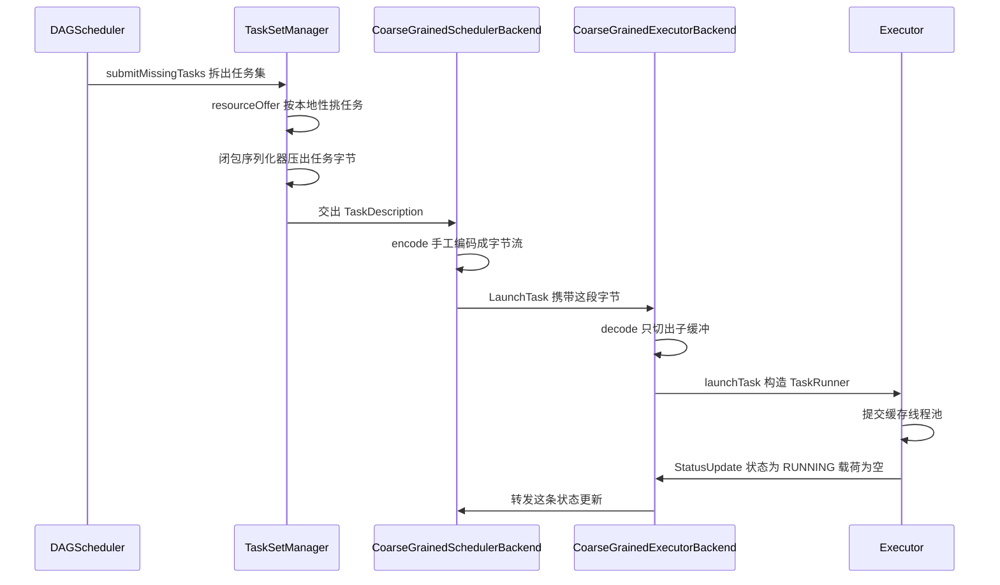
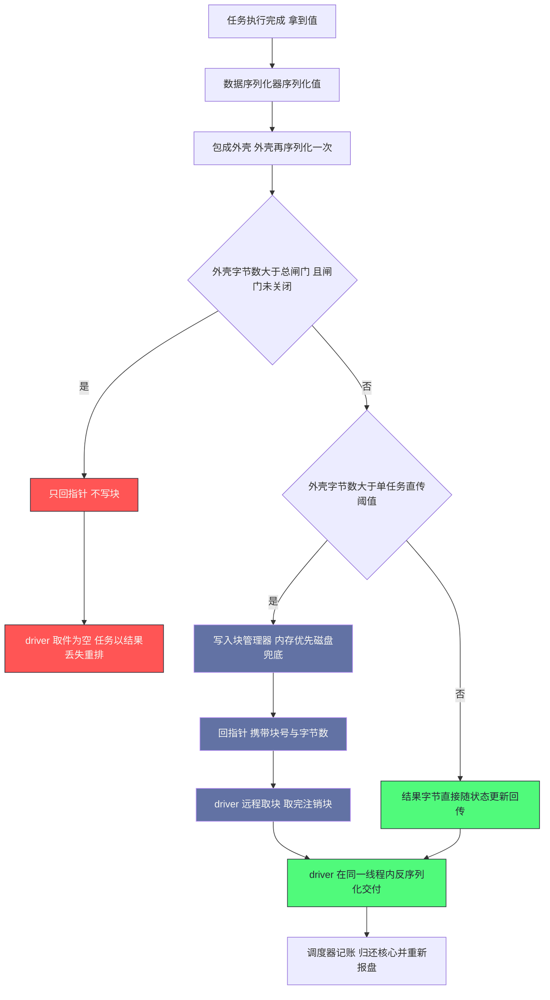
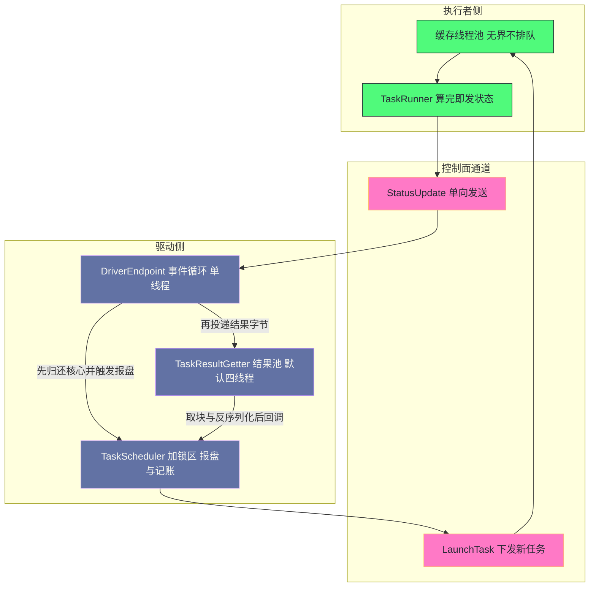
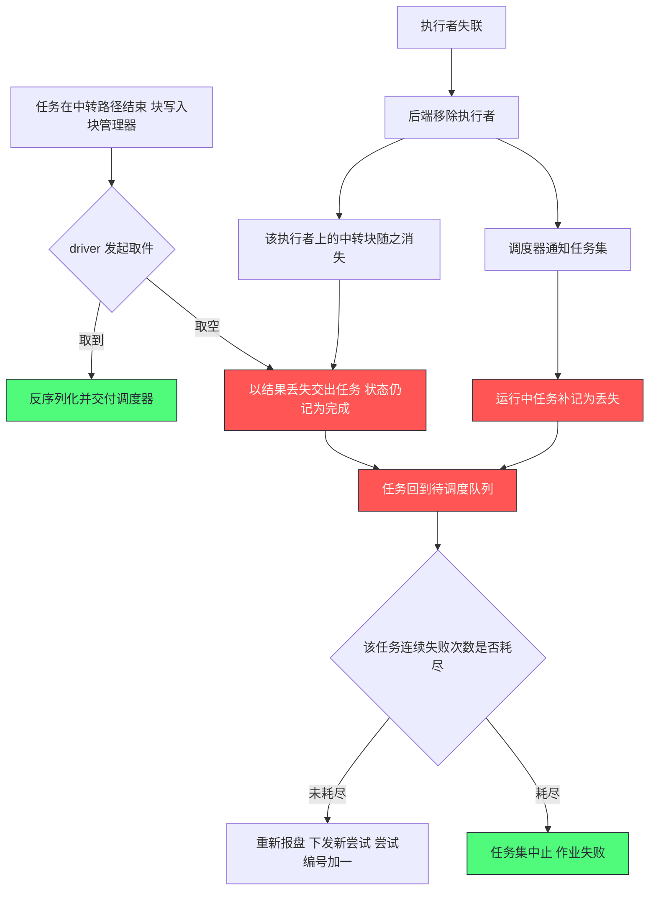

# 7. Spark Executor启动与结果传递

**摘要：**

分布式计算里最容易被低估的一段路程，是"结果从执行者回到调度者"这一程。任务算完只是把值拿到了手里，而这个值还要经过序列化、打包、择路、传输、拆包、记账六道手续，才能变成调度器眼里的一次"成功"。本文专讲这一程：先看任务如何被打包成 `LaunchTask` 送到执行者手上——`Task` 对象由闭包序列化器序列化，外层再被 `TaskDescription` 手工编码成一个紧凑字节流，闭包引用的文件与依赖不随任务字节重复搬运；再看结果如何回来——执行者算完值之后要做一次三岔判断，结果小则随状态更新直接回传，超过单任务直传阈值则先落进 BlockManager 只回一个块号，而一旦超过 `spark.driver.maxResultSize` 这个总闸门，执行者连块都不落，只回一个指向虚空的指针。两条路径对应两道不同的闸门，量的口径也不同：单任务阈值是 `min(配置值, RPC 消息上限)`，累计闸门按任务集累加并且豁免 shuffle map 任务。随后拆解序列化的四段开销、driver 侧那个默认只有四个线程的结果获取器、核心归还与结果交付之间的时间错位、大量小结果如何把 driver 变成单点，以及结果丢失时执行器死亡与调度器重试之间的那个衔接点。最后给出八条反例与一份取舍清单。全文的落点是一句判断：**结果通道的成本不在带宽，而在"每个任务都要经过同一个进程"这件事本身。**

---

## 第 1 章 结果的归途

### 1.1 任务结束时的三个动作

一个任务在执行者（Executor）里跑完，会发生三件彼此独立的事，而它们经常被混为一谈。

第一件是值的产生：任务的 `run` 方法返回一个结果，对 `ResultTask` 而言是用户函数作用在这一分区上的返回值，对 `ShuffleMapTask` 而言则是一份写盘后的 MapStatus。

第二件是值的序列化与打包：执行者用一个序列化器实例把值变成字节，再把这段字节连同累加器（Accumulator）更新、指标峰值一起包进一个结果对象（`DirectTaskResult`），这个结果对象自身还要再被序列化一次。

第三件是报告的发出：执行者通过 `ExecutorBackend.statusUpdate` 把状态与载荷组成一条状态更新消息（`StatusUpdate`），经 RPC 发给 driver。任务是否"完成"，在 driver 眼里取决于这条消息是否到达，而不是取决于那个值是否还在执行者的内存里。

这三件事的顺序是固定的，但它们占用的时间相差极大：值序列化可能只花几毫秒，也可能花掉几十秒；状态上报本身通常只是一次异步发送。把这三种耗时混在一个"任务耗时"里，是后面一系列误判的源头。

### 1.2 算完为什么不等于交付

执行者不做结果汇总，这是 Spark 执行模型里一条硬约束。

执行者是无状态的计算容器：它的生命周期跟着应用走，随时可能因为节点故障、抢占、动态缩容而消失，因此它不能成为任何结果的保管者。所有的结果必须汇到一个进程里，那个进程只能是 driver，因为只有 driver 手里有 DAG 与 Stage 的完整视图，只有它能判断"这个分区的结果是否足以让下一个 Stage 开跑"。

这条约束带来一个直接后果：**driver 是结果通道上唯一的必经节点，任何一次任务完成都要在它那里排队。** 一个 Stage 有一万个任务，就有一万条消息进入同一个进程的事件循环。这不是设计缺陷，而是集中式调度的必然代价。

### 1.3 一条被忽视的成本线

谈 Spark 性能，注意力通常落在 Shuffle 上：磁盘、网络、序列化、倾斜，样样都有明确的量化指标。结果通道则安静得多，它没有独立的观测面板，也没有专门的调优章节，只在作业不明原因变慢或者 driver 突然 OOM 时露出一点痕迹。

它与 Shuffle 有一个本质区别：Shuffle 的数据量取决于分区数与数据分布，可以靠改分区策略绕开；结果通道的流量取决于任务数与每个任务的结果大小，而任务数通常等于分区数，是很难压缩的量。一个十万分区的作业，即使每个任务只回传几 KB，累计也是一次可观的传输，更麻烦的是那十万次消息处理全部落在同一个进程的单线程事件循环里。

行文至此可以给出本篇要回答的核心问题：结果到底走哪条路回去，路上有几道关卡，关卡的量纲是什么，以及当路断了会发生什么。

### 1.4 一个类比：分拣中心的回执

把结果回传类比成快递分拣中心的回执流转，能一次性看清几个约束。

包裹本身对应任务的值，它是重的东西；回执单对应状态更新消息，它是轻的东西，但必须有，因为分拣中心只认回执。小包裹随回执一起带走，这就是直接回传；大包裹塞不进信封，于是先存进自提柜、回执上只写柜号，这就是经 BlockManager 中转，回执变轻了，但多了一次取件。

而"总重量上限"对应 `spark.driver.maxResultSize`：它限制的不是单个包裹，而是一整批包裹加起来的重量。至于某个包裹大到连自提柜都塞不进的极端情形，系统选择的处理方式不是"硬送"，而是"回执照发、包裹丢掉"——取件的一方会发现柜子是空的，于是这笔投递记为丢失。

### 1.5 路线的铺排

后面十章按"发出去、收回来、算代价、看边界"的顺序展开：任务如何打包送出，状态更新这条运输带，两条归途与各自的触发条件，两道闸门的量纲差异，序列化的四段开销，driver 的单点压力，资源回收的两重含义，结果丢失与重试的衔接，最后收在反例与落点上。

---

## 第 2 章 LaunchTask：任务如何被送到执行者手上

在讲任务怎么被送出去之前，先交代一句执行者这边的前情：执行者进程启动后要向 driver 注册，driver 回一条注册成功消息，它才在自己的进程里创建真正的 `Executor` 对象；在此之前收到的 `LaunchTask` 会被直接拒绝，随即以失败退出。也就是说，任务下发这条链路只有在执行者完成注册之后才真正接通，而链路的另一端是 driver 里那套负责记账的调度后端。

### 2.1 从资源报盘到一条消息

任务的旅程起点不是网络，而是 driver 内部的一次资源报盘（resource offer）。

`DAGScheduler` 在 `submitMissingTasks` 里把一个 Stage 拆成一批任务，交给 `TaskSchedulerImpl.submitTasks`；任务进入对应任务集（`TaskSetManager`）的待调度队列，等待资源。当调度后端（`CoarseGrainedSchedulerBackend`）发起一次报盘，`TaskSchedulerImpl.resourceOffers` 会按本地性、推测执行、黑名单等一串规则，为每个可用的核心挑一个任务，产出一组任务描述（`TaskDescription`）。

这条链路上有一处容易看漏的分工：**任务对象在这里被序列化，而不是在执行者被"创建"。** `TaskSetManager` 生成任务描述时调用闭包序列化器，把任务对象连同它需要的上下文压成一段字节，此后 driver 侧不必保留它的可执行形态。理由很直接：任务数量远大于机器数量，序列化一次送走，比让每个执行者都反序列化一份完整任务定义要省得多。

### 2.2 闭包序列化器与它的边界

这里要先厘清一个常被混淆的分工：Spark 里有两类序列化器，它们管的东西完全不同。

**闭包序列化器（closure serializer）**负责序列化闭包与任务，也就是"代码那一侧"。它由 `spark.closure.serializer` 指定，默认是 `JavaSerializer`。任务是带着闭包走的：算子函数、函数里引用的外部变量、以及没有被 `@transient` 标注的字段，都会跟着这段字节一起去执行者。

**数据序列化器（data serializer）**由 `spark.serializer` 指定，负责 RDD 数据、Shuffle 记录、累加器更新与**任务结果的值**。

两者的关系是很多人调优时的盲区：把 `spark.serializer` 换成 Kryo，加快的是数据与结果值，闭包与任务描述仍走默认的 Java 序列化。笔者见过换 Kryo 之后抱怨"任务启动没变快"的案例——任务启动耗时主要花在任务反序列化上，而那段字节由闭包序列化器产出。

闭包序列化器还有一条硬边界：它要求闭包里的所有对象可序列化。把 driver 侧的大集合、`SparkContext` 的引用、数据库连接捕获进算子，都会在执行者侧抛出 `TaskNotSerializableException`，或者更隐蔽地在 driver 侧就失败在序列化任务这一步。解法只有一个：把大对象做成广播变量（broadcast variable），让它一次分发、多处复用，而不是随每个任务重复搬运。

### 2.3 TaskDescription 的手工编码

任务序列化后的字节不能直接扔进 RPC，它需要一个信封，这个信封就是 `TaskDescription`。

这里有一个设计细节值得单独讲：`TaskDescription` 不走通用序列化框架，它自己实现了 `encode` 与 `decode` 两个方法，把字段按固定顺序写进一个字节流。源码注释给出了两条理由，两条都值得记住。

第一条理由是顺序依赖：执行者收到任务之后，必须先拿到 JAR 与文件清单并把它们加进类路径、先设置好属性，然后才能反序列化任务对象本身；因此这些信息必须放在信封的固定位置上，先于任务字节被读出。

第二条理由是成本：每个任务都要发一次信封，序列化耗时与字节数都直接乘上任务数量。通用序列化框架会写入字段名、类型标记、`Map` 的结构信息，对小对象而言这些额外开销占比极高；手工编码把字段按顺序平铺，省掉了这一层。

手工编码的代价也很清楚：字节布局一旦变化就不再向后兼容，driver 与执行者的版本必须一致。这条代价被接受，是因为 Spark 本来就不支持跨大版本混跑 driver 与执行者。

```scala
// 摘自 TaskDescription.encode，字段顺序即字节布局，不能随意调整
dataOut.writeLong(taskDescription.taskId)
dataOut.writeInt(taskDescription.attemptNumber)
dataOut.writeUTF(taskDescription.executorId)
dataOut.writeUTF(taskDescription.name)
dataOut.writeInt(taskDescription.index)
dataOut.writeInt(taskDescription.partitionId)
serializeArtifacts(taskDescription.artifacts, dataOut)   // 先给类路径与文件
// 属性必须早于任务字节，执行者要先据此设置环境
dataOut.writeInt(taskDescription.properties.size())
// 任务本身的字节已经在别处序列化好，这里只做拼接，不再过一遍序列化器
Utils.writeByteBuffer(taskDescription.serializedTask, bytesOut)
```

### 2.4 信封里装了什么

把 `TaskDescription` 的字段摊开看，能读出 Spark 4.x 对"任务"这个概念的理解。

| 字段 | 内容 | 为什么必须在信封里 |
|---|---|---|
| `taskId` / `attemptNumber` | 任务编号与尝试次数 | 执行者回报状态时的唯一凭据，尝试次数用于区分重试 |
| `executorId` | 目标执行者编号 | 执行者据此校验"这个任务是不是发给我的" |
| `name` / `index` / `partitionId` | 任务名、任务集内下标、分区号 | 定位与日志，也是推测执行的判定依据 |
| `artifacts` | JAR、文件、归档、REPL 类目录的集合 | 必须先于任务字节生效，否则任务类加载不到 |
| `properties` | 任务级属性快照 | 执行者要按这份快照设置线程上下文，而不是读自己的配置 |
| `cpus` | 小数形式的 CPU 配额 | 支持分数核心，调度侧据此记账 |
| `resources` | 资源类型与地址配额 | GPU 等自定义资源要绑定到具体设备地址 |
| `userCredentials` | 版本号加凭据字节 | 4.x 起随任务下发短期凭据，避免额外一次 RPC |
| `serializedTask` | 任务对象的字节 | 真正的可执行载荷，最后一段 |

表里最不起眼的一项是 `properties`，但它解释了一个常见现象：同一个执行者上跑的两个任务，可能看到不同的配置快照。任务级属性是 driver 侧在报盘时打进去的，执行者按快照设置线程上下文，因此运行期修改配置不会影响已经在跑的任务。

`userCredentials` 是 4.x 的新增项，源码注释把取舍写得很清楚：每个任务携带完整的短期凭据（数 KB 量级），代价随"在飞任务数"而非"任务总数"增长，因为凭据几分钟就过期。这条注释的价值不在结论，而在它说清了代价的量纲。

### 2.5 依赖与工件不随任务字节重复搬运

一个自然的疑问是：任务的字节里到底有没有依赖？如果没有，执行者靠什么跑起来？

答案是分层处理的。窄依赖的链路跟着任务走：任务对象持有它要计算的 RDD，RDD 又持有父 RDD，因此一段分区到分区的计算链被完整序列化进任务字节——这是执行者不必回问 driver 就能算的前提。这也解释了链条很长、闭包很大时任务字节为何迅速膨胀。

宽依赖不跟着任务走：Shuffle 的数据不在任务字节里，它是上一个 Stage 写出的 MapStatus 与磁盘文件，由 driver 调度、由执行者主动去拉。

外部工件走第三条通道：JAR、文件、归档通过 `artifacts` 里的索引引用，配合 `SparkContext` 侧的引用计数与执行者侧的下载逻辑，同一份工件在一个执行者上只落一次盘，避免"任务数乘以工件大小"的乘积式浪费。

### 2.6 下发环节的两种失败形态

任务下发失败有两种典型形态，报错信息都很有辨识度。

第一种是任务字节过大。调度后端在发送前会检查编码后的字节长度，一旦达到 RPC 消息上限（`spark.rpc.message.maxSize`，默认 128 MiB），直接中止对应任务集，报错大意是"序列化的任务有多少字节，超过 `spark.rpc.message.maxSize` 允许的上限，考虑调大该配置或改用广播变量"——这条信息把两条出路都写在里面。

第二种是闭包不可序列化，表现为 `TaskNotSerializableException`，堆栈里通常能直接看到是哪个字段惹的祸。两种形态的共同点是发生在 driver 侧、任务还没出门，因此不会在执行者日志里留下痕迹；如果执行者日志干干净净而作业直接失败，方向应当在 driver。

### 2.7 下发链路全景

把上面几节串起来，一条任务的完整下发路径如下图。



图里最值得留意的一处是 `decode` 那句"只切出子缓冲"。解码并没有把任务对象还原出来，它只是把信封拆开、把任务字节切片成一个独立的缓冲区，真正的任务反序列化被推迟到 `TaskRunner` 在自己的线程里执行时才发生。

这个推迟带来两个后果：其一，执行者的 RPC 接收线程不会被反序列化阻塞，收消息与干活被彻底分开；其二，任务反序列化的耗时被记在任务的"执行者反序列化时间"里，而不在 RPC 处理里——这正好是第 6 章要讲的观测口径问题。

---

## 第 3 章 StatusUpdate：状态机是结果的运输工具

### 3.1 一条消息，三样东西

执行者回报状态用的是同一条消息，不管这次回报带不带结果。

一条状态更新消息包含四类信息：哪个执行者发的（`executorId`）、哪个任务的（`taskId`）、什么状态（`state`）、以及一段可选载荷（`data`，一个可序列化缓冲区）。此外还有这项任务占用的 CPU 配额与资源配额，用于 driver 侧记账归还。

注意"载荷"这个词：它不是 Java 对象，而是一段字节。driver 收到之后并不立刻解析，而是把整段字节交给一个专门的线程池处理。这个设计是整条结果通道的枢纽——**消息的接收是串行的，消息的解析是并行的**。

### 3.2 RUNNING 为什么发在反序列化之前

执行的起点有一处容易被忽略的顺序：状态上报 `RUNNING` 发生在任务反序列化之前。

执行者拿到任务描述后，构造一个任务执行器（`TaskRunner`），在线程池里跑起来，第一件事是发一条 `RUNNING` 状态，载荷是空字节；之后才去反序列化任务、设置类加载器、执行计算。源码里这两行的先后顺序是固定的，而它并不是随手写的。

driver 侧由此可以把任务从"已派发未开始"推进到"运行中"，为推测执行给出启动时刻基线。如果反过来先反序列化再上报，一个反序列化要几百毫秒的大任务在 driver 眼里会长时间停留在"已派发"，推测执行会误判为迟到。

同一条消息在 driver 侧的处理也与这个顺序呼应：`RUNNING` 只更新任务的启动标记，不进入结果处理路径。

### 3.3 状态与载荷的对应关系

把 `TaskState` 的取值与载荷内容对照起来看，能看清"结果"在协议里的位置。

| 状态 | 谁会发 | 载荷内容 | driver 侧走向 |
|---|---|---|---|
| `RUNNING` | 执行者 | 空字节 | 只更新启动标记，不做结果处理 |
| `FINISHED` | 执行者 | 序列化的 `TaskResult` | 交给结果获取器解析、拉取、交付 |
| `FAILED` | 执行者 | 序列化的失败原因 | 交给结果获取器解析原因、计入失败 |
| `KILLED` | 执行者 | 序列化的杀死原因 | 同上，但通常不计入普通失败次数 |
| `LOST` | 不由执行者上报 | 无 | 由调度器在执行者失联时自行补记 |

最后一行需要强调：状态更新路径上的处理函数对 `LOST` 是直接断言的，也就是说这条通道上根本不会出现 `LOST`。任务丢失是 driver 的判定，不是执行者的报告——执行者若还活着，就一定会给出 `FINISHED`、`FAILED` 或 `KILLED` 之一；给不出的唯一原因是它已经不在了，而这个事实只有 driver 能观察到。

### 3.4 TaskResult 与 StatusUpdate 的关系

这两者的关系是"内容与信封"，但要说得更准确一些：`TaskResult` 是信封里的那封信，而信本身有两种写法。

`DirectTaskResult` 是**自带内容**的写法：值已序列化成字节，再配上累加器更新与指标峰值，整封信被序列化成一段字节，塞进状态更新。

`IndirectTaskResult` 是**只留地址**的写法：信里只写一个块编号与这段内容的字节数，内容本身留在执行者的块管理器（BlockManager）里，等 driver 来取。

两种写法在协议层是同一种类型（`TaskResult` 的两种具体实现），因此 driver 侧的分支判断只有一处，就在解析完信封之后：如果解析出来的是"自带内容"，就地反序列化值并交付；如果是"只留地址"，先做一次远程取块，再反序列化。这个统一让状态机不必关心结果大小，结果大小只影响"信里装什么"，不影响"信怎么走"。

理解了这层关系，就能回答一个常见疑问：为什么结果丢失不表现为"任务失败"，而表现为"以结果丢失的原因被重排"？因为信封完好到达了，状态是 `FINISHED`，失败的只是取件。协议层如实记录了"执行者认为它成功了"，而取件失败是 driver 侧的观察。

---

## 第 4 章 两条归途：直接回传与块中转

### 4.1 执行者侧的三岔判断

结果多大算"大"，这个判断由执行者自己做，driver 不参与。执行者在拿到值之后，走的是这样一段逻辑。

```scala
// 摘自 Executor.TaskRunner，三岔判断的核心就在这几行
val resultSer = env.serializer.newInstance()
// 第一段：先序列化值本身，得到 ChunkedByteBuffer
val valueByteBuffer = SerializerHelper.serializeToChunkedBuffer(resultSer, value)
// 第二段：把值字节、累加器更新、指标峰值包成外壳，外壳再序列化一次
val directResult = new DirectTaskResult(valueByteBuffer, accumUpdates, metricPeaks)
val serializedDirectResult = SerializerHelper.serializeToChunkedBuffer(ser, directResult)
val resultSize = serializedDirectResult.size

val serializedResult: ByteBuffer = {
  if (maxResultSize > 0 && resultSize > maxResultSize) {
    // 超过总闸门：不落块，只回一个指针
    ser.serialize(new IndirectTaskResult(TaskResultBlockId(taskId), resultSize))
  } else if (resultSize > maxDirectResultSize) {
    // 超过单任务阈值：先落块，再回块号
    env.blockManager.putBytes(TaskResultBlockId(taskId), serializedDirectResult,
      StorageLevel.MEMORY_AND_DISK_SER)
    ser.serialize(new IndirectTaskResult(TaskResultBlockId(taskId), resultSize))
  } else {
    serializedDirectResult.toByteBuffer   // 直接塞进状态更新
  }
}
execBackend.statusUpdate(taskId, TaskState.FINISHED, serializedResult)
```

这段代码里有三处值得停下来看的地方。

第一处是**判断的量是外壳而非值**。`resultSize` 量的是"外壳序列化之后的字节数"，里面包含值、累加器更新与指标峰值，通常比裸值大一点。因此"结果大小"这个口径天然带了一点外壳税，配置阈值时量到的永远不是自己心里想的那个数。

第二处是**第一个分支不落块**。超过总闸门时执行者只发一个指向 `TaskResultBlockId(taskId)` 的指针，却不往块管理器里写任何东西。这个块号是真实存在的编号，但块不存在。driver 拿到指针去取件，必然取空。

第三处是**同一段逻辑里用了两个序列化器实例**：`resultSer` 来自 `env.serializer`（数据序列化器），`ser` 来自闭包序列化器。这一点在第 6 章展开，这里只先记住两个名字。

### 4.2 直接回传：把结果装在信封里

结果小于单任务直传阈值时，走的是最朴素的一条路：序列化后的外壳直接作为 `FINISHED` 状态更新的载荷发出去。

这条路的成本结构很干净：一次值序列化、一次外壳序列化、一次 RPC 发送、一次外壳反序列化、一次值反序列化，没有额外存储、往返与块生命周期管理。绝大多数作业走的都是这条路，因为默认阈值是 1 MiB，而单分区结果超过 1 MiB 的作业并不算多数。

这条路是唯一一条"结果随状态一起到达"的路径，延迟下限就是一次 RPC 往返，同机架内通常在亚毫秒到毫秒级。

### 4.3 中转：先落块，再回指针

结果超过单任务直传阈值但没超过总闸门时，执行者做三件额外的事：往块管理器里写一个块（`putBytes`），块的键是任务编号派生的 `TaskResultBlockId`，存储级别是内存优先、磁盘兜底、序列化形式；然后回一个只带块号与字节数的指针；最后等 driver 来取。

这里有三个设计选择值得说明。

为什么用"任务编号派生块号"而不是"分配一个随机块号"：因为块号就是取件凭据，它必须能从任务元数据里推出来，否则 driver 还得额外维护一张映射表。用任务编号派生是最省事的做法，代价是同一任务的重试会覆盖同一个块号——而这恰好是想要的行为，重试产生的旧块本就该被覆盖。

为什么存储级别是内存优先、磁盘兜底：中转块的生命周期极短（从任务结束到 driver 取走），放内存最快；但若 driver 忙不过来，块堆积在内存里会挤占执行内存，因此给了磁盘兜底。这也解释了为什么本地的 `spark.local.dir` 在"结果偏大且 driver 繁忙"的作业里会看到明显写入。

为什么要告诉块管理器主节点：块要登记到 driver 侧的块管理器主节点，否则 driver 不知道去哪个执行者取。这一步是把"我有这个块"的事实广播出去，是后面远程取件能成功的前提。

### 4.4 driver 侧的远程取件

driver 收到指针之后，做的第一件事是通知调度器"这个任务开始取结果了"，随后才发起远程取块。这个先后顺序决定了"取结果时间"这个指标的口径——它从任务结束算到结果真正到达，中间的远程传输、排队、重试都算在里面。

取件本身是一次块管理器的远程读。这里有一处与直觉相反的地方：**取件走的是块管理器的数据传输通道，而不是控制面的 RPC 通道。** 两条通道的上限、拥塞行为、失败语义都不一样。控制面有 `spark.rpc.message.maxSize` 的硬上限，数据面没有同样的限制，因此大结果可以经数据面安全通过，而不必去动控制面的上限。

取件成功后，driver 会立刻注销这个块。注销的理由很直接：结果已经落到 driver 的内存里，执行者侧那份副本再留着只会白占空间；而且中转块不是缓存，没有任何复用价值，一个块对应一次任务、一次取件。

取件失败则进入另一条分支：任务不会记为成功，而是以"结果丢失"的原因被交回调度器重排。这条分支在第 9 章展开。

### 4.5 两条路径的对比

| 维度 | 直接回传 | 块中转 |
|---|---|---|
| 触发条件 | 外壳字节数不超过单任务阈值 | 超过单任务阈值且未超总闸门 |
| 载荷内容 | 完整的结果字节 | 块号加字节数 |
| 额外存储 | 无 | 执行者块管理器，内存优先磁盘兜底 |
| 额外网络 | 无 | 一次远程取块，走数据面 |
| 额外失败点 | 无（消息到达即成功） | 取件失败、执行者中途死亡、块被挤出 |
| 时延下限 | 一次控制面往返 | 一次控制面往返加一次数据面传输 |
| 观测指标 | 无专属指标 | 取结果时间、块读取记录 |
| 典型场景 | 分区结果小于 1 MiB | `collect` 收较大分区、驱动端聚合前的中间结果 |

两条路径的分界线是**一个固定阈值**，而不是"是否需要落盘"这类语义判断。这一点很重要：阈值化意味着同一个作业在不同数据量下可能走不同的路，因此"某天开始变慢"很可能只是结果越过了阈值，而不是代码变差了。

### 4.6 决策与流转全景

下图把执行者的三岔判断与两条归途画在一起，也标出了超闸门那条"回指针而不落块"的岔路。



图中红色那一路是"设计上允许、运行时不期望"的路径：执行者明知结果超了总闸门，仍然发出一个格式正确但内容缺失的回报。这不是 bug，而是让 driver 用统一的方式处理"取不到结果"——无论是因为执行者死了、块被挤出了，还是因为压根没写，driver 拿到的都是"取件为空"，都触发同一套重排逻辑。把三种原因收敛成同一种表现，代价是丢掉了原因信息，收益是协议少了一种分支。

---

## 第 5 章 两道闸门：单任务阈值与累计闸门

### 5.1 单任务阈值的实际取值

单任务直传阈值对应的配置是 `spark.task.maxDirectResultSize`，默认 1 MiB，自 2.0.0 起提供，单位是字节，且有一个硬性校验：取值必须小于约 2 GB。

但执行者用的不是这个配置的原始值，而是它与 RPC 消息上限的较小者。

```scala
// 摘自 Executor，直传阈值不能超过控制面消息上限
private val maxDirectResultSize = Math.min(
  conf.get(TASK_MAX_DIRECT_RESULT_SIZE),          // 默认 1 MiB
  RpcUtils.maxMessageSizeBytes(conf))             // 默认 128 MiB
```

这一行解释了一个很常见的困惑：把 `spark.task.maxDirectResultSize` 调到 200 MiB，发现行为没有任何变化。原因是控制面上限只有 128 MiB，取较小者之后仍然是 128 MiB；而且即便如此，超过 128 MiB 的结果也不会真的直传，因为状态更新消息本身就要受这个上限约束。

要真正放大直传上限，必须同时调整 `spark.rpc.message.maxSize`，而这一步的代价是全局的——它抬高的是所有控制面消息的上限，包括那些本就该保持轻量的心跳与状态更新。

### 5.2 为什么不能突破控制面上限

理解这条约束要回到协议结构：直接回传的结果是状态更新消息的一部分，它和任务编号、状态枚举共享同一条消息、同一个上限。因此"结果直传上限"这个概念本身就带着天花板，天花板就是消息上限。

从另一侧看，这条约束其实是保护：控制面消息走 driver 的事件循环，一条超大消息会长时间占用接收路径，把其他执行者的状态更新堵在 TCP 缓冲区里；上限既防止单个任务拖垮事件循环，也给了序列化一个可预估的内存上界。

### 5.3 累计闸门

第二道闸门是完全不同性质的判断，它不关心单个任务，而是关心整个任务集累计交出了多少字节。

driver 在交付结果之前会调用一次"是否还能再取"的检查，这个检查做三件事：把本次字节数累加到任务集的总量上、把计数加一、然后与 `spark.driver.maxResultSize` 比较。一旦超限，任务集被中止，整个作业失败。

```scala
// 摘自 TaskSetManager，累计闸门的记账逻辑
def canFetchMoreResults(size: Long): Boolean = sched.synchronized {
  totalResultSize += size          // 只增不减，没有任何回落
  calculatedTasks += 1
  // shuffle map 任务集被豁免，它们的结果本来就是 MapStatus 而非用户数据
  if (!isShuffleMapTasks && maxResultSize > 0 && totalResultSize > maxResultSize) {
    abort(s"Total size of serialized results of ${calculatedTasks} tasks " +
      s"(${totalResultSize} bytes) is bigger than spark.driver.maxResultSize " +
      s"(${maxResultSize} bytes)")
    false
  } else true
}
```

这段逻辑有三个特征需要记住。

**总量只增不减。** 任务成功后不会扣回，因此它衡量的是"一个任务集至今累计交出了多少"，不是"当前同时占用多少"——它是流量指标，不是存量指标。

**判定发生在交付之前，不是发送之前。** 执行者已经把结果做出来了，甚至已经写进块管理器，driver 才判定超限；结论出现时，网络传输与序列化开销已经花掉。

**它是任务集级别的，不是作业级别的。** 每个任务集各有一份计数，Stage 之间不共享，一个作业有多个 ResultStage 时每个都从零累加。

### 5.4 超限的三种报错形态

超限在不同位置表现为三种不同的现象，这三种现象经常被当成三个不同的问题去排查。

**形态一：作业直接失败，报"总字节数超限"。** 这是累计闸门在 driver 侧生效，错误信息里会给出任务数、累计字节数、配置键与上限值。它的特征是失败发生得非常干脆，且报错里带"总计"字样。

**形态二：执行者日志里的警告"结果大于 maxResultSize，丢弃"。** 这是单个任务的外壳字节数就超过了整批的总额度——单个任务超过总闸门，累计计量自然也会随之超限；但执行者先把结果丢了，driver 的取件检查随即失败。这条警告是唯一能证明"结果是被主动丢弃而非传输失败"的证据。

**形态三：任务被以"结果大小超过 maxResultSize"的原因杀死。** 这是 driver 在取件检查失败后对任务的处置，任务的终态是 `KILLED` 而不是 `FAILED`；源码里写明这个处置的用意是让任务别以"僵尸任务"的形态挂在运行集合里。

三种形态的排查方向完全不同：形态一要看分区数与每分区大小的乘积，形态二要定位是哪个算子产出了超大结果，形态三通常出现在形态一之后，属于同一个根因的余波。

### 5.5 谁被豁免

累计闸门对 shuffle map 任务集是豁免的。

理由不难理解：Map 端任务的结果不是用户数据，而是一份 MapStatus——记录每个 reduce 分区输出了多少字节、在哪个块上。它的大小与数据量基本无关，只与分区数相关。如果把这类任务也纳入累计计量，那么"总闸门"实际衡量的是"分区数乘以几十字节"，与用户真正关心的事情无关。

这条豁免带来一个容易被忽略的推论：**同一个作业里，repartition 之后的 reduce 阶段会受闸门约束，之前的 map 阶段不会。** 因此看到"超限"时，超的一定是某个 ResultStage 的结果收集，而不是中间阶段的产出。

### 5.6 两条路径的量纲并不一致

这里有一处只从代码能看出来的不对称，而它会影响对"我到底传了多少"的判断。

直接回传路径上，累计计量用的是**值的字节数**（值的缓冲区大小）；中转路径上，累计计量用的是**外壳的字节数**（执行者记录在指针里的那个数）。后者比前者多出累加器更新与指标峰值的开销。

也就是说，同样一批结果，走直传时 driver 记账偏小，走中转时记账偏大，偏差幅度取决于累加器数量与指标峰值的条目数。对于一个有几十个累加器的作业，这个偏差不可忽略，它会让"累计字节数"这个数字在两条路径混用时失去可比性。

### 5.7 调优的取舍

| 参数 | 默认 | 调大的收益 | 调大的代价 |
|---|---|---|---|
| `spark.task.maxDirectResultSize` | 1 MiB | 减少块中转与远程取件 | 需同步调大控制面上限，单条消息变重 |
| `spark.rpc.message.maxSize` | 128 MiB | 允许更大的直传与更大的任务字节 | 控制面内存占用上升，超大消息阻塞事件循环 |
| `spark.driver.maxResultSize` | 1 GB | 减少误杀 | driver 堆压力上升，最坏情况是 OOM 而非报错 |
| `spark.resultGetter.threads` | 4 | 提高结果解析吞吐 | driver CPU 竞争加剧，与 GC 争夺线程 |
| `spark.serializer` 设为 Kryo | Java | 缩小值的字节数、加快值序列化 | 需要注册类，外壳与闭包不受益 |

表里最需要权衡的是 `spark.driver.maxResultSize`。调小会让作业在结果刚变大时就失败，属于早失败；调大会把风险从明确报错转成 driver 内存被逐渐吃掉，后者往往表现为 `OutOfMemoryError` 或频繁 Full GC，排查成本高得多。

因此这个参数的正确用法是**把它当作保护 driver 的保险丝，而不是当作性能开关**。保险丝的额定值应当按 driver 堆大小与并发作业数估算，而不是按"我希望这个作业能跑完"来定。

### 5.8 一处常见误解

把总闸门理解成"单个结果不能超过多少"，是这套机制里最常见的误解。

实际上它是**任务集累计**的上限。一个分区 100 MB 的作业，如果只有 5 个分区，总量 500 MB，在默认 1 GB 的闸门下安然无恙；而一个分区只有 2 MB 的作业，如果有 600 个分区，总量 1.2 GB，就会撞上限。前者单结果大，后者单结果小，失败的是后者。

反过来说，"结果小就安全"这个直觉也是错的。真正决定是否撞闸门的是"分区数乘以每分区结果大小"这个乘积，而这个乘积通常由分区策略决定，与单条记录多大关系不大。

---

## 第 6 章 序列化与反序列化的四段开销

### 6.1 值的第一段：把结果变成字节

结果回传的第一个动作是序列化值，用的序列化器实例来自数据序列化器（`spark.serializer`）。

4.x 起这段序列化产出的不再是单个 `ByteBuffer`，而是一个分块缓冲区（`ChunkedByteBuffer`）。这个变化的意义在于突破单块 2 GB 的上限：分块之后，一个任务的返回值理论上可以超过 2 GB，只是它必然走中转路径，因为直传阈值远小于这个量级。

这段耗时被记入"结果序列化时间"指标，起点与终点分别卡在这次序列化前后的纳秒时刻。因此这个指标量的非常精确——它只量值，不量外壳。

### 6.2 外壳的第二段：再包一层

值变成字节之后还要被包进外壳，外壳再被序列化一次。源码里在这一行上方留了一句注释，大意是"TODO：不要序列化值两次"。

这句 TODO 是理解整条通道成本的关键。严格说，第二次序列化并没有重新遍历值对象图——值已经是字节，第二次只是把这堆字节当成一个字段原样拷贝进外层流。但拷贝并不免费：它是一次完整的内存复制，复制量等于结果大小。

4.x 在这里加了一处优化：序列化外壳时传入预估容量（值字节数加上累加器与指标峰值的粗略大小），让输出缓冲区一次分配到位，避免反复扩容；这不改变复杂度，但显著减少了中等结果的拷贝次数。

### 6.3 driver 侧的两次反序列化

回到 driver，一段字节要拆两层才见到值。

第一层是解析信封，把 `TaskResult` 还原出来；第二层是解析值，把值的字节还原成用户对象。两次用的序列化器不同：外层走闭包序列化器，内层走数据序列化器。

这两次反序列化都在结果获取器（`TaskResultGetter`）的线程池里执行，而且源码里专门留了注释说明意图：值的反序列化要在这里完成，且不持有任何锁，这样它就不会阻塞其他线程；等到调度器真正需要值时，发现已经反序列化好了，不必再拆一次。

这段安排的用意很清楚：**反序列化是 CPU 密集且耗时不可控的操作，绝不能放在调度器的锁里做。** 调度器的锁是全局的，一次长耗时的反序列化会把所有执行者的状态更新堵住，表现为整个作业卡住几百毫秒。

### 6.4 两类序列化器的分工

| 对象 | 序列化器 | 由谁决定 | 换 Kryo 是否受益 |
|---|---|---|---|
| 闭包与任务对象 | 闭包序列化器 | `spark.closure.serializer` | 否 |
| 结果外壳 `TaskResult` | 闭包序列化器 | 同上 | 否 |
| 结果的值 | 数据序列化器 | `spark.serializer` | 是 |
| Shuffle 记录 | 数据序列化器 | 同上 | 是 |
| 累加器更新 | 数据序列化器 | 同上 | 是 |

这张表解释了一处常见的调优落差：把 `spark.serializer` 换成 Kryo 之后，Shuffle 与结果值确实变小变快了，任务启动时间却没改善，因为任务与信封仍走 Java 序列化。小结果场景下外壳占比可能比值还大，整体收益因此远小于预期。

### 6.5 固定开销与小结果的税

结果回传的成本不是纯比例的，它有一个与结果大小无关的固定部分。

固定部分包括：一条状态更新消息的消息头、一次外壳序列化/反序列化的框架开销、累加器更新的序列化、指标峰值的序列化、以及 driver 侧的一条任务完成事件。这些开销的量级在微秒到百微秒之间，与结果大小基本无关。

固定开销决定了一个事实：**小结果不等于小开销。** 一个只回传几十字节的任务，它的回传成本可能大部分花在外壳与消息处理上。而任务数是分区数量级的，这个固定开销乘以任务数，就构成了 driver 侧那部分无法用"减少数据量"消除的压力。

### 6.6 观测口径

Spark UI 在任务详情里给了几个彼此独立的时间口径，理解它们的边界比记住名字更有用。

"结果序列化时间"量的是值序列化那一段，不含外壳。"执行者反序列化时间"量的是任务字节反序列化那一段，含任务对象与 RDD 的还原。"取结果时间"量的是任务结束到 driver 拿到结果之间的间隔，只有走中转路径时才有明显数值。"调度延迟"是任务在 driver 侧排队等待资源与上报之间的空隙。这些口径合起来能覆盖一次任务从生到死的全过程，但没有任何一项单独等于"结果回传的代价"。

### 6.7 一个反直觉的结论

把上面几节合起来，结论有些反直觉：任务数越大，结果通道的瓶颈越偏向那份与结果大小无关的固定开销，而不是带宽本身。"把结果变小"这类优化只在比例部分有效，遇到瓶颈在固定部分时就显得毫无作用；真正对症的方向是减少任务数，或者把汇总动作挪出 driver。

---

## 第 7 章 Driver 的单点压力

### 7.1 单线程的事件循环

driver 侧接收状态更新的那个端点（`DriverEndpoint`）是一个 RPC 端点，它的消息处理是串行的：一次只处理一条消息，处理完才取下一条。

这个串行性是整套并发设计的基准点：好处是状态更新天然没有并发冲突，不需要为完成顺序做额外同步；代价是任何一次处理变慢都会变成所有执行者的等待。

执行者发状态更新用的是单向发送（`send` 而非 `ask`），因此不会被 driver 卡住——消息进了对方接收队列，它就继续干活。这个选择把"driver 慢"的表现从"执行者阻塞"改成了"结果在队列里堆积"，耦合降低了，堆积却更不容易察觉：执行者一切正常，只有 driver 侧的内存与队列长度在涨。

### 7.2 两处锁

事件循环内部有两处会拿锁的地方，它们的粒度决定了"大量任务同时完成"时的表现。

第一处是调度器的状态更新入口，整个方法在调度器实例上同步。这里只做轻量工作：把任务从运行集合移除、投递到结果线程池、更新启动标记，真正耗时的反序列化被刻意挪到了线程池里，就是为了不在这把锁里发生。

第二处是资源报盘。每次任务完成都会触发一次报盘，报盘要拿调度器锁去遍历任务集、比较本地性、挑出可下发的任务；几十个执行者几乎同时完成时，这些请求会在事件循环里排成一队，逐个竞争同一把锁。

两处锁的共同特征是"持锁时间短但调用频繁"。压力不大时它们完全不是问题，而在任务数上到十万量级、执行者上百时，它就成了 driver CPU 利用率上不去、作业吞吐也上不去的常见原因。

### 7.3 反压缺失与时间错位

把第 3 章与本章串起来，会看到一处结构性的时间错位。

执行者发出 `FINISHED` 之后，它已经在等下一个任务了。driver 收到消息后做的第一件事是把核心还回去并触发报盘，也就是说，**在结果还没有被反序列化、甚至还没有被远程取回的时候，执行者可能已经接到并开始执行下一个任务了。**

这条链路里没有任何一环会因为"driver 处理不过来"而让执行者等待。执行者不会拒绝任务也不会排队，真正的并发度约束在 driver 侧的记账上——每派一个任务就扣一个核心，只有收到完成回报才还。因此"执行者不会超载"这个保证来自 driver 的记账，而不是来自执行者自己的队列。

结果就是：driver 的处理能力与执行者的计算能力之间没有负反馈。driver 慢了，执行者不会慢，只会让结果在 driver 的队列里越堆越多，最后以 GC 时间上升、事件延迟增大、甚至 OOM 的形式暴露。

### 7.4 结果获取器的线程池

driver 侧真正干重活的是结果获取器（`TaskResultGetter`）的线程池，默认四个线程，参数是 `spark.resultGetter.threads`。

这四个线程承担的工作包括：反序列化结果外壳、远程取块、反序列化值、把成功或失败转交给调度器。四项里最重的是远程取块——它是一次真正的网络 IO，可能几百毫秒，也可能因为对端繁忙而拖到秒级。

四个线程意味着同一个时刻最多有四个结果在被"取"。当一批结果都走中转路径且块都不小的时候，这个池子会成为吞吐瓶颈：其他结果的外壳解析全部排队，而它们的执行者早已去干下一个任务了。此时在 UI 上看到的典型现象是"取结果时间"这一列普遍偏高，而任务本身的执行时间正常。

### 7.5 大量小结果的放大效应

| 放大点 | 机理 | 观测特征 |
|---|---|---|
| 消息条数 | 每个任务至少两条状态更新（运行、完成） | driver 网络接收量与事件延迟同涨 |
| 外壳固定开销 | 每条结果都有一层信封与累加器负载 | 结果越小，固定开销占比越高 |
| 报盘次数 | 每次完成触发一次报盘，逐个加锁 | driver CPU 高但单核利用率不满 |
| 任务事件 | 每条完成都产生一条监听事件，进监听总线 | UI 与事件日志的写入压力，历史服务器变慢 |
| 内存驻留 | 未处理完的结果在队列里占堆 | 老年代增长与 Full GC 频率上升 |

表里最后一行最危险，因为它不报错。分区过多、结果又走中转路径的作业，可能在 driver 堆里同时挂着大量待取块引用与反序列化中间对象，表现是作业越来越慢而所有执行者的 CPU 都不饱和。

### 7.6 并发视图

下图把执行者、RPC 通道与 driver 侧的三条处理线程放在一起，标出了"核心归还"先于"结果交付"这个错位。



图里从 `C1` 出发有两条箭头：一条先去 `C3` 归还核心，一条后去 `C2` 处理结果。两条箭头的先后次序是整张图的关键，它意味着"执行者被允许接新任务"这件事与"上一个结果是否已被消化"无关。

---

## 第 8 章 完成的两重含义与资源回收

### 8.1 记账完成与交付完成

一个任务"完成"在系统里有两个不同的时刻。

第一个时刻是记账完成：driver 的事件循环收到 `FINISHED` 状态，把核心加回去、把任务从运行集合移除，毫秒级内完成，不依赖结果内容。

第二个时刻是交付完成：结果被解析、取回、反序列化、被调度器接受，`DAGScheduler` 由此推进 Stage 状态、处理 Shuffle 输出、安排后续 Stage，可能是几毫秒后，也可能是几百毫秒后。

两个时刻分离的直接后果是：资源回收的节奏由前者决定，作业推进的节奏由后者决定。结果处理慢的作业，执行者会一直保持忙碌（核心早就还回去了），但 Stage 迟迟推不动，表现为"所有执行者都在跑，进度条不动"。

### 8.2 核心归还与下一次报盘

核心归还是这条链路上最简单的一步：把本次任务占用的 CPU 配额加回执行者的可用核心数，再把自定义资源（如 GPU）的地址配额释放，然后立刻触发一次针对该执行者的报盘。

紧接着报盘的原因是不让刚空出来的核心闲置。报盘的产物是一批新的任务描述，它们会被立刻编码成 `LaunchTask` 发出去。因此从执行者发出完成回报到收到下一个任务，正常情况下只是两次 RPC 的时间。

这解释了为什么核心归还必须放在结果处理之前：如果等结果解析完再还核心，结果越大、解析越慢，执行者的空闲时间就越长，集群利用率会随结果大小波动。

### 8.3 执行者侧没有队列

执行者的任务线程池是缓存型线程池，这里把它的含义说透。

缓存型线程池的特征是"来任务就开线程，空闲线程超时回收"，它没有容量上限，也不会拒绝任务。因此执行者侧不存在"任务队列满"这种状态，也不存在"执行者主动拒绝任务"的路径。

真正的并发上限来自 driver 的记账：执行者注册时会报告自己有多少核心，driver 每派一个任务扣一个，扣到零就不再派。因此"一个执行者同时跑几个任务"完全由 `spark.executor.cores` 与 `spark.task.cpus` 的比值决定，与线程池无关。

这条设计的意图是让"资源"这个概念只有一个权威来源（driver 的记账），执行者只负责执行。它带来的副作用是：一旦 driver 的记账与实际占用出现偏差（例如重复的状态上报、丢失的完成回报），执行者侧就会出现"实际在跑的任务数超过核心数"的情况，表现为 CPU 争抢与 GC 压力上升。

### 8.4 重复上报与迟到上报

状态更新可能重复到达，也可能在任务集已经消失之后才到达。重复的典型场景是执行者发送完成后短暂失联又恢复，或网络层重传，driver 按任务编号查不到未完成任务时直接忽略并记日志——这类日志大量出现，说明连接在抖动；迟到的典型场景是任务集已被中止（作业取消、Stage 重试），同样只记日志，故障恢复期间大量出现属正常。

两类处理体现同一条原则：driver 对状态更新的态度是"能对应上就处理，对应不上就丢弃"，绝不因一条无法归属的消息改变全局状态，这让它面对重复、乱序、迟到的消息时保持幂等。

### 8.5 四个口径对照

| 口径 | 触发条件 | 耗时量级 | 是否阻塞执行者接新任务 |
|---|---|---|---|
| 记账完成 | 收到完成状态 | 毫秒以内 | 否，反而释放新任务 |
| 结果取回 | 中转路径远程取块 | 毫秒到秒 | 否 |
| 结果交付 | 外壳与值反序列化完成 | 百微秒到百毫秒 | 否 |
| Stage 推进 | 整个任务集完成 | 取决于最慢任务 | 否 |

四行里没有一行的答案是"是"，这正是这套设计的要害：执行者的时间线里没有"等 driver 处理结果"这一段。因此对作业变慢的归因必须从 driver 侧找，而不是从执行者侧找。

---

## 第 9 章 结果丢失与重试的衔接

### 9.1 三种丢失

结果在回来的路上丢失，有三种成因。第一种是指针指向的块不存在，即"回指针不落块"那条路径，执行者主动丢弃了结果；第二种是块存在但已经没了，块管理器为腾出内存把它挤出了磁盘，或执行者在任务结束后、driver 取件前退出；第三种是执行者整体失联，它上面的任务一起消失，driver 连完成消息都没收到。前两种表现为"取件为空"，第三种表现为"核心与任务一起消失"，三者最终都落到同一件事上：任务需要再跑一次。

### 9.2 取件为空的处理

driver 在取件分支里对"空"的处理非常干脆：把任务以结果丢失（`TaskResultLost`）的原因交给调度器按失败处理。

这里有两处细节值得停下来看。

第一处是任务的状态仍然是 `FINISHED`。失败处理函数收到的状态是完成而不是失败，原因参数才是结果丢失。这个组合看似矛盾，实际表达得很准确：执行者确实算完了，任务本身没有失败，失败的是结果交付。分开记录这两件事，才能在统计里区分"计算失败"与"取件失败"——两者的处置方向完全不同。

第二处是失败原因会带上这次尝试的次数。任务被重排时尝试编号加一，新的尝试会带新的编号下发，执行者与 driver 两侧都以编号区分。因此同一任务的多份结果不会互相覆盖，除了那个由任务编号派生的块号——它会被新尝试覆盖，而这正是期望行为。

### 9.3 执行者失联的处理

执行者失联走的是另一条路径：driver 侧的后端发现某个执行者不再响应，把它从可调度集合里移除，并把这件事通知调度器。

调度器要做三件事：把该执行者上正在运行的任务逐个补记为丢失；把这些任务放回待调度队列；重新报盘让其他执行者接管。补记丢失这个动作只可能发生在 driver 侧，因为死掉的执行者不会报告自己的死亡。

失联执行者上的中转块也随之消失，已经发出完成回报但结果还没被取走的任务，会在取件时发现块不存在，从而走 9.2 节那条路径。也就是说，同一个执行者的死亡可能同时触发"任务丢失"与"结果丢失"两种处置：前者针对还在跑的任务，后者针对已经跑完但结果没送到的任务。

### 9.4 尝试次数与失败计数

重排不是无限的。每个任务有一个尝试计数，同一任务连续失败的次数达到 `spark.task.maxFailures`（默认 4）就放弃整个作业。

结果丢失与计算失败在计数上的待遇不完全一样：取件失败不会让任务带上来自执行者的异常堆栈，因此它表现为框架级的丢失而不是用户代码的异常。如果失败原因清一色是结果丢失，方向应当在结果通道（结果太大、执行者太不稳定、driver 取件太慢），而不是在用户代码。

### 9.5 丢失与重排的流转

下图把两条丢失路径与共同的重排出口画在一起。



图中两条丢失路径汇合在同一个节点上，这正是设计上的收敛点：无论原因是主动丢弃、块消失还是执行者死亡，处置动作只有一套，任务的重排逻辑因此不必感知结果通路的细节。

### 9.6 衔接点清单

| 衔接点 | driver 侧动作 | 交给重试机制的东西 |
|---|---|---|
| 取件为空 | 以结果丢失交出任务 | 任务编号、尝试编号、丢失原因 |
| 执行者失联 | 移除执行者并补记丢失 | 受影响任务清单、失联原因 |
| 超闸门丢弃 | 先杀死任务再交出 | 杀死原因（超过结果大小上限） |
| 反序列化抛异常 | 中止任务集 | 异常信息，不重排 |

表里最后一行是唯一的例外：反序列化失败不做重排，而是直接中止。理由是这类失败几乎必然是确定性的——同一个类、同一个序列化器，重试一次得到同样的异常，重排只会浪费资源。

---

## 第 10 章 边界与反例

### 10.1 反例一：把累计闸门当作单结果上限

第 5.8 节已经展开过。这里补一句处置方式：真要限制单结果大小，可用的手段是控制分区数与算子输出宽度，而不是调 `spark.driver.maxResultSize`；后者只会改变"什么时候失败"，不会改变"结果有多大"。

### 10.2 反例二：用收集类算子搬运大结果

把几十 GB 的结果用收集类算子拉到 driver，是结果通道被压垮的最常见原因。正确的做法是让结果落盘或落表，让下游直接读文件，把"汇总"这件事从 driver 的内存里挪出去。

判断标准很简单：如果结果规模与 driver 堆不在一个量级，那么任何收集类算子都不该出现在这条路径上。

### 10.3 反例三：以为换了数据序列化器就万事大吉

第 6.4 节的表已经说明，任务对象、结果外壳、闭包都走闭包序列化器。换 `spark.serializer` 只加速数据与结果值，不加速任务启动与外壳解析。

### 10.4 反例四：只调单任务阈值不调消息上限

单任务直传阈值取的是配置值与控制面消息上限的较小者。只调前者，实际生效值仍是消息上限，行为没有任何变化。

### 10.5 反例五：把取结果时间当作计算耗时

取结果时间量的是任务结束到结果到达之间的间隔，它包含远程取块、排队、重试。它高不代表计算慢，恰恰说明计算早就结束了。用它来定位慢任务会完全走错方向。

### 10.6 反例六：忽略 shuffle map 任务的豁免

累计闸门对 shuffle map 任务集豁免。因此在 map 阶段看不到"总字节数超限"，这不代表结果通道没问题——它可能只是在 reduce 阶段才会爆出来。

### 10.7 反例七：以为执行者会排队保护自己

执行者的任务线程池没有队列也没有上限。并发度的唯一闸门是 driver 的核心记账。如果 driver 侧记账出现偏差，执行者会照单全收并因此过载。

### 10.8 反例八：把结果丢失当成数据错误

结果丢失是交付层面的失败，重跑一次通常就好了。把它当成数据错误去查数据质量，会浪费大量时间。区分方法就是看失败原因里的关键字。

---

## 第 11 章 演进与落点

### 11.1 结果通道的演进

| 阶段 | 变化 | 动因 |
|---|---|---|
| 早期 | 结果只随状态更新走控制面，单靠消息上限约束 | 任务规模小，单个结果也小 |
| 1.2.0 | 引入累计闸门 `spark.driver.maxResultSize`（默认 1g） | 单个结果合规、总量失控时仍会打爆 driver |
| 2.0.0 | 引入单任务直传阈值 `spark.task.maxDirectResultSize`（默认 1 MiB），超过则改走块管理器 | 大结果会撑爆控制面消息 |
| 2.0.0 | 控制面消息上限显式化为 `spark.rpc.message.maxSize`（默认 128 MiB） | 直传上限必须与消息上限对齐 |
| 4.x | 结果值改用分块缓冲区，任务信封扩展凭据与分数核心 | 突破单块 2 GB，适配细粒度资源与短期凭据 |

这条演进线的主线是"把一个问题拆成两个问题"：最早只有一道上限，既管单条消息又管总量；后来拆成两道闸门各管一件事，代价是量纲不再统一。这种"拆分带来精确性、也带来口径分裂"的模式，在分布式系统里几乎无处不在。

### 11.2 落点

回到开篇那句判断。

**结果通道的成本不在带宽，而在"每个任务都要经过同一个进程"这件事本身。** 这句话解释了三件看起来无关的现象：为什么大量小任务的作业会在 driver 侧卡住而不在执行者侧；为什么把结果变小经常没有效果；为什么调整序列化器只带来有限的收益。

它也给出了优化的方向。减少任务数是治本的（分区策略、小文件合并）；减少结果字节数是治标的（只对比例部分有效）；把汇总动作挪出 driver 是绕开这个约束的唯一办法（落盘、写表、用分布式聚合代替单点收集）。优先级取决于任务数与结果量级：任务多而结果小，先治任务数；任务少但结果大，先治收集方式；两者都大，只能绕开。

至于两类阈值的取值，正确的态度是承认它们是保险丝而不是开关——额定值按 driver 的承受能力定，而不是按期望跑完的作业规模定。

---

## 参考资料

1. Apache Spark 4.3.0 源码 `Executor.scala`：结果三岔判断、缓存线程池、序列化计时。https://github.com/apache/spark
2. Apache Spark 4.3.0 源码 `TaskDescription.scala`：手工编码与两条设计理由。
3. Apache Spark 4.3.0 源码 `TaskResultGetter.scala`：结果线程池、两类序列化器、取件与失败分支。
4. Apache Spark 4.3.0 源码 `TaskSetManager.scala`：累计闸门与 shuffle map 豁免。
5. Apache Spark 4.3.0 源码 `CoarseGrainedSchedulerBackend.scala`：状态更新处理、核心归还、任务字节上限检查。
6. Spark 官方文档 Configuration：`spark.driver.maxResultSize` 默认 1g（1.2.0 起）、`spark.rpc.message.maxSize` 默认 128 MiB、`spark.task.maxFailures` 默认 4。https://spark.apache.org/docs/latest/configuration.html
7. Spark 官方文档 Tuning Guide：序列化器选择与 Kryo 注册的成本收益。https://spark.apache.org/docs/latest/tuning.html
8. Spark 官方文档 Monitoring：任务详情页各时间口径的定义。https://spark.apache.org/docs/latest/monitoring.html
9. Apache Spark 源码 `internal/config/package.scala`：`spark.task.maxDirectResultSize` 定义与 2 GB 校验（2.0.0 起）。

---

> [!note] 思考题
> 1. 执行者在超过总闸门时为什么不落块，而是发一个指向空块的指针？如果把这一步改成"直接上报失败"，driver 侧需要多出哪些分支？
> 2. 累计闸门对 shuffle map 任务集豁免，这个豁免如果取消，会误杀哪些本来完全正常的作业？
> 3. 核心归还发生在结果解析之前，这个顺序换来了什么，又牺牲了什么？如果反过来会怎样？
> 4. 结果外壳走闭包序列化器、结果值走数据序列化器，为什么要分成两个？合并成一个会失去什么？
> 5. 一个作业的分区数从 2000 涨到 20000，其它条件不变，结果通道上哪些量会按比例增长，哪些会保持不变？
