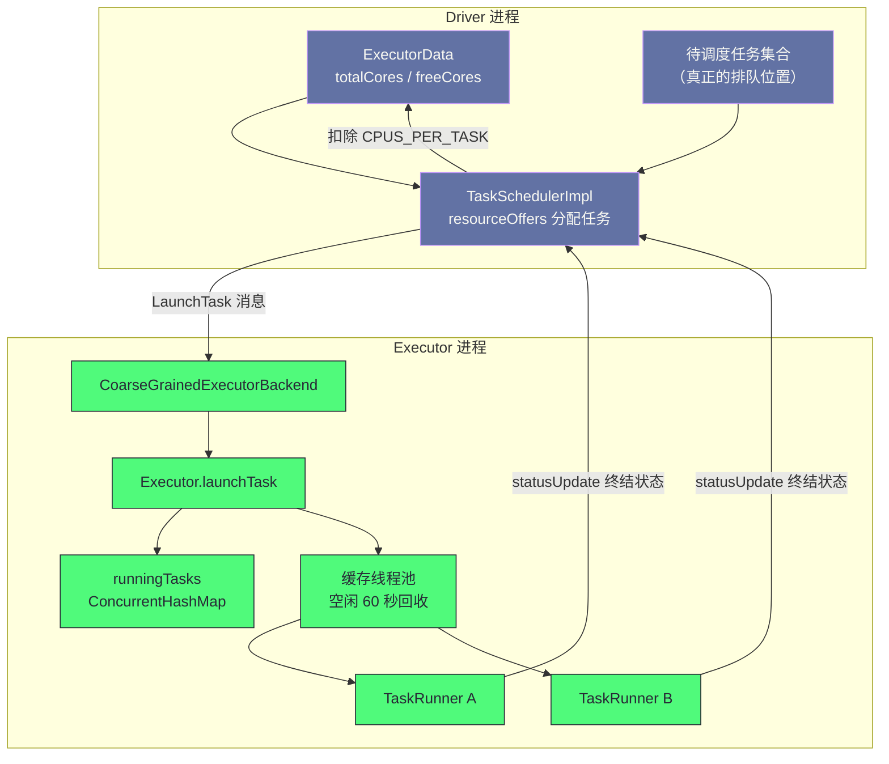
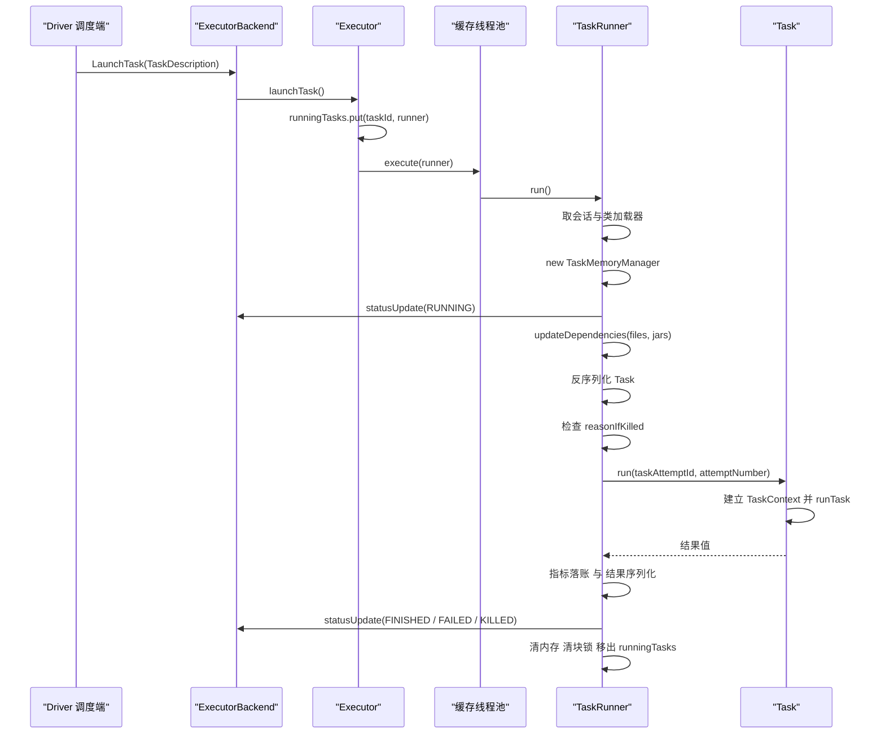
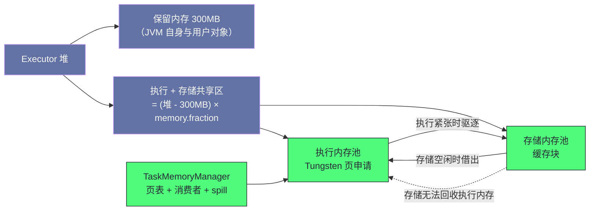
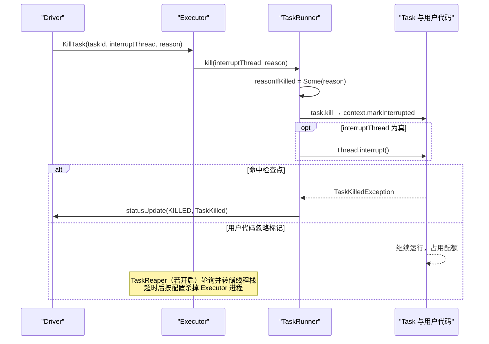
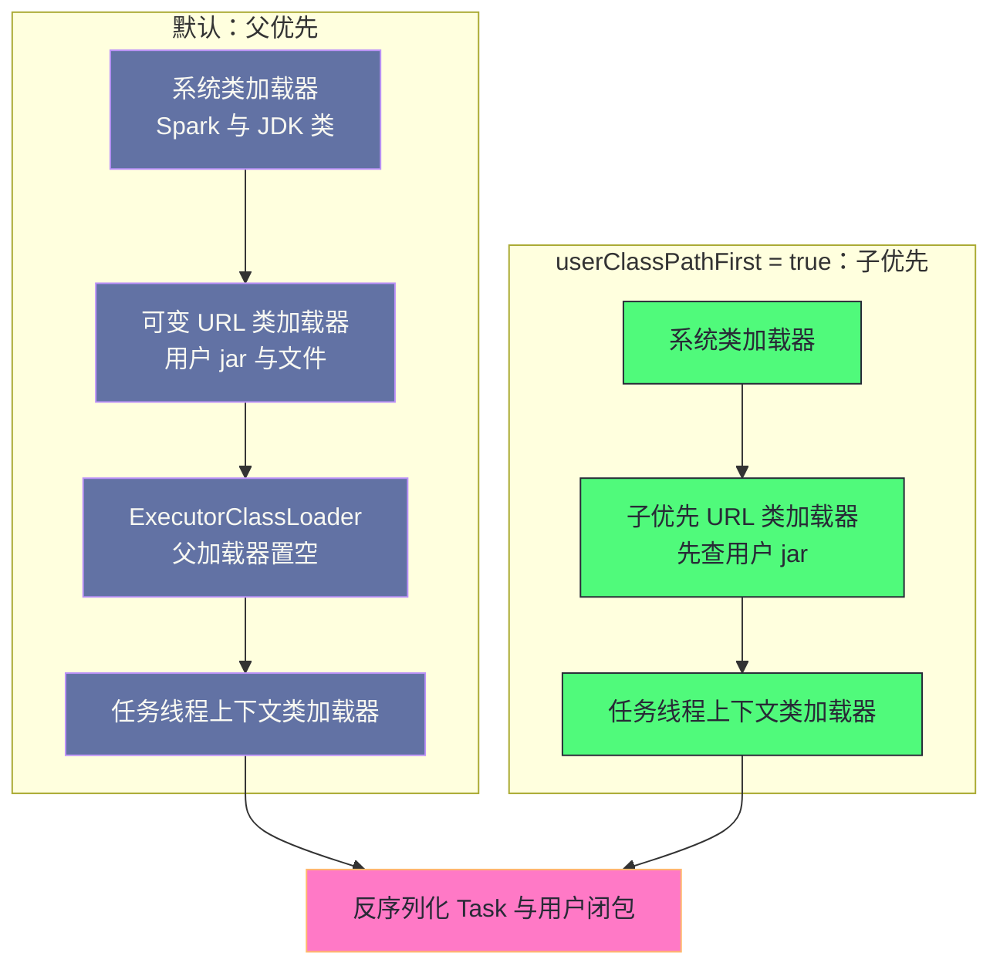

# 8. Spark Executor 任务执行机制_上

**摘要：**

任务调度讲的是"把任务交给谁"，任务执行讲的是"交给之后发生了什么"，而后半句话的答案并不在 Driver 里，它落在一个 JVM 进程内部的若干线程上。本文把观察窗口限定在 Executor 进程之内：从 `CoarseGrainedExecutorBackend` 收到 `LaunchTask`、调用 `Executor.launchTask` 的那一刻起，到 `TaskRunner.run` 走完全程、发出 `FINISHED`、`FAILED` 或 `KILLED` 状态为止，中间那段既密集又容易被跳过的过程，是本文的全部对象。行文沿五个问题推进：一个 Executor 同时能跑几个任务，这个数究竟由谁决定，以及"线程池大小等于 `spark.executor.cores`"这个流传极广的说法错在哪里；`TaskRunner` 的执行体为什么被拆成反序列化、`runTask`、结果收敛、指标落账这四段，每一段各在防什么；同一个进程里的多个任务靠什么互不踩脚，`TaskMemoryManager` 记的是哪一本账，`spark.memory.fraction` 划出的执行与存储软边界又为什么是单向的；任务级指标那些数字是谁在什么时候写下来的，为什么"任务的 GC 时间"不能简单归因到这个任务头上；以及一个跑到一半的任务被取消时，Spark 为什么不直接 `Thread.interrupt()` 了事，而要用一套协作式的中断协议与看门狗收尾。文章的落点不在罗列参数，而在说明这台"多租户小机器"的三根支柱：配额、账本与契约。

---

## 第 1 章 一段字节的旅程

### 1.1 谁在执行任务

在 Spark 的世界里，Driver 负责"想"，Executor 负责"做"。这句话被引用得太频繁，以至于它掩盖了一个更具体的结构：真正跑计算的既不是 Driver，也不是 Executor 这个类，而是 Executor 进程里的一条线程，以及这条线程上运行的一个 `TaskRunner` 对象。

由此形成三层嵌套：一个 Executor 是一个 JVM 进程，进程里有一批工作线程，每条工作线程某一时刻承载一个 `TaskRunner`，而 `TaskRunner` 里装着从 Driver 传来的那个 `Task`。这三层在后文会反复出现，因为几乎每一类故障都能被定位到其中某一层：进程层的问题表现为 Executor 掉线、被 YARN 或 Kubernetes 杀掉；线程层的问题表现为任务挂住、线程数异常、`jstack` 里满屏 `WAITING`；任务层的问题表现为 `TaskKilled`、序列化失败、内存溢出。把这三层分清，是读懂后面所有机制的前提。

有一个事实必须先摆在前面：Executor 是无状态的，至少对单个任务而言是无状态的。它不知道上一步算到了哪里，不知道这个任务属于哪个 Stage，也不知道这个任务失败之后会不会被重试。凡是执行所需要的上下文，都必须随任务一起打包送来；凡是执行产生的结果，都必须随状态更新一起打包送走。这条**无状态加自包含**的约束，塑造了 `TaskRunner` 里几乎所有的设计。

### 1.2 被压进消息里的东西

Driver 发来的东西叫 `TaskDescription`（3.x 及更早版本里，`TaskRunner` 直接持有序列化字节，`taskId`、`attemptNumber`、`taskName` 作为独立参数传入，4.x 把这些字段收进一个描述对象）。它承载的内容大致可以分四类。

第一类是身份与位置：`taskId`、`attemptNumber`、任务的显示名、所属分区与分区总数，以及 Stage 的编号与尝试号。这些字段的作用不只是"标记"，它们还决定了指标上报时的归属：同一个任务的重试必须共用一条逻辑血缘，否则 Driver 无法判断该不该继续重试。

第二类是**执行体（execution payload）**：一段序列化后的 `serializedTask` 字节。这是任务的本体，里面既有 `Task` 对象本身（`ShuffleMapTask` 或 `ResultTask`），也有 `runTask` 真正要执行的那段闭包与它所依赖的 RDD 谱系信息。字节是序列化过的，意味着它必须在 Executor 端被反序列化才能使用，而反序列化需要类加载器，这就在执行链的最前端埋下了一个容易出问题的环节。

第三类是依赖清单：任务需要用到的 jar、文件与归档包，以及它们的时间戳。Executor 可能第一次见到这些文件，也可能早就有了旧版本，所以清单里带时间戳，`updateDependencies` 才能判断要不要重新拉取。

第四类是资源声明与用户属性：任务申请的 CPU 数量、GPU 之类的自定义资源、以及用户通过 `spark.*` 或线程本地属性设置的配置。CPU 数量这一项特别重要，因为它与 Driver 侧的核数账本是对应的，也是理解并发上限的钥匙。

把这些东西一次性塞进一条消息，是一种明确的取舍：消息变大，但 Executor 不必回问 Driver，也不必假设自己知道集群的全局状态。代价是反序列化的成本被推到了每个任务的开头，而这个成本后来被单独计量成了一个指标项（`executorDeserializeTime`）。

### 1.3 本篇的观察窗口

行文至此需要划一条边界，否则后面的叙述会不断越界。本文的窗口从 `LaunchTask` 抵达 Executor 开始，到 `statusUpdate` 把 `FINISHED`、`FAILED` 或 `KILLED` 其中的一个发出去为止。

窗口之外的部分不属于本篇：状态更新抵达 Driver 之后如何被 `TaskSchedulerImpl` 消化、结果字节如何经网络落到 Driver、失败如何累计并触发重试与 Stage 重算、Executor 丢失之后的任务如何重新调度，这些都属于结果回传与失败处理那一段。之所以要划得这么清楚，是因为 Executor 内部的失败处理与 Driver 侧的失败处理是两套逻辑，混在一起讲，读者很容易把"任务在 Executor 上失败了"与"任务在作业层面被判定失败"当成同一件事，而它们之间还隔着一次状态上报与一轮策略判断。

### 1.4 五个问题

第一个问题关于容量：一个 Executor 同时能跑几个任务？这个数由 `spark.executor.cores` 决定，但决定的方式与大多数人想象的不同。

第二个问题关于流程：`TaskRunner` 从拿到字节到发出状态，中间有十几个动作，哪些是计算本身，哪些是为了让计算能够安全地发生？

第三个问题关于隔离：同一个 JVM 里跑着四五个任务，它们共享堆、共享磁盘、共享网卡，凭什么不会互相把对方拖死？

第四个问题关于度量：任务结束后我们看到的那张指标表，那些毫秒与字节是谁在什么时候写下来的，哪些可信、哪些需要打折扣？

第五个问题关于终止：一个任务跑到一半被取消，Spark 到底做了什么，为什么它有时候"取消不掉"？

---

## 第 2 章 并发账本：spark.executor.cores 与线程池

### 2.1 配额在 Driver 手里

要回答"一个 Executor 能同时跑几个任务"，得先看 Driver 侧的那本账。`CoarseGrainedSchedulerBackend` 为每个注册上来的 Executor 维护一份 `ExecutorData`，其中有 `totalCores` 与 `freeCores` 两个字段。任务调度时，`resourceOffers` 把每个 Executor 的空闲核数作为"报价"递上去，`TaskSchedulerImpl` 按报价分配任务，每分配一个任务，就从这份报价里扣掉该任务申请的核数（`spark.task.cpus`，默认 1）；任务终结的状态更新回来之后，再把这份核数加回去，并立即触发一次 `makeOffers`，把腾出来的额度重新发出去。

所以真正限制并发的是一个**并发预算（concurrency budget）**：单个 Executor 上同时运行的任务数约等于 `totalCores / spark.task.cpus` 向下取整。预算的持有者是 Driver，Executor 只是执行方，它既不知道预算是多少，也没有能力自己扩大预算。这条分工是后面所有讨论的基础，因为"线程池是不是固定大小"这个问题，本质上是在问"预算由谁执行、由谁兜底"。

顺带说清一个容易混淆的地方：`spark.executor.cores` 在 Standalone 与 YARN 上的语义并不完全等价。Standalone 模式下它由 Master 分配给 Worker 上的 Executor，YARN 模式下它由 `--executor-cores` 决定容器内的虚拟核数，Kubernetes 模式下则对应 Executor Pod 的 CPU 请求。三种部署方式的默认值与可调边界不同，调优时应当以对应版本的部署文档为准。

### 2.2 Executor 侧只有一个弹性池

按上面的推论，Executor 似乎应该准备一个大小恰好等于核数的线程池。但打开 `Executor` 的源码，看到的却是另一幅景象：线程池是一个缓存线程池（cached thread pool），核心线程数为 0，最大线程数为 `Integer.MAX_VALUE`，工作队列是 `SynchronousQueue`，空闲线程存活 60 秒，线程名带 `Executor task launch worker` 前缀，并且任务线程被包装成 `UninterruptibleThread`（这一点留到第 6 章再展开）。

`launchTask` 的动作也非常直白：构造一个 `TaskRunner`，把它放进 `runningTasks` 这个 `ConcurrentHashMap`（键是 `taskId`），然后 `threadPool.execute(tr)`。没有排队检查，没有信号量，没有"池子满了就等一等"的逻辑。

```scala
// 线程池：缓存池 + 守护线程 + 不可中断线程包装
private[executor] val threadPool = {
  val threadFactory = new ThreadFactoryBuilder()
    .setDaemon(true)
    .setNameFormat(s"$TASK_THREAD_NAME_PREFIX-%d")
    .setThreadFactory((r: Runnable) => new UninterruptibleThread(r, "unused"))
    .build()
  Executors.newCachedThreadPool(threadFactory).asInstanceOf[ThreadPoolExecutor]
}

def launchTask(context: ExecutorBackend, taskDescription: TaskDescription): Unit = {
  val tr = createTaskRunner(context, taskDescription)
  // 先登记再提交：取消请求可能比任务启动更早到达，登记之后 killTask 才找得到它
  runningTasks.put(taskDescription.taskId, tr)
  // 这里没有队列长度判断，因为"同时跑几个"由 Driver 的核数配额决定
  threadPool.execute(tr)
}
```

这套设计之所以成立，靠的是一条**信任链**：上游已经限流了，下游不必再限一次。既然 Driver 不会把超过预算的任务同时发过来，Executor 就没有必要在自己这一侧再设一道闸门；而缓存线程池的语义恰好是"有任务就交给空闲线程，没有空闲线程就新建一个，60 秒没活干就回收"，对"任务成批到达、成批结束"的负载形态来说，它省掉了固定池常见的队列堆积与线程饥饿问题，也省掉了池大小的调参负担。

代价同样清楚：这条信任链一旦断裂，Executor 侧没有任何自保手段。预算算错、资源声明与实际不符、自定义资源调度出现偏差，都会直接变成"线程数超出预期、每个线程都在抢内存和 CPU"的场面。信任链是否可靠，就成了这套轻量实现的隐含前提，也是第 9 章要列举的第一类反例。

### 2.3 "固定大小线程池"这个说法错在哪

在笔者读到的多数中文资料里，长期流传着一种描述：Executor 使用"固定大小的线程池"，大小等于 `spark.executor.cores`。这句话的前半句是错的，后半句是对的，而错的那半句会把人引向错误的调优动作。

| 流传的说法 | 源码里的事实 | 造成的实际影响 |
| :--- | :--- | :--- |
| 线程池大小等于 `spark.executor.cores` | 池是缓存池，容量无上限，仅受上游配额约束 | 调 `cores` 影响并发，但影响的不是"池容量" |
| 超出并发的任务在 Executor 上排队 | 工作队列是 `SynchronousQueue`，不缓存任务 | 排队发生在 Driver 的待调度队列，不在 Executor |
| 线程数会随任务数无限膨胀 | 只有调度端超发时才膨胀 | 线程数异常是"配额失真"的信号，不是常态 |
| 线程复用靠池的固定线程 | 复用靠缓存池的空闲线程（60 秒存活期） | 线程创建开销被摊薄，但峰值线程数不可控 |

第一行的错误最容易造成误解。当有人说"把 `spark.executor.cores` 调大，线程池就变大，并发就变高"时，他描述的结果是对的，但机理是错的：真正变化的是 Driver 发出的任务数，线程池只是被动地跟着创建线程。机理错了，遇到"线程数明明没到 `cores`，任务却排不上"或者"线程数超过 `cores`，任务仍在跑"这类现象时，就会完全失去排查方向。

第二行的错误后果更隐蔽。如果以为任务在 Executor 上排队，就会去找 Executor 侧的队列长度指标，而那个指标根本不存在；**真正的排队位置在 Driver 的待调度集合**，其长度要看 TaskSetManager 的待调度任务数，以及 `resourceOffers` 拿到的空闲核数。同样一个"任务迟迟不开始"的现象，两种理解指向两个完全不同的排查位置。

至于"排队"这件事本身，也需要说得更准确：`SynchronousQueue` 的语义是"生产者直接把任务交给消费者线程，没有消费者就创建新的"，它不做缓存，因此 Executor 侧的等待队列长度恒为零（在线程创建失败等边界情况下会有拒绝，但那是异常路径，不是排队）。任务之所以会等，是因为 Driver 手里没有足够的核数报价可以分配，它们在 Driver 的待调度集合里等，等到某个任务终结、额度回收、`makeOffers` 再次触发时才有机会被发出。

### 2.4 线程名是一份被低估的诊断资产

缓存线程池的线程名格式是 `Executor task launch worker for <taskName>`，任务结束后线程名会被改成 `Executor task idle worker#<threadId>`。这两个名字的价值在于，它们让一次 `jstack` 或一次线程转储就能回答三个问题：当前有几个任务在跑、卡在哪个任务的哪个调用栈上、线程池里有多少空闲线程。

对于"任务挂住"这类问题，这往往是最快的定位方式：看线程数是否超过 `cores`，判断是配额问题还是执行问题；看卡住的线程栈停在哪一层，区分是用户代码里的阻塞调用、Shuffle 拉取的等待、还是写 HDFS 时的重试。执行体里还额外把任务名写进了日志的 MDC 上下文，使得同一条线程上的日志能够按任务切分。这些都属于"不花成本就能拿到的可观测性"，比事后加埋点要划算得多。

下面这张图把 Driver 侧的配额与 Executor 侧的线程池串起来，可以看清"预算"与"载体"的分工。



图中最该被记住的是那条从左到右的箭头：任务只有在拿到核数额度之后才会离开 Driver，所以 Executor 侧的线程池从来看不到"超出预算的积压"。这也解释了为什么池子敢做成无界的——它接收的流量本来就被上游掐住了。

---

## 第 3 章 TaskRunner 的执行体

### 3.1 一个任务执行者的字段

`TaskRunner` 继承自 `Runnable`，是任务在 Executor 侧的唯一载体。它的字段不多，但每一个都对应一类责任。

| 字段 | 类型 | 责任 |
| :--- | :--- | :--- |
| `execBackend` | `ExecutorBackend` | 回传状态更新的出口，指向 `CoarseGrainedExecutorBackend` |
| `taskDescription` | `TaskDescription` | 任务身份、序列化字节、依赖清单、CPU 与资源声明 |
| `task` | `Task[Any]` | 反序列化之后的执行体，`run()` 中被赋值一次，此后不再变化 |
| `reasonIfKilled` | `Option[String]` | 取消原因为空表示未被取消；非空表示已被要求终止 |
| `finished` | `Boolean`（加锁旁观） | 供 TaskReaper 判断任务是否真的退出 |
| `startGCTime` | `Long` | 任务开始时的 JVM 累计 GC 时间，用于事后作差 |
| `threadId`、`threadName` | `Long`、`String` | 线程转储与日志归属 |

把这些字段与执行流程对起来看，会发现一个有意思的结构：一半字段是为了"算"（`task`、`taskDescription`），另一半是为了"报"（`execBackend`、`startGCTime`、`threadName`），还有两个是为了"停"（`reasonIfKilled`、`finished`）。一个执行单元里同时住着计算、度量与终止三件事，这正是它比"调用一个函数"复杂得多的原因。

### 3.2 run 的十个动作

`run()` 是一段不到两百行的方法，却把 Executor 侧的大部分机制都串了一遍。按发生顺序拆开，大致是十个动作。

第一，确定本次任务用哪个类加载器会话。4.x 引入了按作业产物隔离的会话状态，任务描述里带着产物标识，`TaskRunner` 据此从缓存里取（或新建）一份会话，会话里包含用户 jar 的类加载器与 REPL 类加载器；取不到就重试，取到了就记一次引用计数。这个动作发生在一切之前，因为后面所有与字节打交道的步骤都要用它。

第二，设置线程名与日志上下文，并记录线程 ID，为后续的线程转储与日志切分提供锚点。

第三，创建 `TaskMemoryManager`，把当前 Executor 的内存管理器与 `taskId` 绑上去。从这一刻起，这个任务在 Tungsten 侧申请与释放的每一页内存都会记在它自己名下。

第四，发出 `RUNNING` 状态更新。这是一个容易被忽略的细节：任务还没有反序列化，Driver 就已经知道它开始跑了。这么做的原因是调度器需要尽快把"已启动"与"尚未启动"区分开，否则推测执行与超时判定都会失真。

第五，`updateDependencies`，把任务描述里声明的文件、jar、归档包与本地已有的做时间戳比对，缺的就下载，新的 jar 就加进类加载器。这一步在锁内进行，且用的是可中断的锁获取，目的是让一个正在等文件的任务在收到取消请求时能立刻退出。

第六，反序列化任务本体。`ser.deserialize[Task[Any]](serializedTask, Thread.currentThread.getContextClassLoader)`——注意这里显式传入了上下文类加载器，也就是第 8 章要展开的那条链。

第七，反序列化完成后立刻检查一次取消标记。如果任务在等待反序列化的过程中已经被要求终止，就地抛出 `TaskKilledException`，不必再进入计算。这个检查点的位置很关键，它把"还没开始算就被取消"这种最廉价的情形挡在了计算入口之外。

第八，`Task.run`。这一步内部还会再做一次任务上下文与线程的绑定，设置 `TaskContext`，处理 barrier 场景，初始化输入文件块持有者，然后调用 `runTask` 执行真正的计算。如果此前已经置上了取消标记，这里还会顺带把标记传进上下文。

第九，收尾清账。无论成功还是异常，`finally` 块都会做三件事：释放该任务在 BlockManager 上持有的所有块锁、清空该任务在 `TaskMemoryManager` 上的全部内存分配、把任务从 `runningTasks` 中移除。前两步的残余量会被检查：内存没清干净会打印"托管内存泄漏"告警，块锁没还干净会记录未释放的锁列表。这两项检查默认只是告警，只有把对应的内部开关打开，才会把它们升级成异常。

第十，指标落账与结果收敛。计算耗时、CPU 时间、GC 时间、反序列化时间、结果序列化时间、峰值执行内存、各类 spill 字节，在这一段被写进 `TaskMetrics`；结果值被序列化成字节；然后按大小分三路决定怎么发；最后发出 `FINISHED`。

这十个动作里，只有第八个是"计算"，其余九个都是为了让计算能够发生、能够被度量、能够被安全终止。把这九个动作理解成"开销"是不准确的，它们更接近一类**执行契约（execution contract）**：Executor 承诺在任务开始前把依赖准备好、承诺在任务结束后把资源还干净、承诺在任何时刻都能报告自己处于什么状态。契约的履行需要成本，但违约的代价更高。

### 3.3 反序列化为什么是两段

一个容易被忽略的细节是：任务的反序列化其实是**两段式**的，而不是一段。第一段在 `TaskRunner.run` 里，把字节还原成 `Task` 对象，这一步得到的是任务的元信息、分区信息与那一段待执行的闭包引用；第二段发生在 `runTask` 内部，`Task` 自己再去反序列化 RDD 与函数。两段耗时都被计入 `executorDeserializeTime`，先是 `TaskRunner` 侧的外层区间，加上 `Task` 内部记录的那一段。

分成两段的原因在于序列化的组织方式：`Task` 对象本身很小，主要是编号、分区与一个指向"任务二进制"的引用；真正大的是任务二进制里的 RDD 谱系与用户函数。把两者分开，可以让 Executor 先拿到任务的元信息（用来上报、用来判断取消、用来准备上下文），再决定要不要付出反序列化大对象的代价。同理，取消检查点被放在第一段之后、第二段之前，就是为了避免"为一个已经被取消的任务反序列化整条 RDD 谱系"。

代价是计时口径变复杂了。若只统计外层区间，`executorDeserializeTime` 会偏小；若把内层重复计入，又会偏大。源码里的处理方式是外层区间加上 `Task` 内部耗时，并在计算运行时间时把这个内层耗时从总区间里减掉，避免重复计数。

### 3.4 runTask 与面向接口

`Task` 是一个抽象类，Executor 侧只认这个抽象：`ShuffleMapTask` 与 `ResultTask` 都实现了 `runTask`，前者把计算结果按分区器切成若干桶写出去，后者把结果直接返回。`TaskRunner` 完全不需要知道手里是哪种任务，它只调用 `task.run(...)`，再由 `Task.run` 建立上下文并转调 `runTask`。

这种面向接口的做法在这里有实际收益，而不只是风格问题。Executor 的代码里没有任何一处 `match` 分支去区分任务类型，因此新增任务类型（譬如 barrier 任务、以及后续版本里出现的其他执行形态）不需要改 Executor；反过来，任务的执行细节被完全封装在子类里，Executor 只负责"契约"那部分。这也解释了为什么 `Task` 的 `run` 被声明为 `final`：模板方法把流程固定下来，把可变的部分留给子类实现。

`TaskContext` 在 `Task.run` 里被创建并绑定到当前线程，它是用户代码与 Spark 之间的公共契约：用户代码通过它读配置、注册累加器、注册完成回调、检查是否被中断；Spark 通过它收集指标、记录 fetch 失败、触发监听器。执行期的绝大部分横切逻辑都挂在这个上下文上，而不是硬编码在 `runTask` 里。

### 3.5 结果的三种归途

任务算完之后，结果值要变成字节再决定怎么送回 Driver。Executor 侧在这一步做的是"分级"：

| 判据 | 处理方式 | 后续影响 |
| :--- | :--- | :--- |
| 结果大小 > `spark.driver.maxResultSize`（默认 1g） | 丢弃结果，只回传一个 `IndirectTaskResult` 标记 | Driver 侧会因结果超限而报错，这是保护而非故障 |
| 结果大小 > `spark.task.maxDirectResultSize`（默认 1 MiB）或超过 RPC 单条消息上限 | 结果先写入 BlockManager，回传块标识 | 需要额外一次远程读取，延迟与网络成本上升 |
| 其余情况 | 直接回传 `DirectTaskResult` | 最常见路径，无额外 IO |

这里有一处必须校正的历史说法：早期资料把第二档的阈值写成"Akka 帧大小 128MB"。Spark 2.0 之后 RPC 层已从 Akka 换成基于 Netty 的实现，对应的配置项是 `spark.rpc.message.maxSize`，而真正把结果推给 BlockManager 的阈值主要是 `spark.task.maxDirectResultSize`，其默认值在 1 MiB 这个量级，远小于 128 MB。把两者混为一谈，会导致对"为什么几 MB 的结果就走了 BlockManager"这类现象判断失误。

结果的搬运与 Driver 侧的接收属于另一段逻辑，本篇不展开。这里只强调一点：**三档判断全在 Executor 侧完成**，Driver 收到的要么是字节，要么是一个指向字节的地址，它并不参与"该走哪条路"的决策。

### 3.6 兜底逻辑：异常也是一种结果

`run` 的 catch 分支需要单独看一眼，因为它体现了"执行失败也要有产出"的设计。捕获到异常时，Executor 不会简单地把错误吞掉或让线程直接死掉，而是构造一个 `ExceptionFailure`（携带异常栈、累加器更新、指标峰值），序列化后随 `FAILED` 状态回传；如果异常对象本身不可序列化，就降级成只带栈信息的形态再试一次。

还有几种特殊分支：任务被取消抛出的 `TaskKilledException` 走 `KILLED`；用户代码把 fetch 失败包在别的异常里抛出，仍然按 fetch 失败处理；提交被拒（`CommitDeniedException`）也走 `KILLED`；如果 Executor 已经在停止过程中，则不再上报失败，避免关机钩子与运行中的任务互相干扰导致误报。只有被判为致命错误（例如 JVM 级别的链接错误、栈溢出）时，才会交给未捕获异常处理器，进而终止整个 Executor 进程。

这段逻辑的共同取向是：**尽量把失败降级成一条可上报的消息，而不是一次进程崩溃**。因为前者只影响一个任务，后者会连带影响同一 Executor 上所有正在运行的任务，以及 Driver 侧对该 Executor 上所有中间结果的假设。

下面这张时序图把 §3.2 的十个动作压成一条时间线，可以用它来对照日志里的顺序。



图中的 `RUNNING` 出现在反序列化之前，这一点与很多人的直觉相反：状态机并不等待"任务真的开始计算"，它等待的是"任务已经被 Executor 接手"。这个先后顺序决定了 Driver 侧的超时与推测执行基于哪个时刻起算。

---

## 第 4 章 任务的内存隔离

### 4.1 为什么需要一个按任务记账的人

一个 Executor 的堆是几个任务共用的。共用的后果是：如果没有任何记账机制，一个任务申请了远超预期的内存，其他任务只会在下一次分配时莫名其妙地失败，而失败现场与真正的元凶已经相隔很远。

更麻烦的是，Spark 的一段重要执行路径并不走 JVM 对象模型。Tungsten 引入之后的排序、聚合、哈希表都用二进制格式在堆内或堆外操作，地址被编码成一个 64 位长整型，而不是一个 Java 引用。这类内存无法靠 GC 管理，也无法靠"对象引用消失"来释放，必须有人显式记账：谁申请了多少页、哪些页还被引用、什么时候能还。

`TaskMemoryManager` 就是这个人。每个 `TaskRunner` 在开始执行前 new 一个，绑定当前 Executor 的 `MemoryManager` 与自己的 `taskId`；任务结束时统一清算。它做三件事：把二进制的页地址翻译成真实的堆内数组或堆外地址；向全局内存管理器申请与释放执行内存；在内存不够时驱动 spill。

### 4.2 页表：8192 个槽位的地址翻译

`TaskMemoryManager` 内部最核心的结构是一张页表。它用 13 个二进制位表示页号，于是页表长度为 8192 项；剩下 51 位用来表示页内偏移。一个 64 位地址因此被切成"页号 + 偏移"两段，页号去页表里查基址，偏移直接相加，就得到了真实地址。

| 结构 | 规模 | 作用 |
| :--- | :--- | :--- |
| 页号位宽 | 13 位 | 最多 8192 个页同时存在 |
| 偏移位宽 | 51 位 | 单页可达 2 PB 的寻址空间（理论值） |
| 页表 | `MemoryBlock[8192]` | 页号到基址的映射 |
| 页大小上限 | 约 17 GB | 受堆内长整型数组的最大长度限制 |
| 已分配页位图 | `BitSet` | 快速找出空闲页号 |

页表这个设计与操作系统的页表是同构的，目的也类似：把"逻辑上连续的二进制缓冲区"映射到"物理上可以不连续的页"，从而避免为一个大缓冲区要求一整块连续内存。堆内模式下，页表项指向页的基对象；堆外模式下所有页表项都是空，地址翻译走另一条不查表的路径。

这套结构也解释了 Spark 的一个经典报错：当单个页超过上限时，会出现"页过大"类的异常；当页号耗尽时，会在申请新页时失败。它们都不是"内存不够"，而是"地址空间的管理结构不够用"，两者在日志里长得很像，处理方式却完全不同。

### 4.3 申请与 spill：先保别人还是先保自己

`acquireExecutionMemory` 是记账的入口。它先向全局内存管理器要内存，拿到的少于所需的量时，就转向 spill：遍历本任务登记的所有内存消费者（`MemoryConsumer`），挑出一些来让它们把数据写到磁盘、释放内存，然后再要一次。

挑选策略里有一处容易忽略的细节：它会倾向于选择"用量最小、但释放之后足够满足本次缺口"的消费者，并且把发起申请的消费者排在最后。前者是为了让一次 spill 释放的量刚好够用、少产生小文件；后者是为了避免"申请者把自己的数据换出去、又马上要用"的抖动。策略的注释里也承认它的局限：如果存在大量小消费者，这个启发式可能产生许多次小规模 spill。

从公平性角度看，这套机制是"任务内自治"的：spill 只发生在当前任务的消费者之间，它不会去动别的任务的数据。跨任务的公平不在这里处理，而在全局内存管理器的分配池里（第 7 章）。两层分工明确：一层管"我这个任务内部怎么腾挪"，一层管"几个任务之间怎么分"。

### 4.4 软边界：执行与存储的单向借用

Executor 堆里能用于执行与存储的部分，并不是整个堆。默认口径是：先扣掉 300 MB 的保留内存（供 JVM 自身、字符串常量、用户对象与估算误差使用），剩下的部分再乘以 `spark.memory.fraction`（默认 0.6），得到执行与存储共享的区域；这个区域内部再按 `spark.memory.storageFraction`（默认 0.5）划出一条初始分界线，线的一侧是存储，另一侧是执行。

关键在于这条线是**软边界（soft boundary）**，而不是硬隔离。规则有两条，方向相反：存储区空闲时，执行可以借走存储区的空闲部分，需要时再让存储把借出去的部分还回来；执行区空闲时，存储也可以借用，但执行需要内存时会把借出去的存储部分驱逐（表现为缓存块被淘汰）。反方向则不成立：**存储永远不能驱逐执行内存**。

这个不对称是有意为之的。执行内存的生命周期与一个算子的计算过程绑定，一旦被夺走，算子只能失败重算；存储内存的生命周期与缓存块的存活绑定，被淘汰之后大不了下次重新计算。用可重算的代价去换不可中断的计算，是一种明显更划算的取舍。

但它带来一个常被抱怨的现象：当作业里有大量缓存时，执行一侧的申请会把缓存逐渐挤掉，表现为"缓存了却像没缓存"。这不是配置错误，而是软边界在按设计工作。要缓解，只能从"给存储更多免疫额度"（调高 `storageFraction`）或"降低缓存规模"入手，而不能指望执行内存给缓存让路。

### 4.5 结束时的清账与泄漏检测

任务结束时的清账由 `cleanUpAllAllocatedMemory` 完成。它遍历本任务分配过的所有页，逐个归还，并返回仍然残留的字节数。`TaskRunner` 拿这个返回值做判断：如果任务正常结束却仍有残留，就打印"托管内存泄漏"告警；把内部开关 `spark.unsafe.exceptionOnMemoryLeak` 打开，则会直接抛异常。

块锁的检查是同一手法：`releaseAllLocksForTask` 返回该任务尚未释放的锁列表，非空则告警，打开 `spark.storage.exceptionOnPinLeak` 则升级为异常。这两处检查的默认行为都是"告警不杀任务"，原因很实际：这类泄漏往往来自第三方库或用户代码的异常路径，如果直接杀任务，会把一个偶发问题放大成作业失败。但告警本身是有价值的，它把"内存缓慢下滑"这类难以复现的问题，转化成了日志里一行可以检索的记录。

### 4.6 账本的边界

必须把账本的覆盖范围说清楚，否则容易得出错误结论。

| 内存类别 | 是否计入 `TaskMemoryManager` | 说明 |
| :--- | :--- | :--- |
| Tungsten 执行内存（排序、聚合、哈希表） | 是 | 按页申请，任务结束时统一清算 |
| 缓存块占用的存储内存 | 否 | 由存储内存池按块记账，不属于某个任务 |
| 用户代码创建的普通 JVM 对象 | 否 | 由 GC 管理，不在账本视野内 |
| Python worker 的内存 | 否 | 在独立进程内，由 `spark.python.worker.memory` 之类参数约束 |
| 堆外内存（`spark.memory.offHeap`） | 是（若是 Spark 申请的） | 走同一套页表，但页表项为空、地址翻译路径不同 |

第一行与第三行的差异，是许多误判的源头。当一个任务因为用户代码里构造了巨大的集合而 OOM 时，`TaskMemoryManager` 可能几乎没有记录——它只负责 Tungsten 的那本账。所以看到"峰值执行内存很低但仍然 OOM"，不要怀疑账本坏了，先怀疑账本管不到的地方。

下面这张图把执行与存储两块区域、以及借用的方向画在一起。



图中那条虚线是全图的关键：借用是双向的，驱逐却是单向的。理解了这条单向性，就能理解为什么"缓存命中率突然下降"经常与"某个 Stage 开始 spill"同时出现，两者不是巧合，而是同一次内存再分配的两面。

---

## 第 5 章 任务级的指标采集

### 5.1 指标随任务一起旅行

`TaskMetrics` 不是执行完才去"统计"出来的东西，它在 Driver 侧就已经创建，并被序列化进任务的字节里一起下发。Executor 反序列化任务时，`@transient lazy val metrics` 才被还原成对象；此后执行过程中的所有计量都往这个对象上写。任务终结时，这些数值随状态更新回传 Driver，同时也随心跳周期性上报。

这个组织方式带来两个后果。第一，指标是"任务自带"的，不需要 Executor 额外维护一张全局指标表，也不需要额外的 RPC 通道；第二，指标的生命周期与任务严格一致，任务重试会产生新的指标对象，不会把两次尝试混在一起。

### 5.2 分项与来源

| 指标项 | 口径 | 由谁写入 |
| :--- | :--- | :--- |
| `executorDeserializeTime` | 从开始反序列化到进入计算的时间 | `TaskRunner` 计时，加上 `Task` 内部反序列化耗时 |
| `executorRunTime` | 计算本身耗时 | `TaskRunner` 在 `task.run` 前后取时间差 |
| `executorCpuTime` | 当前线程的 CPU 时间 | 线程 MXBean，若平台不支持则为 0 |
| `jvmGCTime` | 任务区间内 JVM 累计 GC 时间的增量 | 进程级 GC 计数器作差 |
| `resultSerializationTime` | 结果值序列化耗时 | `TaskRunner` 计时 |
| `resultSize` | 回传结果的字节数 | 序列化后的字节计数 |
| `peakExecutionMemory` | 峰值执行内存（堆内与堆外分别记录） | `TaskMemoryManager` 的峰值统计 |
| `memoryBytesSpilled` / `diskBytesSpilled` | spill 的内存量与落盘量 | `MemoryConsumer` 在 spill 时累加 |
| `inputMetrics` / `outputMetrics` | 读写字节数与记录数 | 数据源与输出算子侧累加 |
| `shuffleReadMetrics` / `shuffleWriteMetrics` | 拉取与写出的块数、字节数、记录数、等待时间 | Shuffle 管理器与 BlockManager |

表格里最容易被误读的是 `jvmGCTime`。它的算法是"任务开始时读一次进程级 GC 总耗时，任务结束时再读一次，两者相减"，因此它衡量的是"任务存活期间，整个 JVM 在 GC 上花了多少时间"，而不是"这个任务自己触发了多少 GC"——**这是进程级时间差，不是任务级归因**。当同一个 Executor 上并行跑着四个任务时，四个任务会各自记下近似相同的一段 GC 时间，四份数字加起来远大于真实耗时。用它做横向对比是可以的（同一时间窗内的任务承担同样的 GC 负担），用它做纵向求和则是错的。

`executorRunTime` 在较新版本里还有一个口径变化：它会按任务申请的 CPU 配额做加权。这个调整的动机是指标自洽——如果任务的运行区间按墙钟时间计，而它实际只占用了一部分核，那么"调度延迟"就会被算错。带小数的 `spark.task.cpus` 出现之后，这个加权变得更必要，具体折算规则以对应版本的实现为准。

### 5.3 谁在写这些数字

指标的写入方可以分为三类，分清它们有助于判断某个数字何时可信。

第一类是 `TaskRunner` 自己：反序列化时间、运行时间、CPU 时间、GC 时间、结果序列化时间与结果大小，都在它的主流程里完成，口径统一、可信度高。

第二类是 `TaskMemoryManager` 与 `MemoryConsumer`：峰值执行内存与 spill 字节由它们累加。这类数字的可靠性取决于调用方是否老实记账，自定义算子如果绕过 `MemoryConsumer` 直接用 `Unsafe` 申请内存，这部分用量就不会出现在指标里。

第三类是算子与数据源：输入输出的字节数与记录数、Shuffle 的读写统计，由具体的 Reader、Writer 与 Shuffle 管理器累加，通常通过累加器机制汇总。笔者倾向于把这类数字当作参考值，因为这类数字最细，也最依赖实现，不同数据源覆盖的字段并不一致（例如某些连接器不报告输入记录数）。

### 5.4 失败任务也有指标

一个常见的误解是"任务失败就没有指标"。实际上 `TaskRunner` 在异常路径上也会调用专门的方法，把运行时间与 GC 时间补记上，收集累加器更新，再连同异常一起上报。此外，内存峰值这类由轮询收集的指标会被单独保存并在失败时一并携带，以便 Driver 侧在任务失败后仍然能判断"是不是内存问题"。

从排障角度看，这一点很重要：一大批任务失败时，最先拿到的信息往往就是失败任务的指标与异常栈，如果指标在失败路径上缺失，那么定位就只能靠猜。

### 5.5 指标怎么读

| 现象组合 | 可能的成因 | 下一步动作 |
| :--- | :--- | :--- |
| `jvmGCTime` 占比高、`peakExecutionMemory` 也高、spill 少 | 数据集常驻堆内，GC 压力大 | 评估对象复用、序列化方式、是否该加大 Executor 内存 |
| `diskBytesSpilled` 大、运行时间长 | 执行内存不足或分区过大 | 看 `memory.fraction`、分区数、聚合的基数 |
| `shuffleReadMetrics.fetchWaitTime` 高 | 上游产出慢或网络受限 | 看上游 Stage 的写出耗时与数据分布 |
| `executorDeserializeTime` 异常高 | 任务闭包过大、依赖 jar 太多 | 检查广播变量使用、闭包捕获、jar 数量 |
| `resultSize` 接近上限 | 结果集过大，走了 BlockManager | 评估是否该把结果写外部存储而非拉回 Driver |

这张表的用法不是"对号入座找答案"，而是"用组合缩小范围"。单个指标偏高往往有多个解释，两个指标同时偏高才能把解释收敛到一两类。

---

## 第 6 章 中断与 TaskKilled

### 6.1 谁会要求一个任务停下来

取消的来源比想象中多。用户主动取消一个作业或一个 Stage，是最直接的一类。推测执行发现某个副本已经成功，会要求其余副本停止，这是第二类——它并不是失败，只是不再需要。Executor 被标记为退役（decommission）时，上面的任务会被要求尽快结束，好让资源平滑退出，这是第三类。此外，Driver 侧的超时判定、Stage 因上游失败而整体取消，也都会产生取消请求。

这些来源在消息层面被统一成一个 `KillTask` 请求，携带三个信息：目标任务、是否中断线程、取消原因。注意第二个字段——"是否中断线程"是一个可选动作，而不是必然动作。这个设计是理解整套取消机制的关键。

### 6.2 协作式中断：检查点而不是强杀

收到取消请求后，Executor 侧的动作分两步。第一步是设置标记：把取消原因写进 `TaskRunner.reasonIfKilled`，并调用任务的 `kill` 方法，把原因写进 `TaskContext`，同时触发任务中断监听器；如果请求要求中断线程，再对任务线程调用一次 `Thread.interrupt()`。第二步是等待：任务本身必须在若干个检查点上主动查看这个标记，才会真正退出。

```scala
// TaskRunner：只负责记下"已被要求终止"，不强行结束线程
def kill(interruptThread: Boolean, reason: String): Unit = {
  reasonIfKilled = Some(reason)
  if (task != null) synchronized {
    // 已完成的任务不必再补一刀，否则会污染已经上报的终结状态
    if (!finished) task.kill(interruptThread, reason)
  }
}

// Task：把标记传进 TaskContext；不可中断时只挂起请求，等状态恢复再投递
def kill(interruptThread: Boolean, reason: String): Unit = {
  _reasonIfKilled = reason
  if (context != null) TaskContext.synchronized {
    if (context.interruptible()) {
      context.markInterrupted(reason)
      if (interruptThread && taskThread != null) taskThread.interrupt()
    } else {
      val threadToInterrupt = if (interruptThread) Option(taskThread) else None
      context.pendingInterrupt(threadToInterrupt, reason)
    }
  }
}
```

检查点分布在几处：任务在反序列化之后、进入计算之前查一次；计算结束后、结果序列化之前再查一次（`killTaskIfInterrupted`）；用户代码如果主动调用上下文相关的方法，也会在内部查到。任何一个检查点命中，都会抛出 `TaskKilledException`，随后被 `TaskRunner` 捕获，转成 `KILLED` 状态上报。

为什么不做强杀？因为强杀在工程上做不到"干净"。用户代码可能正在往 HDFS 写一个文件，可能在提交一个数据库事务，可能在调用一个不可重入的客户端。`Thread.interrupt()` 在这些位置上引发的 `ClosedByInterruptException` 或半途而废的写入，会把一次"取消"变成一次"数据损坏"。协作式中断把终止的时机交给代码自己选择，代价是**取消可能长期不生效**——如果用户代码里有一个不响应中断的死循环，或者一段长时间的 `sleep` 被吞掉了中断标志，这个任务就会一直占着配额。

### 6.3 不可中断线程与延迟中断

任务线程并非普通的 `Thread`，它被包装成 `UninterruptibleThread`，允许代码在关键区段临时屏蔽中断：屏蔽期间收到的中断请求被暂存，退出区段之后才真正投递。`TaskContext` 侧也有对应的机制，在任务不处于可中断状态时，把中断请求挂起，等状态恢复再执行。

这套机制针对的是一类真实存在的故障：某些库在被中断之后会永久挂住（历史上有过 Hadoop 与 Kafka 客户端的此类问题），于是"优雅取消"反而变成了"进程卡死"。屏蔽中断区段的做法是把"能不能被打断"的决定权下放给最了解风险的那一层，而不是交给一个统一的时间点。

代价是取消语义变得更弱：从发出请求到任务真正退出，中间可能隔着一段不可中断的工作，这段时间没有任何机制能强制结束它。这也解释了为什么需要一个额外的看门狗。

### 6.4 TaskReaper：为僵尸任务准备的看门狗

`spark.task.reaper.enabled` 默认是关闭的。打开之后，每次取消都会额外启动一个监督者，它按固定间隔轮询被取消的任务是否真的退出了；如果超过 `spark.task.reaper.killTimeout`（默认 -1，表示不设超时）仍未退出，就会打印线程转储（`spark.task.reaper.threadDump` 默认开启），并在超时配置为正数时选择杀掉整个 Executor 进程。

这个设计承认了一个不体面的事实：**协作式取消无法保证终止**。当一批任务被取消却继续运行时，它们仍然占着核数配额与内存，Driver 会以为资源已经释放，于是新任务被发到别处，集群整体利用率下降，而日志里看不出明显异常。TaskReaper 的价值在于把这种"缓慢失血"变成一个可观测、可处置的事件：先给出线程栈，让运维知道卡在哪里；再按配置决定是否用杀进程这种极端手段回收资源。

默认关闭也是合理的：杀进程会连带杀掉同一个 Executor 上其他无辜的任务，这个代价必须由使用者显式承担。

### 6.5 TaskKilled 不等于失败

从状态机角度看，`KILLED` 与 `FAILED` 是两种不同的终结。被取消的任务通常不计入失败次数（`spark.task.maxFailures` 那套累计逻辑），也不会触发"任务连续失败就放弃整个 Stage"的判定。这个区别之所以重要，是因为它让"推测执行的冗余副本被丢弃"这类正常行为不至于污染失败统计。

具体哪些情形计入、哪些不计入，以及重试与放弃的完整规则，属于失败处理那一段的内容，本篇只点到为止。

下面这张图把取消请求的传播路径与三个可能的结果画出来。



图中最右侧的 Note 是整套机制的兜底：当协作失效时，唯一的强制手段是结束整个进程，而不是结束那个线程。

---

## 第 7 章 同一 Executor 上的多任务共存

### 7.1 共享清单

一个 Executor 上的四五个任务共享的东西比通常想象的要多：CPU 时间、执行内存池、磁盘 IO 与页缓存、网卡带宽、BlockManager 的块锁、以及 JVM 的 GC 线程。任何一项被某个任务长期独占，其他任务的表现都会变差，而这种变差通常不会以"报错"的形式出现，只会以"变慢"的形式出现。

| 共享资源 | 争抢时的表现 | 观测手段 |
| :--- | :--- | :--- |
| CPU 时间 | 各任务运行时间同比拉长，CPU 利用率接近饱和 | 线程转储、操作系统层面的核使用率 |
| 执行内存 | spill 增多、GC 频次上升 | `diskBytesSpilled`、`peakExecutionMemory` |
| 磁盘与页缓存 | 写 spill 的延迟上升，读写互相拖慢 | 磁盘利用率、spill 文件大小与数量 |
| 网络 | 拉取 Shuffle 的等待时间上升 | `fetchWaitTime`、远程读取字节数 |
| 块锁 | 任务结束迟迟不释放，后续任务拿不到 | 未释放锁的告警日志 |

### 7.2 执行内存的公平是"按任务数均分"

跨任务的执行内存分配遵循一条简单规则：每个任务最多能拿到内存池的 `1 / 活跃任务数`，但至少要让它拿到 `1 / (2 × 活跃任务数)` 才允许阻塞等待。前者防止某个任务把池子吃光，后者防止小请求永远得不到满足。

这条规则在数据倾斜时会显出后果。假设四个任务里有一个处理的分区是其他任务的一百倍，它会持续申请内存；一旦触及自己的份额上限，就只能靠 spill 或者等别人释放。此时其他三个任务虽然早早做完，但因为活跃任务数下降得慢（那个大任务还在跑），它自己的份额上限也随之变化——**份额上限随活跃任务数动态变化**，池子的分配按当前活跃任务数现算，不是按启动时的任务数算的。这个动态性是有益的，它让剩余任务在别人退出后能拿到更多内存；但也意味着倾斜任务的实际可用内存会随并发度波动，排障时不能用一个固定值去推断。

### 7.3 CPU 的公平不在 Spark 手里

内存的分配由 Spark 自己裁决，CPU 的分配则交给了操作系统。Spark 能做的只是控制"同时有多少个任务在跑"，它不能控制"每个任务拿到多少时间片"。于是一个 CPU 密集的任务与三个轻量任务混在同一个 Executor 上时，四者会按操作系统的调度策略分享时间片，Spark 层面看不出任何异常，只有运行时间对不上。

这解释了为什么"把 `spark.executor.cores` 调大"有时并不能提升吞吐：并发度上去了，但每个任务可用的时间片、可用的缓存、可用的执行内存份额都下来了，而 GC 与上下文切换的成本上去了。并发度与单任务效率之间的这条曲线，通常在一个中间位置达到峰值，位置取决于任务本身的 CPU 密集程度与内存需求。

### 7.4 cores 调大的三重代价

第一重代价是每个任务的执行内存份额下降。共享区大小基本固定，任务数增多意味着 `1 / 活跃任务数` 变小，于是 spill 更频繁。这一点在聚合与排序类算子密集的作业里非常明显。

第二重代价是 GC 压力上升。多个任务同时产生短命对象，年轻代的回收频率与停顿都会增加，而停顿是全局的——一个任务触发 Full GC，同一个 JVM 里所有任务都被按住。

第三重代价是失败影响面扩大。一个 Executor 上有八个任务，它一旦掉线，八个任务同时需要重算；只有两个任务时，同样的掉线只影响两个。这个权衡与容错粒度直接相关，却常被"提高并发"的直觉掩盖。

### 7.5 倾斜如何在 Executor 内部被放大

数据倾斜的常规叙事都发生在 Stage 与分区层面，但它在一个 Executor 内部还有第二重放大效应：一个超大分区不仅让自己跑得久，还通过内存占用与 GC 压力拖慢同一 Executor 上的其他任务，反过来又拉长整个 Stage 的完成时间。于是"慢"会以超出线性的方式扩散。

判断是否存在这种放大，可以看一个组合：某个 Executor 上的任务完成时间整体偏长，而分区大小并没有同比例偏大。若确实如此，问题可能不在数据分布，而在"这台 Executor 上恰好落了一个大分区"。缓解手段不是重分区就是隔离（把大分区单独放到一批较小的 Executor 上），具体取舍要看作业对资源利用率的敏感程度。

---

## 第 8 章 类加载器：反序列化时的那道隔离带

### 8.1 为什么反序列化要指定类加载器

反序列化的本质是"根据字节里的类名找到类，再按字段构造对象"。默认情况下，Java 用调用栈上最近的那个类加载器，而 Spark 的执行路径横跨了多个加载器：Spark 自身的类由系统加载器载入，用户 jar 由 Executor 动态构造的 URL 加载器载入，REPL 或 Notebook 里动态生成的类还有一个专门的加载器。选错了，症状是"类找不到"，而不是"数据不对"。

因此 `TaskRunner` 在反序列化之前显式做了一件事：把当前线程的上下文类加载器设置为本次会话的 REPL 类加载器，然后把同一个加载器作为参数传给反序列化方法。这个动作看起来只是两行代码，实际上是"用户代码的类必须由用户 jar 的加载器解析"这条规则的落地。

### 8.2 三层链

Executor 侧的类加载器大致构成三层。

最底层是系统加载器，负责 Spark 自身与 JDK 的类。中间层是用户类加载器，由 Executor 在启动时按 `--jars` 声明构造，类型是可变 URL 类加载器，运行中新增的依赖由 `updateDependencies` 追加进去；当 `spark.executor.userClassPathFirst` 为真时，换成子优先（child-first）的实现，让用户 jar 里的同名类优先于 Spark 自带版本。最上层是 REPL 类加载器 `ExecutorClassLoader`，它只在 `spark.repl.class.uri` 存在时被挂上，负责从 Driver 的类服务器或文件系统按需拉取类文件。

`ExecutorClassLoader` 的实现有两处设计上的选择。其一，它的父加载器被显式设为 `null`，然后用一个 `ParentClassLoader` 包装真正的父加载器。这样做的原因是 `ClassLoader` 默认的"父优先"委托会绕过 `findClass`，导致动态生成的类无法被自己的加载路径命中；**把父加载器置空，等于把委托时机收回到自己手里**。其二，它支持按资源名拉取类文件流，因此 REPL 里新定义的类可以在不重启 Executor 的情况下被加载。

下面这张图把默认链路与子优先链路并排画在一起，两条链的差别只在中间那一层，但故障形态差别很大。



图中 `R1` 那一层只在 REPL 或 Notebook 场景下存在；批处理作业的执行链通常止于用户类加载器。子优先链路则干脆把顺序反过来，用"谁离用户更近谁优先"换取了版本覆盖的能力。

### 8.3 userClassPathFirst 的取舍

默认情况下是父优先：先找 Spark 自带的类，再找用户 jar。这个默认值保证了 Spark 内部组件的一致性——如果用户 jar 里恰好有一个与 Spark 内部同名的类，父优先会让 Spark 用自己的版本，避免莫名其妙的链接错误。

把开关打开变成子优先，动机通常是"用户需要覆盖某个依赖的版本"，譬如某个连接器要求更新版本的 Guava 或 Jackson。代价是风险反转：一旦用户 jar 里出现了与 Spark 内部同名的类，被加载的可能就是用户的版本，症状从"版本不匹配"变成"方法找不到"甚至"字段布局不一致"，而且这类问题往往只在特定代码路径上触发，极难复现。

### 8.4 4.x 的会话级隔离

4.1 起，Executor 引入了按作业产物隔离的会话：每个会话拥有自己的用户类加载器与 REPL 类加载器，并按引用计数管理生命周期，缓存大小由 `spark.executor.isolatedSessionCache.size` 控制（默认 100），未被使用时可以被淘汰。这个设计的动机与 Spark Connect 的多会话场景直接相关——同一个 Executor 可能同时服务多个客户端提交的作业，它们的依赖版本可能互相冲突，共享一个用户类加载器就必然打架。

会话级隔离把类冲突的**爆炸半径**从"整个 Executor"缩小到"一个会话"，多个客户端各自的依赖版本从此可以在同一个进程里共存。但它不是免费的：每份会话都要维护一套加载器与文件目录，缓存淘汰与正在执行的任务之间需要引用计数来协调，这也是那段实现里状态机显得格外复杂的原因。具体行为以对应版本文档与源码为准。

### 8.5 类冲突的故障形态

类冲突极少以"类找不到"这种直白形式出现，更多时候它以链接期或运行期的错误现身，让人误以为是逻辑 bug。

| 现象 | 典型根因 | 定位方法 |
| :--- | :--- | :--- |
| `NoSuchMethodError` / `NoSuchFieldError` | 运行时加载的类版本比编译期旧（或新） | 比对 Driver 与 Executor 的类路径，打印实际加载的类来源 |
| `AbstractMethodError` | 接口实现与接口定义来自不同版本 | 检查是否混入了多个版本的同一依赖 |
| `ClassCastException`（同名类却转换失败） | 同一个类被两个加载器各加载一次 | 打印两个对象的类加载器身份，确认是否同一份 |
| `LinkageError` / `IncompatibleClassChangeError` | 类结构不兼容（字段或父类变化） | 检查依赖树里的版本收敛情况 |
| 序列化异常（`InvalidClassException` 等） | 序列化器版本与类定义不匹配 | 核对序列化器配置与类的 `serialVersionUID` |
| `UnsupportedClassVersionError` | 编译用的 JDK 高于运行时的 JDK | 核对编译目标版本与 Executor 的 JVM 版本 |

最有迷惑性的是第三行。两个类名字相同、字段相同，`equals` 却返回假，`instanceof` 也判假——因为它们由不同的加载器加载，在 JVM 眼里是两个毫不相干的类型。这类问题的排查要从"类是从哪个加载器来的"入手，而不是从业务逻辑入手。

---

## 第 9 章 边界与反例

### 9.1 反例一：把 cores 当线程池大小

前面已经拆过这个说法。这里补一条后果：如果按"线程池大小等于 cores"去推断容量，就会在扩容时只调 `cores` 而不动内存，结果并发上去了、每个任务的执行内存份额下来了，spill 与 GC 双双上升，吞吐反而下降。正确的做法是把 `cores`、Executor 内存、分区数当成一组参数一起调。

### 9.2 反例二：以为取消能立刻停住任务

协作式中断的语义是"请求 + 检查点"，不是"强制终止"。用户代码里的死循环、吞掉中断的第三方库、长时间不可中断的 IO，都会让取消长期不生效。若作业对取消的时效性有要求，需要打开 TaskReaper 并配置合理的超时，同时接受"超时会杀掉整个 Executor"这个代价。

### 9.3 反例三：把任务账本当成 JVM 账本

`TaskMemoryManager` 只记 Tungsten 的执行内存。用户代码里 `new` 出来的大对象、Python worker 的内存、第三方本地库申请的堆外内存，都不在它的账本里。看到"执行内存峰值很低却 OOM"，应当往账本之外找原因。

### 9.4 反例四：把指标当精确测量

`jvmGCTime` 是进程级计数器的时间差，并行任务会重复计入；输入输出指标依赖具体连接器的实现，覆盖并不完整；`peakExecutionMemory` 只反映 Tungsten 的峰值。这些指标适合作相对比较与趋势观察，不适合做绝对归因，更不适合直接相加。

### 9.5 反例五：把 KILLED 计进失败次数

取消不进入失败累计，目的是让推测执行的冗余副本与主动取消不污染失败统计。若把两者混为一谈，会得出"任务频繁失败"的错误结论，进而去调 `maxFailures` 这类参数，方向完全错了。

### 9.6 反例六：忽视同 Executor 内的相互拖慢

一个 Executor 上并发多个任务时，慢的会通过内存与 GC 拖慢快的。排障时如果只按"分区是否倾斜"去看，会漏掉这层放大效应；一个可行的判别方法是比较同一 Stage 内不同 Executor 上的任务完成时间分布，若某些 Executor 整体偏慢而分区大小并无异常，就该怀疑进程内的相互影响。

---

## 第 10 章 落点

回到开头那五个问题，答案可以收敛成三根支柱。

第一根是**配额**。Executor 能同时跑多少任务，不由线程池容量决定，而由 Driver 手里的核数账本决定。线程池是弹性载体，配额是硬约束；理解这一点，才不会在"线程数为什么不是 cores"这类问题上打转，也才能明白为什么改 `cores` 必须同时改内存与分区。

第二根是**账本**。`TaskMemoryManager` 按任务记 Tungsten 的账，全局内存管理器按池子记执行与存储的账，软边界决定了两者之间谁能驱逐谁。账本的价值不在"精确"，而在"可归因"：有了它，一次内存不足才能被定位到某个任务的某次申请，而不是一团糊涂账。

第三根是**契约**。`TaskRunner` 的十个动作里只有一个是计算，其余是"准备依赖、报告状态、清理资源、收敛结果"这些承诺；取消之所以是协作式的，也是因为终止同样是一份契约，需要双方配合履行。契约的好处是可预期，代价是它依赖对方守约——用户代码不响应中断，契约就失效，于是需要看门狗兜底。

这三根支柱的共同点是：它们都不是"性能优化技巧"，而是让一个共享进程能够同时承载多个互不信任的计算单元所必须付出的结构性成本。Spark 选择把这部分成本放在 Executor 内部，换来的是 Driver 侧的调度逻辑可以保持相对简单：Driver 只需要记账与派发，不需要关心某个任务在远端究竟是怎么被隔离、被计量、被终止的。

至于这套结构在什么条件下会失效——配额失真、账本盲区、契约违约——第 9 章已经逐条列过。它们不是实现缺陷，而是"共享进程内多租户"这个前提本身带来的边界。认清边界，比记住参数更有用。

---

## 参考资料

1. Apache Spark 源码：`core/src/main/scala/org/apache/spark/executor/Executor.scala`（线程池构造、`launchTask`、`TaskRunner.run`、类加载器与会话管理）。
2. Apache Spark 源码：`core/src/main/scala/org/apache/spark/scheduler/Task.scala`（`Task.run`、`kill`、反序列化耗时记录）。
3. Apache Spark 源码：`core/src/main/scala/org/apache/spark/TaskContextImpl.scala`（`markInterrupted`、`killTaskIfInterrupted`、中断监听器）。
4. Apache Spark 源码：`core/src/main/java/org/apache/spark/memory/TaskMemoryManager.java`（页表、页号与偏移编码、`acquireExecutionMemory`、spill 选择策略）。
5. Apache Spark 源码：`core/src/main/scala/org/apache/spark/memory/UnifiedMemoryManager.scala` 与 `ExecutionMemoryPool.scala`（保留内存、`spark.memory.fraction`、软边界、按任务均分）。
6. Apache Spark 源码：`core/src/main/scala/org/apache/spark/executor/TaskMetrics.scala`（指标字段与内部累加器映射）。
7. Apache Spark 源码：`core/src/main/scala/org/apache/spark/executor/ExecutorClassLoader.scala`（REPL 类加载器、`ParentClassLoader`、类文件拉取路径）。
8. Apache Spark 官方文档：Configuration（`spark.executor.cores`、`spark.task.cpus`、`spark.memory.fraction`、`spark.task.maxDirectResultSize`、`spark.task.reaper.*` 的默认值）。https://spark.apache.org/docs/latest/configuration.html
9. Apache Spark 官方文档：Tuning Guide（Memory Management Overview 一节对执行与存储软边界的说明）。https://spark.apache.org/docs/latest/tuning.html
10. Apache Spark 官方文档：Cluster Mode Overview（Driver 与 Executor 的职责划分）。https://spark.apache.org/docs/latest/cluster-overview.html
11. M. Zaharia, R. S. Xin, P. Wendell, et al. Apache Spark: A Unified Engine for Big Data Processing. Communications of the ACM, 2016.（以任务为调度单元的设计取向）

---

> [!note] 思考题
> 1. 为什么 Executor 侧的线程池可以不做大小限制，而并发数依然稳定在 `spark.executor.cores` 附近？这条信任链在哪些情况下会断？
> 2. `TaskMemoryManager` 记的是哪一本账？为什么用户代码里的普通对象不在账本视野内，这种"看不见"会带来什么排查盲区？
> 3. 一个任务的 `jvmGCTime` 为什么不能理解为"这个任务造成的 GC 时间"？在什么场景下这个指标仍然有用？
> 4. 协作式中断为什么必须依赖检查点，而不能只靠 `Thread.interrupt()`？哪些代码形态会让取消长期失效？
> 5. 类冲突为什么常常表现为 `NoSuchMethodError` 或"同名类转换失败"，而不是加载时就报错？`spark.executor.userClassPathFirst` 在这个过程里改变了什么？
> 6. 如果要在同一个 Executor 上同时跑"内存密集"与"CPU 密集"两类任务，你会从配额、账本、契约这三根支柱里先动哪一根，为什么？