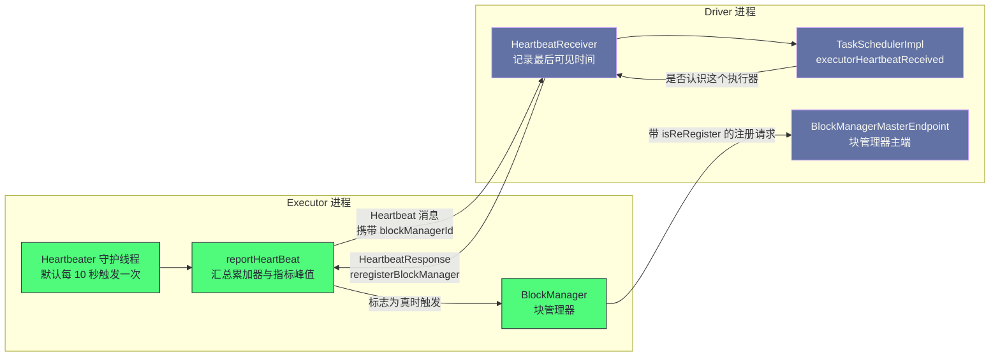
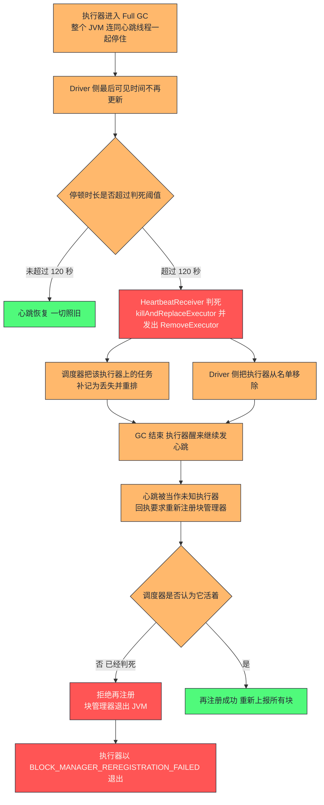
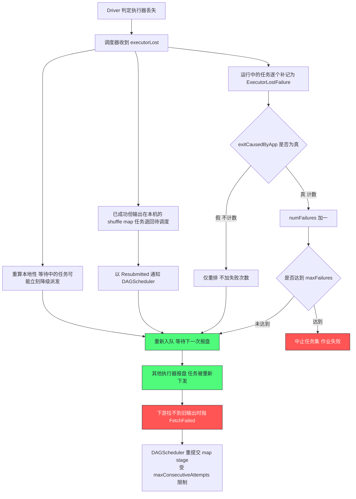
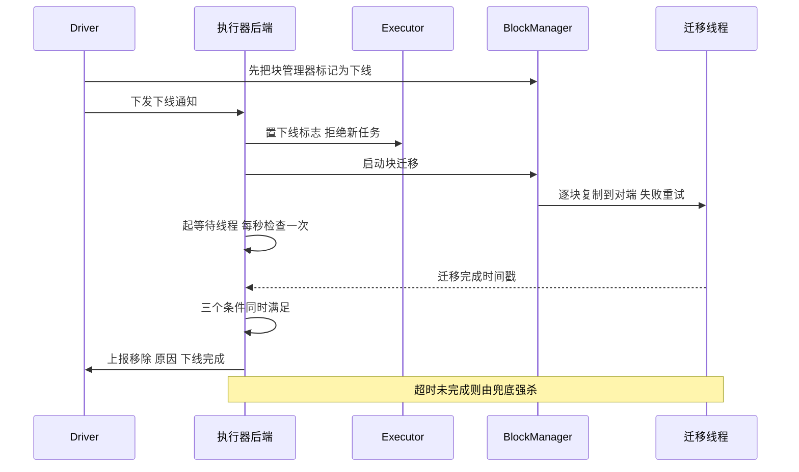

# 9. Spark Executor 任务执行机制_下

**摘要：**

一个 Executor 进程最容易被忽略的时间段，不是它算任务的那几个小时，而是从"任务算完"到"进程消失"之间的那一段：状态上报出去了，核心还回去了，账面上这件事已经结束，可进程还在跑，还在心跳，还在往磁盘上写 shuffle 文件，还在等着某一天被人判死或者请走。

第一问是失败的分类学：任务异常、执行器丢失、被取消三类失败，在执行侧各长成什么样子，`spark.task.maxFailures` 又按什么规矩记账，为什么有的失败计数、有的不计数。第二问是心跳与判死：十秒一次的 `Heartbeat` 里装着什么，120 秒与 60 秒两个数字凑出的检测窗口有多宽，`spark.network.timeout` 这个总闸怎样把 ask 超时、shuffle 连接超时、块管理器心跳一并接管。第三问是误判：一次两分半的 Full GC 停顿，为什么最终不是"任务重跑一遍"，而是执行器自己走进死亡名单。第四问是丢失之后：调度器怎样把死掉执行器上的任务重新排出去，shuffle map 输出丢失为何让已成功的任务重新入队，重建又要付多少本地性代价。第五问是退出：`BlockManager` 为何需要第二次注册，decommission 的三步顺序为何不能颠倒，块迁走之后留下的文件归谁清理，一个跑了几天的执行器会先在哪些地方坏掉。

文章落点不在参数表，而在一句判断：Spark 对执行器生死的处理，本质是**尽早判死、尽快重生**，而所有优雅退出的设计，都是在跟这条默认策略争夺时间。

> [!info] 版本口径
> 本文以 Spark 4.3.0（2026-10-30 发布）为基准，4.x 系列的预编译包基于 Scala 2.13；源码引用同以 4.3.0 主线为准，4.0.0 之后才出现的配置项与失败类型在正文中单独标注版本。Spark Connect 自 3.4 起把客户端与本篇所说的 Driver 拆成两个进程，凡涉及 Driver 边界的地方都会点明。尚未发布的行为、或各发行版打补丁后可能有出入的细节，以对应版本文档或源码为准。

---

## 第 1 章 一段被跳过的收尾

### 1.1 一条日志背后的两分半

夜批集群的 Driver 日志里，最容易被翻过去的一行是这个：

```text
Removing executor 7 with no recent heartbeats: 187432 ms exceeds timeout 120000 ms
```

它通常出现在凌晨三点到四点之间，前后没有异常堆栈，只有一个执行器编号、一个 187 秒的空白和一个 120 秒的阈值。运维第一反应是查 dmesg、查容器驱逐、查网络，多数时候一无所获——机器好好的，进程也活着，只是那 187 秒里没向 Driver 发出一次心跳。

笔者遇到过的一个案例是这么收场的：某个作业每晚会在一张宽表上做全量校验，校验阶段把几百万行中间结果堆在堆里等待序列化，堆被塞满，Full GC 停了两分半，心跳线程跟着整个 JVM 一起冻住。Driver 判它死了，把任务分给别人重跑，作业四十分钟后成功结束；而那个被判死的执行器在 GC 结束后醒过来，发现自己已经不在名单上，于是按规矩自我了断。第二晚同一时刻，同样的一幕。

这个案例值得当作起点，因为它同时踩中本篇的三条线：判死（心跳超时）、误判（GC 停顿被当成宕机）、以及判死之后执行器自己的下场。任务没失败，代码没错误，坏掉的只是"系统对这个进程是否还活着的判断"。

### 1.2 本文将窗口压在哪一段

把执行器的生命周期摊开，可以切成四段：被拉起并注册、接到任务并执行、任务结束后的收尾、进程终结。前两段已经被拆得很细，真正含糊的是后两段：它们没有明确的入口，没有一条"收尾阶段开始"的日志，出事时又往往表现为"作业慢"或"作业莫名失败"这种没有指向性的现象。

所以本篇的观察对象是：一次 `StatusUpdate` 发出之后，到这个 JVM 真正退出之前，中间发生的一切。边界划在这里有两个好处：一是不必重复已经讲透的执行细节；二是可以把"失败"和"退出"当成同一件事的两端来看——大部分非正常的进程终结，都是从某次失败开始的。

### 1.3 一个类比：机位与过站

把 Executor 想成一个机场机位，任务是落在机位上的航班，会好理解一些。

航班降落（任务完成）只是"这一班结束了"，机位并没有清空：要交接、要清仓、要加油，下一班才能进来。滑行时出了问题（任务异常），机位不关闭，换一架飞机继续用；机位的地面电源烧了（执行器故障），停在这里的飞机都得转场，而目的地未必有同样的保障设施；机场要整体检修（decommission），得先把飞机挪走、把航油抽干再关灯。

### 1.4 五个问题

行文按五问推进，每一问都对应一组可以到日志和配置里验证的机制。

其一，失败有几种，谁在给它们计数，`spark.task.maxFailures` 数的究竟是什么。其二，心跳一跳有多远，Driver 侧的检测窗口怎样由两个时间参数拼出来，`spark.network.timeout` 为什么牵一发动全身。其三，一次 GC 停顿怎样被翻译成一次执行器死亡，中间有没有可以插手的缝隙。其四，判死之后调度器做了什么，哪些任务被重排，重建要付什么代价。其五，块管理器为什么需要第二次注册，优雅退出的顺序为何不能换，长期运行的执行器会先在哪些地方失真。

---

## 第 2 章 三种败因，一本失败账

### 2.1 失败不是一种东西

在 Driver 的调度器看来，一个任务以 `FAILED` 结束，只是"这次尝试没有产出可用结果"，至于为什么没有，答案藏在一个叫 `TaskFailedReason` 的接口里。这个接口有一个看上去很不起眼、实际上决定了一切的方法：

```scala
// core/src/main/scala/org/apache/spark/TaskEndReason.scala
// 每个失败原因自己回答：这次失败要不要计入 spark.task.maxFailures
def countTowardsTaskFailures: Boolean = true
```

默认是 `true`，也就是说"绝大多数失败都算数"；少数几个实现把它改成了 `false`，每一个都对应一类"不该由这个任务负责"的情形。理解 Spark 的失败处置，其实就是把这几个 `false` 逐一讲清楚——它们加起来，构成了"什么才算真的失败"这件事的完整定义。

### 2.2 第一类：任务异常

最常见的一类是 `ExceptionFailure`，也就是用户代码在 `runTask` 里抛了异常，或者任务在反序列化阶段就失败了。执行侧的处理很朴素：捕获、打包成状态更新、连同序列化后的异常一起发回 Driver；`TaskRunner` 里那句"异常也是一种结果"的兜底逻辑保证了执行线程不会因为一个坏任务而退出。

这一类的两个例外值得单独记住，因为它们不走重试。

其一是结果不可序列化。如果失败的类名是 `NotSerializableException`，`TaskSetManager` 会直接记一条"not retrying"的日志并中止整个任务集，理由是同一个对象、同一个序列化器，再跑一次只会得到同样的异常，重试纯属浪费。

其二是输出文件已存在。`TaskOutputFileAlreadyExistException` 同样直接中止，因为这通常意味着上一次尝试其实已经把数据写出去了，重跑会破坏输出目录的幂等前提。

这两条例外说明了一件事：重试的正当性来自**这次失败可能是偶发的**，而不是来自"多试几次总有机会"。 凡是确定性的失败，Spark 宁可立刻停下让上层看见。

### 2.3 第二类：执行器丢失

第二类是 `ExecutorLostFailure`，它有两个字段值得看：执行器编号，和一个布尔量 `exitCausedByApp`。这个布尔量直接决定了计数：

```scala
case class ExecutorLostFailure(execId: String, exitCausedByApp: Boolean = true, reason: Option[String])
  extends TaskFailedReason {
  override def countTowardsTaskFailures: Boolean = exitCausedByApp
}
```

也就是说，任务并不是"因为执行器死了"就自动被记一次失败。执行器如果是因为跑在这上面的某个任务把 JVM 撑爆而死（`exitCausedByApp` 为真），那笔账要算到这个任务头上；执行器如果是因为被抢占、被驱逐、被集群管理器杀掉、或者正在优雅下线而死（`exitCausedByApp` 为假），那属于"与任务无关的意外"，不计数。

这个设计相当克制：它承认了一件事——在一个共享集群里，**执行器消失是常态而不是事故**，把常态计入失败上限，会让 `spark.task.maxFailures` 变成一张随机判决书。 一个默认值为 4 的参数，如果连节点回收都算失败，那么在弹性伸缩的集群上，作业能不能跑完基本取决于别人扩容的频率。

那个布尔量不是执行器自己上报的，而是 Driver 根据丢失原因反推出来的，判定规则留到第 5 章。

### 2.4 第三类：被取消

第三类是 `TaskKilled`，表示任务被主动要求停止。它的 `countTowardsTaskFailures` 是 `false`，理由是取消是"调度决策"而不是"执行失败"——推测执行里另一份副本先成功了、用户主动杀了任务、或者任务集被整体中止，都会产生 `TaskKilled`，这些都不该消耗失败额度。

同一类的还有几个不那么显眼的成员：`TaskCommitDenied`（Driver 拒绝了提交，常见于推测执行里多份副本争抢同一个分区）、`FetchFailed`（下游拉不到上游的 map 输出）。后者尤其重要，因为它根本不在"任务失败"这条路上走：一次 `FetchFailed` 会让 `DAGScheduler` 把失败的那个 stage 连同它依赖的 map stage 一起重算，用 `spark.stage.maxConsecutiveAttempts`（默认 4）来限制连续重算的次数，而不是用 `spark.task.maxFailures`。

4.x 里还多了一个成员：`ExecutorShutdownFailure`，对应"执行器正在关闭，线程池拒绝了这次任务下发"。它同样不计数，理由写在类注释里——任务根本没开始跑，凭什么算它失败。

### 2.5 账本怎么记

把这几种失败合起来看，`spark.task.maxFailures` 的语义就清楚了：它不是"整个作业能失败几次"，而是**同一个分区的连续失败次数，一旦成功即清零**。官方文档的措辞是"continuous failures of any particular task"，并且明确写着"不同任务之间的失败总和不会导致作业失败"。

默认值 4 意味着三次重试机会。耗尽时 Driver 会打出这样一行：

```text
Task 183 in stage 7.0 failed 4 times; aborting job
```

还有一个 4.x 的边界：流水线执行（pipelined）任务组的有效失败上限被强制设为 1，连"与任务无关的执行器丢失"也计入，理由是这类任务组内部的 shuffle 是瞬时的、不可单独恢复的，重跑一个 producer 会让整条流对不上号。具体适用面以对应版本文档或源码为准，但它提醒了一件事：**失败计数不是全局统一的规则，而是按执行模型分层的策略。**

### 2.6 三类失败在执行侧的样子

把三类失败放回执行器进程里看，会看到三种完全不同的现场，这是排查时区分它们最快的办法。

| 失败类别 | 执行侧现场 | Driver 收到的消息 | 是否计数 | 后续动作 |
|---|---|---|---|---|
| 任务异常 | 任务线程抛出异常，`TaskRunner` 捕获并打包 | `ExceptionFailure`，带类名、描述、堆栈 | 计数 | 等待重排；确定性异常直接中止任务集 |
| 执行器丢失 | 进程已不存在，没有任何上报 | 由 Driver 侧超时或断连补记 `ExecutorLostFailure` | 视 `exitCausedByApp` 而定 | 该执行器上运行中的任务全部重排 |
| 被取消 | 任务收到 `KillTask`，协作式停下来 | `TaskKilled`，带原因字符串 | 不计数 | 通常是因为另一份副本成功或作业中止 |
| 线程池拒绝 | 执行器正在关闭，任务没能进入线程池 | `ExecutorShutdownFailure` | 不计数 | 原样重排到别的执行器 |

表里第二行的"没有任何上报"是关键：执行器丢失是唯一一种由旁观者补记的失败，因此它的现场证据只能到 Driver 与机器的日志里找，执行器自己的日志往往在死亡那一刻就断了。

---

## 第 3 章 十秒一跳

### 3.1 心跳线程

每个 Executor 进程里都有一条叫 `executor-heartbeater` 的守护线程，它由 `Heartbeater` 这个很小的工具类创建：单线程的定时执行器，按固定频率调用一次回调。有两处细节容易被忽略，却解释了它的行为。

第一处是首次延迟不是零，而是一个随机值——`间隔 + 随机(0, 间隔)`，也就是首次心跳落在 10 到 20 秒之间。目的是避免几百个执行器在同一毫秒向 Driver 报到，把 Driver 的事件循环瞬间打满。集群越大，这个随机化越重要，因为它是"突发流量"与"均匀流量"之间唯一的调节手段。

第二处是它用的是固定频率（`scheduleAtFixedRate`）而非固定延迟。这意味着如果某次心跳处理本身花了 3 秒，下一次不会顺延，而会提前 3 秒发出来追平节奏；但如果整个 JVM 被 GC 冻住，这次调度就只是迟到，醒来后补一次。

### 3.2 一次心跳里装了什么

心跳消息体有四个字段：执行器编号、运行中任务的累加器更新、块管理器编号、以及执行器指标的峰值。四个字段各有归属，恰好对应 Driver 侧三个不同的消费者。

累加器用于更新 UI 上的计数器与作业进度，块管理器编号让主端知道它还持有存储，指标峰值喂给执行器级的内存与 GC 曲线。而"还活着"这个信号本身没有专门字段——只要消息到了，就说明进程还在跑。

这个设计带来一个副作用：心跳既是活体信号，又是数据通道，于是超时参数无法只按"活体检测"的需要去调。要让判死更灵敏就得缩短间隔，可间隔一缩，累加器与指标的上报频率也变，Driver 的事件循环压力随执行器数量线性上升。两个职责绑在一根管子里，调参是在两边同时动手。

### 3.3 执行器自己的耐心

心跳发出去之后，执行器只等一个间隔的时间。源码里这次 `askSync` 的超时直接取心跳间隔本身：默认 10 秒没回应就算一次失败。失败次数累加，成功清零，连败 60 次就自我了断：

```text
Exit as unable to send heartbeats to driver more than 60 times
```

退出码是 `HEARTBEAT_FAILURE`。60 这个默认值写在内部配置 `spark.executor.heartbeat.maxFailures` 里，源码注释顺手把算术做完了：60 次乘以 10 秒，大约十分钟。

十分钟比 Driver 侧的判死阈值宽松得多，两者并不对称：Driver 两分钟就认定它死了并开始善后，执行器却要十分钟才承认联系不上 Driver。这段时间差，正是"执行器还会醒过来，但已经不在名单上"的温床。

### 3.4 回路全景

把执行器侧与 Driver 侧放在一张图上，可以看到心跳是一条带分支的回路，而不是单向汇报。



图里从 `HR` 回到 `RP` 的那条箭头是关键：心跳不只是"我还在"，它同时是 Driver 下达指令的载波。`HeartbeatResponse` 只有一个字段 `reregisterBlockManager`，取值逻辑是"只要 SparkContext 没停就为真"，再与"调度器是否认识这个执行器"取与——Driver 在回执里说的其实是**"我这边找不到你了，重新登记你的块"**。

### 3.5 与判死相关的时间参数

把所有参与判死的时间参数摆在一起，才能看出检测窗口是拼出来的，不是单一配置决定的。

| 配置项 | 默认值 | 作用 | 位置 |
|---|---|---|---|
| `spark.executor.heartbeatInterval` | 10s | 执行器发心跳的间隔，同时是每次心跳等待回执的超时 | 执行器 |
| `spark.executor.heartbeat.maxFailures` | 60 | 连续发送失败多少次后执行器自杀，约十分钟 | 执行器 |
| `spark.network.timeout` | 120s | 判死阈值：多久没有心跳就认定执行器死亡 | Driver |
| `spark.network.timeoutInterval` | 60s | Driver 检查并清理过期执行器的轮询间隔 | Driver |
| `spark.storage.blockManagerHeartbeatTimeoutMs` | 未设置 | 若设置则顶替 `spark.network.timeout` 作为判死阈值 | Driver |
| `spark.executor.decommission.killInterval` | 未设置 | 约定外部平台在多长时间后强杀正在下线的执行器 | 外部 |
| `spark.executor.decommission.forceKillTimeout` | 未设置 | Spark 自己在下线超期后强杀执行器的兜底时限 | Driver |

表里最需要注意的一对是 120 与 60：判死阈值 120 秒，检查间隔 60 秒，于是实际检测窗口是 120 到 180 秒。这个宽度不是精度问题，而是设计取向——轮询越密，Driver 开销越大；轮询越疏，死执行器占着核心越久。Spark 选了**宁可慢一点判死**这一侧，因为误判的代价（重算、丢 shuffle、重建执行器）远高于多等一分钟的代价。

---

## 第 4 章 判死：两个数字与一条链

### 4.1 Driver 侧的账

Driver 里有个叫 `HeartbeatReceiver` 的端点，专门记一件事：每个执行器最后一次心跳的时间戳。它的判死逻辑短得可以背下来——取当前时间减去最后可见时间，超过阈值就从表里删掉，并异步执行两个动作。

阈值来自两处：显式配了 `spark.storage.blockManagerHeartbeatTimeoutMs` 就用它，否则用 `spark.network.timeout`；检查频率是独立的 `spark.network.timeoutInterval`。三者在启动时会被校验：检查间隔不得大于判死阈值，心跳间隔也不得大于判死阈值。这三个数字不是可以随意组合的独立旋钮，**它们被一套不等式绑在一起**，调错任何一个都会在启动时直接失败。

### 4.2 判死之后做的两件事

过期处理里有两个动作，都写在同一个异步任务里，顺序不可换。

第一件是 `killAndReplaceExecutor`：把执行器踢掉，并且要求补一个新的回来。源码注释特意解释了为什么不用 `sc.killExecutor`——那个方法只杀不补，而在心跳超时的场景下，集群很可能还是健康的，只是这一个进程出了问题，因此应当按"替换"而不是"缩容"来处理。

第二件是向后端发一条 `RemoveExecutor`，携带的原因类型是 `ExecutorProcessLost`，消息里带着"心跳超时了多少毫秒"。这条消息的作用不只是记账，它还负责把"移除执行器"这件事推进调度器，否则挂在这台执行器上的任务会一直保持"运行中"，作业也就一直挂着。源码注释点明了动机：不能等 RPC 连接自己断开，因为连接可能还活着，只是对端不再回话。

两件事合起来的语义是：**Driver 不等断开信号，而是主动宣布死亡。** 这个取向贯穿了整个执行器生命周期管理——被判死的执行器还有机会发消息过来，但 Driver 已经不听它的了。

### 4.3 network.timeout 是个总闸

`spark.network.timeout` 的表面含义是"网络交互的默认超时"，但它真正的身份是一个兜底总闸：几个更细粒度的超时如果没有显式配置，全部取它的值。

受它管辖的至少有三处：RPC 的 `ask` 超时（`spark.rpc.askTimeout`）、shuffle 客户端与 shuffle 服务之间的连接超时（`spark.shuffle.io.connectionTimeout`）、以及块管理器心跳的超时。三处的语义完全不同，却共用一个默认值，于是调它会引发一串连锁反应。

把它调大，收益是容忍更长的 GC 停顿与网络抖动；代价有三个：真死的执行器更晚被清走；下游拉 shuffle 时若对端挂住，reduce 任务要等到超时才抛 `FetchFailed`；判死后的善后整体后移。调小则判死变快，但稍长的 GC 都会变成误杀。

这里没有正确答案，只有取向。笔者的建议是把它当成"集群里最长的一次可接受停顿"来定，而不是当成网络参数来定：如果业务能接受一次 Full GC 停 90 秒，那就把它设在 150 秒上下；如果堆很大、GC 本来就可能停两分钟，那设 120 秒就是在赌。

### 4.4 一次 GC 停顿的完整下场

现在可以把这个案例的完整链条画出来了。它的每一步都能在日志里对上号。



链条里最反直觉的一步是 `J` 到 `K`。执行器醒过来之后，并不是"重新加入集群继续干活"，而是被要求重新注册块管理器；块管理器主端在受理再注册之前，会先向调度器后端确认这个执行器是否还活着，这条检查来自一个具体缺陷（SPARK-41360）的修复。既然调度器两分钟前已经把它划掉，这次再注册会被直接拒绝，块管理器拿到非法编号，然后退出 JVM。

于是那条链的终点是一行日志：

```text
Exiting executor due to block manager re-registration failure
```

对比两侧的日志就很有意思：Driver 说的是"这个执行器没有心跳了"，执行器说的是"我再注册不上，所以我走了"。两边都在说同一件事，却没有一方说"这是一次误判"。GC 停顿不会让执行器自己死掉——它的心跳线程也跟着停了，压根没机会累计失败次数；**真正杀死它的是 Driver 先判死**，它醒来后撞上那份已经生效的死亡名单。

### 4.5 三种"看起来像宕机"的成因

同样是"心跳没了"，成因不同，处置方向完全不同。仅凭"心跳超时"这一条日志无法分辨，必须去看别的证据。

GC 停顿的特征是机器负载正常、进程还在、网络没异常，日志里往往能找到一次耗时极长的 GC 记录，或者堆使用率在停顿前已经顶到上限。

网络分区的特征是机器存活且 GC 正常，但 Driver 与执行器之间的 RPC 全断，而执行器访问 HDFS 可能还是通的，说明问题在同一条链路上。

节点级挂起（CPU 被别的进程抢光、虚拟机被宿主暂停、cgroup 冻结）的特征是心跳断断续续而不是完全消失，日志时间戳出现跳变，同一台机器上其他执行器往往同时出问题。

三者都会在 Driver 留下同一行日志，处置方式却分别是"减少堆压力"、"查网络"和"查这台机器上的邻居"。

---

## 第 5 章 丢失之后：调度器的重排

### 5.1 四个动作

执行器丢失这件事落到调度器上，由 `TaskSetManager.executorLost` 处理。它做的事可以清点成四件，顺序有意义。

第一件是把"已经成功、但输出只在这台机器上"的 shuffle map 任务退回重跑。这里有个容易忽略的判据：退出成功的任务并不意味着输出还在。map 任务的输出是一份 `MapStatus`，指向本地磁盘上的 shuffle 文件，执行器一死文件就没了；下游去拉只会得到 `FetchFailed`，进而让整个上游 stage 重算。所以调度器在丢失当下就把它们重新入队，并以 `Resubmitted` 告知 `DAGScheduler`——不过这笔账要记在 stage 上，不记在任务上。

第二件是把"还在运行"的任务逐个补记为失败。补记时用的失败原因是 `ExecutorLostFailure`，`exitCausedByApp` 由丢失原因反推。

第三件是重算本地性。丢失一个执行器意味着某些分区的"最佳位置"消失了，等待本地性的任务需要重新评估还能不能等。这一步在代码里就是一行 `recomputeLocality()`，但它的影响不小：一个原本在等 `NODE_LOCAL` 的任务，可能因此直接降级到 `ANY`，立刻被派出去。

第四件是（在 `TaskSchedulerImpl` 层面）让其他执行器重新报盘，把空出来的调度机会用掉。这一步是把"损失"变成"继续"的最后一环。

### 5.2 谁决定这次失败算不算数

`exitCausedByApp` 的判定是一张很短的对照表，但它解释了绝大多数"为什么我的作业没有重试就失败了"和"为什么节点被杀作业却没事"。

| 丢失原因 | `exitCausedByApp` | 判定依据 |
|---|---|---|
| `ExecutorExited` 且明确非应用导致 | 否 | 集群管理器报告退出码与应用无关 |
| `ExecutorKilled` | 否 | Driver 主动要求停止 |
| `ExecutorDecommission` | 否 | 正在优雅下线 |
| `ExecutorProcessLost` 且应用无关 | 否 | 进程消失但没有应用侧证据 |
| 其他情况，且任务已上报过运行状态 | 是 | 默认视为任务把执行器拖死了 |
| 其他情况，但任务还在下发途中 | 否 | 连 `RUNNING` 都没回过，按网络失败处理 |

最后一行值得单独说。如果 Driver 刚把 `LaunchTask` 发出去，执行器还没回 `RUNNING` 就死了，这次失败会被当作"网络问题"而非"任务问题"，不计数。**一个还没开始跑的任务，不可能把执行器弄死**，所以不该由它承担后果。 代价是真会拖死执行器的坏任务在某些时序下显得"无辜"，多跑几次才被抓住。

### 5.3 下游的连锁：FetchFailed 与 stage 重试

`executorLost` 只处理"这台执行器上还有什么"，管不了"别人对它的依赖"。那份依赖会在下游拉数据时以 `FetchFailed` 的形式浮出来，而 `FetchFailed` 的处置路径完全不同：它不消耗 `spark.task.maxFailures`，而是让 `DAGScheduler` 把失败 stage 及其依赖的 map stage 一起重提交，用 `spark.stage.maxConsecutiveAttempts`（默认 4）限制连续重算的次数。

3.4.0 之后加了一个缓和措施：`spark.stage.ignoreDecommissionFetchFailure` 默认为真，优雅下线引起的拉取失败不算 stage 的连续重试次数——块正在迁移，拉不到只是时序问题，不该因此把整个 stage 判死。这是一个典型的**"用配置项给已设计好的流程打补丁"**的例子：流程是对的，但它需要一个例外清单才能在生产里跑顺。

### 5.4 重排的流向

把上面四个动作与失败计数的判断合成一条流向，可以看到两条并行入口怎样汇到同一个出口。



### 5.5 排除机制：计数的补充手段

如果一次失败真的被判定为"应用导致"，除了消耗 `maxFailures` 之外，还有一条并行的机制在起作用：把出问题的执行器或节点排除掉，让后续任务别再往那儿送。这一族配置在 4.0.0 前后统一改名为 `spark.excludeOnFailure.*`，默认关闭。

它的四个粒度是：同一个任务的多次尝试（同一执行器 1 次、同一节点 2 次）、同一个 stage 内的失败任务数与失败执行器数（各 2）、整个应用级别的失败任务数（2）。超限之后，执行器或节点会被加入排除名单，默认一小时后自动解除。

这套机制与 `maxFailures` 的关系是互补的：后者管"这个任务还能不能试"，前者管"往哪儿试"。两者都不完美——前者可能让一个坏任务把整个集群试一遍，后者可能因为一次偶发失败就把一台好机器排除一小时。**把它们都打开、并把阈值调低，是很多生产事故的共同配方。** 取舍点在于失败是否具有位置相关性。

---

## 第 6 章 重建：换一份资源继续

### 6.1 谁负责补一个新的

执行器消失之后，"补一个新的"这件事不在 Spark 的调度器手里，而在资源层手里。Standalone 模式下是 Master 按应用的资源需求重新挑 Worker；YARN 与 Kubernetes 下是 ApplicationMaster 或 Driver 重新向资源管理器申请容器；开了动态分配时，`ExecutorAllocationManager` 会按积压任务的情况主动发起请求。

动态分配的请求节奏是固定的：有待处理任务积压超过 `spark.dynamicAllocation.schedulerBacklogTimeout`（默认 1 秒）就请求新执行器，后续请求用 `spark.dynamicAllocation.sustainedSchedulerBacklogTimeout`（默认与前者相同）。缩容一侧则靠空闲时间：`spark.dynamicAllocation.executorIdleTimeout` 默认 60 秒。

这两个默认值放在一起看，能看出一处不对称：**扩容一秒就动手，缩容要等一分钟。** 这是刻意的——加机器是为了追进度，慢一点就多等一轮；减机器可能引发重算，快一点就可能误伤。

### 6.2 为什么重建不等于恢复

从判死到新执行器可用，中间有几段时间，每一段都有代价，而这三段代价都不在"执行器启动耗时"这个指标里。

第一段是检测窗口，前面算过，120 到 180 秒。这段时间里任务挂在"运行中"，进度条不动，而集群资源并没有被真正利用——死掉的执行器占的核还在账上。

第二段是申请与启动。集群管理器要找到一个能满足规格的容器，进程要起 JVM、要建 `SparkEnv`、要向 Driver 注册、要拉依赖。这一段的长短取决于集群忙不忙，忙的时候可能就是几分钟。

第三段是重算。这一段最容易被低估，因为它不在等待时间里体现，而在"作业总时长"里体现：丢失的执行器上已经完成的 map 输出没了，下游要么重算上游 stage，要么从远端拉取，两种路径都比本地读一份算好的数据贵得多。

### 6.3 本地性的三档跌落

把重建前后的本地性摆在一起，代价就具体了。

| 本地性级别 | 重建前 | 重建后 | 代价来源 |
|---|---|---|---|
| 进程本地 | 数据在同一个执行器的块管理器里，直接读内存或本地盘 | 随进程消失，必然丢失 | 需要重新计算或从远端拉取 |
| 节点本地 | 数据在同一台机器的 HDFS 副本或其他执行器上 | 只有当新执行器恰好落回同一台机器才保留 | 落在别处就退化为跨机读 |
| 机架本地 | 数据在同一机架 | 取决于新执行器落在哪个机架 | 跨机架带宽成为瓶颈 |
| 任意 | 无所谓 | 无所谓 | 网络传输成为唯一路径 |

表里第二行的"只有当……才保留"是关键词。Standalone 模式下，Master 按 `spreadOutApps` 的取向把执行器摊开，回收后的空位未必由同一台机器补上；YARN 与 Kubernetes 下更不由 Spark 决定，容器调度器可能把它放到任何一个有空闲的节点。换句话说，重建在资源账本上是**一次等价的替换**，在数据账本上却是"一次位置的洗牌"。

### 6.4 locality.wait 的两难

本地性降级还牵出一个参数：`spark.locality.wait` 默认 3 秒。任务在派发前会按"进程本地 → 节点本地 → 机架本地 → 任意"逐级等待，每一级等 3 秒。执行器刚丢的时候，一批任务的期望位置已经不在了，它们会先把这三级等待走完，再以任意级别派出去——也就是说，在重建窗口里，每个任务都可能额外空转几秒到十几秒。

把等待调小，任务更快派出，不过可能在数据其实还可得的时候过早放弃本地读；调大，重建期间的无效等待被放大。这个参数没有普适值，它取决于"数据有多大"与"任务有多短"的比值：数据大、任务短时，本地读的收益高，值得等；数据小、任务长时，等待纯属浪费。

### 6.5 记在账上的损失

把这一章的代价收成一句：执行器丢失的损失**不是"一个进程"**，而是"进程里的缓存 + 磁盘上的 shuffle 输出 + 已经排好的本地性 + 检测与重建的时间"。前两项可以靠外部 shuffle 服务与更细的分区粒度缓解，第三项只能靠资源调度策略，第四项只能靠更短的超时与更快的资源供给。

而缓解手段各自都有反向代价：外部 shuffle 服务让数据不随执行器消失，但它本身成了新的单点；分区更细让单次重算更便宜，但调度开销变大；超时更短让判死更快，但误判更多。**这是一组互相牵制的旋钮，所谓调优，就是决定在哪一侧多承担一点。**

---

## 第 7 章 块管理器的第二次注册

### 7.1 第一次注册

每个执行器启动时，块管理器都要向 Driver 的块管理器主端登记一次。登记的内容包括执行器编号、主机与端口、本地目录列表、堆内与堆外可用内存；主端回一个补齐了拓扑信息的编号，并建一条 `BlockManagerInfo` 记录，同时向监听总线发一条"块管理器已添加"的事件。

这次注册的时机很早，早于执行器向调度器注册完成，也早于任何任务下发。顺序有讲究：**块管理器必须先被 Driver 认识**，任务才可能在它上面产生需要被追踪的块。 注册失败的执行器即使能接任务，产出的块也无处登记，等同于不可用。

### 7.2 三种"我不认识你了"的信号

注册之后，双方靠两条通道维持认知：一条是块状态更新（每次块增删都要上报），一条是心跳里携带的块管理器编号。任何一条通道出问题，都会触发"再注册"。

第一种信号来自块状态更新的回执。当执行器上报某个块的状态时，主端如果发现这个块管理器已经不在自己的记录里，会返回失败，执行器随即发起一次异步再注册。

第二种信号来自心跳回执里的 `reregisterBlockManager` 标志，这是本篇第 3 章那张图的回头箭头。它出现的场景更"高层"：调度器发现这个执行器不在自己的名单里，于是让它的块管理器重新登记。

第三种信号来自 Driver 侧的重启或状态丢失。Driver 一旦换了进程，所有块管理器的记录都归零，于是每个执行器在下一轮上报或心跳时都会被要求再注册。

三种信号最终都收敛到同一个方法 `reregister()`：带着 `isReRegister = true` 重新登记，成功后把本地所有块重新上报一遍。

### 7.3 再注册不是无条件的

再注册有一个前置检查，也就是第 4 章那条死亡链的最后一环：主端会向调度器后端确认"这个执行器还活着吗"，答案是否定就拒绝登记。

这个检查的必要性不难理解：一个已经被判定死亡的执行器如果还能把自己登记回来，它持有的块会重新出现在 Driver 的视图里，下游可能去拉这些块，而这些块所在的进程随时会退出——这比"块不存在"更难排查，因为失败会表现为随机的拉取错误而不是明确的缺失。

拒绝的后果写得很硬：块管理器拿到非法编号，直接退出 JVM，退出码是"块管理器再注册失败"。所以再注册这条路上有两个结果，没有中间态：要么成功并重新上报全部块，要么进程结束。

### 7.4 三个状态

把注册、再注册与被判死三件事画成状态迁移，可以看清块管理器为什么没有"自救"这条边。


### 7.5 下线时为什么要先动块

块管理器还有第三种操作：把某个块管理器标记为"正在下线"。这个标记必须在通知执行器之前做，源码注释把理由写得很清楚——如果执行器先收到通知、开始向别的执行器要数据（迁移需要先拿候选列表），而 Driver 还没把相关块管理器标成下线，这次请求就可能拿到一个"即将消失"的对端，迁移就白做了。

顺序是：先把块管理器标为下线，再通知执行器开始迁移。标记本身不依赖"存储下线"那个开关是否打开，因为无论迁不迁，这个执行器的块都不该再被当作长期可用的副本——这是一条纯粹的时序防护，与功能开关无关。

---

## 第 8 章 优雅退出：先迁块，再退出

### 8.1 默认是关的

`spark.decommission.enabled` 默认是假。这意味着在大多数集群上，执行器收到下线请求时只会打一条警告然后什么都不做：

```text
Receive decommission request, but decommission feature is disabled.
```

这个默认值符合 Spark 的一贯取向：优雅下线需要在 Driver、执行器、块管理器三层同时配合，还需要外部平台配合给出足够的宽限期，任何一环没配好，结果都比"直接杀"更糟——进程在那儿挂着不走，集群回收不了资源，扩容被卡住。

### 8.2 三条触发路径

打开之后，执行器进入下线状态有三条路。

第一条是信号。执行器启动时会按 `spark.executor.decommission.signal`（默认 `PWR`）注册一个信号处理器。这个默认值的用意很实际：Kubernetes 与 YARN 在要回收一个容器前，通常先发一个"准备一下"的信号，而 `SIGPWR` 是一个不太会被别的东西占用的选择，适合当"我要走了"的约定。收到信号后，执行器会先向 Driver 询问"我可以下线吗"，得到肯定答复才真正开始。

第二条是 Driver 直接下发的 `DecommissionExecutor` 消息。动态分配在开启了优雅下线时走这条路——缩容不再直接杀进程，而是让它体面地退场。

第三条是动态分配与存储下线的组合分支，本质上仍然是第二条，但会额外决定要不要迁移块。

三条路的共同点是它们都先经过 Driver，而不是执行器自己决定。理由与块管理器那一节一样——下线会影响调度，而调度权在 Driver 手里。

### 8.3 三步顺序

真正开始下线时，动作的顺序是固定的，且每一步都有明确的理由。

第一步是把执行器标记为下线状态，效果是"不再接新任务"；代码里在 `launchTask` 的末尾还留了一句日志，如果在下线状态下还有任务被下发，会打一条错误。这不是洁癖，而是在记录一次真实的竞态：Driver 决定不再派任务与执行器自己进入下线状态之间，存在一个时间窗。

第二步是启动块迁移（前提是存储下线开着，且 RDD 块或 shuffle 块至少有一类允许迁移）。迁移由一个后台线程负责，反复刷新"还能迁哪些块"的清单，逐块复制到对端，失败的按 `spark.storage.decommission.maxReplicationFailuresPerBlock` 重试，重试超限就记一次失败并继续下一块。如果配置了后备存储（`spark.storage.decommission.fallbackStorage.path`），没有对端可迁的块会被写到那里。

第三步是进入等待，由一个叫 `wait-for-blocks-to-migrate` 的守护线程每秒检查一次，三个条件同时满足才退出。

### 8.4 三个退出条件

三个条件分别是：没有正在运行的任务、所有块都已迁完、以及迁移完成时间晚于最后一次任务结束时间。

第三个条件最容易被忽略，却最重要。设想执行器在迁移期间又接到了某个任务的尾巴，这个任务可能写出新的 shuffle 块，而迁移线程的"全部迁完"是基于此前清单得出的。用"迁移完成时间必须晚于最后一次任务结束时间"卡住，就把这段时序漏洞补上了；源码注释承认它抓不到"迁移开始时已在传输途中的块"，但说这个取舍是为了避免在关键路径上引入新的锁。

退出时执行器会正常上报一次移除消息，原因写的是"下线完成"，退出码为 0。这是整个生命周期里唯一一种"体面死亡"：有原因、有收尾、Driver 知道它是自愿走的。

### 8.5 兜底：谁来杀那个不肯走的

优雅下线最怕的是"迁不完"。块可能很大、对端可能已经满了（`spark.storage.decommission.shuffleBlocks.maxDiskSize` 控制对端愿意接收多少）、可能根本没有对端可用。这时候需要有人来收尾，而兜底分两层。

第一层是 Spark 自己：`spark.executor.decommission.forceKillTimeout` 一旦设置，Driver 会起一个定时任务，超时后把还没走完的执行器强制杀掉。这个参数默认不设，文档建议"在大多数情况下设得很大"，因为设小了就等于取消了迁移的机会。

第二层是外部平台：`spark.executor.decommission.killInterval` 不是一个 Spark 会执行的超时，而是一个"约定"——它告诉运维"我打算用多久完成下线"，由 Kubernetes 的宽限期或 YARN 的容器超时去执行。两个参数的分工是：一个管 Spark 内部的兜底，一个管外部世界的兜底；只配一个，总有一侧会提前动手。

### 8.6 四条退出路径对照

把执行器可能的结局摆在一起，可以看清"优雅"到底贵在哪里。

| 退出路径 | 触发者 | 等任务跑完 | 迁移块 | 退出码 | Driver 侧记录的原因 |
|---|---|---|---|---|---|
| Driver 主动停止 | Driver 下发停止指令 | 否，立即进入停止流程 | 否 | 0 | 应用结束或主动缩容 |
| 优雅下线 | 信号、Driver 通知 | 是 | 是 | 0 | 下线完成 |
| 心跳连败自杀 | 执行器自己 | 否 | 否 | 心跳失败 | 与任务无关的进程丢失 |
| 块管理器再注册失败 | 执行器自己 | 否 | 否 | 再注册失败 | 与任务无关的进程丢失 |
| Driver 断连 | `RpcEnv` 断开事件 | 否 | 否 | 1 | 进程消失 |

表里第二行与其余各行的差别，就是"优雅"两个字的全部内容：多等一会儿、多搬一遍数据、多一条明确的原因。代价是这台机器在等待期间不能挪作他用，迁移本身还要吃掉网络与磁盘带宽——**迁块不是免费的保险，它是拿集群带宽换重算时间。**

### 8.7 下线期间的时序

把顺序铺在时间轴上，最容易看出哪一步动了之后就不能回头。



---

## 第 9 章 文件的下落

### 9.1 谁在盘上留了东西

执行器会在本地盘上留下三类东西：shuffle 数据文件与索引文件、RDD 缓存落盘的块、以及任务溢出（spill）产生的临时文件。三类文件的生命周期完全不同，清理责任也不同。

shuffle 文件的生命周期跟"这次 shuffle 还被不被需要"绑定。Driver 的 map 输出追踪器知道每个 map 输出在哪台执行器上，但它不知道文件本身什么时候该删——删除的时机取决于下游是否还有 stage 要读它，以及这个 shuffle 依赖是否已经被垃圾回收。

RDD 缓存落盘的块跟"这个块还被不被引用"绑定，由块管理器统一记账，在内存不足时被挤出，在执行器结束时整体消失。

spill 文件是最短命的，任务结束就该删，但任务非正常结束时它们会留下来，成为纯粹的垃圾——这些文件的清理不在 Spark 的责任范围内，而在运维的目录清理策略里。

### 9.2 正常路径的清理

在有外部 shuffle 服务的集群上，清理路径是清晰的：Driver 发现某个 shuffle 不再需要时，通知 shuffle 服务删掉对应执行器上的数据。这条能力由 `spark.shuffle.service.removeShuffle`（3.3.0 引入，默认开启）控制，关掉它的后果写在文档里——被释放的执行器上的 shuffle 数据会一直留在磁盘上，直到应用结束。

没有外部 shuffle 服务时，情况要复杂一些。3.0 之后默认开启的 shuffle 文件追踪让 Driver 知道哪些执行器还持有活跃 shuffle 的数据，从而避免把它们回收掉；但"什么时候可以回收"取决于 shuffle 依赖是否被垃圾回收，而 `spark.dynamicAllocation.shuffleTracking.timeout` 默认无穷大，于是：如果依赖迟迟不被回收，**持有数据的执行器就迟迟不放**，磁盘上的文件也就一直躺着。

### 9.3 非正常路径的残留

执行器被判死时，它盘上的文件没有人来收。三种情形要分开看。

有外部 shuffle 服务时，文件虽然在执行器的本地盘上，但 shuffle 服务的记账还在，Driver 在释放执行器时可以请求删除，所以残留窗口通常只到"这个 shuffle 被确认不再需要"为止。

没有外部 shuffle 服务时，文件跟着进程一起失去归属，只能等应用结束由集群管理器清理，或者等下一轮本地目录的清理策略扫到。这段时间里磁盘占用是实打实的。

执行器被重建在同一台机器上时，新进程会用一个新的执行器编号，本地块目录按编号命名，于是旧目录不会被新进程复用，也不会被它清理——这是一处很容易被忽略的磁盘泄漏源：**机器没有换，进程换了，目录就多了一份**。

### 9.4 下线迁移留下的副本

优雅下线会主动制造"多余的副本"。被迁走的块在新位置有一份，源位置的那份在执行器退出后才消失；如果配了后备存储，那些写进后备存储的块则是永久的——文档明确写着后备存储需要自己用 TTL 管理，Spark 不会清理它。

这一点在容量规划里经常被漏掉：一个集群如果经常做优雅下线，后备存储会以"每次下线迁走的块大小"的速度单调增长，直到有人去删；删早了，正在进行的恢复可能读不到，删晚了，存储成本持续上升。**这条尾巴是优雅下线最不优雅的部分。**

### 9.5 文件归属与清理责任

| 文件类型 | 归属记录在哪 | 正常清理者 | 异常时的残留窗口 |
|---|---|---|---|
| shuffle 数据与索引 | Driver 的 map 输出追踪器 + shuffle 服务 | shuffle 服务按 Driver 通知删除 | 直到 shuffle 被确认不需要或应用结束 |
| RDD 缓存块 | 块管理器主端的块记录 | 块管理器按存储级别与内存压力淘汰 | 随执行器进程消失，磁盘目录留待清理 |
| spill 临时文件 | 仅执行器本地可知 | 任务结束时自行删除 | 任务非正常结束时留到目录清理 |
| 下线迁移副本 | 目标执行器的块管理器 | 目标执行器按正常块生命周期管理 | 后备存储中的副本永不自动清理 |
| 本地块目录 | 无集中记录 | 集群管理器的目录清理策略 | 执行器编号变化后成为孤儿目录 |

表里最后一行是所有残留问题的根：**Spark 的记账粒度是"块"，不是"目录"**，所以目录级的垃圾天然落在 Spark 的视野之外。 谁来扫这些目录，取决于集群管理器的清理策略与运维的巡检脚本，而不是 Spark 自己。

---

## 第 10 章 长跑之后：四类退化

### 10.1 为什么长跑的执行器会变差

一个执行器如果连续跑三天，它的状态与刚启动时已经不同：堆里多了用户代码留下的缓存，元空间里多了若干版本的类，线程池里多了几条卡住的线程，本地盘上多了几万个文件，UI 上的指标却在按心跳间隔不停地被覆盖。这些变化单看都不严重，叠在一起就构成了"这个执行器好像越来越慢"的现场。

四类退化值得分开看，因为它们的观测信号与处置方式完全不同。

### 10.2 第一类：堆与元空间

堆的增长有两个常见来源。一是用户代码里的静态缓存，譬如在 `mapPartitions` 里 `new` 一个按 key 累积的 `HashMap` 挂在单例上——这种写法在短作业里看不出来，跑够久就会把执行内存挤干，表现为任务开始频繁 spill、GC 时间上升。二是广播变量，它按设计在每个执行器常驻一份，大小合适时是优化，大小失控时就是每个执行器都背着一块永不释放的内存。

元空间的增长主要与类加载有关。4.x 引入的会话级隔离让不同会话可以使用不同版本的类，代价是类加载器可能长期存活；`spark.executor.isolatedSessionCache.size` 默认是 0 分钟，即不缓存会话类加载器，等于默认不背这个包袱——一旦把它调成正数，就要相应地把元空间的预算加上去。

这两类退化的共同特征是"不报错"：没有异常、没有失败任务，只有逐渐升高的 GC 占比与逐渐变长的任务耗时。等到真的 OOM 时，现场已经被覆盖过好几轮了。

### 10.3 第二类：直接内存与连接

堆外内存的账本比堆内难看得多，因为它不在 GC 的视野里，只有在耗尽时以 `OutOfMemoryError: Direct buffer memory` 的形式突然出现。

两个来源最值得盯。一是网络传输用的直接缓冲区，心跳、状态上报、块传输都走这条路；执行器的并发连接数越多，这部分占用越大。二是 shuffle 拉取的并发度：`spark.reducer.maxReqsInFlight` 默认是整型最大值，也就是不限并发，在节点数很多、分区很碎的场景下，一个执行器可能同时向上百个对端发起拉取，连接与缓冲区一起涨。

### 10.4 第三类：线程与句柄

执行器的任务线程池是缓存型线程池：核心线程数为零，最大线程数无上限，空闲 60 秒回收。这个设计在正常情况下非常好用，因为并发上限由 Driver 的核心记账控制，池子本身不需要设限。

问题出在"任务线程不退出"这件事上。协作式中断依赖任务代码里的检查点，如果用户代码卡在不响应中断的调用里（JDBC 查询、`synchronized` 块、native 调用），线程会一直挂着。线程池不会杀它，60 秒回收也轮不到它，于是线程数只增不减；每条线程都占栈内存，几百条挂住的线程足以让一个"内存充足"的执行器开始栈溢出。

句柄的泄露路径类似：shuffle 文件、spill 文件、HDFS 客户端连接，任何一个没有在任务结束时关掉，都会累积到 `ulimit` 上限，然后以"打开文件过多"的形式让整个执行器失去写入能力。长跑执行器上**最先出问题的往往不是内存，而是文件句柄**，因为它的上限是硬性的、且通常配得不高。

### 10.5 第四类：失真的指标

指标失真不是"监控不准"，而是"读数与事实的含义发生了偏移"，这一点在长跑执行器上尤其明显。

第一处偏移是采样口径。执行器指标默认按心跳间隔采集，也就是说，两次心跳之间发生的事情是被抽样掉的；把 `spark.executor.metrics.pollingInterval` 设成正数可以让采集更密，但代价是采集本身的开销。

第二处偏移是零值不上报。心跳里的累加器默认会过滤掉值为零的项，于是"某个计数器一直是 0"与"这个计数器根本没有被注册"在 UI 上看起来可能一样。

第三处偏移是只保留峰值。执行器级的内存与 GC 指标上报的是区间峰值，不是瞬时值，用它去解释"某一刻发生了什么"会得到偏高的结论。

第四处偏移是重启归零。所有计数都跟着进程走，执行器重建之后，同一个执行器编号在 UI 上的历史曲线会断开，跨重启的"总量"必须由外部系统去加，而不是看某个执行器的当前值。

把这四处偏移合起来看，会得到一个有点沮丧的结论：**执行器级指标适合回答"这个进程现在健康吗"，不适合回答"这个任务为什么慢"。** 后者需要任务级指标，而任务级指标在任务被取消、执行器失联时又未必能上报完整。

### 10.6 四类退化的观测与处置

| 退化类别 | 首要观测信号 | 常见根因 | 第一处置 |
|---|---|---|---|
| 堆与元空间 | GC 占比上升、spill 增多、元空间曲线单调上涨 | 用户静态缓存、广播过大、会话类加载器常驻 | 定位常驻对象，缩小广播，控制会话缓存 |
| 直接内存与连接 | 直接内存 OOM、连接数随运行时长上升 | 拉取并发不设限、连接未归还 | 限制在途拉取数，检查客户端关闭路径 |
| 线程与句柄 | 线程数持续增长、打开文件数逼近上限 | 任务卡在不可中断调用、资源未关闭 | 排查卡住的线程栈，修资源关闭路径 |
| 指标失真 | 曲线与日志矛盾、重启后数据断裂 | 采样口径、零值过滤、峰值口径 | 以任务级指标为主，外部系统做累计 |

表里"第一处置"一列都指向代码与配置，而不是"重启执行器"。重启确实能让曲线恢复漂亮，但它同时把现场清空了——**一个靠定期重启维持稳定的集群，等于把问题从"可观测"推向"周期性复发"。**

---

## 第 11 章 边界与反例

### 11.1 反例一：把 maxFailures 当成"总重试次数"

`spark.task.maxFailures` 是"同一个分区的连续失败次数"，成功即清零，且不同分区的失败互不相加。把它理解成"整个作业能失败 4 次"，会得到完全错误的容量预期：一个有一万个分区的 stage，理论上可以承受远超 4 次的失败。

### 11.2 反例二：把心跳超时等同于节点宕机

心跳超时只说明"这 120 秒里没有收到消息"，成因可能是 GC、网络分区、节点挂起，也可能是 Driver 自己的事件循环被堵住了。三者的处置方向完全不同，而日志里那一行长得一模一样。

### 11.3 反例三：用调大 network.timeout 兜住所有停顿

这个参数同时是判死阈值、RPC ask 超时、shuffle 连接超时、块管理器心跳超时的默认值。调大它能容忍更长的停顿，也让真死的执行器占着资源更久、让卡住的 shuffle 拉取更晚报错，还会把"作业变慢"的归因难度整体抬高，因为所有超时被推到了同一个时间尺度上。

### 11.4 反例四：以为 decommission 一定能把块迁完

迁移受对端容量、块大小、重试次数、超时四重限制。没有对端、对端磁盘满、块数过多，都会让迁移停在半路，最后由某一侧的强杀收场。把"开了优雅下线"当作"不会丢数据"的保证，是把保险当成了免疫。

### 11.5 反例五：以为执行器丢了只需重跑任务

已经完成的 shuffle map 任务，其输出如果只在那台机器上，也要退回重算；下游如果已经发起了拉取，还会触发 `FetchFailed`，进而让整个 map stage 重提交。一次执行器丢失的实际代价，可能是"重跑一个 stage"，而不是"重跑几十个任务"。

### 11.6 反例六：把 shuffle 追踪当免费保险

shuffle 文件追踪确实让动态分配在没有外部 shuffle 服务时也能工作，但它的回收前提是 shuffle 依赖被垃圾回收，而相关超时默认是无穷大。依赖不被回收，持有数据的执行器就不放——这在长作业里会表现成"缩容不生效"。

### 11.7 反例七：以为失联的执行器会自己复活

执行器醒来之后，会因再注册被拒而退出 JVM。它不会回到集群，也不会保留任何现场之外的状态。指望"网络恢复了它自己就好了"，在 Spark 里是不成立的。

### 11.8 反例八：用执行器指标判断单任务问题

执行器级指标是进程级的、按心跳采样的、只保峰值的。用它去解释某个任务为什么慢，等于用整栋楼的水电表去解释某个房间的用电异常。任务级指标才是正确的粒度，而它只在任务正常结束时才完整。

---

## 第 12 章 落点

把这一整段收尾流程走完，会发现 Spark 在这里做的每一个决定，都是同一个取向的不同侧面：**默认假设进程会死**，并且宁可早死早重生，也不愿为一个可能还活着的进程保留资源。

这个取向带来了清晰的收益。判死是主动的、不等连接的；任务重排是幂等的、不需要人工干预的；块管理器的再注册是可撤销的、失败即退出的。整套流程没有"等待人工判断"的环节，因此可以承受高频的节点回收与弹性伸缩。

代价也同样清晰。判死要等 120 到 180 秒，这段时间资源是空占的；重建要付本地性与重算的代价，而且新执行器落在哪里不由 Spark 决定；优雅下线要迁块、等任务、要外部平台配合，任何一环缺失，效果都不如直接杀。

于是所有配置决策最终都收敛到几组互相牵制的权衡上。判死快还是慢：快了误杀 GC 停顿，慢了空占资源。迁块还是不迁：迁了换重算时间但吃带宽，不迁省事但下游重算。长跑还是一直换新：长跑省掉 JVM 启动与预热，但库里所有只增不减的东西都会累积。

这些权衡没有通用解，只有与集群形态匹配的解。弹性伸缩频繁的集群，判死要快、重建要快、优雅下线要短，因为节点消失是常态；机器稳定、作业长跑的集群，可以容忍更长的判死窗口与更彻底的迁移，因为进程消失是异常。**判断自己的集群属于哪一类，比记住任何一个默认值都重要。**

行文至此，还有一个问题悬着：如果进程的死亡是常态，那么"一个执行器在生命周期里究竟应该承担多少状态"就成了下一层设计问题——缓存、shuffle 输出、类加载、会话，哪些应该跟着进程走，哪些应该外置到共享服务。这个问题在数据湖与存算分离的语境下正被反复重问，但答案仍取决于同一个东西：愿意为"不丢"付多少代价。目前仍然言之尚早。

---

## 参考资料

1. Apache Spark 源码：`core/src/main/scala/org/apache/spark/TaskEndReason.scala`（`countTowardsTaskFailures`、`ExecutorLostFailure.exitCausedByApp`、`ExecutorShutdownFailure`）。
2. Apache Spark 源码：`core/src/main/scala/org/apache/spark/scheduler/TaskSetManager.scala`（`executorLost`、shuffle map 输出退回与 `Resubmitted`、`handleFailedTask`、`maxFailures` 计数与流水线任务组的强制上限）。
3. Apache Spark 源码：`core/src/main/scala/org/apache/spark/HeartbeatReceiver.scala`（`executorLastSeen`、判死阈值与检查间隔、`killAndReplaceExecutor`、`HeartbeatResponse`）。
4. Apache Spark 源码：`core/src/main/scala/org/apache/spark/Heartbeater.scala` 与 `executor/Executor.scala`（心跳线程的随机初始延迟、`reportHeartBeat`、心跳失败上限与退出码）。
5. Apache Spark 源码：`core/src/main/scala/org/apache/spark/executor/CoarseGrainedExecutorBackend.scala`（下线信号注册、`decommissionSelf` 的三步顺序、等待迁移线程的三个条件）。
6. Apache Spark 源码：`core/src/main/scala/org/apache/spark/scheduler/cluster/CoarseGrainedSchedulerBackend.scala`（`removeExecutor`、`decommissionExecutors`、`forceKillTimeout` 的兜底定时任务）。
7. Apache Spark 源码：`core/src/main/scala/org/apache/spark/storage/BlockManager.scala` 与 `BlockManagerMasterEndpoint.scala`（`reregister`、`isReRegister` 与存活校验、再注册失败退出码、下线标记的时序）。
8. Apache Spark 源码：`core/src/main/scala/org/apache/spark/storage/BlockManagerDecommissioner.scala`（块迁移线程、对端刷新、后备存储写入）。
9. Apache Spark 官方文档：Configuration（`spark.executor.heartbeatInterval`、`spark.network.timeout`、`spark.network.timeoutInterval`、`spark.task.maxFailures`、`spark.stage.maxConsecutiveAttempts`、`spark.excludeOnFailure.*`、`spark.decommission.enabled`、`spark.storage.decommission.*`、`spark.dynamicAllocation.*`）。https://spark.apache.org/docs/latest/configuration.html
10. Apache Spark 官方文档：Job Scheduling（动态分配与 shuffle 追踪、执行器排除机制的说明）。https://spark.apache.org/docs/latest/job-scheduling.html
11. Apache Spark JIRA：SPARK-41360（再注册必须获得调度器后端确认）、SPARK-27348（心跳超时后主动移除执行器）、SPARK-57465（关闭期间的线程池拒绝使用不计数失败）。
12. M. Zaharia, R. S. Xin, P. Wendell, et al. Apache Spark: A Unified Engine for Big Data Processing. Communications of the ACM, 2016.（批处理与交互式共用一个执行引擎的设计取向）

---

> [!note] 思考题
> 1. 如果集群里出现大量"心跳超时但机器健康"的告警，你会先去调 `spark.network.timeout`，还是先去看执行器的堆与 GC？这个选择取决于什么事实？
> 2. `exitCausedByApp` 为假时任务失败不计数，这让执行器丢失不会耗尽 `maxFailures`。这个设计在什么场景下会掩盖真实的坏节点，又该用什么机制补上？
> 3. 优雅下线的三个退出条件里，"迁移完成时间必须晚于最后一次任务结束时间"防的是什么时序漏洞？如果去掉它，最坏的结果是什么？
> 4. 块管理器再注册被拒就直接退出 JVM，这是一种"宁死不复生"的设计。它与"执行器应当尽量自我修复"的直觉冲突吗？
> 5. shuffle 文件追踪超时默认为无穷大，等于把回收责任交给垃圾回收。什么情况下这个默认值会让集群缩容长期失效？
> 6. 一个执行器连续运行七天，你认为它最先在哪一类资源上出问题：堆、直接内存、线程、文件句柄，还是指标？请用你能观测到的信号来支撑这个判断。