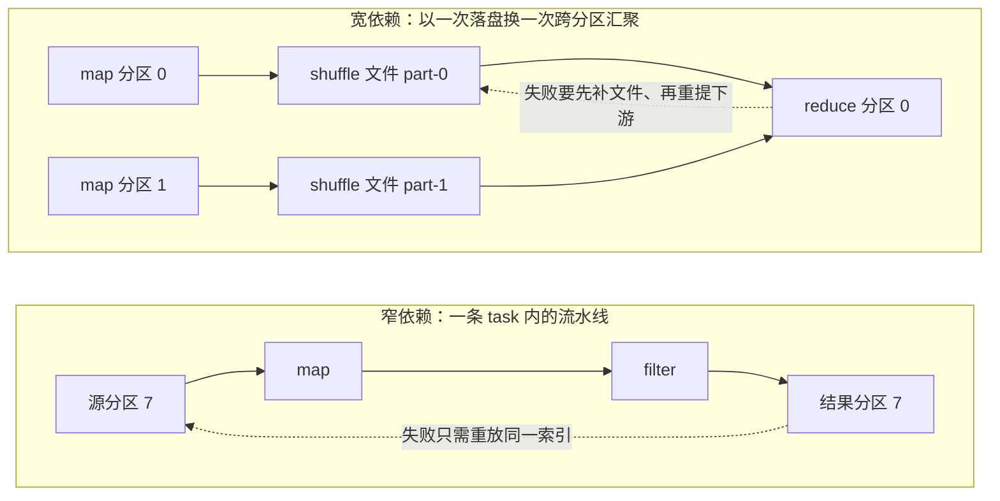
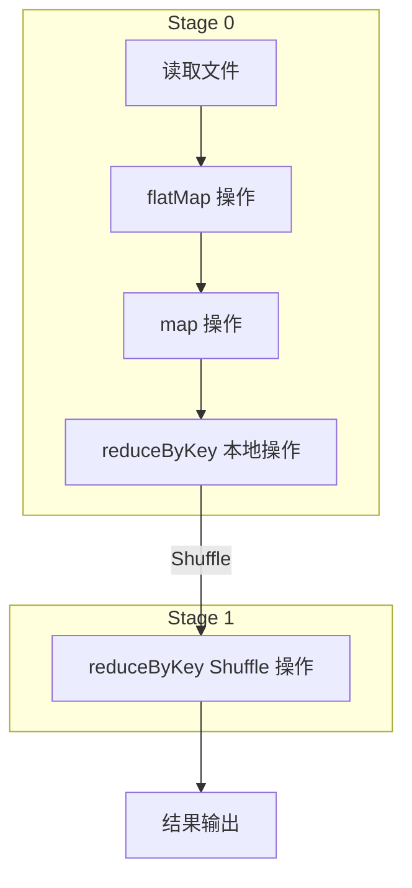
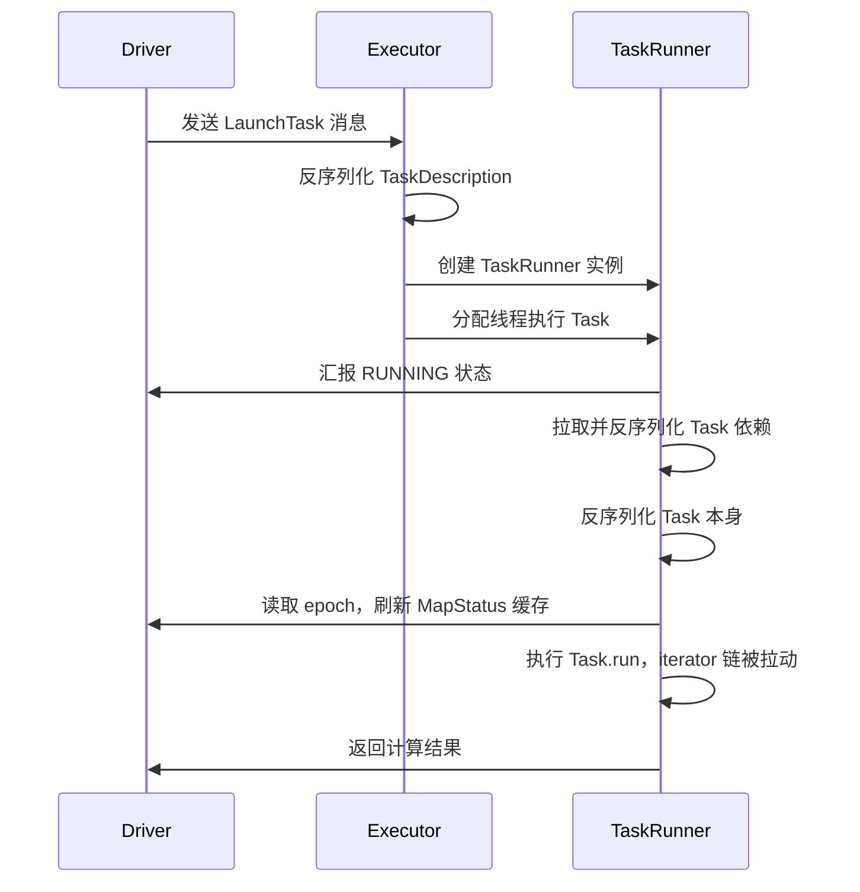
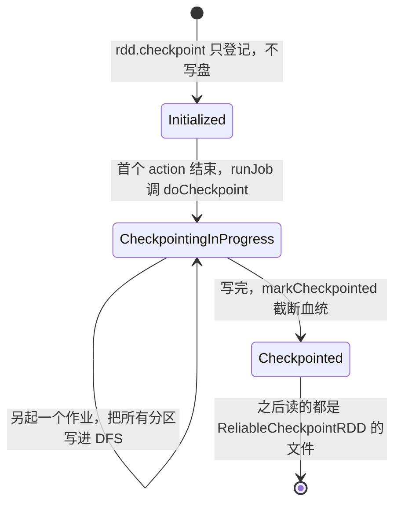
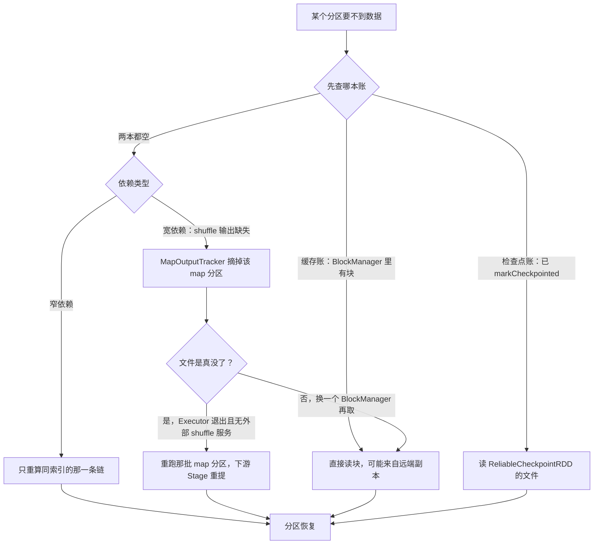

# 1. RDD 容错机制：一条血统链、两级重算范围与三本恢复账

**摘要：**

2012 年 4 月，伯克利 AMPLab 在 NSDI 上抛出的主张与当时的集群潮流相反：不要替数据集保存副本，要保存它被算出来的那段历史，也就是血统（Lineage）。这篇文章要回答两个问题：一条由依赖关系与计算函数拼成的链条，凭什么在机器随时会死的前提下把结果救回来；以及当这条链长到无法重放、或者失败的代价高到无法接受时，缓存、检查点与 shuffle 账本各自把哪一部分代价买了下来。

文章沿着五问推进：先用源码澄清血统并不是一个字段，而是 RDD 的依赖表与 compute 函数合起来的那份合约；再把重算与副本的成本结构摆在一起，说明 Spark 用"确定性加可重读的源头"换掉了复制开销，也因此背上了重算的放大风险；接着逐层拆开依赖类型，指出窄依赖可以在一个 task 里从头流水到尾，而宽依赖必须以 shuffle 文件落盘为代价，这条差异直接决定了失败之后要重算多少；然后把恢复机制分成三本账来读——BlockManager 里的缓存账、可靠存储上的检查点账、MapOutputTracker 里的 shuffle 账，分别交代它们的命中边界、触发时机与失效条件；之后处理推测执行这笔用重复计算换尾延迟的交易；最后落到边界与反例上，把把缓存当检查点、把检查点当备份、非确定算子下的重算漂移、动态分配与 shuffle 文件的耦合逐一摊开。全文的落点是取舍：重算、缓存、检查点构成一条成本阶梯，选哪一级取决于依赖形状、数据被复用的次数，以及一次失败到底贵在哪里。

**关键词（Keywords）**: Lineage, 窄依赖, 宽依赖, Checkpoint, persist, StorageLevel, MapStatus, 推测执行, 确定性

---

## 第 1 章 血统：一份不存数据副本的容错合约

### 1.1 一个反常识的主张

2012 年 4 月，旧金山的 NSDI 会场上，来自伯克利 AMPLab 的一篇论文对集群容错提出了一个反常识的主张：**记录数据被算出来的那段历史，而不是数据本身**。论文的原话是"by logging the transformations used to build a dataset (its lineage) rather than the actual data"，直译过来就是"记录用于构建数据集的那些变换，而不是实际数据"；紧接着的一句更关键，"If a partition of an RDD is lost, the RDD has enough information about how it was derived from other RDDs to recompute just that partition"，一个分区丢了，RDD 手里握有足够的信息，知道它是从别的 RDD 怎么推出来的，于是可以只重算那一个分区。

这句话在 2012 年之所以显得刺眼，是因为当时的主流答案是复制与检查点：HDFS 用三副本把"数据会不会丢"变成一个存储问题，分布式共享内存（Distributed Shared Memory，DSM）用周期性全局快照把"程序状态会不会丢"变成一个操作系统问题。两者的共同点是把容错做在"状态"上，代价也落在状态上——三副本意味着三倍存储与三倍写入带宽，全局快照意味着每次落盘都要停下整个程序。Spark 的选择是把容错做在"推导过程"上：只要推导过程还在，丢掉的中间结果随时可以再算一次。同一批人在 2010 年的 HotCloud 短文里已经用"工作集"（Working Set）这个词描述过内存中反复使用的数据集，但真正把容错这件事讲清楚的，是两年之后这篇 RDD 论文。

不过，把容错从数据挪到过程上，等于把风险也一起挪了过去：副本丢一份还有两份，重算则要求"再算一次"得到的必须是同一份数据。这个前提在后文会反复出现，它是整套机制最脆弱的一环。

### 1.2 血统在源码里不是一个字段

初次接触 Spark 的人常以为 RDD 内部有一个叫 lineage 的成员变量，点开源码会发现根本没有这个名字。RDD 的类注释写得很清楚，一个 RDD 由五个属性刻画：一组分区（partitions）、一个对每个分片计算的函数（compute）、一张对其他 RDD 的依赖表（dependencies）、一个可选的划分器（partitioner），以及一组可选的首选位置（preferredLocations）。**血统是这张依赖表与那个计算函数合起来的语义**，不是一处独立的存储。

这五个属性里，真正承担恢复职责的是三个：`partitions` 告诉调度器"这个数据集分成几块、每块的索引是什么"，`compute` 告诉执行器"给定一个分片，怎么算出它的迭代器"，`dependencies` 告诉所有人"算它之前要先算谁"。三者拼在一起，等价于一份可执行的施工图：只要上游还在、函数还是纯的，任何一块都能按图重做。`partitioner` 与 `preferredLocations` 不参与正确性，它们影响的是重算之后数据落在哪里、要不要再走一次网络。

这份合约在运维上有一个很直接的投影：`RDD.toDebugString` 会把依赖链按缩进打印出来，遇到 shuffle 边界就在前面画一个 `+-`，`SparkContext.runJob` 里那个 `spark.logLineage` 开关一旦打开，每个作业都会把整条链打进日志。排查"这个作业为什么重算这么久"时，先看这棵树有多深、中间有几个 `+-`，往往比翻执行计划更快。

本文引用的源码位置与配置默认值，一律以 4.3.0 这个标签为准；4.x 的预编译发行包默认搭配 Scala 2.13，文中出现的 API 与语法都以这一组合为基准。遇到版本之间默认值不同的地方，笔者会在正文里点明分界点，没有把握的地方则注明以对应版本文档或源码为准。

### 1.3 一个贯穿全文的案例

为了不让后面的机制悬空，笔者设想两个具体的作业，它们会在后文反复出现。

第一个叫 `watch_daily`，某视频站点每天凌晨跑一次：从 HDFS 上读前一天 3.2 TB 的埋点明细，八百个分区，先按用户与视频聚合出观看时长，再与一张两千万行的视频维度表做 join，最后写成推荐特征表。这条链上有两次 shuffle，第一次来自聚合，第二次来自 join，也就是说它的血统树在两个地方被 `+-` 切断，中间各生出一批必须落盘的中间文件。

第二个叫 `crowd_expand`，一个相似人群扩散的迭代作业：从一个种子用户集合出发，每轮把人群沿关注关系扩一圈，与静态的关注边表 join 一次，再收敛一次，跑四十轮。它每一轮都在上一轮的结果上再叠一层依赖，四十轮之后血统链长到四十层，其中四十个 join 各带一次 shuffle。这两个作业的差别，恰好是本文要区分的那条分水岭：一个的痛点在"失败一次要重算多少"，另一个的痛点在"血统长到根本重放不动"。

### 1.4 一个比喻：施工图、堆料与预制板

把血统比作施工图，很多取舍会立刻变得直观。施工图不占地方，房子拆了可以照图重建；但它有个前提——图纸必须准确，而且建材（源头数据）必须还能买到。缓存像是工地旁边堆着的半成品：这一批梁柱刚好在场上，下一个工序直接拿去用；一旦堆场被清空，就得回去按图重做。检查点则是预制板：花钱在工厂做一次，之后无论工地发生什么，吊装上去就行，代价是这笔钱必须先付、而且预制板本身不能丢。

比喻的技术限定在于：施工图重做的成本与"图纸有多长"成正比，而预制板的价格与"数据有多大"成正比。这两个成本曲线的交叉点，就是第 5 章要讨论的检查点决策点。

---

## 第 2 章 为什么是重算：一次成本结构的置换

### 2.1 副本容错的三笔账

要理解 Spark 为什么选重算，先把副本容错的账摊开。第一笔是存储：HDFS 默认三副本，一份逻辑数据要占三份物理空间，中间结果若也要可靠保存，这个倍数会顺着作业链条一路乘下去。第二笔是带宽：每次落盘都要写三份，每次读取都可能跨机架，网络成了吞吐的上限。第三笔最隐蔽，是同步成本：DSM 的检查点必须在一个一致的状态上拍快照，为了拍这张照片，整个程序得停下来对齐，停一次的时间随集群规模增长。

RDD 的做法是把这三笔账一次性勾掉：中间结果默认不落盘、不复制、不同步，只在内存里以迭代器的形式流动。省下来的钱并不是免费的，它被换成了一笔或有负债——一旦有机器退出，损失的中间结果必须从源头重算。**Spark 的容错本质上是一次成本结构的置换：把确定的、按数据量线性增长的复制开销，换成不确定的、按血统形状放大的重算开销。** 置换划不划算，取决于重算一次有多贵，而重算的贵贱又取决于两件事：血统有多长，以及链上有几道 shuffle。

### 2.2 重算成立的三条前提

重算能替代副本，靠的不是勇气，而是三条相当硬的前提。

第一条是确定性（Determinism）：同一个分区、同样的输入、同样的函数，重算必须得到同样的结果。Spark 把这件事形式化成了 `DeterministicLevel` 这个枚举，`RDD.outputDeterministicLevel` 给出三档取值——`DETERMINATE`（重跑结果与顺序都不变）、`UNORDERED`（数据集相同但顺序可能变）、`INDETERMINATE`（重跑可能得到不同数据）。反过来，只要算子里掺了随机数、读了系统时钟、用了自增 ID，或者依赖了上游的到达顺序，这条链就会被拖进第三档；譬如在 `map` 里读一次 `System.currentTimeMillis()`，重算出来的数据就和第一次不一样。

第二条是源头可重读：血统链的根必须落在一份稳定存储上，通常是 HDFS 或对象存储。`parallelize` 出来的 RDD 恰恰不具备这个条件：它的数据由 Driver 内存里的集合切片而来，分区一旦丢失，能回去的只有那份集合本身，这也是流式场景要给源头额外加一层预写日志的原因。

第三条是血统长度可控：重算的成本随链长线性上升，一旦链长到了几十上百层，单次重算的时间就可能超过作业本身的执行时间。第 5 章的检查点，本质上就是给这条前提打的一个补丁。

### 2.3 不这样会怎样

反事实推演一下，如果 Spark 当年选择"每个 RDD 都物化到磁盘"，会发生什么。

`crowd_expand` 会退化成四十轮 MapReduce：每一轮结束把中间结果写三份，下一轮再读回来，四十轮就是四十次全量落盘加四十次全量读取，而这四十轮里真正变化的只有人群集合，关注边表始终没变。论文里给出的对比是迭代类应用上最多二十倍的差距，这个数字之所以成立，靠的正是"不落盘"这三个字。

如果把方案换成"内存里存两份副本"呢？看起来兼顾了速度与可靠，实际上两头不讨好：内存占用直接翻倍，能缓存的数据集少了一半；更要命的是副本的放置策略是尽力而为，同一台机器上的两个 Executor 同时消失时，两份副本会一起没，此时仍然要靠血统重算。这也是为什么 `StorageLevel` 里那些带 `_2` 后缀的级别从来不是容错方案，它们只是降低了"重算触发"的频率。

### 2.4 重算的成本可以被估出来

把重算成本写成一个粗糙的式子，后面几章的取舍就有了共同的度量：重算成本 ≈ 丢失的分区数 × 每个分区到最近物化点的路径长度 × 单分区单位计算成本。

这个式子里，第一项由失败规模决定（丢一个分区还是一台机器），第三项由算子本身决定（过滤便宜、join 昂贵），而第二项——路径长度——是唯一一个能靠设计改变的变量。**缓存缩短的是"到最近物化点的距离"，检查点做的是"直接把距离归零"，而依赖类型决定的是"这段距离到底按链算还是按阶段算"。** 后文三章，讲的就是这三个变量各自怎么动。

---

## 第 3 章 依赖类型：重算范围的分水岭

### 3.1 两种依赖，一条分界线

论文把依赖分成两类，定义朴素得近乎吝啬：窄依赖（Narrow Dependency）指父 RDD 的每个分区最多被一个子分区使用，宽依赖（Wide Dependency）指多个子分区可能依赖同一个父分区。`map`、`filter`、`union`、`coalesce`（不 shuffle 的那种）是窄的，`groupByKey`、`reduceByKey`、`join`（父 RDD 未按同一划分器分区时）是宽的。

落到实现上，这两种依赖的判定标准与物理后果可以并列成一张表。

| 依赖类型 | 判定特点 | Stage 处理方式 | 输出形态 |
|---|---|---|---|
| 窄依赖 | 父 RDD 的每个分区最多被子 RDD 的一个分区使用 | 并入同一个 Stage，同一次 task 内流水执行 | 迭代器，不落盘 |
| 宽依赖 | 父 RDD 的分区可能被子 RDD 的多个分区使用，需要 Shuffle | 在此切断，形成新的 Stage，先算完父 Stage 再算子 Stage | shuffle 文件加 MapStatus 收据 |

单看定义，这不过是个"数据会不会跨分区流动"的分类；但论文紧接着给出了两条理由，其中第二条正是本文的主题：窄依赖让失败恢复更高效，因为只有丢失的父分区需要重算，而且这些分区可以在不同节点上并行重算；而在含宽依赖的血统图里，单个节点的失败可能导致 RDD 所有祖先都丢掉一部分分区，从而要求一次完整的重新执行。

下图把这两种形状摆在一起，重点看右侧那条必须落盘的边界。



### 3.2 窄依赖为什么能流水：一个函数调用的距离

窄依赖能流水，源码层面的理由简单得让人意外：子 RDD 的 `compute` 方法直接向父 RDD 要迭代器，中间没有任何落盘点。

```scala
// MapPartitionsRDD.compute（4.3.0）：把父 RDD 的迭代器接过来，套一个函数就返回
override def compute(split: Partition, context: TaskContext): Iterator[U] =
  f(context, split.index, firstParent[T].iterator(split, context))
```

这行代码意味着什么？它意味着 `map` 之后接 `filter`、`filter` 之后接 `map`，在执行期并不存在三个 RDD 的数据集，只有一个 task 线程里层层包装的迭代器。数据从源分区的第一行读进来，穿过 `map` 的函数、穿过 `filter` 的判定，直接被下游消费者拿走；中间没有数组、没有缓冲文件、没有 RDD 的实体。所谓流水线（Pipeline），就是把"三个算子"压缩成"一次遍历"。

顺带一提，`iterator` 是 `final` 的，不允许子类改写。这不是风格洁癖，而是为了让"是否读缓存""是否读检查点"这两个判断只存在于一个地方——第 4 章会看到，正是这唯一的分叉点决定了缓存的命中语义。

窄依赖对容错的意义可以直接读出来：**若分区 7 丢了，重算只需要"从源头取分区 7，重新穿过这条链上的几个函数"，范围是 1 个分区乘以链长，而且不同分区之间互不影响，可以在不同机器上同时重算。** 这是 Spark 恢复能力最强的一种形状，也是论文说"checkpointing may never be worthwhile"的那类情形。

### 3.3 宽依赖为什么必须落盘：一次跨分区的强制同步

宽依赖没有这个待遇。以 `reduceByKey` 为例，reduce 侧的分区 0 需要拿到"所有 map 分区里哈希到 0 的那些 key"，这些数据分散在八百个 map 任务里，任何单个 map 任务都不掌握全貌。想让它们聚到一起，只有一条路：先把每个 map 分区的输出按目标分区切开、写到本地磁盘，再由 reduce 任务跨网络去拉。这就是 shuffle，而 shuffle 的物理形态就是一组落在磁盘上的文件。

读侧的代码同样短：

```scala
// ShuffledRDD.compute（4.3.0）：不去问父 RDD 要迭代器，而是问 shuffle 管理器要一个 reader
override def compute(split: Partition, context: TaskContext): Iterator[(K, C)] = {
  val dep = dependencies.head.asInstanceOf[ShuffleDependency[K, V, C]]
  val metrics = context.taskMetrics().createTempShuffleReadMetrics()
  SparkEnv.get.shuffleManagerFor(dep).getReader(
    dep.shuffleHandle, split.index, split.index + 1, context, metrics)
    .read()
    .asInstanceOf[Iterator[(K, C)]]
}
```

请注意这里的差别有多根本：窄依赖是"向上游要数据"，上游就在同一个 JVM 里；宽依赖是"向 shuffle 管理器要一个 reader"，数据在别人的磁盘上。前者失败时重算一段函数，后者失败时先要判断"文件还在不在"，再去补文件。**宽依赖把恢复的坐标系从"分区"换成了"分区乘以阶段"**，这是本文最想强调的一条判断。

### 3.4 同一棵树，两种切法

血统树在物理执行时会被切成 Stage，切点就是宽依赖。下面这张图是经典的 WordCount，两个 Stage 之间隔着一次 `reduceByKey` 的 shuffle。



对应的用户代码只有五行，但它同时产生了五个 RDD 和一处 `+-`：

```scala
val conf = new SparkConf()
conf.setAppName("WordCount Example")
conf.setMaster("local")
val sc = new SparkContext(conf)

val lines = sc.textFile("data.txt", 1)
val words = lines.flatMap { line => line.split(" ") }
val pairs = words.map { word => (word, 1) }
val wordCounts = pairs.reduceByKey(_ + _)
wordCounts.collect().foreach(println)
sc.stop()
```

Stage 是怎么被切出来的，属于调度层的题目，这里只借用它的结论：从末端 RDD 往前回溯，遇到窄依赖就并入当前 Stage，遇到宽依赖就在此切断，把那条 `ShuffleDependency` 记成下一段要等的父 Stage。

```scala
// DAGScheduler.getOrCreateParentStages（4.3.0，节选）：父 Stage 就是这条链上最近的几处宽依赖
private def getOrCreateParentStages(rdd: RDD[_], firstJobId: Int): List[Stage] = {
  getShuffleDependencies(rdd).map { shuffleDep =>
    getOrCreateShuffleMapStage(shuffleDep, firstJobId)
  }.toList
}

// 从末端 RDD 出发做一次深度优先，只收集"最近的"宽依赖，遇到窄依赖继续往前走
private[scheduler] def getShuffleDependencies(
  rdd: RDD[_]): HashSet[ShuffleDependency[_, _, _]] = {
  val parents = new HashSet[ShuffleDependency[_, _, _]]
  val visited = new HashSet[RDD[_]]
  val waitingForVisit = new Stack[RDD[_]]
  waitingForVisit.push(rdd)

  while (waitingForVisit.nonEmpty) {
    val toVisit = waitingForVisit.pop()
    if (!visited(toVisit)) {
      visited += toVisit
      toVisit.dependencies.foreach {
        case shuffleDep: ShuffleDependency[_, _, _] =>
          parents += shuffleDep
        case dependency =>
          waitingForVisit.push(dependency.rdd)
      }
    }
  }
  parents
}
```

这里有一个常被读漏的细节：函数名是"取 Shuffle Dependencies"而不是"取所有的 Shuffle Dependency"，因为它一旦撞上宽依赖就把它收进集合、不再往那条分支的深处走。所以"最近的宽依赖"才是 Stage 的切点，更上游的宽依赖会在父 Stage 被创建时递归处理。这个"只找最近一层"的写法，与恢复时的行为正好互为镜像——补一个 map 输出，只需要重跑那一个 map 分区，不需要把更上游的历史也翻出来。

### 3.5 两级重算范围

把上面几节收拢，重算范围其实只有两级，而它们在代价上差着数量级。

| 维度 | 窄依赖链上的重算 | 跨宽依赖的重算 |
|---|---|---|
| 重算单元 | 单个分区乘以链长 | 丢失的 map 分区，加下游未完成分区 |
| 中间结果形态 | 迭代器，内存里流动 | shuffle 文件，必须落在磁盘 |
| 触发条件 | 分区数据不在缓存、不在检查点 | 缓存缺失、MapStatus 被摘除、文件不可达 |
| 重算并行度 | 高，各分区互不影响 | 受限于需要补的那批 map 分区 |
| 下游影响 | 无，同一 task 内消化 | 下游 Stage 的 attempt 作废，重新排队 |
| 恢复上限 | 取决于链长 | 取决于 shuffle 文件的生命周期 |

表格最后一行是第 6 章的引子。shuffle 文件能活多久，不由 RDD 决定，而由 Executor 与外部 shuffle 服务的部署方式决定；这条依赖关系一旦被忽略，重算范围就会从"一个分区"悄悄膨胀成"一整台机器上的全部中间结果"。

### 3.6 一个反直觉的推论

顺着这条线往下推，会得到一个与直觉相反的结论：宽依赖的问题不在于"它更贵"，而在于它把恢复的粒度从"分区"变成了"分区乘以阶段"，于是同一个故障在不同拓扑下会放大出完全不同的代价。

举一个具体的对比。`watch_daily` 的第一个 Stage 有八百个 map 分区，某个 Executor 退出，它上面跑了二十个 map 任务，输出的 shuffle 文件随进程消失。此时恢复的动作是：MapOutputTracker 把这二十个分区的 MapStatus 摘掉，Stage 重提时只在 `findMissingPartitions` 的结果里看到二十个缺口，于是只补这二十个 map 分区；但下游那个正在跑的 reduce Stage，attempt 会被判失败、正在跑的任务被取消，重新提一次。补二十个分区本身不算贵，贵的是下游那次"整段重来"。

而在一条纯窄依赖的链上，同一个 Executor 退出，影响只是"缓存里少了二十块"，下次需要时按分区索引各重算各的，不需要任何阶段级的重排。**同样是二十个分区，前者换来一次 Stage 重提，后者换来二十次函数调用。** 这个差距不是实现优劣，而是依赖形状决定的。

---

## 第 4 章 第一本账：缓存与 getOrCompute 的命中边界

### 4.1 iterator 的三岔口

一个分区被需要时，Spark 会先问三本账：缓存里有没有、检查点里有没有、都没有才按血统算。这三问被压缩在 `RDD.iterator` 的两次判断里。

```scala
// RDD.iterator（4.3.0）：整条链路上只有这一个分叉点
final def iterator(split: Partition, context: TaskContext): Iterator[T] = {
  if (storageLevel != StorageLevel.NONE) {
    getOrCompute(split, context)             // 配了存储级别，先问 BlockManager
  } else {
    computeOrReadCheckpoint(split, context)  // 否则先问检查点，再问血统
  }
}

private[spark] def computeOrReadCheckpoint(split: Partition, context: TaskContext)
    : Iterator[T] = {
  if (isCheckpointedAndMaterialized) {
    firstParent[T].iterator(split, context)  // 父链此刻只剩一个 ReliableCheckpointRDD
  } else {
    compute(split, context)                  // 沿血统往下递归，直到源头
  }
}
```

这段代码解释了两件容易被误解的事。其一，"缓存"的生效条件是 `storageLevel != StorageLevel.NONE`，也就是只要调用过 `persist` 或 `cache`，哪怕块最后没存住，也会走 `getOrCompute` 这条路；其二，"检查点"的读取点不在 `iterator` 的分支里，而在 `computeOrReadCheckpoint` 里，因为它替换的是"父链"本身——第 5 章会看到 `markCheckpointed` 把依赖表换成了一条指向 `ReliableCheckpointRDD` 的窄依赖，于是"读检查点"在代码里就表现为"向父 RDD 要迭代器"。

### 4.2 getOrCompute 的两条返回路径

`getOrCompute` 的名字容易让人以为它有"命中"与"未命中"两种结果，实际返回的是一个 `Either`，两个分支的语义比"命中与否"更细。

```scala
// RDD.getOrCompute（4.3.0）：Left 是拿到了块，Right 是没存住、只能把迭代器交回去
private[spark] def getOrCompute(partition: Partition, context: TaskContext): Iterator[T] = {
  val blockId = RDDBlockId(id, partition.index)
  var readCachedBlock = true
  SparkEnv.get.blockManager.getOrElseUpdateRDDBlock(
    context.taskAttemptId(), blockId, storageLevel, elementClassTag, () => {
      readCachedBlock = false
      computeOrReadCheckpoint(partition, context)   // 未命中的话，重算就是从这一行开始的
    },
    verifySealedChecksum = verifyCheckpointChecksums
  ) match {
    case Left(blockResult) =>
      if (readCachedBlock) {
        val existingMetrics = context.taskMetrics().inputMetrics
        existingMetrics.incBytesRead(blockResult.bytes)   // 命中会计入输入指标
        new InterruptibleIterator[T](context, blockResult.data.asInstanceOf[Iterator[T]]) {
          override def next(): T = {
            existingMetrics.incRecordsRead(1)
            delegate.next()
          }
        }
      } else {
        new InterruptibleIterator(context, blockResult.data.asInstanceOf[Iterator[T]])
      }
    case Right(iter) =>
      new InterruptibleIterator(context, iter)     // 存不下，数据照算，但没进缓存
  }
}
```

`Right` 这条分支是"cache 了但没缓存住"的源码出处：`doPutIterator` 尝试把数据放进 BlockManager，若内存装不下且存储级别不允许落盘，就把迭代器原样交回调用方继续消费。于是数据正确性没问题，缓存的收益却没了；更糟的是，下一个 task 再次需要这块数据时，仍然要重算一遍。这也是为什么在真实集群上，`MEMORY_ONLY` 常常表现得比预期差：它不会报错，只会安静地少掉一部分缓存。

### 4.3 命中的四个前提

把 `getOrCompute` 展开，一个"命中"其实要同时满足四个条件，缺一个就会退化成重算。

第一，块必须存在于某个 BlockManager 上。RDD 的缓存粒度是 `RDDBlockId(rddId, partitionIndex)`，也就是说缓存的是"某个 RDD 的某个分区"，不是整个 RDD；一部分分区在内存里、另一部分不在，是完全正常的状态。

第二，本地没有时，还有一次远程查找的机会。`BlockManager.get` 会先查本地，再通过 `getRemoteValues` 去别的 Executor 拉，日志里分别打印 "Found block ... locally" 与 "Found block ... remotely"。所以命中不等于本地命中：譬如某个分区只缓存在 A 机的内存里，B 机上的任务命中它，换来的其实是一次网络传输，代价可能是半个机架的往返。

第三，任务最好被调度到持有该块的机器上。DAGScheduler 在算首选位置时会先查 `getCacheLocs(rdd)(partition)`，源码注释只有一句"如果这个分区被缓存了，就返回缓存所在的位置"。这条优先级的含义很实际：缓存块的位置会盖过 HDFS 块的位置，因为从远端 Executor 拉一份内存块，未必比从本地磁盘读原始数据便宜。

第四，块不能被驱逐或清理。内存不足时 `MemoryStore` 会按最近最少使用把块挤出去，`spark.memory.storageFraction` 保护的只是"存储区不被执行区抢占"这一层，挡不住"存储区自己装不下"；调用过 `unpersist`、RDD 被 GC 触发清理、或者 `SparkContext` 结束，块都会消失。

### 4.4 存储级别决定了失败后能救回什么

`StorageLevel` 由四个布尔与一个整数拼成：是否用磁盘、是否用内存、是否用堆外、是否以反序列化形态驻留，再加上副本数。组合出来的常用级别与它们的容错含义如下。

| 存储级别 | 数据形态 | 驱逐或重启后的结果 | 适用判断 |
|---|---|---|---|
| `MEMORY_ONLY` | 反序列化对象 | 装不下即丢弃，下次重算 | 复用次数高、对象小 |
| `MEMORY_ONLY_SER` | 序列化字节，受 `spark.rdd.compress` 影响 | 同上，但同内存能放更多 | CPU 有余、内存吃紧 |
| `MEMORY_AND_DISK` | 内存优先，溢出落盘 | 落盘部分在 Executor 存活期内仍可读 | 分区大、重算贵 |
| `DISK_ONLY` | 只落盘 | 仍随 Executor 消失而消失 | 极长链的中间结果 |
| `OFF_HEAP` | 堆外内存 | 同 `MEMORY_ONLY`，不参与 JVM GC | 堆内 GC 压力大 |
| 带 `_2` 后缀 | 加一份副本 | 少一次重算，但副本会一起没 | 关键窄依赖链 |

表格最后一行需要一句限定：带副本的级别从来没有被写进恢复逻辑。调度器判断缓存位置时只看"有没有块"，不看"有几份"；副本丢失之后由 `spark.storage.replication.proactive`（默认开启）尽力补一份，补不上也不会有人报错。**副本是降低重算概率的优化，血统才是保证重算可能的合约。**

### 4.5 重算发生在哪里：一次 Task 的执行现场

缓存未命中的时候，重算究竟在哪个时刻、由谁执行？答案在 Executor 的 `launchTask` 与 `TaskRunner.run` 里。

```scala
// Executor.launchTask（4.3.0，节选）：收到一个 TaskDescription，就起一个 TaskRunner 扔进线程池
def launchTask(context: ExecutorBackend, taskDescription: TaskDescription): Unit = {
  val taskId = taskDescription.taskId
  var taskRunnerOpt: Option[TaskRunner] = None
  try {
    val tr = createTaskRunner(context, taskDescription)
    taskRunnerOpt = Some(tr)
    runningTasks.put(taskId, tr)
    threadPool.execute(tr)
  }
  // 异常处理与 kill 标记略
}
```

```scala
// Executor.TaskRunner.run（4.3.0，大幅节选）：血统只在这一处被真正拉动
override def run(): Unit = {
  // 1. 反序列化 Task 之前，先把 task 依赖的文件、jar、归档拉下来
  Executor.taskDeserializationProps.set(taskDescription.properties)
  updateDependencies(
    taskDescription.artifacts.files,
    taskDescription.artifacts.jars,
    taskDescription.artifacts.archives,
    isolatedSession)
  // 2. 反序列化 Task 本身；RDD 与它的依赖表就藏在这份字节里
  task = ser.deserialize[Task[Any]](
    taskDescription.serializedTask, Thread.currentThread.getContextClassLoader)
  // 3. 更新 epoch，让本地缓存的 MapStatus 失效（发生过 FetchFailed 时必须刷新）
  if (!isLocal) {
    env.mapOutputTracker.asInstanceOf[MapOutputTrackerWorker].updateEpoch(task.epoch)
  }
  // 4. 真正干活：Task.run 内部会调 rdd.iterator，血统从这一刻开始重放
  val res = task.run(
    taskAttemptId = taskId,
    attemptNumber = taskDescription.attemptNumber,
    metricsSystem = env.metricsSystem,
    cpus = taskDescription.cpus,
    resources = resources,
    plugins = plugins)
}
```

这张时序图把一次执行的消息往来画全，也是"重算"这件事的最小现场：Driver 下发、Executor 起线程、汇报状态、反序列化、执行、回传。



第 4 步里那句"血统从这一刻开始重放"值得再强调一次：**重算不是一个后台过程，而是一次普通的 task 尝试。** 它和第一次计算走的是同一条代码路径，区别只在于上次数据在缓存里，这次不在。这也解释了为什么重算失败同样计入 `spark.task.maxFailures`：它走的是同一条 task 尝试路径，没有特殊待遇。

---

## 第 5 章 第二本账：checkpoint 把重算换成一次写

### 5.1 两种检查点模式

`RDD.checkpoint()` 不是一种机制，而是两种，选哪一条由你调用的方法决定。

| 维度 | 可靠检查点 `checkpoint()` | 本地检查点 `localCheckpoint()` |
|---|---|---|
| 落点 | `spark.checkpoint.dir` 或 `setCheckpointDir` 指定的可靠存储 | Executor 本地块存储（强制 `useDisk`） |
| 是否跨应用可读 | 文件本身独立于 Executor 生命周期，但目录每次带随机 UUID | 否，Executor 退出即丢 |
| 断 lineage | 是 | 是 |
| 失败语义 | 数据丢失可重读文件 | 数据丢失直接作业失败，无法重算 |
| 依赖要求 | 需要 DFS 或等价可靠存储 | 需要存储级别带磁盘，默认 `MEMORY_AND_DISK` |
| 与动态分配的关系 | 无冲突 | 危险，回收 Executor 会连带丢检查点 |
| 典型用途 | 迭代算法、超长血统 | GraphX 一类反复截断血统的内存计算 |

可靠检查点把分区写成文件，路径是 `<checkpointDir>/rdd-<id>/part-00000`，写完还会尽力写一个 `_partitioner` 文件保存划分器，读回来时 `ReliableCheckpointRDD` 直接用 HDFS 的块位置作为首选位置，本地性因此得以保留。本地检查点则简单粗暴：它只是把 RDD 标记成要持久化，然后把分区写进 BlockManager，用磁盘兜底，源码里甚至有一条 `assume` 断言存储级别必须使用磁盘，理由是"纯内存级别下驱逐会导致数据丢失"。

### 5.2 checkpoint 什么时候真正落盘

`checkpoint()` 本身几乎什么都不做：它只检查有没有配置检查点目录，然后把 `checkpointData` 设成一个 `ReliableRDDCheckpointData`。目录没配就直接抛异常，配置了也只是"登记"。

真正的写入发生在第一次 action 之后。`SparkContext.runJob` 在作业跑完之后，会紧接着调一句 `rdd.doCheckpoint()`，这一句是整个机制的启动键。

```scala
// SparkContext.runJob（4.3.0，节选）：作业结束之后立刻处理检查点
dagScheduler.runJob(rdd, cleanedFunc, partitions, callSite, resultHandler, localProperties.get)
progressBar.foreach(_.finishAll())
rdd.doCheckpoint()
```

`doCheckpoint()` 内部有一串约束：它用 `doCheckpointCalled` 保证每个 RDD 只处理一次；它只处理"自己或者最近的已标记祖先"，除非把 `spark.checkpoint.checkpointAllMarkedAncestors` 设为真（这个开关是 SPARK-6847 为解决流式场景里父 RDD 永远等不到检查点而加的）；它最终落到 `RDDCheckpointData.checkpoint()`，后者用 `Initialized → CheckpointingInProgress → Checkpointed` 三个状态做互斥，写完再把状态置为完成并截断血统。

下面的状态图把这条路径画全，注意中间那个"另起一个作业"的环节。



"另起一个作业"这件事，是理解检查点成本的关键。`ReliableCheckpointRDD.writeRDDToCheckpointDirectory` 内部会调一次 `sc.runJob(originalRDD, writePartitionToCheckpointFile(...))`，也就是把整个 RDD 再算一遍、再把每个分区写成一个文件。如果这个 RDD 之前没有被缓存，这次重算就是实打实的全量重放——源码在 `LocalRDDCheckpointData` 里把这一点写成了待办（SPARK-8582），注释是"Not all actions compute all partitions of the RDD (e.g. take). For correctness, we must cache any missing partitions"。

于是那条被反复传诵的经验"checkpoint 之前先 cache"并不是玄学，而是这次额外作业的直接后果：先 `persist` 把数据钉在内存或磁盘上，检查点这次写就只是"读一遍、写一遍"；不 `persist`，检查点这次写就是"从头算一遍、再写一遍"。对 `crowd_expand` 这种四十轮迭代的作业，每十轮做一次检查点、且每次都先把当前轮次 persist 住，能省下的正是这四十层血统的重放。

```scala
sc.setCheckpointDir("hdfs:///spark/ckpt")        // 也可以配 spark.checkpoint.dir（4.0 起）
val base = sc.textFile("hdfs:///dw/watch/*")
  .map(parse).reduceByKey(_ + _)

base.persist(StorageLevel.MEMORY_AND_DISK)       // 先物化，否则检查点这次写要重放整条链
base.checkpoint()                                // 只登记，不写盘
base.count()                                     // 这次 count 结束后才写；写完血统被切断
base.count()                                     // 这一次的父链只剩检查点文件
```

还有一处容易踩的细节在目录上：`setCheckpointDir` 会在给定目录下再拼一个随机 UUID 子目录，所以同一个路径在两个 `SparkContext` 里对应两份互不相干的检查点。由此可以推出一条限制：RDD 检查点不是"断点续跑"的存档，它的用途被限定在同一个 `SparkContext` 生命周期之内的恢复。

### 5.3 为什么必须切断血统

检查点写完，`RDDCheckpointData.checkpoint()` 做的最后一件事是 `rdd.markCheckpointed()`，源码注释是"Update our state and truncate the RDD lineage"；这个动作在讨论里常被称作"切血统"（cut lineage），落到 4.3.0 的实现上就是 `markCheckpointed` 那几行，并没有一个单独的 cutLineage 方法。它做的事很干脆：把 `dependencies_` 清空、把 `partitions_` 置空，并用一个弱引用把旧的依赖表留一份给清理器，最后 `dependencies` 这个方法在下次被调用时，只会返回一条指向检查点 RDD 的 `OneToOneDependency`。

四条理由说明这个"切断"为什么不能省。

第一条是恢复路径变短。切断之前，从末端往回追要穿过四十层迭代；切断之后，追到检查点文件就停。恢复成本从"重算四十层"降到"读一次分布式文件系统"，而这正是检查点想买的东西。

第二条是父链可以被回收。`markCheckpointed` 之后，旧依赖只被弱引用持有，父 RDD 对象及其闭包可以被 GC 掉。对 `crowd_expand` 这种每轮都新建 RDD 的作业，不切断意味着 Driver 端要一直持有整棵血统树的对象图，几十轮之后堆内存与 GC 都会抗议。

第三条是把"不确定"钉死。一个已经完成可靠检查点的 RDD，`outputDeterministicLevel` 会被直接判定为 `DETERMINATE`，因为数据已经是文件里的字节，重读多少次都只有那一份。对含随机算子的链，这是唯一能保证"恢复后结果与恢复前一致"的手段。

第四条是规避上游故障的连锁。检查点文件在可靠存储上，而上游可能是一批脆弱的临时数据、一个已经被人删掉的 Hive 分区、或者一段只存在于内存的关系；切断之后，恢复不再依赖这些随时会变的东西。

代价同样清楚：**切断血统等于主动放弃"可重算"这条后路**。检查点文件丢了就是丢了，本地检查点尤其如此——`RDD.unpersist` 遇到本地检查点的 RDD 会打一条警告，说它的血统已被截断、unpersist 之后无法重算。这与"用检查点换安全"的直觉恰好相反：可靠检查点换的是安全，本地检查点换的是速度。

### 5.4 检查点与持久化的分工

这两件事经常被混为一谈，其实它们回答的是两个不同的问题：持久化回答"这份数据下一轮还要不要用"，检查点回答"这份数据丢了之后还找不找得回来"。

| 维度 | 持久化 `persist` / `cache` | 可靠检查点 `checkpoint` |
|---|---|---|
| 存储位置 | 内存、磁盘或堆外，由存储级别决定 | 可靠存储（HDFS、对象存储等） |
| 是否切断血统 | 否，依赖表原样保留 | 是，依赖表被替换成一条窄依赖 |
| 丢失后果 | 重算，代价取决于链长 | 无文件即无数据，作业直接失败 |
| 触发时机 | 第一个用到该分区的 task | 首个 action 结束后，另起作业写入 |
| 是否跨应用可见 | 否 | 文件在，但目录带随机 UUID，实际不可复用 |
| 额外成本 | 一次写入 BlockManager | 一次全量读取加写入，未缓存时外加一次全量重算 |
| 主要目的 | 复用中间结果，省时间 | 截断血统，缩短恢复路径 |

表格里"首个 action 结束后"那一行，正是两者最容易混淆的地方：`persist` 是惰性的，第一个 task 用到它时顺手写入缓存；`checkpoint` 也是惰性的，但要等整个作业结束才动手，而且动手时是一次独立的作业。**这也意味着一个"只 checkpoint 不 persist"的 RDD，其第一次作业会比不用检查点慢上一大截**，慢的那部分不是写入文件的开销，而是第二次从头算的开销。

### 5.5 什么时候不值得做检查点

论文里有一段判断值得完整引用："checkpointing is useful for RDDs with long lineage graphs containing wide dependencies"，对含宽依赖的长血统图，检查点有用；反过来说，"for RDDs with narrow dependencies on data in stable storage ... checkpointing may never be worthwhile"，如果血统链全是窄依赖、源头又落在稳定存储上，检查点可能永远不划算——因为节点失败时，丢失的分区可以由其他节点并行重算，成本只是复制整个数据集的一个零头。

把这段判断翻译成工程语言，就是三个"不必"：链短且全是窄依赖的，不必；数据只被用一次、用完即弃的，不必；作业本身就是一次性的、失败重跑整条流水线也无所谓的，不必。反过来，`crowd_expand` 这种"长血统加宽依赖"的迭代作业，是检查点的典型受益者，但即便在这里也要算一笔账：检查点带来的恢复收益，是否值得每十轮多一次全量读写。

还有一个反向的陷阱：把 `checkpoint` 当成"省内存"的手段。检查点写完之后内存并不会自动归还，除非你显式 `unpersist`；而一旦 `unpersist` 了本地检查点，血统又已经被切断，此时再要这份数据就只能失败。这两步的正确顺序是先检查点、确认写入成功、再 `unpersist`，而可靠检查点是安全的，本地检查点则要确认后续不再需要重算。

---

## 第 6 章 第三本账：Stage 重提时哪些分区不必再算

### 6.1 三本账的分工

到这里可以把恢复时要查的三本账并排放好：缓存账记在 BlockManager 上，回答"这块数据此刻在不在内存或磁盘里"；检查点账记在可靠存储上，回答"这份数据的持久快照在不在"；而 shuffle 账记在 Driver 的 `MapOutputTracker` 里，回答"某个 map 分区的输出文件还在不在、在哪台机器的哪个 BlockManager 上"。

第三本账最容易被忽略，因为它不属于任何一个 RDD。它是 Stage 级别的记账，记的是"哪个 shuffle 的第几个 map 分区，输出在哪"。而正是这本账，实现了那句听起来很神奇的性质：Stage 失败重提时，已完成的分区不必再算。

| 账本 | 记账位置 | 回答的问题 | 主要失效条件 | 失效之后的重算代价 |
|---|---|---|---|---|
| 缓存账 | 各 Executor 的 BlockManager | 这个分区的块此刻在不在内存或磁盘上 | 内存驱逐、Executor 退出、`unpersist`、被清理器回收 | 按依赖形状重算，窄依赖便宜、跨 shuffle 昂贵 |
| 检查点账 | 可靠存储的 `rdd-<id>` 目录 | 这份数据的持久快照还在不在 | 目录被清理、文件损坏、本地检查点随 Executor 消失 | 快照没了就没有后路，可靠检查点还会退化为重算 |
| shuffle 账 | Driver 的 `MapOutputTracker` | 哪个 map 分区的输出在哪、还在不在 | Executor 退出且无外部 shuffle 服务、宿主丢失、FetchFailed 判定不可信 | 重跑那批 map 分区，并把下游 Stage 重提一次 |

### 6.2 MapStatus：一个 map 分区的收据

`ShuffleMapTask` 干完活之后不返回数据，返回一张 `MapStatus`。这张收据里记了四样东西：输出所在的 `BlockManagerId`、每个 reduce 分区对应数据块的大小、这个 map 任务的唯一 ID，以及一个校验值（4.x 用于判断重跑的输出是否变化）。分区数超过 `spark.shuffle.minNumPartitionsToHighlyCompress`（默认 2000）时会换成压缩形态，只精确记录非空块，其余按平均值估算。

两种 Task 的分工与它们的恢复依据放在一起看，会更清楚"为什么只有 ShuffleMapTask 的产出值得记账"。

| Task 类型 | 所处 Stage 位置 | 主要功能 | 产出形态 | 失败后的恢复依据 |
|---|---|---|---|---|
| ShuffleMapTask | 非最后一个 Stage | 计算结果通过 Shuffle 传给下一个 Stage | shuffle 文件加一张 MapStatus 收据 | 收据还在就免算，收据被摘才重跑 |
| ResultTask | 最后一个 Stage | 计算结果输出，计算结束 | 返回值或写入外部存储 | 血统、缓存、检查点，三者按序取一 |

```scala
// ShuffleMapTask.runTask（4.3.0，节选）：把迭代器交给 shuffle 写入器，换回一张 MapStatus
override def runTask(context: TaskContext): MapStatus = {
  // 反序列化 RDD 与依赖：注意 RDD 是随任务一起下发的，血统在 Executor 侧重建
  val rddAndDep = ser.deserialize[(RDD[_], ShuffleDependency[_, _, _])](
    ByteBuffer.wrap(taskBinary.value), Thread.currentThread.getContextClassLoader)
  val rdd = rddAndDep._1
  val dep = rddAndDep._2
  // 新协议下 mapId 用 taskAttemptId，老协议用 partitionId，前者能区分重试产生的不同输出
  val mapId = if (SparkEnv.get.conf.get(config.SHUFFLE_USE_OLD_FETCH_PROTOCOL)) {
    partitionId
  } else {
    context.taskAttemptId()
  }
  dep.shuffleWriterProcessor.write(
    rdd.iterator(partition, context), dep, mapId, partitionId, context)
}
```

```scala
// ResultTask.runTask（4.3.0，节选）：末端任务只做一件事，把迭代器交给用户函数
override def runTask(context: TaskContext): U = {
  val (rdd, func) = ser.deserialize[(RDD[T], (TaskContext, Iterator[T]) => U)](
    ByteBuffer.wrap(taskBinary.value), Thread.currentThread.getContextClassLoader)
  func(context, rdd.iterator(partition, context))
}
```

两张任务放在一起看，恢复的路径就明白了：`ResultTask` 的产出是交给用户函数的返回值，Driver 侧除了一次输出提交之外不为它保留可重放的副本，它的重算依据只剩血统、缓存与检查点；`ShuffleMapTask` 的产出是一份文件加一张收据，只要收据还在 `MapOutputTracker` 里、文件还能被找到，下游就不需要它再跑一次。

### 6.3 findMissingPartitions：重提时只补缺口

Stage 重提时算哪些分区，代码只有一行：

```scala
// ShuffleMapStage.findMissingPartitions（4.3.0）
override def findMissingPartitions(): Seq[Int] = {
  if (isPipelined) {
    (0 until numPartitions).filterNot(pipelinedCompletedPartitions.contains)
  } else {
    mapOutputTrackerMaster
      .findMissingPartitions(shuffleDep.shuffleId)
      .getOrElse(0 until numPartitions)
  }
}
```

而 `findMissingPartitions` 的实现更朴素，就是把 `mapStatuses` 数组里为空的下标挑出来：

```scala
// MapOutputTrackerMaster.ShuffleStatus.findMissingPartitions（4.3.0）
def findMissingPartitions(): Seq[Int] = withReadLock {
  val missing = (0 until numPartitions).filter(id => mapStatuses(id) == null)
  assert(missing.size == numPartitions - _numAvailableMapOutputs,
    s"${missing.size} missing, expected ${numPartitions - _numAvailableMapOutputs}")
  missing
}
```

也就是说，"已完成的分区不重算"不是一条额外的优化逻辑，而是**记账方式本身的结果**：分区只要登记过收据，就不在缺口列表里；缺口列表里只有那些没有收据的分区。有些资料把这个门槛称作 `numCompletedOutputs`（已完成输出数），这个说法在 4.3.0 里可以落到两个真实的计数上：`ShuffleMapStage.numAvailableOutputs` 给出某次 shuffle 已有多少分区登记了收据，底层是 `MapOutputTrackerMaster.ShuffleStatus` 里的 `_numAvailableMapOutputs`；它与 `findMissingPartitions` 返回的缺口数互为补集，断言 `missing.size == numPartitions - _numAvailableMapOutputs` 说的就是这件事。

### 6.4 一次 FetchFailed 引发的连锁

真正让这本账动起来的，是 reduce 侧的一次取数失败。处理链路很长，但拆开只有三步。

第一步，摘掉那张收据。`mapOutputTracker.unregisterMapOutput(shuffleId, mapIndex, bmAddress)`，同时 `incrementEpoch()` 让所有 Executor 本地缓存的 MapStatus 一起失效（第 4 章 TaskRunner 里那句 `updateEpoch` 就是为此而设）。注意这一步只摘"那一个 map 分区"，不是整批。

第二步，把两个 Stage 一起塞进失败队列。源码里是连续两行 `failedStages += failedStage` 与 `failedStages += mapStage`：前者是当前正在跑的 reduce 侧 Stage，后者是出问题的 map Stage。这一行说明下游的 attempt 确实被作废了——正在跑的任务会被取消，重新排队。

第三步，重提。`resubmitFailedStages` 把队列清空，按 `firstJobId` 排序后逐个 `submitStage`，于是 `findMissingPartitions` 被调用，缺口只有被摘掉的那几个分区。

这里有两处细节值得停下。其一，reduce 侧作废并不等于"全部重算"：`ResultStage.findMissingPartitions` 返回的是 `job.finished` 里还没打勾的分区，已经成功的末端分区会被跳过；中间那个 shuffle map Stage 的已完成输出也仍记在自己的账上。其二，`failedStages` 是个集合，一次 Executor 退出往往会引发几十个 FetchFailed，而源码用"队列里已有就跳过"的方式把几十次重提压成一次，避免消息风暴。

### 6.5 这本账什么时候整体作废

第三本账不是永久的。决定它是否作废的，是一行相当不起眼的判断：

```scala
// DAGScheduler.handleExecutorLost（4.3.0）
val fileLost = !sc.shuffleDriverComponents.supportsReliableStorage() &&
  (workerHost.isDefined || !env.blockManager.externalShuffleServiceEnabled)
```

翻译过来：如果驱动端的 shuffle 组件没有可靠存储，而且（整个 Worker 节点被判死，或者没有启用外部 shuffle 服务），那么就认为这台机器上的 shuffle 文件全没了，把这些 map 分区的收据一并摘除。

这一行解释了三种完全不同的恢复代价。启用外部 shuffle 服务（`spark.shuffle.service.enabled`，默认关闭）时，shuffle 文件不随 Executor 进程消失，Executor 退出只是换一个 BlockManager 去读，账本几乎不用动，重算范围最小。没有外部服务时，Executor 一退出，它写过的所有 shuffle 文件一起消失，这些分区的收据全部作废，重算范围等于"这台 Executor 上跑过的全部 map 任务"。第三种是 Worker 整体丢失，无论有没有外部服务都按全丢处理，因为服务本身可能就在那台机器上。

于是就有了第 3 章那个推论的工程版本：**决定一次故障代价的，往往不是失败本身，而是 shuffle 文件的生命周期被绑在了谁身上。** 把 shuffle 文件绑在 Executor 进程上，故障代价随 Executor 数放大；把它解耦到外部服务，故障代价收敛为一次换址读取，但代价是多一个需要运维的常驻服务。

### 6.6 一次失败之后，恢复路径的全部岔口

把缓存、检查点、shuffle 三本账与血统重算合在一起，就能画出一次失败之后的完整分支。



这张图里有两处与调度层的交界需要说明。第一处是失败计数：`spark.task.maxFailures`（默认 4）计的是"同一个 task 尝试次数"，达到之后整个 TaskSet 作废、Stage attempt 加一，而 Stage attempt 的连续失败上限是 `spark.stage.maxConsecutiveAttempts`（默认 4），3.5 之后还叠加了一个绝对上限 `spark.stage.maxAttempts`，取两者较大值。第二处是屏障 Stage：一旦声明为 barrier，任何任务失败都会让整个 Stage 重跑，账本在这里不起作用——这是设计取舍，因为屏障语义要求"所有任务同时在场"，缺一个就失去了意义。

### 6.7 4.3 的一处新边界：流水线化 shuffle

Spark 4.3.0 引入了一类"可增量读取"的 shuffle（配置项是 `spark.shuffle.manager.incremental`），它的消费 Stage 可以在生产 Stage 还在跑的时候就开始读取。这类 shuffle 没有可寻址的持久输出，因此根本不注册到 `MapOutputTracker`，可用性记在 Stage 自己身上，且只增不减；代价是它的失败语义变成了"整组作废"，任何成员失败都会把整个组连同作业一起失败，而不是按分区补算。

这一处差异说明第三本账并非普适：**账本是为可寻址、可重读的输出设计的，一旦输出变成一次性流，账本就退化成"做过没做过"的布尔标记。** 具体支持范围与配置行为，以对应版本文档或源码为准。

---

## 第 7 章 推测执行：用重复计算换尾延迟

### 7.1 触发条件比想象中苛刻

推测执行（Speculative Execution）的思路与 MapReduce 一脉相承：某个任务明显慢于同类任务时，在另一台机器上再起一份，谁先完成用谁的结果。它默认关闭（`spark.speculation=false`），原因之一是触发条件本身就相当保守。

判断在 `TaskSetManager.checkSpeculatableTasks` 里。它要求已完成任务数先达到"分位数乘任务总数"，也就是 `spark.speculation.quantile`（4.0 起默认 0.9）那么多任务做完，才开始找落后者；落后者要达到的时长阈值是 `max(乘数 × 已完成任务的中位时长, 最短运行时长)`，其中乘数 `spark.speculation.multiplier` 在 4.0 起默认 3（3.x 是 1.5），最短运行时长 `spark.speculation.minTaskRuntime` 默认 100 毫秒。

Spark 3.4 之后还多了一道更细的筛子：`spark.speculation.efficiency.enabled` 默认开启，它不只比时长，还比处理速率——只有"处理速率低于全体均值乘以 `spark.speculation.efficiency.processRateMultiplier`（默认 0.75）"，或者"时长超过阈值乘以 `longRunTaskFactor`（默认 2.0）"的任务，才会被判定为低效并下注。这个改动针对的是一个老问题：慢任务分两种，一种是机器慢，备份有意义；另一种是数据倾斜，备份只是在同样的那批大数据上再慢一次。

此外还有两条短路：整个 Stage 只有一个任务时不推测（没有中位数可比），barrier Stage 不推测（破坏了同时在场的前提）。若确实要给任务数极少的 Stage 加保险，可以设 `spark.speculation.task.duration.threshold`，它在"Stage 任务数不超过单 Executor 槽位数"时生效。

### 7.2 重复计算的代价

推测执行的收益是尾延迟，代价则分布在四处，而**它花的是集群当前的空闲能力，不是凭空变出来的算力**。

第一处是槽位。备份任务要占一个空闲槽，如果集群本来就吃紧，它会把别的排队任务挤到后面，极端情况下"推测执行让作业整体更慢"，这类负收益在大作业的排队队列里并不罕见。

第二处是 shuffle 写放大。被推测的往往是 ShuffleMapTask，两个 attempt 都会写自己的 shuffle 文件，先完成的那份被登记，另一份成为孤儿文件，直到 `SparkContext` 结束或外部服务清理。孤儿文件不影响正确性，但会实实在在占着磁盘，长跑应用里它们是磁盘告警的常见来源。

第三处是输出重复提交。末端任务写外部存储时，两个 attempt 可能同时要提交同一批文件；Spark 用输出提交协调器（`OutputCommitCoordinator`，SPARK-4879）做"先提交者胜"的仲裁，后到者的提交请求会被拒绝，任务被标记为已杀。这条机制保住了"一份输出只被提交一次"，但它保不住"外部系统只被写一次"——如果写入动作发生在提交之前，副作用已经产生了。

第四处也是最难处理的一处：非确定性。同一分区算两遍可能得到不同数据，谁先完成就用谁，等于让结果取决于调度时序。4.x 用校验值（`MapStatus.checksumValue`）去识别"同一个 map 分区两次输出不一致"，并把这类 Stage 判为运行时不确定，进而走整体回滚重算。这是一条很重的兜底，说明非确定性在这里不是被容忍，而是被显式地识别与修复。

### 7.3 什么时候不该开

把上面的代价翻过来，就得到一张判断表；笔者的使用顺序是先分辨慢的成因——机器慢还是数据倾斜——再决定要不要下注，而不是先把开关打开再看效果。

| 场景 | 是否建议开启 | 理由 |
|---|---|---|
| 任务数多、单任务时长稳定、集群有余量 | 开 | 中位数稳定，备份有比较基准 |
| 任务数极少（个位数） | 不开 | 没有统计基准，只多一份重复计算 |
| 明确的数据倾斜 | 不开 | 备份任务读同样大的分区，一样慢 |
| 集群资源饱和、作业排队 | 不开 | 抢占槽位会让整体吞吐下降 |
| 写外部系统且无幂等保证 | 谨慎 | 提交可仲裁，副作用不可仲裁 |
| 屏障 Stage | 自动不开 | 实现层面直接跳过 |
| 含随机数或依赖到达顺序的算子 | 谨慎 | 两份结果可能不一致，触发回滚 |

```scala
// 原笔记里的这段配置保留下来，但两处默认值需要按 4.x 的口径改
conf.set("spark.speculation", "true")
conf.set("spark.speculation.multiplier", "3")        // 3.x 的默认值是 1.5，4.0 起改为 3
conf.set("spark.speculation.quantile", "0.9")        // 3.x 是 0.75，4.0 起改为 0.9
conf.set("spark.speculation.minTaskRuntime", "100ms")
// 原笔记把 spark.task.maxFailures 调到 8；加大它只是把失败拖得更久，
// 真正的解法是查清那个分区为什么反复失败
conf.set("spark.task.maxFailures", "4")
```

---

## 第 8 章 边界与反例

### 8.1 把缓存当检查点

最常见的误用是"我 cache 了，所以不怕挂"。缓存的三条软肋前文已经交代：块可能被驱逐、Executor 退出即消失、副本不参与恢复决策。缓存解决的是"重复计算"，检查点解决的是"血统太长"，两者不是同一个问题，也不能互相替代。一个只用 `cache` 保护长血统作业的团队，通常会在某个 Executor 被回收的凌晨第一次明白这件事。

### 8.2 把检查点当备份

可靠检查点确实落在 HDFS 上，但它不是备份。第一，目录带随机 UUID，跨应用不可复用；第二，文件由清理器管理，`spark.cleaner.referenceTracking.cleanCheckpoints` 一旦开启（默认关闭），RDD 被 GC 时文件会被删；第三，检查点目录的清理策略常常被忽略，长期运行的应用会在 HDFS 上留下成片的 `rdd-<id>` 目录，直到管理员来敲门。

本地检查点的问题更直接：它把数据放在 Executor 的块存储里，只防"重算"，不防"丢机"。官方注释里写得毫不含糊——本地检查点牺牲容错换性能，Executor 失败时数据可能不可访问，导致不可恢复的作业失败；同时明确警告不要与动态分配混用，因为动态分配会把带缓存块的 Executor 一起回收。真要用，就得把 `spark.dynamicAllocation.cachedExecutorIdleTimeout` 设得足够大，让它在作业用完数据之前不回收。

### 8.3 让血统无限增长

`crowd_expand` 如果不做任何截断，四十轮之后血统深度是四十层。这带来两个后果：Driver 端要一直持有整条链上的 RDD 对象与闭包，堆内存随轮次增长；一旦某个分区丢失，重算要沿着四十层往上爬，而每层都夹着一次 shuffle，重算成本约等于"把前四十轮重跑一遍"。

`RDD.localCheckpoint()` 的文档注释里点名了 GraphX，理由正是"需要周期性截断的长血统"，而它对单机故障的容忍度要求没那么高，于是用本地检查点换掉了写分布式存储的开销。判断标准可以很简单：**当血统深度乘以单层重算时间的量级，开始接近作业本身的运行时间时，就该截断。**

### 8.4 非确定算子下的重算漂移

重算的前提是确定性，而现实里破坏它的东西比想象中多：`map` 里取了 `System.currentTimeMillis()`、用了未设种子的随机数、`join` 之后依赖了到达顺序（`UNORDERED` 档位）、或者上游是一个本身就不确定的 RDD。

后果分两级。轻的一级是"结果顺序变了但数据集一样"，多数作业无感；重的一级是"数据本身变了"，表现为重算之后计数对不上、去重结果不同、下游聚合值漂移。Spark 的对策是显式的：`outputDeterministicLevel` 给出静态判断，`MapStatus.checksumValue` 在运行时发现不一致，两者合起来把不确定 Stage 判为需要整体回滚。这套机制能止损，但不能让不确定算子变得确定。

### 8.5 动态分配与 shuffle 文件

动态分配（Dynamic Allocation）把 Executor 变成可按需伸缩的资源，它的正确性建立在一个前提上：Executor 退出时，它写过的 shuffle 文件不能跟着没。这个前提由外部 shuffle 服务提供，所以启用动态分配的部署通常必须同时启用 shuffle 服务。

反过来说，一个既开了动态分配、又没有外部 shuffle 服务的集群，会表现出一种很有迷惑性的行为：作业跑得好好的，突然某段时间开始反复重算 map 阶段，耗时曲线出现锯齿。原因不复杂——空闲 Executor 被回收，它们的 shuffle 文件一起消失，`fileLost` 判为真，`MapOutputTracker` 的收据被批量摘除，于是"已完成的分区"重新变成"缺口"。

### 8.6 屏障 Stage 与输出提交

屏障（Barrier）Stage 的失败语义是"全有或全无"：任何一个任务失败，整个 Stage 的所有任务全部重跑。这条规则让第三本账在这里失效，也让推测执行自动关闭；然而它并不是"更强的容错"，只是把一致性的要求抬高到了"要么全对、要么全错"的程度。它适合 MPI 式的场景，不适合拿来当通用保险。

输出提交协调器是另一处容易误解的机制。它实现的是"先提交者胜"，保证同一个输出分区在一次 Stage attempt 里只被一个任务提交。它不保证幂等，也不管提交之前的副作用；如果作业在提交之前就把数据写进了外部系统，重试依然可能写两遍。

### 8.7 一句话的边界

把这一章收成一句话：**Spark 的容错保证的是"计算可以被重放"，而不是"副作用只发生一次"。** 任何跨越系统边界的行为——写数据库、发消息、调外部接口——都落在容错机制的保护范围之外，需要幂等键或事务来兜底。这条边界不因为开了检查点、开了推测执行、或者换了部署模式而改变。

---

## 第 9 章 落点

回到开头那两个问题。

一条由依赖与函数拼成的血统链，凭什么在机器随时会死的前提下把结果救回来？凭的是三条前提同时成立：源头可重读、函数确定、链长可控。前两条是 Spark 从论文里继承的假设，第三条是工程上必须自己守住的纪律。当第三条被打破时，检查点就是那个补丁；当第二条被打破时，任何机制都只能止损，不能修复。

而当血统长到无法重放时，缓存、检查点与 shuffle 账本各自买下了哪一部分代价？缓存买的是"重复计算的时间"，代价是内存与一次可能落空的写入；可靠检查点买的是"恢复路径的长度"，代价是首次额外一次全量读写，以及主动放弃可重算这条后路；本地检查点买的是"截断血统的速度"，代价是彻底放弃机器故障下的恢复能力；shuffle 账本买的是"Stage 重提时不必全量重算"，代价是把正确性绑在 shuffle 文件的生命周期上，而这个生命周期由部署方式决定。

这四级台阶——重算、缓存、可靠检查点、本地检查点——构成了 Spark 容错的成本阶梯。**选哪一级不看先进与否，看的是依赖形状、数据被复用的次数，以及一次失败到底贵在哪里。** 一条全是窄依赖、源头在 HDFS 上的链，重算本来就是最便宜的方案，加检查点只是给自己添一笔开销；一条四十轮迭代、每轮带 shuffle 的链，不截断血统就是把恢复成本推给未来；而一个开了动态分配的集群，如果不给 shuffle 文件找一个不随 Executor 消失的家，前面所有的截断都只是在替下一次失败攒利息。

需要说明的是，这三本账之间并没有优先级，只有先后。查账的顺序是成本从低到高的顺序：先看缓存（一次内存读取），再看检查点（一次分布式文件读取），最后才是重算（一次可能很长的函数重放）。理解了这一点，`getOrCompute` 里那两个分支、`markCheckpointed` 里那一次清空、`findMissingPartitions` 里那个 `== null` 的判断，就不再是三处孤立的实现细节，而是同一条成本曲线上的三个刻度。

---

## 参考资料

1. Apache Spark 源码（v4.3.0 标签）：`core/src/main/scala/org/apache/spark/rdd/RDD.scala`，五属性、`iterator` 三岔口、`getOrCompute`、`checkpoint` / `localCheckpoint`、`doCheckpoint` 与 `markCheckpointed`。https://github.com/apache/spark/blob/v4.3.0/core/src/main/scala/org/apache/spark/rdd/RDD.scala
2. Apache Spark 源码：`core/src/main/scala/org/apache/spark/rdd/RDDCheckpointData.scala`，检查点三态与截断血统的调用点。https://github.com/apache/spark/blob/v4.3.0/core/src/main/scala/org/apache/spark/rdd/RDDCheckpointData.scala
3. Apache Spark 源码：`core/src/main/scala/org/apache/spark/rdd/ReliableRDDCheckpointData.scala` 与 `ReliableCheckpointRDD.scala`，可靠检查点的目录布局、压缩开关与写入流程。https://github.com/apache/spark/blob/v4.3.0/core/src/main/scala/org/apache/spark/rdd/ReliableCheckpointRDD.scala
4. Apache Spark 源码：`core/src/main/scala/org/apache/spark/rdd/LocalRDDCheckpointData.scala`，本地检查点的存储级别约束与 SPARK-8582 的背景注释。https://github.com/apache/spark/blob/v4.3.0/core/src/main/scala/org/apache/spark/rdd/LocalRDDCheckpointData.scala
5. Apache Spark 源码：`core/src/main/scala/org/apache/spark/scheduler/DAGScheduler.scala`，`submitMissingTasks`、FetchFailed 处理、`handleExecutorLost` 中的 `fileLost` 判据。https://github.com/apache/spark/blob/v4.3.0/core/src/main/scala/org/apache/spark/scheduler/DAGScheduler.scala
6. Apache Spark 源码：`core/src/main/scala/org/apache/spark/scheduler/ShuffleMapStage.scala`、`MapStatus.scala`、`core/src/main/scala/org/apache/spark/MapOutputTracker.scala`，`findMissingPartitions` 与 MapStatus 的字段。https://github.com/apache/spark/blob/v4.3.0/core/src/main/scala/org/apache/spark/MapOutputTracker.scala
7. Apache Spark 源码：`core/src/main/scala/org/apache/spark/scheduler/TaskSetManager.scala`，推测执行的阈值计算与任务失败计数。https://github.com/apache/spark/blob/v4.3.0/core/src/main/scala/org/apache/spark/scheduler/TaskSetManager.scala
8. Apache Spark 源码：`core/src/main/scala/org/apache/spark/storage/BlockManager.scala` 与 `common/utils/src/main/scala/org/apache/spark/storage/StorageLevel.scala`，缓存命中的本地与远程两条路径、存储级别的取值。https://github.com/apache/spark/blob/v4.3.0/core/src/main/scala/org/apache/spark/storage/BlockManager.scala
9. Apache Spark 源码：`core/src/main/scala/org/apache/spark/internal/config/package.scala`，本文引用的配置项默认值均出自此处（含 4.3.0 的推测执行与检查点参数）。https://github.com/apache/spark/blob/v4.3.0/core/src/main/scala/org/apache/spark/internal/config/package.scala
10. Apache Spark 4.3.0 文档：RDD Programming Guide，持久化与存储级别的官方说明。https://spark.apache.org/docs/latest/rdd-programming-guide.html
11. Apache Spark 4.3.0 文档：Tuning Spark，推测执行、内存管理与序列化的调优建议。https://spark.apache.org/docs/latest/tuning.html
12. Apache Spark 4.3.0 文档：Configuration，全部配置项与版本引入标记。https://spark.apache.org/docs/latest/configuration.html
13. Zaharia M., Chowdhury M., Das T., et al. Resilient Distributed Datasets: A Fault-Tolerant Abstraction for In-Memory Cluster Computing. NSDI 2012. https://www.usenix.org/system/files/conference/nsdi12/nsdi12-final138.pdf
14. Apache Spark JIRA：SPARK-4879（输出提交协调器）、SPARK-6847（`checkpointAllMarkedAncestors`）、SPARK-8582（本地检查点的额外作业）。https://issues.apache.org/jira/browse/SPARK-8582

---

> [!note] 思考题
> 1. 血统重算要求函数确定，可现实中带时间戳与随机数的算子极常见；除了加检查点，还有哪些手段能把一条不确定的链重新变回确定？
> 2. `checkpoint` 之前先 `persist` 能省掉一次全量重算，但 `persist` 本身也要占内存；对 `crowd_expand` 这类四十轮作业，截断间隔应该按什么依据定？
> 3. 外部 shuffle 服务把 shuffle 文件的生命周期从 Executor 上解耦出来，它换来的恢复收益与新增的运维成本，在什么规模的集群上才划算？
> 4. 推测执行在任务数极少时自动关闭，而 `spark.speculation.task.duration.threshold` 又能给它开一个后门；这两者的取舍依据是什么？
> 5. 本地检查点截断血统后不可恢复，`unpersist` 还会额外警告；如果业务确实需要在"可重算"与"省内存"之间反复切换，应该怎么设计？
> 6. 三类账本（缓存、检查点、MapOutputTracker）各自都有失效路径，能否设计一个指标，在作业开始重算放大的时候提前告警？