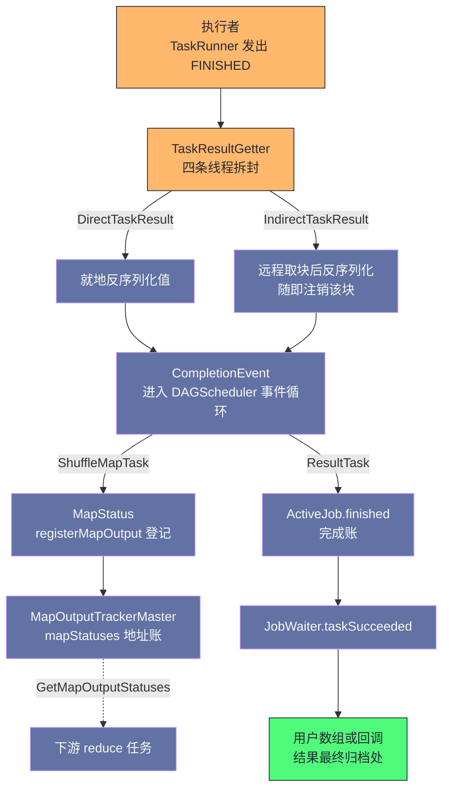
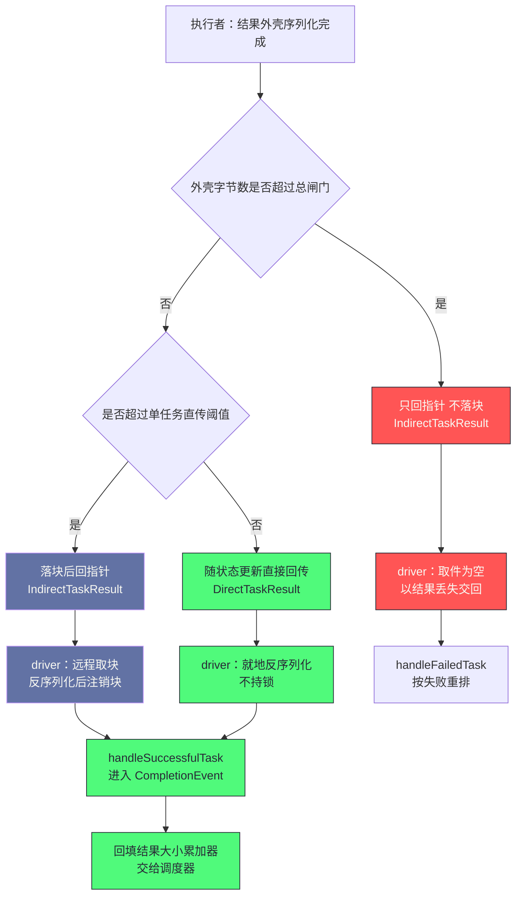
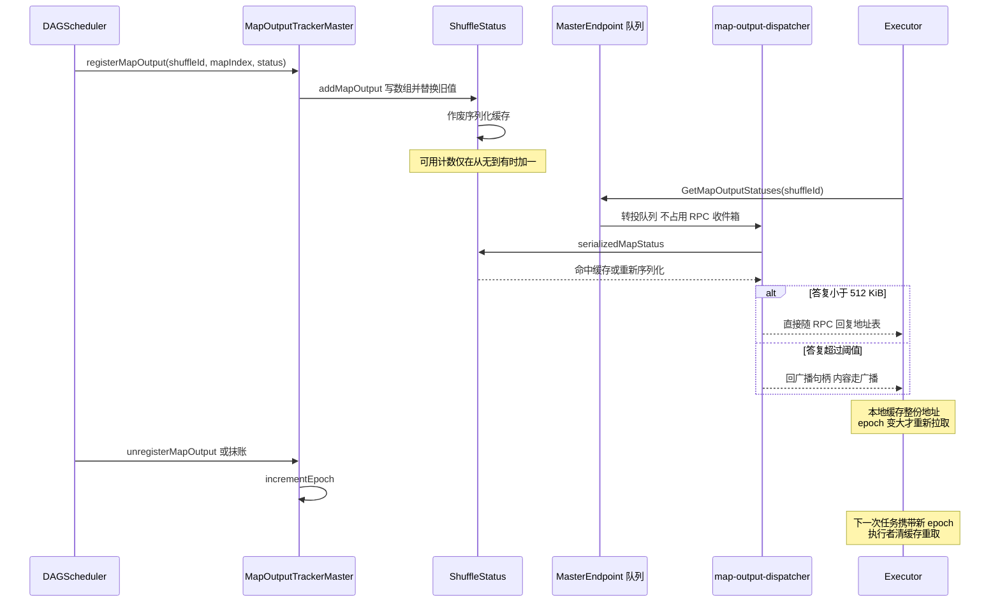
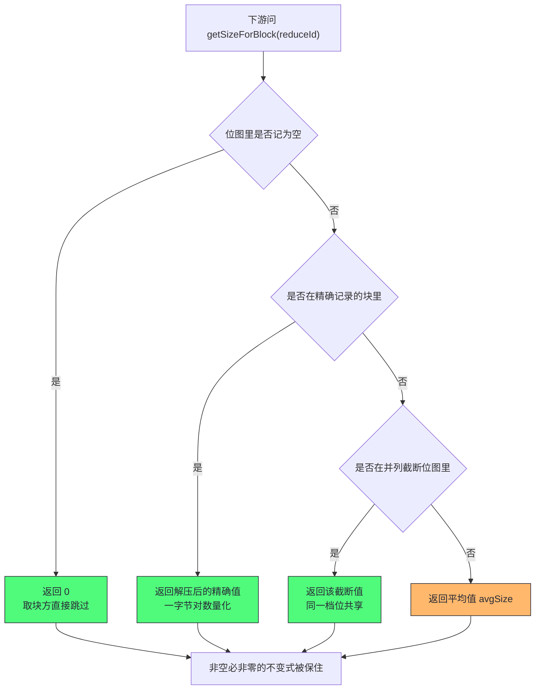
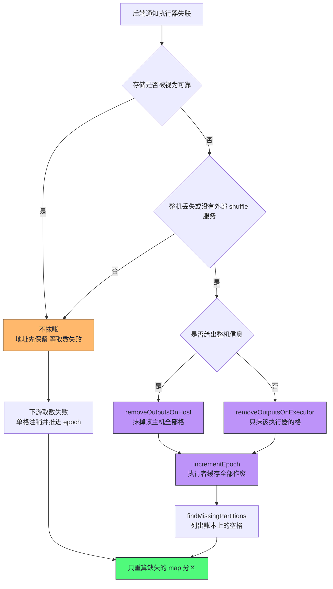

# 10. Spark Task 执行结果管理：两份账本、两档压缩与一次收回

**摘要：**

一个 Stage 跑完，真正被留下来的东西不是数据，而是关于数据的记录。这些记录按用途分成几套，各有各的寿命、精度与失效规则，却全部住在同一个进程里——driver，于是它们之间任何一处失配都会以作业变慢或重算的形式浮现。本文只讲结果到达 driver 之后的那一段路程：`TaskResult` 的三种写法如何被 `TaskResultGetter` 拆封并归档，`ShuffleMapTask` 的 `MapStatus` 如何在 Stage 收尾时登记进 `MapOutputTrackerMaster`，`ResultTask` 的值又如何经 `CompletionEvent` 进入 `JobWaiter` 并最终落到用户数组里。文章要回答两个问题：为什么 Spark 必须把一份应用级的 shuffle 地址账本挂死在 driver 上，以及这份账本一旦变大、变旧、变不准，代价会以什么形态浮现。为此要拆开 `mapStatuses` 的数组结构、`registerMapOutput` 的登记语义与 `epoch` 的缓存失效协议，算清 `CompressedMapStatus` 与 `HighlyCompressedMapStatus` 两档压缩各让出多少精度，并对齐执行器丢失之后 `removeOutputsOnExecutor` 的抹账判据、`FetchFailed` 的单格注销，以及外部 shuffle 服务如何悄悄改写"文件是否真的丢了"这个前提。落点是一句判断：**结果管理的本质是记账，而记账的成本由分区数决定，与数据量基本无关。**

**关键词（Keywords）**: TaskResult, MapStatus, MapOutputTrackerMaster, HighlyCompressedMapStatus, JobWaiter, removeOutputsOnExecutor, 外部Shuffle服务

---

## 第 1 章 结果的两种归宿

### 1.1 算完之后留下的东西

在 Spark 的内核里，`MapStatus` 与 `MapOutputTracker` 是少数从 0.x 一路活到 4.x 仍然保持同一副骨架的类：前者记一个 map 任务把每个 reduce 分区的输出写到了哪里、有多大，后者把成千上万份这样的记录收成一份应用级的账本。这两个类的形态之所以稳定，是因为它们要回答的问题十几年来没变过——下游要取数据，就必须先知道数据在哪台机器上、大概多大。

2026 年 10 月发布的 Spark 4.3.0 仍是这条线索的延续，4.x 的预编译包面向 Scala 2.13；后文引用的机制与默认值都以这个版本为准，凡是笔者无法从文档或源码确认的细节，都会写明"以对应版本文档或源码为准"。

先说清边界。一个任务在执行者（Executor）里跑完之后，要经过值的序列化、外壳的打包、状态更新消息的发送、driver 侧的拆封与取块，才变成调度器眼里的"一次成功"。其中"结果怎么从执行者回传"这一段属于执行器与传输层的职责，本文只在必要处点到；真正要展开的是后面半程——记录到了 driver 之后，落在哪个数据结构里、由谁维护、什么时候被抹掉。

### 1.2 两份账本

driver 上其实并存着两份性质不同的账本，混淆它们是读这段源码时最常见的失手。

第一份是**地址账**，由 `MapOutputTrackerMaster` 持有，记的是"某个 shuffle 的第 k 个 map 分区，输出在哪台机器、每个 reduce 分区各多少字节"。这份账本的寿命最长，跨 Stage、跨 Job，只要 shuffle 没被注销就一直留着，是下游 fetch 的唯一权威。

第二份是**完成账**，由 `ActiveJob.finished` 这个布尔数组加 `numFinished` 计数器构成，记的是"这个 Job 的第 i 个目标分区算完了没有"。它的寿命等于一次 Action，Job 结束就被清掉，最终把结果交到用户手里的动作发生在 `JobWaiter` 里。

两份账本的服务对象不同：地址账服务的是调度器自己（决定下游 Stage 何时能提交、哪些分区要重算），完成账服务的是用户代码（告诉它"你要的结果齐了，拿走"）。下图把结果进入 driver 之后的四个落点画在一起。



图里最容易被读漏的是右边那条虚线：地址账真正的消费者不是 driver 内部的某个组件，而是下一批跑在执行者上的 reduce 任务。它们要取数据之前，得先向 driver 把这份账本问一遍，这一步把 driver 变成了一个绕不开的查询入口。

### 1.3 一个贯穿案例

为了让后面的机制不至于悬空，笔者设想一个具体的作业：某内容平台每天凌晨跑一个名为 `exposure_daily` 的 Spark SQL 作业，读取前一天的曝光明细，按渠道与省份聚合后写入宽表，中途与一张渠道维表做一次 join。集群是自建的八台机器，每台 32 核、128 GB；作业配置 `spark.executor.cores=4`、`spark.executor.memory=8g`，聚合前用 `repartition(2000)` 把第一个 shuffle 的 reduce 分区数定在 2000，正好卡在高位压缩的阈值线上，join 之后再做一次 `repartition(5000)` 把它推到阈值之外。

这个形状——两个 shuffle、两千上下的 map 任务、两千与五千两档 reduce 分区——在后文反复出现：第 3 章看它的 map 任务交出什么样的 `MapStatus`，第 5 章算这份 `MapStatus` 在五千个 reduce 分区下会不会被压成空块位图，第 7 章看一台机器掉线之后账本上被抹掉多少格，第 8 章估这份账本在 driver 堆里占多少字节。

### 1.4 一个比喻：账房与货栈

把 driver 想成一个大宗仓库的账房，可以一次性看清几件事的边界。货栈里堆的是真实的货物（shuffle 文件，躺在各台机器的磁盘上），账房里存的是货位卡——哪一批货、在几号库、每个买家分到多少。买主来提货时从不进库房翻找，只到账房查卡，再按卡上的库号去提。

比喻的技术限定在于：账房不盘点货物，也不保证卡上写的数量与实际分毫不差。卡上的"每个买家分到多少"是八个二进制位表示的对数量化值，误差可以到一成；当买家数超过两千个，账房连每张小卡都不写了，改成只记"哪些买家没分到"和"其余大概平均多少"。这套做法省下了大量卡片，代价是账房再也说不出某个具体买家到底拿了多少——第 5 章整章都在处理这笔交易的后果。

### 1.5 路线的铺排

后面九章按五问推进：第 2 章界定 `TaskResult` 的三种写法与 driver 侧的拆封路径，回答"结果到了 driver 是什么形态"；第 3 章与第 4 章拆开 `MapStatus` 与 `MapOutputTrackerMaster`，回答"为什么必须由 driver 记这本账、账本长什么样"；第 5 章处理两档压缩的精度代价；第 6 章回到 `ResultTask`，看结果如何从事件循环走进 `JobWaiter`；第 7 章讲执行器丢失之后账本如何被收回、重算判据是什么，以及外部 shuffle 服务如何改变前提；第 8 章把账本的内存、CPU、RPC 与广播四类成本折算成可估算的量级；第 9 章列八条反例，第 10 章收在权衡上。

---

## 第 2 章 信封里的三种写法

### 2.1 DirectTaskResult：自带内容

执行者算完一个任务，把它包装成一个 `TaskResult` 发回来。这个类型只有两种具体实现，但它们对应三条实际走向。

`DirectTaskResult` 是自带内容的写法，字段只有三个：`valueByteBuffer`（值序列化后的分块字节）、`accumUpdates`（累加器更新）、`metricPeaks`（指标峰值）。它的设计要点在于值的反序列化被推迟了：类里只有一个 `valueObjectDeserialized` 标志和暂存的对象引用，第一次调用 `value()` 时才真正反序列化，之后直接复用。

这个"推迟"不是省事的偷懒，而是把一次可能长达几十秒的 CPU 操作从 RPC 线程挪到了可控的线程池里。源码注释写得很直白：第一次调用 `value()` 不能在持锁的情况下发生，因为大值反序列化可能要几十秒。driver 侧正是利用这一点，在 `TaskResultGetter` 的线程池里预先把它反序列化好，等调度器真正需要值时就不必再拆一次。

### 2.2 IndirectTaskResult：只留地址

结果超过单任务直传阈值时，执行者把它写进自己的块管理器（BlockManager），发回来的 `IndirectTaskResult` 里只有两个字段：`blockId` 与 `size`。前者是取件凭据，后者是这段内容有多少字节——注意 `size` 是外壳字节数，含累加器与指标峰值，比裸值略大。

driver 拿到它之后要做三件额外的事：先判定这个大小是否还在配额之内，再发起一次远程取块，取到之后反序列化外壳与值，最后注销这个块。注销这一步是整套设计里最能说明"中转块不是缓存"的细节：一个中转块对应一次任务、一次取件，取完即删，没有任何复用语义，留着只会白占执行者的内存。

### 2.3 第三种：连地址都不给

还有一条在代码里只有一行、在运维里却经常撞上的走向：结果超过 `spark.driver.maxResultSize` 时，执行者既不落块也不传值，只发一个指向 `TaskResultBlockId(taskId)` 的指针。这个块号是真实编号，块却从来不存在，driver 取件必然取空，任务随即以"结果丢失"的原因被交回调度器。

从 driver 的视角看，这条路径的意义不在于"丢弃"，而在于把三种不同的失败收敛成同一种表现：主动丢弃、块被执行者挤出、执行者在取件前退出，最终都表现为取件为空。协议少了一种分支，代价是丢掉了原因信息——这也是第 7 章要讨论的判据问题的起点。

### 2.4 driver 侧的拆封

真正动手拆封的是 `TaskResultGetter`。它维护一个固定线程池，线程数由 `spark.resultGetter.threads` 决定，默认 4；`enqueueSuccessfulTask` 把整段状态载荷丢进池子里，池子里的线程做四件事：用闭包序列化器解析信封、按分支决定是否远程取块、用数据序列化器反序列化值、把成功或失败交回调度器。

这里的线程分工有一个容易忽略的用意：**反序列化是 CPU 密集且耗时不可控的操作，绝不能放在调度器的锁里做**。调度器的锁是全局的，一次长耗时的反序列化会把所有执行者的状态更新堵在事件循环上，表现为整个作业卡住几百毫秒。

同一条路径上还有两个 driver 侧专属的动作。其一是"结果大小"这个内部累加器（`InternalAccumulator.RESULT_SIZE`）在 driver 回填，而不是在执行者：源码注释给的理由很实在，如果在执行者侧回填，就得在更新之后把结果再序列化一次。其二是取件开始时先调一次 `handleTaskGettingResult`，这一步是 UI 上"取结果时间"这条时间线的起点，也是后面判断"计算慢"与"取件慢"的分界。

下图把三种写法与 driver 侧的分支放在一起。



图里红色那一路是"格式正确、内容缺失"的回报，它的存在让 driver 不必为"执行者主动丢了结果"单独设计一条协议。至于两道闸门的量纲差异——单任务阈值取配置值与 RPC 消息上限的较小者，累计闸门按任务集累加并且豁免 shuffle map 任务——不属于本文范围，这里只需记住一句：**累计闸门量的是一个任务集至今交出了多少字节，是流量指标，不是存量指标**。

### 2.5 三种写法的对照

| 维度 | 直接回传 | 块中转 | 超闸门丢弃 |
|---|---|---|---|
| 载荷内容 | 完整结果字节 | 块号加字节数 | 块号加字节数（块不存在） |
| driver 侧额外动作 | 无 | 远程取块、取完注销 | 无，取件直接为空 |
| 结果驻留位置 | 事件对象的字段里 | 执行者块管理器 | 不存在 |
| 失败表现 | 无 | 取件为空，按结果丢失重排 | 取件为空，按结果丢失重排 |
| 观测线索 | 无专属指标 | 取结果时间、块读取记录 | 执行者侧的丢弃警告 |
| 典型触发条件 | 外壳小于单任务阈值 | 超过单任务阈值但未超总闸门 | 单个结果就超过总闸门 |

表里最后一行值得单独记一笔：第三条走向不是"另一种传输方式"，而是一种故意的省略。理解这一点，才能解释为什么"结果丢失"在统计里往往与"结果太大"同时出现。

### 2.6 归档的第一步在调度器之外

拆封完成之后，结果对象被交给 `TaskSetManager`，再经 `TaskSchedulerImpl` 转成 `DAGScheduler.taskEnded(...)`，最终变成一个 `CompletionEvent` 投进 `DAGSchedulerEventProcessLoop` 的队列。这个事件里装着任务本身、结束原因、任务信息、结果值、累加器更新与指标峰值——结果在 driver 上的第一次归档，就是这个事件对象的字段。

它此后一直跟着事件走：事件循环把它取出来，交给 `handleTaskCompletion`，两种任务在这里分道扬镳。理解这个"结果只是事件的一个字段"，能顺带解释一个常见困惑：为什么结果处理慢不会让执行者变慢——因为执行者发出状态更新之后就不再关心这个值了，事件在 driver 的队列里排队多久，与执行者的时间线无关。

---

## 第 3 章 ShuffleMapTask 的产物：MapStatus

### 3.1 生成时机在 writer 停笔之后

`ShuffleMapTask` 的 `runTask` 本身几乎不做事：反序列化出 RDD 与 `ShuffleDependency`，算出本次的 `mapId`，然后把活交给 `shuffleWriterProcessor.write(...)`。真正的产物在写入器内部生成。

以排序型写入器为例，它在 `write` 方法的末尾做三件事：把排好序的数据按 reduce 分区刷进一个合并文件，`commitAllPartitions` 提交并拿到 `partitionLengths`，最后用这份长度数组构造 `MapStatus`。

```scala
// 排序型 ShuffleWriter 的收尾：长度数组先到，MapStatus 后建
val mapOutputWriter = shuffleExecutorComponents.createMapOutputWriter(
  dep.shuffleId, mapId, dep.partitioner.numPartitions)
sorter.writePartitionedMapOutput(dep.shuffleId, mapId, mapOutputWriter, writeMetrics)
partitionLengths = mapOutputWriter.commitAllPartitions(...).getPartitionLengths
mapStatus = MapStatus(blockManager.shuffleServerId, partitionLengths, mapId, ...)
```

这段代码里有三个细节，每一个都对应后文的一条结论。

第一，`MapStatus` 的生成时点在文件真正落地之后。也就是说，一个 `MapStatus` 的存在本身就意味着"这份数据写完了"，账本上不会出现指向半截文件的地址。

第二，`location` 取的是 `blockManager.shuffleServerId` 而不是 `blockManagerId`。两者在关闭外部 shuffle 服务时相同，开启之后前者会带上 shuffle 服务的端口——**账本记的是"数据在哪个 shuffle 服务上"，而不是"哪个执行器算的"**。这个差别在第 7 章会变成"执行器死了数据还活着"的全部依据。

第三，`mapId` 默认取任务尝试编号（`taskAttemptId`），只有在开启旧取块协议时才退回分区号。用尝试编号的好处是重试产生的多份输出可以区分，坏处是同一分区的多次尝试会在账本上互相覆盖——而覆盖恰好是期望行为。

### 3.2 内容只有两项

`MapStatus` 是一个密封特质，对外只承诺两项能力：`location` 与 `getSizeForBlock(reduceId)`。前者是块管理器地址，后者是"这个 map 任务在某个 reduce 分区上产出了多少字节"。

接口上还有一条容易被跳过的约束，写在特质的注释里：**如果某个块非空，`getSizeForBlock` 必须返回非零大小**。理由是取块方允许跳过零大小的块，一旦把一个非空块报成零，那份数据就会被静默丢弃。这条不变式决定了后面所有压缩方案的设计边界——压可以，但不能把非空压成零。

### 3.3 大小从出生起就是估算值

`CompressedMapStatus` 把每个 reduce 分区的大小压成一个字节。压缩函数用的是以 1.1 为底的对数：

```scala
private[this] val LOG_BASE = 1.1

def compressSize(size: Long): Byte = {
  if (size == 0) 0
  else if (size <= 1L) 1
  else math.min(255, math.ceil(math.log(size.toDouble) / math.log(LOG_BASE)).toInt).toByte
}
```

源码注释给出了这套量化的能力边界：最大可以表示到 35 GB 左右，误差不超过一成。换句话说，`MapStatus` 里的"大小"从诞生那一刻起就不是字节数，而是一个按对数量化的档位；下游所有依赖它做的判断——取块时的内存预算、合并小分区的决策、倾斜的识别——用的都是这个带误差的数。

这份误差在小块上尤其明显：相邻两个档位只隔约一成，两个实际相差不到一成的块完全可能报出同一个数。对于"要不要合并分区"这类粗粒度决策，一成的误差无关紧要；对于"哪个分区是倾斜的那一个"这类排序决策，误差就不那么无所谓了。

### 3.4 为什么按 reduce 分区记

一个自然的疑问是：为什么不只记一个总数，非要按 reduce 分区各记一份？

因为下游的取数是按分区进行的。一个 reduce 任务要读两万个 map 输出中属于自己的那一片，它需要知道每一片的大小，才能排出取块的顺序、估算同时打开多少个流不会把内存打爆。若只有总数，取块方就只能按平均值猜，遇上倾斜的分区会一次性拉开太多连接。

按分区记的直接代价是账本的体积与 reduce 分区数线性相关。这一点在第 8 章的估算里会变成一个很硬的结论：**决定账本大小的是 reduce 分区数，而不是数据量。**

### 3.5 两档实现

`MapStatus.apply` 里有一个二选一，判据是"每个 map 任务要记多少个 reduce 分区"：

```scala
if (uncompressedSizes.length > minPartitionsToUseHighlyCompressMapStatus) {
  HighlyCompressedMapStatus(loc, uncompressedSizes, mapTaskId, checksumVal)
} else {
  new CompressedMapStatus(loc, uncompressedSizes, mapTaskId, checksumVal)
}
```

阈值来自 `spark.shuffle.minNumPartitionsToHighlyCompress`，默认 2000，判断用严格大于。这张表先把两者的差别摆出来，细节留到第 5 章。

| 维度 | CompressedMapStatus | HighlyCompressedMapStatus |
|---|---|---|
| 记录粒度 | 每个 reduce 分区一个字节 | 空块位图 + 平均值 + 少数精确块 |
| 触发条件 | reduce 分区数不超过阈值（默认 2000） | reduce 分区数超过阈值 |
| 单格大小 | 约 48 字节加 reduce 分区数 | 约 60 至 80 字节加位图 |
| 精度 | 每块一档，误差约一成 | 普通块一律报平均值，只有大块精确 |
| 主要风险 | 分区多时堆占用线性膨胀 | 倾斜被平均值抹平 |
| 适用规模 | reduce 分区数千以内 | reduce 分区上万 |

表里"主要风险"那一行是本章与第 5 章的分界：前者是空间问题，后者是正确性问题，只不过这个"正确性"不指数据对错，而指调度判断的准头。

---

## 第 4 章 MapOutputTrackerMaster：driver 上的全局账本

### 4.1 两层容器

账本的结构是两层 `Map` 套数组。外层是 `shuffleStatuses`，一个从 shuffleId 到 `ShuffleStatus` 的并发映射；内层是每个 `ShuffleStatus` 里的 `mapStatuses`，一个长度等于 map 分区数的数组，下标就是 map 分区号，值为 `null` 表示这一格还没有地址。

```scala
// 外层：一个应用里所有 shuffle 的账本，只有显式注销才会释放
val shuffleStatuses = new ConcurrentHashMap[Int, ShuffleStatus]().asScala

// 内层：下标是 map 分区号，null 表示这一格还没有地址
val mapStatuses = new Array[MapStatus](numPartitions)
```

外层那句注释值得抄下来：**状态只由显式的注销动作释放**。这句话解释了长跑应用的一个隐蔽问题——`shuffleStatuses` 没有 TTL，一个跑了几天的常驻服务（譬如 Spark Connect 服务端）如果反复执行带 shuffle 的查询，账本只会变多。什么时候释放由 DAGScheduler 决定，与内存压力无关。

### 4.2 一格只存一个地址

数组的注释里有一段坦白，是理解整份账本设计取向的关键：理论上一个 map 输出可能同时存在于多个位置（推测执行会让两个尝试都产出数据），但实践中这种情况的概率小到可以忽略，因此**每格只保留一个地址，后登记的覆盖先登记的**。

这个选择带来一个明确的取舍。省下来的是空间（不用为每格维护一个列表）与判断的简单（下游只需问"在不在、在哪"，不必在多个副本里挑）；付出的代价是"副本"这个概念在账本层面根本不存在——如果唯一那个地址失效了，账本没有备选，只能注销这一格、让 map 任务重算。第 7 章的重算判据之所以那么干脆，根子就在这一行。

### 4.3 registerMapOutput 的三种语义

登记入口是 `registerMapOutput(shuffleId, mapIndex, status)`，它最终落到 `ShuffleStatus.addMapOutput`。这个方法的语义比名字复杂，至少包含三件事。

第一件是可用计数只在从无到有时增加。若该格原来为 `null`，可用输出数加一；若已有值，计数不动，只做替换。这个计数是 `numAvailableOutputs` 的来源，也是 Stage 判断"输出齐了没有"的依据。

第二件是序列化缓存必须作废。每次登记都会调一次 `invalidateSerializedMapOutputStatusCache()`，把为响应 `GetMapOutputStatuses` 而缓存的那份字节流与广播句柄丢掉。这条依赖关系把"账本更新"与"账本分发"绑在了一起：账本每变一次，下一批来查询的执行者就要重新生成一次答复。

第三件是较新版本里新增的校验和比对。`registerMapOutput` 的返回值不再只是一个布尔，而是"这次登记的校验和与之前是否不同"；不同意味着同一个 map 分区在两次尝试里产出了不一样的数据，属于不确定性的运行时信号。这一项与本文主题只是相邻，具体处置以对应版本源码为准。

### 4.4 一次收尾与逐格登记

登记的时间点在不同版本里有过变化，而变化的只是"何时写"，"怎么写"的语义没变。

在 2.x 至 3.x 的实现里，`DAGScheduler` 在 `ShuffleMapTask` 成功时先把 `MapStatus` 记进 `ShuffleMapStage` 的本地表，等这个 Stage 的所有分区都完成，再一次性把这些地址批量登记进 tracker，并把 `changeEpoch` 置为真。这种"先攒后交"的做法让账本在一次 Stage 收尾里只变一次，缓存只失效一次。

4.x 的分支把这一步拆成了逐分区登记：每个 `ShuffleMapTask` 成功就登记一格，epoch 的推进与缓存作废由其他动作（注销、抹账）承担。两种写法在可观测行为上的差别不大，在故障窗口里的差别却值得留意——批量登记时，一个 Stage 跑到最后一个分区之前账本上什么都没有；逐格登记时，先完成的分区已经可以被下游看见。谁更好取决于你更怕"下游提前看到半份地址"还是更怕"最后一个分区拖住整份地址"。

### 4.5 epoch：账本的版本号

`epoch` 是一个单调递增的长整数，定义在 driver 侧的 `MapOutputTracker` 里。它的用途写在字段注释里，而且写得比多数文档清楚：driver 每次丢失一个 map 输出就把计数器加一，这个数字随任务一起发到执行者，执行者拿它与自己记住的最大 epoch 比较，一旦发现更大就清掉本地缓存的 map 状态并重新向 driver 拉取。

这是一个很小但很关键的设计。执行者侧缓存整份 map 状态是必需的（否则每个 reduce 任务都要问一次 driver，driver 会被问垮），但缓存一旦过期，reduce 任务会拿着旧地址去取一个已经不存在的块，然后以 `FetchFailed` 的形式把问题放大成 Stage 重算。epoch 用一次比较消掉了这个风险，本质上是**用一个整数换掉了一次去中心化的失效通知**——谁也不需要精确知道哪个地址没了，只需要知道"账本变过了"。

`unregisterMapOutput` 里那行 `incrementEpoch()` 因此不能省。源码里它紧跟在移除动作之后，看上去只是一句记账，实际上是整个缓存协议的发令枪。

### 4.6 一次查询的完整旅程

执行者那边的 `MapOutputTrackerWorker` 在第一次需要某个 shuffle 的地址时，会向 driver 的 `MapOutputTrackerMasterEndpoint` 发一条 `GetMapOutputStatuses(shuffleId)`。这条消息并不在 RPC 的收件箱里被直接处理，而是被转投进一个队列，由一组专门的线程消费。

```scala
// 端点收到请求后只做转投，真正的构造发生在专用的线程池里
case GetMapOutputStatuses(shuffleId: Int) =>
  tracker.post(GetMapOutputMessage(shuffleId, context))
```

消费方是一个固定大小的守护线程池，线程数由 `spark.shuffle.mapOutput.dispatcher.numThreads` 决定，默认 8。每个线程跑一个消息循环，从 `LinkedBlockingQueue` 里取请求，取出对应的 `ShuffleStatus`，把整份地址序列化之后回复。这里的设计意图写在注释里：用独立线程池，避免阻塞常规的 dispatcher 线程。

答复的形态有两种。序列化后的字节数小于 `spark.shuffle.mapOutput.minSizeForBroadcast`（默认 512 KiB）时直接随 RPC 回复；超过这个阈值就换成广播，driver 侧只回一个广播句柄。这个阈值与 RPC 消息上限之间有一道启动期约束：源码在 `MapOutputTrackerMaster` 构造时检查 `minSizeForBroadcast` 不得大于 `spark.rpc.message.maxSize`（默认 128 MiB），一旦违反直接抛 `IllegalArgumentException` 并拒绝启动。把这条检查放在构造期而不是使用期，是为了让"某天突然有一批答复超过消息上限"这种故障在启动时就暴露。

下图把登记与查询两条路径画在一起，也标出了缓存失效的位置。



图中"转投队列"那一步是整条链路的压力缓冲：RPC 收件箱只负责收，八条线程负责算。但它也把时延的不确定性带进来——一批执行者同时启动时，请求会在队列里排队，先到的先算，后到的等前一个把整份账本序列化完。

### 4.7 为什么必须是单点

把上面几节合起来，可以回答"为什么这份账本非要挂在 driver 上"。

账本必须与 Stage 的判断同源。谁产出 `MapStatus`、谁决定哪些分区要重算、谁判断下游 Stage 能不能提交，这三件事必须在一个进程里、用同一份数据完成，否则就要在"登记地址"与"决定重算"之间引入分布式协调。Spark 的选择是把它们都放进 DAGScheduler 的事件循环，账本与判断共享同一个线程上下文，一次决定不需要任何网络往返。

执行者不能持有权威账本。执行者是无状态的计算容器，随时可能因为故障、抢占、缩容而消失；让它保管地址表，等于把账本的可用性绑在最短命的组件上。它只能持有副本，副本靠 epoch 保持新鲜。

下游需要一次同步的地址查询。reduce 任务取数之前必须知道地址，这个查询是同步的、要求低延迟的，而 driver 是唯一拥有多 Stage 视图的地方。

代价因此也很清楚：**内存、CPU 与一次 Stage 切换时的查询脉冲，全部压在同一个进程上**。这不是可以靠加机器解决的问题，第 8 章会把它折算成具体的量级。

---

## 第 5 章 两档压缩：用精度换堆内存

### 5.1 第一档的账单

`CompressedMapStatus` 的成本很好算：一个 map 任务一份，内含一个长度等于 reduce 分区数的字节数组。它在 reduce 分区数几千的场景里完全够用——每格几百字节到一两千字节，两万个 map 任务也不过几十兆。

真正让它撑不住的是 reduce 分区数的膨胀。第 4 章说过账本按 reduce 分区各记一份，所以单格成本随 reduce 分区数线性增长，总成本是 map 任务数与 reduce 分区数的乘积。当 reduce 分区数上万，一格的字节数组就是十 KB 量级，两万个 map 任务乘以十 KB 就是两百兆——这已经不是一个可以放在 driver 堆里当"元数据"对待的量级。

### 5.2 第二档的四个字段

`HighlyCompressedMapStatus` 换了一套记法。它不再逐块记大小，而是把"哪些块是空的"与"其余块大概多大"分开处理，字段可以分成四组。

第一组是 `emptyBlocks`，一个位图，记录哪些 reduce 分区在这个 map 任务上没有数据。这里有一个反直觉的选择：位图记的是空块而不是非空块。源码注释给的理由是性能——从压缩的角度看记空记非空都可以，但从插入次数看，空块通常远少于非空块，记空能显著减少位图插入。

第二组是平均值 `avgSize`，把所有"非空且不巨大"的块加起来除以个数。这是第二档精度的主要来源，也是它最受争议的地方。

第三组是精确记录的少数块：`hugeBlockIds` 与 `hugeBlockSizes` 两个平行数组，记下那些大到必须精确的块。用两个基本类型数组而不是一个 `Map`，源码给出的理由是 driver 要为一个 shuffle 的整个生命周期保留每个 map 任务的状态，装箱的 `Map` 在节点、桶数组与装箱键上的开销是平行数组的十倍量级。

第四组是较新版本加入的并列块位图：那些恰好落在倾斜截断值上的块，大小完全相同，因此只需要记"是哪几个"，不必为每个块记一个编号。它的成本上限被写进了配置注释——最坏情况每 reduce 分区每 map 任务一个比特，五万个 reduce 分区时约每个 map 任务 8 KiB。

### 5.3 哪些块算"巨大"

精确记录的判据由两个配置共同决定，而这两个配置的默认值透露出设计者的两难。

第一个是 `spark.shuffle.accurateBlockThreshold`，默认 100 MiB，自 2.2.1 起提供。它的文档措辞很直接：超过这个阈值的块在 `HighlyCompressedMapStatus` 里被精确记录，目的是"避免低估 shuffle 块大小导致取块时 OOM"。换句话说，这个阈值的初始动机是内存安全，不是统计准确。

第二个是 `spark.shuffle.accurateBlockSkewedFactor`，默认 5.0，自 3.3.0 起提供。它把精确记录的判据从"绝对大小"扩展到"相对大小"：一个块只要大于中位块大小的若干倍，也会被精确记录。文档里给出的理由恰好是本篇要讲的核心代价——如果不这样做，所有低于 100 MiB 的块都会被报成平均值，**一旦 reduce 分区数超过 `minNumPartitionsToHighlyCompress`，倾斜就会对自适应查询执行（Adaptive Query Execution，AQE）隐身**。

这两个配置合起来的效果可以这样概括：绝对值管"大到可能撑爆内存的块"，相对值管"大到足以构成倾斜的块"，两者取一个能够覆盖的并集；配套的 `spark.shuffle.maxAccurateSkewedBlockNumber`（默认 100）给每个 map 任务能精确记录的倾斜块数封顶，超出的部分靠第 5.2 节说的并列位图兜住。

### 5.4 取值时的四层判定

把取值路径画出来，能看清精度是怎么一层层丢掉的。



图里绿色三路是"能说出具体值"的，橙色那一路是"只能说个大概"的。橙色那一路覆盖的恰恰是绝大多数普通块——真实作业里，块大小的分布通常长尾，绝大多数块既不空也不巨大，于是它们全部共享同一个数。

### 5.5 平均值如何污染下游判断

平均值的影响不止"数不准"，它会以三种方式改变调度行为。

第一种是取块时的内存估算。reduce 任务按块大小决定同时打开多少个流、预取多少数据；若一批块被报成同一个平均值，估算就失去区分度，实际偏大的块可能在取块时把内存顶穿。`spark.shuffle.accurateBlockThreshold` 的默认值定在 100 MiB 这个量级上，正是因为这条路径上的事故最直接。

第二种是合并小分区的决策。AQE 在 map 阶段跑完之后会向 driver 要一份 `MapOutputStatistics`，里面是每个 reduce 分区的近似字节数。这份统计的来源就是逐个 map 状态求和——`MapOutputStatistics` 的注释写得很清楚：每个分区的输出字节数是近似的，因为用了压缩的 map 状态。分区合并的阈值建立在这份近似值上，误差一成意味着合并后的分区大小也会有一成的偏差。

第三种是倾斜判断，也是隐蔽的一种。源码里有一段解释值得逐字理解：每个 map 任务看到的块大小分布是一样的，所以任何"只记一部分并列块"的规则会在每一份 map 状态里藏起同一批 reduce 分区，而 `MapOutputTracker` 会把这些状态相加——被藏起来的那批悄悄回落到平均值，同时又把平均值抬高，于是 AQE 拿来比较的倾斜阈值跟着水涨船高，两边一起漂移，倾斜就更难被识别。

三条路径的共同点是：**误差不是在数据里，而是在判断里**。数据本身一字不差地躺在磁盘上，坏掉的只是"哪个分区更大"这个排序结论。

### 5.6 还有一层网络压缩

讨论 `MapStatus` 的压缩时，很容易把两件事混成一件，它们其实作用在不同的地方。

本文前几节讲的 `HighlyCompressedMapStatus` 压的是 driver 堆里的对象，解决的是账本随分区数膨胀的问题，代价是精度。而 `spark.shuffle.mapStatus.compression.codec`（默认 zstd，3.0.0 起提供）压的是回复给执行者的那段字节流，解决的是 RPC 与广播的传输量，代价是 driver 侧每次生成答复时多一次压缩的 CPU 开销。

两者互不替代：把 codec 换成更快的，不会让 driver 的堆少占一个字节；把分区数压到 2000 以下避免高位压缩，也不会让答复变小。真正需要判断的是"当前瓶颈在堆还是在网络"，而这两件事的观测线索完全不同——前者看 driver 的 GC 与老年代增长，后者看 dispatcher 的线程占用与广播体积。

### 5.7 该不该调

| 关注点 | 判断依据 | 调整方向 | 反向代价 |
|---|---|---|---|
| driver 堆压力 | 老年代常驻随 shuffle 数增长 | 调低 `minNumPartitionsToHighlyCompress` | 更多 shuffle 进入低位压缩，倾斜可见性下降 |
| 倾斜识别失效 | AQE 未识别出实际倾斜 | 调低 `accurateBlockSkewedFactor` 或阈值 | 精确记录的块变多，账本变大 |
| 取块 OOM | reduce 侧内存被大块顶穿 | 调低 `accurateBlockThreshold` | 精确块增多，driver 堆与序列化开销上升 |
| 答复过大 | dispatcher 忙、广播体积大 | 调低 `minSizeForBroadcast` 让更多答复走广播 | 广播块在 driver 与执行者两侧都常驻 |
| 序列化耗时 | driver CPU 在 Stage 切换时尖峰 | 换更快的 codec | 传输字节变多 |

这张表没有一行是"调了就更好"，每一行都在两个代价之间挪动。笔者倾向于把这几项当作诊断工具而不是优化开关：先确认瓶颈在堆、在网络还是在判断失准，再动对应的那一个参数。

---

## 第 6 章 ResultTask 的结果与 JobWaiter

### 6.1 从事件到完成账

`ResultTask` 走的是 `handleTaskCompletion` 的另一条分支。它的处理逻辑短得可以一次读完，但每一行都在维护"完成账"的一致性。

第一行是幂等守卫：若 `job.finished(rt.outputId)` 已经是真，说明这个目标分区的结果已经被收过了，直接跳过。这个守卫对付的是重复上报与推测执行的双份完成——同一分区两个尝试都成功时，只有先到的那个算数。

第二行是记账：把布尔数组对应位置置真，`numFinished` 加一。这两件事的顺序无关紧要，但它们必须与下一步的判断在同一个线程上完成，否则"最后一个分区"可能被两个线程各判一次。

第三行是收尾判断：当 `numFinished` 等于 `numPartitions`，这个 Job 就算完成了。此时 driver 要连做五件事——标记 Stage 完成、取消仍在运行的独立 Stage、清理这个 Job 及其独立 Stage 的状态、杀掉可能还在跑的推测或僵尸任务、投递一条 `SparkListenerJobEnd(JobSucceeded)` 事件。

第四行才是交付：调 `job.listener.taskSucceeded(rt.outputId, event.result)`。这一行被 `try/catch` 包着，因为它执行的是用户代码，可能抛异常；一旦抛出，处置是 `jobFailed(new SparkDriverExecutionException(e))`——注意这个动作发生在任务已经成功之后，所以它把"任务成功、交付失败"这件事显式地记成了一次作业失败。

### 6.2 JobWaiter 的三件东西

`JobWaiter` 是这次交付的终点站，实现只有几十行，核心是三个字段。

第一个是 `finishedTasks`，一个原子整数。每交付一个结果就加一，加到等于总数时把 `jobPromise` 置为成功。用原子整数而不是加锁的计数，是因为交付可能是并发的（两个分区在两个线程上完成）。

第二个是 `resultHandler`，一个 `(Int, T) => Unit` 的函数。`taskSucceeded` 里对它的调用被 `synchronized` 包住，注释给的理由很实在：结果回调本身未必线程安全。`collect` 的处理器是往一个数组里写第 i 格，这不需要同步；但框架不能假定所有调用方都这么规矩，于是把同步做在框架侧。

第三个是 `jobPromise`，一个 Scala 的 `Promise[Unit]`。零个任务的 Job（譬如空分区的 RDD）在构造时就直接把它置为成功，这个特例处理省掉了一次永远等不到的等待。

### 6.3 交付发生在事件循环线程上

这是最容易被忽略、也最容易踩坑的一点：`taskSucceeded` 是在 DAGScheduler 的事件循环线程里被调用的，因为它由 `handleTaskCompletion` 直接发起。

后果是直接的：**`resultHandler` 里做多久的重活，整个 DAGScheduler 就停多久**。用户在 `collect` 之后拿到的是一个数组，`collect` 的处理器只是把值放进数组，耗时以纳秒计；但如果有人写了一个自定义的 `JobListener`，在 `taskSucceeded` 里做网络写、做磁盘落盘、甚至只是打一次同步日志，都会把调度器的事件循环按住。按住期间所有执行者的状态更新都在队列里排队，表现是"任务都跑完了但作业不结束"。

同样的道理适用于失败路径：`jobFailed` 走的是 `tryFailure`，若 promise 已经完成，只打一条警告"忽略失败"——迟到的失败不会覆盖已成的事实。

### 6.4 框架不保存结果

一个常见的误解是"driver 会攒着所有分区的结果，等齐了再交给用户"。事实恰好相反：**框架没有任何地方保存结果**。

`CompletionEvent` 里的 `result` 在 `handleTaskCompletion` 返回之后就不再被引用；`JobWaiter` 只持有计数与 promise，不持有值；`ActiveJob` 只有布尔数组与计数器。唯一保存结果的地方是用户侧的容器——`collect` 在 `SparkContext.runJob` 里创建的那个 `Array[U]`，通过 `resultHandler` 一格一格填进去。

这个设计有两个直接推论。其一，driver 侧的结果内存压力全部来自用户容器，框架本身不会替你攒结果，也不会替你释放——`collect` 收了两千万条记录，那两千万条就实实在在躺在 driver 堆里，与账本无关。其二，框架对结果的承诺只有"交付一次"：每个 `outputId` 至多交付一次，绝不重放。需要重放语义的场景（譬如失败重试后重新消费），得由调用方自己实现。

### 6.5 异步 Action 拿的是 future

顺带补一句与 `JobWaiter` 相邻的用法。异步 Action（`AsyncRDDActions` 那一套）拿到的不是回调，而是 `JobWaiter` 的 `completionFuture`。这个选择让调用方可以在自己的线程池里等待，而不必占用事件循环；但它也意味着结果数组仍然由调用方提供，future 只负责告诉你"齐了"。

### 6.6 结果的四个落点

| 落点 | 存放内容 | 生命周期 | 谁负责释放 |
|---|---|---|---|
| 用户容器 | `ResultTask` 的值 | 用户代码决定 | 用户或 GC |
| `MapOutputTrackerMaster` | `MapStatus` 地址 | 到 shuffle 显式注销 | DAGScheduler |
| 执行者块管理器 | 中转块 | 到取件完成或执行者退出 | 取件方注销 |
| 监听事件流 | 任务与作业事件 | 由监听总线与历史服务器决定 | 监听器配置 |

表里后两行经常被忽略：中转块的生命周期以"取件"为终点，而监听事件是另一条与结果无关的旁路——它不携带结果值，只携带元数据，所以别指望从事件日志里找回某个分区算出了什么。

---

## 第 7 章 一次收回：结果丢失与重算判据

### 7.1 三种丢失

结果在 driver 眼里"没了"，有三种成因，处置路径各不相同。

第一种是中转块没了：取件时远程读返回空。可能的原因包括块被执行者挤出内存、执行者在任务结束与取件之间退出、或者执行者压根没写（超过总闸门那条路径）。处置是一条 `TaskResultLost`，任务状态仍记为完成，原因记为结果丢失。

第二种是执行器没了：driver 侧的调度后端发现某个执行者失联，把它从可调度集合里移除，并通知调度器。此时该执行者上还在跑的任务被补记为丢失，它上面的中转块与 shuffle 文件也随之成为疑问。

第三种是机器或文件没了：整台 worker 被判死、或者取数失败（`FetchFailed`）证明某份 shuffle 输出已经不可读。这一种最接近"数据真的丢了"，也最需要区分它与前两种。

### 7.2 判据：文件到底丢没丢

执行器失联的处理入口是 `DAGScheduler.handleExecutorLost`，它只做一件事：算出一个布尔量 `fileLost`，然后交给统一的移除流程。

```scala
// 只有"存储不可靠"且"整台 worker 没了或没有外部 shuffle 服务"时，才认为 shuffle 文件丢了
val fileLost = !sc.shuffleDriverComponents.supportsReliableStorage() &&
  (workerHost.isDefined || !env.blockManager.externalShuffleServiceEnabled)
```

这一行是整个第 7 章的枢轴，值得逐项拆开。

`supportsReliableStorage()` 问的是"当前这套 shuffle 的存储是否被当作可靠存储"，它为真时，driver 不因为一个执行器消失就抹账——数据可能在别处还有一份。`workerHost.isDefined` 问的是"集群是否明确告诉我整台 worker 没了"，Standalone 与 YARN 在整机故障时会给这个信息；整机没了意味着数据再无藏身之处。`externalShuffleServiceEnabled` 问的是"shuffle 文件是不是由独立服务托管"，托管之后执行器进程的死活与文件存不存在是两件事。

三个条件组合出来的语义很精确：**只有当存储本身不可靠、并且要么整机确认丢失、要么根本没有独立服务托管时，driver 才认定文件丢了。** 其余情况下它宁可先不抹账，等更硬的证据（取数失败）出现。

把这段判据展开成图，可以看清"抹账"其实有三条互斥的出口，而"不抹账"也是一条正经出口。



图里橙色那条"什么都不做"的路径最容易被误读成漏处理，其实它是 ESS 场景下的默认正确行为：账本保留地址，等取数失败来提供更硬的证据。紫色两条是抹账的两种粒度，绿色是唯一的结果——无论如何都要走一次"按空格重算"。

### 7.3 抹账的两级粒度

`fileLost` 为真时，移除动作分两级。若 `hostToUnregisterOutputs` 有值，抹的是整台主机上所有执行者的输出；否则只抹这一个执行者的输出。

```scala
hostToUnregisterOutputs match {
  case Some(host) => mapOutputTracker.removeOutputsOnHost(host)
  case None       => mapOutputTracker.removeOutputsOnExecutor(execId)
}
```

两级粒度的存在理由不难理解：整机故障时，同一台机器上的所有执行者几乎同时不可用，逐个抹账既慢又容易漏；而单个执行器退出时，同机其他执行者的数据完全可能还活着，此时按主机抹账就是误伤。

`removeOutputsOnExecutor` 本身很朴素——遍历该 shuffle 的所有 `mapStatuses`，把 `location.executorId` 匹配的那些格置空并递减可用计数。源码注释在这里特意提醒了一句：它连外部 shuffle 服务托管的输出也会一起抹掉，因为这些输出仍然登记在同一个执行器编号下。这句话是理解"为什么判据必须由 DAGScheduler 来算"的关键：抹账函数本身不做判断，判断全部在上游那个布尔量里。

### 7.4 两道位点守卫

抹账还有两个附带的字段，作用是防止重复与乱序。

第一个是 `executorFailureEpoch`，记录每个执行器最近一次被判死的 epoch。`handleExecutorLost` 进来先看这个记录，若同一次故障（epoch 相同或更旧）已经处理过，就不重复抹账。这条守卫对付的是"同一故障被多条路径通知"——调度后端、worker 移除、取数失败都可能报告同一个执行器的死亡。

与之配套的是 `ShuffleMapTask` 成功分支里的那段判断：如果执行器已经在 `executorFailureEpoch` 里、而任务的 epoch 不晚于它，这次完成就被当作"可疑的迟到登记"直接丢弃，日志写的是"忽略可能伪造的 Stage 完成"。这条守卫比它的篇幅重要得多：没有它，一个已经判死的执行器的迟到消息会把地址重新写回账本，而那个地址指向的文件早已被抹掉，下游会拿着一个"看起来有效"的地址去取数，得到 `FetchFailed`，然后触发一次本可避免的 Stage 重算。

第二个是 `shuffleFileLostEpoch`，记录每个执行器的文件被判定丢失的 epoch，作用类似——同一执行器在同一 epoch 内的多次丢失判定只执行一次抹账。

### 7.5 FetchFailed：单格注销

取数失败是另一条路径，也是外部 shuffle 服务开启时唯一主动的那条。

`handleTaskCompletion` 处理 `FetchFailed` 时，先把这个失败归到对应的 map stage，然后做一次单格注销：`unregisterMapOutput(shuffleId, mapIndex, bmAddress)`。第三个参数是块管理器地址，注销函数会先校验这一格的地址是否还是当初那个，只有一致才真正移除。

这个校验是必要的：`FetchFailed` 可能是旧的，期间那一格已经被别的尝试重新登记过。若不加校验，一次迟到的失败会把刚补上的地址又抹掉，形成"越补越丢"的循环。注销之后 `incrementEpoch()` 会推进版本号，让所有执行者丢掉缓存。

源码里还有一句解释这条路径地位的注释，大意是：开启外部 shuffle 服务时，执行器丢失并不会清理它的输出，因此取数失败成了唯一主动的清理通道。这句话把第 7.2 节的判据与第 7.5 节的路径接上了：判据把抹账推迟，取数失败把抹账兑现，两者合起来才构成完整的容错闭环。

### 7.6 外部 shuffle 服务改了什么

把外部 shuffle 服务（External Shuffle Service，ESS）单独拎出来讲，是因为它同时改动了本文的两个前提。

第一个前提是"地址指向谁"。开启 ESS 之后，`MapStatus` 的 `location` 端口是 shuffle 服务的端口，而不是执行器的端口。这意味着账本记的是一个比执行器更长命的实体——YARN 的 NodeManager 上的辅助服务、或者 Standalone 的 Worker 进程里的服务。执行器被动态分配回收、容器因超时被杀，都不会让这份地址失效。

第二个前提是"文件何时被删"。这就是 `spark.shuffle.service.removeShuffle` 的作用范围：它决定 driver 是否借用 ESS 删除已释放执行器的 shuffle 块。不开启时，这些块会留在磁盘上直到应用结束；开启之后，driver 会在不再需要时主动请求删除。

这个配置的默认值在不同版本间变过：3.3.0 引入时默认为假，较新的版本改为真，具体默认值以对应版本文档为准。默认值变化的动因不难猜——不删的代价是磁盘占用，尤其在有动态分配的集群上，一个长跑应用会攒下大量已无用的 shuffle 文件；而删得太早的代价是容错，一旦下游还要重读，就得整段重算。

这里可以给出一个结论级的判断：**外部 shuffle 服务把"执行器生命周期"与"shuffle 数据生命周期"解耦，换来的容错收益需要以一个额外的运维前提为代价——它托管的那台机器不能丢。** 机器一丢，同一台机器上所有执行者的数据一起消失，此时判据退化成"整机丢失"，该抹的账一分不少。所以开 ESS 不等于不重算，只是把重算的触发条件从"执行器退出"挪到了"机器退出或取数失败"。

### 7.7 三种丢失的对照

| 丢失形态 | 触发信号 | 账本动作 | 重算判据 |
|---|---|---|---|
| 中转块消失 | 远程取块返回空 | 无，块本就不在账本里 | 该任务以结果丢失重排 |
| 执行器退出且无 ESS | 后端通知执行器失联 | 抹掉该执行器所有格，推进 epoch | 账本上的空格，只重算缺的分区 |
| 执行器退出但有 ESS | 同上，但文件不认定为丢失 | 不抹账，先保留地址 | 等到取数失败再单格注销 |
| 整机丢失 | worker 移除事件 | 按主机抹掉全部格 | 该主机上所有 map 分区重算 |
| 取数失败 | `FetchFailed` | 单格注销并推进 epoch | 只重算被注销的那一格 |

表里第四行与第五行的区别最能说明设计取向：整机丢失时按主机一刀切，因为同一台机器上的数据没有幸存者；取数失败时只抹一格，因为失败证据只指向一个地址。**抹账的粒度跟着证据的粒度走**，这条原则比具体的函数名更值得记住。

---

## 第 8 章 driver 的账本有多重

### 8.1 估算方法

账本的大小可以用一个很简单的公式估出来，不需要任何 profiling。

外层是 shuffle 的个数，内层是每个 shuffle 的 map 分区数乘以单格成本。单格成本分两部分：固定部分（对象头、`BlockManagerId` 引用、`mapId` 与校验和字段）与可变部分（长度等于 reduce 分区数的字节数组或位图）。

固定部分有一个容易被忽略的优惠：`BlockManagerId` 在 driver 侧是缓存的，同一个执行器的地址对象被所有 `MapStatus` 共享，缓存容量上限硬编码为一万个，注释里给出的估算是每个对象约 48 字节、总开销不到 1 MB。所以固定部分里只需要算引用，不必把执行器编号与主机名重复计入每一格。

于是第一档（`CompressedMapStatus`）的单格成本约等于 48 字节加 reduce 分区数个字节，向上取整到 8 的倍数；一个 shuffle 的总账约等于 map 分区数乘以这个值。第二档（`HighlyCompressedMapStatus`）的单格成本约等于 60 至 80 字节加一个空块位图，位图的最坏情况是每个 reduce 分区一比特，压缩良好时远小于此。

### 8.2 代入那个案例

回到 `exposure_daily`。第一个 shuffle 是 2000 个 map 任务、2000 个 reduce 分区，按第一档估算：单格约 2048 字节，总账约 4 MB。第二个 shuffle 是 2000 个 map 任务、5000 个 reduce 分区，已经越过阈值，按第二档估算：位图约 625 字节加上固定开销，单格不到 1 KB，总账反而只有 1.4 MB 上下。两个 shuffle 加起来不到 6 MB，对一个默认堆配置的 driver 来说完全可以忽略。

把这个案例放大十倍，就能看出分界线：两万个 map 任务、两千个 reduce 分区，单个 shuffle 约 41 MB；若把 reduce 分区数抬到五千，账本从第一档掉到第二档，单格成本从约 2 KB 掉到位图量级，总账从四十多兆回落到十四兆上下。第二档存在的意义正在这里：它把"乘积增长"的曲线从随 reduce 分区数线性上升，掰成了近似只随 map 数线性上升。

再放大：五十个 shuffle、每个两万 map 任务、每个一千 reduce 分区，总账按公式估算在一 GB 上下。这个量级已经足以与用户结果、广播变量争夺 driver 堆，而这还只是元数据。

### 8.3 查询脉冲与序列化成本

内存之外，还有两笔成本值得单独算。

第一笔是查询脉冲。每当一批 reduce 任务在新启动的执行者上运行，它们会各自（每个执行者一次）向 driver 拉取整份地址表。请求数大致等于新执行者数乘以涉及的 shuffle 数，而不是任务数——这是执行者侧缓存的功劳。但账本一变（登记、注销、抹账、推进 epoch），缓存就作废，下一批任务要重新拉。于是在 Stage 频繁切换、执行器又因动态分配而反复增删的集群上，`GetMapOutputStatuses` 的请求会呈现明显的脉冲形态：平时几乎为零，切换时成批到达。

第二笔是序列化成本。每次缓存未命中，dispatcher 的某条线程要把整份账本序列化一遍（再用 zstd 压一遍），答复超过 512 KiB 时还要生成一个广播。这份成本与账本大小成正比，落在 driver 的 CPU 上，而且是突发的——八条线程同时处理八个执行者的请求时，driver 的瞬时 CPU 占用会有肉眼可见的尖峰。

### 8.4 统计求和是另一笔账

driver 上还有一处与账本体积无关、与账本维度有关的成本：AQE 需要一个 map 阶段的分区大小统计，这份统计由 `MapOutputTrackerMaster.getStatistics` 现算——遍历所有 `mapStatuses`，对每个 reduce 分区把各 map 的 `getSizeForBlock` 加起来。

这个过程的复杂度是 map 分区数乘以 reduce 分区数。源码为此设了一个内部阈值 `spark.shuffle.mapOutput.parallelAggregationThreshold`（默认一千万）：乘积超过阈值就改用多线程，实际并行度按"乘积除以阈值再加一"计算，并受可用核数上限约束。这个设计说明一件事：**账本不仅占内存，还占 CPU，而且 CPU 成本随分区数平方级增长**——因为要按 map 与 reduce 两个维度做一次全量求和。

### 8.5 四类成本

| 成本类型 | 计量方式 | 触发时机 | 观察线索 |
|---|---|---|---|
| 堆内存 | shuffle 数乘 map 数乘单格 | 常驻，随分区数增长 | 老年代常驻、Full GC 频率 |
| 序列化 CPU | 账本大小乘缓存未命中次数 | Stage 切换、账本变更后的首批查询 | dispatcher 线程占用、driver CPU 尖峰 |
| 求和 CPU | map 数乘 reduce 数 | AQE 决策点 | 决策延迟、Aggregate 阶段的额外耗时 |
| 广播驻留 | 答复大小超过阈值时 | 大账本被多次分发 | 广播块在 driver 与执行者两侧的内存 |

表里"广播驻留"最容易被漏算：一份超过 512 KiB 的地址表被广播出去之后，它的驻留位置不只是 driver，还包括每一个需要读它的执行者。账本变大时，这笔成本会按执行者数放大。

### 8.6 规模的三个判据

把上面几节压成三个可以随手用的判据。

看 reduce 分区数，它决定单格成本，也决定账本走哪一档压缩。看 shuffle 个数，它决定账本的行数，而且这些行不会自己消失。看执行器的稳定性，它决定查询脉冲的频率——执行器频繁增删意味着缓存频繁失效，序列化成本随之上升。

三个判据里没有"数据量"这一项，这不是巧合。一个处理十 TB 数据但只有两千个分区的作业，账本可能只有几兆；一个只处理几十 GB 但有五十个 shuffle、每个两万 map 任务的作业，账本可以到 GB 级。真正撑起账本体积的是那两个维度上的乘积累加，与字节数无关。

---

## 第 9 章 边界与反例

### 9.1 把平均值当真实大小

`HighlyCompressedMapStatus` 里非空非巨大的块一律返回 `avgSize`。若有人拿 `getSizeForBlock` 的结果去做资源规划或倾斜诊断，得到的是一份被抹平的数据：真实最重的分区与最轻的分区可能报告同一个数。诊断倾斜正确的做法是从执行者侧的 shuffle 文件大小或 AQE 的运行期统计里取，而不是翻 driver 的账本。

### 9.2 以为开了外部 shuffle 服务就不会重算

开 ESS 只是把"执行器退出即视为文件丢失"改成了"整机退出或取数失败才视为丢失"。机器故障、磁盘损坏、服务进程被杀，任何一种都会让数据真丢，该重算的一格不少。把 ESS 当成"shuffle 数据不灭"的保证，会在整机故障时得到最难解释的一次全量重算。

### 9.3 以为账本会被自动清理

`shuffleStatuses` 的注释写得很清楚：状态只由显式注销释放。常驻型应用（尤其是把 driver 当服务跑的那些）如果不主动结束会话或清理 shuffle 状态，账本会随着查询次数单调增长。判断一个长跑应用是否健康时，账本大小应当与堆使用一起看。

### 9.4 用 map 任务数估压缩档位

`minNumPartitionsToHighlyCompress` 比较的是每个 map 任务要记多少个 reduce 分区，也就是 reduce 分区数，不是 map 任务数。一个只有两百个 map 任务、却有五千个 reduce 分区的作业同样会掉进第二档，此时它的账本很小，但精度已经丢了——这时候再按"map 任务少"去推断"精度够用"就错了。

### 9.5 把 MapStatus 压缩当网络优化

`HighlyCompressedMapStatus` 压的是 driver 堆里的对象，`mapStatus.compression.codec` 压的是发给执行者的字节流。两者的收益、代价与观测线索完全不同，把二者混谈会导致调错参数：堆不够却去换 codec，或者网络打满却去调分区阈值。

### 9.6 在结果回调里做重活

`taskSucceeded` 在 DAGScheduler 的事件循环线程上执行。任何在其中做的同步 IO、远程调用或大规模计算，都会把整个调度器按住，表现是"任务都完成了但作业迟迟不结束"。要处理大结果，正确的位置是在 `awaitResult` 返回之后、在用户自己的线程里做。

### 9.7 把 `spark.driver.maxResultSize` 当单结果上限

它是一个任务集级的累计闸门。一个分区 100 MB、只有五个分区的作业可能安然无恙，而一个分区 2 MB、有六百个分区的作业反而会撞线。要限制单个结果的大小，可用的手段是控制分区数与算子输出宽度，而不是这个配置。

### 9.8 以为 epoch 只是个计数器

epoch 是执行者侧缓存失效的协议。任何让账本发生变化的动作——单格注销、按执行器抹账、按主机抹账——都必须推进它，否则执行者会继续用旧地址去取已经被删掉的块。读源码时看到 `incrementEpoch()` 就该意识到，这是一次分布式缓存失效的发令枪，不是一行统计。

---

## 第 10 章 落点

回到开头那两个问题。

为什么必须把一份应用级的地址账本挂在 driver 上？因为"哪份数据在哪、多大、还算不算数"这三个判断必须与 Stage 的推进决策同源。把它们拆到两个进程里，就要在登记与决策之间引入分布式协调；而 Spark 选择的是把账本、判断与重算判据都放进同一个事件循环，用单点的代价换判断的确定性与零往返。

这份账本一旦变大、变旧、变不准，代价会分三处出现：变小靠两档压缩，用精度换堆内存，代价是倾斜识别与分区合并的准头；变旧靠抹账与注销，代价是判据必须依赖集群管理器给出的信息，判据错了就要么重算过度要么读到空地址；变准则靠配置把"大块"与"倾斜块"重新划进精确区，代价是账本回升。**三者不可能同时最优**，这正是这类元数据系统绕不开的形状。

由此可以给出一条更一般的观察：分布式计算框架里，凡是"全局唯一、人人要查、又要跟着故障变化"的账本，最终都会长成同一副样子——一份内存里的表、一个版本号、一套按证据粒度分级的失效规则。Spark 的 `MapOutputTrackerMaster` 是这副样子，其他系统里管块位置、管分片路由的组件也大多是这副样子。差异只在于它把哪一项代价压得更低：Spark 选择压低协调成本，因此接受了单点与精度损失。

至于那个贯穿全文的判断，行文至此可以再说一遍：**结果管理的本质是记账，记账的成本由分区数决定，与数据量基本无关。** 这句话解释了三个看起来无关的现象：为什么十 TB 的作业可能毫无压力，而几十 GB 的作业能把 driver 拖垮；为什么调大堆内存对某些作业只是延后了问题；为什么"少一些 shuffle、少一些分区"这类朴素建议，往往比调任何参数都有效。

---

## 参考资料

1. Apache Spark 源码：`core/src/main/scala/org/apache/spark/MapOutputTracker.scala`，`shuffleStatuses` 结构、`ShuffleStatus.mapStatuses`、`registerMapOutput`、`removeOutputsOnExecutor`、`getStatistics`、dispatcher 线程池与广播阈值。https://github.com/apache/spark/blob/master/core/src/main/scala/org/apache/spark/MapOutputTracker.scala
2. Apache Spark 源码：`core/src/main/scala/org/apache/spark/scheduler/MapStatus.scala`，`compressSize` 的对数量化（底数 1.1、255 上限）、`CompressedMapStatus` 与 `HighlyCompressedMapStatus` 的字段与构造逻辑。https://github.com/apache/spark/blob/master/core/src/main/scala/org/apache/spark/scheduler/MapStatus.scala
3. Apache Spark 源码：`core/src/main/scala/org/apache/spark/scheduler/DAGScheduler.scala`，`handleTaskCompletion` 的两条分支、`handleExecutorLost` 的 `fileLost` 判据、`removeExecutorAndUnregisterOutputs` 的位点守卫与 `FetchFailed` 单格注销。https://github.com/apache/spark/blob/master/core/src/main/scala/org/apache/spark/scheduler/DAGScheduler.scala
4. Apache Spark 源码：`core/src/main/scala/org/apache/spark/scheduler/TaskResultGetter.scala`，结果线程池、两条分支的取块与注销、`RESULT_SIZE` 累加器在 driver 回填。https://github.com/apache/spark/blob/master/core/src/main/scala/org/apache/spark/scheduler/TaskResultGetter.scala
5. Apache Spark 源码：`core/src/main/scala/org/apache/spark/scheduler/TaskResult.scala` 与 `JobWaiter.scala`，`DirectTaskResult` 的延迟反序列化、`IndirectTaskResult` 的块号与字节数、`JobWaiter` 的返回路径。https://github.com/apache/spark/blob/master/core/src/main/scala/org/apache/spark/scheduler/JobWaiter.scala
6. Apache Spark 源码：`core/src/main/scala/org/apache/spark/scheduler/ShuffleMapTask.scala` 与 `shuffle/sort/SortShuffleWriter.scala`，`MapStatus` 在写入完成之后的生成时点与 `partitionLengths` 来源。https://github.com/apache/spark/blob/master/core/src/main/scala/org/apache/spark/scheduler/ShuffleMapTask.scala
7. Apache Spark 源码：`core/src/main/scala/org/apache/spark/internal/config/package.scala`，`spark.shuffle.minNumPartitionsToHighlyCompress`（默认 2000，2.4.0）、`spark.shuffle.accurateBlockThreshold`（默认 100 MiB，2.2.1）、`spark.shuffle.accurateBlockSkewedFactor`（默认 5.0，3.3.0）、`spark.shuffle.mapOutput.minSizeForBroadcast`（默认 512 KiB，2.0.0）、`spark.shuffle.mapOutput.dispatcher.numThreads`（默认 8）、`spark.shuffle.mapStatus.compression.codec`（默认 zstd，3.0.0）、`spark.shuffle.service.removeShuffle`（3.3.0）。
8. Apache Spark 源码：`core/src/main/scala/org/apache/spark/storage/BlockManagerId.scala` 与 `BlockManager.scala`，地址对象的缓存上限与 `shuffleServerId` 在外部 shuffle 服务下的端口语义。https://github.com/apache/spark/blob/master/core/src/main/scala/org/apache/spark/storage/BlockManagerId.scala
9. Apache Spark 源码：`core/src/main/scala/org/apache/spark/MapOutputStatistics.scala`，分区字节数为近似值的说明。https://github.com/apache/spark/blob/master/core/src/main/scala/org/apache/spark/MapOutputStatistics.scala
10. Apache Spark 4.3.0 文档：Configuration，`spark.driver.maxResultSize`（默认 1g，1.2.0 起）与 shuffle 相关配置项。https://spark.apache.org/docs/latest/configuration.html
11. Apache Spark 4.3.0 文档：Tuning Guide，shuffle 分区数与 driver 内存的关系。https://spark.apache.org/docs/latest/tuning.html
12. Zaharia M., Chowdhury M., Das T., et al. Resilient Distributed Datasets: A Fault-Tolerant Abstraction for In-Memory Cluster Computing. NSDI 2012. https://www.usenix.org/system/files/conference/nsdi12/nsdi12-final138.pdf

---

> [!note] 思考题
> 1. 账本每格只存一个地址，推测执行的第二份输出因此不被记录。如果要求账本记录多副本，`mapStatuses` 该改成什么结构，重算判据又会变成什么？
> 2. `minNumPartitionsToHighlyCompress` 判断的是 reduce 分区数而不是 map 任务数。这个判断依据与"单格成本由谁决定"有什么关系？如果反过来按 map 数判断，会误判哪一类作业？
> 3. `epoch` 只用一次整数比较就替代了精确的失效通知。这个做法在什么情况下会失效，失效时的表现是什么？
> 4. 外部 shuffle 服务把地址指向服务而不是执行器，这对 `removeOutputsOnExecutor` 的语义提出了什么新问题？
> 5. 若把 `resultHandler` 改成异步执行，交付延迟会下降，但会破坏哪一条保证？
