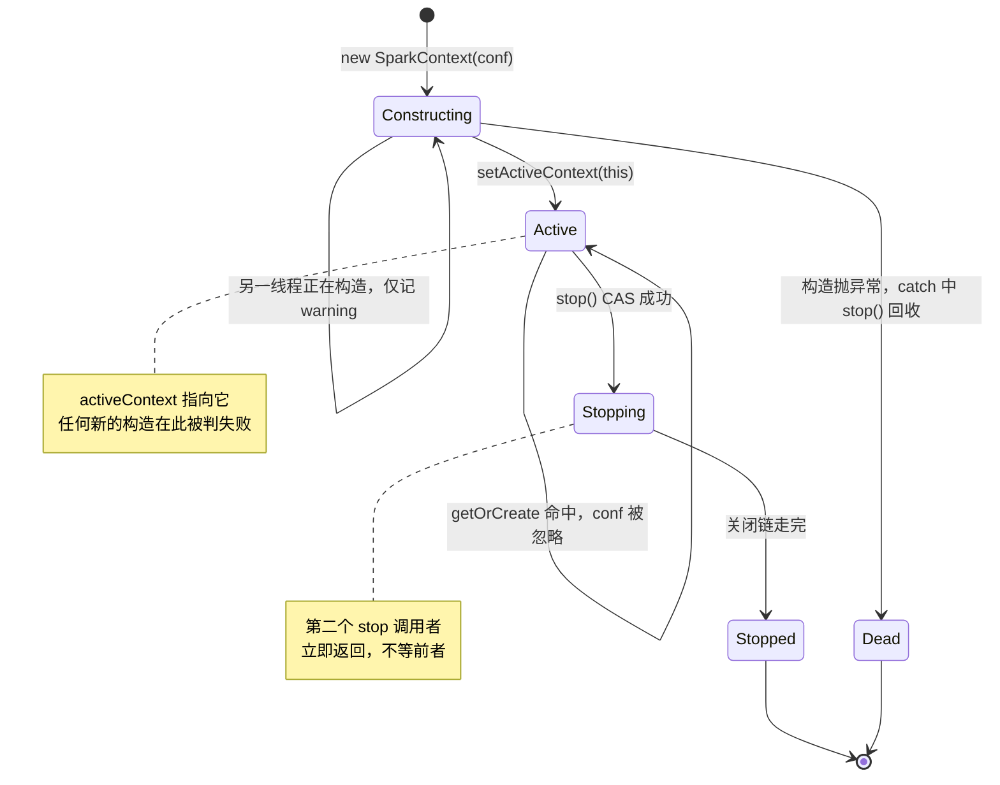
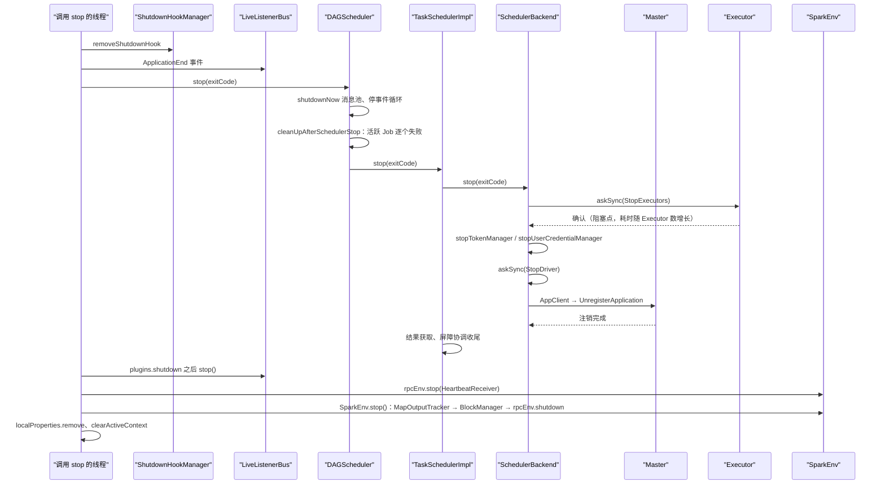
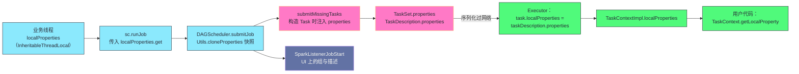
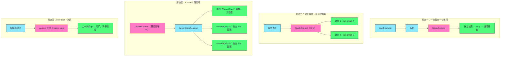

# 2. SparkContext深度剖析

**摘要：**

`SparkContext` 常被描述成 Spark 应用的"入口"，但入口这个词掩盖了它真正的身份：一个进程内单例的编排者。它持有 `SparkEnv`、`DAGScheduler`、`TaskScheduler` 与 `ListenerBus`，把用户线程上的一次 action 变成一次有归属的 Job，并在进程退出之前负责把这些东西按一条确定的调用链拆开。本文不追问它在构造期创建了哪些组件，而追问它被造出来之后怎么活：以什么规则被判定为"本 JVM 唯一"、被并发访问时线程本地的属性如何跟着 Job 走、被关掉时什么先死什么后死、以及哪些东西根本关不掉。

文章按五问推进。先界定"单例"的两本账——`activeContext` 与 `contextBeingConstructed`——以及 `getOrCreate` 的复用语义为什么会让传入的配置静默失效；再用反事实说明若允许两个 context 并存，进程级静态状态会怎样互相覆盖；接着把 `stop()` 摊成一条链，逐段交代 `DAGScheduler.stop` 如何经 `TaskScheduler` 落到 `SchedulerBackend`、`stopExecutors` 为什么是一次同步握手、事件总线为什么必须最后停；随后处理关闭的边界，从 shutdown hook 的优先级讲到 `kill -9` 之后钩子的失效，再讲到 stop 与正在跑的 Job 之间的赛跑；之后进入并发语义，拆开 `localProperties` 的 `InheritableThreadLocal` 继承规则、线程池里丢属性与串味两种走样、以及 `runJob` 在提交那一刻把属性 clone 成快照的完整链路；最后落到多实例与多租户：同一 JVM 里反复 create/stop 的代价、Spark Connect 服务端为何把"一个常驻 context 加多个 session"固化成架构前提，以及关闭不及时留下的端口、线程与引用泄漏。全文回答两个问题：单例这一约束到底约束了什么，以及在这个约束下，关与不关各要付什么代价。

---

## 第 1 章 单例的边界

### 1.1 一条断言的来历

2014 年，Spark 的 JIRA 上有一条编号 SPARK-2243 的议题，标题是"Support multiple SparkContexts in the same JVM"，讨论的是能不能让一个 JVM 里同时跑多个 context。这条议题最后没有被当作特性实现，反而成了反向约束的依据：此后十余年，任何一份 Spark 的异常日志里，只要出现 "Only one SparkContext should be running in this JVM (see SPARK-2243)"，指的都是它。从 1.x 到 2.x，Spark 一直留着一个 `spark.driver.allowMultipleContexts` 的后门，允许用户在知情的前提下把这条断言关掉；到 3.0，这个开关被 SPARK-26362 彻底删除，迁移文档里的说法很直白——同一 Driver 内支持多个 context 的能力已经移除，因为它会导致"任意而神秘"的错误。

这条二十来个字的断言值得逐字读一遍。源码里的完整信息长这样：

```scala
// SparkContext.assertNoOtherContextIsRunning，4.x
val errMsg = "Only one SparkContext should be running in this JVM (see SPARK-2243)." +
  s"The currently running SparkContext was created at:\n${ctx.creationSite.longForm}"
throw new SparkException(errMsg)
```

注意两点。第一，措辞是 "should be" 而不是 "must be"——它承认这条约束来自设计约定而非物理定律。第二，报错主动带上了另一个 context 的创建位置，而不是当前这次创建的位置。这是一处很体贴的设计：报错的人往往是"第二次创建"的那个调用点，但需要被修改的通常是"第一次创建"的地方——是那里该收尾却没有收尾，才让后来的创建撞了墙。

本文的源码口径是当前稳定的 Spark 4.3.0（2026-10-30 发布），4.x 的预编译包默认 Scala 2.13；涉及更早版本的行为差异时会单独注明年份或版本，不确定之处以对应版本文档或源码为准。

### 1.2 两本账

单例的判定不是靠一个布尔量完成的，而是靠两本账：一本记活跃者，一本记在造者。

```scala
// SparkContext 伴生对象，4.x
private val SPARK_CONTEXT_CONSTRUCTOR_LOCK = new Object()
private val activeContext: AtomicReference[SparkContext] =
  new AtomicReference[SparkContext](null)
private var contextBeingConstructed: Option[SparkContext] = None
```

`activeContext` 是"已经完整构造完成、正在服役"的那一个；`contextBeingConstructed` 是"某个线程正在构造函数里"的那一个。两本账都由 `SPARK_CONTEXT_CONSTRUCTOR_LOCK` 这把对象锁保护，而构造函数的首行与末行正好是两本账的写入口：首行 `markPartiallyConstructed(this)` 把当前实例记进"在造"名单，末行 `setActiveContext(this)` 把它挪进"活跃"名单。

拆成两本账的理由写在源码注释里，相当诚实：锁的方案无法可靠区分"另一个线程正在构造"与"另一个构造函数已经抛异常退出"，所以对"在造"这种情况只能告警而不能抛错，真正的一锤定音留到构造末尾的那次 `setActiveContext` 里。于是并发构造的两个人不会在门口就打起来，而是在终点线前分出胜负。

把这三样东西（两本账加一把锁）画成状态迁移，实例的一生就很清楚了。



### 1.3 `getOrCreate` 的复用语义

绝大多数生产代码并不直接 `new SparkContext(conf)`，而是走 `SparkContext.getOrCreate(conf)`。它的实现短得像一句顺口溜，但锁的粒度值得留意：

```scala
// SparkContext.getOrCreate，4.x
def getOrCreate(config: SparkConf): SparkContext = {
  SPARK_CONTEXT_CONSTRUCTOR_LOCK.synchronized {
    if (activeContext.get() == null) {
      setActiveContext(new SparkContext(config))
    } else {
      if (config.getAll.nonEmpty) {
        logWarning("Using an existing SparkContext; some configuration may not take effect.")
      }
    }
    activeContext.get()
  }
}
```

这段代码有两处容易被略过。第一处是整段构造被包在全局锁里：`new SparkContext(config)` 在 `SPARK_CONTEXT_CONSTRUCTOR_LOCK` 内执行，意味着在一个 JVM 里，任何一次 `getOrCreate` 的构造期间，其他 `getOrCreate` 调用都会阻塞等待，而不是快速失败。这条性质在常规部署里几乎无害，因为一个应用只会在启动时调一次；但在交互式环境里它会显形——如果构造过程正卡在向 Master 注册的那几秒（`waitForRegistration` 阻塞），另一个线程的 `getOrCreate` 就只能干等，等不到任何"已存在"的答复。

第二处是配置的静默失效：当已有活跃 context 时，传入的 `SparkConf` 被完全忽略，只在 `config.getAll.nonEmpty` 为真时打一行 warning。这行 warning 的措辞值得记住——"some configuration may not take effect"，实际语义比这更硬：是"除了已经被第一个 context 固定下来的那些，其余全部不生效"。`spark.executor.memory`、`spark.serializer`、`spark.sql.shuffle.partitions` 这类参数如果在第二个 `getOrCreate` 里才设置，不会有任何效果，也不会报错。交互式分析里"我明明在 cell 里设了参数，作业却还是按老参数跑"，根子多半在这里。

| 调用形态 | 已有活跃 context | 实际行为 | 可观测信号 |
|---|---|---|---|
| `new SparkContext(conf)` | 是 | 抛 `SparkException`，附对方创建位置 | 进程内立即失败 |
| `new SparkContext(conf)` | 另一线程正在构造 | 先记 warning，构造末尾处决，输者回收 | 两条创建日志相距极近，后一条伴随 `Error initializing SparkContext` |
| `getOrCreate(conf)` | 是 | 返回已有实例，conf 被忽略 | 仅当 conf 非空时一行 warning |
| `getOrCreate(conf)` | 否 | 在全局锁内构造并登记 | 其他 `getOrCreate` 阻塞至构造完成 |
| `getOrCreate()` | 是/否 | 同上，但不携带 conf | 无 warning |

### 1.4 三档冲突

把冲突按后果分档，比笼统地说"只能有一个"更有用。

第一档是**直接失败**。已有活跃 context 时再 `new SparkContext`，`markPartiallyConstructed` 里的 `assertNoOtherContextIsRunning` 立刻抛出异常，此时新实例除了一行 `creationSite` 之外什么都没建，失败得很干净。这是最常见的一档，也是最容易定位的一档。

第二档是**先告警、后处决**。两个线程几乎同时 `new SparkContext`：A 先进入构造函数把 `contextBeingConstructed` 置为自己，B 进来时看到"在造"的 A，按设计只能打一条 warning 放行；随后 B 一路把 `SparkEnv`、`HeartbeatReceiver`、`TaskScheduler`、`DAGScheduler` 建完，甚至可能已经向 Master 注册成功，直到末行 `setActiveContext` 才发现 `activeContext` 已被先完成的 A 占据，抛出异常。这个异常会被构造函数外层的 `catch` 接住：日志里先出现 `Error initializing SparkContext`，再调用一次 `stop()` 把刚建好的东西拆掉，收尾失败则再记一条 `Error stopping SparkContext after init error`，最后把原始异常抛给调用者。

第二档的代价需要说清楚：输的一方在失败之前已经向集群注册过应用。也就是说，Master 那边可能留下过一条被立刻注销的应用记录，Executor 可能被拉起过又被杀掉，注册用的重试线程池已经跑过一轮。这不是泄漏，而是"失败也要付启动成本"，在频繁并发初始化的测试环境里会表现为"集群里时不时冒出一个存活几百毫秒的空应用"。

第三档是**成功复用**。`getOrCreate` 在已有实例时直接返回，不创建、不销毁、不抛错，只留一行 warning。它是唯一被官方推荐的多处取用方式，代价则是 1.3 节里那笔配置账。

### 1.5 一个比喻：对公账户

把 JVM 想成一家公司，`SparkContext` 就是这家公司的对公账户。一家公司在一个银行只能开一个基本户：要换银行、换账户，得先把旧户销掉，否则新户开不出来——这就是第一档冲突。柜台偶尔会遇到两个人同时来开户的情形，系统不会在取号时就拒绝，而是到录入环节才发现重号，于是后一个人先被受理、再被退回，中间那些填过的单子就白填了——这是第二档。而 `getOrCreate` 相当于"查一下本公司有没有账户，有就报号，没有就开一个"，最省事，但它不会帮你核对"你这次想改的预留信息"是否生效。

这个比喻的边界也要划出来：银行账户是全局唯一的，而 `SparkContext` 的单例只在**单个 JVM 内**成立。跨进程、跨机器，同一个应用可以有任意多个 context，它们彼此不知道对方存在，只在集群管理器那里以不同的应用 ID 相遇。把两种"唯一"混为一谈，就会把"我这台机器上只能有一个"错读成"整个集群只能有一个"。

---

## 第 2 章 为什么必须是单例

### 2.1 一份静态状态清单

要回答"为什么不能有第二个"，最直接的办法是列出 `SparkContext` 在构造与运行期向进程级静态位置写了什么。下面这份清单来自 4.x 的 `core` 模块，逐项都能在源码里找到落点。

| 静态落点 | 写入者 | 作用 | 两个 context 并存时的后果 |
|---|---|---|---|
| `SparkEnv.set(env)` | 构造函数 | 全局执行环境（序列化、RPC、Block、Shuffle） | 后写者覆盖前者，先者组件变成孤儿 |
| `SparkContext.activeContext` | 构造末尾 | 单例登记与 `getActive` 查询 | 第二个在终点线被拒 |
| `ShutdownHookManager` 钩子表 | 构造末尾 | JVM 退出时兜底 stop | 每个 context 各挂一个钩子，逐个重入 stop |
| `_conf` 中的 `spark.app.id` | 构造末尾 | 把 appId 写回配置 | 后写者改写共享配置对象里的值 |
| `ResourceProfile.clearDefaultProfile()` | `stop()` | 清理默认资源档 | 先停者把后者仍在用的默认档清掉 |
| `SparkSession.defaultSession` 等 | SQL 层 | 会话默认值 | 指向已停 context 的会话 |
| `SparkContext.localProperties` | 各类 API | 线程本地属性 | 停掉之后仍被子线程继承（`stop()` 里专门清理） |

这张表里最要紧的是第一行。`SparkEnv` 是进程级的：Executor 端靠 `SparkEnv.get` 取序列化器、取 `BlockManager`、取 `MemoryManager`，Driver 端的 `Task`、`RDD`、`Broadcast` 也各自通过它拿运行时依赖。它是一个"最后写入者获胜"的槽位，而不是一个可以按 context 分身的注册表。只要有第二个 context 把自己的 env 写进去，第一个 context 里所有已经建好的端点、Block 管理器、Shuffle 管理器就再也拿不到"自己的"那份环境了——它们不会立刻报错，而是在下一次需要 `SparkEnv.get` 时读到别人的组件，症状是序列化失败、Block 找不到、Shuffle 文件归属错乱这类看似无关的报错。

### 2.2 反事实：如果允许并存

不妨做一个思想实验：假设 `allowMultipleContexts` 还在，两个 context 在同一个 JVM 里同时服役，会依次撞上什么。

先撞的是配置。两个 context 共享同一个 `SparkConf` 实例是常见写法，而 `spark.app.id`、`spark.app.attempt.id` 这些键会在构造末尾被写回该实例；后完成构造的那个会把自己的 ID 写进去，于是先完成者的 `conf.getAppId` 与它真实的 appId 不再一致。这类偏差不会立刻发作，等到某段代码拿 `conf` 去拼路径、拼事件日志目录时才显形。

接着撞的是端口与端点。`SparkUI` 默认从 4040 起步，第二个 context 会依次尝试 4041、4042，UI 上两个应用看起来相安无事，但运维只记得"4040 是应用界面"，于是在 4041 上排查问题时读到的全是另一个 context 的状态。`RpcEnv` 的情况更隐蔽：两个 `RpcEnv` 并存本身允许，但同名端点的注册、`HeartbeatReceiver` 的心跳路由都会按 env 分散，Executor 回调时按地址找端点，一旦地址被复用，消息就投给了错误的 context。

再往后撞的是生命周期。两个钩子都挂在 `ShutdownHookManager` 上，JVM 退出时按优先级从高到低执行；两个 context 的优先级相同（都是 `SPARK_CONTEXT_SHUTDOWN_PRIORITY`），执行顺序取决于注册顺序，于是"谁先停"变成不确定事件。如果其中一个的 `stop()` 在关闭 `SparkEnv` 时把共享的 `metricsSystem`、`rpcEnv` 一起关掉，另一个的关闭流程就会在一片"端点已停止"的报错里走完——`Utils.tryLogNonFatalError` 会把这些报错吞掉，最终日志上看起来"两个都正常关闭了"，实际只有一个走完了全程。

这些后果合起来，就是 SPARK-26362 那句"arbitrary and mysterious error cases"的具体含义：实现本身不难，难的是每一处共享状态都要重新设计归属，而 Spark 的组件模型从一开始就假定"进程内只有一个执行环境"。

### 2.3 单例约束的准确表述

把上面的分析收成一句可操作的话：**单例约束的不是"一个应用"，而是"一个 JVM 里的活跃执行环境"**。它管的边界在进程内，不在集群内；它禁止的是两个 context 同时持有进程级静态槽位，而不是禁止一个应用被提交两次。

这个表述能解释几件常被误解的事。其一，同一台机器上跑两个 `spark-submit` 完全合法，它们是两个 JVM，各有一个 context。其二，client 模式下 Driver 与提交终端同进程，终端里再起一个 `pyspark` 会撞车，因为那是同一个 JVM——PySpark 的 `SparkContext._active_spark_context` 与 JVM 侧的 `activeContext` 是两层同名约束，前者管 Python 进程，后者管 JVM。其三，在 Executor 里创建 context 被另一道闸拦住：构造函数的第二行就调 `assertOnDriver()`，只要当前线程正在执行 Spark 任务就抛 `IllegalStateException("SparkContext should only be created and accessed on the driver.")`；唯一的例外是 `spark.executor.allowSparkContext`（3.0.1 引入），它存在的目的主要是让 local 模式的测试能在一个进程里反复摆弄 context，而不是给生产留口子。

### 2.4 这笔交易的账

单例换来的是"静态可及"：`SparkEnv.get` 可以在任何地方拿到序列化器，`TaskContext.get` 可以在任务线程里拿到当前任务，`SparkContext.getActive` 让工具方法不必层层传参就能找到"当前那个 context"。这些入口降低了框架内部的传参负担，也是 Spark 能把 `RDD`、`DataFrame` 这些 API 做得如此轻的原因。

代价则落在多租户上：进程内没有第二个位置可以安放第二个执行环境，于是"隔离"只能往两个方向走——要么**进程隔离**（一个租户一个 JVM，各自一个 context），要么**会话隔离**（共享一个 context，用 `SparkSession.newSession()` 分隔 SQL 配置与临时视图，用 `job group` 分隔作业归属）。前者彻底但重，后者轻但共享资源账。第 8 章会把这两条路各自的样子摆出来。

### 2.5 一个比喻：楼里的公共管线

`SparkEnv` 这一类静态槽位，像一栋楼里的公共管线：总水表只有一个，消防喷淋只有一套，电梯只有一组。每户人家（context）当然可以自己装净水器、自己布线，但总水表的位置是固定的，谁最后接管了水表间，谁就决定了整栋楼的水压。

允许两个 context 并存，相当于让两户人家同时往同一套总水管上接锅炉：短期内水流得动，只是水压归谁调、爆管时谁去关阀，都成了扯不清的事故责任。单例约束做的事很朴素——它规定"水表间只能有一个管理员"，把责任归属提前钉死。

---

## 第 3 章 `stop()` 是一条调用链

### 3.1 进门的三道闸

`stop()` 不是"把事情做完"，而是"确保只做一次"。它的开头有三次拦截，顺序本身有讲究。

```scala
// SparkContext.stop(exitCode)，4.x，删去日志与无关分支
if (LiveListenerBus.withinListenerThread.value) {
  throw new SparkException(s"Cannot stop SparkContext within listener bus thread.")
}
if (!stopped.compareAndSet(false, true)) {
  logInfo("SparkContext already stopped.")
  return
}
if (_shutdownHookRef != null) {
  ShutdownHookManager.removeShutdownHook(_shutdownHookRef)
}
```

第一道拦住的是"在事件总线线程里调用 `stop()`"。这条限制不难理解：`LiveListenerBus` 的投递线程正在遍历监听器，此时若某个监听器回调里去拆总线，等于在遍历途中把容器拆掉；与其死于并发修改，不如直接抛一个明确的异常。实践中踩到它的地方很固定——用户写的 `SparkListener` 在 `onJobEnd` 里"顺手把 context 停了"，或者某个监控插件在监听回调里做超时自杀。正确做法是换线程，源码内部遇到同类场景时用的是 `stopInNewThread()`，起一个名为 `stop-spark-context` 的守护线程去调 `stop()`。

第二道是 CAS：`stopped.compareAndSet(false, true)`。它保证了并发调用 `stop()` 时只有一个线程真正执行关闭流程，其余线程立刻返回，只留一行 "SparkContext already stopped."。这里藏着一个容易忽略的语义：第二个调用者不等第一个关完。所以"`stop()` 返回了"并不等于"端口已释放、线程已退出"，在需要精确判断资源是否回收的场合，这个差别会直接导致偶发失败。

第三道是把 shutdown hook 摘掉。钩子是构造末尾挂上的，此刻主动摘除，是为了避免"显式 stop 之后 JVM 又退出，钩子再进来调一次 stop"这种无意义的二次进入。摘除与 CAS 组合起来，让"进程正常退出"与"代码主动关闭"这两条路收敛到同一个幂等点。

### 3.2 链条的骨架

很多人以为 `stop()` 里会平铺地列出"先停调度器、再停总线、最后停环境"，不过 4.x 的实际写法要绕一层：`stop()` 只直接调了 `_dagScheduler.stop(exitCode)`，而 `TaskScheduler`、`SchedulerBackend` 的关闭是通过这次调用**向内传导**的。这条链值得完整走一遍，因为它决定了每一步失败时会剩下什么。

```mermaid
%%{init: {'theme': 'dracula'}}%%
flowchart TD
    S["SparkContext.stop(exitCode)"] --> G1["① CAS stopped、摘 shutdown hook"]
    G1 --> A1["② postApplicationEnd 事件"]
    A1 --> A2["③ driverLogger / UI / cleaner / EAM"]
    A2 --> D["④ DAGScheduler.stop(exitCode)"]
    D --> D1["messageScheduler / shuffleMergeFinalizeScheduler<br/>shutdownNow"]
    D1 --> D2["eventProcessLoop.stop()"]
    D2 --> D3["onStop → cleanUpAfterSchedulerStop()<br/>活跃 Job 逐个 jobFailed"]
    D3 --> T["⑤ TaskSchedulerImpl.stop(exitCode)"]
    T --> T1["speculationScheduler.shutdown"]
    T1 --> B["⑥ SchedulerBackend.stop(exitCode)"]
    B --> B1["stopExecutors()：askSync(StopExecutors)"]
    B1 --> B2["askSync(StopDriver)<br/>client.stop() → UnregisterApplication"]
    B2 --> T2["taskResultGetter / barrierCoordinator 等"]
    T2 --> P["⑦ plugins.shutdown()"]
    P --> L["⑧ listenerBus.stop()"]
    L --> E1["⑨ metricsSystem.report / eventLogger /<br/>shuffleDriverComponents / heartbeater"]
    E1 --> E2["⑩ rpcEnv.stop(HeartbeatReceiver)"]
    E2 --> E3["⑪ SparkEnv.stop()<br/>BlockManager / MapOutputTracker / rpcEnv.shutdown"]
    E3 --> F["⑫ statusStore.close / localProperties.remove<br/>clearActiveContext"]
    classDef entry fill:#8be9fd,stroke:#282a36,color:#282a36
    classDef sched fill:#ff79c6,stroke:#ffb86c,color:#282a36
    classDef comp fill:#50fa7b,stroke:#282a36,color:#282a36
    classDef tail fill:#6272a4,stroke:#bd93f9,color:#f8f8f2
    class S,G1,A1,A2 entry
    class D,D1,D2,D3,T,T1,B,B1,B2,T2 sched
    class P,L,E1,E2 comp
    class E3,F tail
```



图中第 ④ 到 ⑥ 段是一条向内的递归：`DAGScheduler.stop()` 依次关掉自己的两个消息线程池、停掉事件循环，然后在事件循环的 `onStop` 回调里要求调度器把所有活跃 Job 标记失败，最后把关闭动作交给 `TaskScheduler`；`TaskSchedulerImpl.stop()` 关掉推测执行的调度器，把关闭交给 `SchedulerBackend`；`SchedulerBackend` 一边向 Executor 广播停止指令，一边让 `AppClient` 向 Master 注销。这条链上的每一层都不是"自己能关干净"，而是"把自己那份关掉，然后叫下一层关"。

### 3.3 顺序为什么不能反

链条上有三处顺序是硬约束，颠倒之后不是"慢一点"，而是"状态永久错位"。

**事件总线必须最后停。** 第 ④ 到 ⑥ 段在关闭过程中仍在向 `LiveListenerBus` 投递事件：`JobEnd`、`StageCompleted`、`ExecutorRemoved`、应用的结束事件，都是在关闭途中产生的。如果先把总线停了，这些事件会被静默丢弃，UI 与事件日志上就会留下"作业永远在跑""Executor 永不退出"的假象。4.x 的代码把这一点写进了注释——插件必须在总线停止之前关闭，理由是"关闭插件期间可能仍有事件被投递"。这条顺序的反面例证很好找：任何一次"作业已经结束、Spark UI 上却一直显示 RUNNING"的怪现象，都值得先怀疑有人在错误的时机停了总线。

**`HeartbeatReceiver` 必须显式先停，且早于 `SparkEnv.stop()`。** `SparkEnv.stop()` 的最后一步是 `rpcEnv.shutdown()` 加 `awaitTermination()`，那是一次整体性的网络层关闭；而 `HeartbeatReceiver` 是一个具体端点，先单独停它，能保证在窗口期里不再有心跳被派发到调度器，也避免整层关闭时端点里还压着未处理的心跳请求。这类"先停具体端点、再停承载它的容器"的次序，是 RPC 框架关闭时的通用做法。

**`SparkEnv.stop()` 必须最后。** 它停的是 `MapOutputTracker`、`BroadcastManager`、`BlockManager`、`MetricsSystem`、`OutputCommitCoordinator` 与 `RpcEnv`——全是上层组件的依赖。若先停它，上面的 `DAGScheduler`、`TaskScheduler`、`AppClient` 就会在半死状态下执行关闭动作：注销消息发不出去（RpcEnv 已关）、BlockManager 清理时找不到 master、指标上报抛异常。这些异常都会被 `Utils.tryLogNonFatalError` 吞掉，最终只留下一片 WARN。

| 阶段 | 关键动作 | 失败被吞掉之后的形态 | 典型日志 |
|---|---|---|---|
| 应用结束事件 | 向总线投递 `SparkListenerApplicationEnd` | UI 与事件日志缺结束事件 | 无（静默） |
| 附属组件 | UI、ContextCleaner、动态分配管理器 | 4040 端口不释放、清理线程常驻 | `Stopped Spark web UI` 缺失 |
| DAG 层 | 停消息池、事件循环、失败活跃 Job | 调用方可能长期阻塞在本应失败的 Job 上 | `Job N cancelled because SparkContext was shut down` |
| 任务层 | 停推测执行、结果获取、屏障协调 | 结果获取线程残留，堆上多一份大结果 | 无（静默） |
| 后端层 | 广播 `StopExecutors`、注销应用 | Executor 迟退、Master 上应用残留至超时 | `Shutting down all executors` |
| 插件与总线 | 插件 `shutdown()`、总线 `stop()` | 事件丢失、UI 状态冻在最后一帧 | `Stopped SparkContext` 前无结束事件 |
| 环境层 | 停 `SparkEnv`、清 `SparkEnv.set(null)` | BlockManager 与 RPC 线程残留 | `Successfully stopped SparkContext` |

表中最后一行是这一节最想强调的事实：**`Successfully stopped SparkContext` 只证明主流程走到了最后一行，不证明每一段都成功**。整个 `stop()` 被十来处 `Utils.tryLogNonFatalError` 包裹，设计意图很明确——关闭是"尽力而为"的动作，任何一段失败都不该阻断后面几段。这带来了很好的鲁棒性，也带来了一个排查代价：关闭不干净时，日志上通常没有 ERROR，只有一堆被吞掉的 WARN，得靠"少了一行预期日志"来倒推。

### 3.4 一次同步握手

前一节提到 `stopExecutors()`，它的实现值得单拎出来看：

```scala
// CoarseGrainedSchedulerBackend
def stopExecutors(): Unit = {
  try {
    if (driverEndpoint != null) {
      logInfo("Shutting down all executors")
      driverEndpoint.askSync[Boolean](StopExecutors)
    }
  } catch {
    case e: Exception => throw SparkCoreErrors.askStandaloneSchedulerToShutDownExecutorsError(e)
  }
}
```

`askSync` 意味着**阻塞等待**：Driver 发出 `StopExecutors` 之后要等 DriverEndpoint 给出答复，而端点内部再对每个 Executor 发消息并等待。于是 `sc.stop()` 的耗时并不恒定，它取决于当下有多少 Executor、网络往返有多快、以及有没有 Executor 正卡在 GC 里不应答。超时上限由 `spark.rpc.askTimeout`（默认取 `spark.network.timeout`，120 秒）一类的参数约束，具体取值以对应版本文档为准；一旦超时，`askSync` 抛出异常，`SchedulerBackend.stop` 把它包装成新的错误往上抛，而 `TaskSchedulerImpl.stop` 又用 `tryLogNonFatalError` 接住，最终表现为"`stop()` 花了很久，日志里有一行 WARN，然后一切照常往下走"。

笔者见过的下线事故里，这条性质有两个用法。其一是估算下线时间：一个 200 Executor 的集群，`stop()` 花上几十秒并不奇怪，脚本里写 `sleep 5` 之后再杀进程，很容易在关闭未完成时把 JVM 打死，于是第 9 章那些"关不干净"的形态就出现了。其二是判断"卡在哪一段"：如果 `stop()` 长时间不返回且日志停在 `Shutting down all executors`，问题在 Executor 侧；如果停在 `Stopped Spark web UI`，问题在 DAG 层；如果已经在 `Successfully stopped SparkContext`，说明主流程已结束，卡住的是之后用户代码自己的收尾。

### 3.5 关闭过程的时序

把"谁来关谁"按时间轴摊开，比流程图更容易对上日志。



这张图里有两段时间容易被误读。一段是 `askSync(StopExecutors)` 的等待，它不是卡死，只是同步握手；另一段在 `UnregisterApplication` 之后，Master 侧的清理是异步的，`stop()` 返回时应用可能还挂在 `completedApps` 里，这是常态而非异常。

### 3.6 一个比喻：关厂的次序

把 `stop()` 想成一家工厂的关厂流程，每一步都有它的物理理由。

先通知客户"今天截止接单"（`postApplicationEnd`），再让质检与保洁各自收尾（UI、cleaner、动态分配），然后停车间的生产线（`DAGScheduler` 事件循环）——注意此时车间里可能还有半成品，处理办法不是等它做完，而是给每张工单盖一个"因停厂中止"的章（活跃 Job 逐个失败）。接着拉总闸之前要先通知各分厂停机并等回执（`askSync(StopExecutors)`），因为有些分厂自己有发电机，不打招呼直接断总会留下半截工序。等所有分厂都回执了，才向园区管理处报备退租（`UnregisterApplication`）。最后才是关账本（事件总线）、关总水表（`SparkEnv`）、把门牌摘下来（`clearActiveContext`）。

这套次序的核心不是"先重后轻"，而是"**谁还在产生事件，谁就得晚点关**"。账本关得早，最后几笔账就记不上；总水表关得早，各车间的收尾就全在半断水的状态下进行。Spark 把这条原则落成了代码顺序，而不是写在文档里的约定。

---

## 第 4 章 越过 `stop()` 的边界

### 4.1 兜底的那根绳

用户忘记调 `stop()` 是常态，不是例外。命令行脚本跑完 `main` 就退出、notebook 用户直接关浏览器、CI 里进程被超时杀掉——这些场景都不可能指望业务代码优雅收尾。Spark 的兜底手段是给 JVM 挂一个 shutdown hook，在构造函数的末尾安装：

```scala
// SparkContext 构造函数末尾
logDebug("Adding shutdown hook") // force eager creation of logger
_shutdownHookRef = ShutdownHookManager.addShutdownHook(
  ShutdownHookManager.SPARK_CONTEXT_SHUTDOWN_PRIORITY) { () =>
  logInfo("Invoking stop() from shutdown hook")
  try {
    stop()
  } catch {
    case e: Throwable =>
      logWarning("Ignoring Exception while stopping SparkContext from shutdown hook", e)
  }
}
```

三个细节决定了这根绳的强度。其一，钩子调的就是同一个 `stop()`，所以第 3 章那条链在兜底路径上会完整重放一遍，包括 `stopped` 的 CAS 与 hook 摘除（此时摘的是自己，属于无害的空操作）。其二，钩子里的异常被就地吞掉并降级为 WARN，因为 JVM 退出阶段抛异常只会让关闭流程更乱。其三，钩子的优先级是 50——`ShutdownHookManager` 的规则是"数值越大越先执行"，默认优先级 100，临时目录清理是 25，而 `SparkContext` 排在 50。这个数值的选择有明确意图：让用户与框架的普通钩子（100）先跑完，再停 context，最后才轮到删临时目录（25），免得目录先被删掉、作业还在往里写。

### 4.2 优先级不是装饰

优先级在 Spark 自己的组件之间就用得上。`StreamingContext` 的钩子优先级定义为 `SPARK_CONTEXT_SHUTDOWN_PRIORITY + 1`，也就是 51——比 `SparkContext` 高一位，于是 JVM 退出时会先停流式上下文、再停底层的 `SparkContext`。这个"高一位"的排列来自 2015 年的 SPARK-7776：当时 `SparkContext` 的钩子先执行，流式作业在被强行中止后抛出一串 "Job cancelled because SparkContext was shut down"，日志极难看，于是给 `StreamingContext` 加了优先级更高的钩子，让它先做优雅停止。

这条历史对今天的实践仍有指导意义。凡是在 `SparkContext` 之上再加一层生命周期（流式、自定义的作业编排器、连接池式的服务封装），都应该问一句：我的收尾应该发生在 `stop()` 之前还是之后？答案几乎总是"之前"，因为 `stop()` 会把所有还在跑的作业判为失败，任何依赖这些作业结果的收尾都会落空。若要"之前"，就得用比 50 更高的优先级挂自己的钩子。

### 4.3 钩子的三种失效

钩子不是保险箱，它在三种情形下不起作用。

第一种是 `kill -9`。SIGKILL 不给进程任何执行清理代码的机会，钩子表根本不会被遍历。此时留下的是"Driver 进程消失、Executor 还在原地等"的形态，直到 TCP 连接被操作系统判定断开、Executor 侧的 `onDisconnected` 把它自己带走。

第二种是 `Runtime.halt()`。它比 `System.exit()` 更硬，直接终止 JVM，跳过钩子。某些容器运行时在收到 SIGTERM 之后给一段宽限期，宽限期一到就发 SIGKILL，效果与第一种相同。Kubernetes 上 `terminationGracePeriodSeconds` 设得太短，是这类"钩子没跑完就被砍"的常见成因。

第三种是钩子执行期间再被中断。JVM 已经在退出流程里，钩子是一个个串行执行的，如果某个优先级更高的钩子长时间不返回，后面的钩子会被无限期推迟；而运维侧的"等 30 秒还没退就强杀"会把这个推迟变成实际的中断。于是同一份代码在"手动 Ctrl-C"与"容器超时杀"两种路径下的收尾完整度完全不同——前者通常能跑完，后者常常只跑到一半。

### 4.4 一个可配的开关

是否安装这个钩子，在 4.x 的后期版本里变成了可配置项：`SparkContext.SPARK_CONTEXT_SHUTDOWN_HOOK_ENABLED` 对应一个布尔配置，默认开启；关掉它之后，`stop()` 不再自动挂兜底钩子，进程退出时若没人显式调用 `stop()`，就等同于"没关"。这个开关的适用场景很窄但真实：进程长期驻留、context 生命周期由上层容器管理、且不希望退出时被 Spark 的关闭流程拖慢（`askSync` 那段等待可能长达数十秒）。各版本对这个键的命名与默认值存在差异，具体以对应版本文档或源码为准。

关掉它意味着把"兜底"的责任全部交给调用方，代价是第 9 章那些泄漏形态会以更高的概率出现。笔者对这类开关的一贯看法是：它适合被框架层（譬如一个自研的常驻查询服务）打开，而不适合被业务脚本打开，因为业务脚本恰恰是最容易忘记收尾的那一层。

### 4.5 `stop()` 关不掉什么

即便 `stop()` 完整跑完，仍有一批东西留在外面，把它们列清楚，才不会对"关闭"抱有不切实际的期待。

- Master 上的应用记录不会立刻消失：`UnregisterApplication` 是异步消息，Master 处理完之后把应用移入 `completedApps` 并按 `spark.deploy.retainedApplications` 修剪，`stop()` 返回时 UI 上还能看到它。
- 已经启动的 Executor 进程不保证立刻死亡：`StopExecutors` 只是让 Executor 自己退出，卡在长任务或 GC 里的那一个会拖到超时才走完流程，Driver 侧已不再跟踪它，机器上的进程与内存却还在。

- 外部系统的副作用不可撤销：已经写进 HDFS 的输出、已经提交到 Kafka 的消息、已经插入数据库的行，`stop()` 一概不管。这一点听起来显然，实践中却常被"用 `stop()` 表达回滚"的写法混淆。
- Driver 端的静态残留需要额外清理：`localProperties` 被显式 `remove()` 是为了不让子线程继续继承一份已死 context 的属性，`ResourceProfile.clearDefaultProfile()` 是为了不让下一个 context 继承上一个的默认资源档。这两行都在 `stop()` 尾部，说明作者清楚地知道"有些静态状态不在 `SparkEnv` 里，必须单独擦"。

### 4.6 一个比喻：大厦消防联动

shutdown hook 像大厦的消防联动：火警一响，喷淋、排烟、电梯迫降按预设顺序动作，不需要每户人家自己记得关火。优先级就是联动顺序表——先疏散（用户钩子，100），再断生产用电（context，50），最后关水阀、清空水箱（临时目录，25）。这个顺序如果反过来，先关水阀再断生产用电，车间里的机器就会在断水状态下空转、烧毁。

而 `kill -9` 相当于直接把整栋楼的进线剪断：没有警铃、没有联动、没有疏散，楼里的人只能各自夺门而出——对应到 Spark，就是 Executor 靠连接断开自己觉察、Master 靠超时与断连反查。消防联动的可靠性从来不取决于预案写得多好，而取决于"电还在不在"。

---

## 第 5 章 并发：`stop()` 与 Job 的赛跑

### 5.1 四类调用者

"`stop()` 期间正在跑的 Job 会怎样"这个问题没有统一答案，因为问这句话的人可能站在四个完全不同的位置。把四类调用者的处境列出来，答案自然分明。

| 调用者 | 所处线程 | `stop()` 之后它看到什么 | 能否自救 |
|---|---|---|---|
| 业务线程 | 调用了 action 的线程，正阻塞在 `runJob` | 抛 `SparkException`，信息为"Job N cancelled because SparkContext was shut down" | 能，捕获后放弃本次结果 |
| 监听器 | `LiveListenerBus` 的投递线程 | `stop()` 直接抛 `SparkException`，禁止在总线线程内关闭 | 能，改用独立线程 |
| 任务线程 | Executor 内的任务执行线程 | 任务被中断或丢失，Executor 随后退出 | 不能，属于连带损失 |
| 管理线程 | 守护脚本、容器入口、测试 `afterAll` | `stop()` 可能阻塞数十秒；完成后资源才逐步释放 | 能，但需等待而不是紧接着杀进程 |

第二行与第四行是实践中最常出问题的两处。前者属于"用错了线程"，后者属于"用错了时间假设"——`stop()` 是同步的，但它同步到的只是"关闭流程走完"，不是"资源已经全部归还"。

### 5.2 已提交的 Job：一个明确的失败

对于已经进入 DAGScheduler 事件循环的 Job，`stop()` 给的是一个干净利落的结局。`DAGScheduler.stop()` 停掉事件循环之后，会在事件循环的 `onStop` 回调里执行 `cleanUpAfterSchedulerStop()`，把 `activeJobs` 里的每一个 Job 都标记失败：

```scala
for (job <- activeJobs) {
  val error = new SparkException(s"Job ${job.jobId} cancelled because SparkContext was shut down")
  job.listener.jobFailed(error)
  // Tell the listeners that all of the running stages have ended.  Don't bother
  // cancelling the stages because if the DAG scheduler is stopped, the entire application
  // is in the process of getting stopped.
  val stageFailedMessage = "Stage cancelled because SparkContext was shut down"
  runningStages.toArray.foreach { stage => markStageAsFinished(stage, Some(stageFailedMessage)) }
  listenerBus.post(SparkListenerJobEnd(job.jobId, clock.getTimeMillis(), JobFailed(error)))
}
```

这段代码有三处值得记住。其一，失败是由 Driver 主动构造的，不是在等 Executor 报告，所以它发生的时刻与正在跑的任务无关——任务可能还在算，但 Job 已经判死。其二，注释里那句"不必费心取消 Stage，因为整个应用都在关闭中"是一种取舍：省掉一轮取消消息的往返，代价是 Executor 侧的任务可能还要跑一会儿才被 `StopExecutors` 带走。其三，`SparkListenerJobEnd` 是在事件总线停止之前投递的，所以 UI 上能看到这次失败——这也从反面印证了 3.3 节那条顺序约束的必要性。

对业务线程来说，这个失败最终以异常形式落到 `runJob` 上，而且异常里带着调用方的栈：源码在捕获失败之后会把当前线程的 `StackTrace` 追加上去（SPARK-8644），目的是让"作业为什么失败"与"是谁调用了这次作业"出现在同一段日志里。若某个服务在关闭时输出一屏 "Job N cancelled because SparkContext was shut down"，第一件事不是查作业，而是查这次 `stop()` 是从哪里发起的。

### 5.3 正在跑的任务：连带损失

任务侧的结局由 Executor 决定，不由 DAGScheduler 决定。`stop()` 走到后端层时会广播 `StopExecutors`，Executor 收到之后按自己的关闭流程退出：停止任务线程池、停 BlockManager、上报最后的指标、结束进程。此刻正在执行的任务有三种命运——被中断（若 `interruptOnCancel` 语义生效）、跑完但结果无人接收、或者跑在用户代码里不响应中断而一直跑到 Executor 进程被杀。

这三种命运在 Driver 侧的观测是一致的：Job 早已判失败，任务状态的后续上报会被丢弃或记在一条已结束的 Job 上。于是日志里会出现"任务成功结束"紧接着"Job 失败"的错位，这不是矛盾，而是两条时间线在关闭点附近交叉的产物。

### 5.4 读秒窗口里的三种结局

前面两节讨论的都是"已经进了事件循环"的 Job。真正麻烦的是那个极窄的窗口：一个线程刚通过 `runJob` 入口的 `stopped.get()` 检查，另一个线程正好把 `stopped` 置真并开始关闭。

```scala
// SparkContext.runJob 入口
if (stopped.get()) {
  throw new IllegalStateException("SparkContext has been shutdown")
}
```

这个检查与后面的 `dagScheduler.runJob(...)` 之间没有原子性，中间还隔着 `getCallSite()`、`clean(func)` 与日志。更宽的窗口在 DAGScheduler 侧：`submitJob` 在投递事件之前会先强制计算 RDD 的分区（`eagerlyComputePartitionsForRddAndAncestors`，SPARK-23626 的产物，目的是把可能很慢的 `getPartitions` 挪出单线程事件循环），而这一步在自定义数据源上可以耗时几百毫秒。在这段时间里若 `stop()` 完成，接下来会发生三种结局之一。

第一种，`_dagScheduler` 已被置为 `null`（`stop()` 在 `_dagScheduler.stop()` 之后立刻把它清空），调用方拿到 `NullPointerException`。这是最容易被误判为"Spark bug"的一种，异常栈指向 `SparkContext.runJob`，而真正的起因是另一个线程的关闭。

第二种，事件被投递进了一个已经停掉的事件循环。`EventLoop.post` 在 `stopped` 为真时**静默丢弃**事件，既不抛错也不入队；于是调用方在 `ThreadUtils.awaitReady(waiter.completionFuture, Duration.Inf)` 上一直等，等一个永远不会到来的完成信号。这个窗口窄到几乎无法复现，但它的症状很明确：进程不退出、线程栈停在 `awaitReady`、日志里既没有 Job 开始也没有 Job 失败。

第三种，也是最常见的一种：`stopped` 设置得足够早，入口检查命中，调用方拿到 `IllegalStateException("SparkContext has been shutdown")`，干脆利落。

三种结局里，第一种与第二种都属于"关闭期间不要提交新作业"这条纪律的反面教材。要彻底避免，靠的不是给 `runJob` 加锁，而是让调用方自己维护一个"服务正在关闭"的状态位，在提交之前就拒绝新请求——这是关闭顺序在应用层的镜像：先停止接单，再关车间。

### 5.5 幂等不等于可重入

`stop()` 的 CAS 保证了幂等，但幂等与可重入是两件事。可重入指的是"同一个线程在关闭流程中再次进入 `stop()` 不会破坏状态"，而 Spark 在这里是有明确禁区的：事件总线线程内禁止调用，构造函数内也不该调用（早期的版本里有一条显式检查，抛"不能在构造函数里停止 context"；4.x 的写法改成了用 `contextBeingConstructed` 记账，但结论没变——构造尚未完成时没有可停的东西）。

真正的风险来自间接重入。譬如一个 `SparkListener` 在 `onApplicationEnd` 里调用某个清理函数，该函数内部又调了 `sc.stop()`；或者一个 `ContextCleaner` 的清理回调里触发了资源的 `close()`，而那个资源又持有 context。这类路径在关闭时最容易把流程搅乱，因为它们让同一次关闭在多个线程上交叉。判断办法很朴素：站在任意一个"可能在关闭途中被调用"的回调里，问一句"我这次调用会不会落到 `stop()` 上"，答案是"可能"就换成异步投递。

### 5.6 一个比喻：打烊的餐厅

`stop()` 与 Job 的关系，像餐厅打烊与客人用餐的关系。

打烊的第一步是停止接单（`stopped` 置真、入口检查拒绝新 Job），第二步是通知在座的客人"本店即将结束营业"（活跃 Job 判失败），第三步是请客人离席（`StopExecutors`），最后才关灯、关燃气、锁门（`SparkEnv.stop`）。已经上桌的菜不会被退回厨房重做——对应到 Spark，就是注释里那句"不必取消 Stage"：厨房已经在收拾，再下一道"停火"的指令没有意义。

---

## 第 6 章 `localProperties`：线程本地的属性如何变成 Job 的属性

### 6.1 一张贴在工位上的便签

Driver 上有大量"只对本次调用有效"的信息：这次 action 属于哪个作业组、该进哪个公平调度池、取消时要不要中断任务线程、这次作业该叫什么名字。这些信息不能做成全局变量（并发调用会互相覆盖），也不适合层层传参（要穿过 RDD 的每一个算子），Spark 的选择是把它放进线程本地变量：

```scala
// SparkContext
protected[spark] val localProperties = new InheritableThreadLocal[Properties] {
  override def childValue(parent: Properties): Properties = {
    // Note: make a clone such that changes in the parent properties aren't reflected in the
    // those of the children threads, which has confusing semantics (SPARK-10563).
    Utils.cloneProperties(parent)
  }
  override protected def initialValue(): Properties = new Properties()
}
```

它是 `InheritableThreadLocal` 而非普通的 `ThreadLocal`，这一选择决定了后文所有语义：新线程创建时会从父线程复制一份，于是"主线程设好作业组、再起线程跑作业"默认能带上属性。复制的方式是 `cloneProperties`，克隆而非共享——SPARK-10563 的注释解释了理由：若共享同一个 `Properties` 对象，父线程后续的修改会莫名其妙地出现在子线程里，语义混乱。换句话说，**子线程拿到的是创建那一刻的快照，此后父子各改各的**。

### 6.2 五个键

属性表里由 Spark 自己解释的键并不多，但它们覆盖了作业归属的全部维度。

| 键 | 设置入口 | 消费方 | 边界 |
|---|---|---|---|
| `spark.jobGroup.id` | `setJobGroup` | DAGScheduler 的取消匹配、UI 分组 | 仅匹配已提交的 Job；未来 Job 需 `cancelJobGroupAndFutureJobs` |
| `spark.job.description` | `setJobDescription` | UI、事件日志 | 未设置时用 callSite 的短形式兜底 |
| `spark.job.interruptOnCancel` | `setJobGroup` 的第三参、`setInterruptOnCancel` | 取消时是否 `Thread.interrupt` 任务线程 | 默认 false，源于 HDFS 对中断的敏感（HDFS-1208） |
| `spark.job.tags` | `addJobTag`、`addJobTags` | `cancelJobsWithTag`、SQL 层的中断 | 逗号分隔；标签内不能含逗号 |
| `spark.scheduler.pool` | `setLocalProperty` | FAIR 调度器的池选择 | 池必须先被定义，否则退化为默认池 |

表里第一行与第三行的差别值得停一下。作业组与中断开关由同一次 `setJobGroup` 写入，"取消这个组"与"取消时是否中断线程"因此绑在一起；只想要后者的话，可以用 3.5 起提供的 `setInterruptOnCancel` 单独设，它不动组 ID。

### 6.3 传播链

属性从"线程本地"变成"任务的本地属性"，中间要经过四次搬运，每一次都有一个可以出错的接缝。



四个接缝分别是：入口处取的是"当前线程的属性对象"、提交时做的是"克隆快照"、进 Task 时做的是"引用注入"、过网络时做的是"序列化拷贝"。其中第二个接缝最容易被误解——快照并不发生在调用 action 的那一刻，而是在 `DAGScheduler.submitJob` 里，那里距离 `runJob` 入口还隔着调用点解析与闭包清理。这个差别在实践中几乎无害，但语义值得说清：**属性跟着 Job 走，不跟着线程走**，Job 一旦提交，线程后来改成什么都与它无关。

### 6.4 线程池里的两种走样

`InheritableThreadLocal` 的继承发生在"线程创建"这一瞬间，而不是"任务提交"这一瞬间。线程池恰好把这两件事拆开了：池里的工作线程是复用的，创建时机由池决定，提交时机由业务决定。两者一错位，就出现两种走样。

第一种是**丢属性**。`ExecutionContext.global`、`Executors.newFixedThreadPool` 这类池，工作线程往往在第一次提交时才创建，于是第一个任务能继承到调用线程的属性，后续任务复用同一个工作线程却不再继承——它们看到的仍是第一个任务留下（或被清掉）的那份。更糟的情形是池在工作线程创建时就完成了预热，之后所有任务都拿不到属性。症状是"同步调用时能取消，异步调用时取消不了"，而代码里明明写了 `setJobGroup`。

第二种是**串味**。属性一旦被某个工作线程继承，它会留在那个线程的 `localProperties` 里，直到被显式覆盖或清除。于是下一个复用该线程、与作业组毫无关系的任务，会莫名其妙地带上上一个请求的组 ID。表现为 UI 上两个互不相关的查询被归进同一个组，或者 `cancelJobGroup("A")` 把一个从未属于 A 的作业杀掉了。串味的危害大于丢属性，因为丢属性只是"取消失效"，串味是"取消错了对象"；笔者处理过的取消失效案例，多数栽在第二种上。

| 场景 | 属性来源 | 结果 | 典型症状 |
|---|---|---|---|
| 主线程同步 action | 当前线程直接持有 | 正常 | 无 |
| `new Thread` 内 action | 创建时从父线程克隆 | 正常（快照） | 父线程后续修改不影响子线程 |
| 线程池内第一次任务 | 工作线程创建时克隆 | 视创建时机而定 | 时灵时不灵 |
| 线程池内后续任务 | 工作线程上次留下的 | 丢属性或串味 | 取消失效、组错配 |
| Scala `Future` | 取决于执行上下文 | 同上 | 常见于"异步提交后取消"的需求 |
| Executor 端闭包 | 任务的 `TaskContext` | 正常 | 属性经序列化送达 |

### 6.5 正确写法

避开这两种走样，有三条可操作的写法，按侵入性从低到高排。

第一条是**在任务体内重新设置**：把 `setJobGroup` 挪到真正提交 action 的那个线程里执行，而不是在"发起请求"的线程里执行。这条最简单，也最容易被忽略——多数丢属性的 bug 不是继承机制不工作，而是设置与提交不在同一个线程。

第二条是**显式传递**：把组 ID 作为一个普通参数传进异步任务，在任务开头 `setJobGroup(groupId, desc)`，任务结束用 `clearJobGroup()` 收尾。收尾这步不能省，否则线程池的下一个使用者会继承到它。

第三条是**包一层作用域**：写一个 `withJobGroup(groupId)(body)` 的帮助方法，进入时设置、退出时清空，用 `try/finally` 保证异常路径也清理。这条做法把属性的生命周期收敛到一个词法作用域里，可读性最好，代价是要在团队里形成约定。

不过还有一条不该走的路：指望 `sc.setLocalProperty` 的全局可见性。它不是全局的，父线程改了子线程看不到，子线程改了父线程也看不到；把它当成"应用级配置"来用，最后一定会在某个异步路径上失效。

### 6.6 取消为什么常常"没反应"

`cancelJobGroup` 的实现是往 DAGScheduler 投递一个 `JobGroupCancelled` 事件，事件循环里遍历 `activeJobs`，用属性里的 `spark.jobGroup.id` 做等值匹配，匹配上的才进入取消流程。这套逻辑有两个隐含前提，缺一个就会"取消没反应"。

前提一，Job 必须在 `activeJobs` 里。刚提交、还在等资源的 Job 在；已经结束的 Job 不在；而 6.4 节那种"属性丢了"的 Job 虽然在，但组 ID 是空的，匹配不上。此时 DAGScheduler 会打一条 warning："Failed to cancel job group ... Cannot find active jobs for it."——这条日志是排查取消问题的第一现场，看到它就该去查属性传播，而不是查取消逻辑。

前提二，取消只对已经提交的 Job 生效。`cancelJobGroup` 返回之后，同一线程若再提交一个同组的 action，它会照常运行。要让"取消"对后续作业也生效，得用 4.x 的 `cancelJobGroupAndFutureJobs`：它把组 ID 记进一个容量受限的集合（上限由 `spark.scheduler.numCancelledJobGroupsToTrack` 控制，4.0 引入），后续同组 Job 提交时直接判失败，不再进入调度。这个补充 API 的存在本身就是一条证据——"取消一个组"在语义上有两种读法，而默认实现选的是窄的那一种：取消当下在跑的，不管以后还会不会来。哪一种更合理取决于场景，长跑服务选宽的，一次性批处理选窄的。

### 6.7 一个比喻：工位上的便签

`localProperties` 像贴在工位隔板上的便签：谁坐这个工位，看到的就是这张便签上的字。`InheritableThreadLocal` 相当于"新开一个工位时，把老工位的便签复印一份贴过去"——复印发生在开张那一刻，之后老工位改了便签，新工位不会跟着变。

线程池则是一组共享工位：人走了便签不撕，下一个人坐下就照着上一个人的便签办事。丢属性是"新工位开张时老工位还是空的"，串味是"上一班的人忘了撕便签"。两种毛病的修法不同：前者要在坐下之后重新写一张，后者要在离开之前撕掉。Spark 在 `stop()` 里对 `localProperties` 调的那句 `remove()`，正是"整间办公室关门时把所有便签撕干净"的动作——不撕的话，下一个 context 起的线程会继承到上一个 context 的作业组，那就不只是串味，而是串了朝代。

---

## 第 7 章 `runJob` 如何把闭包与属性绑到本次 Job

### 7.1 一条短得可疑的方法

所有 action 最终都落到 `SparkContext.runJob` 上。它短得可疑，但每一行都在承担一件事：

```scala
def runJob[T, U: ClassTag](
    rdd: RDD[T], func: (TaskContext, Iterator[T]) => U,
    partitions: Seq[Int], resultHandler: (Int, U) => Unit): Unit = {
  if (stopped.get()) throw new IllegalStateException("SparkContext has been shutdown")
  val callSite = getCallSite()
  val cleanedFunc = clean(func)
  logInfo(log"Starting job: ${MDC(LogKeys.CALL_SITE_SHORT_FORM, callSite.shortForm)}")
  dagScheduler.runJob(rdd, cleanedFunc, partitions, callSite, resultHandler, localProperties.get)
  progressBar.foreach(_.finishAll())
  rdd.doCheckpoint()
}
```

四行实质代码，分别对应四件不同的事：检查上下文是否还活着、解析调用点、清理闭包、把属性与闭包一起交给 DAGScheduler。最后那行 `rdd.doCheckpoint()` 常被忽略——它在作业成功之后才执行，所以 `stop()` 打断作业时它根本不会运行，checkpoint 目录里的临时文件就留在了那里。

### 7.2 为什么要 `clean(func)`

闭包在 Scala 里会捕获外部变量，而捕获的实现方式是把它变成闭包对象的字段。问题在于，被捕获的对象未必可序列化，也未必需要随任务走：一个方法里引用了 `this`，整个外部类实例就被拖进了序列化图；引用了一个日志器，日志器也会被打包。`ClosureCleaner` 做的事就是把这些不必要的引用摘掉，只留下真正被使用的。

清理失败的典型症状不是"序列化失败"，而是"作业能提交、任务在 Executor 上炸"。因为清理发生在 Driver，序列化也发生在 Driver（`Task` 序列化时才会真正触发），错误要到 Executor 反序列化时才以 `Task not serializable` 的形式暴露。这条因果链解释了"作业提交成功"与"作业能跑"之间为什么还有一道坑。

### 7.3 属性的落点是 `JobSubmitted`

属性在 `DAGScheduler.submitJob` 里被克隆并随 `JobSubmitted` 事件进入事件循环，最终成为 `ActiveJob.properties`：

```scala
val waiter = new JobWaiter[U](this, jobId, partitions.size, resultHandler)
eventProcessLoop.post(JobSubmitted(
  jobId, rdd, func2, partitions.toArray, callSite, waiter,
  JobArtifactSet.getActiveOrDefault(sc),
  Utils.cloneProperties(properties)))
```

`Utils.cloneProperties` 这一层克隆值得强调：它切断了 Job 属性与调用线程后续修改之间的联系。此后这条属性表随着 Job 一路向下——`ActiveJob` → `submitMissingTasks` 构造 Task 时的字段 → `TaskSet.properties` → `TaskDescription.properties` → Executor 端的 `TaskContext`。同一份属性还被塞进 `SparkListenerJobStart`，所以 UI 上的作业分组、作业描述、SQL 执行 ID 全部来自这里。

零分区的作业有一条短路：`submitJob` 发现分区为空，会直接克隆属性、投递 `JobStart` 与 `JobEnd`、返回一个零任务的 `JobWaiter`，根本不给事件循环添麻烦。这条短路顺带解释了一个小现象——对空 RDD 调 action，UI 上仍会出现一条瞬时完成、带分组信息的 Job。

### 7.4 结果怎么回来

`DAGScheduler.runJob` 拿到 `JobWaiter` 之后做的唯一一件事是等：

```scala
val waiter = submitJob(rdd, func, partitions, callSite, resultHandler, properties)
ThreadUtils.awaitReady(waiter.completionFuture, Duration.Inf)
```

`JobWaiter` 内部是一个计数器和 `Promise`：每个任务成功时 `taskSucceeded` 把计数器加一并调用 `resultHandler`，计数到总数就 `success`；任何导致 Job 失败的事件调用 `jobFailed` 把 `Promise` 置为失败。5.2 节那个"关闭时判失败"的路径，最终就是走到 `jobFailed` 上，让 `awaitReady` 抛出异常。

`Duration.Inf` 说明等待没有超时。这条设计让"作业永不结束"与"Driver 永远阻塞"绑定在一起——正常情况下这没问题，因为作业总会因为完成、失败、取消、关闭中的某一条而结束；5.4 节那个"事件被投递进死掉的事件循环"的窗口之所以危险，正是因为它绕过了所有会结束作业的路径。

### 7.5 一次 action 的绑定清单

把这一章与上一章拼起来，一次 action 到底绑定了什么，可以列成一份清单：

| 绑定项 | 绑定时机 | 存放在哪 | 越界之后 |
|---|---|---|---|
| 闭包 | `runJob` 里 `clean(func)` | Driver 内存，随 Task 序列化 | Executor 反序列化时爆炸 |
| 调用点 | `runJob` 里 `getCallSite()` | `ActiveJob`、UI、异常信息 | 无 |
| 分区集合 | 调用 action 时确定 | `JobSubmitted` 事件 | 提交时校验越界，直接抛错 |
| 本地属性 | `submitJob` 里克隆 | `ActiveJob.properties` | 之后线程再改无效 |
| 结果处理器 | `runJob` 的参数 | `JobWaiter` | 关闭时不再被调用 |
| 资源档（ResourceProfile） | Task 构造时由 stage 决定 | `TaskDescription.resourceProfileId` | 与属性无关，另走一条链 |

清单最后一行是一处容易被混淆的边界：**`ResourceProfile` 决定任务要几个核、多少内存，`localProperties` 决定任务归属哪个作业组**，两者都随 `TaskDescription` 过网络，但一条走资源档 ID，一条走属性表。把它们混作一谈，就会得出"设了作业组能改资源"这类错误结论。

---

## 第 8 章 多实例与多租户

### 8.1 同一个 JVM 里反复创建

单例约束说的是"同时只能有一个活跃者"，不是"一生只能有一个"。同一个 JVM 里完全可以把 context 停掉再造一个，只是每一次循环都要付一笔账，而这笔账很少有人认真算过。

第一笔是**端口**。`SparkUI` 从 `spark.ui.port` 起步，被占用就往后试，上限由 `spark.port.maxRetries` 控制。前一个 context 刚停时端口还在回收状态，后一个未必能立刻拿回同一个端口；服务重启几次之后，UI 端口一路往上爬，监控脚本里写死的 4040 就开始指向不存在的页面。

第二笔是**钩子表**。每个 context 在构造末尾往 `ShutdownHookManager` 里塞一个闭包，`stop()` 时再摘掉。正常循环账是平的；但只要有一个 context 没走 `stop()`（异常路径、`System.exit`、被 kill），它的钩子就永远留在表里，而闭包持有 context 的引用——最隐蔽的泄漏不是线程、不是堆块，而是一个再也不会被调用的钩子钉住了整个对象图。

第三笔是**线程与类加载器**。正常关闭之后，`dag-scheduler-event-loop`、`heartbeat-receiver`、`netty-rpc-*-server`、`driver-heartbeater` 这些线程都会退出，但退出需要时间，而新 context 会在旧线程退干净之前起来；短时间内看到两套同名线程并存是常态。类加载器的问题更持久：`spark.jars` 里的用户 jar 会被加到 Driver 的类路径上，反复创建不会卸载，长时间运行的 notebook 或测试进程里，Metaspace 会随重启次数缓慢上涨。

第四笔是**会话层的静态残留**。`SparkSession` 一侧的默认会话与线程会话都指向某个 `SparkContext`，context 停掉之后这些记录不会自动失效，于是"取当前会话"取到一个已死的壳，第一条 SQL 报的错可能是 `Cannot call methods on a stopped SparkContext`。`stop()` 尾部清理 `localProperties` 与默认资源档，正是同类问题的另一半。

### 8.2 四种形态

把"谁拥有 context、活多久、怎么关"三个问题排在一起，全貌就出来了。



形态一最容易理解：进程的生命周期就是 context 的生命周期，关闭顺带完成。形态二是自研服务最常见的做法：一个常驻 context 服务所有请求，靠 job group 与调度池区分归属，靠"停止接单"的开关避免 5.4 节那个读秒窗口。形态四最容易被低估：解释器与测试框架会反复创建 context，每一次都在赌前一任关得够干净。

形态三是本章要重点交代的一种，因为它把"单例"从一个运行期约束变成了架构前提。

### 8.3 Connect 服务端：一个 context，多个会话

Spark Connect 在 3.4 引入，把客户端与 Driver 拆成两个进程，协议是 protobuf 编码的未解析逻辑计划。落到本篇的主题上，它做的事情可以一句话概括：把 `SparkContext` 从"每个客户端一个"变成"每个服务端一个"。

源码里的证据很直接。`SparkConnectService.start(sc)` 接收一个已经建好的 `SparkContext`，然后用它初始化一个基础会话：

```scala
// SparkConnectService.start，4.x
sessionManager.initializeBaseSession(() =>
  SparkSession.builder().sparkContext(sc).getOrCreate().newSession())
```

此后每个 `(userId, sessionId)` 组合第一次请求时，`getOrCreateIsolatedSession` 会创建一个隔离会话，而隔离的手段是 `SparkSession.newSession()`——它共享同一个 `SparkContext` 与共享状态（缓存、元数据），只把 SQL 配置、临时视图、注册的函数分开。换句话说，**所有会话共用一本资源账、一个执行环境、一套 BlockManager**，会话之间的隔离发生在 SQL 层，不在调度层与存储层。

这个结构带来三条与关闭有关的结论。

其一，关闭粒度上移。`SparkConnectService.stop()` 关的是 gRPC 服务、会话管理器与 UI 页签，它不调用 `sc.stop()`；服务端进程的退出由启动脚本与 JVM 生命周期负责，`SparkContext` 的关闭最终仍由第 3 章那条链或 shutdown hook 完成。把"停 Connect 服务"当成"停 context"，会得到"服务端口没了、Executor 还在、Master 上的应用还在 RUNNING"的怪状态。

其二，客户端断开不触发任何关闭。经典 client 模式里，提交终端一断，Driver 就死，应用随之灰飞烟灭；Connect 模式下，客户端断开的后果只是那个会话失联，服务端的 context 与作业照常运行。会话本身有闲置回收与墓碑缓存（相关键在 `spark.connect.*` 下，具体名称与默认值以对应版本文档为准），不过回收的是会话，不是执行环境。

其三，多租户的隔离面被压缩到会话层。同一服务端上两个租户共用一个 context，意味着 executor 内存、shuffle 文件、广播变量池都是共享的；一个租户把 executor 打 OOM，另一个租户的作业也跟着重试。要在这层结构里做出可用的隔离，只能靠作业组、调度池、`spark.cores.max` 这类软约束与 SQL 层的资源档，真正的强隔离仍然倾向"一租户一服务端"或"一租户一集群"。

### 8.4 一个比喻：写字楼与工位

形态一像独立厂房：一个厂一个院子，关厂就是拆院子，干净。形态二像一栋写字楼里的一个部门：所有人在同一个大开间办公，靠工位牌区分项目组，部门撤编时才统一关灯。形态三像写字楼本身：楼里有很多公司（会话），共用电梯、中央空调与配电房（context），一家公司退租只清自己的工位，楼照常开着；只有物业决定整栋楼停运，配电房才会关。

共用配电房的好处是成本低、启动快；坏处是任何一家公司私接大功率设备，整层楼一起跳闸。Connect 服务端把这种共用制度化了，容量规划的口径也随之改变：从"并发作业数乘每作业核数"改成"常驻服务数乘每服务申请的核数"，因为空闲服务不会主动把资源还回去。

---

## 第 9 章 关闭不及时的泄漏形态

### 9.1 六种残留

"忘记 stop"与"stop 没走完"是两种不同的病，症状却常常混在一起。把残留按资源类型列清楚，排查时才有下手处。

| 残留类型 | 成因 | 表现 | 观测手段 |
|---|---|---|---|
| UI 端口 | `SparkUI` 未停，端口一直被占 | 端口号逐次上移，监控页 404 | `lsof -i :4040`、启动日志里的 `Started SparkUI` |
| RPC 与 Netty 线程 | `SparkEnv.stop()` 未执行到 `rpcEnv.shutdown()` | 线程数只增不减，`netty-rpc-*` 常驻 | `jstack` 按线程名过滤 |
| 调度线程 | DAG 事件循环、心跳接收器未停 | `dag-scheduler-event-loop`、`heartbeat-receiver` 挂着 | `jstack`、线程 dump 计数 |
| 堆内对象 | `statusStore`、监听器队列、广播块、缓存的 RDD | 老年代缓慢上涨，Full GC 后不回落 | `jmap -histo`、堆 dump 查 `AppStatusStore` |
| 临时目录 | Driver 临时目录未删，Executor 的 blockmgr 未清 | `/tmp` 下 `spark-*`、`blockmgr-*` 堆积 | 目录计数、磁盘水位 |
| 钩子引用 | 未 stop 的 context 被钩子闭包钉住 | 无法从任何地方回收，且退出时被重放一次 stop | 堆 dump 查 `ShutdownHookManager` 的钩子表 |

这张表里最后一行值得单独说。钩子为了兜底必须持有 context 的引用，于是"没有 stop"的直接后果不只是资源不释放，而是**连垃圾回收都救不了它**——只要 JVM 还活着，钩子表就替这个死 context 续着命。一个长跑服务若在启动失败后重试几十次，钩子表里可能已挂着几十个 context，每个都带着自己的 `SparkEnv`、BlockManager 与线程池。

### 9.2 为什么"日志看起来一切正常"

第 3 章说过，`stop()` 被十来处 `tryLogNonFatalError` 包裹，异常被降级为 WARN 甚至直接吞掉。这套设计在"关闭尽量走完"上是对的，却制造了排查盲区：**关闭失败几乎不产生 ERROR**。

于是"泄漏"的典型现场是这样的：进程还在、日志停在 `Successfully stopped SparkContext`、UI 还能打开、线程数比基线多十几个，没有一条错误日志。要定位，得反过来做——先确认"预期该消失的东西"是否消失：`jstack` 里该退出的线程名、`lsof` 里该释放的端口、`/tmp` 下该删掉的目录、堆里该被回收的 `AppStatusStore`。

### 9.3 一个比喻：没拧紧的水龙头

关闭不及时的泄漏，像一只没拧紧的水龙头：不会立刻淹了房子，只是滴。一天看不出来，一个季度之后水费单会告诉你。

而 9.1 节最后那行"钩子引用"不是滴水，是把水龙头焊死在墙上：你以为关掉了，整条管子还在墙里占位，全楼检修时还会再喷一次。

---

## 第 10 章 边界与反例

### 10.1 把 `stop()` 当成"作业完成"的确认

`stop()` 走到 DAG 层的第一件事就是把活跃 Job 判失败。作业没结束就调 `stop()`，得到的不是"提前收工"而是"工单作废"。确认作业完成要看 action 正常返回或 `JobWaiter` 的完成信号，不是 `stop()` 是否返回。

### 10.2 在 `finally` 里 stop 之后继续用 `sc`

`finally { sc.stop() }` 写得没错，错在忘了 `finally` 之后还有代码。任何一次对已停 context 的方法调用都会撞上 `assertNotStopped`，异常文本会把"这个已停 context 的创建位置"与"当前活跃 context 的创建位置"一起打出来——这段文本很啰嗦，但它恰好是排查"谁在关闭后还伸手"的最好线索。

### 10.3 以为 `stop()` 会回滚已写出的数据

`stop()` 关的是运行时，不是事务。已经写进 HDFS 的分区、已经发出的 Kafka 消息，不会因为 `stop()` 而消失。要"要么全成要么全不成"，得靠输出端的提交协议或幂等写入。

### 10.4 以为 `getOrCreate` 会合并第二个配置

`getOrCreate(conf)` 在已有活跃 context 时只返回旧实例，第二个 `conf` 整体作废，仅留一行 warning。想改配置，只有两条路：改第一个 context 的构造参数，或者停掉重建。交互式环境里"改配置要重启 context"这条体感，根子就在这里。

### 10.5 在线程池里设 job group，然后指望取消生效

6.4 节已经拆过：属性跟随线程创建时的继承，线程池把它拆成了两件事。这条反例的排查成本很高，因为代码里 `setJobGroup` 明明写着，取消也确实发出去了，唯一异常的信号是 DAGScheduler 那句 "Cannot find active jobs for it"。

### 10.6 把"停 Connect 服务"与"停 context"混为一谈

`SparkConnectService.stop()` 不碰 `SparkContext`。要让服务端连同执行环境一起退出，得显式停 context 或让进程结束；客户端断线则不会触发任何关闭动作。

### 10.7 把长收尾塞进 shutdown hook

钩子里的 `stop()` 会走到 `askSync(StopExecutors)`，那是一次同步握手。容器编排的宽限期通常只有几十秒，钩子跑不完就被 SIGKILL，"优雅关闭"于是变成"关到一半被杀"，比不关更糟——前一半已经拆掉注销通道，集群侧反而更难清理。

---

## 第 11 章 落点

回到开头的问题：单例这一约束到底约束了什么？

它约束的不是"应用数量"，而是"进程内执行环境的归属"。`SparkEnv`、`activeContext`、钩子表、默认资源档这些静态槽位只容得下一个主人，所以 Spark 选择在构造的首尾各设一道检查，把"谁是主人"这件事提前钉死。代价是配置的静默失效、并发构造的末尾处决、以及多租户只能退到会话隔离；换来的是 `SparkEnv.get`、`TaskContext.get` 这类静态入口的可用，以及一整套不必层层传参的 API 形态。

在这个约束之下，关闭与并发各自长出了一套语义。`stop()` 是一条向内递归的调用链，顺序由"谁还在产生事件"决定，而非组件重要性；它尽力而为，于是几乎不报错，也就要求排查者用"缺席"而非"报错"判断成败。`localProperties` 是一份跟着线程创建、跟着 Job 提交、跟着 Task 过网络的属性表，其快照语义决定了"改属性"必须落在正确的时机与线程上。两套语义合起来，就是"进程内单例编排者"的日常。

所以判断一个方案是否合适，不妨先问三个问题：这个 context 的 owner 是谁，是提交脚本、常驻服务还是 Connect 服务端？"结束"的定义是什么，是进程退出、作业完成还是客户端断线？故障发生时，要的是"立刻全部结束"还是"留下痕迹慢慢收尾"？第一个问题决定谁负责关闭，第二个问题决定关闭的触发点，第三个问题决定你要读哪一段日志。

---

## 专栏导航

- 上一篇：[[1. Spark核心调度与容错机制]]
- 下一篇：[[3. Spark逻辑处理流程详解]]

---

## 参考资料

1. Apache Spark 4.3.0 源码：`core/src/main/scala/org/apache/spark/SparkContext.scala`，单例登记（`markPartiallyConstructed`、`setActiveContext`）、`getOrCreate`、`stop`、`localProperties`、`runJob`、作业组与标签 API。
2. Apache Spark 4.3.0 源码：`core/src/main/scala/org/apache/spark/scheduler/DAGScheduler.scala`，`submitJob` 的属性克隆、`cleanUpAfterSchedulerStop`、作业组取消匹配、`cancelledJobGroups`。
3. Apache Spark 4.3.0 源码：`core/src/main/scala/org/apache/spark/scheduler/TaskSchedulerImpl.scala`、`TaskSetManager.scala`、`Task.scala`、`TaskDescription.scala`，属性从 `TaskSet` 到 `TaskDescription` 的传递。
4. Apache Spark 4.3.0 源码：`core/src/main/scala/org/apache/spark/executor/Executor.scala`、`TaskContextImpl.scala`，Executor 端 `localProperties` 的落地方式。
5. Apache Spark 4.3.0 源码：`core/src/main/scala/org/apache/spark/util/EventLoop.scala`、`ShutdownHookManager.scala`，事件循环停止后的投递语义与钩子优先级。
6. Apache Spark 4.3.0 源码：`core/src/main/scala/org/apache/spark/SparkEnv.scala`、`scheduler/cluster/CoarseGrainedSchedulerBackend.scala`、`scheduler/cluster/StandaloneSchedulerBackend.scala`，关闭顺序与 `StopExecutors` 同步握手。
7. Apache Spark 4.3.0 源码：`sql/connect/server/src/main/scala/org/apache/spark/sql/connect/service/SparkConnectService.scala` 与 `SparkConnectSessionManager.scala`，常驻 context 与隔离会话的构造方式。
8. Apache Spark 4.3.0 文档：Configuration（`spark.executor.allowSparkContext`、`spark.scheduler.numCancelledJobGroupsToTrack`、`spark.ui.port` 等）。https://spark.apache.org/docs/4.3.0/configuration.html
9. Apache Spark 4.3.0 文档：Job Scheduling（作业组、取消、公平调度池与本地属性）。https://spark.apache.org/docs/4.3.0/job-scheduling.html
10. Apache Spark 4.3.0 文档：Spark Connect Overview（客户端与服务端的职责划分、会话语义）。https://spark.apache.org/docs/4.3.0/spark-connect-overview.html
11. Apache Spark JIRA：SPARK-2243（同一 JVM 多 context 议题）、SPARK-26362（3.0 移除 `spark.driver.allowMultipleContexts`）、SPARK-7776（StreamingContext 钩子优先级）、SPARK-10563（子线程克隆本地属性）、SPARK-8644（作业异常附带调用方栈）、SPARK-23626（提交前预先计算分区）。https://issues.apache.org/jira/browse/SPARK-26362

---

> [!note] 思考题
> 1. `getOrCreate` 把整段构造放在全局锁里，若把构造挪到锁外、只在登记时加锁，会引入哪些新的竞态？
> 2. `stop()` 的每一步都被 `tryLogNonFatalError` 包裹，这个设计在什么场景下反而让故障更难发现？你会怎么补观测？
> 3. `InheritableThreadLocal` 的克隆语义解决了 SPARK-10563 的混乱，但它给线程池留下了什么后遗症？有无替代方案？
> 4. Connect 服务端把"一个 context 多个会话"固化成架构，若要在同一服务端上给两个租户做硬隔离，除了多开服务端还有什么路？
> 5. 5.4 节那个读秒窗口的三种结局，哪一种在生产上最难排查？如果要彻底消除它，责任应该放在 Spark 内部还是调用方？
