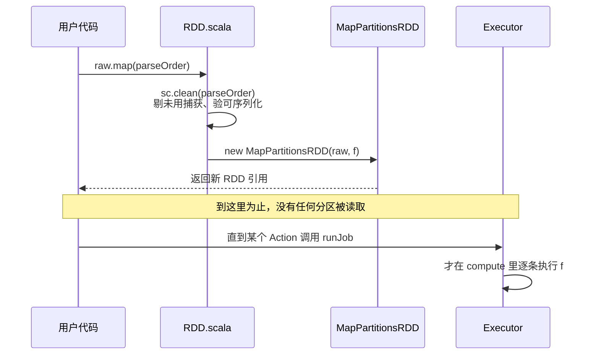
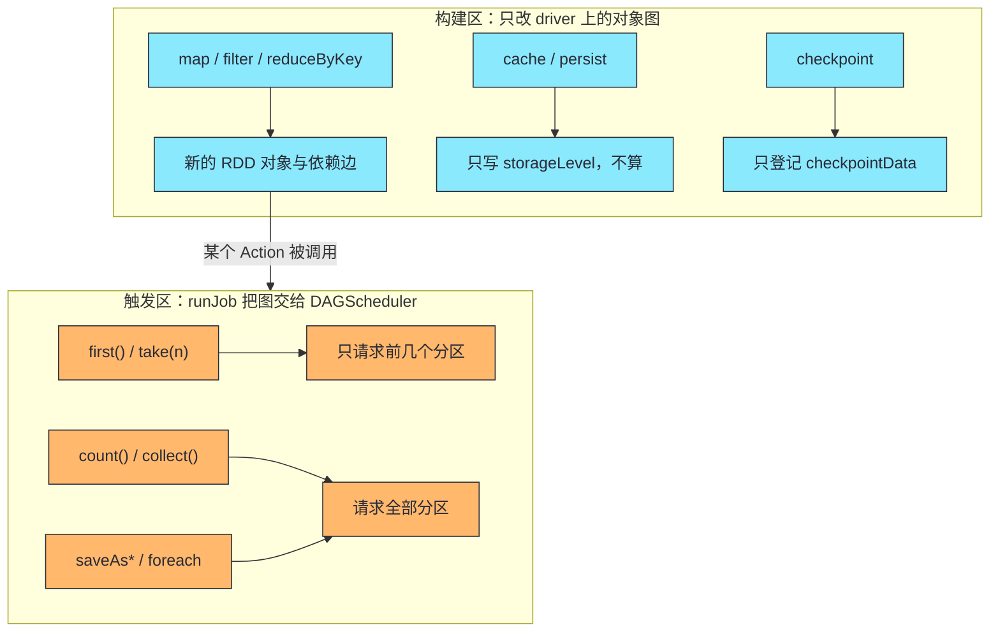
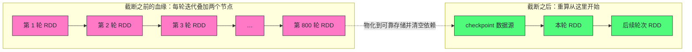
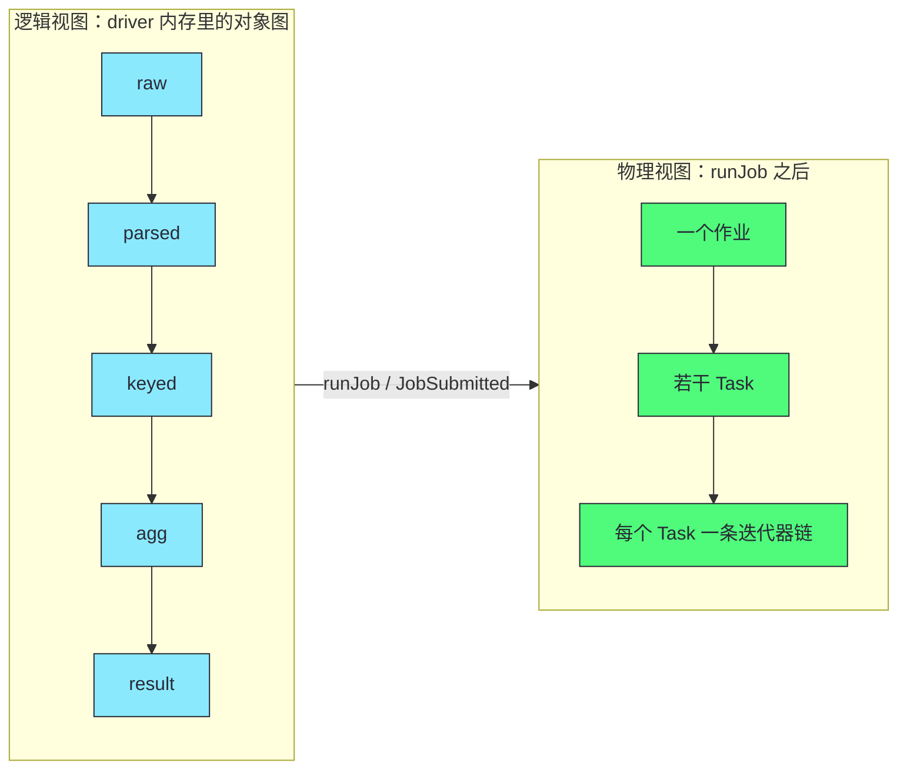

# 3. Spark 逻辑处理流程：五个属性、一张依赖图与一次惰性求值

**摘要：**

2012 年，加州大学伯克利分校的 AMPLab 在 NSDI 上把弹性分布式数据集（Resilient Distributed Datasets，RDD）概括为"一组只读的、带血缘的分区集合"；同一年 Spark 0.6 的源码里，`RDD` 已经是一个带 `compute` 与 `getDependencies` 的抽象类。从那一刻起，"写代码"与"算数据"就被明确拆成了两件事。这篇文章要回答的正是这条线索上的两个问题：一次 `map` 调用在 driver 的内存里究竟留下了什么，以及这套只登记、不执行的机制，凭什么在容错与优化上占到便宜。

行文的路线是这样：先看一次 `map` 调用真正做的三件事（第 1 章），再把 `RDD` 的五个属性逐个拆开，说明它为什么同时是逻辑描述与局部物理计划（第 2 章）；然后跟着 `order_daily` 这个贯穿案例把依赖图逐层装起来（第 3 章），对比窄依赖与宽依赖如何改变后面的一切（第 4 章）；随后处理惰性求值的边界，哪些操作会立刻触发、`first` 为什么能短路（第 5 章）；接着谈不可变性的三条理由，以及长血缘在 driver 上留下的代价和 `checkpoint` 为什么是必需品（第 6、7 章）；最后落在 `runJob` 这一个转换点上，看逻辑上的一条链如何变成物理上的若干 Task（第 8 章），收在几条容易被踩空的边界上（第 9、10 章）。

**关键词（Keywords）**: 惰性求值, Lineage, 窄依赖, 宽依赖, Partitioner, Checkpoint

---

## 第 1 章 一次 map 调用到底发生了什么

### 1.1 先看一个 2012 年的判断

RDD 的中文名常被译作"弹性分布式数据集"，但论文里更关键的一个限定是"粗粒度转换"（coarse-grained transformations）：用户只能对一整批数据施加同一个函数，不能像访问共享内存那样随机地改某一个元素。这个限制当年是刻意为之的。分布式共享内存（Distributed Shared Memory，DSM）允许细粒度读写，代价是每一处写入都要配一套一致性协议，失败恢复则要靠周期性的检查点或全局回滚；RDD 把写操作收窄成"整批变换"，于是恢复不再需要记住"改过哪些字节"，只需要记住"这一批数据是从哪一批、经过什么函数算出来的"。

这份记录就是血缘（Lineage）。此后十多年，Spark 在上面陆续盖了 DataFrame、Dataset、Structured Streaming、Spark Connect 好几层，但最底下这一层没有动过：**一个 RDD 只保存三样东西，分区的定义、依赖的父 RDD、以及一个把父分区的迭代器变成子分区迭代器的函数**。后文所有机制都是这三样东西的推论。

把 RDD 与另外两种数据模型并排放在一起，差别一眼可见；这张表也解释了为什么 RDD 必须不可变——它的恢复策略完全建立在"能重算"之上。

| 特性 | 传统面向对象程序 | Hadoop MapReduce | Spark RDD |
|---|---|---|---|
| 数据抽象 | 对象（Object） | `<K, V>` 键值记录 | 带分区的 RDD |
| 操作方式 | 方法调用，任意改字段 | 固定的 map / reduce 两段 | Transformation / Action |
| 粒度控制 | 细粒度，可改单个元素 | 记录级，但只读 | 粗粒度，整批变换 |
| 中间结果 | 常驻内存 | 每轮落盘 | 不落盘，按需重算 |
| 失败恢复 | 异常或事务回滚 | 重跑失败的 task，读取已落盘中间结果 | 沿血缘重算受影响分区 |
| 存储特性 | 程序管理 | HDFS 上的中间文件 | 计算时产生，计算后消失 |

表里"失败恢复"一行是分水岭。MapReduce 用"落盘"买恢复能力，RDD 用"血缘"买恢复能力，两者都把"重算"当成兜底手段，区别只在重算的起点是磁盘还是原始数据。这也是 Spark 敢把中间结果留在内存里的底气：丢了就再算一遍，只要配方还在。

### 1.2 一行代码，三件事

回到具体的代码。`order_daily` 这个作业每天凌晨两点提交，读取前一天的订单明细，清洗之后按省份与品类聚合，写回数仓。它的第一行有效逻辑是这样的：

```scala
val raw    = sc.textFile("hdfs://nn/warehouse/order/dt=2026-11-18")
val parsed = raw.map(parseOrder)      // 这一行是本章的主角
```

`parsed` 拿到手的时候，集群里没有任何一个字节被移动过。这一行做了三件事。第一件是在 driver 上清洗闭包：`sc.clean(parseOrder)` 会剔除闭包里捕获但并未使用的引用（常见的是顺手捕获了整个外部类实例），再把闭包序列化一次做体检，不可序列化当场抛 `Task not serializable`。第二件是把闭包包成一个 `(TaskContext, Int, Iterator[Order]) => Iterator[Parsed]` 的函数，连同父 RDD 一起交给 `MapPartitionsRDD` 的构造器，父 RDD 通过 `extends RDD[U](prev)` 进入父类的 `deps` 字段——这是依赖关系唯一的入口。第三件是返回新对象，让 `val parsed` 指向它。

```scala
// RDD.scala：map 只做三件事——清洗闭包、包一层迭代器转换、造一个新 RDD
def map[U: ClassTag](f: T => U): RDD[U] = withScope {
  val cleanF = sc.clean(f)
  new MapPartitionsRDD[U, T](this, (_, _, iter) => iter.map(cleanF))
}

private[spark] class MapPartitionsRDD[U: ClassTag, T: ClassTag](
    var prev: RDD[T],
    f: (TaskContext, Int, Iterator[T]) => Iterator[U],
    preservesPartitioning: Boolean = false)
  extends RDD[U](prev) {

  // 分区器不继承：map 换了元素类型，key 的语义可能已经变了
  override val partitioner = if (preservesPartitioning) firstParent[T].partitioner else None
  override def getPartitions: Array[Partition] = firstParent[T].partitions
  override def compute(split: Partition, context: TaskContext): Iterator[U] =
    f(context, split.index, firstParent[T].iterator(split, context))
}
```

这段代码里有两处容易被跳过的细节。一是 `withScope`：它只是把当前调用栈登记进 `RDDOperationScope`，好让 Web UI 上把同一段代码创建的 RDD 归到一组，与计算无关，别把它误读成"作用域内立即执行"。二是 `extends RDD[U](prev)` 这一个父类构造参数，它把父 RDD 灌进了 `deps`，此后无论谁问"你从哪来"，`getDependencies` 都从这一个字段回答。**依赖不是事后登记的，而是造对象时一次性注入的**，这条约定决定了后面所有遍历都只能沿对象图反向走。

把这次调用的消息流画成时序图，可以看到两条线索被一次 Action 隔开：driver 上只有对象的创建，executor 上的数据变换要到 Action 才发生。



顺带说一句 `@transient`。`RDD` 的 `_sc` 与 `deps` 都标了 `@transient`，因为 task 要带着 RDD 对象被序列化下发到 executor；transient 掉这两个字段，就意味着 executor 端反序列化出来的 RDD 既没有 `SparkContext` 也没有依赖链，它只需要 `compute` 与分区编号就能干活。逻辑图留在 driver，执行所需的局部信息跟着 task 走——这个切分从第一个 RDD 的构造就开始了。

### 1.3 反事实：如果 map 当场执行

不妨做个反事实推演。假设 `map` 拿到函数就立即执行，链式调用会变成什么样：`raw.map(parseOrder).filter(_.isValid).map(toKeyed)` 三行代码要产生三份中间结果，每份都得放在某个地方——放内存，driver 与 executor 的堆会被中间数据吃满；放磁盘，每一次转换都是一轮落盘加一轮读取，与 MapReduce 没有本质差别。更糟的是选择性：如果 `filter` 把数据砍掉了九成，前两份中间结果里的大部分内容从未被下游读到，算力与存储都白费。

Spark 的答案是把物化推迟到不得不做的那一刻，并且把"不得不做"的判据交给 Action。这个选择的代价写在另一面：一旦某台机器掉线，已经算过的那一段没有留下任何东西，只能沿血缘重来；同样地，同一份数据被两个 Action 用到时，默认要算两遍。**惰性求值买到的不是"不算"，而是"把算的时机与算的范围都推迟到信息最全的时刻"**，这句话在第 5 章会被摊开细讲。

### 1.4 Transformation 与 Action 的分界

Spark 把操作分成两类，分界不在 API 名字，而在"是否需要一个具体结果"。

| 维度 | Transformation | Action |
|---|---|---|
| 返回值 | 新的 RDD | 非 RDD 的结果，或没有返回值 |
| 是否触发作业 | 否，只改对象图 | 是，内部调用 `runJob` |
| driver 上发生什么 | 新建 RDD 对象、注入依赖、清洗闭包 | 清洗函数、提交作业、等待结果或收尾 |
| executor 上发生什么 | 什么都不发生 | 起 task，执行 `compute` 链 |
| 失败后的语义 | 无（尚未执行） | 重试 task、必要时重算分区 |
| 典型操作 | `map`、`filter`、`reduceByKey`、`join`、`repartition` | `count`、`collect`、`take`、`saveAsTextFile`、`foreach` |

Action 还可以按"结果去哪"再分三档，三档的风险完全不同。回 driver 的那一档（`collect`、`count`、`take`）要过网络，`collect` 还会把全部数据压进 driver 堆；写外部存储的那一档（`saveAsTextFile`、`saveAsSequenceFile`）由 executor 直接写，driver 只收状态；只为副作用的那一档（`foreach`、`foreachPartition`）连结果都没有，失败与否只能靠日志与外部系统的状态判断。这三档在第 5 章会与"扫描范围"交叉，届时能看到同样叫 Action 的操作，代价可以差出若干个数量级。

### 1.5 一个比喻：菜谱与开火

写 transformation 像写菜谱。一道菜引用前一道菜的半成品，"把切好的葱倒进锅里"这句话写下来，厨房里并不会因此发生任何事；菜谱写完了，灶还是凉的。Action 才是有人喊了一声"开火"。这个比喻的技术限定有两处：其一，菜谱不能有循环引用，Spark 的图必须无环；其二，菜谱会被反复读——同一道半成品被两道菜引用时，厨房要么重做一遍，要么提前"留一份"（`cache`），而 Spark 默认选择重做。

---

## 第 2 章 五个属性：逻辑描述与局部物理计划的合体

### 2.1 一个抽象类的五个口子

`RDD` 这个抽象类薄得出人意料，去掉工具方法与注释之后，真正的骨架只有五个成员：

```scala
abstract class RDD[T: ClassTag](
    @transient private var _sc: SparkContext,
    @transient private var deps: Seq[Dependency[_]]) extends Serializable {

  protected def getPartitions: Array[Partition]                       // 必须实现
  def compute(split: Partition, context: TaskContext): Iterator[T]    // 必须实现
  protected def getDependencies: Seq[Dependency[_]] = deps            // 来自构造参数
  @transient val partitioner: Option[Partitioner] = None              // 可选覆写
  protected def getPreferredLocations(split: Partition): Seq[String] = Nil  // 可选覆写
}
```

五个口子里只有两个是子类必须回答的，另外三个都有缺省：`getDependencies` 直接用构造时注入的 `deps`，`partitioner` 缺省为 `None`（意为"分布未知"），`getPreferredLocations` 缺省为 `Nil`（意为"哪里都能算"）。这个配比本身就是一条设计信息：**Spark 认为"有多少份、每份怎么算"是 RDD 的本质，"从哪来、按什么分布、在哪算最省"是可以退化、可以后补的附加信息**。一个只实现前两个方法的自定义 RDD 可以跑起来，只是会失去分区复用与本地性调度这两项优化。

### 2.2 五个属性各自回答什么

把五个成员摊成一张表，逻辑侧与物理侧的归属就一目了然了。

| 属性 | 回答的问题 | 逻辑侧含义 | 物理侧含义 | 缺省与退化 |
|---|---|---|---|---|
| `getPartitions` | 数据被切成几份 | 并行度的上限 | 决定 task 数量与每份的数据边界 | 必须实现，通常继承父 RDD |
| `compute` | 一份数据怎么算 | 转换的语义 | 一个 task 内的可执行代码 | 必须实现，返回 `Iterator` |
| `getDependencies` | 数据从哪来 | DAG 的边 | 重算时的回溯路径、数据取自哪个父分区 | 来自构造参数，checkpoint 后被清空 |
| `partitioner` | 按 key 怎么分布 | 数据分布的契约 | 决定 `join`/聚合能否省掉一次重分布 | `None`，表示"未知"而非"无 key" |
| `getPreferredLocations` | 在哪算最省 | 无（纯物理信息） | 调度本地性的提示 | `Nil`，由调度器沿窄依赖回溯 |

表里最容易被误读的是 `partitioner` 的缺省值。`None` 不是"这个 RDD 没有 key"，而是"这个 RDD 不保证 key 的分区规律"——`map` 之后即使元素里仍有 key，分区器也照样变成 `None`，因为函数可能改写了 key。这个语义差别在 `join` 处会被放大成一次真实的网络重分布，第 4 章会给出源码级的证据。

### 2.3 为什么说它"逻辑里掺了物理"

关系数据库的查询计划是有层次的：逻辑计划是一棵纯声明的树（选择、投影、连接），优化器在它上面做等价变换，最后由代码生成产出物理算子。RDD 没有这个分层，它把两侧塞进了同一个对象：`getDependencies` 是纯逻辑的边，`partitions` 是物理切分，`compute` 是可直接执行的代码，`preferredLocations` 是调度器的位置提示。调度器拿到一个 RDD，不需要再要一份"计划树"，就能知道要发多少 task、每个 task 读哪个分区、优先放到哪台机器——代价是它没有一份可以被单独重写、单独优化的中间表示。

这个取舍与 Spark 对用户函数的态度是一体的。`parseOrder` 是一个黑盒，Spark 既不知道它读了哪些字段，也不知道它是不是幂等，于是谓词下推、列裁剪这类需要"读懂表达式"的优化在 RDD 层根本无从谈起。**RDD 层的优化空间只剩下三处：合并窄依赖以减少中间物化、复用分区器以避免重分布、按需计算分区以减少扫描**。这也是后来 Catalyst 要为 DataFrame 另起一套声明式结构的原因——只有把用户意图翻译成优化器能读懂的形式，全局优化才有落脚点。

### 2.4 用五个属性读一遍 order_daily

把 `order_daily` 的七个 RDD 摆开，逐个属性读一遍，抽象的骨架就落到具体对象上了。`sc.textFile` 其实是两个 RDD 叠出来的：`HadoopRDD` 负责按 HDFS 块切分并给出块所在的主机名（`preferredLocations` 有值，这是本地性调度的源头），外面再套一个 `MapPartitionsRDD` 把 `Text` 转成 `String`（分区数继承，分区器为 `None`，首选位置不自己提供，由调度器沿窄依赖回溯到 `HadoopRDD`）。`parsed` 与 `keyed` 都是 `MapPartitionsRDD`，分区数与父一致，分区器丢失。`agg = keyed.reduceByKey(_ + _)` 是 `ShuffledRDD`，分区数由默认的 `HashPartitioner` 决定，`partitioner` 第一次变成 `Some(...)`。最后一个 `map` 又把它变回 `None`。

这一遍读下来会浮现一个不对称：**同一个 RDD 的分区数来自"上游的切分"，分区器来自"上一次重分布"，两者并不总是同时可知**。`repartition(200)` 之后分区数确定但分区器仍为 `None`；`reduceByKey` 之后两者都确定；`map` 之后分区数确定而分区器又不确定了。这种"一个知道、一个不知道"的状态，正是第 4 章讨论依赖类型时必须先立好的前提。

### 2.5 属性是懒的，但不是缓存

五个成员里有两个"惰"得很有分寸。`partitions` 是懒加载的：第一次访问时调 `getPartitions` 算出来存进 `partitions_`，此后直接返回同一份数组；`compute` 则不然，每次调用都要重新执行，哪怕同一分区上已经被算过十遍。这个差别对写自定义 RDD 的人是硬约束：**在 `getPartitions` 里读外部元数据，只会在 driver 上发生一次；在 `compute` 里读，会在每一个 task 里各发生一次**，把该放 driver 的事情挪进 `compute`，代价是与分区数成正比的重复 IO。

`partitioner` 与 `getPreferredLocations` 都不缓存，前者是 `val`（构造时即可定），后者每次问都要现算。还有一个少见的例外：checkpoint 完成之后，`partitions_` 与 `deps` 会被清空，此时 `getPartitions` 改为从 checkpoint 数据回答、`getDependencies` 返回空——第 7 章会看到这一手截断是 checkpoint 的全部价值所在。

---

## 第 3 章 依赖图的组装

### 3.1 每个 RDD 只认识自己的父

`RDD` 的构造参数 `deps` 是一个 `Seq[Dependency[_]]`，每个 `Dependency` 持有父 RDD 的引用（`dep.rdd`）。所以整张图是从末端 RDD 逆向可达的：末端的 RDD 拿着依赖，依赖拿着父，父又拿着它自己的依赖，一路问到数据源为止。方向是单向的——子知道父，父不知道子。Spark 没有维护任何"子节点列表"，也没有一张全局的注册表。

单向性不是省事，而是刻意的取舍。不维护反向索引，意味着新增一个子 RDD 不需要去修改父对象，RDD 才能保持真正不可变（第 6 章）；代价是 driver 只能"从结果往回问"，任何需要正向遍历的优化（譬如同一个父被多个子共用时只算一次）都必须靠额外机制（`cache`），而不能靠图本身发现。**Spark 的图是一棵挂满配方的反向树，而不是一张可以随意漫游的双向图**，这句话可以用来解释后面很多"为什么 Spark 不自动做 X"的问题。

### 3.2 分区数与分区器怎么传下去

新 RDD 的分区数只有三条来源：继承父 RDD（`map`、`filter`）、用户显式指定（`parallelize` 的第二个参数按元素下标切段，`repartition` 指定目标数）、由数据源决定（HDFS 按块切分，分区数大体等于块数，但不会低于 `min(defaultParallelism, 2)` 这个下限）。分区器的传法更微妙，它跟着具体的 RDD 实现走，而不是跟着"操作类别"走。

| 操作 | 生成的 RDD | 分区数 | `partitioner` | 依赖类型 |
|---|---|---|---|---|
| `textFile` | `HadoopRDD` + `MapPartitionsRDD` | 由 HDFS 块数决定 | `None` | 无（数据源）+ 一对一 |
| `map` / `flatMap` | `MapPartitionsRDD` | 继承父 | `None` | `OneToOneDependency` |
| `filter` | `MapPartitionsRDD`（`preservesPartitioning = true`） | 继承父 | 继承父 | `OneToOneDependency` |
| `mapValues` | `MapPartitionsRDD`（保留分区） | 继承父 | 继承父 | `OneToOneDependency` |
| `union` | `UnionRDD` | 父分区数之和 | `None` | `RangeDependency`（每个父一条） |
| `coalesce(n, shuffle = false)` | `CoalescedRDD` | 收缩到 n | 不保证 | `NarrowDependency`（自定义 `getParents`） |
| `reduceByKey` | `ShuffledRDD` | 由 `HashPartitioner` 决定 | `Some(HashPartitioner)` | `ShuffleDependency` |
| `sortByKey` | `ShuffledRDD` | 由 `RangePartitioner` 决定 | `Some(RangePartitioner)` | `ShuffleDependency` |
| `join`（两侧分区器一致） | `CoGroupedRDD` | 继承该分区器 | `Some(part)` | **每个父都是 `OneToOneDependency`** |
| `join`（分区器不一致） | `CoGroupedRDD` | 取首个父的分区器或默认 `HashPartitioner` | `Some(part)` | **每个父各一条 `ShuffleDependency`** |
| `cartesian` | `CartesianRDD` | 两父分区数之积 | `None` | 两条 `NarrowDependency` |

表里最后三行值得多看一会儿。`join` 的依赖类型不是由"`join` 这个操作"决定的，而是由两侧分区器是否匹配决定的；`cartesian` 看着像要跨节点大动干戈，实际上两条边都是窄依赖，真正的代价是分区数平方增长带来的 task 数量与单分区数据量。一个"看上去要跨网络、其实能就地拼接"，一个"看上去能就地拼接、代价却压在分区数的平方上"，两种错位合起来说明：依赖类型的判据必须看 `getParents` 能返回什么，而不是看操作的名字。

顺带纠正一处常见的记法：Hash 分区的公式并不是 `key.hashCode() % numPartitions`，而是 `Utils.nonNegativeMod(key.hashCode, numPartitions)`。`hashCode` 可能为负，直接取模会得到负分区编号，越界崩溃；`null` 的 key 另有约定，被固定放进 0 号分区。这类细节在写自定义分区器时最容易踩。

### 3.3 一次 reduceByKey 如何造出 ShuffleDependency

宽依赖不是"操作发生时自动标记"的，而是在构造 RDD 时被显式造出来的。`reduceByKey` 走到 `combineByKeyWithClassTag`，核心是四行：

```scala
// PairRDDFunctions：宽依赖在这里被"造"出来，而不是被"发现"（示意，略去 numPartitions 分支）
val aggregator = new Aggregator[K, V, C](createCombiner, mergeValue, mergeCombiners)
val part = self.partitioner.getOrElse(new HashPartitioner(self.partitions.length))
val shuffled = new ShuffledRDD[K, V, C](self, part)
  .setSerializer(serializer)            // 要跨进程，序列化器必须在此确定
  .setAggregator(aggregator)            // 聚合语义：reduceByKey 把同一个函数传了三次
  .setMapSideCombine(mapSideCombine)    // groupByKey 传 false，reduceByKey 传 true
```

`ShuffledRDD` 的构造器里给父类传的 `deps` 是 `Nil`，真正的 `ShuffleDependency` 在它覆写的 `getDependencies` 里才被创建。这个"晚一步"不是风格问题：RDD 在 executor 端反序列化时可能没有父对象，构造期就绑定依赖会让反序列化失败，把依赖推迟到第一次访问是可行且必要的。所以**宽依赖是"第一次有人问起时才存在"的边**，而窄依赖在构造时就已就位——这个时序差别在排错时很有用：堆栈里出现 `ShuffledRDD.getDependencies`，说明某个作业正在为一条尚未成形的 shuffle 边做规划。

### 3.4 图是组装出来的，不是解析出来的

用户代码是自底向上写的，所以 driver 拿到的天然是一张已经组装好的图，不需要解析器。这与 SQL 的路径正好相反：一段 SQL 文本要先过 parser、analyzer、优化器，才变成可以执行的计划；RDD 没有文本可解析，代码执行到哪，图就长到哪。好处是零解析开销、语义即代码；代价是 Spark 在 Action 之前从不审视这张图，于是同一段逻辑写两遍就会长出两套对象，重复的子表达式不会被自动消除，`map(...).filter(...).map(...)` 在对象图里永远是三个节点。

不过逻辑上的冗余在物理层会被消化掉一部分：一个 task 内部的 `compute` 是嵌套调用，子 RDD 的 `compute` 直接拿父 RDD 的迭代器接着变换，三条转换在同一个 task 里只遍历数据一次，中间不落地。对象图里的三个节点依然存在，driver 内存与血缘都要为它们付账，但数据只走了一遍——逻辑冗余与物理冗余并不是一回事，这一点是理解 Spark 执行模型的关键分界。

### 3.5 逻辑 DAG 的样子

把 `order_daily` 的七个 RDD 与它们之间的边画出来，就是逻辑处理流程的全貌。图上唯一的宽边是 `reduceByKey`，其余都是可以在同一个 task 内首尾相接的窄边。

```mermaid
%%{init: {'theme': 'dracula'}}%%
flowchart LR
    H["HadoopRDD<br/>按 HDFS 块切分"] -->|"OneToOneDependency"| T["MapPartitionsRDD<br/>Text 转 String"]
    T -->|"OneToOneDependency"| M1["MapPartitionsRDD<br/>map(parseOrder)"]
    M1 -->|"OneToOneDependency"| F["MapPartitionsRDD<br/>filter(isValid)"]
    F -->|"OneToOneDependency"| M2["MapPartitionsRDD<br/>map(toKeyed)"]
    M2 -->|"ShuffleDependency"| S["ShuffledRDD<br/>reduceByKey(_ + _)"]
    S -->|"OneToOneDependency"| O["MapPartitionsRDD<br/>map(format)"]
    O --> A["Action<br/>saveAsTextFile"]
    classDef narrow fill:#50fa7b,stroke:#282a36,color:#282a36
    classDef wide fill:#ff79c6,stroke:#282a36,color:#282a36
    classDef act fill:#ffb86c,stroke:#282a36,color:#282a36
    class H,T,M1,F,M2,O narrow
    class S wide
    class A act
```



图里没有画分区，只画了 RDD 与边——这正是"逻辑视图"的定义：它只回答"谁依赖谁"，不回答"有多少份、在哪台机器上"。等第 8 章把 `runJob` 加上去，同一条链会在物理侧展开成另一副模样。

### 3.6 一个比喻：叠放的图纸

依赖图可以想成一叠图纸。每一张只标注"我这一层可以从上一层的哪个局部折出来"，至于上一层长什么样、再上一层又从哪来，它一概不管；要还原整条工序，只能从最上面一张往下逐层翻。这个比喻的技术限定是：图纸是线性叠放的，而 RDD 的图是 DAG，一个父可以被多个子引用（同一份 `raw` 既给 `order_daily` 用，也给另一个对账作业用），此时图形状更像一棵分叉的树。分叉处的两份"配方"互不知情，各自 Action 时各算一遍，除非有人在中途留了一份。

---

## 第 4 章 一条边的两种画法：窄依赖与宽依赖

### 4.1 窄依赖：用位置的函数描述

窄依赖（NarrowDependency）的判据只有一条：子 RDD 的每个分区，只依赖父 RDD 的有限个确定分区，且这个对应关系可以用分区编号的函数表达出来。源码里它是一个带 `getParents(partitionId: Int): Seq[Int]` 的抽象类，三个实现各对应一种编号映射：`OneToOneDependency` 返回 `Seq(partitionId)`，`RangeDependency` 返回 `Seq(inStart + partitionId - outStart)`（`union` 用它把多个父的分区首尾拼接），`PruneDependency` 返回按过滤函数选出的编号子集（`PartitionPruningRDD` 用它跳过不需要的分区）。

判据能成立，就自动带出三条性质。其一，不需要跨节点搬运：子分区要的数据全在同一个父分区里，而父分区本来就只在一台机器上，所以"从父分区取数"是一次本地读取。其二，恢复只需重算对应的那个父分区，若父分区还在（或被 cache），一个都不必重算。其三，一个 task 可以把父分区的迭代器直接接过来，形成流水线，中间不落盘。三条性质合起来，就是 `map`、`filter` 这类操作廉价的原因。

顺带清理一处教材里的分类。有些资料把"子分区依赖多个父分区"的情形单列为"多对一依赖""多对多依赖"，听上去像与一对一、区域并列的第四、第五种。`apache/spark` 的 `Dependency.scala` 里并没有这两个类，它们是对 `getParents` 返回多个编号这一行为的归纳：`coalesce(n, shuffle = false)` 的 `CoalescedRDD` 让一个子分区对应多个父分区，`cartesian` 让每个子分区对应两个父 RDD 各一个分区，本质都还是窄依赖——对应关系确定、可用编号函数表达。判据始终只有一条，分类只是描述。

### 4.2 宽依赖：用数据的谓词描述

宽依赖（ShuffleDependency）的判据正好相反：子 RDD 的每个分区都需要父 RDD 所有分区里满足某个条件的记录，而这个条件不能用分区编号表达，只能用 key 的谓词表达。源码里的 `ShuffleDependency` 没有 `getParents`，因为它携带的东西都不是位置信息：父 RDD、分区器、序列化器、key 的排序器、聚合器，以及一个 `mapSideCombine` 开关。

"不能用编号表达"直接推出三条后果。第一，数据必须先写后读：每个父分区的记录按 key 落到不同的子分区，这些子分区可能在别的机器上，接收方只能等数据写完再主动来拉（Spark 的 shuffle 是 pull 式的），于是中间数据必须落到磁盘或内存的 shuffle 服务里。第二，恢复代价变成"重算父 RDD 的全部分区"：一个 reduce 侧 task 失败，它需要的那份数据散在所有 map 侧 task 的输出里，只要 shuffle 文件还在就能重读，一旦文件随 executor 一起消失，就得把整段上游重算一遍。第三，流水线在此中断：一个 task 没法把另一个 task 的迭代器接过来，只能隔着一次落盘。

**宽依赖是逻辑图里唯一必须落地的边**——这句话可以当作判断"这次 Action 会不会慢"的第一直觉：只要链上有一条宽边，就一定有磁盘写、网络拉、序列化反序列化三笔开销，而它们与数据量成正比。

### 4.3 同一类依赖，两种代价：reduceByKey 与 groupByKey

`reduceByKey` 与 `groupByKey` 生成的依赖类型完全相同，都是 `ShuffleDependency`，但两者让多少数据跨过网络，差了一个量级——差别藏在 `aggregator` 与 `mapSideCombine` 两个参数里。

| 维度 | `reduceByKey(_ + _)` | `groupByKey()` |
|---|---|---|
| 依赖类型 | `ShuffleDependency` | `ShuffleDependency` |
| `mapSideCombine` | `true`，map 端先局部聚合 | `false`，map 端只按分区归堆 |
| 跨网络的数据 | 每个 key 的局部结果（≤ 分区数个） | 每个 key 的全部 value |
| 聚合函数要求 | 满足结合律与交换律 | 无要求 |
| 结果形态 | `RDD[(K, V)]`，一个 key 一个值 | `RDD[(K, Iterable[V])]`，value 全在内存 |
| 倾斜时的表现 | 单 task 内存与 key 数成正比 | 单 task 内存与该 key 的 value 数成正比 |
| 典型风险 | 聚合函数写错（非结合律导致结果错） | 大 key 把单个 task 撑爆 |

表里"聚合函数要求"一行是这段对比的落点。`reduceByKey` 之所以便宜，是因为它把聚合拆成了"局部先合、再合局部"，这要求函数满足结合律——`_ + _` 满足，`(a, b) => a / b` 不满足，后者用 `reduceByKey` 会算出与串行执行不同的结果，而且不报错。反过来，当业务确实需要"一个 key 的全部值"来做非结合运算（求中位数、按到达顺序拼接、算 Top-N 的精确分位），`groupByKey` 就不是"该被替换的坏习惯"，而是唯一语义正确的选择；此时控制风险的手段是加盐打散或改采样近似，而不是硬换成 `reduceByKey`。

### 4.4 依赖类型改变后面的一切

把窄与宽放回整条链上看，一条边的类型会向上游、向下游同时施加约束。

第一是能否流水线。窄边允许父分区的迭代器被子分区直接消费，一个 task 内一条记录走完全程；宽边强制落地，于是"一次遍历"被切成了"写一遍、读一遍"。

第二是分区器语义能否延续。`reduceByKey` 之后分区器是 `Some(HashPartitioner)`，紧随其后的 `join` 只要另一侧也是同一个分区器，`CoGroupedRDD` 就会给这一侧生成 `OneToOneDependency`——一次网络重分布被省掉。而中间插一个 `map` 就把分区器清成 `None`，同样的 `join` 立刻退化成 `ShuffleDependency`。源码里的判据写得非常直白：

```scala
// CoGroupedRDD.getDependencies：依赖类型逐父判断，判据是分区器是否相同
rdds.map { rdd: RDD[_] =>
  if (rdd.partitioner == Some(part)) {
    new OneToOneDependency(rdd)                       // 分区器一致：就地拼接
  } else {
    new ShuffleDependency[Any, Any, Any](rdd, part)   // 不一致：重分布
  }
}
```

这段代码解释了一条极其实用的改写：`rdd.reduceByKey(f).map { case (k, v) => (k, v) }.join(other)` 与 `rdd.reduceByKey(f).mapValues(identity).join(other)` 在语义上等价，但后者保留了分区器，少一次 shuffle；前提是 `other` 也用 `HashPartitioner` 且分区数相同，否则 `partitioner == Some(part)` 不成立，照样要重分布。**能不能省下这次 shuffle，取决于分区器而不是取决于写法是否漂亮**。

第三是恢复代价。窄边上某个分区算错或丢失，重算它自己就够了；宽边上某个 reduce 分区丢失，要么重读 shuffle 文件，要么重算全部上游。链上宽边越多，"一次失败要重算多少"的期望值越高。

第四是物理侧的切分位置（点到为止）。物理执行要在哪里把一条链折成若干段、每段起多少 task，判据正是这些边的类型；至于具体怎么折，那是 `runJob` 之后 DAGScheduler 的事，本章只需要确认一件事：逻辑图上的每一条边，在物理侧都是一次"能不能就地接着算"的判决。

### 4.5 反事实：两侧都不区分会怎样

假设 Spark 不区分依赖类型，把所有边都当窄边处理：`reduceByKey` 会让每个子分区只读对应的一个父分区，可同一个 key 的 value 散落在多个父分区里，聚合结果必然漏算。这不是性能问题，是正确性问题——**窄与宽的第一层区别是"能不能算对"，第二层才是"算得贵不贵"**。

反过来，假设把所有边都当宽边处理：每次 `map` 都落盘、每次 `filter` 都跨网络重分布，作业依然能算出正确结果，但每一轮转换都退化成一次 MapReduce，内存计算带来的那点优势被彻底抹平。两侧的推演合起来说明，依赖分类不是给性能优化留的钩子，而是"正确性"与"代价"两条约束共同收敛出来的唯一解。

### 4.6 一个比喻：装配线与分拣中心

窄依赖像同一条装配线上相邻的两个工位：上一个工位把零件递过来，手递手，不经过仓库；哪怕这个工位停了，重新做的也只是它前面那一道。宽依赖像分拣中心：所有工位的半成品先送进中心，按颜色（key）重新分到不同车间，每个车间收齐自己那份才开工。分拣中心必须"收齐再分发"，这就是落地的由来。

比喻的技术限定在于：分拣中心不是单点。每个 map task 各自写自己的分区文件，每个 reduce task 各自来拉自己那份，写与读都是并行的；真正的代价在网络带宽、磁盘 IO 与序列化，而不是串行排队。也正因为如此，宽依赖的优化手段集中在"减少跨网络的数据量"（map 端聚合、压缩、列裁剪）与"让数据分布更均匀"（合理分区数、处理倾斜）两处，而不是"让分拣中心变快"。

---

## 第 5 章 惰性求值的边界

### 5.1 判据不是名字，是需要不需要具体结果

"Transformation 惰性、Action 触发"是常识，但真正落地时会遇到一批"看着像 Action、其实只读元数据"和"看着像 Transformation、其实当场执行"的操作。判据只有一条：这次调用是否需要一个具体的计算结果。`toDebugString` 要的是一张字符串，从 driver 的依赖链上拼出来即可，不碰数据；`count` 要的是一个数，必须把每个分区都扫一遍；`first` 要的是一个元素，理论上只扫到第一个元素所在的记录为止。

按这条判据排一遍，边界就清楚了。

| 操作 | 是否触发作业 | 扫描范围 | 结果去向 | 备注 |
|---|---|---|---|---|
| `count()` | 是 | 全部分区 | 一个 `Long` 回 driver | 扫全量，只传一个数 |
| `collect()` | 是 | 全部分区 | 全部数据回 driver | 受 driver 堆内存限制 |
| `take(n)` / `first()` | 是 | 从第一个分区起按需扫描 | n 个元素（`first` 为 1 个） | `first` 即 `take(1).head` |
| `isEmpty()` | 是 | 最多扫到第一个非空分区 | 一个 `Boolean` | 内部就是 `take(1).isEmpty` |
| `saveAsTextFile` / `saveAsSequenceFile` | 是 | 全部分区 | executor 直接写外部存储 | driver 不接触数据 |
| `sortByKey` / `sortBy` | 是（抽样作业） | 抽样分区 | 无 | 构造 `RangePartitioner` 时先跑抽样作业 |
| `foreach` / `foreachPartition` | 是 | 全部分区 | 无回传 | 只为副作用 |
| `cache()` / `persist()` / `unpersist()` | 否 | 无 | 无 | 只改 `storageLevel` |
| `checkpoint()` | 否 | 无 | 无 | 首次 Action 收尾时另起一个写作业 |
| `toDebugString` / `dependencies` / `getNumPartitions` | 否 | 无 | 无 | 只读 driver 上的元数据 |
| `repartition` / `join` / `groupByKey` | 否 | 无 | 无 | 仍是 Transformation |

表里 `sortByKey` 那一行是个例外，也是惰性求值最好用的一个反例。分区的分界点必须看过数据的分布才能定，`RangePartitioner` 于是先用两轮抽样估出分界，而抽样本身就是一个作业——所以在 driver 上写下 `sortByKey` 的那一刻，UI 上已经多了一个 Job，只是它不产生业务结果，只产出一组分区边界。这类"隐藏作业"在排查"作业数对不上"时最容易被漏掉：它不来自任何 Action，而来自一个需要数据分布才能构造的对象。

表里 `isEmpty` 那一行值得单独说。直觉上"集合空不空"是元数据，`getNumPartitions == 0` 就够了；但一个 RDD 完全可能有很多分区而每个分区都是空的，Spark 的做法是 `take(1)`，于是它比 `count()` 便宜得多，却又不是零成本——如果前若干分区恰好都是空，它还得继续往后扫。

### 5.2 first 与 take 的短路：惰性之外的第二层按需

`take` 的实现把"按需"讲到了第二层：不但执行时机可以推迟，连"算多少"也可以现谈。它的主体是一个带放大因子的循环。

```scala
// RDD.take：先试 1 个分区，不够再按 4 倍放大（示意，略去放大分支的细节）
val scaleUpFactor = Math.max(conf.getInt("spark.rdd.limit.scaleUpFactor", 4), 2)
var numPartsToTry = 1
var partsScanned = 0
while (buf.size < num && partsScanned < totalParts) {
  val left = num - buf.size
  val p = partsScanned.until(math.min(partsScanned + numPartsToTry, totalParts))
  // 只把这几号分区交给 runJob，而不是全部分区
  val res = sc.runJob(this, (it: Iterator[T]) => it.take(left).toArray, p)
  ...
  numPartsToTry = if (numPartsToTry < 0) -1 else numPartsToTry * scaleUpFactor
}
```

这段代码把惰性求值的一个推论摆到了台面上：**`runJob` 的最后一个参数是"要算哪些分区"，调用方可以只交一部分**。`collect` 交全部，`first` 走 `take(1)`、先交 `[0]`，`take` 先交一个再按四倍放大——同一个 RDD、同一条链，物理侧要发起的 task 数可以差上百倍。一个有一千个分区的日志表，`first` 的代价往往是一个分区的毫秒级读取，而 `count` 的代价是一千个 task 的完整扫描。

放大策略本身也是一笔权衡。按四倍递增，意味着最坏情况下会重复扫描一部分已读过的分区（第一轮扫了 1 个，第二轮从第 1 个开始再扫 4 个），用"少量重复"换"不必预知数据分布"；若改成一次交全部，短路就失去意义；若严格一个分区一个分区地退，分区数多时 `runJob` 的往返开销又会累积。在笔者看来，默认值 4 只是这个连续区间上的一个折中点，可以调，但不值得为它调。

### 5.3 惰性的收益：优化空间与避免中间物化

收益有两处，且分量不同。较小的一处是优化空间：Action 之前，driver 手里是一张完整的图，于是"哪些分区要算"可以作为参数传下去（上一节），"哪些窄依赖可以合成一次遍历"也可以在 task 生成时定下来（第 8 章）。较大的一处是避免中间物化：`map → filter → map` 三次转换在物理上是一条迭代器链，一条记录走完全程，内存里同时只存在当前记录，除非某个算子（`mapPartitions`、排序、聚合）自己需要缓存整份分区。

不过要承认，RDD 层的优化空间本来就有限。用户函数是黑盒，等价变换无从谈起，所谓"优化"主要是合并窄依赖、复用分区器、按需计算分区这三件事，其余都得靠人。惰性在这个层面最大的价值，其实是把决策推迟到信息最全的时刻——等到调用 Action 的那一刻，"要多少数据""要哪几个分区"这些在写代码时根本不知道的信息，才第一次变得确定。

### 5.4 构建区与触发区的分界

惰性求值的边界可以用一张图收束：左侧是构建区，一切操作只改 driver 上的对象图；右侧是触发区，只有 `runJob` 会把图交给调度器，而交多少由调用方决定。



这张图还能解释一个日常困惑：为什么 `rdd.cache()` 之后立刻 `rdd.count()`，UI 上只看到一个作业，而 `rdd.count()` 之后没有看到 cache 生效的迹象？因为 `cache` 落在构建区，只改了 `storageLevel`；真正的物化发生在第一次 `runJob` 的 task 内部——`RDD.iterator` 发现 `storageLevel` 不是 `NONE`，就会在 `compute` 之外多转一道，把算出来的分区顺手存进 BlockManager。

### 5.5 惰性的代价：副作用与重算

惰性最贵的代价是副作用变得不可控。下面这段代码看着无害，实则把两次计算写进了同一个闭包：

```scala
// 反例：在 transformation 里做副作用，重算时会重复执行
val enriched = raw.map { order =>
  metrics.increment("parsed")          // 每算一次就加一次
  val profile = db.lookup(order.userId) // 每次重算都重新查库
  order.copy(profile = profile)
}
```

后果有两层。第一层是"预演"会真的执行：在调试时顺手 `enriched.count()` 校验一下条数，`increment` 与 `lookup` 就真的跑了一整遍。第二层是重算次数不确定：task 失败重试、executor 掉线、cache 被淘汰后的重算，都会让同一份数据上的副作用重复发生，而且重复几次取决于集群当天的脸色。正确的做法是把副作用挪到 `foreachPartition`（每个分区一次，可预期）或者写成幂等的外部写入，而不是藏在 `map` 里。

另一层代价是调试。transformation 报错时，栈是 driver 端的提交栈与 executor 端反序列化后的执行栈拼起来的，两者不在同一个进程里，闭包里的行号还可能因为序列化而偏移。这也是为什么很多团队宁可先 `collect` 一小份样本回来验证逻辑，也不愿在集群上反复猜。

### 5.6 一个比喻：挂账与结算

惰性求值像挂账消费：点单的时候只在一张单子上记一笔，厨房并没有开火；等到有人喊"结账"，才把所有挂着的单子一起做出来。这个比喻的技术限定是：挂账消费最终只结算一次，而 Spark 的单子会被结算多次——同一张单子（同一个 RDD）被两个 Action 用到时，厨房会把同样的菜做两遍，除非你提前说"这份留出来"（`cache`）。所以"挂账"不是免费的延迟，而是把成本从"写代码时"挪到了"结算时"，并且结算次数由调用方决定。

---

## 第 6 章 不可变性：为什么不能原地改

### 6.1 不可变写在哪里

`RDD` 没有提供任何修改分区内容的 API：没有 `put`、没有 `update`、没有 `remove`，所有 Transformation 一律返回新的 RDD 对象，父对象原封不动。它的字段里确实有可变的（`partitions_`、`storageLevel`、`checkpointData`），但那些是"元数据的一次性初始化"，不是"数据内容的修改"——`partitions_` 是懒加载缓存，`storageLevel` 由 `cache` 设置，`checkpointData` 由 `checkpoint` 设置，三者都不触碰任何一个数据元素。

所以"不可变"在这里指的是逻辑语义上的只读：**一个 RDD 一旦被创建，它的分区内容就被定义为"由 `compute` 决定"，此后没有任何操作能改变这个定义**。物理上数据完全可能被重算、被缓存、被丢弃、被重新读取，但"这份数据是什么"这件事被钉死在函数上，而不是钉死在某个内存地址上。

### 6.2 三个理由

第一个理由最根本：血缘要成立，就要求父 RDD 是函数式的。血缘记录的是"子分区由哪个父分区、经过什么函数算出"。如果父 RDD 的内容可以被原地改，那么"重算"就不再是可重复的运算——同一个父分区在不同时刻可能给出不同结果，恢复出来的数据与失败前不一致，而 Spark 恰恰把恢复的全部希望押在"重算一次就行"上。**不可变是可重算的前提，而可重算是血缘容错的前提**，这条推理链是理解 RDD 的第一块基石。

第二个理由是共享读者。RDD 的图不是链而是 DAG，一个父常常有多个子（`raw` 同时喂给 `order_daily` 与对账作业）。原地修改会让另一个分支看到不属于它的中间状态，而且这种污染没有报错、极难定位。只读语义把所有分支隔离开，谁也不必关心别人对同一份数据做了什么。

第三个理由是缓存与 checkpoint 的一致性。`cache` 缓存的是某个 RDD 的分区，如果上游可被修改，缓存就永远可能是脏的，任何"这份数据已经算好了"的判断都失效。checkpoint 同理——它把某一刻的数据固化下来并当作新的数据源，前提是这份数据不会在上游被改写。

反过来说，Hadoop MapReduce 里那个 `reuse` 优化（在 map 里反复复用同一个输出对象以省分配）在 Spark 里是个陷阱：如果下游把引用缓冲起来，最后拿到的全是同一条记录。省下的对象分配，代价是"数据到底是什么"变得依赖执行顺序。

### 6.3 代价，以及代价的边界

不可变的三笔代价中，第一笔是对象分配与 GC 压力：每层转换新增一个 RDD 对象（driver 端）与若干迭代器包装（executor 端），迭代器链比"原地遍历数组"多一层调用开销。这笔开销在正常链长下可以忽略，但把上千次转换串成一条链就不是了——它同时也是第 7 章"长血缘"问题的来源。

第二笔是无法增量更新。业务上"今天只改了百分之三的数据"，Spark 无法只重算这百分之三，只能按分区整块重算；写到外部存储时也只能整分区覆盖或追加，没有行级更新。这也是 Delta Lake、Hudi、Iceberg 这类表格式存在的意义——它们在不可变的文件之上另造了一套增量与更新语义。

第三笔是内存里留不住旧版本。不可变听起来像"每个版本都留着"，其实相反：Spark 只保留配方，不保留数据，想要旧版本只能重新算一遍或显式 `cache`/`checkpoint`。这一点与数据库的多版本并发控制（MVCC）形似而神不似——MVCC 真的保存多个物理版本，Spark 保存的是"能再算出来的函数"。

### 6.4 口诀与一处边界

判断某个写法是否会破坏不可变语义，用一句口诀就够：**RDD 是函数，不是数组**。凡是把它当数组用的写法——原地更新元素、按下标赋值、依赖遍历顺序做累加、在 `map` 里改外部可变对象——都会在某次重算、重试或缓存淘汰之后显形。

需要说明一处看起来像反例的地方：`reduceByKey` 的 `mergeValue` 里经常出现可变结构（`HashMap`、`CompactBuffer`），聚合过程中确实在"改对象"。但那是 task 私有的临时状态，task 结束即丢弃，既不进入 RDD 的定义，也不会被另一个 task 看到；它属于"函数内部的实现细节"，与"RDD 内容可变"是两件事。

---

## 第 7 章 血缘的代价

### 7.1 driver 内存里到底存了什么

惰性加上不可变，带来的一个直接后果是所有"配方"都必须放在 driver 上，直到作业结束。具体存的是三类东西。其一是 RDD 对象：每个对象带 `sc` 引用（transient）、依赖数组、分区数组（懒加载）、分区器、`storageLevel`、`checkpointData`，以及 `MapPartitionsRDD` 里那个包着用户函数的闭包字段。其二是 `Dependency` 对象：父 RDD 的引用与分区映射信息。其三是每个 Action 在 `DAGScheduler` 里留下的作业记录：`JobWaiter`、作业与 stage 的映射、供 UI 展示的 `RDDInfo`。

对象本身的体量不大，真正贵的是闭包捕获。`map(x => broadcastMap.value(x))` 只捕获一个广播变量的句柄，很轻；`map(x => bigLocalList.contains(x))` 会把 driver 上的整个集合挂进闭包，此后每个 task 反序列化时都要复制一份，长链上每层各挂一个，driver 与 executor 的堆会同时被"配方"吃掉。**血缘的内存成本不在图的结构上，而在每条边上挂着的闭包里**，这是排查 driver 端 OOM 时最该先看的地方。

顺带说明一个常被误解的回收机制：单个 RDD 对象在没有引用之后会被正常 GC 回收，`ContextCleaner` 负责的是持久化数据（`cache` 的 block、checkpoint 目录）的清理，不是 RDD 对象本身。但"没有引用"这件事在长链里几乎不成立——每个 RDD 都被自己的子 RDD 通过 `dep.rdd` 引用着，整条链会一直活到最后一个 RDD 被丢弃为止。迭代一千轮的那条链，就是两千个互相牵着的对象连同各自的闭包，一起在 driver 上待到作业结束。

### 7.2 长链的两个后果

第一个后果是栈深。依赖回溯与调试输出都是递归实现：`toDebugString` 逐层调用父 RDD 的同名方法，`getNarrowAncestors` 递归收集窄依赖祖先，DAGScheduler 查父 stage 也是递归下降。链长到几千个节点时，这些遍历的调用栈会线性加深，遇到 JVM 栈上限就可能抛 `StackOverflowError`；具体在多少节点上触发，取决于 `-Xss`、链的形态与 JVM 版本，以对应版本的源码与实测为准。这类故障的麻烦之处在于它发生在 driver 上，会把整个应用而不是某个 task 带下去。

第二个后果是重算放大。一次 task 失败，如果上游 shuffle 文件还在，只需重算本段；如果 shuffle 文件随 executor 一起消失，就要沿链一路重算到数据源。链越长，最坏情况的重算量越大，而血缘本身不提供任何"部分结果可用"的保证——它只回答"从哪来"，不回答"算到哪了"。迭代型作业（ALS、PageRank 这类每轮都 `rdd = rdd.map(...).reduceByKey(...)` 的写法）把这两个后果同时放大：一千轮迭代就是两千个 RDD 节点，`toDebugString` 的输出长到无法阅读，UI 上的 DAG 图也只能靠截图分辨。

### 7.3 checkpoint：在链上立一块碑

`checkpoint` 的语义是把某个 RDD 的分区内容写进可靠存储（`spark.checkpoint.dir` 指向的 HDFS 或本地目录），然后把它的依赖清空，血缘在这里截断。截断发生在物化完成之后：

```scala
// RDD.markCheckpointed：示意，略去同步与字段细节
// checkpoint 物化完成后，依赖被清空，重算不再沿链回溯
private[spark] def markCheckpointed(): Unit = {
  numPartitions_ = -1
  partitions_ = null
  deps = Nil
}
```

清空之后，这个 RDD 对外表现的就像一个数据源：`getPartitions` 从 checkpoint 文件回答，`getDependencies` 返回空，后续重算从这里读，不再往回走。截断的时机有一点容易被忽略：`checkpoint()` 调用本身不触发计算，它只是登记 `checkpointData`；真正写数据发生在第一次 Action 的收尾阶段（`SparkContext.runJob` 末尾会调 `rdd.doCheckpoint()`），而且写这一步本身要再跑一个只写不读回的作业。所以"checkpoint 之后立刻看到输出目录里有文件"这个预期，在第一次 Action 之前是不成立的。

截断的效果画出来更清楚：链在 checkpoint 处断成两段，前一段从此只存在于历史里，重算只会发生在后一段。



`cache`、`checkpoint`、`localCheckpoint` 三者的差别值得并排看。

| 维度 | `cache` / `persist` | `checkpoint` | `localCheckpoint` |
|---|---|---|---|
| 物化到哪 | executor 的 BlockManager（内存/磁盘） | 可靠存储（`spark.checkpoint.dir`） | executor 的 BlockManager |
| 是否截断血缘 | 否 | 是 | 是 |
| 可靠性 | executor 丢失则数据丢失 | 与 HDFS 同寿命 | 依赖 executor，丢失后血缘已断、无法重算 |
| 触发时机 | 第一次 Action 的 task 内顺手写 | 第一次 Action 收尾时另起一个作业 | 第一次 Action 收尾时写入 |
| 主要用途 | 一份数据被多次使用 | 超长血缘、迭代算法 | 短链但想省一次重算 |
| 典型误用 | 当 checkpoint 用，重启后仍要重算 | 当 cache 用，多付一次全量写盘 | 以为它可靠 |

表里 `localCheckpoint` 那一行是个真陷阱：它把血缘截断了，但数据只存在 executor 上，一旦那个 executor 被回收，既没有血缘可回溯、也没有可靠副本可读。这个组合在"看起来只是缓存一下"的场景里最容易出事。

### 7.4 何时该 checkpoint

判据可以写成一个粗糙的比较：把"血缘长度 × 单次重算的期望代价"与"一次全量写盘的成本"放在一起称。前者超过后者，就值得立碑。三类场景几乎总是划算：迭代算法（每轮都在同一份数据上叠加，链长随轮数线性增长）、几百个窄依赖串起来的超长链（每层都不是瓶颈，合起来是）、以及宽依赖之后仍需继续叠加转换的链路（shuffle 结果已经落地，把上游截断能让后续失败只回退一段）。

不划算的场景同样明确：短链 ETL（链上五个 RDD，重算一次也就几秒，写一份全量反而更慢）、以及把 checkpoint 当 cache 用（它更慢、更重，还不保证留在内存）。位置的选择也有讲究：贴着宽依赖之后放，写的数据量最小（已经聚合过），但截不掉 shuffle 的上游；放在宽依赖之前，截断的是更长的链，但要写原始量级的数据。笔者的取向是优先截断"最长且最难重算"的那一段，而不是机械地贴着宽依赖放。

### 7.5 反事实：一个没有 checkpoint 的迭代作业

设想一个一千轮的迭代作业，每轮一次 shuffle，跑到第八百轮时一台机器抖了一下，它上面八十轮之前的 shuffle 文件被标记丢失。没有 checkpoint 时，driver 要从最后一个可用的 shuffle 输出往回推，最坏情况退化成把整个作业重跑一遍——前面八百轮的算力全部作废，而且这种作废是概率性的，可能一周一次，也可能一个晚上三次。

有 checkpoint 时，从最近一块碑开始，只需重算一轮。两者的成本形态完全不同：前者是"确定的写盘成本"，可以预算、可以放进容量规划；后者是"概率乘以灾难"，既不可预算也不可预测。**checkpoint 买的不是速度，而是把不确定的重算风险换成确定的写盘开销**，这笔交换在长链与迭代场景里几乎总是值得，在短链场景里则往往亏本。

---

## 第 8 章 从逻辑 DAG 到物理执行

### 8.1 逻辑视图：一条链

到此为止，`order_daily` 在 driver 上就是七个 RDD 加六条边，加上一个尚未执行的 Action。没有任何分区被计算，没有任何 task 存在，没有任何 executor 收到过这个作业的消息。逻辑视图的全部内容就是这张对象图，它的价值在于"完备"——只要图在，任何时刻都能从头算出结果；它的局限也在于"只有图"——图不知道集群有几台机器、每台剩几个核。

### 8.2 唯一的转换点：runJob

`saveAsTextFile` 内部会调到 `SparkContext.runJob`，这是逻辑与物理之间唯一的一道门。

```scala
// SparkContext.runJob：逻辑到物理的唯一转换点
def runJob[T, U: ClassTag](
    rdd: RDD[T], func: (TaskContext, Iterator[T]) => U,
    partitions: Seq[Int], resultHandler: (Int, U) => Unit): Unit = {
  val callSite = getCallSite                 // 记下调用栈，UI 上的作业归属由此而来
  val cleanedFunc = clean(func)              // 与 map 时的闭包清洗同一套机制
  dagScheduler.runJob(rdd, cleanedFunc, partitions, callSite, resultHandler, ...)
  rdd.doCheckpoint()                         // checkpoint 的物化安排在作业收尾
}
```

三处细节值得停一下。`partitions` 参数是惰性求值的第二次利用——逻辑图是完整的，物理执行却只算图的一个子集，`first` 交 `[0]`、`collect` 交全部，第 5 章的短路就落在这个参数上。`callSite` 把 driver 的调用栈记进作业，Web UI 上"这个 stage 是哪行代码触发的"全靠它，这也是为什么一段被多个 Action 复用的链在 UI 上会出现多次、每次归属不同的调用点。`rdd.doCheckpoint()` 放在最后，说明 checkpoint 不是一个独立动作，而是"作业收尾时的副产物"。

`dagScheduler.runJob` 会把请求包装成一个 `JobSubmitted` 事件投进事件循环，然后返回一个 `JobWaiter` 让调用方阻塞等待。物理侧的一切——阶段怎么切、task 怎么生成、本地性怎么算、失败怎么重试——都从这条事件开始，与逻辑图再无直接关系。**runJob 之前，Spark 在"描述"；runJob 之后，Spark 在"施工"**，两边的数据结构、线程模型、失败语义都不同。

### 8.3 物理视图：一个分区一条执行栈

物理视角下，"一条链"被摊成"若干 Task"。数量关系很简单：一个 task 处理一个分区，所以 task 数等于"这一轮要算的分区数"。而在一个 task 内部，执行方式是沿 `compute` 递归向上取迭代器：最后一个 RDD 的 `compute` 调父 RDD 的 `iterator`，父的 `compute` 再调它的父，直到数据源。于是逻辑上首尾相连的一条链，在物理上表现为**每个分区一条执行栈，N 个分区就是 N 条并行的栈**。

| 逻辑实体 | 物理对应物 | 数量关系 | 谁创建 |
|---|---|---|---|
| RDD 对象 | 无直接对应物 | 一个 RDD 可被多个 task 共用 | driver |
| 分区 | 一个 task（在当前可算的范围内） | 分区数决定 task 数 | driver 的调度器 |
| `compute` 调用链 | 一个 task 内的迭代器链 | 每个 task 一条 | executor |
| 窄依赖边 | 栈内的一次函数调用 | 每个 task 内若干次 | executor |
| 宽依赖边 | 落盘加跨节点拉取 | 一次 shuffle 一组读写 | 两侧 task 共同完成 |
| `getPreferredLocations` | task 的本地性偏好 | 逐分区 | driver 的调度器 |

表里第一行与第二行的落差，就是"逻辑一条链、物理若干 Task"这句话的全部含义。同一个 RDD 对象在物理侧没有对应物，它不是"一份数据"，而是"一份数据的定义"；真正在机器之间流动的是分区，而分区的并行单元是 task。也正因为如此，"RDD 有多少个"与"要起多少个 task"是两个无关的数字——前者是配方的数量，后者是数据分块的数量。

### 8.4 同一个 RDD 被两个 Action 用到

逻辑图不会因为 Action 而改变，但每次 `runJob` 都会把图重新走一遍。`val base = raw.map(clean)` 之后先 `base.count()` 再 `base.collect()`，`clean` 会执行两遍；加一行 `base.cache()` 才能只执行一遍。而 `cache` 的生效时机是第一个 Action 执行期间（task 里顺手写 BlockManager），不是调用 `cache()` 的那一刻——这也解释了为什么有时"加了 cache 还是很慢"：如果两次使用之间有一次执行失败或缓存被淘汰，第二遍照样重算。

这里能看清"链"与"物化"的分野：链是描述，物化是选择。Spark 把选择权交给使用者，代价是使用者必须自己判断哪些中间结果值得留。判断的依据不是"这个 RDD 重要"，而是"它会被用几次、重算一次多贵"——用一次的不必留，用两次但重算很便宜的也不必留，真正该留的是那些"被多次使用且上游很长"的节点。

### 8.5 分割点只此一处

行文至此，可以把逻辑与物理的关系收成一句话：**逻辑图是完备的处方，物理执行是处方的一次抓药**。抓药时才会决定抓几副（分区数）、去哪抓（本地性）、要不要分两次抓（跨宽依赖），而处方本身不包含这些信息。把两者混为一谈，是理解 Spark 时最常见的偏差——看到 `map` 就以为数据动了一次，看到 `join` 就以为一定 shuffle，看到 `collect` 就以为全部数据都会经过 driver。



---

## 第 9 章 边界与反例

### 9.1 把 RDD 当数据容器

最常见的误解是 `val rdd = sc.textFile(path)` 之后认为数据已经在内存里。实际上这两行只创建了两个 RDD 对象，数据仍在 HDFS 上；除 `cache` 与 `checkpoint` 之外，RDD 从不持有数据。判断一段代码是否会触发实际读取，看它是否走到了 `runJob`，而不是看它是否拿到了一个 RDD 变量。

### 9.2 在 Transformation 里做副作用

第 5 章已经展开，这里补一个变体：用累加器（Accumulator）在 `map` 里计数。Spark 只保证"在 Action 内部的累加器更新对每个 task 恰好应用一次"，写在 Transformation 里的更新在 task 重试或分区重算时会被重复应用。所以累加器适合做监控指标的量级参考，不适合做需要精确对账的计数。

### 9.3 以为 cache 会立即生效

`cache` 只设置 `storageLevel`，第一次 Action 才算并写。更隐蔽的是淘汰：内存不足时 BlockManager 会按 LRU 丢掉部分分区，下一轮用到时照样重算，而 UI 上只表现为"缓存命中率不满"。把 cache 当"保证不重算"的承诺，是一个会周期性失效的假设。

### 9.4 长血缘只 checkpoint 一次

checkpoint 截断的是"它上游"的那一段。如果 checkpoint 之后继续在链上叠加转换（迭代算法每轮都在叠加），新长出来的部分照样没有截断，链会继续变长。正确做法是每若干轮立一次碑，而不是全程只立一次；立的间隔取决于单轮成本与失败概率，没有一个通用值。

### 9.5 分区器丢失导致的重复 shuffle

`rdd.reduceByKey(f).map { case (k, v) => (k, v) }.join(other)` 里那个看起来毫无必要的 `map`，把 `HashPartitioner` 清成了 `None`，于是紧随其后的 `join` 多了一次全量重分布。改成 `mapValues` 就能保住分区器，前提是 `other` 的分区器与分区数也一致。这类改动不需要动业务逻辑，收益却是一次完整的 shuffle。

### 9.6 以为 collect 是唯一危险的操作

`count` 同样会扫全量，把集群打满；`take` 在每个分区内可以提前停止迭代，但 task 的启动、分区的打开成本与分区大小无关，对"分区少而巨大"的数据源，`take(10)` 也可能付出读一个大分区的代价。危险与否取决于"扫了多少数据"，而不是"拿回来多少数据"。

---

## 第 10 章 落点

回到开头那两个问题。

一次 `map` 调用留下了什么？一个 RDD 对象、一条注入进 `deps` 的依赖边、一份清洗过的闭包，以及"这个分区将来由哪个父分区经什么函数算出"的一句承诺。数据一个字节都没有动，集群一台机器都没有被通知。这就是逻辑处理流程的全部：它是一份可以反复执行的处方，而不是一次执行。

这套机制凭什么划算？它把"执行时机"与"执行范围"都推迟到了信息最全的时刻——等到 Action 被调用，才知道要多少数据、要哪几个分区，于是 `first` 只扫一个分区、`collect` 才扫全部；它用"可重算"换掉了"存中间结果"，用"不可变"换来了"血缘可推理"，于是内存里不必留下任何一份中间数据。代价同样清楚：重算是概率性的灾难，血缘是 driver 上的长期负债，惰性让副作用与调试变得难缠，而逻辑图因为没有独立的声明层，拿不到全局优化的红利。

所以这笔账划不划算，取决于作业的形状而不是引擎的优劣。短链 ETL 与一次性分析几乎不需要 checkpoint，长链迭代与需要精确副作用的任务则必须由人补上立碑、缓存与幂等设计；RDD 层能自动做的只有合并窄依赖、复用分区器、按需计算分区三件事，再多就得换一层抽象，让优化器读懂意图。

**RDD 把"要算什么"写成了代码，把"什么时候算"交给了调用者，把"算错了怎么办"押在了血缘上**——三句话对应三个取舍，也对应三种必须由使用者自己补上的判断。至于这套账在流式与增量计算里如何重新计算，取决于引擎怎样处置"状态"这件事，目前仍然言之尚早。

---

## 参考资料

1. Zaharia M., Chowdhury M., Das T., et al. Resilient Distributed Datasets: A Fault-Tolerant Abstraction for In-Memory Cluster Computing. NSDI 2012. https://www.usenix.org/system/files/conference/nsdi12/nsdi12-final138.pdf
2. Zaharia M., Xin R. S., Wendell P., et al. Apache Spark: A Unified Engine for Big Data Processing. Communications of the ACM, 2016. https://dl.acm.org/doi/10.1145/2934664
3. Apache Spark 源码：`core/src/main/scala/org/apache/spark/rdd/RDD.scala`，五个属性、`iterator`、`take`、`toDebugString`、`markCheckpointed` 的实现。https://github.com/apache/spark/blob/master/core/src/main/scala/org/apache/spark/rdd/RDD.scala
4. Apache Spark 源码：`core/src/main/scala/org/apache/spark/Dependency.scala`，`NarrowDependency`、`OneToOneDependency`、`RangeDependency`、`PruneDependency`、`ShuffleDependency` 的定义。https://github.com/apache/spark/blob/master/core/src/main/scala/org/apache/spark/Dependency.scala
5. Apache Spark 源码：`core/src/main/scala/org/apache/spark/rdd/MapPartitionsRDD.scala`，分区器保留规则与 `compute` 的迭代器包装。https://github.com/apache/spark/blob/master/core/src/main/scala/org/apache/spark/rdd/MapPartitionsRDD.scala
6. Apache Spark 源码：`core/src/main/scala/org/apache/spark/rdd/CoGroupedRDD.scala` 与 `ShuffledRDD.scala`，依赖类型逐父判定与宽依赖的延迟生成。https://github.com/apache/spark/blob/master/core/src/main/scala/org/apache/spark/rdd/CoGroupedRDD.scala
7. Apache Spark 源码：`core/src/main/scala/org/apache/spark/rdd/PairRDDFunctions.scala`，`combineByKeyWithClassTag`、`reduceByKey`、`groupByKey` 的 `mapSideCombine` 差异。https://github.com/apache/spark/blob/master/core/src/main/scala/org/apache/spark/rdd/PairRDDFunctions.scala
8. Apache Spark 源码：`core/src/main/scala/org/apache/spark/SparkContext.scala`，`runJob`、`textFile`、`clean` 与 `doCheckpoint` 的调用位置。https://github.com/apache/spark/blob/master/core/src/main/scala/org/apache/spark/SparkContext.scala
9. Apache Spark 源码：`core/src/main/scala/org/apache/spark/Partitioner.scala`，`HashPartitioner` 的 `nonNegativeMod` 与 `RangePartitioner` 的抽样分界。https://github.com/apache/spark/blob/master/core/src/main/scala/org/apache/spark/Partitioner.scala
10. Apache Spark 源码：`core/src/main/scala/org/apache/spark/rdd/RDDCheckpointData.scala` 与 `LocalRDDCheckpointData`，checkpoint 的物化与血缘截断。https://github.com/apache/spark/blob/master/core/src/main/scala/org/apache/spark/rdd/RDDCheckpointData.scala
11. Apache Spark 4.3.0 文档：RDD Programming Guide，Transformation/Action 清单、`persist` 与 `checkpoint` 的语义说明。https://spark.apache.org/docs/latest/rdd-programming-guide.html
12. Apache Spark 4.3.0 文档：Configuration，`spark.rdd.limit.scaleUpFactor`、`spark.default.parallelism`、`spark.checkpoint.dir` 等参数默认值。https://spark.apache.org/docs/latest/configuration.html

---

> [!note] 思考题
> 1. `map` 的 `partitioner` 缺省为 `None`，而 `filter` 与 `mapValues` 却能保留父 RDD 的分区器。这个差异在什么情况下会让一次 `join` 多付一次 shuffle？
> 2. 如果让 `RDD` 支持"原地修改某个分区"，哪些现有机制会最先失效：血缘重算、缓存一致性，还是调度本地性？请给出推理顺序。
> 3. `take` 的放大因子默认是 4。把它改成 1 或改成"一次交全部分区"，分别会在什么数据分布下变差？
> 4. `checkpoint` 能截断血缘，`localCheckpoint` 也能截断但不可靠。为什么 Spark 仍要提供后者，它适合放在链的哪个位置？
> 5. 同一份 RDD 被两个 Action 使用，两次 `runJob` 之间没有 `cache`。第二次执行时 driver 上的对象图与第一次有什么不同？