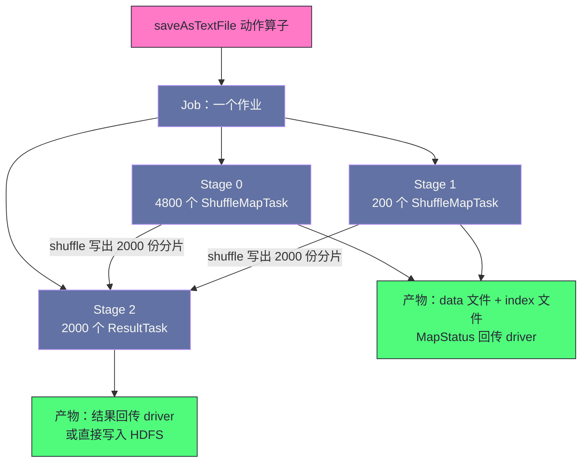
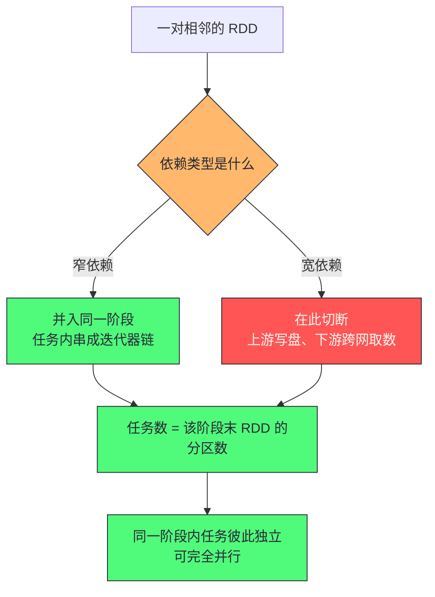
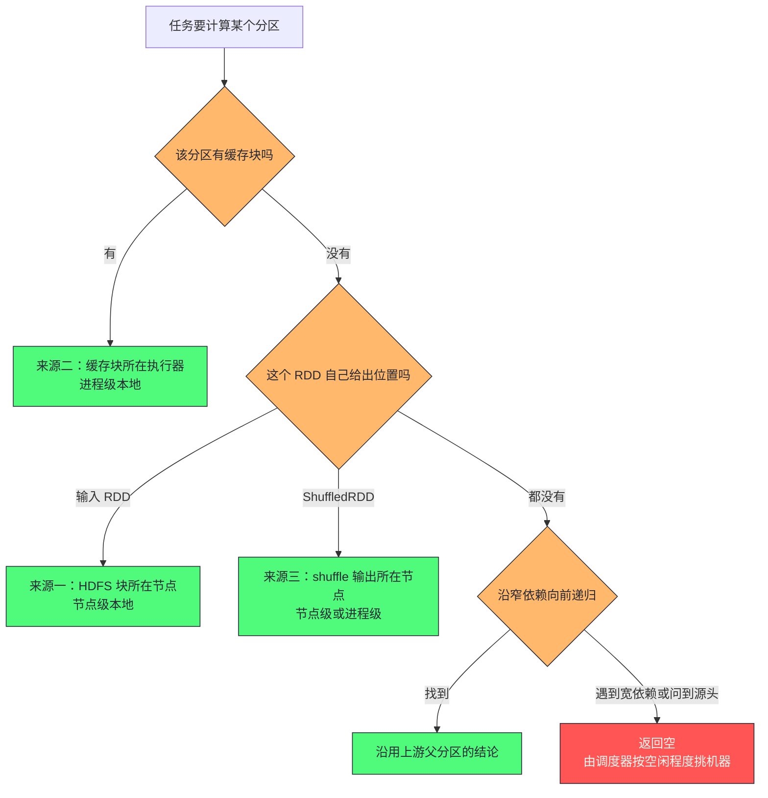
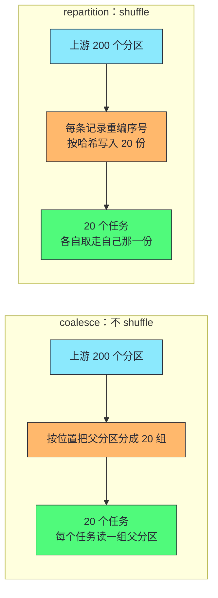
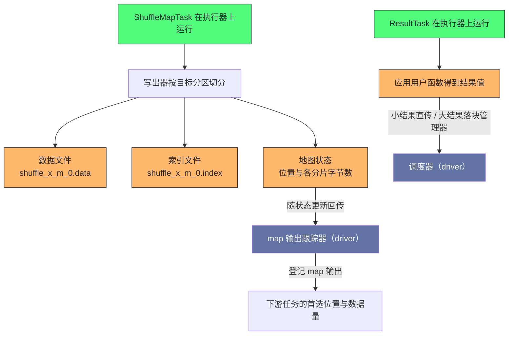

# 4. Spark物理执行计划

**摘要：**

一个 Spark 作业在集群上真实存在的样子，不是一张依赖图，而是一串被序列化、被派发、被重试的工单。用户写下的是算子，调度器交出的是阶段与任务：一个动作算子落成一个作业，作业沿宽依赖切成若干阶段，每个阶段再按分区摊成若干任务，任务数等于该阶段末 RDD 的分区数——这条等号把用户的数据布局与集群的并发能力焊在了一起。本文要回答两个问题：这个形态由什么决定，以及它为什么只能是这个形态。

文章先给出一个作业的物理清单——几个阶段、几千个任务、两类任务各自的产物，再回头论证"逐算子切任务"与"整图切任务"为何都不可行，落点是阶段内那条记录级流水线。随后把四件事拆开：分区数如何决定任务数与并行度上限；首选位置（preferredLocations）的三个来源——HDFS 块位置、缓存块所在执行器、shuffle 输出位置——以及它们的优先级次序；分区器（Partitioner）与 `partitionBy` 如何决定下游分区数，并使 `join` 呈现"零 shuffle"与"两次 shuffle"两种形态；`coalesce(shuffle=false)` 与 `repartition` 如何以"搬整箱"和"拆箱重装"两种方式改写物理计划。之后对照两类任务的产物差异，说明 shuffle 边界在磁盘与网络上留下的痕迹，并处理分区数与核数的两种失衡、`spark.default.parallelism` 与实际分区数的错位。

全文的落点是一句判断：**物理计划的成本不花在计算上，而花在边界的搬运与任务的摊派上**；分区数是唯一同时牵动并行度、本地性、shuffle 规模与输出文件数的旋钮，调它等于同时调四件事。

**关键词（Keywords）**: preferredLocations, ShuffleMapTask, ResultTask, MapStatus, Partitioner, coalesce, repartition, spark.default.parallelism

---

## 第 1 章 计划的形态：一张施工图与几千张派工单

### 1.1 一个动作算子落下来的三样东西

2012 年，加州大学伯克利分校的 AMPLab 在 NSDI 上发表弹性分布式数据集（Resilient Distributed Datasets，RDD）的论文，它回答了"如何描述一份可以并行计算的数据"，却没有回答"如何把这份描述变成集群上几千个可以同时下发的执行单元"。后一件事由调度器承担，它的产物就是本章要讲的对象：物理执行计划（Physical Plan）。

物理执行计划在 Spark 里不是一棵可以打印出来的树，而是一组可以被序列化、被派发、被重试的对象。动作算子触发时，`SparkContext.runJob` 把最终的那个 RDD 交给调度器，调度器交出三样东西：一个作业（Job）的标识、若干个执行阶段（Stage），以及每个阶段内按分区摊开的任务（Task）。三者不在同一时刻产生：阶段在切分依赖图时确定，任务在阶段提交时才生成，任务落到哪台机器则要等资源与本地性一起算完。

本文所述以 Spark 4.3.0（2026-10-30 发布）为准，4.x 的官方预编译包基于 Scala 2.13；涉及集合语义、序列化行为与默认值的细节，若与更早版本有出入，以对应版本的文档或源码为准。

### 1.2 一条等号，两端各自是什么

**一个阶段的任务数，等于该阶段末 RDD 的分区数。** 这句话在绝大多数的情形下成立，而它把两件本来无关的事情焊在了一起：一端是数据的布局，另一端是计算的份数。

等号之所以能成立，根子在 `RDD.compute(partition, context)` 这个签名上。计算函数只接受一个分区，返回该分区上的迭代器，因此一个任务能处理的最大范围就是一个分区，而任务也无法被再切细——切分的边界由 `RDD.partitions` 决定，不由调度器的偏好决定。调度器能做的只有两种动作：把某个分区交给某个执行器，或者在某些分区已经有有效产物时把它跳过去。

一个作业的总任务数是各阶段任务数之和：第 1.4 节那个作业的三个阶段分别摊出 4800、200、2000 个任务，合计 7000 张派工单。这个数字与集群规模、执行器数量都无关，只由分区数决定——很多人把"任务多"归因为"集群大"，因果恰好是反的。

### 1.3 三个经常被混用的数字

讨论物理计划时，有三个数字必须分开：分区数、任务数、同一时刻在跑的任务数。

分区数是数据侧的划分，由读取方式、算子语义或分区器决定；任务数是计算侧的份数，按第 1.2 节的等号由分区数推出；同时运行的任务数则由集群的槽位（slot）决定，槽位等于执行器总核数除以 `spark.task.cpus`（缺省为 1，即一核一任务）。三者关系可以写成一句话：**分区数决定一共有多少份活，槽位决定同一时刻有多少人能干这份活。**

混用这三个数字会直接导致误判：看到"2000 个任务"就以为集群要 2000 个核，其实 256 个核轮八轮就够；把"槽位 256"当成"分区数应设成 256"，则会让每个任务读几百兆数据，单任务的内存峰值把执行器压垮。

### 1.4 一个贯穿全文的作业

为了让后面的机制不至于悬空，笔者设想一个内容平台的日更作业 `play_daily`：每天凌晨读取前一天的播放明细，按视频聚合播放次数，与维表拼装后写成报表。集群是自建的 Standalone，八台机器、每台 32 核，共 256 核；`spark.executor.cores=8`，于是有 32 个执行器、256 个槽位。

```scala
// 事实表：假定一天的明细未压缩约 600 GB，按 128 MiB 一个分区切，约 4800 个分区
val votes = sc.textFile("hdfs://nn/warehouse/logs/play/dt=2026-11-18")
  .map(parsePlayLog)                 // 窄依赖，分区数不变
  .filter(_.isValid)                 // 窄依赖，分区数不变
  .map(v => (v.videoId, 1L))         // 转成键值对，为聚合做准备
  .reduceByKey(_ + _, 2000)          // 宽依赖：下游固定 2000 个分区

// 维表：先按同一分区器重分区再缓存，供 join 复用
val dimBase = sc.textFile("hdfs://nn/warehouse/dim/video")
  .map(parseVideoDim)                // 假定 200 个分区
  .cache()                           // 后续两处使用，缓存位置会成为首选位置
val dim = dimBase.keyBy(_.videoId)
  .partitionBy(new HashPartitioner(2000))   // 宽依赖：下游 2000 个分区

// 两侧分区器一致，join 不再产生 shuffle
votes.join(dim).map(toReportRow)
  .saveAsTextFile("hdfs://nn/warehouse/ads/play_daily")
```

这个作业的物理形态可以逐条数出来：第一阶段算事实表的聚合前身，4800 个 `ShuffleMapTask`，任务数等于 `textFile` 切出的分区数；第二阶段把维表重分区，200 个 `ShuffleMapTask`，任务数等于缓存后的分区数；第三阶段把两侧拼起来并写出，2000 个 `ResultTask`，任务数等于 `join` 输出 RDD 的分区数。两个 shuffle，一共 7000 个任务。

后面各章会反复回到它：第 4 章看它的三个阶段分别从哪三个来源拿到了首选位置，第 6 章看一次 `coalesce` 如何把 2000 个任务压成 200 个，第 9 章看 7000 个任务摊在 256 个槽位上到底是什么节奏。

### 1.5 施工图与派工单

把物理执行计划比作施工图、把任务比作派工单，这个比喻可以一直用到全文结尾。施工图只有一份，画的是哪些工序必须先后、哪些可以并行；派工单按房间开，一间房一张，上面写着"去做第几间"，却不写"先拌灰还是先砌砖"——工序被压进了工人手里的做法里，压不进那张纸。

比喻的技术限定在于：派工单上唯一可变的是"送到哪个工地"，即任务的本地性；而工序被压进任务内部的迭代器链，任何需要整分区数据才能继续的步骤（排序、聚合、shuffle 写出）都会在链上形成一个必须停顿的卡点，卡点的位置决定阶段边界。

下图把一个作业从动作算子到产物的路径画全，重点看两类任务在中途分岔的地方。



图中两条从 ShuffleMapTask 指向 ResultTask 的边，就是物理计划里最昂贵的两条边：它们的下半段要走磁盘和网络，其余所有边都只是同一个 JVM 内的函数调用。

---

## 第 2 章 为什么不是一个算子一个任务

### 2.1 三种划分想法的取舍

面对一张有 `map`、`partitionBy`、`union`、`join` 的依赖图，把计算摊成任务的方案不止一种。把三种摆在一起比较，能看清最终形态为什么长成这样。

第一种是逐 RDD 划分，让每个转换操作都独立成一个任务。它实现简单、边界清晰，代价是任务数量随算子数线性膨胀，且每个任务都必须把自己的输出物化下来供下游读取，否则下游就要重算上游。物化意味着中间数据要落内存或落磁盘，而 Spark 的内存计算优势恰恰建立在"不物化中间结果"上。

第二种是按分区串联，从最终的 RDD 分区向前回溯，把连续作用在同一分区上的算子收进一个任务。它把任务数压回到分区数量级，中间结果也不必落地，但会在宽依赖处失效：下游每个任务要从上游全部分区里各取一部分，若仍把上下游塞进同一个任务，每个任务都得重算上游所有分区。

第三种是在宽依赖边界处切开，Stage 内仍用第二种的串联策略，Stage 间用 shuffle 传递数据。Spark 取的是第三种，它同时保住了两件事：任务粒度适中（数量等于分区数），并行度不被破坏（下游任务仍能吃到全部上游输出）。

下表把三种方案按四个维度并排，方便看清取舍落在哪里。

| 划分方案 | 任务数量级 | 中间数据是否物化 | 并行度 | 主要代价 |
|---|---|---|---|---|
| 逐 RDD 划分 | 与算子数同阶 | 必须物化，否则重算 | 完整 | 调度开销与中间存储同时膨胀 |
| 按分区串联（整图） | 与分区数同阶 | 不物化 | 在宽依赖处崩塌 | 重复计算，量级为上游分区数乘下游分区数 |
| 宽依赖边界切分 | 与分区数同阶 | 仅在边界处落盘 | 完整 | 边界上付出磁盘与网络成本 |

表格最后一行即 Spark 的实际选择，它的代价集中在少数几条边上，而不是均匀摊在所有算子上——这是"把成本花在边界上"的最初来源。

### 2.2 宽依赖处为什么必须断

要理解这个断点，得先看清宽依赖在数据上的样子。窄依赖（`NarrowDependency`）里，子 RDD 的一个分区只依赖父 RDD 的少量分区，最常见的情形是一对一：父分区第 `i` 份算出子分区第 `i` 份。宽依赖则相反，子 RDD 的每个分区都要从父 RDD 的**所有**分区里各取一段。

这个"所有"是关键。假设上游有 4800 个分区、下游有 2000 个分区，若不切断，则每个下游任务若要拿到自己的数据，就必须把 4800 个上游分区全部算一遍，总量是 4800 × 2000 次分区计算，其中 99.9% 以上是白算的。切断之后，上游的 4800 个分区各算一次、各自把结果按 2000 份切开写到本地，下游的 2000 个任务各取一次，总计算量回到 4800 加 2000。

切断的另一个理由是"数据得有地方待着"。宽依赖要求上游输出被下游跨节点、跨进程按分区取用，而上游任务的 JVM 事后可能已经跑别的任务去了，那批数据必须落在一个不依赖上游任务存活的位置上。Spark 选的位置是执行器的本地磁盘——便宜、容量大，代价是数据没有副本，执行器一失联这批输出就不可达。这个选择在后面的 shuffle 边界一章里还会展开。

### 2.3 阶段内的流水线：一条记录走完全链

阶段内部之所以不必物化，靠的是迭代器模型。RDD 的 `compute` 返回的是 `Iterator` 而不是集合，一串窄依赖算子串联起来时，下游的迭代器把上游的迭代器包在里面，调用 `next()` 时请求沿链一路传到底层数据源，取回一条记录，再沿链一路变换上来。对于 `map` 接 `filter` 这样的组合，内存里同时存活的只有正在处理的那一条记录。

但流水线有它做不到的事。任何需要"看完整分区才能给出下一条输出"的算子都会在链上形成卡点：排序要先把整个分区读进缓冲区、排完才能吐第一条；聚合要在哈希表里累积到分区末尾；`mapPartitions` 把整个迭代器交给用户函数，若函数内部调用了 `toList`，整分区数据就被搬进了堆内存。卡点不会让流水线失效，只会让它在那一处停顿一次、并在内存上出现一个峰值。

因此可以说，**流水线只在同一个分区的内部成立，跨分区、跨阶段一律不成立**。这句话解释了三类现象：为什么同一个阶段的任务耗时差异会很大（某个分区的数据恰好特别大时，整条链都被它拖住）；为什么 `mapPartitions` 里包一个大集合会 OOM 而同样逻辑写成 `map` 不会；为什么阶段内的任务数可以设得比阶段间的分区数更大而不增加磁盘开销。

### 2.4 反事实：如果逐算子切任务

不妨做一次反事实推演。假设 Spark 真的按第一种方案执行，`play_daily` 的七个转换算子会摊成七个任务层次，每层任务数都等于该 RDD 的分区数：第一层 4800 个任务扫描解析日志并写盘，第二层再 4800 个任务从盘上读回来过滤、再写盘。仅这两层就是 9600 个任务与 600 GB 量级的中间落盘，而业务计算还没开始。

调度与容错的代价随之放大。每个任务都要经历序列化、派发、状态上报、结果处理各一次，层级越多，本地性等待被放大得越厉害；中间结果一落盘，就得为它维护位置信息与失效判定，一层落盘就是一层要记账的状态。

反过来说，宽依赖边界上的落盘之所以可以接受，是因为它只发生少数几次，而每次落盘换来的是下游整整一个阶段的可并行执行。**边界要少、要值钱，这是物理计划设计的第一条经济原则。**

下图把第 2.1 节的决策逻辑压成一张判断图，两条分支最终都收敛到同一个结论——任务数由分区数决定。



---

## 第 3 章 分区数决定一切

### 3.1 为什么是"末 RDD"而不是"第一个 RDD"

阶段内的窄依赖链上，各个 RDD 的分区数未必相同：`map` 与 `filter` 继承父分区数，`union` 把两侧相加，`coalesce` 把多份并成一份，`cartesian` 把两侧相乘。既然链上分区数会变，任务数按哪一个算？

答案是按链的末端，也就是阶段最后一个 RDD 的分区数。原因在于计算的拉取方向：任务不是从数据源开始往下推，而是从末端分区开始向上要数据——`compute` 被调用在末端 RDD 上，它再去向父 RDD 要对应分区，一层层要到底。因此末端有几个分区，就有几个互不重叠的计算入口，也就有几个任务。

这条规则反过来解释了一件事：`coalesce` 之后的任务数由合并后的分区数决定，而上游那些被合并的分区并不会因此少算，它们仍在同一个任务内部被依次读取——任务的**份数**变了，每一份的**工作量**也变了，两个变化同时发生，这正是第 6 章要展开的取舍。

### 3.2 分区从哪来：四个来源

分区数不是凭空出现的，它有四个来源，按出现频率从高到低排列。

第一个是数据源切分。读 HDFS 时，一个文件按块（缺省 128 MiB）切成若干分区，块数就是分区数；`sc.parallelize(list, n)` 由调用者直接给出 `n`；结构化数据读取路径上，单个分区的上限由 `spark.sql.files.maxPartitionBytes`（缺省 128 MiB）约束，实际分区数由"总字节数除以单分区上限"向上取整再按文件边界拆分得到。

第二个是继承父 RDD。`map`、`filter`、`flatMap`、`mapPartitions` 这类一对一或一对少的算子不改变分区数，它们生成的 RDD 直接沿用父 RDD 的分区数。这条规则让大部分窄依赖算子在物理计划里"不留痕迹"——它们在任务内部被串成链，不产生新的任务。

第三个是分区器指定。`partitionBy`、`reduceByKey`、`groupByKey`、`join` 这些会产生 shuffle 的算子，其输出分区数由分区器（`Partitioner`）的 `numPartitions` 决定，与上游有几个分区无关。这是下游阶段任务数的直接来源，第 5 章专讲。

第四个是算子自身的语义。`union` 把两侧分区数相加，`join` 在两侧分区器一致时取该分区器、否则取缺省分区器，`cartesian` 取两侧之积，`distinct` 则跟随其内部 shuffle 的分区数。这些差异让分区数成为依赖图上一个会变化的量，也是后面讨论"错位"的伏笔。

### 3.3 依赖类型与物理形态的对应

把依赖类型与物理形态并排看，能快速判断一段代码会长成什么样。下表在保留原有分类的基础上，补上了任务数与产物两列。

| 依赖类型 | 代表性操作 | 阶段划分 | 任务形态 | 任务数 |
|---|---|---|---|---|
| 一对一依赖 | `map`、`flatMap`、`filter` | 与父 RDD 合并为同一阶段 | 一对一处理分区，任务内流水线 | 等于父分区数 |
| 区域依赖 | `union`（一般情形） | 与父 RDD 合并为同一阶段 | 分区到父 RDD 有确定的区间映射 | 等于各父分区数之和 |
| 多对一依赖 | `coalesce(shuffle=false)` | 与父 RDD 合并为同一阶段 | 一个任务读父 RDD 的多个分区 | 等于合并后的分区数 |
| 多对多依赖 | `cartesian` | 与父 RDD 合并为同一阶段 | 一个任务读两侧各一个分区 | 等于两侧分区数之积 |
| 单一宽依赖 | `reduceByKey`、`groupByKey`、`sortByKey` | 切为上下游两个阶段 | 上游写盘，下游取数 | 上游等于父分区数，下游等于分区器分区数 |
| 多个宽依赖 | 未对齐分区器的 `join` | 按 shuffle 数量切成多个阶段 | 下游需等上游全部完成 | 各阶段分别按上述规则计算 |

这张表里最容易读错的是"多对一依赖"那一行：`coalesce(shuffle=false)` 不产生 shuffle，上下游同属一个阶段，但下游一个任务要读上游多个分区——任务份数减少、每份的读取范围扩大，物理计划上表现为"任务数下降而单任务数据量上升"，不会表现为"多了一条 shuffle 边"。

### 3.4 等号的一个脚注：缺失分区

前面反复说的等号有一个脚注：调度器下发的是"缺失分区"对应的任务，而不是全部分区。对结果阶段而言，这个区别没有意义，因为结果必须重算；对 shuffle 阶段而言则不然——如果某个 shuffle 的 map 输出在之前已经被登记为有效，那么重新提交这个阶段时，那部分分区会被跳过，任务数可以小于分区数，极端情况下可以是零。

这个机制在作业有阶段重试时最容易观察到：某个下游任务取数失败会让上游阶段重新提交，而重新提交的上游阶段若其 map 输出的有效性仍然被记账，则界面上会出现"阶段已提交但没有任务"的情形。把它当成等号的反例就错了，它只是"等号右边乘了一个有效比例"，而比例的来源是 shuffle 输出的记账状态——第 7 章会看到这份记账靠什么维持。

### 3.5 分区数为一的物理后果

分区数取 1，是物理计划里最容易被低估的一种配置：最后一个阶段只有一个任务，它串行读完前面所有数据，其余槽位全部空转。对 `play_daily` 而言，若在写出前改成 `coalesce(1)`，2000 个分区会被并成一个任务，它要依次读 2000 份上游数据并写成单个文件。这个选择有时是刻意的（下游工具不接受目录、需要单个文件），但刻意不等于免费。**分区数是一个不能随便取极值的参数，取极小是把并行换成单点，取极大是把单点开销乘以份数。**

---

## 第 4 章 首选位置：三个来源与一条传递规则

### 4.1 RDD 的第五个属性

RDD 的接口里有五个要素：分区列表、计算函数、依赖列表、分区器，以及首选位置（`preferredLocations`）。前四个要素决定了"算什么、在哪切、按什么规则分"，第五个要素只决定"最好在哪算"。

它是五者中唯一带有建议性质的：调度器可以完全忽略它，也经常真的忽略它。这个"建议"的身份决定了它的三个特点：来源分散（不同的 RDD 子类各自实现自己的位置逻辑）、深度有限（只有少数 RDD 会覆写它）、时效性强（缓存被驱逐、执行器失联都会让位置失效）。

### 4.2 来源一：HDFS 块所在的数据节点

最常见的来源是输入 RDD。读 HDFS 时，输入切分（`InputSplit`）自己带着 `getLocations()`，返回该块副本所在的数据节点；输入 RDD 把这些主机名透出为首选位置，调度器据此把任务尽量派到数据所在节点。这种本地性最高只到节点级（`NODE_LOCAL`），到不了进程级——块由 DataNode 进程持有，任务的执行器是另一个 JVM，数据必须跨一次进程边界。三副本的布局则让"就近"有多个正确答案。

### 4.3 来源二：缓存块所在的执行器

第二类来源是缓存。某个 RDD 被 `cache` 或 `persist` 之后，它的每个分区在块管理器（BlockManager）里对应一个按 RDD 编号与分区号命名的块，驱动器侧的块管理器主控持有"哪个块在哪个执行器上"的映射。调度器求首选位置时先查这张映射，把命中的执行器作为首选位置。这类本地性可达进程级（`PROCESS_LOCAL`），因为块就在那个执行器的堆内或本地盘上。更要紧的是它省掉的不止网络：**缓存命中意味着不用重算上游血缘，收益是"少算一遍"而不是"少传一次"**，这也是它排第一的根本原因。

`play_daily` 里的 `dimBase` 就落在这一类。它被缓存后参与两处计算，其中 `partitionBy` 之前的那个任务阶段会优先被派到持有对应缓存块的执行器上——这些任务数只有 200，但每一个都要读完整份维表分区，派错地方的代价是 200 次远程读取。

### 4.4 来源三：shuffle 输出所在的位置

第三类来源是 shuffle。`ShuffledRDD` 的分区代表"某个下游分区的数据"，这些数据分散在上游所有 map 任务的输出里，每份输出带着一个位置——写出它的那个执行器的块管理器标识。调度器求这个分区的首选位置时，实际是在问 map 输出跟踪器（MapOutputTracker）：这个分区在各个 map 输出里分别躺在哪些主机上。

这一类来源的位置精度同样是节点级，而且它有一个别处没有的性质：**首选位置指向的不是"原始数据"，而是"上一次计算留下的产物"**。产物可能已经随执行器退出而消失，位置信息却还在驱动器的内存里，指向一台可能已经不在集群里的机器。于是这类本地性天然带着"可能落空"的属性，落空的后果是取数失败，第 8 章会看到它如何传导成上游阶段重算。

### 4.5 窄依赖可以传递，宽依赖不能

三个来源并非并列地被查询，调度器有一套固定的次序。为某个 RDD 的某个分区求首选位置时，它依次做四件事：先查这个分区有没有缓存块，有就直接返回缓存位置；再看这个 RDD 自己有没有覆写位置逻辑，有就用它给出的位置；若都没有，则沿窄依赖向前递归，取第一个能给出位置的父分区的结论；若递归到源头或遇到宽依赖仍然没有，就返回空，交给调度器按空闲程度挑机器。

这套次序里有两条值得单独记住的规则。

第一条是**缓存优先于自身位置**。输入 RDD 即使能给出 HDFS 块位置，只要它的分区被缓存了，缓存位置就盖过块位置。这个优先级的道理在于两者省下的成本量级不同：块位置省下的是一次跨机传输，缓存位置省下的是整条血缘的重算。

第二条是**窄依赖传递位置，宽依赖断路**。对 `rdd.map(f).filter(g)` 这样的链条，末端 RDD 自己并不覆写位置逻辑，但递归会穿过 `map` 与 `filter` 一路问到输入 RDD，于是 HDFS 块位置照样生效。一旦中间隔了一次 shuffle，位置信息就接不上了——shuffle 之前的位置对 shuffle 之后毫无意义，因为数据已经被重新分布过，新的位置只能从 map 输出里问出来。

这条断路规则解释了一个常见现象：一个读 HDFS 的作业，在第一次 shuffle 之前的阶段本地性很好，之后的任务就变成"哪台有空去哪台"。这不是调度器偷懒，而是宽依赖在物理上确实把"数据在哪"这件事重置了。

下图把四个步骤与三个来源画在一起，重点看宽依赖那条断路。



下表把三个来源按七个维度并排，其中"失效条件"一列最值得记住，因为线上本地性突然变差，多半是那一列里某一项被触发了。

| 维度 | 来源一：HDFS 块位置 | 来源二：缓存块位置 | 来源三：shuffle 输出位置 |
|---|---|---|---|
| 信息持有者 | 输入切分的副本列表 | 块管理器主控的块位置映射 | map 输出跟踪器的 map 状态 |
| 位置精度 | 节点（三个副本节点） | 执行器（可用到核级） | 节点（多个上游任务各一份） |
| 最高本地性级别 | 节点级 | 进程级 | 节点级或进程级 |
| 省下的成本 | 一次跨机传输 | 整条血缘的重算 | 一次跨机传输 |
| 优先级 | 第三 | 第一 | 第二（在窄依赖递归中可能先命中） |
| 失效条件 | 副本迁移、块损坏 | 缓存被驱逐、执行器退出 | 执行器退出、输出被清理 |
| 典型表现 | shuffle 前的阶段 | 复用维表或中间结果 | shuffle 后的阶段 |

### 4.6 本地性是一条建议，不是命令

调度器拿到首选位置之后并不必然照办，它要在一个两难里选：等一等，让数据所在节点腾出一个空槽；或者立刻把任务派到远处，让核先转起来。

Spark 把这个选择做成了可调的等待机制。本地性分五级，由近及远是进程级、节点级、机架级、任意级，外加一个"没有偏好"的等级；任务在某一级上等不到合适的位置，就降到下一级重新排队。每一级的等待时长由 `spark.locality.wait`（缺省 3 秒）及其分项参数控制。这个数字是权衡出来的：调大，本地性更好但核空转的时间变长；调小，核转得快但跨机传输变多。

这条机制说明了一件事：**首选位置只是"最好去哪"，调度器真正优化的是"数据搬运成本与核空转成本之和"**。在小任务上，这个和里核空转占绝对多数，等待几乎立刻被放弃；在长任务上，搬运几十兆数据可能比空转三秒更贵，等待就值了。这也解释了为什么按 128 MiB 切出的任务通常能等到本地性，而几兆的碎片任务几乎总是就近取机器。

---

## 第 5 章 分区器：下游的分区数由谁定

### 5.1 partitionBy 的两种结果

`partitionBy` 是理解"下游分区由谁决定"最直接的入口。它接受一个分区器，返回的 RDD 有两种可能：若当前 RDD 的分区器与传入的分区器相等，原样返回自身；若不相等（或者当前根本没有分区器），则生成一个 `ShuffledRDD`，其分区数等于传入分区器的 `numPartitions`。

第一种情形值得单独强调，因为它意味着**一次 `partitionBy` 可以是零成本的**：没有 shuffle，没有任务，物理计划上不留任何痕迹。这个看似不起眼的短路，是第 5.4 节 `join` 能变成零 shuffle 的技术基础。

第二种情形则是下游分区数的直接来源。`ShuffledRDD` 的分区列表由 `numPartitions` 展开，一个下游分区的数据来自上游所有 map 输出中"目标分区号等于自己"的那些分片。分区器在这里承担了双重职责：它的 `getPartition(key)` 决定每条记录的去向，它的 `numPartitions` 决定下游有几个分区、也就是下一个阶段有几个任务。

### 5.2 哈希、范围与它们各自的代价

最常用的是 `HashPartitioner`，规则是键的哈希值对分区数取非负余数。它计算便宜、分布大体均匀，但某些键特别多时这些键会全部落到同一分区，形成倾斜——这是"按哈希取模"在键分布不均时的必然结果，分区器保证的是"同键同分区"，从未承诺"分区一样大"。

`RangePartitioner` 走另一条路：先对 RDD 做一次抽样，估算出若干分位点作为分区边界，再按边界把数据分到各分区。它保证的是"分区间有序、大小大致均衡"，适合排序与范围查询；代价是多了一次额外的作业用于抽样。这一次抽样是在构造分区器时触发的，因此 `sortByKey` 这类算子在物理计划上会多出一次采样作业——数据量很小时，这次采样的固定开销甚至比排序本身更显眼。

两者的差别可以逐项对照。

| 维度 | HashPartitioner | RangePartitioner |
|---|---|---|
| 分区依据 | 键哈希值对分区数取模 | 抽样得到的分位点边界 |
| 是否额外触发作业 | 否 | 是，构造分区器时抽样 |
| 分区大小是否均衡 | 键分布均匀时才均衡 | 通常较均衡 |
| 分区之间是否有序 | 否 | 是 |
| 典型使用者 | `reduceByKey`、`groupByKey`、`partitionBy` | `sortByKey`、`repartitionByRange` |
| 主要风险 | 热点键导致倾斜 | 抽样偏差导致边界失真 |

### 5.3 defaultPartitioner 的三条分支

用户不显式给分区器时，`reduceByKey`、`join`、`cogroup` 这类算子会调用一个缺省决策，它的逻辑分三条分支。

第一条：若参与运算的 RDD 全都有分区器，且这些分区器彼此相等，直接沿用该分区器，不产生 shuffle。第二条：若只有一部分 RDD 有分区器，则取分区数最大的那个 RDD，按它的分区数重新决策一次。第三条：若全都没有分区器，则用 `HashPartitioner`，分区数取 `spark.default.parallelism`，若该项未显式配置，则取父 RDD 的分区数（多输入时取最大者）。

三条分支里，第一条是省钱的，第三条是埋雷的——第 10 章会看到，第三条里的那个"若未显式配置"如何让一个作业的分区数在设置了一个看似无关的配置项之后突然塌缩。

### 5.4 join 的两种物理形态

`join` 在物理上是 `cogroup` 加一层展平，它的形态完全由两侧的分区器关系决定，呈现出两种截然不同的样子。

第一种是零 shuffle。若两侧都已被同一个分区器分好，`cogroup` 对两侧都只需一对一依赖，每个下游任务在本地就能同时拿到两侧对应分区，拼装即可。`play_daily` 正是这种形态：事实表经 `reduceByKey(..., 2000)` 后带 `HashPartitioner(2000)`，维表经 `partitionBy(HashPartitioner(2000))` 后带同参数的分区器，两者相等，于是整个 `join` 落在最后一个阶段里，2000 个任务各自完成拼装。

第二种是至少一侧 shuffle。两侧都没有分区器时，`join` 会按缺省决策造一个 `HashPartitioner`，两侧各做一次 shuffle 再取数拼装；只有一侧有分区器时，缺的那一侧 shuffle、已有的一侧走窄依赖。这种"半对齐"形态在实际作业里最常见，也最容易被误认为"分区数已经对齐了"。

两种形态的差别不只是少一次 shuffle 的网络量。零 shuffle 的形态下，`join` 不产生阶段边界，两个数据源的读取与拼装可以流水线地进行；两次 shuffle 的形态下，两个上游阶段必须先各自完成并落盘，下游才能开始，作业的最短完成时间被拉长了一整个阶段的时长。

### 5.5 对齐分区器的收益与代价

把维表先 `partitionBy` 再 `cache`，是数据仓库里非常常见的一招，它的账要两面算。

收益侧清楚：一次 `partitionBy` 的 shuffle 换来后续每次 `join` 都免 shuffle，只要这份维表被复用两次以上，这笔交易就划算。代价侧有三项。其一，分区数一旦定错，所有下游都被绑定在这个数字上。其二，维表更新后必须重新分区，缓存与分区器是两份要一起失效的状态。其三，`partitionBy` 之前的窄依赖变换会在 shuffle 的 map 侧重算一遍，若维表解析很贵，这就是隐藏成本。

判断标准可以简化成一句：**若一份数据会被多次按同一规则关联，就对它对齐分区器并缓存；若只用一次，对齐的 shuffle 就是纯亏。**

---

## 第 6 章 coalesce 与 repartition：两种改写方式

### 6.1 coalesce(shuffle=false)：搬整箱

`coalesce(n)` 缺省不 shuffle，它生成一个合并 RDD（`CoalescedRDD`），依赖类型是多对一：下游一个分区由上游若干个分区组成。它不做数据重分布，只是把"读哪几个上游分区"这件事记在一张映射表里，任务运行时按表依次读取。

合并的分组不是简单按顺序切片。分组算法会先取上游各分区的当前位置，把有位置的父分区按位置聚拢，再用"幂二选桶"加一个平衡余量（缺省 0.10）在"均衡"与"本地"之间做取舍：两个候选组的规模差在余量之内时，优先选位置更合适的那一组，超过了就退回均衡优先。于是合并出来的每个分区都带一个首选位置，通常就是组内多数父分区所在的那台机器。

这个设计带来两个直接后果。好消息是合并之后本地性往往不错，任务大多能在数据原本所在的机器上跑；坏消息是**数据没有被搬动**，合并只改变了"谁去读"，没改变"数据在哪"，那几台机器一忙，合并后的任务也只能跟着等。

还有一条边界必须记住：不 shuffle 的合并只能减少分区，不能增加。请求值大于父分区数时，实际分区数停在父分区数上；想要更多分区，只能走下一节的路径。

### 6.2 repartition(n)：拆箱重装

`repartition(n)` 在实现上是 `coalesce(n, shuffle = true)`，它生成的是一个经过 shuffle 的 RDD：先给每条记录重新编一个序号（每个上游分区的起始序号随机，之后逐条加一），再按哈希把序号映射到 `n` 个下游分区，最后让下游任务各自取走属于自己的那一份。

随机起点这个细节值得留意。若起点固定为零，那么上游分区数少于下游分区数时，靠前的上游分区只会把数据撒到靠前的下游分区，靠后的下游分区会空着；随机起点让每个上游分区的撒点范围错开，使得记录数足够时下游各分区大致均匀。这个手法与"给每个任务分配一个不同的随机种子"是同一个思路，代价是分布只在大数意义下均匀。

于是两种改写方式的物理差异可以概括成一对比喻：**`coalesce` 是把几个小箱子捆成一个大箱子，不拆封，搬运距离为零；`repartition` 是把所有箱子拆开、按新规则重新装箱，每个箱子都轻一些，但每一件货都要过一次传送带。**

下图把两种改写的物理形态并排放，输入都是 200 个上游分区，输出都是 20 个分区。



### 6.3 一张对照表

| 维度 | coalesce(shuffle=false) | repartition(n) |
|---|---|---|
| 是否产生 shuffle | 否 | 是 |
| 分区数变化方向 | 只能减少（实际取父分区数与请求值的较小者） | 可增可减 |
| 数据是否跨机搬运 | 否 | 是 |
| 下游首选位置来源 | 组内父分区的当前位置 | shuffle 输出所在位置 |
| 阶段边界 | 不新增 | 新增一次 shuffle，两个阶段 |
| 单任务数据量 | 上升 | 大体均衡 |
| 主要代价 | 单任务变重、并行度下降 | 磁盘与网络开销 |
| 典型用途 | 减少输出文件数、回收碎分区 | 提升并行度、缓解分区过少 |

### 6.4 三个反例

第一个反例是把 `coalesce` 当 `repartition` 用。想让 200 个分区变成 1000 个，写 `coalesce(1000)` 只会得到 200 个分区，因为不 shuffle 就没有办法把一份数据拆成两份。这个错误在实践中非常常见，表现是"调了参数但任务数没变"。

第二个反例是把 `coalesce(1)` 当成"减少输出文件"的万能手段。它确实只写出一个文件，但那个文件由一个任务产出，前面所有分区都要经由这一个任务串行读取；若上游有 2000 个分区、总量几十 GB，这个任务会成为整个作业的瓶颈，且一旦失败要全部重来。

第三个反例是拿 `repartition` 治倾斜。倾斜的成因是某些键特别多，而 `repartition` 依据记录序号哈希重分布，它能摊平记录，却摊不平"同一个键必须落到同一个分区"这条约束——除非在聚合前对键加盐打散，否则重分区只改变分区数量，改变不了键的分布。

### 6.5 一个容易被忽略的事实

`repartition` 之后，上游的本地性信息全部作废。HDFS 块位置、缓存位置、之前 shuffle 的输出位置，都在这次重分布之后失去了意义，下游任务的首选位置只剩下"这次 shuffle 的输出在哪"。这正是第 4.5 节那条"宽依赖断路"规则的具体体现。

把这件事放进调优语境里，它给出了一个判断：**每一次 `repartition` 都是一次本地性的重置，重置之后所有的就近优化都要重新赚回来。** 所以它该被放在数据流的早期而不是晚期——早期的重置只影响少数几轮任务，晚期的重置会把已经赚到的本地性全部丢掉。

---

## 第 7 章 两类任务与各自的产物

### 7.1 判据只有一条

任务分两类，判据只有一条：这个阶段是不是结果阶段。作业最后一个阶段是结果阶段，它里面的任务叫 `ResultTask`；其余阶段都以 shuffle 收尾，里面的任务叫 `ShuffleMapTask`。

名字里的 "map" 容易引起误解，它指的不是"这个任务里跑了 `map` 算子"，而是"这个阶段的输出要经过一次 shuffle 分发出去"。同理 `ResultTask` 也不是"算出最终结果的任务"，而是"不再往下游分发的任务"——它的结果要么回传驱动器，要么直接写入外部存储，总之不进入 shuffle。

这一条判据带来一个结构上的事实：一个作业里 `ResultTask` 只存在于最后一个阶段，其余全是 `ShuffleMapTask`；`play_daily` 的 7000 个任务里，5000 个是 `ShuffleMapTask`，2000 个是 `ResultTask`。

### 7.2 ShuffleMapTask 的三件产物

`ShuffleMapTask` 执行时做的事情可以拆成三步：拿到本阶段的数据，交给 shuffle 写出器，把写出器返回的状态交回去。三件产物也随之确定。

第一件是数据文件。写出器把本分区内按目标分区号分好组的记录连续写进一个本地文件，文件落在执行器的本地目录下，名字里带着 shuffle 编号与 map 编号。这个文件是下游取数时真正被读的字节流。

第二件是索引文件。它记录每个目标分区在数据文件里的起始偏移与长度，下游任务取数时先读索引定位区间，再顺序读取该区间的字节——不必扫描整个文件，也不必为每个分区单独建一个小文件。用一个数据文件加一个索引，而不是"一千万个小文件"，是为了让本地磁盘上的文件数量与 map 任务数同阶，而不是与 map 任务数乘以分区数同阶。

第三件是地图状态（`MapStatus`），这是三件产物里最容易被忽略的一件。它随任务完成的状态更新回到驱动器，内容包括"这批输出躺在哪个块管理器上"以及"每个下游分区分别有多大"。它本身不含数据，却是下游一切位置与体量判断的依据。

### 7.3 MapStatus 的两副面孔

`MapStatus` 的大小直接关系到驱动器的内存，因为每个 map 任务都要留一份，总量是 map 任务数乘以每个状态的大小。当 shuffle 的下游分区数很大时，若每个分区都用一个长整型记录字节数，单份状态就是几万字节，几万个 map 任务乘起来足以把驱动器的堆吃掉。

Spark 因此给了它两套压缩形态。缺省形态把每个下游分区的字节数压成一个字节：先取以 1.1 为底的对数再向上取整，于是最大可表示到几十 GB 量级，而相对误差被限制在百分之十上下。这个精度对调度来说足够了——它只需要知道"这个分片是大是小"，不需要知道精确到字节。

当下游分区数超过一个阈值（`spark.shuffle.minNumPartitionsToHighlyCompress`，缺省 2000）时，改用更强的一种形态：记录空分片的位图、少数几个特别大分片的精确大小，其余分片只记一个平均值。这个设计的选择依据是"空分片通常远少于非空分片"以及"真正影响调度决策的是那几个大分片"，用一张位图加一个平均值就能把误差控制在可接受范围。

**MapStatus 的压缩不是为了省网络，而是为了省驱动器的堆**；这条判断解释了为什么它的精度是"够用就好"，也解释了为什么两套形态的分界点选在分区数而不是数据量上。

### 7.4 ResultTask 的产物

`ResultTask` 执行时只做一件事：把用户函数作用在分区迭代器上得到一个结果值，去向取决于它的大小。小结果随状态更新消息回传驱动器；超过单任务直传阈值的结果先落到执行器的块管理器，只回传一个块号，由驱动器再发起取件。这个分岔把控制面消息与数据面传输分开，也分出了两类失败：控制面失败是重试，数据面失败是取件为空，而取件为空会被当成结果丢失。

### 7.5 两类任务的产物对照

| 维度 | ShuffleMapTask | ResultTask |
|---|---|---|
| 出现在哪个阶段 | 除最后一个阶段外全部 | 仅最后一个阶段 |
| 核心产物 | 数据文件、索引文件、地图状态 | 结果值（直传或落块管理器） |
| 产物存放位置 | 执行器本地磁盘 | 控制面消息或块管理器 |
| 谁消费产物 | 下游阶段的所有任务 | 驱动器或外部存储 |
| 失效后的后果 | 下游取数失败，上游阶段重算 | 该分区结果重算 |
| 是否会重算上游 | 可能（其输入来自上一阶段） | 可能（其输入来自上游阶段） |

### 7.6 地图状态为什么必须回到驱动器

把地图状态回传驱动器，看起来只是"顺手汇报"，实际承担三项职责：位置索引（下游首选位置完全依赖它，没有它下游只能盲取，全部退化为任意级本地性）、体量估计（下游据此决定取数缓冲区与并发度，倾斜的自动处理也依赖按分片记录的体量）、有效性记账（某个输出是否还有效、是否需要重算，都记在驱动器侧这份账上，第 3.4 节那个"任务数可以为零"的脚注，根子就在这里）。三项合起来说明，地图状态是物理计划的一部分，而不是运行日志。

下图把两类任务的产物流向画在一起，注意两者终点相同，性质不同。



---

## 第 8 章 shuffle 边界在物理上意味着什么

### 8.1 落盘：堆场与货位卡

一次 shuffle 在上游留下的痕迹，是把数据按目标分区切好、连续写进本地磁盘，并用索引记住每段的位置。这件事的物理含义是"数据离开了计算进程"，从 JVM 的堆变成了机器上的文件。

这些文件有几个关键属性：没有副本，不做校验和备份，随执行器生灭；不在块管理器的统一存储空间里，不被缓存、不被驱逐、不受内存压力影响；由执行器自己提供服务——下游取数时，是写出这批文件的执行器把字节发出去，而不是某个独立的存储服务。三条属性决定了 shuffle 输出的可靠性等级，也决定了第 8.3 节那条容错规则。

### 8.2 网络：一张 N 乘 M 的网

下游每个任务都要从上游所有 map 输出里各取一片，于是取数关系是一张 N 乘 M 的网。`play_daily` 的第一次 shuffle 里，4800 个 map 输出、2000 个下游分区，理论上的分片数是 960 万条，每条对应一次"某台机器上的某个区间"的读取。

实际取数当然不会真的发起 960 万次请求，因为一次请求可以连续取多个分片，而且并发受到一组参数约束：单次请求的在途字节上限（`spark.reducer.maxSizeInFlight`，缺省 48 MiB）、在途请求数上限、对单个地址的并发块数上限。这些约束的作用是防止一个下游任务把上游所有执行器的网络同时打满。

取数总量的量级可以概括为一句话：**shuffle 的网络成本等于数据总量乘以"每个分片被读的次数"，而后者在分区数设得过大时会急剧上升**。同样是 600 GB 数据，切成 2000 份与切成 20000 份，下游每个任务要发起的取数连接数差一个数量级，而传输的字节总量差别不大——多出来的是请求开销、索引读取与小分片的边界损耗。

### 8.3 边界即容错边界

shuffle 输出没有副本，且由执行器自己提供服务，这两条属性合起来导出一个后果：**执行器一退出，它写出的那批 shuffle 输出就不可达**。下游任务来取数时取不到，会以取数失败报上去；调度器收到取数失败，能做的处置只有一种——把产出那批数据的上游阶段标记为失效并重新提交，让 map 任务重算一遍并重新写盘。

这条链路解释了 shuffle 为什么是整个作业里最贵的一段：它不只是磁盘加网络的开销，还把"上游阶段"与"下游阶段"绑成了一个故障共同体，任何一个执行器的意外退出都可能让一整个上游阶段重做。也解释了为什么长作业、大 shuffle 的作业对节点稳定性格外敏感——重算的成本随上游阶段规模线性增长。

### 8.4 外部 shuffle 服务存在的理由

既然 shuffle 输出与执行器同生共死，"让执行器可以退出"就需要专门解决。外部 shuffle 服务把"提供 shuffle 文件读取"这项职能从执行器里剥出来，做成每个节点上独立常驻的进程，执行器退出后文件仍可被读。它是动态资源分配的前提：没有它，缩容就意味着丢弃输出、触发重算。

---

## 第 9 章 并行度与资源：两种病

### 9.1 分区数远大于核数

`play_daily` 的第一阶段有 4800 个任务、256 个槽位，平均每个槽位要跑近 19 个任务。这个比例是否合适，取决于单个任务的耗时与单任务的调度开销之比。

任务数过多的代价由六项组成：任务对象的序列化与派发（同一阶段的任务共享一份广播出去的 RDD 与函数字节，任务本身只带分区号与位置提示，但每次派发仍有一次消息往返）；调度器记账（每个任务在待调度、运行中、完成三个集合里进出）；状态上报与结果处理；任务启动本身（打开输入流、反序列化、初始化累加器的固定成本）；本地性等待；失败与推测执行带来的额外副本。

最容易被忽略的是本地性等待。它按任务计，一个任务等三秒看着不多，几千个任务各等三秒就是数小时的核空转——只是它分散在几百个核上，从作业总时长看不出来，从集群利用率上看得出来。

### 9.2 分区数远小于核数

反过来的问题是核空转。若写出前用 `coalesce(20)`，最后一个阶段只有 20 个任务，256 个槽位里 236 个在等这 20 个任务跑完；每个任务要读 100 份上游数据、写出百倍于常规的字节数，内存峰值与带宽都压在同一个进程上。这种失衡更危险，因为它不表现为"作业变慢"，而表现为"资源利用率只有一成"，运维的第一反应往往是加机器——加完分区数没变，利用率更低。

### 9.3 经验值从哪来

社区里流传的"每个核两到三个任务"，其依据是任务启动开销与核利用率的平衡点。官方调优文档给出的说法是 Spark 能高效支持短到几百毫秒的任务，因为执行器 JVM 被多个任务复用、任务启动成本很低，因此并行度可以设到超过核数。

这个经验值的适用前提是"单任务耗时在百毫秒到数秒量级"。若单个任务本来就要跑几分钟（例如每个分区几百兆字节），把它切得更碎只会增加调度开销而不增加吞吐；若单个任务只有几十毫秒，那么即使按两到三个任务每核配置，调度开销占比仍然偏高。**经验值是起点，不是结论，真正的判据是"调度开销除以任务耗时"这个比值。**

### 9.4 槽位不等于核

把槽位等同于核，在纯 CPU 作业里大致成立，两类场景下会失效。一是任务申请多核，`spark.task.cpus` 大于 1 时一个任务占多个核，槽位相应减少，"任务数等于核数"的估算会高估并发。二是细粒度资源，例如 GPU，带 GPU 的任务要求声明资源量，槽位于是变成多维：一个执行器 8 个核、2 块 GPU，能同时跑几个任务由两个维度里更紧的那个决定。

这也是为什么"按核数设分区数"这条朴素规则在大作业上经常失准：分区数只是一个数字，而能不能同时跑起来，取决于核、内存、资源类型三者里最紧的那一个。

### 9.5 结构化路径上的再切分

结构化数据（DataFrame、Dataset、SQL）走的是另一条物理计划生成路径，它有自适应查询执行（Adaptive Query Execution，AQE）这一层在运行时改写计划。其中与本文主题直接相关的是分区合并：shuffle 之后，AQE 会按目标分片大小（`spark.sql.adaptive.advisoryPartitionSizeInBytes`，缺省 64 MiB）把过小的相邻分片合并，从而让下游任务数在运行时变小。

这意味着结构化路径上"提交时的分区数"与"运行时的任务数"可以不同，界面上的任务数会比 `spark.sql.shuffle.partitions` 小得多。纯 RDD 路径没有这一层，它在提交时定下多少个分区，运行时就是多少个任务。

---

## 第 10 章 错位：三个旋钮与两处失真

### 10.1 三个旋钮各管一段

与分区数相关的配置有三个，它们管的范围完全不同：`spark.default.parallelism` 管 RDD 路径上"未显式指定分区数"时的缺省值；`spark.sql.shuffle.partitions` 管结构化路径上 shuffle 的缺省分区数（缺省 200）；算子参数（`reduceByKey(_, n)`、`repartition(n)`、`partitionBy(...)`）则在单个算子上覆盖前两者。

**三个旋钮各管一段链路，混用就必然错位。** 在 RDD 作业里调 `spark.sql.shuffle.partitions` 不会有任何效果，反过来在 SQL 作业里调 `spark.default.parallelism` 也一样——两个名字都像"并行度"，排查时最容易被弄反。

### 10.2 文档口径与代码口径

`spark.default.parallelism` 的官方描述是"未指定时，`join`、`reduceByKey` 等算子的输出分区数取父 RDD 中最大的分区数"。这句话描述的是**不设置它**时的行为。

一旦显式设置，行为就变了：缺省分区决策会优先采用这个配置值，父 RDD 的分区数不再参与计算。于是出现一种失真——上游读进来 4800 个分区，设了 `spark.default.parallelism=200` 之后，`reduceByKey` 的下游只有 200 个分区，压缩比 24 倍；而这个设置的动机往往只是"想让并行度高一点"。

这个错位的具体分支以对应版本的源码为准，但现象是稳定的：**设置了它，下游分区数就与上游布局脱钩；不设置，下游分区数才跟着父 RDD 走。**

### 10.3 两处失真的具体样子

第一处是塌缩。`play_daily` 若把 `reduceByKey` 的显式参数去掉，并在集群配置里写上 `spark.default.parallelism=200`，则事实表聚合后的分区数从 2000 变成 200，最后一个阶段的任务数随之从 2000 变成 200，256 个槽位里有 56 个整轮空着。若维表仍按 2000 分区重分区，两侧分区器不再相等，`join` 从零 shuffle 退化为两侧各一次 shuffle——一个配置项的改动，改写了整条链的物理计划。

第二处是爆破。上游只有 2 个分区（例如 `parallelize` 一个很小的集合），而 `spark.default.parallelism` 设为 1000，则第一次 shuffle 之后下游变成 1000 个分区，每个分区可能只装几条记录。任务数从个位数涨到四位数，调度开销把作业总时长拉长，而有效计算量没有变化。

### 10.4 三个旋钮的对照

| 旋钮 | 作用范围 | 缺省行为 | 典型误用 |
|---|---|---|---|
| `spark.default.parallelism` | RDD 路径的缺省分区数 | 未设置时取父 RDD 分区数（多输入取最大） | 设为核数，导致大数据集下游塌缩 |
| `spark.sql.shuffle.partitions` | 结构化路径 shuffle 分区数 | 200 | 在 RDD 作业里调它，毫无效果 |
| 算子显式参数 | 单个算子 | 无 | 只在某一处指定，与上下游不匹配 |

---

## 第 11 章 边界与反例

### 11.1 把 coalesce 当成 repartition 的反向开关

`coalesce` 不能增加分区，这一点在第 6.1 节已经说明。它的实践表现是"改了参数没有效果"，而更隐蔽的变体是先 `coalesce` 到很少的分区，再想用 `coalesce` 加回来——两次都是不 shuffle 的合并，第二次仍然只能减少。要加回分区，必须用 `repartition`。

### 11.2 以为缓存的位置一定生效

缓存块的本地性依赖两件事同时成立：块还在那个执行器上，那个执行器还在集群里。缓存被内存压力驱逐、执行器因故障或缩容退出，都会让缓存位置失效；此时调度器会退回到该 RDD 自身的位置逻辑或窄依赖递归，位置可能完全变样。把"缓存之后本地性一定好"当成事实，会导致对作业耗时的误判。

### 11.3 以为首选位置是硬约束

首选位置只是建议，调度器在等待与空转之间做取舍。任务完全可能被派到没有任何数据的位置上去，尤其是在任务很短、集群很忙的时候。反过来，也不该因为"任务没有跑在数据所在节点"就断定调度有问题——先看这个任务的耗时是否值得为它等。

### 11.4 以为分区数等于任务数在所有情形下都成立

等号有两个例外：一是缺失分区，重新提交的 shuffle 阶段可以只下发一部分任务甚至不下发；二是结构化路径上的自适应合并，运行时的任务数会小于提交时的分区数。把等号当成绝对真理，会在读界面时得出错误结论。

---

## 第 12 章 落点

回到开篇的两个问题：这个形态由什么决定，以及它为什么只能是这个形态。

决定它的是分区数。一个作业有几个阶段，每个阶段有几个任务，任务落在哪台机器，下游要建立多少条取数连线，输出会写成几个文件——这些量全部由分区数及其分布推出。它只能是这个形态，是因为任务的最小粒度被 `compute(partition)` 的签名钉死在分区上，而跨分区的数据交换在物理上无法避免落盘与网络，于是"边界"成了唯一的成本发生地。

由此可以给出一个判断：**物理计划的成本不花在计算上，而花在边界的搬运与任务的摊派上。** 这条判断有三处直接推论。其一，优化顺序应当是先减少边界（避免不必要的 shuffle、对齐分区器让 `join` 零 shuffle），再优化边界内部（压缩、序列化、缓冲区），最后才微调任务粒度。其二，任何"把分区数调到最优"的努力都是一次多目标权衡，它同时改变并行度、本地性、shuffle 规模与输出文件数，四个目标里必有两三个要被牺牲。其三，本地性、缓存、自适应合并的收益都有上限，上限由数据布局决定，而数据布局在作业写出那一刻就被分区数固定下来了。

行文至此，不妨把这一章压缩成三个自查问题：这个作业的每个阶段会有多少个任务，这个数字是被谁定下来的；每个阶段的任务能拿到什么级别的本地性，这个本地性来自三个来源中的哪一个；边界上一共有多少字节要被搬动，其中有多少是重复搬运。三个问题答得出来，物理计划就读懂了；答不出来，界面上的任务数再详细也只是数字。

---

## 参考资料

1. Apache Spark 4.3.0 源码 `core/src/main/scala/org/apache/spark/rdd/RDD.scala`：`coalesce` 的两条分支、`preferredLocations` 与分区器的接口约定。https://github.com/apache/spark/blob/master/core/src/main/scala/org/apache/spark/rdd/RDD.scala
2. Apache Spark 4.3.0 源码 `core/src/main/scala/org/apache/spark/rdd/ShuffledRDD.scala`：分区数由分区器展开，首选位置来自 map 输出跟踪器。https://github.com/apache/spark/blob/master/core/src/main/scala/org/apache/spark/rdd/ShuffledRDD.scala
3. Apache Spark 4.3.0 源码 `core/src/main/scala/org/apache/spark/rdd/CoalescedRDD.scala`：多对一依赖、合并分组算法与平衡余量的取舍。https://github.com/apache/spark/blob/master/core/src/main/scala/org/apache/spark/rdd/CoalescedRDD.scala
4. Apache Spark 4.3.0 源码 `core/src/main/scala/org/apache/spark/scheduler/DAGScheduler.scala`：首选位置的查询次序（缓存、自身、窄依赖递归）、缺失分区与任务生成。https://github.com/apache/spark/blob/master/core/src/main/scala/org/apache/spark/scheduler/DAGScheduler.scala
5. Apache Spark 4.3.0 源码 `core/src/main/scala/org/apache/spark/scheduler/MapStatus.scala`：两种地图状态的压缩方式与空分片位图。https://github.com/apache/spark/blob/master/core/src/main/scala/org/apache/spark/scheduler/MapStatus.scala
6. Apache Spark 4.3.0 源码 `core/src/main/scala/org/apache/spark/scheduler/MapOutputTracker.scala`：map 输出的登记、查询与失败处置。https://github.com/apache/spark/blob/master/core/src/main/scala/org/apache/spark/scheduler/MapOutputTracker.scala
7. Apache Spark 4.3.0 文档：Tuning Guide，并行度建议、数据本地性的五个级别与等待策略。https://spark.apache.org/docs/latest/tuning.html
8. Apache Spark 4.3.0 文档：Job Scheduling，shuffle 输出由执行器提供读取、外部 shuffle 服务与动态资源分配的关系。https://spark.apache.org/docs/latest/job-scheduling.html
9. Apache Spark 4.3.0 文档：Configuration，`spark.default.parallelism`、`spark.sql.shuffle.partitions`、`spark.locality.wait`、`spark.reducer.maxSizeInFlight` 等参数的定义与缺省值。https://spark.apache.org/docs/latest/configuration.html
10. Zaharia M., Chowdhury M., Das T., et al. Resilient Distributed Datasets: A Fault-Tolerant Abstraction for In-Memory Cluster Computing. NSDI 2012. https://www.usenix.org/system/files/conference/nsdi12/nsdi12-final138.pdf

---

> [!note] 思考题
> 1. 一个作业有 3 个阶段、分区数分别是 4800、200、2000，任务总数是多少？若把最后一个阶段改成 `coalesce(20)`，这个数字与作业的最短完成时间会怎么变？
> 2. 首选位置的三个来源里，为什么缓存位置排在输入 RDD 自身的位置之前？如果把这个优先级反过来，会多付什么成本？
> 3. `join` 在两侧分区器一致时可以零 shuffle，那么"先对两张表都 `partitionBy` 同一个分区器"这个做法，在什么条件下是纯亏的？
> 4. `coalesce` 的分组算法要把"位置"作为依据，这件事与它不 shuffle 之间是否矛盾？如果不看位置、纯按顺序切片，会损失什么？
> 5. `spark.default.parallelism` 从缺省值改成 200 之后，一个 4800 分区的读取作业在下游可能出现哪两种失真？分别怎么从界面上看出来？
> 6. 地图状态只记录"哪个执行器、每个分片多大"，不记录数据本身，为什么它足以支撑下游的位置决策与倾斜判断？