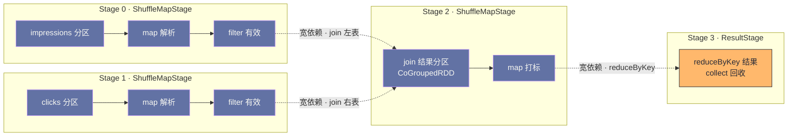
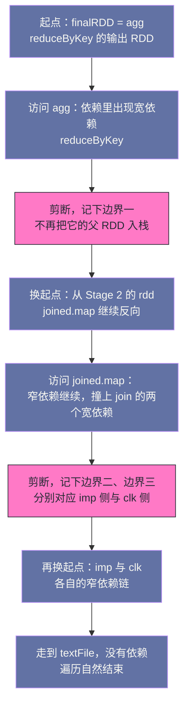
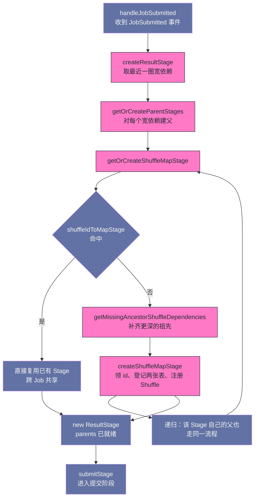
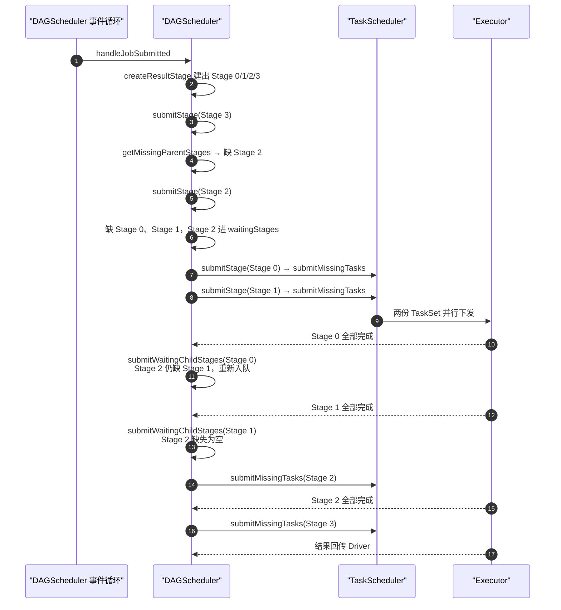
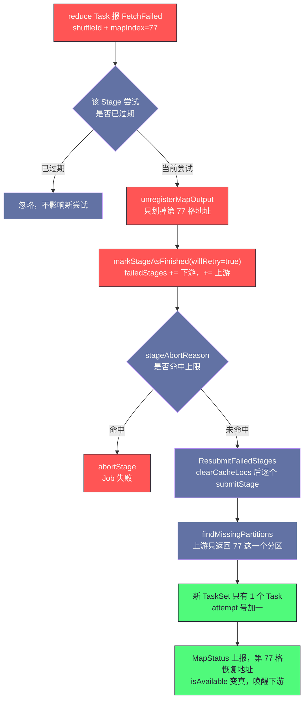

# 5. Spark DAGScheduler Stage 划分：反向遍历、宽依赖边界与分区级重提

**摘要：**

2012 年，伯克利 AMPLab 在 NSDI 上发表 RDD 论文时，用一张血缘（Lineage）图解释了容错从哪里来：数据丢了不必复制，照着血缘重算即可。但血缘图只是一张逻辑图，它没有回答执行引擎最关心的那个问题——从哪一段开始重算最便宜。Spark 在 RDD 之上加的那一层高层调度器（DAGScheduler），回答的正是这件事：它把用户写下的变换链折叠成若干个 Stage，在每个 Shuffle 处把逻辑图截断成可以独立物化、独立重来的段。

这篇文章要回答两个问题：Stage 的边界凭什么定在宽依赖上，以及一次失败之后重算到底从哪一级开始。文章沿五问推进：先界定 Stage 是什么、为什么它只能是"物化"的产物；再拆开 `getShuffleDependencies` 的反向遍历，说明为什么边界只能从后往前找、为什么它只认最近一圈宽依赖；接着对比 `ResultStage` 与 `ShuffleMapStage` 两套完全不对称的账本，并解释这种不对称如何决定了 Stage 能否跨 Job 共享；然后把 `createResultStage`、`getOrCreateShuffleMapStage`、`submitStage`、`submitWaitingChildStages` 的调用链完整走一遍，交代 Stage 的提交顺序与"下游必须等上游"这条严格边界；最后落到失败重提上，讲清 `FetchFailed` 如何把账本上的一格划掉、`missingPartitions` 如何让已完成的分区不被重算，以及 `spark.stage.maxConsecutiveAttempts` 这道熔断的两条独立上限；并单列边界与反例，交代哪些直觉会在 barrier Stage、cache、分区器复用与 AQE 这几处失效。

文章的口径是 Spark 4.3.0（4.x 预编译 Scala 2.13）；源码细节以对应版本文档或源码为准。

**关键词（Keywords）**: DAGScheduler, ResultStage, ShuffleMapStage, 宽依赖, missingPartitions, Stage重提, MapOutputTracker

---

## 第 1 章 Stage 是什么：一次 Shuffle 把图剪断

### 1.1 一张血缘图解释不了的事

RDD 论文给出的容错论证相当漂亮：RDD 是不可变的，分区之间的血缘被记录下来，任何一个分区丢失，都可以沿着血缘把它重新算出来，因此不需要像 HDFS 那样做三副本。这套论证成立的前提是"重算的代价可以接受"，而代价这件事，血缘图本身是不描述的。

一条 `map → filter → map` 的链上，重算一个分区只需要拉一个父分区，代价与这条链的长度成正比、与数据总量无关；可一旦中间隔了一次 Shuffle，重算一个下游分区就要去拉上游全部 map 分区的输出，代价一下子从"一个分区的量"变成"一次 Shuffle 的量"。同一张血缘图上，不同位置的重算代价差了几个数量级，调度器如果对此视而不见，任何一次失败都会被放大成"整个作业重来"。

DAGScheduler 的第一件事就是给这张图划段，让重算有作用域。**它从不执行计算，它做的事情更接近给一张施工图分段并贴上"此段可独立验收"的标签**。段与段之间的接缝，选在 Shuffle 上。

### 1.2 宽依赖为什么天然是接缝

窄依赖（Narrow Dependency）的定义是子 RDD 的每个分区只依赖父 RDD 的固定几个分区，`map`、`filter`、`union`、以及分区器相同的 `join` 都属此类。这类依赖可以做成迭代器套迭代器：父分区算出一个元素，子分区立刻消费一个元素，整条链在一个 Task 里、一轮遍历中跑完，中途不落地。

宽依赖（Shuffle Dependency）则相反，子 RDD 的每个分区要读父 RDD 的所有分区（严格说是所有包含目标键的分区），于是必须先把父端算完、按目标分区重排、写到磁盘（或内存）上、并在某个地方登记"第 i 个 map 分区的输出在第几台机器的哪个文件里"，下游才谈得上读取。

把两种依赖的几个关键差别并排放，能看出它们的分工远不止"快与慢"：

| 维度 | 窄依赖（Narrow Dependency） | 宽依赖（Shuffle Dependency） |
|---|---|---|
| 分区对应关系 | 子分区映射到父的固定分区，一对一或范围对应 | 子分区要读父的全部分区中符合键的那些 |
| 中间结果 | 不落地，迭代器直接传递 | 必须物化，并向 Driver 登记地址 |
| 能否流水 | 能，整条链在一个 Task 内推完 | 不能，下游要等上游产出（默认路径） |
| 失败时的重算范围 | 所在 Task 的那一个分区 | 由地址账本裁剪出的缺失 map 分区 |
| 典型算子 | `map`、`filter`、`union`、`mapPartitions` | `groupByKey`、`reduceByKey`、`join`、`repartition` |
| 是否构成 Stage 边界 | 否 | 是 |

这个差别看起来是性能问题，实质是寻址问题：窄依赖链上的中间结果没有名字，你没法说"把第 3 个分区的中间结果给我"，因为它从来没有被单独存下来过；宽依赖的输出有名字，名字是 `(shuffleId, mapId)`，地址记在 `MapOutputTracker` 里。有了名字和地址，才谈得上"只重算丢了的那一格"。

所以 Stage 的边界不是"慢"的边界，而是"物化"的边界。**凡是有地址的中间结果，都是重算可以裁剪的地方；凡是没地址的中间结果，只能跟着所在的 Task 一起重来。**这句话可以当作后文所有结论的源头：Stage 划分真正划出来的，是"哪里可以重来"，而不是"哪里更快"。

反过来设想一下边界如果不划在宽依赖上会怎样。若按窄依赖切，每个 `map` 一个 Stage，每步都落盘登记，流水线彻底消失，一个十步的链要写十次磁盘，Task 数量按步数翻倍；若干脆不切，整张图一个 Stage，那么一次 reduce 端取数失败就得把前面的 map 全部重跑，而这恰恰是 Shuffle 最想避免的事。两头都不划算，接缝只能落在宽依赖这个"本来就要落盘"的位置上——这是一次顺势而为，不是一次额外开销。

### 1.3 一个贯穿全文的作业

为了让后面的机制有具体的着力点，笔者设想一个广告归因作业 `ad_attribution`：每天凌晨从 HDFS 读当天的曝光日志与点击日志，各自解析、过滤掉无效记录，按请求标识把两边 join 起来，再按广告位与小时聚合点击率，最后 `collect` 回 Driver 做一次小规模校验。

写成 RDD 代码大致是这样，输入侧各按 200 个分区读入：

```scala
// 两条彼此独立的窄依赖链，各自以一次 Shuffle 收尾
val imp = sc.textFile("hdfs:///logs/impressions").map(parseImp).filter(_.valid)
val clk = sc.textFile("hdfs:///logs/clicks").map(parseClk).filter(_.valid)

// join 会对 imp 与 clk 各生成一个 ShuffleDependency，两条父分支在此汇合
val joined = imp.join(clk)
val agg = joined.map(toAdSlotHourPair).reduceByKey(_ + _)

agg.collect()   // ResultStage 的终点
```

这段代码里有三个 Shuffle 依赖：`join` 内部有两个（左表一个、右表一个），`reduceByKey` 有一个。DAGScheduler 会把它建造成四个 Stage：`imp` 侧一个 `ShuffleMapStage`、`clk` 侧一个 `ShuffleMapStage`、join 之后到 `reduceByKey` 之前一个 `ShuffleMapStage`、以及最后的 `ResultStage`。前两个 Stage 之间没有任何依赖，可以同时跑；第三个必须等前两个都可用；第四个必须等第三个可用。

这个作业会在后文反复出现：第 2 章看它如何被反向遍历切出来，第 3 章看它的四个 Stage 各自记着什么账，第 5 章看它的提交顺序，第 7 章看它的一次取数失败如何只重算一个 map 分区。

### 1.4 一个比喻：总装线与中转仓

把窄依赖链想成总装线上连续的几道工序：零件在传送带上一件件过来，拧螺丝、贴标签、装箱，全在一条线上完成，中间不需要入库；某一颗螺丝没拧紧，退回去重拧这一颗即可，前面已经装好的不受影响。Shuffle 则是中转仓：货必须卸下来、上架、登记库位，下一道工序凭库位单来取货。中转仓一旦建好，某一件货坏了只需补那一件；但在仓库收齐货之前，下一道工序没法开工。

比喻的技术限定在于：Spark 的中转仓并非"全部收齐才开门"。`MapOutputTracker` 是逐分区登记地址的，reduce 端理论上可以边取边等还没算完的 map 分区。Spark 没有这么做，而是在 Stage 提交这一层就把等待做掉了——下游 Stage 要等到上游 `isAvailable` 才被提交。为什么宁可选择"等全量"这种看起来更粗的方式，正是第 5 章要交代的取舍。

下图是 `ad_attribution` 被剪开后的样子。三个 Shuffle 依赖落在三处接缝上，四个 Stage 分成三层，Stage 的编号就是建图时分配到的 id，后文会说明它为什么天然满足"父小于子"。



图中 Stage 0 与 Stage 1 之间没有边，这是 Stage 图可以并行的唯一来源；Stage 2 有两条入边，来自同一次 `join` 的两个 Shuffle 依赖；Stage 3 只有一条入边。四段三层，层数等于"最长 Shuffle 链"的长度。

---

## 第 2 章 反向遍历：边界只能从后往前找

### 2.1 正向为什么走不通

要划段，先得知道接缝在哪。一个自然的想法是从数据源正向遍历：从最左侧的 RDD 出发，顺着依赖往右走，遇到宽依赖就切一刀。这个思路在一条直链上没问题，在真实图上很快失效。

原因在于 RDD 图不是树。`imp` 这个 RDD 可能既被 `join` 用，又被另一个 `saveAsTextFile` 用；一个 RDD 有多个孩子，正向遍历会在分叉处重复访问同一段血缘，而"切一刀"这个动作本身又依赖你知道"这一刀之后还有没有别的孩子要读"。更麻烦的是，正向遍历时你并不知道当前这条链的终点在哪里——终点由 Action 决定，而 Action 在图的另一端。

反向遍历把这两个麻烦一次解决：从 Action 指定的最终 RDD 出发，沿着依赖往回走，**第一个遇到的宽依赖就是这条链的接缝**，剪断它、从它的父 RDD 继续往回走，直到走到没有依赖的数据源。终点已知，分叉由 `visited` 集合去重，接缝由"遇到宽依赖即止"确定，全部是局部判断。

### 2.2 `getShuffleDependencies`：只认最近一圈

这个方法的名字容易引起误解：它返回的不是"这个 RDD 的所有祖先宽依赖"，而是"这个 RDD 最近一圈的宽依赖"。源码注释里举了个例子：若有 `A <-- B <-- C`，对 C 调用只返回 `B <-- C` 这一条，A 与 B 之间的宽依赖不在结果里。

实现是一个带 `visited` 的手写栈遍历，去掉 4.x 收集资源剖面（ResourceProfile）的部分后，主干如下：

```scala
// DAGScheduler.getShuffleDependencies（3.x 形态；4.x 把同一遍历抽成
// traverseRDDGraph，并顺带收集 ResourceProfile，方法名改为
// getShuffleDependenciesAndResourceProfiles）
private def getShuffleDependencies(
    rdd: RDD[_]): HashSet[ShuffleDependency[_, _, _]] = {
  val parents = new HashSet[ShuffleDependency[_, _, _]]
  val visited = new HashSet[RDD[_]]
  val waitingForVisit = new ListBuffer[RDD[_]]
  waitingForVisit += rdd
  while (waitingForVisit.nonEmpty) {
    val toVisit = waitingForVisit.remove(0)   // 配合下面的 prepend，等价于弹栈
    if (!visited(toVisit)) {
      visited += toVisit
      toVisit.dependencies.foreach {
        case shuffleDep: ShuffleDependency[_, _, _] =>
          parents += shuffleDep                 // 收到边界即止，不深入它的父 RDD
        case dependency =>
          waitingForVisit.prepend(dependency.rdd) // 窄依赖继续往回探
      }
    }
  }
  parents
}
```

三处细节值得停下来看。第一，`prepend` 配 `remove(0)` 是后进先出，也就是深度优先；换成 `+=` 配 `remove(0)` 就变成广度优先，结果集合相同但访问顺序不同，而访问顺序会影响日志与调试体验，不影响正确性。第二，遇到宽依赖只把依赖本身收进结果，不再把它的父 RDD 入栈，这一行的省略就是"剪断"这个动作的全部实现。第三，`visited` 记的是 RDD 而不是依赖，同一个 RDD 从两条路径到达只处理一次，这是图而不是树带来的必需。

为什么只收最近一圈，而不是一次收全？因为 Stage 的父子关系必须精确到"直接父"。假如这里把所有祖先宽依赖都返回，`getOrCreateParentStages` 就会把每一个都当成当前 Stage 的直接父，Stage 图会从 DAG 变成"每个 Stage 都指向所有上游 Stage"的稠密图，提交顺序随之失去拓扑意义，重提时也无法判断该先等谁。

把 `ad_attribution` 的第一次遍历画出来，可以看到"剪断"这个动作在数据上是什么样子。注意每次剪断之后，遍历并不会结束，而是换一个起点继续——起点从"当前 RDD"变成"这个宽依赖的父 RDD"，由 `getOrCreateShuffleMapStage` 接手。



图里两次"剪断"对应两次 `getShuffleDependencies` 调用：第一次拿到的边界只有一个，第二次拿到两个。这也解释了第 4 章要交代的那个细节——`join` 是两个宽依赖而不是一个，所以 Stage 2 有两条入边，而不是一条。

### 2.3 手写栈与一个真实的溢出风险

用 `while` 加 `ListBuffer` 而不是递归，不是为了风格。RDD 链可以很长，一个由几百个 `map` 拼出来的 ETL 在 Scala 里递归遍历依赖，碰上默认栈大小就会抛 `StackOverflowError`；而这个错误发生在 Driver 的调度线程上，后果是事件循环退出、整个 SparkContext 停掉。源码在好几处遍历里都留了同一句注释，大意是"这里手工维护栈，避免递归访问导致的 StackOverflowError"。

4.x 把这类遍历统一抽成了 `traverseRDDGraph` 与 `traverseRDDGraphUntil` 两个辅助方法，前者把每个未访问的 RDD 交给访问者并允许它继续入栈，后者多一个"访问者返回 false 就整体停止"的短路能力。抽出来的动机不只是复用：`getMissingParentStages`、`getMissingAncestorShuffleDependencies`、barrier Stage 的分区数校验、以及 4.x 新加的流水线 Shuffle 检查，做的是同一件事——沿窄依赖反向走、在每个 Shuffle 依赖处停下做判断——只是"停下之后做什么"不同。把这层骨架统一起来，等于把"如何遍历 RDD 图"变成一个可以单独审阅的正确性问题。

### 2.4 反事实：遍历不剪枝

把 2.2 里那行"不深入"删掉，让遍历穿过宽依赖继续往回走，会发生什么？`getShuffleDependencies(agg)` 会返回三个宽依赖而不是一个，`createResultStage` 于是认为 `ResultStage` 有三个直接父 Stage，其中包括 `imp` 与 `clk` 那两个上游的 ShuffleMapStage。建出来的图仍然是 DAG，但拓扑关系错了：中间那个 join 之后的 Stage 不再是 ResultStage 的父，而是与它平级；提交顺序上，`imp` 算完了 `ResultStage` 就可能被判定"父已齐"，于是去读一份根本还没生成的 Shuffle 输出。

这类错误的可怕之处在于它不总是立刻崩溃。如果中间 Stage 恰好先完成了，作业会正常跑完，错误被掩盖；一旦执行顺序换一下，就变成偶发的取数失败，排查时看到的是 `FetchFailed`，而根因在 Stage 图上少了一层父子关系。**Stage 图的每一条边都是一次"谁等谁"的承诺，多一条边是浪费，少一条边是事故。**

---

## 第 3 章 两类 Stage 与两套账本

### 3.1 `ResultStage`：一个 Job 的终局

`ResultStage` 对应一次 Action。它持有三样别处没有的东西：要作用于每个分区的函数 `func`、这次 Action 关心的分区子集 `partitions`、以及当前绑定在这个 Stage 上的活跃 Job `activeJob`。

有一个容易被忽略的不对称：`ResultStage` 在构造时传给 `Stage` 的 `numTasks` 是 `partitions.length`，而 `Stage` 基类里的 `numPartitions` 是 `rdd.partitions.length`。两者通常相等，但在 `first()`、`take(n)`、`lookup()` 这类只需要部分分区的 Action 上会差很多——`first()` 的 `numTasks` 是 1，`numPartitions` 可能是一万。后面第 6 章讲 Task 数量时，这个差别会直接决定"这个 Stage 提交几个 Task"。

`ResultStage` 每个 Job 新建一个，从不复用。原因不在实现偷懒，而在它的账本：`ResultStage` 的"完成"是记录在 `ActiveJob.finished` 这个布尔数组上的，数组长度等于本次 Job 要算的分区数，下标是 Job 内部的分区序号。这份账本天然属于某一个 Job，换一个 Job 就是另一份，谈不上共享。

### 3.2 `ShuffleMapStage`：以 `shuffleId` 为键的中转仓

`ShuffleMapStage` 对应一次 Shuffle 的产出侧。它挂着一个 `shuffleDep`，`numTasks` 取 `shuffleDep.rdd.partitions.length`，也就是父 RDD 的分区数——这一点值得强调：**map 端的 Task 数由父 RDD 的分区数决定，与下游 reduce 分区数无关**。下游要 2000 个分区，上游仍按自己的 200 个分区算，多出来的是 Shuffle 的扇出，不是 Stage 的 Task 数。

它的账本不在自己身上，而在 Driver 的 `MapOutputTracker` 里。`numAvailableOutputs` 直接从 tracker 拿，`isAvailable` 就是 `numAvailableOutputs == numPartitions`，`findMissingPartitions()` 也是问 tracker"哪些 map 分区还没有地址"。Stage 对象本身只保留两样东西：`shuffleDep` 与 `jobIds`。

账本放在 tracker 而不是 Stage 上，是因为这份信息必须对全应用唯一：多个 Job 可能读同一个 `shuffleId`，多个 Stage 可能因为重提而不停重建，只有 `shuffleId` 是稳定标识。用 `shuffleId` 作键还带来一个直接后果——一个 `shuffleId` 只对应一个 `ShuffleMapStage`，`shuffleIdToMapStage` 这张表就是这条约束的物化。

### 3.3 两套账本为什么必然不对称

把两套账本并排看，会发现它们记的东西根本不是一个类型：

| 维度 | `ResultStage` | `ShuffleMapStage` |
|---|---|---|
| 创建时机 | 每次 Action 新建，一个 Job 一个 | 按 `shuffleId` 去重，可跨 Job 复用 |
| 构造函数入参 | `func`、Action 关心的分区子集 | `shuffleDep`、父 RDD 的分区数 |
| `numTasks` 口径 | `partitions.length`（可能是全量分区的子集） | 父 RDD 的分区数 |
| 完成账本 | `ActiveJob.finished` 布尔数组（Job 私有） | `MapOutputTracker` 的 MapStatus 地址表（应用全局） |
| 可用性判据 | 本次 Job 的目标分区全部 `finished` | `numAvailableOutputs == numPartitions` |
| `missingPartitions` 来源 | 布尔数组取反 | 向 tracker 查询缺失的 map 分区 |
| 任务类型 | `ResultTask`，结果回传 Driver | `ShuffleMapTask`，结果写盘并登记地址 |
| 能否跨 Job 共享 | 不能，也不需要 | 能，且这是 Spark 复用上游的基石 |
| 重提时的重算范围 | 本次 Job 未完成的目标分区 | 账本上地址缺失的 map 分区 |

这就是那句话的出处：**Stage 能否跨 Job 共享，取决于它的"完成"是不是一个全局可寻址的事实。**`ShuffleMapStage` 的完成是"200 个 map 分区各自有一个地址"，这个事实与应用里哪个 Job 在跑无关，任何 Job 都能查；`ResultStage` 的完成是"这个 Job 的 37 个目标分区算完了"，离开这个 Job 就没有意义。

### 3.4 多个 Job 共享一个 Stage 的两种情形

共享在真实作业里天天发生，而且有两种截然不同的形态。

第一种是串行复用。同一个 RDD 上先 `count()` 再 `collect()`，第一个 Job 已经把中间那层 `ShuffleMapStage` 跑完了，第二个 Job 建图时 `getOrCreateShuffleMapStage` 直接命中 `shuffleIdToMapStage`，返回的是同一个 Stage 对象；随后 `getMissingParentStages` 检查 `isAvailable` 为真，于是它根本不进入 missing 集合，第二个 Job 只需要提交自己的 `ResultStage`。这条路径上还有一个不起眼但必要的动作：`increaseAttemptIdOnFirstSkip`，在 Stage 第一次被"跳过"时把 `nextAttemptId` 从 0 推到 1。没有它，StageInfo 里会出现一次"第 0 次尝试"，在 Spark UI 上看就像是重试过一轮。

第二种是并发共享。两个 Job 同时需要同一个 `shuffleId`，后者建图时拿到的仍是同一个 `ShuffleMapStage`，`updateJobIdStageIdMaps` 把两个 jobId 都记进 `stage.jobIds`。这时一个问题冒出来：Stage 提交时要带一个 jobId（用于取调度池、job group 等属性），两个 Job 该用谁的？`activeJobForStage` 的答案是"取 `jobIds` 排序后第一个仍然活跃的 Job"，源码注释里也承认这只是缓解跨 Job 的优先级反转，并没有真正按调度池优先级挑。这是一个已知的粗糙处，它的代价被限制在"提交属性可能取自另一个 Job"这个范围内，不影响数据正确性。

### 3.5 `activeJob` 上的那个裸 `get`

`ResultStage.findMissingPartitions()` 里有一行 `val job = activeJob.get`，而 `activeJob` 是 `Option`。源码注释写得很直白：这个方法只能在存在活跃 Job 时调用。也就是说，一旦某个 `ResultStage` 的 Job 已经结束、`removeActiveJob` 被调用，再有人试图提交这个 Stage，拿到的不是"零个缺失分区"，而是一个 `NoSuchElementException`。

把它当成一个契约而不是缺陷更合适：它把"Stage 不能脱离 Job 独立重提"这条约束写进了类型之外的地方。读源码时看到这种裸 `get`，通常意味着作者认为"走到这里还没有 Job"本身就是 bug——而这类断言，恰恰是理解一个调度器边界最快的地方。

### 3.6 第三种共享：Stage 自己就是 Job 的终点

还有一种共享形态比前两种更隐蔽：`ActiveJob` 的 `finalStage` 字段声明的类型是 `Stage`，不是 `ResultStage`。`DAGScheduler.submitMapStage` 提交的 Job，终点就是一个 `ShuffleMapStage`——它不执行任何 Action，只要求把某个 Shuffle 的 map 输出算出来，算完之后通过回调交回一份 `MapOutputStatistics`（每个 reduce 分区的平均数据量与记录数）。

这条路是给自适应查询执行用的：下游还怎么划分、要不要合并小分区、join 走 Broadcast 还是 SortMerge，都可以等这份统计出来再决定。放在本文的框架里看，它说明了一件容易被忽略的事——Stage 不会因为"背后没有 Action"而改变身份。同一个 `ShuffleMapStage`，在 `ad_attribution` 那种普通 Job 里是中间站，在 `submitMapStage` 提交的 Job 里是终点；它的账本、可用性判据、重提粒度一模一样，只是完成时要多回调一个 `mapStageJobs` 列表里的等待者。

这也解释了 `ShuffleMapStage` 上为什么单独有一个 `mapStageJobs`，而不是复用 `ResultStage` 的 `activeJob`：**中间站可以被多个终点共享，终点的等待者却只能有一个**——账本形态决定了这两类信息不可能塞进同一个字段。

---

## 第 4 章 建图：先有终点，才有父节点

### 4.1 `handleJobSubmitted` 只做三件事

Action 触发后，`SparkContext.runJob` 最终把 `JobSubmitted` 事件投进 DAGScheduler 的事件循环；Action 如何触发 Job、`JobWaiter` 如何等待结果，属于 Job 生命周期的范围（见 [[9. Spark_Job生命周期详解]]），这里从事件被处理的那一刻说起。`handleJobSubmitted` 的主干短得有点意外：

```scala
private[scheduler] def handleJobSubmitted(jobId: Int, finalRDD: RDD[_], ...): Unit = {
  var finalStage: ResultStage = null
  try {
    finalStage = createResultStage(finalRDD, func, partitions, jobId, callSite)
  } catch {
    case e: Exception =>
      listener.jobFailed(e)     // 建图失败就地失败，不留半个 Stage 图
      return
  }
  val job = new ActiveJob(jobId, finalStage, callSite, listener, properties)
  clearCacheLocs()
  jobIdToActiveJob(jobId) = job
  activeJobs += job
  finalStage.setActiveJob(job)  // ResultStage 与 Job 在此绑定
  listenerBus.post(SparkListenerJobStart(...))
  submitStage(finalStage)       // 真正的提交从这里开始，见第 5 章
}
```

三件事：建图、登记 Job、提交。中间那句 `clearCacheLocs()` 值得记一笔，它把 Driver 缓存的"哪个分区在哪个 Executor 上"清空，因为上一个 Job 跑完之后 Executor 集合可能已经变了；后面处理取数失败时还会再清一次，理由相同。

建图失败就地失败这条也值得看。`createResultStage` 里会去碰 `HadoopRDD` 的输入路径，如果 HDFS 上的文件已被删除，异常会在这里抛出；此时一张 Stage 图可能已经建了一半，`handleJobSubmitted` 选择不修补、直接让 Job 失败，把清理交给 Job 级的收尾流程。半张图比没有图更难处理，这是调度器里反复出现的同一个态度。

### 4.2 `createResultStage`：父 Stage 先于子 Stage 登记

`createResultStage` 的顺序是有讲究的：

```scala
private def createResultStage(rdd: RDD[_], func: ..., partitions: Array[Int],
    jobId: Int, callSite: CallSite): ResultStage = {
  val (shuffleDeps, resourceProfiles) = getShuffleDependenciesAndResourceProfiles(rdd)
  checkBarrierStage(rdd, resourceProfile, partitions.toSet.size)   // barrier 约束先校验
  val parents = getOrCreateParentStages(shuffleDeps, jobId)        // 先把父 Stage 建好
  val id = nextStageId.getAndIncrement()                           // 再领自己的 id
  val stage = new ResultStage(id, rdd, func, partitions, parents, jobId, callSite, ...)
  stageIdToStage(id) = stage
  updateJobIdStageIdMaps(jobId, stage)                             // 反向给祖先补 jobId
  stage
}
```

`getOrCreateParentStages` 只是一个 `map`：对每个宽依赖调用 `getOrCreateShuffleMapStage`。因为"先建父、后领号"，`nextStageId` 的分配顺序天然是自底向上的——`ad_attribution` 的四个 Stage，`imp` 侧拿到 0、`clk` 侧拿到 1、join 之后拿到 2、`ResultStage` 拿到 3。**父 Stage 的 id 必然小于子 Stage 的 id**，这条性质后面会被 `submitStage` 用来给缺失父 Stage 排序；`resubmitFailedStages` 用的是另一套口径（按 `firstJobId`），两处排序不要混。

`updateJobIdStageIdMaps` 的方向与建图相反，是从子往父传：

```scala
private def updateJobIdStageIdMaps(jobId: Int, stage: Stage): Unit = {
  @tailrec def updateJobIdStageIdMapsList(stages: List[Stage]): Unit = {
    if (stages.nonEmpty) {
      val s = stages.head
      s.jobIds += jobId
      jobIdToStageIds.getOrElseUpdate(jobId, new HashSet[Int]()) += s.id
      // 已经登记过这个 jobId 的父 Stage 不必再往下走：它的祖先必然也登记过了
      val parentsWithoutThisJobId = s.parents.filter { !_.jobIds.contains(jobId) }
      updateJobIdStageIdMapsList(parentsWithoutThisJobId ++ stages.tail)
    }
  }
  updateJobIdStageIdMapsList(List(stage))
}
```

那个 `filter` 是图共享带来的必要剪枝。没有它，一个被多个 Job 反复走过的 Stage 图会退化成指数级的重复访问；有了它，每个 Job 的登记成本与"首次被这个 Job 触达的 Stage 数"成正比。

### 4.3 `getOrCreateShuffleMapStage`：三段式与一次二次检查

这个方法是整条建图链上唯一会"递归深入"的地方，形态是三段：

```scala
private def getOrCreateShuffleMapStage(
    shuffleDep: ShuffleDependency[_, _, _], firstJobId: Int): ShuffleMapStage = {
  shuffleIdToMapStage.get(shuffleDep.shuffleId) match {
    case Some(stage) =>
      stage                                   // 命中：直接复用，跨 Job 共享从这里发生
    case None =>
      // 未命中：先把这条分支上所有还没建过的祖先 Shuffle 建出来
      getMissingAncestorShuffleDependencies(shuffleDep.rdd).foreach { dep =>
        if (!shuffleIdToMapStage.contains(dep.shuffleId)) {  // SPARK-13902：可能已被顺带建好
          createShuffleMapStage(dep, firstJobId)
        }
      }
      createShuffleMapStage(shuffleDep, firstJobId)          // 最后建自己
  }
}
```

第一段是复用，也是"已完成的分区不重算"在上游的起点：只要 `shuffleId` 在表里，无论它的输出是最新一轮算的还是上一轮算的，都拿来用，是否可用由调用方查 `isAvailable`。

第二段是补齐祖先。`getMissingAncestorShuffleDependencies` 的遍历方式与第 2 章那个遍历同源，但它做的事情不同：对每个未访问的 RDD 调一次 `getShuffleDependencies`，把未登记的宽依赖前置进结果并继续深入它的父 RDD，也就是把"最近一圈"这个动作一层层叠上去，直到把所有层都收齐。建成顺序自然是从最深的祖先开始，因为结果用的是 `prepend`。

第三段那个 `if` 看起来多余——`getMissingAncestorShuffleDependencies` 明明只返回"未登记"的依赖，为什么还要再查一次？源码注释里点了名：在遍历返回与循环执行之间，前一个依赖的 `createShuffleMapStage` 可能已经把它顺带建出来了。这是 SPARK-13902 留下的教训，也是这类"先查询再创建"接口的通用陷阱：查询与创建之间存在窗口，而创建本身又会递归触发查询。

### 4.4 `createShuffleMapStage` 真正登记了什么

```scala
def createShuffleMapStage[K, V, C](
    shuffleDep: ShuffleDependency[K, V, C], jobId: Int): ShuffleMapStage = {
  val rdd = shuffleDep.rdd
  val numTasks = rdd.partitions.length
  val parents = getOrCreateParentStages(getShuffleDependenciesAndResourceProfiles(rdd)._1, jobId)
  val id = nextStageId.getAndIncrement()
  val stage = new ShuffleMapStage(id, rdd, numTasks, parents, jobId,
    rdd.creationSite, shuffleDep, mapOutputTracker, resourceProfile.id)

  stageIdToStage(id) = stage
  shuffleIdToMapStage(shuffleDep.shuffleId) = stage   // 一个 shuffleId 一个 Stage
  updateJobIdStageIdMaps(jobId, stage)
  mapOutputTracker.registerShuffle(
    shuffleDep.shuffleId, rdd.partitions.length, shuffleDep.partitioner.numPartitions, jobId)
  stage
}
```

`registerShuffle` 那一行传了两个分区数：`rdd.partitions.length` 是 map 端分区数，`shuffleDep.partitioner.numPartitions` 是 reduce 端分区数。这两个数字在整个 Shuffle 生命周期里反复出现——map 端决定要建多少个 Task，reduce 端决定要生成多少份输出文件、下游 Stage 有多少个分区。把两者记在同一个注册项上，才谈得上"按分区块查询地址"。

从这张图能看清建图的完整形状：从终局出发，父向更深、id 从小到大分配，每建一个 `ShuffleMapStage` 就把 `shuffleId` 记进表里，把依赖注册进 `MapOutputTracker`。



图中右侧那个自环是建图的核心：每建一个 `ShuffleMapStage`，都要再问一次"它自己的父是谁"，直到走到没有 Shuffle 依赖的数据源。整张图的深度等于 Shuffle 链的长度，广度等于并行分支数。

---

## 第 5 章 提交顺序：递归向父，等待队列回调

### 5.1 三重闸门与提交的幂等性

`submitStage` 的第一段是三道闸门：

```scala
private def submitStage(stage: Stage): Unit = {
  val jobId = activeJobForStage(stage)
  if (jobId.isDefined) {
    if (!waitingStages(stage) && !runningStages(stage) && !failedStages(stage)) {
      // 只有三个集合都不包含它，才谈得上提交
      ...
    }
  } else {
    abortStage(stage, "No active job for stage " + stage.id, None)
  }
}
```

三个集合分别表示"在等父 Stage"、"正在跑"、"已失败待重提"。它们存在的理由是同一个：提交这个动作会被多个来源重复触发。Job 提交时会 `submitStage(finalStage)`；某个父 Stage 完成时会 `submitWaitingChildStages` 扫一遍等待队列；取数失败重提时会 `resubmitFailedStages` 重走一遍。如果没有这三道闸门，一个已经被重新提交过的 Stage 会收到第二份 `TaskSet`，同一批分区被算两遍，Shuffle 输出文件互相覆盖。

注意第一个分支的判据是 `activeJobForStage(stage).isDefined`，取的是"能代表这个 Stage 的活跃 Job"。对 `ResultStage` 来说它等于自己那个 Job；对共享的 `ShuffleMapStage` 来说它是 `jobIds` 里最小的活跃 Job。若一个 Stage 的所有 Job 都已结束或取消，走 else 分支 `abortStage`，而不是静默跳过——这条刻意选择了"报错"而不是"忽略"，因为一个没有 Job 的 Stage 被提交，意味着调度器里已经有不一致。

### 5.2 `getMissingParentStages`：只有"缺"才等

闸门之后是判据：

```scala
val missing = getMissingParentStages(stage).sortBy(_.id)
if (missing.isEmpty) {
  submitMissingTasks(stage, jobId.get)
} else {
  for (parent <- missing) { submitStage(parent) }   // 先把缺失的父提交掉
  waitingStages += stage                            // 自己进等待队列
}
```

`getMissingParentStages` 的遍历骨架与第 2 章同源，但对每个 Shuffle 依赖做的是"取或建 Stage，再问它可不可用"：

```scala
case shufDep: ShuffleDependency[_, _, _] =>
  val mapStage = getOrCreateShuffleMapStage(shufDep, stage.firstJobId)
  // 4.x 里 isAvailable 不是唯一判据：push-based shuffle 还要等 merge 收尾
  if (!mapStage.isAvailable || !mapStage.shuffleDep.shuffleMergeFinalized) {
    missing += mapStage
  } else {
    mapStage.increaseAttemptIdOnFirstSkip()   // 被跳过的 Stage 也要占一个 attempt 号
  }
case narrowDep: NarrowDependency[_] =>
  enqueue(narrowDep.rdd)                      // 窄依赖继续往回走
```

这里藏着 cache 能"抹掉"父 Stage 的机制。遍历每个 RDD 时先问一句"它的分区是不是全都有缓存位置"（`getCacheLocs(rdd).contains(Nil)` 为假即视为全缓存），**一旦全缓存，这个 RDD 的依赖根本不被访问**，它背后的整条 Shuffle 分支也就不会出现在 missing 里。换句话说，cache 不是把 Stage 变快，而是让父 Stage 从"缺失"里消失。这条机制的边界在第 8 章还会再提：它只影响 missing 的判定，不改变 Stage 图的形状。

`sortBy(_.id)` 只是给缺失父 Stage 一个确定的顺序。真正保证拓扑的是递归本身——每个父在被提交前又会先检查自己的父；排序的作用是让多个父同时缺失时的提交顺序稳定，避免同一张图在不同次运行里打出顺序不同的日志。而"id 小的是父"这条性质，让这个顺序恰好也是自底向上的。

### 5.3 完成回调：`submitWaitingChildStages`

`waitingStages` 里的 Stage 不会自己醒来。父 Stage 完成时，调度器扫一遍等待队列，把父已全部就绪的 Stage 拉出来重新提交：

```scala
private def submitWaitingChildStages(parent: Stage): Unit = {
  val childStages = waitingStages.filter(_.parents.contains(parent)).toArray
  waitingStages --= childStages
  for (stage <- childStages.sortBy(_.firstJobId)) { submitStage(stage) }
}
```

`filter(_.parents.contains(parent))` 只挑"直接把这个父 Stage 列为父"的子 Stage，不递归往下传。这一点很关键：孙子 Stage 的父是子 Stage，它必须等子 Stage 完成，而不是等祖父完成；如果这里做递归唤醒，就会出现"祖父完成、孙子被提交、而子还在跑"的越级。

被拉出来的 Stage 重新走一遍 `submitStage`，再查一次 `getMissingParentStages`。所以一个有两个父的 Stage（`ad_attribution` 里的 Stage 2）会被唤醒两次：`imp` 侧完成时它进一次 `submitStage`，发现 `clk` 侧还缺，于是重新回到等待队列；`clk` 侧完成时再进一次，这次 missing 为空，才真正提交。**重复唤醒 + 每次重查**这个组合，是"下游必须等上游"这条严格边界最朴素的实现，也是它能正确处理任意 DAG 形状的原因——不需要事先拓扑排序，只需在每次触发时诚实地问一遍"我现在还缺什么"。

### 5.4 流水在 Stage 内，边界在 Stage 间

Stage 内部的窄依赖是流水的：`map`、`filter`、`mapPartitions` 串在一个 Task 里，用迭代器一个元素一个元素往下推，中间不落地。这条流水线的长度就是 Stage 里窄依赖的条数，深度可以很长，而内存占用与链长无关。

跨 Stage 就没有这种自由。下游 Stage 被提交的那一刻，上游的所有 map 分区都必须已经可用——不是因为读取接口不支持阻塞，而是因为一旦允许"边读边等"，等待的位置就从调度层下沉到了 Task 内部：一个 reduce Task 可能因为某个 map 分区迟迟算不出来而长时间占着 Executor 的一个核空转，同时它还握着已经读到的数据；如果这个 map 分区最终失败，这个已经跑了很久的 reduce Task 只能整个作废，前面读的数据全部白费。两害相权，Spark 选择在调度层等：**等待发生在 Stage 之间，代价是吞吐的空窗，收益是不会出现"白跑一半又被推翻"的任务。**

这条边界在 4.3.0 里出现了一个受限的例外。源码里已经有 `PipelinedShuffleDependency` 这一支：当一个 Shuffle 被标记为流水线式时，它的下游不再等上游全部产出，而是与上游协同调度（co-schedule），由 `submitWaitingPipelinedChildStages` 在上游"开始运行"而非"完成"时唤醒下游，并且在 Job 提交阶段就做一次整组容量准入（gang admission），要求整组 Stage 能同时起步；对应的失败语义也变成整组原子失败，而不是只重提某个 Stage。这条路径还在演进，具体约束以对应版本文档或源码为准；但它反过来说明了一件事：**"下游必须等上游"不是物理定律，而是默认路径上的一个成本选择**——要打破它，得同时接管准入、失败语义与资源占用三件事。

### 5.5 一次完整的提交时序

把这一章串起来，`ad_attribution` 的第一次提交大致长这样：Stage 3 被提交 → 缺 Stage 2 → 提交 Stage 2 → 缺 Stage 0 与 Stage 1 → 提交 Stage 0 → 无缺失，发任务；提交 Stage 1 → 发任务；Stage 0 完成 → 唤醒 Stage 2，仍缺 Stage 1 → 回到等待；Stage 1 完成 → 唤醒 Stage 2 → 发任务；Stage 2 完成 → 唤醒 Stage 3 → 发任务。



时序图里第 8 步与第 10 步需要单独看一眼：Stage 2 被唤醒了两次。这不是实现冗余，而是 DAG 有多个父时的必然——每次唤醒都重新算一遍"还缺谁"，比预先算好一个全局拓扑序更简单，也更能容忍运行期的各种变化（父 Stage 被重提、Job 被取消、Stage 被跳过）。

---

## 第 6 章 `submitMissingTasks`：到底发多少个 Task

### 6.1 Task 数由缺失分区数决定

`submitMissingTasks` 一进来就只问一件事："这个 Stage 这次要算哪些分区。"

```scala
val partitionsToCompute: Seq[Int] = stage.findMissingPartitions()
```

`findMissingPartitions` 在两个子类里的实现完全不同，这也正好呼应第 3 章的两套账本：

- `ShuffleMapStage` 问 `MapOutputTracker`："这个 `shuffleId` 还有哪些 map 分区没有地址？"若 tracker 里压根没有这个 Shuffle 的记录（第一次跑），返回全量分区。
- `ResultStage` 拿 `activeJob.finished` 取反，再映射回 Action 真正关心的分区下标 `stage.partitions(id)`。

因此**Task 数量等于本次缺失的分区数，而不是 Stage 的分区总数**。首跑时两者相等；重提时前者可能是 1。这个区别是第 7 章"已完成的分区不重算"的全部技术基础，也是为什么一次取数失败在日志里往往只表现为"提交了 1 个 Task"而不是"整个 Stage 重跑"。

### 6.2 两种 Task 与一个 TaskSet

拿到分区列表后，按 Stage 类型构造两种 Task：

```scala
stage match {
  case stage: ShuffleMapStage =>
    stage.pendingPartitions.clear()
    partitionsToCompute.map { id =>
      val locs = taskIdToLocations(id)       // 首选位置的计算不在本篇范围，这里只把结果挂到 Task 上
      val part = partitions(id)
      stage.pendingPartitions += id
      new ShuffleMapTask(stage.id, stage.latestInfo.attemptNumber, taskBinary, part,
        locs, properties, serializedTaskMetrics, Option(jobId), ...)
    }

  case stage: ResultStage =>
    val job = stage.activeJob.get            // 再次出现：ResultTask 必须绑定 Job
    partitionsToCompute.map { id =>
      val p = stage.partitions(id)           // 注意这里做了下标映射
      val part = partitions(p)
      new ResultTask(stage.id, stage.latestInfo.attemptNumber, taskBinary, part,
        locs, id, properties, serializedTaskMetrics, Option(jobId), ...)
    }
}
```

两处差别值得看。第一，`ShuffleMapTask` 把结果写成 Shuffle 文件并把 `MapStatus` 上报给 Driver，任务本身没有返回值；`ResultTask` 则把 `func` 作用于分区迭代器，结果通过 `JobWaiter` 回传给用户代码。第二，`ResultTask` 的构造函数里多一个 `id` 参数，它是"本次 Job 内的分区序号"，而非 RDD 的分区序号——`first()` 只算一个分区，但这个 Task 要能告诉 `JobWaiter`"我完成的是第 0 个目标分区"，两个序号必须分开。

所有 Task 打成一个 `TaskSet`，连同 `stage.id` 与 `stageAttemptId` 一起交给 `TaskScheduler.submitTasks`。Task 落在哪台机器、本地性级别如何升降、等多久放弃等待，都是 TaskScheduler 的职责（见 [[6. Spark_TaskScheduler_深度解析]]），`submitMissingTasks` 只负责交出边界清楚的 TaskSet：多少个 Task、每个 Task 算哪个分区、属于哪一次 Stage 尝试。

### 6.3 零任务的 Stage 是一种合法状态

如果 `partitionsToCompute` 为空——所有分区都已被缓存、或上游已完成而本 Stage 无需再算——`tasks` 就是空数组。此时 Spark 不会调 `submitTasks`，而是直接 `markStageAsFinished` 然后 `submitWaitingChildStages`：

```scala
if (tasks.nonEmpty) {
  taskScheduler.submitTasks(new TaskSet(tasks.toArray, stage.id, ...))
} else {
  // 一个 Task 都没发，但这个 Stage 在语义上"已经完成"，必须往下推进
  markStageAsFinished(stage, None)
  stage match {
    case stage: ShuffleMapStage => submitWaitingChildStages(stage)
    case stage: ResultStage =>
      // 本次 Job 的目标分区全部命中缓存，Job 直接完成
      ...
  }
}
```

这条分支不能省。假如一个 Stage 因为全缓存而没有 Task 可发，却又没有走"完成"路径，它就会永远停在 `runningStages` 里，下游永远等不到唤醒，整个 Job 挂在那里——没有报错、没有超时，只是不动。这类"合法的空操作"在调度代码里是最容易漏的分支，也是读源码时最该留意的地方：每一个"如果不为空"的判断，背后都有一条"为空时必须往哪走"的路径。

### 6.4 四个计数口径

| Task 数量口径 | 取值来源 | 典型数值 | 说明 |
|---|---|---|---|
| Stage 的分区数 `numPartitions` | `stage.rdd.partitions.length` | 200 | 整个 RDD 的分区规模 |
| Stage 的任务数 `numTasks` | 构造 Stage 时传入 | `ResultStage` 是 Action 目标分区数，`ShuffleMapStage` 是父 RDD 分区数 | `first()` 时为 1 |
| 本次提交的 Task 数 | `findMissingPartitions().length` | 首跑等于 `numTasks`，重提可能为 1 | 决定 `TaskSet` 大小 |
| 已完成 Task 数 | `MapOutputTracker` 的可用输出数 / `ActiveJob.finished` 的 `true` 个数 | 单调递增 | 决定 Stage 何时完成 |

四个数字在 UI 上分别对应"Stage 的分区""Stage 的 Task 总数""本次尝试的 Task 数"与"已完成 Task 数"，日常看到"Stage 有 200 个 Task，但这次只跑了 1 个"，就是第一行与第三行的差别。

### 6.5 一个 Stage 何时算"跑完"：`pendingPartitions` 与账本的分工

`ShuffleMapStage` 上还有一个字段容易被忽略：`pendingPartitions`。`submitMissingTasks` 在构造每个 `ShuffleMapTask` 时把它的分区号加进去，Task 成功时再逐个移除。它记的是"本次尝试派出去、还没回来的分区"，与 `MapOutputTracker` 上那份"历史上算出来、地址还留着"的账本不是一回事。

区别在于判定对象。判断"这次 Stage 尝试是不是跑完了"，`handleTaskCompletion` 用的是 `shuffleStage.pendingPartitions.isEmpty`；判断"这个 Stage 的输出齐不齐、下游能不能开始"，用的是 `isAvailable`（即账本满不满）。两个问题分开问，是因为它们确实会给出不同答案。

设想一种情形：某个 Stage 的 200 个 Task 全部成功，`pendingPartitions` 清空，看起来完美收官；但就在这期间一台 Executor 掉了，它上面 30 个分区的 Shuffle 输出随之消失，账本被划掉 30 格。此时 `pendingPartitions` 为空而 `numAvailableOutputs` 只有 170，`processShuffleMapStageCompletion` 会发现 `isAvailable` 为假，于是把这个 Stage 再提交一次——不是因为它没跑完，而是因为它跑完了但输出没留住。源码在 push-based Shuffle 那段注释里把这层意思写明了：所有 Task 都完成过一次、`pendingPartitions` 已空，却因为 Executor 故障导致部分 map 输出不可用，Stage 仍会被重新提交。

反过来也有不一致：`pendingPartitions` 里还留着几个分区，但它们的输出其实已经在更早的尝试里算出来并登记过。此时 Stage 不会提前结束——这次尝试的 Task 还没回来，TaskSet 还占着资源，提前判完成会让上一轮的结果和这一轮的 Task 交错。**用 `pendingPartitions` 判"这次结束没有"，用账本判"结果齐不齐"，两条判据各管一件事，谁也不替代谁。**这也解释了为什么 `submitMissingTasks` 一进来先 `pendingPartitions.clear()`：新尝试从零开始派单，不能继承上一次的残留。

---

## 第 7 章 失败与重提：分区级的账本

### 7.1 两层失败，两种处理

Task 失败并不是一个整体。至少要分两层看。

第一层是 Task 内部的失败：用户函数抛异常、序列化出错、Executor 上的 OOM。这类失败由 `TaskSetManager` 在处理，按 `spark.task.maxFailures`（默认 4）重试单个分区，重试次数用完才把整个 `TaskSet` 判为失败。整个过程 DAGScheduler 不介入，Stage 的 attempt 号不变。

第二层是取数失败（`FetchFailed`）：reduce 端去拉某个 map 分区，发现那台机器上的 Shuffle 文件没了——Executor 被 kill、节点掉线、磁盘故障。这时重试这个 reduce Task 没有意义，因为它要的数据不在那里；必须回到 Driver，把账本上对应那一格划掉，让那个 map 分区重算。**`FetchFailed` 是唯一必须回到 DAGScheduler 的 Task 失败**，也是 Stage 级重提的唯一常规入口。

### 7.2 一次取数失败如何被处理

处理逻辑集中在 `handleTaskCompletion` 的 `FetchFailed` 分支，去掉 barrier 与流水线 Shuffle 的特殊路径后，主干是这样：

```scala
case FetchFailed(bmAddress, shuffleId, _, mapIndex, reduceId, failureMessage) =>
  val failedStage = stageIdToStage(task.stageId)     // 取数失败的一方（下游）
  val mapStage = shuffleIdToMapStage(shuffleId)      // 数据本该在的一方（上游）
  if (failedStage.latestInfo.attemptNumber != task.stageAttemptId) {
    // 过期尝试的失败直接忽略：更近的一次尝试已经在跑，别把新尝试打脏
  } else {
    // 1) 把那一格地址从账本上划掉（barrier 则整张表作废）
    mapOutputTracker.unregisterMapOutput(shuffleId, mapIndex, bmAddress)
    // 2) 记一次失败尝试（Set，避免同一 attempt 的多个失败重复计数，SPARK-5945）
    failedStage.failedAttemptIds.add(task.stageAttemptId)
    // 3) 判断是否触发熔断
    val abortReason = stageAbortReason(failedStage, failureMessage)
    markStageAsFinished(failedStage, Some(failureMessage), willRetry = abortReason.isEmpty)
    if (abortReason.isDefined) {
      abortStage(failedStage, abortReason.get, None)
    } else {
      failedStages += failedStage      // 下游要重提：它的 TaskSet 已经不能用了
      failedStages += mapStage         // 上游也要重提：它少了一个分区的输出
      scheduleResubmit()               // 投递 ResubmitFailedStages 事件
    }
  }
```

这里有一个初看反直觉的地方：失败的是下游 Stage 的一个 Task，为什么上游也要重提？因为重提的单位是 Stage，而上游"缺了一个分区"，`isAvailable` 变成假，它必须再被提交一次才能补齐；但它这次只会算那一个缺失的分区。下游之所以也要重提，是因为它这次尝试已经被判为失败：TaskSet 作废，`markStageAsFinished` 带着失败信息把 attempt 收尾，剩下的分区必须在一个新的尝试里重新派单。于是两个 Stage 都进 `failedStages`，等同一个事件处理。

`unregisterMapOutput` 这一行是整个容错的枢纽。它把 `(shuffleId, mapIndex)` 从 `MapOutputTracker` 的地址表里移除，但只移除那一格，同一 Stage 其他 199 个分区的地址毫发无损。这一步做完，"重算范围"就已经被限定了——后面的重提不是重新决定要算什么，而是照着账本上剩下的空格去填。

这个"只划一格"的口径是可调的。配置项 `spark.files.fetchFailure.unRegisterOutputOnHost`（自 2.3.0 起，默认 `false`）一旦置为真，一次 `FetchFailed` 会把**那台主机上这个 `shuffleId` 的全部输出**一起作废，而不只是报错的那个 executor 对应的那一格。选择哪一边，取决于故障的形状：单块盘坏、单个 Executor 被 kill，逐格失效最省；宿主机掉电、网络分区、整机重启这类"一台机器上的输出同时不可信"的故障，逐格失效会和失败来回拉锯——刚补好一格，下一个 Task 又报同一台机器上的另一格。按 host 作废是一次显式的粒度放大，用"多算几十个分区"换"一次算清"。

两种口径的存在本身就说明，容错的粒度不是可以一次定死的东西。它与故障的分布相关，而故障分布取决于硬件、部署与运维习惯，代码没法替运维判断。

### 7.3 `ResubmitFailedStages`：重提前先清缓存

`ResubmitFailedStages` 事件的处理短小：

```scala
private[scheduler] def resubmitFailedStages(): Unit = {
  if (failedStages.nonEmpty) {
    clearCacheLocs()                            // Executor 集合可能已变，缓存位置全部作废
    val failedStagesCopy = failedStages.toArray
    failedStages.clear()                        // 先清空再重提，避免重提过程再次入队造成死循环
    for (stage <- failedStagesCopy.sortBy(_.firstJobId)) { submitStage(stage) }
  }
}
```

三个动作各有理由。`clearCacheLocs` 是因为取数失败往往伴随 Executor 丢失，Driver 侧缓存的"哪个分区在哪台机器"可能整体失真，继续用会选出错误的本地性位置。先 `toArray` 再 `clear` 是为了让重提过程中的新失败能重新入队，而不是被这次遍历吞掉。按 `firstJobId` 排序给出的是一个确定顺序，让同一 Job 的 Stage 连续处理、日志里的因果链更清楚；正确性不依赖这个顺序，它由每个 Stage 重新查一遍缺失父来保证。

这里还有一道流量控制。一次 Executor 退出会瞬间引发几十个 `FetchFailed`，它们大多指向同一个 `mapStage`；如果每条都投递一个重提事件，调度器的事件队列会被同一件事刷满。所以入队之前先看 `failedStages` 里有没有这个 Stage——已经在里面就不再投递，反正一次重提足以处理这一批失败。**`failedStages` 因此兼了两种角色：失败清单与去重表。**这类"顺手复用"在调度器里很常见，读的时候容易只看见它的名字。

随后每个 Stage 走一遍 `submitStage`，再次进入第 5 章那套"查缺失父、递归提交、进等待队列"的流程。所以严格说，Spark 没有一条特殊的"重提路径"——重提就是把同一个 `submitStage` 再走一遍，靠 `findMissingPartitions` 天然地只算缺的部分。这个设计的好处是重提与非重提共享全部逻辑，坏处是所有的重提语义都要从"缺失分区"这个间接层去理解。

### 7.4 已完成的分区凭什么不被重算

把上述链条接起来看一次具体的失败：`ad_attribution` 的 Stage 2 里有一个 reduce Task 报 `FetchFailed`，说 Stage 0 的第 77 个 map 分区的输出取不到。

1. `unregisterMapOutput(shuffleIdOfJoinLeft, 77, bmAddress)` —— 账本上第 77 格被划掉，其余 199 格还在。
2. `mapStage`（Stage 0）进 `failedStages`；`isAvailable` 从真变假。
3. `resubmitFailedStages` 重提 Stage 0；`getMissingParentStages(Stage 0)` 为空，直接 `submitMissingTasks`。
4. `findMissingPartitions()` 问 tracker，只返回 `[77]`；于是新 `TaskSet` 只有 1 个 `ShuffleMapTask`，attempt 号加一。
5. 这个 Task 跑完，`MapStatus` 上报，第 77 格重新有地址，`numAvailableOutputs` 回到 200，`isAvailable` 变真。
6. Stage 0 完成 → 唤醒 Stage 2；Stage 2 重提，`findMissingPartitions` 只返回它自己还没完成的分区。

整个过程只重算了一个 map 分区，其余 199 个分区的输出原样复用。**重提的粒度是分区，不是 Stage**——之所以说"Stage 级重提"，是因为提交的单位是 Stage，而真正被重算的范围由分区账本裁剪。这两句话不矛盾，但混起来就会得出"一次失败要重跑整个 Stage"的错误结论。

下图把这条路径画成一条链，注意第 4 步之后 Task 数从 200 变成 1。



### 7.5 熔断：两条独立上限取大者

如果每次 `FetchFailed` 都老老实实重提，一个反复丢 Executor 的集群会让某个 Stage 无限重来，Job 永远不结束也不报错。所以有一个上限，但它的形状比"重试 4 次"复杂。

```scala
// 连续失败上限，默认 4，Stage 成功一次就清零
private[scheduler] val maxConsecutiveStageAttempts =
  sc.conf.get(config.STAGE_MAX_CONSECUTIVE_ATTEMPTS)

// 总尝试次数天花板，取两者最大值，保证总量上限永远不低于连续上限
private[scheduler] val maxStageAttempts: Int =
  Math.max(maxConsecutiveStageAttempts, sc.conf.get(config.STAGE_MAX_ATTEMPTS))

private def stageAbortReason(stage: Stage, failureMessage: String): Option[String] = {
  if (disallowStageRetryForTest) Some(...)
  else if (stage.failedAttemptIds.size >= maxConsecutiveStageAttempts) Some("... 连续失败次数已达上限 ...")
  else if (stage.getNextAttemptId >= maxStageAttempts) Some("... 总尝试次数已达上限 ...")
  else None
}
```

两把尺子量的是不同的东西。`spark.stage.maxConsecutiveAttempts`（自 2.2.0 起，默认 4）量的是**连续**失败：每失败一次 `failedAttemptIds` 加一个 attempt 号，而 `markStageAsFinished` 在成功时调用 `clearFailures()` 把它清零，所以一段长跑作业里零星的、彼此不相邻的失败不会日积月累地把 Stage 逼到熔断。`spark.stage.maxAttempts`（自 3.5.0 起，默认 `Int.MaxValue`）量的是**总量**：`nextAttemptId` 只增不减，它是另一条独立的、可以被人为收紧的防线。

两条上限取 `max`，这个细节值得记：如果直接取两条独立判据、任一命中就熔断，那么把 `spark.stage.maxAttempts` 设成比连续上限小的值（譬如表单里填了 2），效果等于悄悄降低了连续上限，两条配置的语义就纠缠在一起了。取 `max` 之后，语义变成"连续上限是硬底线，总量上限只能在它之上再加约束"。

把 stage 级与 task 级放在一起，重提的层次就清楚了：

| 层级 | 触发条件 | 重算范围 | 谁负责 | 相关配置与默认值 |
|---|---|---|---|---|
| Task 重试 | 用户函数抛异常、序列化失败、OOM | 该分区的那一个 Task | `TaskSetManager` | `spark.task.maxFailures`，默认 4 |
| Stage 重提 | `FetchFailed`、Shuffle 输出丢失、不确定性 Stage 校验失败 | 账本上缺失的 map 分区，可能只有 1 个 | `DAGScheduler` + `MapOutputTracker` | `spark.stage.maxConsecutiveAttempts`，默认 4 |
| Job 失败 | Stage 连续失败达上限、建图异常、Stage 被取消 | 不重算，直接失败 | `DAGScheduler.abortStage` | `spark.stage.maxAttempts`，默认 `Int.MaxValue` |
| Application 失败 | Driver 异常退出、集群资源不足 | 需重新提交 | 外部调度（YARN、Kubernetes、Standalone） | 各部署模式自有配置 |

这张表最容易被误读的是第二行与第三行的关系：Stage 重提失败次数到顶，失败的是 Job，不是 Application。同一个 Application 里其他 Job（譬如后续的校验 Job）不会因此停下，除非用户代码自己抛出了异常。**容错的作用域被严格限制在"能定位到的那一段"**，超出这一段的责任，Spark 不接管。

### 7.6 反例：不确定性的 Stage

有一类 Stage 的"已完成分区不重算"是错的：输出不确定的 RDD（没有固定种子、没有 checkpoint、依赖上游顺序）。同一个分区算两次可能得到不同结果，如果第一次的结果已经被下游读走、第二次又只重算缺失分区，上下游就会看到两份互相矛盾的数据。

Spark 的处理方式是给这类 Stage 打上"不确定"标记：`isStaticallyIndeterminate` 看 RDD 的 `outputDeterministicLevel`，`isRuntimeIndeterminate` 看不同尝试之间是否出现校验和不一致。命中之后，重提前先做一次回滚（`rollbackSucceedingStages`），把该 Stage 的 Shuffle 输出整体作废、让 `findMissingPartitions` 返回全量分区，重算整段。注释里写得很清楚：这样做比重算一半再发现不一致更省。

这条反例说明第 7.4 节那个漂亮的"只重算一格"有一个前提——那一格的结果是可复现的。前提不成立时，账本越精确，错得越彻底。

---

## 第 8 章 边界与反例

### 8.1 数 Shuffle 算子不等于数 Stage

直观上"一个 Shuffle 算子一个 Stage 边界"，但 Stage 的数量取决于运行期的依赖类型，不取决于算子名字。最典型的是 `join`：`CoGroupedRDD.getDependencies` 里有一句判断——如果某个父 RDD 的分区器恰好等于本次 join 的目标分区器，就建 `OneToOneDependency`（窄依赖），否则才建 `ShuffleDependency`。

```scala
rdds.map { rdd =>
  if (rdd.partitioner == Some(part)) new OneToOneDependency(rdd)  // 窄依赖，不切 Stage
  else new ShuffleDependency(...)                                 // 宽依赖，切 Stage
}
```

于是 `imp.partitionBy(hourPartitioner).join(clk.partitionBy(hourPartitioner))` 这种写法，`join` 两侧可能都不产生新的 Stage 边界；而同一个 `join` 作用在两个随手读进来的 RDD 上，就会产生两个 Shuffle 依赖、两条父分支。写过 `partitionBy` 再 join 的人常说"这样可以避免 Shuffle"，准确的说法是"这样让 join 退化成窄依赖，于是多出来的 Stage 消失了"。

### 8.2 cache 抹掉的是父 Stage，不是 Shuffle

第 5 章提过 `getMissingParentStages` 遇到"全部分区都有缓存位置"的 RDD 就不再深入它的依赖。这条机制很容易被理解成"cache 能省掉 Stage 划分"，其实它只作用在"缺不缺"这一个判断上：Stage 图的形状在 `createResultStage` 时就已经定死，cache 只是让某些父 Stage 不进入 missing 集合，从而不被提交。

由此推出两个常见误判。其一，cache 之后 Stage 在 UI 上显示为 skipped，看起来像"没有这个 Stage"，实际上它一直存在于 `stageIdToStage` 与 `jobIds` 里，只是这次没跑。其二，cache 的账本在 `BlockManager`，Shuffle 的账本在 `MapOutputTracker`，两套账互不影响：Executor 丢了导致缓存丢失，Shuffle 输出未必丢（可能落在别的机器上）；反过来，Shuffle 文件坏了也不影响缓存分区的位置信息。把两套账混着理解，就会得出"cache 丢了等于上游要重算"这种过度推论——实际要不要重算，看的是 `MapOutputTracker` 上那一格地址还在不在。

### 8.3 以为重提是 Job 级

"作业失败了，重跑一遍"是很多人的默认心智模型。Spark 的实际粒度是分区：一次 Shuffle 输出丢失，重算的是那一个 map 分区；一次用户函数异常，重试的是那一个 Task。Job 级重来的情形只有两种：Stage 连续失败打到熔断，或者用户代码自己捕获异常后重新提交。

这个差别在调优上很实际。一个 Stage 有 2000 个 Task、跑了 40 分钟，其中一个 Task 所在的 Executor 挂了，代价可能只有一分钟；但如果这 2000 个 Task 里有一个超大的倾斜分区，它一挂，重算这一个分区可能就要 20 分钟。**Stage 级重提的真实代价取决于最大的那个分区，而不是平均值**——这也是数据倾斜除了"跑得慢"之外的第二个代价：它把重算的成本也放大了。

### 8.4 barrier Stage 是"只重算缺失分区"的反例

barrier Stage（用于 MPI 风格、GPU 训练这类需要全部 Task 同时起步的场景）要求 Stage 内所有 Task 的 slot 数同时满足，失败处理因此完全不同：一个分区失败，整个 Stage 的 Shuffle 输出全部作废（`unregisterAllMapAndMergeOutput`），重提前的分区列表是全集。源码注释写得很直白："把整个 map 阶段标记为损坏，确保重提的尝试重跑所有 Task。"

所以第 7 章那套"账本越精确越省"的推理，前提是"分区之间彼此独立"。barrier 打破了这个前提：分区之间必须同时在场，单独重算一格会让它和其他分区对不上。

### 8.5 `isAvailable` 不是唯一判据

4.x 里 `getMissingParentStages` 的判断是 `!mapStage.isAvailable || !shuffleMergeFinalized`。后半句是 push-based Shuffle 带进来的：Shuffle 输出除了"每个 map 分区都有地址"，还要等 merge 收尾完成，下游才能从合并后的块里读。只盯着 `isAvailable` 读源码的人，会疑惑为什么某个 Stage 明明所有分区都完成了、下游却还没有被提交。

### 8.6 SQL 层的 Stage 划分由另一套逻辑决定

上面的讨论全部基于 RDD API。走 DataFrame/Dataset 时，Stage 的划分来自物理计划的切分，而物理计划在自适应查询执行（Adaptive Query Execution，AQE）开启时（当前版本默认开启）会在 Shuffle 之后重新优化：合并小分区、把 SortMergeJoin 换成 BroadcastJoin，这些动作直接改变下游 Stage 的分区数，甚至改变 Stage 图的结构。

也就是说，SQL 作业里"这个 Stage 有多少 Task"是运行期才定下来的，`spark.sql.shuffle.partitions`（默认 200）只是初始值。把 RDD 时代"Stage 数等于 Shuffle 数"的直觉搬到 SQL 上，通常会数错。

### 8.7 一张反例速查表

| 现象 | 常见误判 | 实际机制 |
|---|---|---|
| UI 上某个 Stage 显示 skipped | 这个 Stage 不存在 | Stage 存在，只是全缓存导致零任务直接完成 |
| `join` 没有产生新 Stage | `join` 不需要 Shuffle | 两侧分区器已匹配，退化成 `OneToOneDependency` |
| Stage 重提只跑了 1 个 Task | 重提逻辑有问题 | `findMissingPartitions` 只返回缺失的那一格 |
| Stage 重提几乎和首跑一样慢 | 重提没有裁剪分区 | 存在超大倾斜分区，或 Stage 输出不确定被整体回滚 |
| barrier Stage 失败后全量重算 | 容错失效 | barrier 语义要求全部分区同时在场，只能整段重来 |
| 所有分区完成但下游不启动 | `isAvailable` 判据失效 | push-based Shuffle 的 merge 尚未收尾 |

---

## 第 9 章 落点

回到开头那两个问题。

边界凭什么定在宽依赖上？因为宽依赖是唯一"天然有地址"的位置。Stage 划分不是性能优化，它划出来的是重算的作用域：窄依赖链内，中间结果没有名字，只能跟着 Task 一起重来；跨过 Shuffle，每个 map 分区的输出都有 `(shuffleId, mapId)` 这个名字和一台机器上的地址，于是重算可以被裁剪到一格。Spark 把这条性质用到了极致——`unregisterMapOutput` 只划掉一格，`findMissingPartitions` 就只返回一格，一次取数失败的代价因此可以小到与分区规模成正比，而不是与 Stage 规模成正比。

这条设计也标出了它的代价。为了保住"地址"这个前提，Stage 之间必须严格串行：下游要等上游所有分区都可寻址才能提交，边界处必然有一段等待。想把这个等待也省掉，就得让 Shuffle 输出变成"可增量读"的，而这会连带改写准入、失败语义与资源占用——4.x 里那支流水线 Shuffle 走的正是这条路，它的存在恰好证明了一件事：**默认路径上的每一个"慢"，背后都对应着一个被精心保住的"简单"。**

两套账本的不对称也可以收成一句话：能跨 Job 共享的，一定是"完成"这件事在全局有唯一含义的 Stage。`ShuffleMapStage` 的完成是 200 个地址，谁都能查；`ResultStage` 的完成是某个 Job 的布尔数组，离开 Job 就不成立。这不是实现风格的差异，而是"共享"这个动作对信息形态提出的要求。

行文至此，可以给出一个判断 Stage 问题的顺序。看到 Stage 慢，先问它的 Task 数——是 200 还是 2000，决定的是并行度与调度开销；再问本次尝试的 Task 数——是不是只跑了 1 个，如果是，那就落在重提路径上，该查的是 Executor 为什么丢、Shuffle 文件为什么取不到；最后问这条边界是否必要——两侧的分区器是否本来就一致、这次 Shuffle 是否可以用广播或 `partitionBy` 消掉。三个问题问完，绝大多数"Stage 慢"的问题会自动落到某一个具体机制上，而不是停在"调大并行度"这种无从验证的建议上。

至于 Stage 的边界会不会被彻底打破，目前仍然言之尚早。流水线 Shuffle 走通的前提是整组 Stage 同时起步、资源一次准入、失败整组重来——它把等待换成了资源占用，把"等"的成本从时间轴上搬到了容量轴上。这笔账划不划算，取决于集群是紧还是松、作业是长还是短，而不是取决于哪一种调度方式更先进。

---

## 参考资料

1. Zaharia M., Chowdhury M., Das T., et al. Resilient Distributed Datasets: A Fault-Tolerant Abstraction for In-Memory Cluster Computing. NSDI 2012. https://www.usenix.org/system/files/conference/nsdi12/nsdi12-final138.pdf
2. Apache Spark 源码（4.3.0）：`core/src/main/scala/org/apache/spark/scheduler/DAGScheduler.scala`，建图、提交、重提与熔断主流程。https://github.com/apache/spark/blob/v4.3.0/core/src/main/scala/org/apache/spark/scheduler/DAGScheduler.scala
3. Apache Spark 源码（4.3.0）：`core/src/main/scala/org/apache/spark/scheduler/Stage.scala`，`numTasks`、`failedAttemptIds`、`clearFailures` 与 attempt 编号。https://github.com/apache/spark/blob/v4.3.0/core/src/main/scala/org/apache/spark/scheduler/Stage.scala
4. Apache Spark 源码（4.3.0）：`core/src/main/scala/org/apache/spark/scheduler/ShuffleMapStage.scala`，`pendingPartitions`、`numAvailableOutputs` 与 `findMissingPartitions`。https://github.com/apache/spark/blob/v4.3.0/core/src/main/scala/org/apache/spark/scheduler/ShuffleMapStage.scala
5. Apache Spark 源码（4.3.0）：`core/src/main/scala/org/apache/spark/scheduler/ResultStage.scala`，`activeJob` 绑定与基于 `finished` 数组的缺失分区计算。https://github.com/apache/spark/blob/v4.3.0/core/src/main/scala/org/apache/spark/scheduler/ResultStage.scala
6. Apache Spark 源码（4.3.0）：`core/src/main/scala/org/apache/spark/scheduler/ActiveJob.scala`，Job 与 `finalStage` 的绑定、`finished` 数组与 `numPartitions` 口径。https://github.com/apache/spark/blob/v4.3.0/core/src/main/scala/org/apache/spark/scheduler/ActiveJob.scala
7. Apache Spark 源码（4.3.0）：`core/src/main/scala/org/apache/spark/MapOutputTracker.scala`，Shuffle 输出地址表与 `findMissingPartitions`。https://github.com/apache/spark/blob/v4.3.0/core/src/main/scala/org/apache/spark/MapOutputTracker.scala
8. Apache Spark 源码（4.3.0）：`core/src/main/scala/org/apache/spark/rdd/CoGroupedRDD.scala`，分区器相同时退化为 `OneToOneDependency` 的判定。https://github.com/apache/spark/blob/v4.3.0/core/src/main/scala/org/apache/spark/rdd/CoGroupedRDD.scala
9. Apache Spark 源码（4.3.0）：`core/src/main/scala/org/apache/spark/internal/config/package.scala`，`spark.stage.maxConsecutiveAttempts`、`spark.stage.maxAttempts`、`spark.task.maxFailures` 的默认值与引入版本。https://github.com/apache/spark/blob/v4.3.0/core/src/main/scala/org/apache/spark/internal/config/package.scala
10. Apache Spark 4.3.0 文档：RDD Programming Guide，Shuffle 与 Stage 的关系。https://spark.apache.org/docs/latest/rdd-programming-guide.html
11. Apache Spark 4.3.0 文档：Configuration，Shuffle Behavior 与 Scheduling 相关配置项。https://spark.apache.org/docs/latest/configuration.html
12. Apache Spark JIRA：SPARK-13902（Stage 创建过程中的重复创建竞态）、SPARK-5945（同一 Stage 尝试的重复失败计数）。https://issues.apache.org/jira/browse/SPARK-13902

---

> [!note] 思考题
> 1. `getShuffleDependencies` 只返回"最近一圈"宽依赖，更深层的由 `getOrCreateShuffleMapStage` 递归补齐。如果把这两件事合并成一次"返回全部祖先宽依赖"的遍历，Stage 图会以什么方式坏掉？
> 2. `ResultStage` 的完成记在 `ActiveJob.finished`，`ShuffleMapStage` 的完成记在 `MapOutputTracker`。假设要求让 `ResultStage` 也支持跨 Job 复用，账本需要改成什么形态，又会引入什么新问题？
> 3. 一次 `FetchFailed` 之后，上游只重算缺失的那一个 map 分区，下游却要整批重提。为什么不能让下游只重试失败的那个 Task，而要重提整个 Stage？
> 4. `spark.stage.maxConsecutiveAttempts` 与 `spark.stage.maxAttempts` 取最大值而非各判各的，这个取舍在"连续失败"与"总失败"两种语义之间划出了什么边界？
> 5. barrier Stage 与流水线 Shuffle 都让"只重算缺失分区"失效，但失效的原因不同。分别说出它们各自打破了第 7 章哪一个前提。