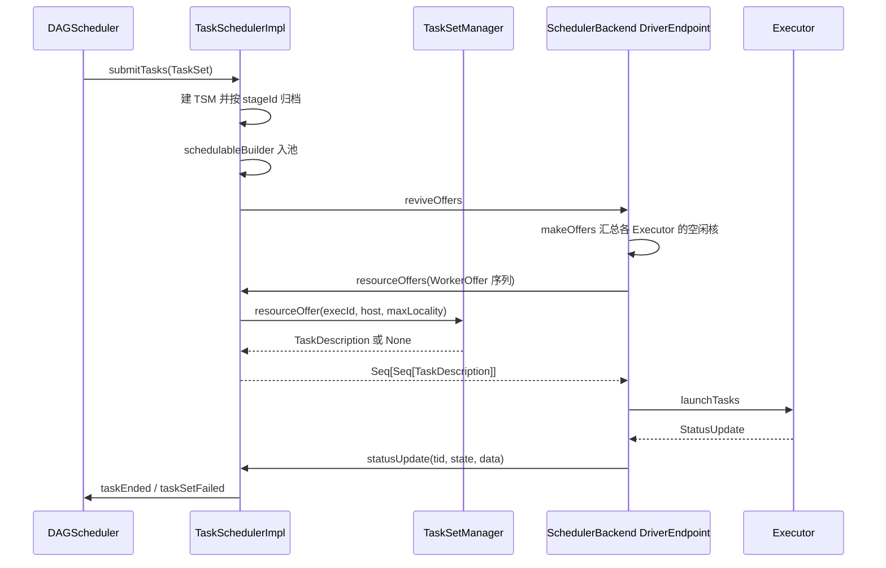
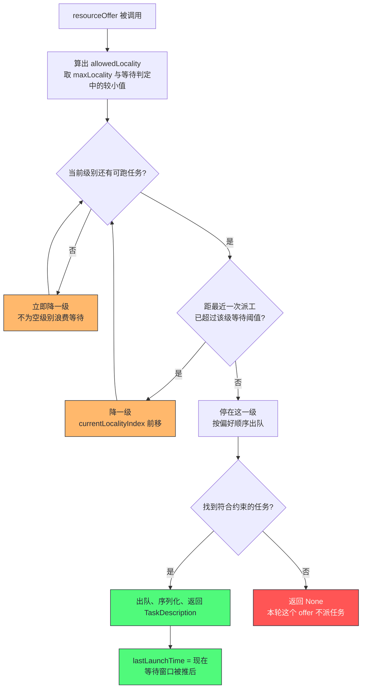
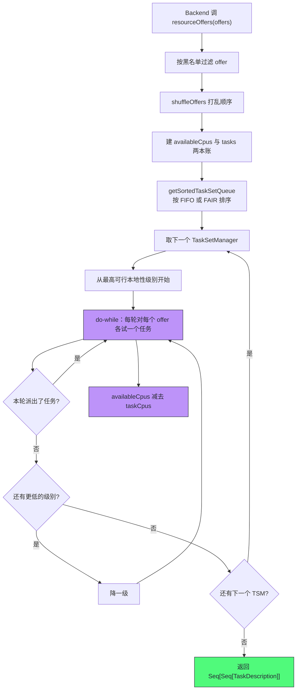
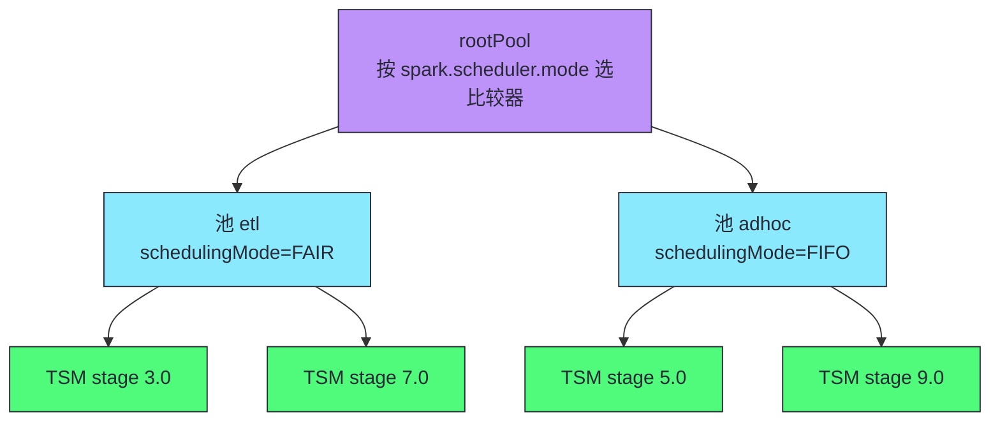
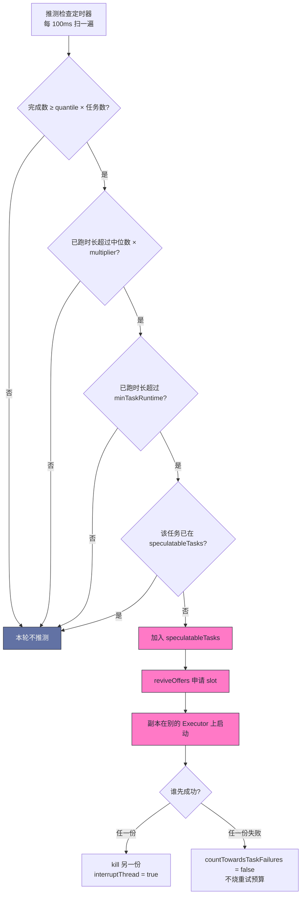

# 6. Spark TaskScheduler 深度解析：本地性等待、slot 分配与失败计数

**摘要：**

2013 年，Spark 0.8.0 把公平调度器（Fair Scheduler）放进 core 的时候，任务调度这一层的形状基本就定了下来：上面是只认 Stage 的 DAGScheduler，下面是只认 Executor 的 SchedulerBackend，中间夹着一个 TaskScheduler，负责把"一个 Stage 的几百个任务"摊到"几十个 Executor 的空闲核"上。这篇文章要回答两个问题——一个只做派工的中间层，凭什么要记住五级本地性、两套排队规则和一张失败计数表；以及当它记错或记漏的时候，表现出来的是哪几种病症。

行文沿五问推进：先界定 TaskScheduler 的四个入口与它明确不管的事；再把 TaskSetManager 的三本账拆开，看清 `pendingTasks` 里的元素为什么是任务下标而不是任务对象；接着走一遍五级本地性与等待-降级循环，解释等待为什么按任务计时、而不按阶段计时；然后在 `resourceOffers` 里看它怎样在洗过牌的 offer 上做除法，把 Executor 的核数与 `spark.task.cpus` 折成可用 slot；之后比较 FIFO 与 FAIR 两种比较器在调度树三层上的分工，说明"池内 FIFO"这句话成立的精确条件；最后处理推测执行、`maxTaskFailures` 的计数口径与黑名单的存在理由。落点不在"哪个策略更好"，而在三对相互牵扯的目标——等与不等、公平与延迟、重试与回避——各自要付什么账。

**关键词（Keywords）**: TaskSetManager, resourceOffers, 本地性降级, FAIR调度, 推测执行, 黑名单

---

## 第 1 章 派工的人不管做菜

### 1.1 一个被两个方向夹住的中间层

2009 年 Spark 在伯克利起步时，Standalone 模式的资源调度近乎朴素：一个 Master 记着每台 Worker 还剩几个核，一个先进先出的队列决定谁先拿。到了 2013 年，公平调度器进 core，集群开始被多个用户、多个作业共享，问题就从"有没有资源"变成了"资源该先给谁"，任务调度这一层才真正有了需要设计的余地。有意思的是，十几年过去，这一层的骨架几乎没动：`TaskScheduler` 依旧只做三件事——接收 TaskSet、把任务配到 slot 上、记录每次尝试的成败；变的只是判定条件越来越细，配置项越来越多。

它被两个方向夹住。上面，DAGScheduler 按 shuffle 边界把 DAG 切成 Stage，按依赖顺序把每个 Stage 封成 TaskSet 提交下来，但它看不见集群里此刻有几个空闲核；下面，SchedulerBackend 负责与 Standalone、YARN、Kubernetes 打交道，把 Executor 的注册与空闲核整理成一张张 offer 递上来，但它不知道哪个作业更该优先。**TaskScheduler 是唯一同时看见"优先级"和"空闲资源"的地方**，它存在的全部理由，就是让这两样东西在一个地方相遇。

不妨做个反事实：如果把配对逻辑塞进 DAGScheduler，那么切 Stage 的代码就得感知 Executor 抖动、机器故障与多租户权重，DAG 层会从"图算法"退化成"资源交易市场"；如果塞进 SchedulerBackend，那么 FIFO 与 FAIR 就得为 Standalone、YARN、Kubernetes 各写一遍，三种部署模式的调度语义立刻分叉。把"策略"留在 Driver 内的一个纯内存组件里，把"资源从哪来"留给 Backend，是这个分层最划算的地方——策略只写一次，资源接入方式可以随便换。

### 1.2 四个入口，四种后果

`TaskScheduler` 这个 trait 本身很薄，真正撑起调度的是它的唯一实现 `TaskSchedulerImpl`（Local 模式也用它，只是配了一个单机的 Backend）。对外暴露的入口有四个，每个入口背后都是一条完整的处理链：

```scala
// 简化后的接口轮廓：trait 只声明约定，热路径实现落在 TaskSchedulerImpl 上
private[spark] trait TaskScheduler {
  def start(): Unit                                  // 启动 Backend，必要时起推测检查定时器
  def submitTasks(taskSet: TaskSet): Unit            // 唯一的"新增工作"入口
  def cancelTasks(stageId: Int, interruptThread: Boolean, reason: String): Unit
  def killTaskAttempt(taskId: Long, interruptThread: Boolean, reason: String): Boolean
  def executorLost(executorId: String, reason: ExecutorLossReason): Unit
  def executorDecommission(executorId: String, decommissionInfo: ExecutorDecommissionInfo): Unit
  def workerRemoved(workerId: String, host: String, message: String): Unit
  def defaultParallelism(): Int
}
// resourceOffers 与 statusUpdate 不在 trait 上，它们在 TaskSchedulerImpl 里
```

| 入口 | 谁调用 | 所在线程 | 直接后果 |
|---|---|---|---|
| `submitTasks(taskSet)` | DAGScheduler 提交 Stage 时 | DAGScheduler 事件线程 | 建 TaskSetManager、挂进调度池、请求一次 `reviveOffers` |
| `resourceOffers(offers)` | SchedulerBackend 的 `makeOffers` | Driver 的 RPC 线程 | 返回 `Seq[Seq[TaskDescription]]`，Backend 据此下发 `launchTasks` |
| `statusUpdate(tid, state, data)` | Backend 收到 Executor 的状态消息后 | Driver 的 RPC 线程 | 成功走 `TaskResultGetter` 异步反序列化，失败走 `handleFailedTask` |
| `executorLost(execId, reason)` | Backend 判定某个 Executor 不可用后 | Driver 的 RPC 线程 | 该 Executor 上跑着的任务重投或计失败，随后再请求一次分配 |

表里"所在线程"那一列值得多看一眼：四个入口全部运行在 Driver 的少数几条线程上，而 `TaskSchedulerImpl` 的绝大多数方法都用 `this.synchronized` 把这把锁拿在手上。**资源分配、失败记账、Executor 清理共享同一把锁**，任何在锁内做阻塞操作的地方，都会把整条调度线拖住。这也解释了 `statusUpdate` 为什么要把"反序列化任务结果"甩给 `TaskResultGetter` 的线程池：一个 shuffle 结果的字节数可能上百兆，在持锁路径上反序列化，等于让所有 Executor 的状态汇报排队等它。`spark.resultGetter.threads` 默认 4，就是为这一步准备的并发度。

### 1.3 它明确不管的三件事

第一，它不管 Stage 怎么切。shuffle 边界、宽依赖、Stage 重算的判定全在 DAGScheduler 手里，`TaskScheduler` 拿到的 TaskSet 已经是"一个 Stage 的一次尝试"的成品。

第二，它不管资源怎么来。Executor 是 Backend 申请的、注册的、被杀掉的；`resourceOffers` 的入参是一份快照，出参是一份派工单，中间没有一次网络调用。

第三，它不管任务怎么执行。`TaskDescription` 交出去之后，序列化、反序列化、`Task.run`、结果回收都在 Executor 侧完成；Driver 只等一条 `StatusUpdate` 回来。

把这三条边界记牢，后面所有的"为什么这样设计"都能对上号：一个只做派工的组件，全部复杂度都花在"派给谁"这件小事的判定条件上——而恰恰是这些判定条件，决定了集群的利用率、作业的尾延迟，以及失败时是否会把整个 Stage 一起拖下水。

---

## 第 2 章 从 TaskSet 到调度树

### 2.1 submitTasks 的五个动作

`submitTasks` 是整条链路的起点，它做的事可以分为五步，每一步都对应一个后面会被反复引用的数据结构。

第一步，建 TaskSetManager。调 `createTaskSetManager(taskSet, maxTaskFailures)`，把"一个 Stage 的一次尝试"包装成一个可调度实体。`maxTaskFailures` 在这里被固化进对象，之后整个 Stage 的失败预算都按这个数算。

第二步，按 `(stageId, stageAttemptId)` 归档。`taskSetsByStageIdAndAttempt` 是一个两层 Map，同一个 Stage 的多次尝试各自占一个槽位；归档时会检查"同一个 Stage 是否已有活跃的 TSM"，若有就抛 `IllegalStateException`。这条检查看着多余，实际上是防"两次尝试并发跑同一个 Stage"的最后一道闸——DAGScheduler 那边重提交逻辑一旦写错，这里会立刻炸出来，而不是让两份任务同时往同一个输出目录写。

第二步里那两个键都来自 TaskSet 本身，它的结构值得摆出来看一眼——这是 DAGScheduler 交给 TaskScheduler 的唯一货币：

```scala
// TaskSet 是"一个 Stage 的一次尝试"，五个字段各有一个下游用途
private[spark] class TaskSet(
    val tasks: Array[Task[_]],      // 任务本体，长度即分区数，下标即分区号
    val stageId: Int,               // 归档与取消的第一层键
    val stageAttemptId: Int,        // 第几次尝试，zombie 判定与去重靠它
    val priority: Int,              // 取自 jobId，FIFO 比较器的第一关键字
    val properties: Properties) {   // job group、pool 名等调度属性
  val id: String = stageId + "." + stageAttemptId
}
```

第三步，入池。`schedulableBuilder.addTaskSetManager(manager, manager.taskSet.properties)` 把它挂到调度树上，挂的位置由调度模式决定：FIFO 模式全部挂在根池，FAIR 模式按 job 的 `spark.scheduler.pool` 找对应的子池。

第四步，起饥饿计时器。若是第一次收到任务且不是 Local 模式，`TaskSchedulerImpl` 会起一个每 `spark.starvation.timeout`（默认 15 秒）跑一次的定时器，只要"收到过任务但一个都没真正启动"，就重复打这条日志：

```text
Initial job has not accepted any resources; check your cluster UI to ensure that
workers are registered and have sufficient resources
```

这条 warning 是排查"作业卡住"的第一现场，它把"调度器已经看到任务、但一个 slot 都配不上"这件事显式化了。第二层含义常被忽略：它每 15 秒重复一次，而只要有一个任务启动就自行取消，所以日志的持续时长恰好等于"饿着"的时长。

第五步，`backend.reviveOffers()`。注意这里是"请求再算一次"，不是"立刻分配"——资源快照在 Backend 手里，TaskScheduler 没有资格自己算。

### 2.2 reviveOffers 的往返

`reviveOffers` 是一条单向消息：TaskScheduler 说"我这边有变化，你再看一眼"，Backend 收到后调 `makeOffers`，把当前所有 Executor 的**空闲核**整理成 `WorkerOffer` 序列，再回调 `resourceOffers`。下面这张图把一次提交从 DAGScheduler 一路走到 Executor 的完整往返画了出来：



图里右侧那三行是"回程"，它不经过 `reviveOffers`，而是由 Executor 主动上报、Backend 转交。回程的每一次成功都会触发一次新的 `reviveOffers`——因为一个任务结束就意味着一个 slot 空出来了，调度器必须重新看一遍。

触发 `reviveOffers` 的时机有五个，记住这个清单比记住方法名有用：TaskSet 提交、Executor 注册、任务成功结束、Executor 丢失、推测检查命中。集群彻底安静下来的时候，这五个时机一个都不会发生，所以一个因资源不足而排队的作业会安静地等下去，直到有别的状态变化把它唤醒。

### 2.3 调度树：根池、子池与叶子

调度树是一棵三层结构：根池（rootPool）是唯一的根，FAIR 模式下它有若干子池，每个子池里挂着若干 TaskSetManager；FIFO 模式下没有子池，所有 TSM 直接挂在根上。取排序结果用的是递归展开：`getSortedTaskSetQueue` 先让每个池按自己的 `schedulingMode` 排自己的子节点，再把子节点的结果拼起来。

```scala
// 简化的调度树形状
rootPool: Pool(FIFO 或 FAIR)
  ├── TSM(stage 3.0)    // FIFO 模式下直接挂这里
  └── TSM(stage 4.0)
// FAIR 模式下中间多一层
rootPool: Pool(FAIR)
  ├── pool "etl"   (minShare=4, weight=2)
  │     ├── TSM(stage 3.0)
  │     └── TSM(stage 7.0)
  └── pool "adhoc" (minShare=2, weight=1)
        └── TSM(stage 5.0)
```

不妨把调度树想成一家公司的组织结构：根池是总部，子池是部门，TSM 是部门里的项目组；总部按预算与权重给部门分资源，部门内部再决定哪个项目组先干。不同的地方在于，这棵树的每一层都可以各换一套排法，而不像真实组织那样一套制度管到底。每次 `resourceOffers` 都重新取一次排序结果，所以"顺序"不是一次定终身，而是每一轮都按当时的状态重算。这一点在多作业并发时很关键：一个 TSM 的名次不是提交时定下的，而是每一轮按当时的 runningTasks 重算的，排后面不等于一直排后面。

### 2.4 zombie：迟到的结果与作废的尝试

Stage 失败后会被 DAGScheduler 重新提交，新的尝试带着递增的 `stageAttemptId` 进来，旧的 TSM 则被标记为 zombie。标记的动作很轻——把 `isZombie` 置真，再把它名下还在跑的 attempt 逐个 kill——但语义很重要：zombie 的 TSM 不再接收新任务，也不再发起 reviveOffers，可它还要继续活着，因为那些被 kill 的任务会有迟到的状态消息回来，Driver 必须能认出"这是谁的任务"并优雅丢弃。

反过来说，如果重提交时直接把旧 TSM 从表里删掉，迟到的那几条 `StatusUpdate` 就会变成"未知任务"被静默忽略；更糟的是旧 attempt 里已经跑完、结果还没送回的那几个任务，会被当成本次尝试的成功结果记上一笔，于是同一个 Stage 的两份输出同时落到同一个目录。**zombie 不是内存泄漏，而是为"结果必须作废"这件事留的一个身份**。

---

## 第 3 章 TaskSetManager 的三本账

### 3.1 一个 TSM 要记住什么

如果把 `TaskSetManager` 的字段列一遍，会发现它记的东西可以归成三本账：谁还没跑、谁在跑、谁失败过几次。归成这三本之后，后面所有的行为都能由它们推出来。

```scala
// 以 4.x 的结构为参照，字段略有精简
private[spark] class TaskSetManager(
    sched: TaskSchedulerImpl,
    val taskSet: TaskSet,
    val maxTaskFailures: Int,
    blacklistTracker: Option[BlacklistTracker] = None) extends Schedulable with Logging {

  val tasks = taskSet.tasks              // 任务本体，下标即分区号
  val numTasks = tasks.length
  val copiesRunning = new Array[Int](numTasks)   // 同一任务有几个副本在跑
  val successful = new Array[Boolean](numTasks)  // 分区是否已成功
  val numFailures = new Array[Int](numTasks)     // 每个任务失败了几次
  val taskAttempts = Array.fill[List[TaskInfo]](numTasks)(Nil)
  private val pendingTasks = new ArrayBuffer[Int]  // 未启动任务的下标
  private val runningTasksSet = new HashSet[TaskInfo]
  private val speculatableTasks = new HashSet[Int]
  var isZombie = false
}
```

第一本是"谁还没跑"，就是 `pendingTasks`。第二本是"谁在跑"，由 `runningTasksSet` 与 `copiesRunning` 共同描述；后者之所以是数组而不是布尔，是因为推测执行允许同一个任务同时有两个副本在跑。第三本是"谁失败过几次"，由 `numFailures` 与 `taskAttempts` 组成；前者只记次数，后者记每一次尝试的 Executor、主机、起止时间与失败原因。

三本账的共同点是**全部以任务下标为键**，而不是以任务对象或 taskId 为键。这个选择不是随手定的：Stage 重算时任务对象会被重新构造，taskId 也会变，唯独"第几个分区"这件事稳定不变；以它为键，计数才能跨尝试延续。

### 3.2 pendingTasks 是队列，也是账本

`pendingTasks` 是整个调度里被读写最频繁的结构，它的两个改动入口决定了它的语义。

入队只有一个口子：`addPendingTask(index)`，把下标追加到数组尾部。它出现在四个场景——TSM 初始化（所有任务一起入队）、任务失败后重投、Executor 丢失后重投、以及推测副本被判无效后退回。

出队也只有一个口子，就是 `resourceOffer` 内部成功取到一个任务时把它从 `pendingTasks` 里摘掉。**出队即意味着"这个任务已经派出去了"**，此后它的状态全部由 `copiesRunning`、`runningTasksSet` 与 `taskAttempts` 跟踪。

这里有一个容易读错的细节：推测执行不会再从 `pendingTasks` 里取一次同一个下标。它走的是另一条路——`checkSpeculatableTasks` 把下标放进 `speculatableTasks`，再由 `resourceOffer` 在该集合里挑一个任务做第二份副本，`pendingTasks` 不动。所以"队列长度"永远等于"还没派出去的任务数"，包含推测副本在内的在跑任务数则要看 `runningTasksSet`。两个数字对不上是正常的，对得上反而说明推测执行没生效。

### 3.3 resourceOffer：出队的那一次判断

`resourceOffer` 的签名看着复杂，逻辑其实是一条直线：先算出这一轮"允许走多远"，再按本地性从近到远找任务。

```scala
// 简化后的骨架：allowedLocality 是"约束"，dequeueTask 是"按偏好顺序找"
def resourceOffer(execId: String, host: String,
    maxLocality: TaskLocality.TaskLocality, taskCpus: Int): Option[TaskDescription] = {
  var allowedLocality = maxLocality
  if (maxLocality != TaskLocality.NO_PREF) {
    allowedLocality = getAllowedLocalityLevel(clock.getTimeMillis())  // 等待-降级在这里发生
    if (allowedLocality > maxLocality) allowedLocality = maxLocality  // 不能比调用方允许的更远
  }
  dequeueTask(execId, host, allowedLocality).map { case (index, taskLocality, speculative) =>
    val taskId = sched.newTaskId()
    val serializedTask = ser.serialize(tasks(index))   // 序列化发生在 Driver 的持锁路径上
    new TaskDescription(taskId, attemptNumber, execId, name, index, serializedTask)
  }
}
```

两个参数各管一件事：`maxLocality` 是调用方（`resourceOffers` 那一层循环）允许的上限，它每一轮都从最高级开始往下走；`allowedLocality` 是 TSM 自己依据等待时间算出来的实际约束。两者取较小值，于是"调用方想先试 PROCESS_LOCAL"与"TSM 已经等不及了"这两个意图被合成了一个数。

序列化就发生在这十几行里，这一点值得单独说：**任务的序列化不是在下发时做的，而是在出队时做的**。它意味着 Driver 的持锁路径上有一份与任务体量成正比的 CPU 开销，任务闭包越大、广播变量越多，这段开销越显眼；也意味着如果序列化失败（闭包里带了一个不可序列化的字段），错误会在分配阶段抛出，表现为"资源明明有空却一直分配不出去"。

### 3.4 三本账的出口

`handleSuccessfulTask` 与 `handleFailedTask` 是两本账的结算口，两者的顺序都值得记。

成功路径做四件事：把 TaskInfo 标记为完成、把 `successful(index)` 置真、把该任务的其他副本全部 kill（`interruptThread = true`，理由写的是"another attempt succeeded"）、上报 DAGScheduler。最后一件是判断"这个 Stage 是否全部成功"，若成功就结束 TSM。

失败路径同样四件事，但顺序有个讲究：**先上报、后记账**。`dagScheduler.taskEnded(...)` 先把失败原因交出去，DAGScheduler 拿到 `FetchFailed` 会立刻安排上游 Stage 重算；记完这一步，TSM 才根据 `reason.countTowardsTaskFailures` 决定 `numFailures(index)` 要不要加一，没到上限就重新入队，到了上限就 `taskSetFailed` 把整个 Stage 交出去。顺序反过来会出问题：上游已经开始重算了，本 TSM 还在把这次失败当成普通异常重试，于是下游会用一份作废的 shuffle 数据继续跑。

### 3.5 内存画像：TaskInfo 是被低估的那一块

一个 400 个任务的 Stage，每个任务最多 4 次尝试，`taskAttempts` 里最多会攒下 1600 条 TaskInfo。每条带着 host、executorId、起止时间、失败原因与累加器引用，体积从几百字节到几 KB 不等；一个反复失败、反复重试的作业，Driver 堆里最大的一块常常不是 RDD 的缓存，而是这些尝试记录。

这笔开销平时看不见，但它决定了 `spark.task.maxFailures` 的另一个含义：把它从 4 调到 10，买到的宽容度是以"每个任务最多 10 条尝试记录、以及最多 10 轮的重新排队与调度开销"换来的。在数据倾斜严重、少数任务反复 OOM 的作业里，这笔开销足以让 Driver 的 GC 压力明显上升，而它在 UI 上没有任何对应指标。

---

## 第 4 章 五级本地性与等待-降级循环

### 4.1 五个级别，五种代价

本地性（Locality）说的是"任务要读的数据在哪儿"，五级从近到远排列。级别越近，省掉的搬运成本越多；级别越远，集群里的资源越容易被用上。这两件事天然对立，`TaskScheduler` 的全部本地性逻辑，就是在"省搬运"和"别空转"之间找那个切换点。

| 级别 | 判据 | 数据来源 | 缺省等待 | 落到这一级的代价 |
|---|---|---|---|---|
| `PROCESS_LOCAL` | 数据就在同一个 Executor 的 JVM 里 | RDD 已缓存，或 shuffle 输出同进程 | 3 秒 | 几乎零成本，直接读内存 |
| `NODE_LOCAL` | 数据在同一台主机的磁盘或另一个 Executor 上 | HDFS 副本位置、同节点的 shuffle 输出 | 3 秒 | 走本机磁盘或进程间传输，不出网卡 |
| `NO_PREF` | 任务对位置没有偏好 | 输入源在远端对象存储、无 preferredLocations | 0 | 无从优化，先到先得 |
| `RACK_LOCAL` | 数据在同一机架的另一台主机上 | 需要 Hadoop 机架拓扑（`RackResolver`） | 3 秒 | 走一次机架内网络，代价中等 |
| `ANY` | 任意主机 | 兜底 | 0 | 跨机架、跨网络拉数据，代价最高 |

第三列与第四列值得连起来看。`NO_PREF` 与 `ANY` 的等待是 0，不是笔误：`NO_PREF` 的任务本来就没有可等的位置，`ANY` 是最后一级、再等也没有下一级。而 `RACK_LOCAL` 这一级在 Standalone 集群上往往名存实亡，因为机架信息要由 Hadoop 的机架解析器提供：没有配置拓扑脚本时，所有主机都被解析到同一个默认机架，于是"同机架"退化成"任意主机"，这一级还在，但提供不了任何区分度。

### 4.2 可行级别是算出来的，不是列出来的

`myLocalityLevels` 不是"五个级别的固定数组"，而是在 TSM 构造时算一次、之后在 Executor 加入时重算的一份"可行级别"清单。判定规则有两条：这一级还有待调度的任务；这一级要求的 Executor 或主机此刻真的在集群里活着。两条同时成立，这一级才留在清单里。

这条优化省掉的是"空等一级"的时间：如果某个 Stage 的输入在 HDFS 上有三个副本，而承载这三个副本的机器恰好都不在本应用分到的 Executor 里，那么 PROCESS_LOCAL 与 NODE_LOCAL 两级根本不可能发生，清单直接从 NO_PREF 开始算，调度器不会有任何一秒浪费在等一个永远不来的本地任务上。

代价是这份清单有滞后性。它只在 TSM 构造与 Executor 加入时重算，如果某台机器在不触发这两件事的情况下从"有 Executor"变成"没有 Executor"（譬如 Executor 被 decommission），清单里的某一级可能还留着。这种滞后通常由后一层兜住：真到了那一级找不到可用主机，`resourceOffer` 返回 `None`，这一轮就不启动任务，调度器下一轮再试。

### 4.3 等待用的是"最近一次派工"作锚点

等待-降级的核心是一个时间锚点：`lastLaunchTime`，记录的是"这个 TSM 最近一次成功启动任务的时刻"。每一轮 `resourceOffer` 都会问一句"离上次派工过去多久了"，然后决定这一轮允许走多远。

```text
getAllowedLocalityLevel(now):
  从 currentLocalityIndex 开始
    若这一级已经没有任何可跑的任务  → 立即降级，不等（省掉无意义的等待）
    否则若 now - lastLaunchTime >= 这一级的等待阈值 → 降一级
    否则 → 就停在这一级，返回它
```

两条分支的差别值得咀嚼。第一条是纯粹的优化：某个级别的任务已经跑光了，再等下去只是白白占着 slot，所以立即往下走。第二条才是真正的等待：任务还有，位置也对，但对应的 slot 被占了，于是调度器宁可让手里这个 slot 空转一会儿，也不急着把任务派到更远的地方去。

阈值来自三个配置：`spark.locality.wait.process`、`.node`、`.rack`，它们的缺省值都继承自 `spark.locality.wait`（默认 3 秒）。按默认值估算，一个任务最坏要经历三次等待窗口才降到 `ANY`，合计约 9 秒——这个数字比很多人直觉里的"等 3 秒"要长，也是本地性调优时最容易低估的一笔时间。

### 4.4 为什么等待按任务计时，而不按阶段

这是本文最想讲透的一个设计点。等待的锚点完全可以有别的选法：按阶段提交的时刻计时，或者按 `resourceOffers` 被调用的轮次计时。Spark 选了第三种——按"最近一次派工"计时——而这个选择恰好是唯一能同时满足三个约束的。

第一个约束是**长阶段不能自动丧失本地性**。假设按阶段提交时刻计时：一个跑二十分钟的 Stage，从第 9 秒起所有任务就都过了等待期，此后一律按 `ANY` 派工，`PROCESS_LOCAL` 与 `NODE_LOCAL` 的收益在剩下的十九分钟里一分钱也拿不到。这显然与本地性优化的初衷相反——恰恰是长阶段最需要本地性，因为它的 slot 复用次数最多。

第二个约束是计时口径不能随集群繁忙程度漂移。假设按 `resourceOffers` 的轮次计时：集群空闲时 offer 来得稀疏，一轮可能隔好几百毫秒；集群繁忙时 offer 来得密集，几轮加起来不过几十毫秒。同样"等三轮"，在两种负载下差了一个数量级，调参就失去了意义。时间是与负载无关的量，轮次不是。

第三个约束是**只要还有任务在按本地性启动，等待窗口就该不断被推后**。这正是 `lastLaunchTime` 作为锚点的效果：每当有任务成功派出去（尤其是派在近处），计时器就被刷新，调度器于是继续愿意等下一轮；一旦这个 Stage 一段时间一个任务都没派出去，说明"近处能跑的都跑完了"或者"近处的 slot 全被占了"，这时候再等只会让 slot 空转，于是降级。

把三条合起来看，**等待的语义不是"任务在等"，而是"slot 在等"**：调度器宁可让一个空闲的核多闲几秒，也不愿把本该在本地执行的任务派到网络上，代价的上限由三个等待窗口封顶。这句话也顺手解释了本地性等待最容易踩的坑：当任务数少于 slot 数时，每个 slot 只跑一两个任务，让 slot 空等三秒，等于把作业时长拉长一大截。

### 4.5 降级是放宽约束，不是放弃偏好

一个常见的误读是"降级到 ANY 之后，任务就随便乱放了"。实际不是。`allowedLocality` 只决定"这一轮最多能接受到多远的位置"，而具体取哪个任务仍然按偏好顺序找：先找落在当前 Executor 上的，再找落在当前主机上的，再找无偏好的，依此类推。所以降级之后的真实效果是"近处没有合适的任务时，不再空等，直接把任务派到远处"，而不是"明明有近处任务却先派远处"。

在 Executor 集合不变的前提下，降级是单向的：`currentLocalityIndex` 只会往后走，不会自己回退。要回退只有一种途径——新 Executor 加入时，TSM 重算可行级别并把等待计时清零，给刚到的节点一次承接本地任务的机会。这个设计有它的道理，也有它的盲区：动态分配频繁扩缩容的集群里，降级会被新 Executor 反复打断，调度器于是长期停留在"愿意等"的状态，反而可能在资源紧张时让 slot 空转得更久。

### 4.6 一个反例：等待在什么规模上才有收益

本文的贯穿案例是一个 Stage 有 400 个任务，集群有 8 台机器、每台 16 核、`spark.executor.cores = 4`，也就是 32 个 Executor、32 个可用 slot。400 / 32 约等于 12.5 轮，每个 slot 要跑十几个任务。此时让 slot 空等 3 秒去换一次本地读，收益是每个任务省下一次网络传输，成本是 3 秒 × 轮次的分摊——在总时长以分钟计的作业里，这笔交易划算。

把任务数换成 40，其余不变：每个 slot 平均只跑 1.25 个任务，等待的收益上限只有一次本地读，成本却是每个 slot 空转 3 秒。作业总时长大致由"一轮 3 秒等待 + 一轮计算"构成，本地性带来的网络节省根本补不回来。**本地性等待的前提是"slot 会被反复复用"**，这个前提在低并行度、小数据量的作业里根本不成立；这也是为什么 `spark.locality.wait = 0` 在交互式查询与对象存储场景里往往是更好的选择。笔者在几套集群上的做法是拿比值先估一遍：先算 slot 数与任务数的比值，若这个比值小到每个 slot 只跑一两个任务，就把等待归零，把省下的时间还给任务本身；但这个判断要在改配置之前做完，因为等待的代价是隐性的，它不体现在任何一条报错里。

下图把 4.3 节那两条分支与实际出队的结果连在一起，两个出口分别是"派出去"与"这一轮不派"：



图里 `D` 与 `F` 两条边都指向"降级"，但成因完全不同：前者是"这一级已经无事可做"，后者是"这一级等够了"。把两者混为一谈，就会误以为本地性等待总是要付满 9 秒；实际上任务跑光的级别是瞬时的，真正耗时的是那些"还有任务、但位置被占"的级别。

---

## 第 5 章 resourceOffers：在 slot 上分蛋糕

### 5.1 一份快照，一张派工单

`resourceOffers` 的入参是 `IndexedSeq[WorkerOffer]`，每一项代表"某个 Executor 此刻还有几个空闲核"；出参是 `Seq[Seq[TaskDescription]]`，外层与入参一一对齐，第 i 项就是"要派给第 i 个 offer 的任务列表"。这个对齐关系是硬约定：Backend 拿到之后按下标逐项 `launchTasks`，错一位就会把任务发给错的 Executor。

```scala
// 两个结构的关系：offer 是"我这儿有几个空位"，派工单是"这些空位各给谁"
private[spark] case class WorkerOffer(
    executorId: String, host: String, cores: Int,
    executorAddress: RpcAddress, resources: Map[String, ResourceInformation],
    resourceProfileId: Int)          // 字段随版本略有增减

private[spark] class TaskDescription(
    val taskId: Long, val attemptNumber: Int, val executorId: String,
    val name: String, val index: Int, val serializedTask: ByteBuffer)
```

`cores` 这一栏是空闲核，不是总核数。它由 Backend 侧的 `ExecutorData.freeCores` 维护：Executor 注册时初始化为 `spark.executor.cores`，每下发一个任务减一，每收到一个任务结束的 `StatusUpdate` 加一。所以一次 `resourceOffers` 看到的核数，是这个 Executor 从上一次任务结束到此刻的余量。

### 5.2 五步分配算法

整个方法可以拆成五步，顺序不能换。

第一步，黑名单过滤。开了 `spark.blacklist` 时，处于黑名单里的 Executor 与主机提供的 offer 会被整条丢掉——注意是丢在洗牌之前，否则返回值与 offer 的下标对齐关系会被破坏。

第二步，洗牌。`shuffleOffers` 把 offer 的顺序打乱。这一手是最便宜的负载均衡：Backend 汇总 offer 的顺序通常与 Executor 注册顺序一致，不洗牌的话每轮都优先填同一批 Executor，热点与资源碎片都会加剧。洗牌之后"谁先被填"变成随机的，统计意义上把任务摊平了。

第三步，为每个 offer 建一本账。`availableCpus` 数组拷贝各 offer 的核数，`tasks` 数组为每个 offer 准备一个空的 `ArrayBuffer[TaskDescription]`。这两本账后面会被反复读写，它们的大小与 offer 数一致。

第四步，取排序结果。`rootPool.getSortedTaskSetQueue` 按 FIFO 或 FAIR 的比较器把当前所有 TSM 排成一条队列，这是"先给谁"的唯一依据。

第五步，逐个 TSM、逐级本地性地派工。对每个 TSM，从它的 `myLocalityLevels` 最高级开始，每一级用 `do-while` 反复调 `resourceOfferSingleTaskSet`，直到一整轮下来一个任务都没派出去，再降到下一级。

把五步连起来就是下面的流程，注意 `availableCpus` 的扣减发生在最内层那一轮里：



### 5.3 轮转，而不是填满

`resourceOfferSingleTaskSet` 容易被读成"把一个 Executor 的核填满"，实际恰好相反：它一次调用只对每个 offer 各试一个任务，然后返回"这一轮有没有派出去"。外层的 `do-while` 反复调用它，于是所有 Executor 齐头并进地被填，而不是先把第一个塞满再换下一个。

这个取向与 Standalone 分配 Executor 时的 `spreadOutApps` 是同一个思路：摊开优先。摊开的好处是任务在集群里的分布更均匀，任何一个 Executor 挂掉损失都有限；代价是短时间内本地性更差——先从每个 Executor 各派一个，意味着同一批任务被分散到了更多机器上。不过在 `resourceOffers` 这一层，摊开几乎是必然的选择：Backend 每次只报"当前空闲核"，调度器没有能力预测未来，先让每个空位都动起来是更稳的策略。

### 5.4 slots：核数除以 task.cpus 的那一步

真正决定"一个 Executor 能同时跑几个任务"的，是这行减法：

```scala
// 判据与扣减都发生在 offer 这一级，任务本身不参与
if (availableCpus(i) >= taskCpus) {
  availableCpus(i) -= taskCpus      // spark.task.cpus 默认 1
  // 派出去
}
```

于是可用 slot 数等于 `floor(cores / taskCpus)`，余数成为永远用不上的死核。`spark.task.cpus` 默认为 1，绝大多数作业里这个除法没有余数；但一旦为某个 CPU 密集型的算子把它调成 2 或 3，余数就出现了：`spark.executor.cores = 4` 配 `task.cpus = 3`，每个 Executor 只能跑一个任务，另外 1 个核永远闲着；`spark.executor.cores = 6` 配 `task.cpus = 4`，同样只跑一个，2 个核闲置。

由此可以得出一条不需要背配置的建议：**`spark.executor.cores` 取 `spark.task.cpus` 的整数倍**。4 核配 1、8 核配 2、12 核配 3 都不会有余数；3 核配 2 这种组合会让三分之一的算力长期闲置，而且从 UI 上看不出来——Executor 的核数是满的，只是永远有空核。

还有一层容易被忽略的后果：`task.cpus` 大于 Executor 的全部核数时，任务永远配不上，表现是作业一直停在"有任务、没进度"，只有第 2 章那条饥饿 warning 每 15 秒提醒一次。这类故障不需要看源码，只要把两个配置摆在一起比一比就能定位。

### 5.5 分配不到的时候，什么都不会发生

这是整条链路上最反直觉的一段：资源不足时 `resourceOffers` 不报错、不排队超时、不通知任何人。它只是对配不上的 offer 返回空列表，然后安静地返回。

沉默的代价是诊断信息稀缺。一个作业卡住时，能从调度器拿到的线索只有三条：饥饿 warning、Web UI 上"已启动任务数"是否增长、以及 Driver 日志里 `resourceOffer` 相关的 debug 输出（默认不打印）。所以排查这类问题的顺序通常反过来：先看 `spark.task.cpus` 与 `spark.executor.cores` 的关系，再看 ResourceProfile 是否给任务要求了额外的 GPU 或 FPGA 资源，最后才怀疑 WorkerOffer 的数量。三者里前两条能解释绝大多数"配不上"。

---

## 第 6 章 FIFO 与 FAIR：两种比较器

### 6.1 差异只有一个比较函数

FIFO 与 FAIR 在代码上的差别小得让人意外：两者都实现 `SchedulingAlgorithm` 的 `comparator(s1, s2): Boolean`，都只是给可调度实体排个序。真正决定"多作业如何分享集群"的，就是这个函数里的十几行判断。

FIFO 的比较器短到可以背下来：先比 `priority`，相等再比 `stageId`。`priority` 来自 TaskSet 构造时传入的 jobId，而 jobId 随提交单调递增，所以它等价于"提交顺序"。效果就是教科书上的先进先出：先提交的作业的 TSM 排在前面，每一轮 `resourceOffers` 都优先满足它，直到它的任务全部派出去，后面的作业才拿到 slot。

```scala
// FIFO：提交早的优先，同一作业内按 Stage 顺序
private[spark] class FIFOSchedulingAlgorithm extends SchedulingAlgorithm {
  override def comparator(s1: Schedulable, s2: Schedulable): Boolean = {
    val priority1 = s1.priority; val priority2 = s2.priority
    var res = math.signum(priority1 - priority2)
    if (res == 0) res = math.signum(s1.stageId - s2.stageId)
    res < 0
  }
}
```

两者的差别可以借一个日常场景记住：FIFO 是银行只开一个窗口，按号叫，叫到谁谁上去；FAIR 是每个队都分到一两个窗口，某个队暂时没人了，窗口就转给别的队。FIFO 的好处是可预测：一个作业拿到的资源只取决于它前面排了几个作业，不取决于别人跑得快慢。它的毛病同样直接——没有老化机制。排在第一的 TSM 只要还有任务没派完，后面的就一轮都轮不上；在多租户集群里，一个大作业可以把小作业压到它跑完为止，而被压住的作业既不会报错也不会超时，只是安静地不动。

### 6.2 FAIR 的比较器：三段判断

FAIR 的比较器长一些，逻辑可以拆成三段，优先级从高到低。

第一段看"谁没拿到保底"。若 s1 的 `runningTasks` 小于自己的 `minShare` 而 s2 已经不欠了，s1 优先；反过来同理。这一段处理的是"最低保障"，保证一个池即使权重不高，也能在一段时间内拿到承诺的那份。

第二段看"谁离保底更远"。两个都在保底线以下，或者都在线以上时，比较 `runningTasks / max(minShare, 1)` 的比值，小的优先。这一段处理的是"欠得多的先补"。

第三段看"谁占权重份额更多"。比 `runningTasks / weight` 的比值，小的优先；仍然相等就按池名或 TSM 名的字典序定序——最后这条是为了让排序结果稳定，避免比较器不满足传递性导致每轮顺序抖动。

```scala
// FAIR：先补保底，再按 minShare 缺口，再按 weight 份额，最后按名字定序
private[spark] class FairSchedulingAlgorithm extends SchedulingAlgorithm {
  override def comparator(s1: Schedulable, s2: Schedulable): Boolean = {
    val minShareRatio1 = s1.runningTasks.toDouble / math.max(s1.minShare, 1)
    val minShareRatio2 = s2.runningTasks.toDouble / math.max(s2.minShare, 1)
    val taskToWeightRatio1 = s1.runningTasks.toDouble / s1.weight
    val taskToWeightRatio2 = s2.runningTasks.toDouble / s2.weight
    var compare = 0
    if (s1.runningTasks < s1.minShare && s2.runningTasks >= s2.minShare) compare = -1
    else if (s2.runningTasks < s2.minShare && s1.runningTasks >= s1.minShare) compare = 1
    else if (minShareRatio1 != minShareRatio2)
      compare = if (minShareRatio1 < minShareRatio2) -1 else 1
    else if (taskToWeightRatio1 != taskToWeightRatio2)
      compare = if (taskToWeightRatio1 < taskToWeightRatio2) -1 else 1
    else compare = s1.name.compareTo(s2.name)
    compare < 0
  }
}
```

两段代码摆在一起，能看出一个容易被忽略的事实：**两个比较器的输入都只有 `runningTasks`（正在跑的任务数），没有核数、没有内存**。这意味着 `minShare` 与 `weight` 的单位是"任务数"，不是"核数"。当全集群的 `spark.task.cpus` 一致时，两者成正比，口径没有问题；一旦不同作业用了不同的 `task.cpus`，一个池的 8 个任务可能是 8 核也可能是 24 核，FAIR 判断的"份额"与真实算力占用就开始分叉。这是 FAIR 调度在异构任务规格下的固有失真，靠调权重补不回来。

### 6.3 三层比较器与"池内 FIFO"的精确条件

调度树有三层——根池、子池、池内 TSM——每一层各自选一个比较器，用的都是该层的 `schedulingMode`。这句话是理解 FAIR 的关键，也是"池内 FIFO"这句流行说法的出处与边界。

```xml
<!-- fairscheduler.xml 的骨架，缺省从 classpath 读，可用 spark.scheduler.allocation.file 指定路径 -->
<allocations>
  <pool name="etl"   schedulingMode="FAIR"  minShare="8" weight="3"/>
  <pool name="adhoc" schedulingMode="FIFO"  minShare="2" weight="1"/>
</allocations>
```

把两个比较器放回调度树，谁和谁比就一目了然了——树的每一层各自用自己的 `schedulingMode` 排自己的子节点，根池与子池可以是不同的模式：



池 `etl` 被显式配成 FAIR，池内几个 TSM 之间按"保底缺口 + 权重份额"轮转；池 `adhoc` 配成 FIFO，池内 TSM 严格按提交顺序排队。也就是说，**"池内 FIFO"不是 FAIR 调度器的固定行为，而是某个池显式选择了 `schedulingMode="FIFO"` 的结果**；池不写这个属性时缺省仍是 FAIR，池内的多个作业会轮流拿 slot，而不是先来的那个吃满。

这个区分在实际运行里能看出来。同一个池里提交两个互不依赖的查询，若池是 FAIR，两者的任务会交替启动，完成时间接近；若池是 FIFO，第二个查询要等第一个把 slot 全放出来。而多数生产集群的 `fairscheduler.xml` 只写了 `minShare` 与 `weight`、没写 `schedulingMode`，于是拿到了 FAIR 的池内行为，却以为自己在用 FIFO。

| 维度 | FIFO | FAIR |
|---|---|---|
| 竞争单位 | 根池上的一条 TSM 队列 | 池与池之间按 minShare/weight，池内另有比较器 |
| 饥饿风险 | 高，无老化机制 | 低，有保底与权重兜底 |
| 可预测性 | 高，名次只由提交顺序决定 | 中，名次随各池 runningTasks 变化 |
| 每轮开销 | 一次 `signum` 比较 | 三次比值比较加字典序兜底 |
| 是否抢占 | 否 | 否 |
| 适用场景 | 单用户批处理、独占集群 | 多租户共享、交互式与批处理混跑 |

表里"是否抢占"那一行需要展开。FAIR 改善的是"新任务先给谁"，不是"已经在跑的任务怎么分"。一个池即使已经欠了 `minShare`，也只能在下一轮 `resourceOffers` 里获得更高的排序名次；别的池正在跑的任务一个都不会被夺走，`minSharePreemptionTimeout` 这类配置在 Spark 的实现里也不改变这一点。**FAIR 调的是分配顺序，不是分配结果**——想要真正的回收，要靠动态分配（`spark.dynamicAllocation`）让空闲 Executor 退出，或者干脆按队列做容量隔离（YARN 的调度队列、Kubernetes 的 namespace 配额）。

### 6.4 一个常见的误判

"我们开了 FAIR，为什么大作业还是把小作业压住了？"这个问题在邮件列表里反复出现，答案通常有三层。

第一层，两个作业在同一个池里，且这个池没配 `schedulingMode="FIFO"`，那池内其实一直在轮转，压不住；看起来被压住，是因为小作业提交上来时 slot 已经全被占满，而 FAIR 只能决定"下一个空出来的 slot 给谁"，不能立刻腾出位置——真正的等待发生在"有空位"之前，不在比较器里。

第二层，作业用了 `spark.scheduler.pool` 指定池名，但那个池在 XML 里不存在，于是落到了默认池；默认池与别的作业共享，权重都是 1，看起来"公平"，实际上谁也没有保底。

第三层，`spark.cores.max` 没有设置，大作业把集群的 Executor 全申请走了。这一层已经不在 TaskScheduler 的管辖范围内：FAIR 只能在"已经拿到的 slot"之间分配，Executor 数量的竞争发生在更下面的资源申请阶段，需要靠 `spark.cores.max`、动态分配或集群管理器的队列配额来约束。

把这三层分清，就能判断一个"不公平"的现场到底该看哪一层：看 Driver 日志里的 TSM 排序（第一层）、看 `fairscheduler.xml` 是否被正确加载（第二层）、看 Executor 总数是否被一个应用独占（第三层）。

---

## 第 7 章 推测执行：用冗余换尾延迟

### 7.1 长尾从哪来

譬如一个 400 任务的 Stage，绝大多数任务在两分钟内跑完，剩下十几个零零散散拖到七八分钟。这是因为执行时间的分布有一条很长的尾巴，而 Stage 的完成时间由最慢的那个任务决定，前面跑得再快也白搭。尾巴的成因有四五种，性质各不相同：磁盘坏道让某台机器的读吞吐掉到十分之一、老年代 GC 在某个 Executor 上停顿了三十秒、某台机器同时跑了别人的作业导致 CPU 被抢、网络抖动让 shuffle 拉取重试了几轮、以及数据倾斜——某个分区的数据量是其他分区的五十倍。

前四种是"这台机器这一刻不行"，第五种是"这个任务本身就大"。推测执行（Speculative Execution）能治前四种，治不了第五种，这个区分是后面所有讨论的前提。

它的做法很朴素：发现某个任务跑得明显比同类慢，就在另一个 Executor 上再启动一份副本，两份谁先跑完用谁的结果，另一份杀掉。**推测执行买的是时间，付的是算力**——这也是为什么它默认关闭，需要作业自己声明"我这个作业的尾延迟比算力更贵"。

### 7.2 判定条件：三个阈值同时成立

判定由一个 Driver 侧的定时器驱动，默认每 `spark.speculation.interval`（100 毫秒）扫一遍所有活跃 TSM。对每个 TSM，判定分三步。

第一步，样本够不够。只有已完成任务数达到 `max(floor(quantile × numTasks), 1)` 时才继续判断，`quantile` 默认 0.75。这一步的用意是"先让多数任务跑完，才知道正常速度是多少"；400 个任务的 Stage 要等 300 个任务完成才进入推测阶段，40 个任务的 Stage 只要 30 个。

第二步，慢不慢。对每个还在跑的任务，比较它已经跑的时间和"已完成任务耗时的中位数 × multiplier"，`multiplier` 默认 1.5。跑过 1.5 倍中位数才算慢。

第三步，够不够长。已跑时间还要超过 `spark.speculation.minTaskRuntime`（默认 100 毫秒）。这一步过滤的是短任务：一个本来只要 50 毫秒的任务，"跑了 200 毫秒"看着是三倍慢，但补一份副本的开销远大于省下的时间。

换句话说，推测执行的门槛不是"慢"，而是"慢得足够久、且样本足够多"。三个条件同时成立时，任务下标被放进 `speculatableTasks`，调度器随即请求一次 `reviveOffers` 去要 slot——注意这个顺序：**推测执行不自己分配资源，它只是把任务重新标成"待派"**，能不能派得出去仍然取决于 `resourceOffers`。

三个条件的判定顺序与两个出口可以收成一张图：



图右下角那两个分支是推测执行与失败计数机制的接口，也是它最容易被忽略的正确性来源：被杀掉的副本如果也算一次失败，那么每做一次推测就烧掉一次重试预算，集群越忙越快把 Stage 逼到失败。Spark 的处理是把 `countTowardsTaskFailures` 显式置假，让"被撤销"与"真失败"在账上彻底分开。

### 7.3 代价与误开

第一个代价是抢占 slot。副本不是凭空多出来的核，它要从别的任务那里拿走一个空位；集群已经满载时，推测执行等于"让慢任务插队"，整体吞吐反而下降。这也是为什么"集群利用率长期贴着上限时不要开推测"是一条经验法则。

第二个代价是重复计算。副本要把任务重跑一遍，包括重读输入、重做 shuffle 拉取；在 IO 密集的 Stage 里，这份重复读会把下游的带宽挤掉。

第三个代价最隐蔽：**输出可能被写两遍**。如果任务的最后一步是写外部系统——直接写数据库、往消息队列投递、往追加模式的目录写文件——两份副本都可能在成功前完成写入，结果是重复数据。HDFS 上的 Parquet 覆盖写相对安全（提交协议会让同一分区的两次尝试只有一次能提交成功，另一次拿到 `TaskCommitDenied`），但任何不在 Spark 提交协议保护范围内的 sink 都有这个风险。第 8 章会看到，这个风险恰好由 `TaskCommitDenied` 这个失败原因兜住，但它兜的是"两个 attempt 争抢同一个输出提交"，不是"外部系统收到了两条消息"。

常见误开有三种。其一，数据倾斜场景下开推测：慢任务慢在数据量，副本也一样慢，纯粹的浪费；正确的做法是加盐打散或调大分区数。其二，任务数很少时开推测：`quantile` 判定的样本基太小，`numTasks = 1` 时 `minFinishedForSpeculation` 为 1，等这个任务跑完，Stage 已经结束了——这正是 `spark.speculation.task.duration.threshold` 存在的理由，它绕开比例判定，直接按"跑了多久"决定。其三，与黑名单同时开：黑名单把 unhealthy 的节点从 offer 列表里剔除，副本可选的落点变少，极端情况下推测任务无处可去，只剩下"标记了但从未启动"的状态。

反过来，值得开的场景也有明确特征：任务数上百、单任务耗时在秒到分钟之间、输入可重复读（HDFS、对象存储）、输出幂等或受提交协议保护、集群留有一到两成余量。这五个条件里少一个，推测执行的收益就要打折。

| 配置 | 缺省 | 作用 |
|---|---|---|
| `spark.speculation` | false | 总开关，不开则后面所有参数无效 |
| `spark.speculation.interval` | 100ms | 检查周期，调大可以降低 Driver 开销 |
| `spark.speculation.multiplier` | 1.5 | 慢的判据，调小则更激进、副本更多 |
| `spark.speculation.quantile` | 0.75 | 进入推测所需的完成比例，调小则更早触发 |
| `spark.speculation.minTaskRuntime` | 100ms | 过滤短任务，避免为毫秒级任务补副本 |
| `spark.speculation.task.duration.threshold` | 无 | 直接按时长触发，绕过比例判定，适合任务数很少的 Stage |

---

## 第 8 章 失败计数、重试预算与黑名单

### 8.1 maxTaskFailures 的口径

`spark.task.maxFailures` 默认 4，官方文档的措辞是"某个任务在放弃整个作业之前允许失败的次数"，并且特意补了一句"这个数减一才是重试次数"。这句话把口径钉住了：4 意味着最多 4 次尝试，也就是首发一次加三次重试。

比数字更重要的是计数单位。计数写在 `numFailures(index)` 上，键是任务下标，不是 Stage、也不是 TaskSet。所以"四个不同的任务各失败一次"和"同一个任务失败四次"在账上是两件完全不同的事：前者只是四次正常的重试，Stage 毫发无伤；后者会把 `numFailures(index)` 推到上限，触发 `taskSetFailed`，整个 Stage 失败。

```scala
// 简化后的计数逻辑：上限判断针对单个任务下标
private[scheduler] def handleFailedTask(...) = {
  val index = info.index
  sched.dagScheduler.taskEnded(tasks(index), reason, null, accumUpdates, null, info)
  if (!isZombie && reason.countTowardsTaskFailures) {
    numFailures(index) += 1
    if (numFailures(index) >= maxTaskFailures) {
      sched.dagScheduler.taskSetFailed(taskSet, s"Task $index failed $maxTaskFailures times")
    } else {
      addPendingTask(index)      // 重投，等下一次 reviveOffers
    }
  }
}
```

这段代码里有两个判断值得记：`!isZombie` 挡住的是"Stage 已经被放弃、迟到的失败不必再记账"；`countTowardsTaskFailures` 挡住的是"这次失败不该算在这个任务头上"。两句话各管一类误计数，缺一个都会让失败预算被提前烧完。

### 8.2 哪些失败不记账

`TaskEndReason` 把"任务为什么结束"分成两大类：正常结束与异常结束。异常结束里又实现了 `TaskFailedReason` 这个 trait，它带一个默认返回真的开关 `countTowardsTaskFailures`，少数原因把它显式改成了假。

| 失败原因 | 是否计数 | 典型场景 | 不计数时的道理 |
|---|---|---|---|
| `ExceptionFailure` | 是 | 用户代码抛异常、任务内 OOM | 任务自身的问题，重试仍有意义但要受限 |
| `TaskResultLost` | 是 | 结果回传时连接断了 | 结果没到 Driver，等于没跑 |
| `ExecutorLostFailure` | 视 `exitCausedByApp` 而定 | Executor 被杀、或任务把它撑爆 | 与任务无关的丢失不该算任务的账 |
| `FetchFailed` | 走特殊路径 | shuffle 数据找不到 | 不是重试本任务，而是让上游重算 |
| `Resubmitted` | 否 | 因 Executor 丢失或 Stage 重算被重投 | 任务没跑成，但也没失败 |
| `TaskKilled` | 否 | 推测副本被撤销、作业被取消 | 主动撤销不是失败 |
| `TaskCommitDenied` | 否 | 同一分区的另一个 attempt 先提交了 | 输的那一方没有做错任何事 |

表里三行"否"合起来构成一条边界：**被撤销的任务不消耗重试预算**。这条边界是推测执行与作业取消能安全存在的前提——设想每次杀一个推测副本都要记一次失败，那么"开推测"这个动作本身就在把 Stage 推向失败，机制会自我否定。至于 `FetchFailed` 为什么走特殊路径，原因在于它不是"这个任务没跑好"，而是"它要读的上游输出丢了"；正确的处置是让 DAGScheduler 把上游 Stage 重算一遍，重试这个下游任务没有任何意义。

各类原因的具体归属与新增原因，以对应版本的 `TaskEndReason` 源码为准。

### 8.3 状态回传的九步与两种命运

任务结束之后，状态要经过一条固定的路径回到 DAGScheduler，这条路径上的每一步都可能改变账本：

| 步骤 | 所在组件 | 做的事 |
|---|---|---|
| 1 | `Executor` | 任务结束，把结果或异常序列化进 `StatusUpdate` |
| 2 | `CoarseGrainedExecutorBackend` | 发出 `StatusUpdate` 消息 |
| 3 | `CoarseGrainedSchedulerBackend` 的 DriverEndpoint | 收到消息，转交 TaskScheduler |
| 4 | `TaskSchedulerImpl.statusUpdate` | 按 taskId 找到 TSM 与 executorId，认不出就丢弃 |
| 5 | `TaskResultGetter` | 成功走反序列化线程池；失败直接进第 6 步 |
| 6 | `TaskSchedulerImpl.handleSuccessfulTask` / `handleFailedTask` | 成功与失败的分岔口 |
| 7 | `TaskSetManager` 对应方法 | 更新三本账，必要时重投或终止 TSM |
| 8 | `DAGScheduler.taskEnded` | 按 Stage 类型上抛结果或调整 Stage 状态 |
| 9 | `DAGScheduler.handleTaskCompletion` | 记 map 输出位置、触发下游 Stage、处理 `FetchFailed` |

表里最容易被跳过的是第 4 步的"认不出就丢弃"。一个 Executor 上的任务如果属于已经被取消的 Stage，它的状态更新到达时 taskId 已经不在映射表里，`statusUpdate` 只打一条 debug 日志就返回。这条路径是 zombie 机制的另一半——第 2 章说的是"旧 TSM 要留着认领迟到的结果"，这里说的是"连 TSM 都清掉之后，结果只能被无声丢弃"。

第 5 步的分流也值得单独说。成功结果的反序列化被放到 `TaskResultGetter` 的线程池里做，原因第 1 章已经交代过：持锁路径上不能有大对象的反序列化。这个设计顺带承担了另一个职责——`spark.driver.maxResultSize` 的检查在这里发生，结果总量超限时失败的是整个作业而不是单个任务，因为超限说明用户的 `collect` 或 `take` 拿得太多，重试没有意义。

### 8.4 executorLost：一批任务的两条路

Executor 丢失时，`executorLost(executorId, reason)` 要处理的是"这个 Executor 上所有正在跑的任务"，而不是一个。每个任务的去向取决于丢失原因是否与它有关。

若 Executor 是被应用自己杀掉的、被 decommission 的、或所在机器进程崩溃的，任务按 `Resubmitted` 处理：从 `runningTasksSet` 移除、`copiesRunning` 减一、重新入队，`numFailures` 不动。

若 Executor 是因为任务本身撑爆内存而被杀，那么触发 OOM 的那个任务按 `ExecutorLostFailure` 处理并计数，同一 Executor 上的其他任务仍然按重投处理。这个区分有一个副作用值得留意：一个反复 OOM 的任务会不断拖死它所在的 Executor，而每次拖死都会让同机的其他任务重跑一遍。失败预算烧在坏任务身上，时间却赔在好任务身上——这也是黑名单要按"节点"而不是只按"任务"记账的原因。

### 8.5 黑名单：从"重试"到"回避"

到 2017 年的 Spark 2.2.0，才把黑名单（Blacklist）做进 core。在这之前，一颗坏盘足以让一个作业反复失败：任务被派到那台机器上、失败、重投、又被派回去、再失败，四次之后 Stage 失败，而集群里其他几十台机器全程空闲。当时的处置手段只有重启作业或者手工排除节点，前者不一定能避开坏机器，后者要人工盯着。

黑名单把"这台机器不可信"做成了一个显式的、有生命周期的判断。它的记账分三层，作用范围依次放大：

| 作用域 | 参数族 | 判据 | 影响范围 |
|---|---|---|---|
| 任务级 | `spark.blacklist.task.maxTaskAttemptsPerExecutor` / `...PerNode` | 同一个任务在同一 Executor（或节点）上失败了几次 | 只把这一个任务从该位置排除 |
| Stage 级 | `spark.blacklist.stage.maxFailedTasksPerExecutor` / `...maxFailedExecutorsPerNode` | 本 Stage 在该 Executor 上失败的任务数、该节点上被拉黑的 Executor 数 | 整个 Stage 不再派到该位置 |
| 应用级 | `spark.blacklist.application.maxFailedTasksPerExecutor` / `...maxFailedExecutorsPerNode` | 跨 Stage 累计的同类计数 | 整个应用回避该位置 |

三层各有分工：任务级最灵敏，一个任务在同一个 Executor 上失败一次就换地方，适合"任务与机器八字不合"的偶发情况；Stage 级看的是"这台机器在本 Stage 里坑了几个任务"，适合坏盘、坏内存这类系统性故障；应用级跨 Stage 累计，适合"这台机器就是不行，别再试了"。

配套还有三个开关：`spark.blacklist.enabled`（默认 false，总开关）、`spark.blacklist.timeout`（默认 1 小时，超时自动解除）、`spark.blacklist.killBlacklistedExecutors`（默认 false，是否顺手把被拉黑 Executor 上正在跑的任务也杀掉）。

默认关闭不是保守，而是权衡。第一，黑名单会让可用于调度的 offer 变少，小集群上很容易把节点拉黑到"无可派"。第二，被拉黑的 Executor 上还在跑的任务不受影响（除非开了 kill），所以"拉黑"省下的是未来的失败，不是当前的浪费。第三，判据依赖失败原因的分类，而分类本身有误差——一个由数据倾斜引起的 OOM 会被记成机器的账。

即便如此，它解决的那类问题在真实集群里足够常见：**当一台机器的故障率明显高于其他机器时，作业需要的是"绕开"，而不是"多试几次"**。前者是调度层的判断，后者是重试机制的职责，两者混在一起，就出现了"重试预算烧在坏机器上、Stage 无辜失败"的局面。笔者对这个开关的取向是：先在故障率明显偏高的集群上打开，观察一两个作业周期里有没有"被拉黑到无 offer 可派"的记录，再决定是否常开——默认关闭是有道理的，坏机器是少数，而误伤是全局的。

---

## 第 9 章 边界与反例

### 9.1 把 task.cpus 当并行度调

`spark.task.cpus` 不是"每个任务用几个线程"，而是"每个任务向调度器申请几个核"。把它调大，`floor(cores / taskCpus)` 变小，并行度下降，但单个任务并不会真的多出几个线程去算。指望用它在算子内部实现并行，结果通常是核数被占着、CPU 利用率却上不去。

### 9.2 本地性等待的两个极端

把 `spark.locality.wait` 调到 0，等于告诉调度器"本地性一点都不重要"；在强依赖 HDFS 短读的作业里，这会让网络流量和任务时长一起上去。反过来调到 60 秒，在任务数少于 slot 数的作业里，等于让每个 slot 先干等一分钟才肯接活，作业时长被等待吃光。这一项没有普适值，只能按"slot 复用次数"估：复用次数多就往大调，少就归零。

### 9.3 以为 FAIR 会抢占

已经在跑的任务不会被夺走。想解决"一个作业占满集群"的问题，得靠 `spark.cores.max`、动态分配、或者集群管理器的队列配额，而不是换调度模式。

### 9.4 以为 maxTaskFailures 是 Stage 的预算

它是单个任务的预算。一个 400 任务的 Stage，各任务分别失败 3 次也不会让 Stage 失败；只要有一个任务失败满 4 次，Stage 立刻失败。两种理解之间的差距是几百倍，按"总失败数"估算容错能力会错得离谱。

### 9.5 在 Driver 堆里攒 TaskInfo

反复失败、反复重试的作业，`taskAttempts` 会攒下大量尝试记录。把 `spark.task.maxFailures` 从 4 调到 10，代价不只是多跑几轮，还包括每个任务的尝试记录上限提高到原来的 2.5 倍。

### 9.6 开着推测却写非幂等输出

推测执行不保证"只有一份副本产生副作用"。往外部数据库、消息队列、追加模式的文件写数据时，要么关掉推测，要么让写入本身幂等（带主键去重、按分区覆盖写）。

### 9.7 小集群开黑名单

节点数少于十台时，几个系统性故障就足以把所有节点拉黑，调度器手里没有可用 offer，作业安静地卡住。这种局面下更好的做法是修机器，而不是让调度器回避。

---

## 第 10 章 落点

回头看第 1 章那个问题：一个只做派工的中间层，凭什么要记住五级本地性、两套排队规则和一张失败计数表？

因为它服务的三个目标互相拉扯，而每一个目标都需要一份自己的账。**本地性要的是"等"**，等一个 slot 空出来去接本地的任务；**利用率要的是"不等"**，让每个空闲的核立刻有活干；**公平要的是"轮到"**，让排在后面的作业也有机会拿到 slot。等待-降级循环是前两个目标的妥协产物，FIFO 与 FAIR 的比较器是第三个目标的实现，而三本账——`pendingTasks`、`copiesRunning`、`numFailures`——是这三者共同的事实基础。

由此可见，读一个调度器可以按三步走：先看它把哪个量记成了"账"，再看它用什么时刻做锚点，最后看它在哪个阈值上做取舍。`TaskScheduler` 记的是任务下标的三个计数，锚点选的是"最近一次派工"而非阶段起点，取舍点落在 `spark.locality.wait`、`spark.task.maxFailures`、`spark.speculation.quantile` 这几个数上。换一套账、换一个锚点、换一个阈值，就是另一个调度器——它们没有高下之分，只有"为哪种负载设计"的区别。

至于推测执行与黑名单，它们是同一枚硬币的两面：一个用冗余换尾延迟，一个用回避换稳定性，一个增加副本、一个减少落点。两者都不改变"派工"这件事的本质，只是在派工的判定条件上各加了一条。真要说这一层设计的克制之处，在于它把这些判定都做成了可关、可调、可观测的开关，而不是写死的启发式——**策略留在配置里，机制留在代码里**，这让同一个 TaskScheduler 能同时服务独占集群与多租户集群，代价是默认值必须足够保守，于是绝大多数作业跑在"没调过"的参数上。

---

## 参考资料

1. Apache Spark 源码（4.x 分支）：`core/src/main/scala/org/apache/spark/scheduler/TaskSchedulerImpl.scala`，`submitTasks`、`resourceOffers`、`statusUpdate`、`executorLost` 的主流程。https://github.com/apache/spark/blob/master/core/src/main/scala/org/apache/spark/scheduler/TaskSchedulerImpl.scala
2. Apache Spark 源码：`core/src/main/scala/org/apache/spark/scheduler/TaskSetManager.scala`，三本账、本地性等待-降级、推测执行与失败计数的实现。https://github.com/apache/spark/blob/master/core/src/main/scala/org/apache/spark/scheduler/TaskSetManager.scala
3. Apache Spark 源码：`core/src/main/scala/org/apache/spark/scheduler/TaskScheduler.scala` 与 `TaskSet.scala`，接口约定与 TaskSet 的字段定义。https://github.com/apache/spark/blob/master/core/src/main/scala/org/apache/spark/scheduler/TaskScheduler.scala
4. Apache Spark 源码：`core/src/main/scala/org/apache/spark/scheduler/SchedulingAlgorithm.scala`，FIFO 与 FAIR 两个比较器的实现。https://github.com/apache/spark/blob/master/core/src/main/scala/org/apache/spark/scheduler/SchedulingAlgorithm.scala
5. Apache Spark 源码：`core/src/main/scala/org/apache/spark/scheduler/Pool.scala` 与 `FairSchedulableBuilder.scala`，调度树的构建与池配置解析。https://github.com/apache/spark/blob/master/core/src/main/scala/org/apache/spark/scheduler/Pool.scala
6. Apache Spark 源码：`core/src/main/scala/org/apache/spark/scheduler/TaskLocality.scala` 与 `TaskEndReason.scala`，五级本地性的定义与 `countTowardsTaskFailures` 的开关。https://github.com/apache/spark/blob/master/core/src/main/scala/org/apache/spark/scheduler/TaskEndReason.scala
7. Apache Spark 源码：`core/src/main/scala/org/apache/spark/scheduler/BlacklistTracker.scala`，三层黑名单的记账与超时解除。https://github.com/apache/spark/blob/master/core/src/main/scala/org/apache/spark/scheduler/BlacklistTracker.scala
8. Apache Spark 源码：`core/src/main/scala/org/apache/spark/scheduler/TaskResultGetter.scala`，结果反序列化的线程池与 `spark.driver.maxResultSize` 检查。https://github.com/apache/spark/blob/master/core/src/main/scala/org/apache/spark/scheduler/TaskResultGetter.scala
9. Apache Spark 4.3.0 文档：Job Scheduling，FIFO 与 FAIR 调度池、推测执行与黑名单的官方说明。https://spark.apache.org/docs/latest/job-scheduling.html
10. Apache Spark 4.3.0 文档：Configuration，本文引用的 `spark.locality.wait`、`spark.task.*`、`spark.speculation.*`、`spark.blacklist.*` 缺省值均出自此处。https://spark.apache.org/docs/latest/configuration.html
11. Apache Spark JIRA：SPARK-8425，黑名单机制的设计与实现（目标版本 2.2.0）。https://issues.apache.org/jira/browse/SPARK-8425
12. Zaharia M., Chowdhury M., Das T., et al. Resilient Distributed Datasets: A Fault-Tolerant Abstraction for In-Memory Cluster Computing. NSDI 2012. https://www.usenix.org/system/files/conference/nsdi12/nsdi12-final138.pdf

---

> [!note] 思考题
> 1. 本地性等待的锚点若改成"Stage 提交时刻"，一个跑二十分钟的 Stage 会在第几秒彻底丧失本地性？这个改动在什么负载下反而更好？
> 2. 为什么 `resourceOfferSingleTaskSet` 一次只给每个 offer 派一个任务，而不是先把一个 Executor 填满？两种做法在什么场景下会拉开差距？
> 3. FAIR 比较器的输入只有 `runningTasks`，没有核数与内存；当集群里同时存在 `spark.task.cpus = 1` 与 `= 4` 的作业时，`minShare` 的语义会漂移成什么？
> 4. 推测执行与黑名单同时开启时，两者对"任务该派到哪里"的判断方向相反，什么情况下这个矛盾会让作业卡死？
> 5. 如果把 `TaskKilled` 也计入失败次数，推测执行会以什么方式自毁？请沿着"副本被杀 → 计数 +1 → 预算耗尽"这条链推导一遍。
