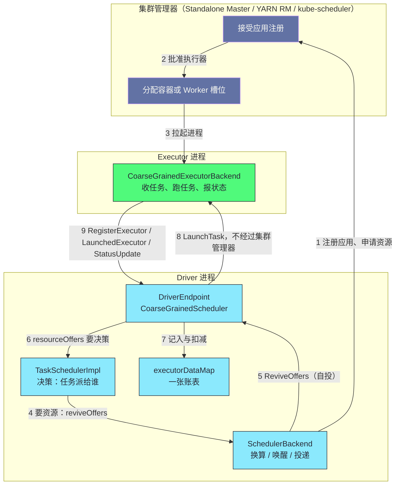
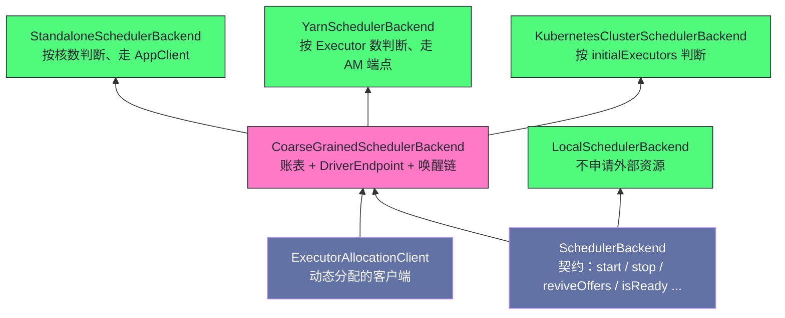
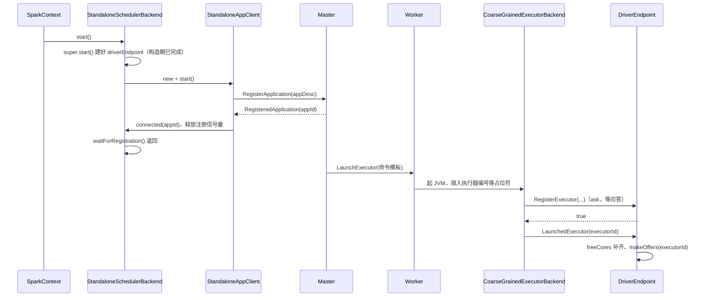
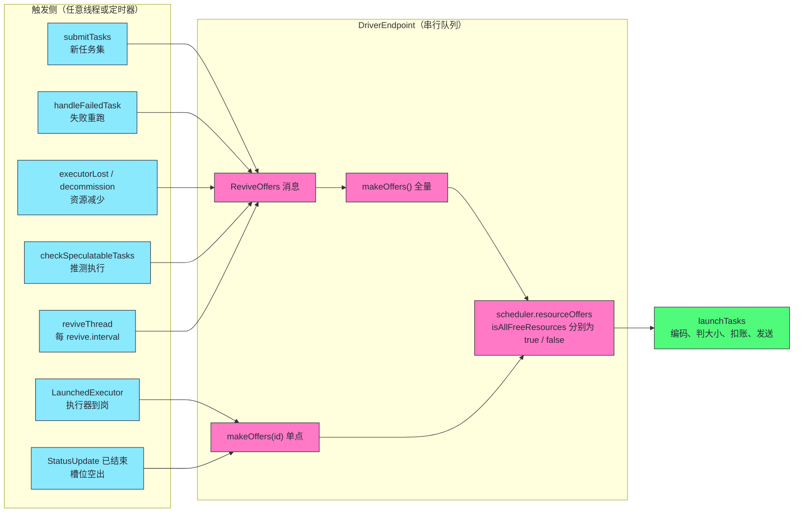
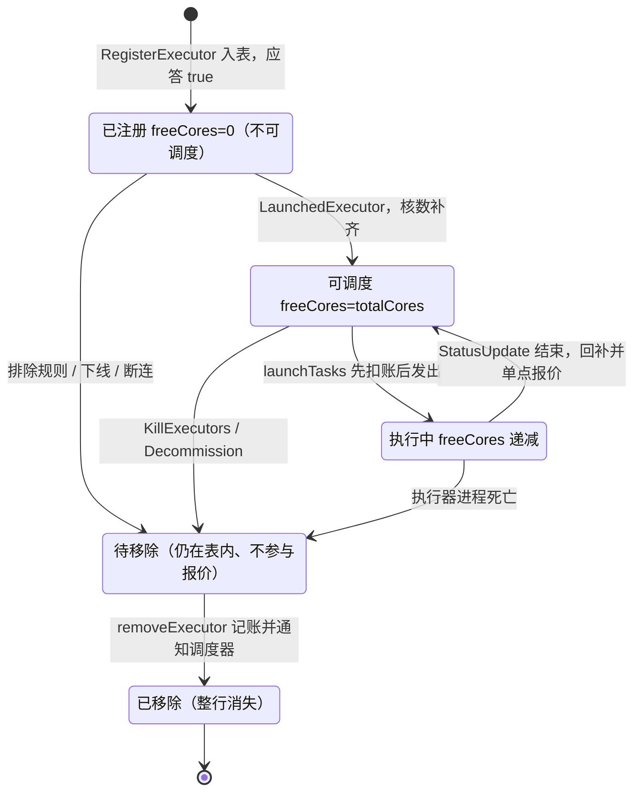

# 7. Spark SchedulerBackend 原理：一纸契约、一张账表与三条唤醒线

**摘要：**

2014 年前后，Spark 把 `spark.scheduler.revive.interval` 的默认值定在 1 秒，让 Driver 上的一个端点按这个节奏给自己发一条消息；同一时期，`spark.scheduler.maxRegisteredResourcesWaitingTime` 的版本注解停在 0.8.0，而 `spark.scheduler.minRegisteredResourcesRatio` 停在 1.1.1，说明"等资源到齐再开工"这件事被反复调过。这两个看似无关的细节指向同一个位置：调度器与执行器之间那层被叫作 SchedulerBackend 的东西。它既不下判断，也不做计算，只负责把集群管理器手里的核换成 Driver 账表上的一行，再把 TaskScheduler 的决策换成一条 RPC。

本文要回答两个问题：一纸只有十几个方法的契约，凭什么撑起 Spark 全部的任务交付；以及"先记账、再唤醒、后交付"这套顺序为什么不能颠倒。文章从契约的方法集讲起，分清哪些名字属于它、哪些属于对开的 TaskScheduler，并说明为什么反向调用被刻意做成对具体类的依赖；再沿粗粒度与细粒度的取舍回到实现家族，交代 Mesos 细粒度模式从弃用到移除的时间线；然后把启动、注册、记账、唤醒、投递、上行分支依次走一遍，其中 `executorDataMap` 那张账表与 `freeCores` 从 0 到满额的两段式补齐是重点；最后处理等待阈值这一处最容易被误配的地方，讲清 `maxRegisteredResourcesWaitingTime` 与 `minRegisteredRatio` 如何避免作业一上来就把任务压给少量 Executor，以及它们在 Standalone、YARN、Kubernetes 三种口径下的差别。全文的落点是一句判断：这一层的设计价值集中在它没有把什么塞进接口里，以及它把账目与事实的偏差控制在了哪一个量级上。

**关键词（Keywords）**: SchedulerBackend, CoarseGrainedSchedulerBackend, DriverEndpoint, reviveOffers, executorDataMap, 粗粒度调度

---

## 第 1 章 一纸契约

### 1.1 只有十几个方法的 trait

Spark 4.x 的 `SchedulerBackend` 放在 `org.apache.spark.scheduler` 包里，是一个 `private[spark]` 的 trait（特质），正文不到百行。它的注释里有两句要紧的话：这是一个"允许在 `TaskSchedulerImpl` 之下插入不同调度系统"的后端接口，前提假设是"应用随着机器的空闲获得资源报价（offer），并可以在这些机器上启动任务"。这句注释把整层组件的地位说透了——它是插槽，不是决策者。

把方法摊开看，一共十来项：`start`、`stop`（另有一个带退出码的重载）、`reviveOffers`、`defaultParallelism`、`killTask`、`getTaskThreadDump`、`isReady`、`applicationId`、`applicationAttemptId`、`getDriverLogUrls`、`getDriverAttributes`、`maxNumConcurrentTasks`、`getShufflePushMergerLocations`；其中 `killTask` 的缺省实现直接抛 `UnsupportedOperationException`，`isReady` 缺省返回真，`applicationAttemptId`、两个 `getDriver*` 缺省返回空，`getShufflePushMergerLocations` 缺省返回空序列。

```scala
private[spark] trait SchedulerBackend {
  // 缺省实现是 "spark-application-" 拼上当前毫秒时间戳，一个明摆着的占位值
  private val appId = "spark-application-" + System.currentTimeMillis
  def start(): Unit
  def stop(): Unit
  def reviveOffers(): Unit                                  // 只是"投一条消息"，不是"排一次序"
  def defaultParallelism(): Int
  def maxNumConcurrentTasks(rp: ResourceProfile): Int        // 注释明确要求调用方不得缓存
  def isReady(): Boolean = true                              // 等资源的那道闸
  def applicationId(): String = appId
  ...
}
```

**契约的窄，本身就是它的设计目标**。窄到只有"开始、停止、唤醒、问数、下发控制"五类动作，任何一种集群管理器都能在几十行里完成适配；宽一点当然能表达更多语义，代价是每接入一种新的资源系统，都要重新实现一遍那些语义。

本文引用的类名与方法签名以 Spark 4.3.0（2026-10-30 发布，4.x 预编译 Scala 2.13）的源码为准，包路径与缺省值按这一版写；这层契约的方法集会随新特性增删，跨大版本对照时以对应版本文档或源码为准。参数缺省值取自同一版的配置定义与官方配置页，两处不一致时以代码为准。

### 1.2 它到底管什么

笔者把这一层的工作归成三件，每一件都能在方法集里找到对应，也都恰好落在"不参与决策"这条红线之外。

第一件是**资源侧的换算**：把集群管理器语言里的"容器""Worker 上的核与内存""Pod 的 request"折算成 Driver 内部的语言——某台主机上的某个 Executor 还有几个核可用，即一个 `WorkerOffer`。`start`、`stop`、`maxNumConcurrentTasks`、`defaultParallelism` 都在这个方向上。

第二件是**调度侧的唤醒**：TaskScheduler 有任务待派、有槽位空出、有执行器失效，都要有人去敲一下门，让"报价—分配—投递"这条链重新转一圈。`reviveOffers` 与 `isReady` 归这里。

第三件是**交付侧的投递**：把调度器算出来的 `TaskDescription` 编码、判大小、扣账、发出去，再把执行器传回的状态转交调度器。这一件事没有独立的方法名，它发生在 `DriverEndpoint` 的消息处理里。

三件之外的事情，它一件都不做：不决定哪个任务去哪台机器（那是 TaskScheduler 与它的调度池），不决定失败要不要重试（那是 TaskSetManager 与 DAGScheduler），不负责重连（Executor 断连即自杀，Driver 不重连），也不负责给 Executor 分配编号以外的身份（编号由集群管理器给）。**它只保证"资源的现实"与"调度的假设"之间不出现长时间的偏差**，偏差一旦出现就通过唤醒和移除两条路收敛。

两个"问数"的方法值得单独看，因为它们最能说明这一层的定位。`defaultParallelism` 的缺省实现是取 `spark.default.parallelism`，未配置时退化为 `max(totalCoreCount, 2)`——也就是说，不看任何任务与分区，只看账表上的核数总和。`maxNumConcurrentTasks` 更进一步，它按 `ResourceProfile` 把每个活跃执行器的满额核数与扩展资源折算成"还能同时排多少个任务"，用的是 `totalCores` 而不是 `freeCores`，注释里把这个语义写得很清楚：即便这些槽位此刻正被占用，也要按可用能力算。前者给"没有指定并行度"的算子一个下限，后者给动态分配与推测执行一个参照，两者都在回答同一个问题——这层组件是唯一同时看得见"资源账"与"调度需求"的地方，所以凡是跨这两者的读数，都只能由它提供。

把三个域的通信方向画成一张图，可以看出这层组件的位置恰好是三者的交点，而它自己不属于任何一边。



图里第 8 步与第 1 步形成一对：资源从集群管理器来，任务却绕开它直接下去。这条不对称是后面所有讨论的地基——集群管理器管"有没有机器"，Driver 管"活怎么派"，两者的时间尺度与失败语义完全不同，硬要合成一条链就会两头都不讨好。

### 1.3 七个名字的归属

日常讨论里常把这七个名字一锅端地叫成"Backend 的方法"，但在 4.x 源码里它们分属三处：`SchedulerBackend` trait、`TaskSchedulerImpl` 这个具体类、以及更上层的 `TaskScheduler` trait。分清楚不只为了准确，它决定了你在读日志时该往哪一层找原因。

| 名字 | 声明位置 | 调用方向 | 职责 |
|---|---|---|---|
| `start` / `stop` | `SchedulerBackend` | 调度器 → 后端 | 建客户端、注册应用、停端点与执行器 |
| `reviveOffers` | `SchedulerBackend` | 调度器 → 后端 → 端点 | 投一条 `ReviveOffers`，触发一轮全量报价 |
| `maxNumConcurrentTasks` | `SchedulerBackend` | 调度器 → 后端 | 按 `ResourceProfile` 折算当前可并发任务数 |
| `isReady` / `sufficientResourcesRegistered` | `SchedulerBackend` | 调度器 → 后端 | 资源是否等够，决定要不要卡住作业提交 |
| `killTask` / `decommissionExecutors` | `SchedulerBackend` | 调度器 → 后端 | 下行控制，落到具体 Executor |
| `resourceOffers` | `TaskSchedulerImpl`（不在 `TaskScheduler` trait 上） | 后端 → 调度器 | 把 `WorkerOffer` 序列换成 `TaskDescription` 序列 |
| `statusUpdate` / `executorLost` | `TaskSchedulerImpl`（`executorLost` 另在 trait 上有声明） | 后端 → 调度器 | 任务终态与执行器失效的上报入口 |

表里最容易被读错的是 `resourceOffers` 与 `statusUpdate` 的位置。它们不在这份契约里，因为契约是单向的：`SchedulerBackend` 只被要求实现"能被调度器调用"的那一半，反向调用直接依赖 `TaskSchedulerImpl` 这个类——`CoarseGrainedSchedulerBackend` 的构造参数类型写的就是 `TaskSchedulerImpl`，不是 `TaskScheduler`。**这是一处刻意的偏斜**：接口做窄以容纳各种集群管理器，反向依赖做实以换取调用上的直接，代价是这层组件无法脱离 `TaskSchedulerImpl` 单独测试。

除了 `SchedulerBackend`，粗粒度后端还混入了 `ExecutorAllocationClient`，于是它同时是动态分配的执行端：`requestTotalExecutors`、`requestExecutors`、`killExecutors`、`decommissionExecutors`、`getExecutorIds`、`isExecutorActive` 这些方法都在这里落地。动态分配器只跟这个客户端说话，从不直接碰集群管理器，这条边界让"要不要弹性"变成 Driver 内部的一个策略问题。

### 1.4 谁来决定用哪个后端

后端不是被 `new` 出来的，而是被"按 master URL 反射找出来"的。`ExternalClusterManager`（外部集群管理器）定义四个方法：`canCreate(masterURL)` 判断自己能不能接管这个 URL，`createTaskScheduler` 造调度器，`createSchedulerBackend` 造后端，`initialize` 把两边互相注册。SparkContext 在启动时遍历所有可用实现，第一个认领成功的就负责这一对组件。

这个设计把"支持一种新的资源系统"压缩成"实现一个工厂"，也解释了为什么 `local`、`standalone`、`yarn`、`kubernetes` 四种模式的调度行为可以差得很远却共用同一套 DAGScheduler：差异全部收在工厂造出来的那一对组件里。

### 1.5 一个贯穿全文的案例

为了让后面的机制不悬空，笔者设想一个具体作业：某支付团队每小时提交一个名为 `settle_hourly` 的结算作业，读取上一小时的交易流水，按商户与渠道汇总后写入对账表。集群是自建的 Standalone，六台 Worker，每台 32 核、128 GB，`settle_hourly` 配 `spark.executor.cores=4`、`spark.executor.memory=8g`、`spark.cores.max=96`，也就是期望二十四个 Executor 一起干活。

这个作业会在后文反复出现：第 3 章看它启动时两端如何同时开工，第 4 章看二十四个 Executor 如何变成账表上的二十四行，第 5 章看一次任务完成如何只惊动一个 Executor，第 8 章看它在 Executor 尚未到齐时被按住的三十秒。

### 1.6 一个比喻与它的限定

把这一层比作码头值班室的对讲机协议：调度室负责排班（谁装哪条船），但排班的人不下码头；码头上每个班组（Executor）有一台对讲机，值班员（DriverEndpoint）通过它问"你还有几个空位"、发"这单归你"。协议里只有问、派、报三种话，没有"你怎么这么慢"这类判断——慢不慢是调度室的事。

比喻的限定在于：对讲机是单向广播式的，"派"出去之后值班员并不等回执，回执走另一条通道（`StatusUpdate`），而且可能永远不来。这个"发出去就不管"的特性，是第 6 章与第 7 章所有边界问题的源头。

---

## 第 2 章 实现家族：从细粒度到粗粒度

### 2.1 类注释里的定义

`CoarseGrainedSchedulerBackend`（粗粒度调度后端）的类注释写得直白：它"等待粗粒度的执行器连上来"，并且在整个作业期间"一直持有每个执行器，而不是每完成一个任务就交还执行器、再为一个新任务申请一个新执行器"。

这句话里有两个承诺：执行器是按作业申请的长期资源，任务只是在这个容器里反复开合的短生命周期对象。粗粒度（coarse-grained）这个形容词修饰的不是任务，而是资源的持有粒度——一次拿一整块，用到作业结束。

### 2.2 细粒度当年怎么算账

要理解这个承诺为什么值钱，得回到它取代的东西。Mesos 上曾经有两种模式：粗粒度与细粒度（fine-grained）。细粒度模式下，Executor 不是常驻进程，而是一个"任务执行槽"的抽象——Driver 为每个 Task 向 Mesos 申请一次资源，任务跑完立刻归还，下一个任务再申请一次。资源账目精确到任务级别，理论上多框架混部时碎片最少。

账面上的优势很诱人，实际代价藏在三条线上。其一是启动开销摊到了每个任务上：进程或容器的拉起、SparkEnv 的重建、Shuffle 服务的重新注册，这些成本在粗粒度下由整个作业分摊，在细粒度下由每个任务承担。其二是状态无处安放：BlockManager 的缓存、广播变量的副本、累加器，都依附于 Executor 进程的存活，进程随任务生灭，这些状态就只能反复重建。其三是 Driver 变成了资源协商的热点：每秒成百上千次 offer 往返全压在同一个端点上，调度延迟随任务数线性上涨。

### 2.3 为什么细粒度输了

| 维度 | 细粒度（Mesos fine-grained，已移除） | 粗粒度（当前唯一形态） |
|---|---|---|
| 资源持有单位 | 单个任务 | 整个作业 |
| Executor 进程 | 任务级生灭 | 作业级常驻 |
| 启动开销分摊 | 每个任务一份 | 每个作业一份 |
| 缓存与广播变量 | 随进程消失 | 可跨任务复用 |
| 资源账目精度 | 高，碎片少 | 低，按 Executor 整块记账 |
| 调度往返频率 | 与任务数同阶 | 与唤醒次数同阶 |
| 失败语义 | 任务失败即资源归还 | Executor 失败才丢一大批任务 |
| 适用判断 | 多框架混部、任务极短 | 单一框架、任务密集 |

表格最后一行是判断的依据而非结论。细粒度不是被证明为错，而是被权衡掉了：它用"账目精确"换"状态无处安放"，而 Spark 的核心卖点恰恰是把中间结果留在内存里——一份随时会被回收的 Executor 与这个卖点直接冲突。**细粒度的失败不在于算不清账，而在于它算清账的代价是让缓存失效**。

反过来说，粗粒度的代价也很明确：资源一旦申请就以整块形式被占住，一个配了 4 核 8 GB 的 Executor 即便只有一个任务在跑，账面上依然占着 4 核；空闲时不会自动还回去，要还就得靠第 1.3 节提到的动态分配客户端去主动缩容。

细粒度的退场有明确的时间线：它自 Spark 2.0.0 起被标记为弃用（SPARK-11857 只改了文档），到 3.0.0 从代码里移除（SPARK-21559）；而 Mesos 作为资源管理器，3.2.0 起弃用，4.0 起彻底移除（SPARK-44442）。所以"细粒度与粗粒度的取舍"在今天只能作为设计史来读，源码里已无第二种形态。

### 2.4 子类只改四件事

粗粒度后端是一个骨架类，真正与某一种资源系统打交道的部分被留成抽象或可覆盖的钩子。三种粗粒度实现各改各的，改动面小得惊人；本地模式干脆不走这条路，直接实现契约：

| 实现 | 改写点 | 说明 |
|---|---|---|
| `StandaloneSchedulerBackend` | `start`、`doRequestTotalExecutors`、`doKillExecutors`、`sufficientResourcesRegistered` | 走 `StandaloneAppClient` 与 Master 对话，按核数算是否等够 |
| `YarnSchedulerBackend` | `minRegisteredRatio`、`sufficientResourcesRegistered`、`doRequestTotalExecutors` | 走 AM 端点，按 Executor 个数算是否等够 |
| `KubernetesClusterSchedulerBackend` | `minRegisteredRatio`、`sufficientResourcesRegistered`、`doRequestTotalExecutors` | 按 `initialExecutors × 比例` 算，Pod 由 kubelet 拉起 |
| `LocalSchedulerBackend` | 不复用粗粒度骨架，直接实现契约 | 不注册任何外部资源，本地起一个 Executor 进程 |

**骨架承担"记账与投递"，子类只承担"申请与释放"**，这条分界线贯穿整个族谱。第 4 章的账表因此在三种粗粒度模式下是同一份实现，第 5 章的唤醒链也是同一条——差异只出现在"资源从哪来"这一端。把继承关系画出来会更清楚：



图里 `CoarseGrainedSchedulerBackend` 之上有两份契约，之下有四个叶子。真正复杂的行为全在中间那一层，叶子的任务是"把这一种资源系统的语言翻译成账表能理解的事件"——Standalone 翻译的是 `ExecutorAdded` / `ExecutorRemoved` 回调，YARN 翻译的是 AM 的分配与释放，Kubernetes 翻译的是 Pod 的相位变化。

---

## 第 3 章 启动：两端同时开工

### 3.1 构造器里就建好了端点

有一处版本差异必须先说清楚，否则读者按旧代码去对会迷路。在 4.x 的实现里，`DriverEndpoint` 不是等到 `start()` 才创建的，它写在类体里：

```scala
// 类体中的 val：构造 CoarseGrainedSchedulerBackend 时就把端点注册进 RpcEnv
val driverEndpoint = rpcEnv.setupEndpoint(ENDPOINT_NAME, createDriverEndpoint())
```

`ENDPOINT_NAME` 的取值是 `"CoarseGrainedScheduler"`，也就是说 Executor 回连时用的名字、Driver 自己投消息用的目标，都是这一个字符串。把它做成构造期副作用的好处是：只要后端对象存在，端点就一定可达，不存在"启动到一半、端点还没建"的窗口；代价是构造这个对象会触发 RPC 环境注册，单元测试里要小心。

`CoarseGrainedSchedulerBackend.start()` 本身只剩下装配安全相关的部分——初始化委托令牌管理器、检查直连凭证提供者配置是否与集群管理器能力匹配。真正"向集群要资源"的动作在子类里。

### 3.2 start() 的两段

`StandaloneSchedulerBackend.start()` 干两件事：先调基类 `start()`，再把执行器的启动命令拼成模板、把应用描述交给 Master。

```scala
override def start(): Unit = {
  super.start()
  // 执行器命令里最有信息量的是占位符：--executor-id {{EXECUTOR_ID}} 之类由 Worker 填
  val args = Seq("--driver-url", driverUrl, "--executor-id", "{{EXECUTOR_ID}}",
    "--hostname", "{{HOSTNAME}}", "--cores", "{{CORES}}", "--app-id", "{{APP_ID}}",
    "--worker-url", "{{WORKER_URL}}", "--resourceProfileId", "{{RESOURCE_PROFILE_ID}}")
  val command = Command("org.apache.spark.executor.CoarseGrainedExecutorBackend",
    args, sc.executorEnvs, classPathEntries ++ testingClassPath, libraryPathEntries, javaOpts)
  val appDesc = ApplicationDescription(sc.appName, maxCores, command, webUrl,
    defaultProfile = defaultProf, sc.eventLogDir, sc.eventLogCodec, initialExecutorLimit)
  client = new StandaloneAppClient(sc.env.rpcEnv, masters, appDesc, this, conf)
  client.start()
  waitForRegistration()          // 注意：等的是应用注册，不是等 Executor
}
```

`--driver-url` 那一项决定了整个拓扑：Executor 起来后连的是 Driver 上的 `CoarseGrainedScheduler` 端点，而不是 Master；Master 只负责让 Worker 把这个进程拉起来并在需要时杀掉它。所以"任务由 Driver 直接下发、不经过 Master"这句话，在参数层面就已经固定下来了。

### 3.3 等的是注册，不是资源

`waitForRegistration()` 的实现简单到只有一行：`registrationBarrier.acquire()`，一个初值为 0 的信号量。而 `notifyContext()` 在 `connected(appId)`、`disconnected()`、`dead(reason)` 三个回调里各释放一次。换句话说，**它等的是"Master 已经接受了这个应用"，任何一种结果都能放行**，成功注册、连接断开、应用判死都算。

这一点常被误读成"等 Executor 到齐"。真正的资源等待在另一处，第 8 章会展开：`TaskSchedulerImpl.postStartHook` 里调用的 `waitBackendReady`，它以 100 毫秒一次的 `wait` 轮询 `backend.isReady()`。两道等待一前一后，一个等身份、一个等资源，混在一起谈就会得出"Spark 启动慢是因为等 Executor"的错误结论——在 Standalone 的缺省配置下，资源等待根本不会发生。

### 3.4 三条消息与一个监听器

应用注册这一段只用了三条消息，外加一个回调接口。Driver 侧的 `ClientEndpoint` 启动时向所有 Master 地址群发 `RegisterApplication(appDesc, self)`；Master 处理完回 `RegisteredApplication(appId, master)`；此后 Worker 拉起 Executor 时，Master 还会通过 `ExecutorAdded` 之类的回调告诉 Driver"你这个执行器被批准了"。这些回调都落在 `StandaloneAppClientListener` 上：`connected`、`disconnected`、`dead`、`executorAdded`、`executorRemoved`、`executorDecommissioned`、`workerRemoved`。

群发之后等多久、失败几次算完，是两个写死在实现里的常量：注册超时 20 秒，重试 3 次，每一轮都重新向全部 Master 地址发一遍。3 次全部无响应时，客户端回调 `dead`，后端的处理是 `scheduler.error(reason)` 加 `sc.stopInNewThread()`——**应用注册失败在这一层的语义是终止整个应用，而不是降级继续**。原因不难推：没有 appId 就没有归属，Executor 就算起来了也不知道该向谁报到，继续跑下去只会留下无人认领的进程。这条路径的日志很显眼，"All masters are unresponsive! Giving up" 出现时，问题几乎总在 Master 侧或网络侧，而不在 Spark 应用本身。

```scala
// StandaloneAppClient.ClientEndpoint：向全部 Master 群发，等 20 秒再决定要不要重来
private def tryRegisterAllMasters(): Array[JFuture[_]] = {
  for (masterAddress <- masterRpcAddresses) yield {
    registerMasterThreadPool.submit(new Runnable {
      override def run(): Unit = try {
        val masterRef = rpcEnv.setupEndpointRef(masterAddress, Master.ENDPOINT_NAME)
        masterRef.send(RegisterApplication(appDescription, self))   // 把回话地址一并带上
      } catch { case NonFatal(e) => logWarning("Failed to connect to master", e) }
    })
  }
}

private def registerWithMaster(nthRetry: Int): Unit = {
  registerMasterFutures.set(tryRegisterAllMasters())
  registrationRetryTimer.set(registrationRetryThread.schedule(new Runnable {
    override def run(): Unit = {
      if (registered.get) {                       // 有一个 Master 应答就够了
        registerMasterFutures.get.foreach(_.cancel(true))
        registerMasterThreadPool.shutdownNow()
      } else if (nthRetry >= REGISTRATION_RETRIES) {
        markDead("All masters are unresponsive! Giving up.")
      } else {
        registerMasterFutures.get.foreach(_.cancel(true))
        registerWithMaster(nthRetry + 1)
      }
    }
  }, REGISTRATION_TIMEOUT_SECONDS, TimeUnit.SECONDS))
}
```

这段代码里有一处值得细看：只有 `registered` 为真才取消全部在途请求，而 `registered` 是收到 `RegisteredApplication` 之后才置位的。也就是说，注册是多 Master 场景下的一场"赛马"，谁先应答就算谁的，其余请求全部取消；重试也是整轮重来，而不是补发给单个 Master。这种"全量重试"的写法在 Master 频繁切换时比"记住上一次成功的地址"更稳健——旧的 leader 可能已经变成只读状态。

下图把启动这一段的两条并行链路画在一起：上半段是应用侧向 Master 注册，下半段是 Executor 进程起来后向 Driver 报到，两条链在 Worker 拉起 JVM 这个物理事件上会合。



图里有一处顺序值得停留：`RegisterExecutor` 走的是 `ask`（要应答），`LaunchedExecutor` 走的是 `send`（不要应答）。前者是"我要加入"，必须知道自己有没有被接纳；后者是"我可以干活了"，纯通知。两种语义用两种消息模式表达，是这一层唯一的"协议设计"。

### 3.5 不这样会怎样

如果把两段等待合并成一段——即注册完立刻开始派任务——会发生什么？在 Standalone 下，Master 接受应用之后通常要等几秒才有第一个 Executor 起来（Worker 收到指令、起 JVM、建 RPC 环境、取配置）。这段时间里 `executorDataMap` 是空的，`makeOffers()` 过滤后得到零个 offer，`resourceOffers` 返回空序列，`launchTasks` 什么都不做；作业并不会出错，只是空转，同时名为 `spark.starvation.timeout`（缺省 15 秒）的看门狗会按这个节奏打印"Initial job has not accepted any resources; check your cluster UI"——这句话之所以在真实集群里出现得如此频繁，多数时候不是资源不足，而是这条链上某个环节还没有走到。

真正的风险出现在资源分批到达时：如果不等，前三个 Executor 一到就会被塞满任务，而剩下的二十一个还在路上。第 8 章会把这条路径算细。

---

## 第 4 章 executorDataMap：一张账表

### 4.1 九个字段

账表本体是一个普通的 `HashMap[String, ExecutorData]`，键是执行器编号，值是下面这个结构：

| 字段 | 类型 | 用途 | 出错的后果 |
|---|---|---|---|
| `executorEndpoint` | `RpcEndpointRef` | 之后所有下行消息的目的地 | 任务发不出去 |
| `executorAddress` | `RpcAddress` | 断连时反查是谁掉了线 | `onDisconnected` 失效 |
| `executorHost` | 主机名 | 数据本地性判断、排除规则匹配 | 本地性退化 |
| `freeCores` | `BigDecimal` | 还能接几个任务 | 派多了会等、派少了会空 |
| `totalCores` | `Int` | 执行器满额核数 | 缩容与统计口径错 |
| `resourcesInfo` | 资源名 → 地址池 | GPU、FPGA 等扩展资源 | 资源感知调度失效 |
| `resourceProfileId` | `Int` | 这份执行器对应哪套规格 | 记账与配额错位 |
| `registrationTs` | 毫秒时间戳 | 扩容决策的观察窗口 | 动态分配判断失准 |
| `requestTs` | 可选时间戳 | 从"申请"到"注册"的耗时 | 只能看日志估 |

`freeCores` 用 `BigDecimal` 记，`totalCores` 仍是 `Int`，这个不对称来自 `spark.task.cpus` 允许小数（0.2、1.5 都合法，并发数按 `floor(executor cores / task.cpus)` 算）：满额核数是执行器的固有属性，而"还剩几个核"是小数加减累积出来的量，用整数记会一路丢失精度。这个细节在 GPU 或混部场景里会变成主要矛盾：一台机器上 4 个核跑 20 个 0.2 核的小任务，账面上 `freeCores` 的每一次加减都是小数。

两个时间戳字段看着像装饰，实际是动态分配的输入。`registrationTs` 记注册时刻，`requestTs` 记"这个执行器大概是什么时候被申请的"，后者来自一张按 `ResourceProfile` 组织的申请队列：每请求一个执行器就往队列里压一条 `(个数, 时间)`，执行器注册时从队头摘一条，若那条的计数大于一就减一再放回去。**这套队列让"申请到注册的耗时"可观测**，也让扩容决策不至于拿"刚申请就嫌慢"当依据。它的实现细节很朴素，朴素到只有一张 `HashMap[Int, Queue[(Int, Long)]]`，但少了它，扩缩容就只能看日志掐表。

### 4.2 freeCores 从 0 开始

注册成功那一刻，`ExecutorData` 的构造参数里 `freeCores` 是 `0`，`totalCores` 才是报上来的核数。这个不对称是整个第 4 章的核心：

```scala
val data = new ExecutorData(executorRef, executorAddress, hostname,
  0,        // freeCores：注册成功也先记 0，此时它还不能接活
  cores,    // totalCores：报上来的满额核数
  logUrlHandler.applyPattern(logUrls, attributes), attributes, resourcesInfo,
  resourceProfileId, registrationTs = System.currentTimeMillis(), requestTs = reqTs)
```

于是注册成功后的 Executor 在 `makeOffers` 眼里是一个"零核可用"的对象，不会被派任何任务。直到它把 `Executor` 对象构造完（建 BlockManager、注册指标源、起心跳线程），主动发一条 `LaunchedExecutor(executorId)`，`DriverEndpoint` 才把 `freeCores` 补成 `totalCores` 并触发一次针对它的报价。

两段式设计的原因很实在：从注册成功到构造完成之间有一个几百毫秒到几秒的窗口，若此时派任务下去，Executor 侧会撞上"收到 `LaunchTask` 但 `executor` 还是 null"，处理方式是直接自杀。**注册保证"能通信"，`LaunchedExecutor` 保证"能计算"**，把一个偶发的自杀竞态变成根本不会发生的事件。

### 4.3 两份汇总账与三张待决表

除了 `executorDataMap`，这一层还有两份"汇总账"与三张"待决表"。汇总账是两个 `AtomicInteger`：`totalCoreCount` 记全集群核数，`totalRegisteredExecutors` 记执行器个数，注册时各自加上去，移除时各自减回来。它们的用途是给 `defaultParallelism`、`maxNumConcurrentTasks` 与 `sufficientResourcesRegistered` 提供 O(1) 的读数——不必遍历账表。

待决表有三张，语义各不相同：`executorsPendingToRemove` 记"已经请集群管理器杀掉、但还没死"的编号，值是布尔，表示是不是 Driver 主动杀的；`executorsPendingLossReason` 记"已知要丢、但还不知道原因"的编号；`executorsPendingDecommission` 记"正在优雅下线"的编号与下线信息。

三张表合起来定义了一个判断：

```scala
override def isExecutorActive(id: String): Boolean = synchronized {
  executorDataMap.contains(id) && !executorsPendingToRemove.contains(id) &&
    !executorsPendingLossReason.contains(id) && !executorsPendingDecommission.contains(id)
}
```

**"在表里"与"可用"是两件事**，这是读这份实现时最该带走的一句。一个被标记为待移除的执行器仍然留在 `executorDataMap` 里，因为还要靠它的端点发 `StopExecutor`、还要在收到迟到的 `StatusUpdate` 时能查到是谁；但它不再出现在任何一次报价里。

### 4.4 记账先于交付

`freeCores` 的加减有固定的方向与时机，顺序颠倒就会出错。

减小发生在 `launchTasks` 里，位置在"编码完成、大小检查通过"之后、"发送之前"：

```scala
executorData.freeCores -= task.cpus                     // 先扣账
task.resources.foreach { case (rName, amt) =>
  executorData.resourcesInfo(rName).acquire(amt)        // 扩展资源一并扣
}
executorData.executorEndpoint.send(LaunchTask(...))     // 再交付
```

增大发生在 `StatusUpdate` 分支里，位置在"把状态交给调度器"之后、`makeOffers` 之前：

```scala
scheduler.statusUpdate(taskId, state, data.value)       // 先让调度器知道结果
if (TaskState.isFinished(state)) {
  executorData.freeCores += taskCpus                    // 再回补账目
  makeOffers(executorId)                                // 最后唤醒
}
```

两个方向都是"先改账、后动作"，但两侧"动作"的位置安排不同。减账前的动作是编码与判大小——如果编码超限，这个任务根本不会发出去，扣了账就永远还不回来，所以判大小必须在扣账之前。增账后的动作是唤醒——只有账目先回到正确值，接下来的报价才会给出正确的核数。

这套顺序的对偶面是失败：如果任务发出去了、Executor 却没收到（进程在这条消息到达前挂掉），账面上的 `freeCores` 就永久少了一块，直到该执行器被移除才随整行一起消失。这种"漏账"不会自愈，也不会报错，它表现为集群看起来还有余量、调度器却派不出去活。粗粒度的赌注就在这里——它假设执行器在作业期间基本稳定，偶发的漏账由"执行器死亡即整行移除"这条粗粒度路径兜住。

### 4.5 这张表没有自己的锁

`executorDataMap` 不是并发容器，它的注释把纪律写得很细：在继承自 `ThreadSafeRpcEndpoint` 的方法里访问不需要额外保护，因为这些方法在同一个端点线程上串行执行；一旦离开这些方法访问，就必须持有 `CoarseGrainedSchedulerBackend.this` 这把锁。

代码里体现这条纪律的是一个工具方法：

```scala
private def withLock[T](fn: => T): T = scheduler.synchronized { fn }
```

借的是 `TaskSchedulerImpl` 的监视器，不是自己的。原因是报价过程要同时读账表、改调度器内部的 `hostToExecutors` 等结构，只有用同一把锁才能保证"读到的一致"与"改完的一致"是同一件事。**共用一把粗锁换来的是顺序确定，付出的是并发度**：所有报价都被串行化，一次慢报价会挡住后续的注册与状态上报。考虑到报价本身只是内存操作，这笔交易在 Driver 这种单点组件上是划算的。

---

## 第 5 章 三条唤醒线

### 5.1 两个入口

唤醒有两个入口，粒度不同。

粗的那个是 `reviveOffers()`：它只做一件事，向自己的端点投一条 `ReviveOffers` 消息，并且用 `tryLogNonFatalError` 包着，异常只记日志不抛。端点收到后调无参的 `makeOffers()`，对全部活跃执行器做一轮报价。

细的那个没有公开名字，是 `makeOffers(executorId: String)`，只针对一个执行器构造 `IndexedSeq` 里的一项报价，并给 `resourceOffers` 传 `false`。

```scala
// 粗：全量报价，供所有 TaskSet 重新竞争一轮
private def makeOffers(): Unit = {
  val taskDescs = withLock {
    val activeExecutors = executorDataMap.filter { case (id, _) => isExecutorActive(id) }
    val workOffers = activeExecutors.map { case (id, d) => buildWorkerOffer(id, d) }.toIndexedSeq
    scheduler.resourceOffers(workOffers, true)          // true：这是一次「全量」报价
  }
  if (taskDescs.nonEmpty) launchTasks(taskDescs)
}

// 细：只为一个执行器报价，任务一完成就走这条
private def makeOffers(executorId: String): Unit = { ... scheduler.resourceOffers(IndexedSeq(offer), false) ... }
```

### 5.2 调用点全表

把 4.x 的调用点列全，会看到一个反直觉的事实：落在 `reviveOffers` 上的场景并不都是"任务完成"。

| 触发场景 | 调用点 | 入口 | 消息还是直接调用 |
|---|---|---|---|
| 新任务集提交 | `TaskSchedulerImpl.submitTasks` | `reviveOffers()` | 投 `ReviveOffers` |
| 任务失败需重跑 | `handleFailedTask` | `reviveOffers()` | 投 `ReviveOffers` |
| 执行器丢失 | `TaskSchedulerImpl.executorLost` | `reviveOffers()` | 投 `ReviveOffers` |
| 执行器优雅下线 | `executorDecommission` | `reviveOffers()` | 投 `ReviveOffers` |
| 推测执行发现慢任务 | `checkSpeculatableTasks` | `reviveOffers()` | 投 `ReviveOffers` |
| 执行器报到完成 | `LaunchedExecutor` | `makeOffers(id)` | 端点内直接调用 |
| 任务终态回报 | `StatusUpdate` 且已结束 | `makeOffers(id)` | 端点内直接调用 |
| 周期兜底 | `reviveThread`，每 `revive.interval` | `ReviveOffers` | 端点自投 |

前五行是"有人告诉调度器该重算了"，于是投消息、走全量；后两行是"某个执行器的账目变了"，于是就地做单点报价。周期兜底那一行是 1 秒一次的定时器，缺省值来自 `spark.scheduler.revive.interval`（版本注解 0.8.1，缺省 1s），在端点 `onStart` 里用 `scheduleAtFixedRate` 挂上，注释写的是"定期唤醒报价，让延迟调度得以工作"。

由此可见，所谓三条唤醒线，指的正是这三件事：**提交（任务来了）、到岗（执行器能干活了）、完工（槽位空出来了）**；表里其余几处都是这三条在异常与优化路径上的延伸。

把这张表画成图，重点不在触发点的数目，而在它们最终都收敛到两个入口、一条投递路径上：



图里五条左侧箭头汇入同一个 `ReviveOffers`，这正是"合并"发生的物理位置：消息在收件箱里排队，端点一次只取一条处理，五条挤在同一时刻投递也只换来一轮全量报价。右侧两条单点箭头则绕开了这条合并路径，因为它们对应的是"一个执行器的账目变了"，不需要惊动全局。

### 5.3 为什么是消息

`reviveOffers` 明明可以直接调 `makeOffers`，为什么非要绕一次消息？答案在锁与线程模型上。

端点的方法在 `ThreadSafeRpcEndpoint` 的串行队列上执行，`makeOffers` 依赖这把锁与账表的串行访问；而 `reviveOffers` 的调用方来自任意线程——DAGScheduler 的调度线程、任务结果处理线程、推测执行的定时线程。如果直接调用，就得在调用方那一侧拿锁，而调用方往往已经持着 `TaskSchedulerImpl` 的锁（`executorLost` 就是在 `synchronized` 块之后立刻调的），一跨就是死锁。

投消息把这个同步点挪到了端点线程上，代价是"唤醒"变成异步：`reviveOffers()` 返回时，什么都没发生。这一点在排查"任务明明提交了却迟迟不跑"时很关键——你在调用栈上看不到任何阻塞，因为阻塞的语义已经不在这一层了。

### 5.4 去抖：合并、兜底与延迟调度

异步投递天然带来合并：如果一次任务失败触发五次唤醒，只要第一条消息还没被端点取出，后面四条就是同一个效果——全量报价本来就是幂等的，多算一遍不会派错任务，只是白干。**去抖在这里不是靠定时器窗口，而是靠"消息队列 + 幂等重算"这对组合**。

1 秒的周期定时器则是另一个方向的兜底，它大致兜住三类"该唤醒却没人唤醒"的情况：延迟调度（delay scheduling）把某个 TaskSet 的本地性等待等过头了、某个报价因为锁竞争被跳过、某个事件因为异常被吞。`TaskSchedulerImpl` 的类注释把这一点列为它的并发来源之一，明确写了"定期唤醒来自 `CoarseGrainedSchedulerBackend` 的全部报价，以适配延迟调度"。

延迟调度的判定还依赖报价的"全量"属性，这处耦合很容易读漏：类注释里把 `resourceOffers` 的 `isAllFreeResources` 为真时的一次报价称作"公平份额报价"，只有在这种报价里被拒绝，才算一次"延迟调度拒绝"。这条定义解释了为什么单点报价必须传 `false`——一个执行器空出来不构成"重新分配公平份额"的时机，若按全量算，延迟调度的计时会被高频的单点报价不断重置，本地性优化永远不会触发。

### 5.5 唤醒的边界

唤醒链有两个不显然的边界。

一是异常在这个位置是"静默"的。`TaskSchedulerImpl` 的注释里有一条警告：Spark RPC 框架会吞掉非致命异常，因此不要指望在 `resourceOffers` 或 `statusUpdate` 里抛异常能让应用失败，要中止一个 Stage 必须显式调 `TaskSetManager.abort()`（SPARK-31485）。`launchTasks` 里那段超限处理正是照着这条注释写的——它不抛，而是找到对应的 TaskSetManager 调 `abort`。

二是唤醒不保证有进展。`makeOffers` 可能算出一个空序列：所有执行器都在待移除状态、所有 TaskSet 都在等本地性、或者账面上的空闲核都被小数任务的取整规则吃掉了。此时 `launchTasks` 静默返回，调用方无从得知这一轮是"没必要"还是"没成功"。

---

## 第 6 章 把 TaskDescription 发出去

### 6.1 先编码再判大小

投递这一段只写到"发出"，代码不过十来行，但每一步都有明确理由。

```scala
for (task <- tasks.flatten) {
  val serializedTask = TaskDescription.encode(task)        // 4.x 自带的编码，不走通用序列化器
  if (serializedTask.limit() >= maxRpcMessageSize) {        // 128 MiB 的硬上限，只判不留
    scheduler.taskIdToTaskSetManager.get(task.taskId).foreach { mgr =>
      mgr.abort("Serialized task ... exceeds max allowed: spark.rpc.message.maxSize ...")
    }
  } else {
    val executorData = executorDataMap(task.executorId)
    executorData.freeCores -= task.cpus                     // 扣账
    executorData.executorEndpoint.send(LaunchTask(new SerializableBuffer(serializedTask)))
  }
}
```

第一步是编码。`TaskDescription` 有自己的 `encode` / `decode`，把任务编号、索引、尝试号、执行器编号、主机、任务对象字节、本地性属性等字段按固定顺序写进一个 `ByteBuffer`，而不是交给通用序列化框架。这样做省掉了一次反射与类型注册，也让"序列化后多大"这个判断变得可预期。

第二步是判断上限。`maxRpcMessageSize` 取自 `spark.rpc.message.maxSize`，缺省 128（单位 MiB），比较的是编码后的 `limit()`。注意这里用的是大于等于——正好等于上限也拒绝，因为 RPC 层还要在这段字节外再包一层信封。

### 6.2 超限的处置

超限不是丢弃这个任务，而是中止它所属的整个 TaskSetManager。这个选择看起来过重，实际是唯一合理的选择：一个任务对象大到超过 128 MiB，通常意味着闭包里捕获了一个大集合（把一张几百万行的本地表塞进了 `map` 函数），同一个 TaskSet 里的其他任务共享同一个闭包，必然同样超限。逐个丢弃只会让同样的错误重复几百次，而中止一次能立刻把原因写进日志。

代码里那句 `msg.format(task.taskId, task.index, serializedTask.limit(), maxRpcMessageSize)` 把四个数字凑齐了，读日志时可以直接判断是"闭包太大"还是"上限配小了"。真正合法的调大场景很少，多数情况该做的是把大对象改成广播变量。

### 6.3 投递是单向的

`send(LaunchTask(...))` 是单向消息，没有应答，也没有重试。Executor 收到后是否真的能跑、跑了多久、结果是什么，全都不在这条链上——回程走的是 `StatusUpdate`。

单向的选择有三个后果，都值得记住。其一，投递成功不代表执行成功，`launchTasks` 返回时任务可能已经在 Executor 侧排队或直接失败。其二，没有重试意味着消息丢失等于任务卡住，唯一能把它捞回来的是执行器侧的心跳超时（Executor 侧数心跳，Driver 侧则依赖执行器退出后的移除），以及任务超时这一层的兜底。其三，正因为不等回执，一次报价循环可以极快地把几百个任务铺出去，吞吐不会被往返延迟限制。

### 6.4 消息清单

这一层的消息体量很小，方向清楚，值得完整列一次：

| 方向 | 消息 | 语义 | 应答 |
|---|---|---|---|
| Driver → Executor | `LaunchTask(data)` | 派一个任务 | 无 |
| Driver → Executor | `KillTask(taskId, executorId, interruptThread, reason)` | 杀一个任务 | 无 |
| Driver → Executor | `StopExecutor` / `UpdateExecutorLogLevel` / `DecommissionExecutor` | 生命周期控制 | 无 |
| Executor → Driver | `RegisterExecutor(...)` | 我要加入 | `ask`，要 `true` |
| Executor → Driver | `StatusUpdate(...)` | 任务终态 | 无 |
| Executor → Driver | `LaunchedExecutor(executorId)` | 我能干活了 | 无 |
| Executor → Driver | `RetrieveSparkAppConfig(rpId)` | 取配置与令牌 | `ask` |
| Driver 内部 | `ReviveOffers` / `RemoveExecutor` / `RemoveWorker` | 自投的调度指令 | 无 |

八个条目里只有两个要应答，且都发生在"建立关系"的时刻。这就是这一层协议的全部。

---

## 第 7 章 DriverEndpoint 的三类上行消息

### 7.1 分工

`DriverEndpoint` 的 `receive` 是一个十来条分支的偏函数，`receiveAndReply` 另有八九条。与任务交付直接相关的是三个分支：`RegisterExecutor`、`StatusUpdate`、`LaunchedExecutor`；边上还有 `onDisconnected`、`RemoveExecutor` 与 `RemoveWorker` 负责收场。

三者可以理解为三种登记：`RegisterExecutor` 是入职登记，`LaunchedExecutor` 是开工报告，`StatusUpdate` 是完工回执。三者的处理顺序恰好对应账表上 `freeCores` 的 0 → 满 → 减 → 回补。



图里从 `A` 直接指向 `D` 的那条边容易被忽略：一个执行器可能刚注册就被排除或下线，此时它从未参与过任何一次报价，却已经走完了半条生命周期。第 4 章那句"在表里不等于可用"说的就是这条边。

### 7.2 RegisterExecutor：三道检查

`RegisterExecutor` 走 `receiveAndReply`，实现里有三道判断，任何一道不过就回失败：

第一道是编号重复。`executorDataMap.contains(executorId)` 为真就拒绝，抛 `Duplicate executor ID`。挡的是"同一编号被两个进程同时用"，常见于容器重建后编号复用，或 Driver 侧做过 reset 而旧进程还活着。

第二道是排除规则。主机名在 `scheduler.excludedNodes()` 里，或该执行器已被 `isExecutorExcluded` 标记，就拒绝。这条规则的动机很实际：排除决定是 Driver 做的，但集群管理器可能已经把资源分下来了，与其让它跑起来再杀，不如在注册时挡掉。

第三道不是判断而是兜底。若执行器的 RPC 引用没有对外地址（`executorRef.address` 为 null），就用这条连接的发送方地址顶替。照顾的是"执行器不监听入站连接、只能顺着已有连接回话"的部署形态。

三道全过之后，端点在同一个 `synchronized` 块里做四件事：写 `addressToExecutorId` 反查表、给两个计数器加值、把 `ExecutorData` 放进账表、更新 `currentExecutorIdCounter`；随后向监听总线投一条 `SparkListenerExecutorAdded`，最后才 `context.reply(true)`。**应答放在入表之后**，源码留了一句注释解释原因：有些测试要求应答发出时执行器已经在表里。这个顺序对生产同样有意义——Driver 一回 `true`，Executor 就会立刻发 `LaunchedExecutor`，若那时表里还没有它，这条消息会被当作"来自未知执行器"而丢掉。

### 7.3 StatusUpdate：先交调度器再补账

`StatusUpdate` 分支的顺序是固定的三步：先 `scheduler.statusUpdate(taskId, state, data.value)`，让调度器更新 TaskSetManager 的状态、必要时触发重试或让 DAGScheduler 推进 Stage；然后判断 `TaskState.isFinished(state)`，为真才回补账目——`freeCores += taskCpus`，并把扩展资源按地址还回池子；最后 `makeOffers(executorId)` 做一次单点报价。

顺序不能换。若先补账再交调度器，调度器可能在同一轮里既看到"槽位空出"又看到"任务还在跑"，重试判断会错；若只补账不交调度器，失败的任务永远不会重跑。代码里还有一处容错：账表里查不到这个执行器时，只打一条 warning 然后丢弃——"来自未知执行器的状态更新"通常是执行器刚被移除、迟到的消息才到，丢掉比报错合理。

这个分支也解释了"任务完成"为什么不需要走全量唤醒：只有一个执行器的账目变了，其余执行器的报价结果不会因为这次回补而改变。局部性在这里既省了一次全表遍历，也避免了把延迟调度的计时器重置。

### 7.4 LaunchedExecutor：注册不等于可用

`LaunchedExecutor` 的处理只有两行：`freeCores` 归一化为 `totalCores`，然后 `makeOffers(executorId)`。这两行是整个两段式设计的落点。

它的直接效果是：一个刚报到的执行器不会立刻被塞满任务，而是先拿到"满额可用"的标记，再由一次针对它的报价决定派什么。这一点在数据本地性上也有意义——单点报价传的是 `false`，不构成公平份额报价，因此不会干扰其他 TaskSet 的延迟调度计时。

反过来说，如果执行器构造失败（建 BlockManager 失败、拉不到配置），它会直接退出，永远不会发 `LaunchedExecutor`，账表里那一行就永久停在 `freeCores=0` 的状态，直到断连触发移除。**账表上出现一个长期零核的执行器，通常意味着这个执行器卡在了构造阶段**，这条经验在排查"资源够但任务不跑"时很省时间。

### 7.5 断连与移除

收场有快慢两条判据。

快判据是 `onDisconnected`：RPC 层发现连接断了，就投一条通知，端点用 `addressToExecutorId` 反查编号，然后 `removeExecutor(id, ExecutorProcessLost(...))`。慢判据在 Executor 自己那一侧——心跳连败到阈值，进程退出，再由集群管理器报给 Driver。

`removeExecutor` 干四件事：从 `addressToExecutorId` 与 `executorDataMap` 里删掉、把 `totalCoreCount` 与 `totalRegisteredExecutors` 减回去、调 `scheduler.executorLost(id, lossReason)`、投 `SparkListenerExecutorRemoved`。第四件事里的 `lossReason` 需要合成：若这个执行器是 Driver 主动杀的（`executorsPendingToRemove` 里标记过），损失原因归为 `ExecutorKilled`；若在优雅下线集合里，归为 `ExecutorDecommission`；否则沿用传入的原因。

`executorLost` 那一步会连带做两件重要的事：把该执行器上正在跑的任务全部标记失败并安排重跑（若所属 Stage 还能重试），以及在方法末尾调一次 `backend.reviveOffers()`——账表刚少了一行，报价的基础变了，必须重算。这条调用把"移除"和"唤醒"焊在了一起，也是第 5 章表格里"执行器丢失"那一行的由来。

还有一条更早的路径：`disableExecutor`。它不改账表，只把编号放进 `executorsPendingLossReason`，然后以 `LossReasonPending` 调 `scheduler.executorLost`。这样做的意图是先把执行器从调度视野里摘出去（`isExecutorActive` 立刻为假），等真正的死因到了再补一次带原因的调用——两次调用、一次摘除、一次定案，避免让调度器拿着一个含糊的原因做重试决策。

---

## 第 8 章 等一等再开席

### 8.1 isReady 的两条出口

回到第 1 章那个 `isReady`。它在粗粒度后端里的实现只有两条出口：

```scala
override def isReady(): Boolean = {
  if (sufficientResourcesRegistered()) return true     // 出口一：资源达标
  if ((System.nanoTime() - createTimeNs) >= maxRegisteredWaitingTimeNs) return true  // 出口二：时间到
  false
}
```

`sufficientResourcesRegistered` 在基类里返回真，各子类覆盖；`maxRegisteredWaitingTimeNs` 来自 `spark.scheduler.maxRegisteredResourcesWaitingTime`，缺省 30 秒（版本注解 0.8.0），从后端对象创建的那一刻开始计时。调用方是 `TaskSchedulerImpl.postStartHook` 里的 `waitBackendReady`：先问一次，不行就进 `synchronized { this.wait(100) }` 的循环，每 100 毫秒问一次，直到返回真；期间若 SparkContext 已停，就抛 `IllegalStateException`。

**这是一道闸，不是一次等待**：闸门在 `SparkContext` 初始化路径上，作业提交与 DAGScheduler 的事件循环都要排在这道闸之后。所以它的效果不是"慢一点"，而是"整个应用在资源到齐前不开始干活"。

### 8.2 三个模式的口径

三个子类对"什么算够"的定义并不相同，这也是最容易配错的地方：

| 模式 | `minRegisteredRatio` 缺省 | 分母（总期望资源） | 判断式 |
|---|---|---|---|
| Standalone | 0.0 | `spark.cores.max`，未设时为 0 | `totalCoreCount >= 分母 × 比例` |
| YARN | 0.8 | AM 报告的期望 Executor 数 | `totalRegisteredExecutors >= 分母 × 比例` |
| Kubernetes | 0.8 | `initialExecutors` | `totalRegisteredExecutors >= 分母 × 比例` |

差异的根子在资源的记账单位上。Standalone 用核做分母，因为 Master 给应用分配的就是核；YARN 与 Kubernetes 用 Executor 个数，因为它们分配的单位是容器或 Pod。文档里那一行把三种缺省写得明明白白："`spark.scheduler.minRegisteredResourcesRatio`：KUBERNETES 模式 0.8；YARN 模式 0.8；standalone 模式 0.0"。

Standalone 缺省 0.0 这件事常被当成"Spark 不等资源"的证据，其实是两件事叠出来的结果：比例缺省为 0，判断式的右边就恒为 0，`sufficientResourcesRegistered` 永远返回真；再加上分母取自 `spark.cores.max`，而多数小集群根本不设这个参数，分母本身就是 0。要想让这道闸在 Standalone 下真的起作用，得同时把 `spark.cores.max` 与比例都设上。

YARN 与 Kubernetes 的分母来自 `SchedulerBackendUtils.getInitialTargetExecutorNumber`，这个工具方法的取值分两种情况：开了动态分配时取初始 Executor 数（受最小、最大两个边界约束，并做一次区间校验），没开动态分配时直接取 `spark.executor.instances`。这解释了一处常见的困惑——开了动态分配之后，期望值不再是"最终会扩到多少"，而是"一开始要几个"，于是比例这道闸只对启动阶段生效，扩缩容期间的资源到齐与否不再受它管。

### 8.3 不这样会怎样

回到 `settle_hourly`。二十四个 Executor 不是同时到齐的：Master 按 Worker 的顺序逐个派发，六个 Worker 各起四个，中间夹着 JVM 启动、配置拉取、BlockManager 注册。若不需要等待，第一个 Executor 报到后立刻会有一批任务落上去。

后果分三层。第一层是并行度错觉：第一批任务把三个 Executor 的 12 个核占满，作业的 `taskId` 已经开始滚动，UI 上看起来"跑起来了"，但真实并行度只有设计值的八分之一。第二层是数据倾斜被人为放大：Shuffle 之后的分区按 Executor 摊开，先到的执行器拿到的分区数远多于后到的，落后者空转、领先者成为长尾，整个 Stage 的完成时间由最慢的那台决定。第三层是推测执行的误判：`spark.speculation` 打开时，慢任务会被判定为拖尾并启动副本，而"慢"的真实原因只是它所在的那台机器先领到了活，副本白跑一遍还多占一个槽位。

**等待买的不是资源，是"同一批任务处于同一起跑线"这个性质**。Spark 的 Stage 是屏障式的——Shuffle 依赖要求上游全部分区就绪才轮到下游，因此在并行度不足时提前开工，收益只有最先那几十秒，代价却由整个 Stage 的结构性倾斜承担。

### 8.4 30 秒的代价

出口二让这道闸不会无限期关着。30 秒的设置是一次明确的取舍：宁可让并行度不完美，也不能因为集群本身资源不足而永远不启动。想象一个只有三台 Worker、恰好只能容纳 12 个 Executor 的集群，而作业按 `spark.cores.max=96` 期望二十四个——此时比例永远达不到，若无超时出口，应用会卡在启动路径上，连日志都只有一句"还在等资源"。

30 秒也是排查时的关键锚点。作业提交后若恰好 30 秒才开始跑，且日志里有 `SchedulerBackend is ready for scheduling beginning after waiting maxRegisteredResourcesWaitingTime` 这一行，说明资源没等够、是被超时放行的，后续的性能问题就该从"期望值与实际容量不匹配"入手，而不是从调度器找原因。反之，若日志是 `reached minRegisteredResourcesRatio`，说明资源达标放行，这条闸没有拖慢任何东西。

### 8.5 三种误配

第一种是把比例设成 1.0 却允许集群偶尔给出略少的执行器。判断式是"大于等于分母乘比例"，分母取的是期望值而非实际可得值，一旦实际容量比期望少一个，比例 1.0 就永远不达标，每次提交都要白等 30 秒。

第二种是在 Standalone 下只设比例不设 `spark.cores.max`。分母为 0，闸门等于常开，配了等于没配。

第三种是把这道闸当成"资源不足的解决方案"。它只影响启动那一刻的等待，不改变运行期的分配；作业跑到一半执行器被抢占、被下线，这道闸不会再关上，能兜住的只有移除与唤醒那条链。

---

## 第 9 章 边界与反例

### 9.1 以为后端会重试失败的任务

它不重试。任务失败的重新提交由 TaskSetManager 与 DAGScheduler 决定，后端只负责在 `handleFailedTask` 之后被唤醒一次。把重试逻辑寄望于这一层，会得出"Spark 的重试不可靠"这种错误判断。

### 9.2 以为账表等于集群资源

`executorDataMap` 只是 Driver 视角的账，且是一份"已批准"的账。集群里可能还有正在启动的执行器（尚未注册）、被排除的执行器（已被调度器剔除但仍在表内）、以及集群管理器已经分配但 Driver 尚未收到通知的资源。三者都不在这张表上，所以拿它去核对集群容量，永远对不上。

### 9.3 以为 `freeCores` 等于负载

它记的是"已交付但未结束"的任务所占的核，不反映实际 CPU 使用率。一个 Executor 上跑着四个 sleep 十分钟的任务，`freeCores` 是 0，CPU 是闲的；反过来，一个任务内部起了多线程把机器打满，`freeCores` 只少了 `spark.task.cpus` 那么多。这个字段服务的是调度决策，不服务监控。

### 9.4 以为 `maxNumConcurrentTasks` 可以缓存

方法注释明确写着"请不要缓存这个方法的返回值，因为执行器的增减会让这个数变化"。它每次调用都遍历账表并按 `ResourceProfile` 折算槽位，是一个真正意义上的即时读数。

### 9.5 以为 `reviveOffers` 之后就开始派任务

它只投一条消息。消息入队到被处理之间，任务仍在等待。反过来，这也意味着"投了两次"不会派两遍——全量报价的幂等性兜住了这一点。

### 9.6 以为执行器断连会自己重连

不会。执行器侧的处理是退出（连不上 Driver 即自杀），Driver 侧的处理是移除。真正的重连发生在集群管理器层面：新的执行器以新编号注册，由账表重新记一行。所有"为什么编号变了"的疑问，答案都在这里。

### 9.7 以为缩容是后端自己的决定

缩容决策在 `ExecutorAllocationManager` 里，后端只是执行端：它把 `requestTotalExecutors` 转成集群管理器的请求，把要杀的执行器编号放进 `executorsPendingToRemove`，再确认它们是否真的退出。把缩容过慢归因于后端，会错过动态分配器那几个以分钟计的评估周期。

---

## 第 10 章 落点

回到开头那两个问题。

一个只有十几个方法的契约，凭什么撑起全部的任务交付？因为它把自己限制在"换算、唤醒、投递"这三件事上，而把另外三件更难的——调度决策、失败重试、资源申请——分别留给了 TaskScheduler、TaskSetManager 与外部集群管理器。契约越窄，可替换面越大：三种粗粒度实现各改写不过三四件事，就分别适配了 Worker、容器与 Pod 三种资源系统，本地模式甚至连这层适配都省了。**这层组件的价值不在于它做了什么，而在于它没有把什么塞进自己的接口里**。

"先记账、再唤醒、后交付"为什么不能颠倒？因为这三步各自对应一次状态转移：记账决定"谁还能接活"，唤醒决定"什么时候重新算"，交付决定"活落在哪"。把记账放在交付之前，超限的任务才不会凭空虚占核数；把记账放在唤醒之前，报价读到的才是正确的余量；把唤醒放在记账之后，一次任务完成才不会引发对全集群的重新计算。反过来，任何一步提前或推后，都会留下一个"账目与事实不同步"的窗口，而这类窗口不会自愈——粗粒度的容错只到"执行器整行移除"这一级。

由此可以给出这一层的能力边界，而边界本身是定位而非缺陷：它用"资源按 Executor 整块持有、账目在 Driver 单点串行"换来极低的调度成本与极强的实现简洁性，代价是资源利用率偏保守、漏账无法自动对账、以及唤醒只能合并不能精确。要不要为这些代价动用更细的资源单位与更复杂的对账机制，取决于集群里任务的时长分布与混部强度，而不取决于哪一种听起来更先进。

判断一个调度层的故障该归在哪一层，笔者常用三个问题：这一步要不要改变"谁在集群里"（落集群管理器）、要不要改变"任务派给谁"（落 TaskScheduler）、还是只改变"谁还有空位"（落这一层）。三个问题答完，绝大多数含糊的故障归因就有了位置。

---

## 参考资料

1. Apache Spark 源码（branch-4.3）：`core/src/main/scala/org/apache/spark/scheduler/SchedulerBackend.scala`，接口方法集与缺省实现。https://github.com/apache/spark/blob/branch-4.3/core/src/main/scala/org/apache/spark/scheduler/SchedulerBackend.scala
2. Apache Spark 源码：`core/src/main/scala/org/apache/spark/scheduler/cluster/CoarseGrainedSchedulerBackend.scala`，账表、唤醒链、`DriverEndpoint` 全部分支。https://github.com/apache/spark/blob/branch-4.3/core/src/main/scala/org/apache/spark/scheduler/cluster/CoarseGrainedSchedulerBackend.scala
3. Apache Spark 源码：`core/src/main/scala/org/apache/spark/scheduler/cluster/CoarseGrainedClusterMessage.scala`，上下行消息定义。https://github.com/apache/spark/blob/branch-4.3/core/src/main/scala/org/apache/spark/scheduler/cluster/CoarseGrainedClusterMessage.scala
4. Apache Spark 源码：`core/src/main/scala/org/apache/spark/scheduler/cluster/ExecutorData.scala` 与 `StandaloneSchedulerBackend.scala`，`ExecutorData` 字段与 Standalone 适配。https://github.com/apache/spark/blob/branch-4.3/core/src/main/scala/org/apache/spark/scheduler/cluster/ExecutorData.scala
5. Apache Spark 源码：`core/src/main/scala/org/apache/spark/scheduler/TaskSchedulerImpl.scala`，`resourceOffers`、`statusUpdate`、`executorLost` 与 `waitBackendReady`。https://github.com/apache/spark/blob/branch-4.3/core/src/main/scala/org/apache/spark/scheduler/TaskSchedulerImpl.scala
6. Apache Spark 源码：`core/src/main/scala/org/apache/spark/scheduler/TaskDescription.scala`，`encode` / `decode` 的字段顺序。https://github.com/apache/spark/blob/branch-4.3/core/src/main/scala/org/apache/spark/scheduler/TaskDescription.scala
7. Apache Spark 源码：`core/src/main/scala/org/apache/spark/ExecutorAllocationClient.scala`，动态分配客户的接口面。https://github.com/apache/spark/blob/branch-4.3/core/src/main/scala/org/apache/spark/ExecutorAllocationClient.scala
8. Apache Spark 源码：`core/src/main/scala/org/apache/spark/internal/config/package.scala`，`spark.scheduler.minRegisteredResourcesRatio`（1.1.1）、`maxRegisteredResourcesWaitingTime`（0.8.0）、`revive.interval`（0.8.1）等参数定义。https://github.com/apache/spark/blob/branch-4.3/core/src/main/scala/org/apache/spark/internal/config/package.scala
9. Apache Spark 4.3.0 文档：Configuration，`spark.scheduler.*`、`spark.rpc.message.maxSize`、`spark.task.cpus` 的缺省值与按模式区分的说明。https://spark.apache.org/docs/4.3.0/configuration.html
10. Apache Spark JIRA：SPARK-11857（细粒度模式自 2.0.0 弃用）、SPARK-21559（3.0.0 移除细粒度）、SPARK-44442（4.0 移除 Mesos 支持）。https://issues.apache.org/jira/browse/SPARK-21559
11. Apache Spark JIRA：SPARK-31485（RPC 框架吞异常，需显式 `abort`）、SPARK-15262（已移除执行器的心跳处理）。https://issues.apache.org/jira/browse/SPARK-31485

---

> [!note] 思考题
> 1. `SchedulerBackend` 只要求实现单向的被调方法，反向调用直接依赖 `TaskSchedulerImpl` 具体类，这样做的收益与限制分别是什么？若要把这一层抽成可独立测试的组件，接口该怎么切？
> 2. `freeCores` 初值为 0、等到 `LaunchedExecutor` 才补齐，这个两段式设计避免了哪一种竞态？如果某些执行器永远发不出这条消息，账表上会留下什么形状的痕迹？
> 3. 唤醒用消息投递而非直接调用，除了避免死锁，还带来了"合并"这个副产品；请比较"合并"与"精确定时"两种策略在延迟调度场景下的差别。
> 4. Standalone 的 `minRegisteredRatio` 缺省为 0.0，为什么同样的缺省值放到 YARN 与 Kubernetes 上并不合理？三种模式里"总期望资源"的口径差异说明了什么？
> 5. `launchTasks` 对超限任务的处理是中止整个 TaskSetManager 而不是丢弃单个任务，请从闭包共享与错误可见性两个角度论证这个选择。
> 6. 粗粒度以整块 Executor 为记账单位，带来"漏账无法自愈"的边界；若要求在不引入细粒度调度的前提下缓解这个问题，你会把对账动作放在哪一层？