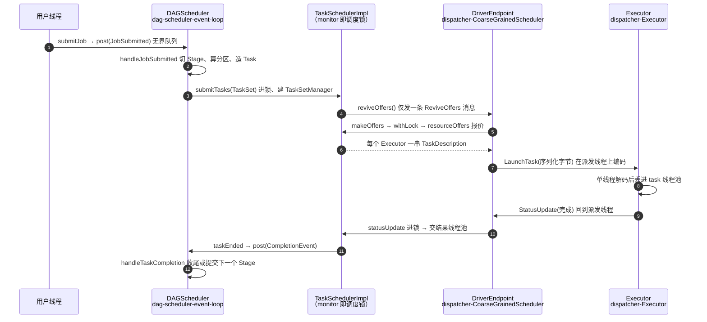
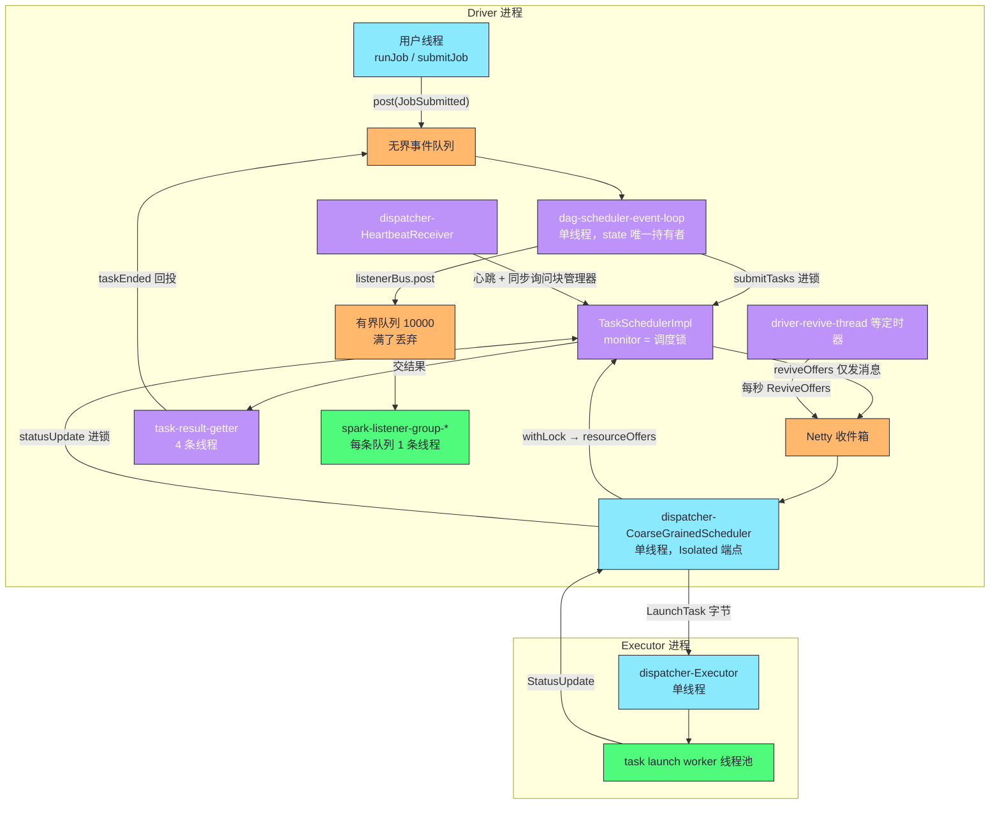
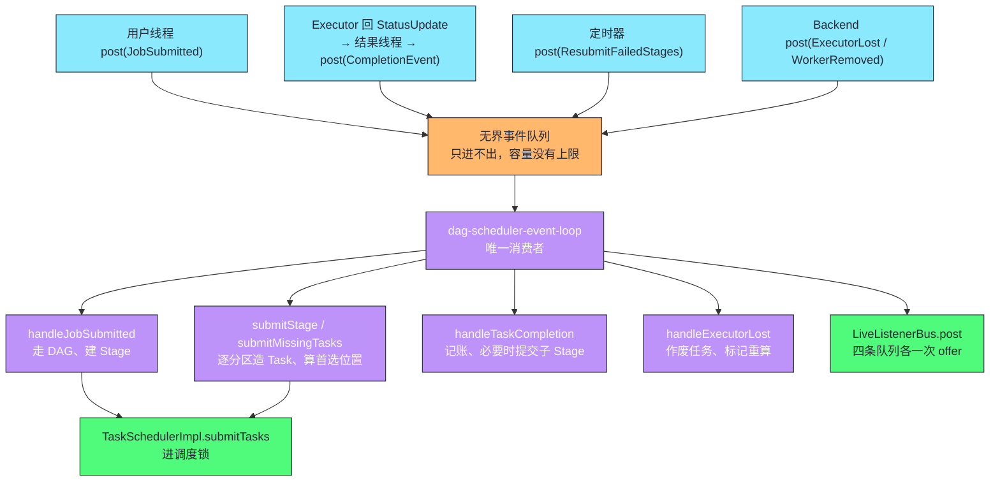
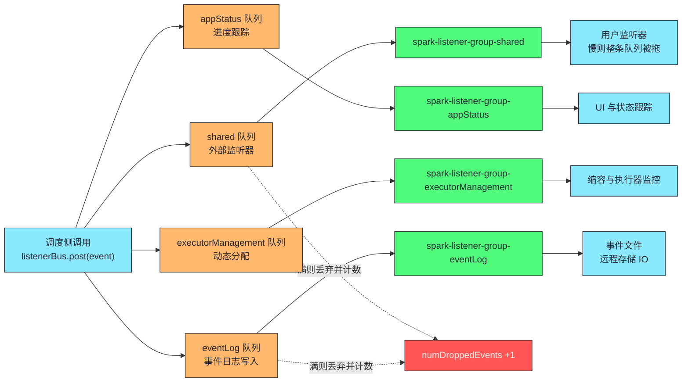
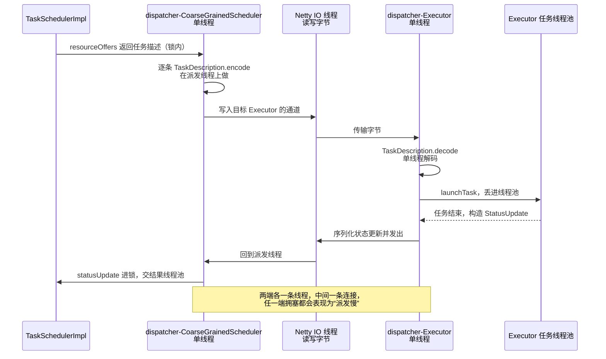

# 8. Spark任务调度核心机制：四方消息流、线程归属与四类阻塞点

**摘要：**

调度被讲成流程的时候总是很清楚：Job 切成 Stage，Stage 切成 TaskSet，TaskSet 摊到 Executor 上跑。但流程讲不出瓶颈。同样两千多个任务，有的集群半分钟派发完，有的要三分钟，而两边的 Stage 划分、并行度、资源申请在日志里长得一模一样。差别藏在流程之下——Driver 把"全局决策"收敛到少数几条单线程上，每条线程前面挂着一个队列，队列旁边有一把锁，锁里干多少活又由上游事件的到达速度决定，四者相乘才是吞吐。

本文换一个横切视角，只看四方：DAGScheduler、TaskSchedulerImpl、SchedulerBackend（DriverEndpoint）与 Executor，看它们之间的消息怎么走、每一步落在哪条线程、在哪把锁上排队、堵住之后症状长什么样。全文回答两个问题：调度吞吐到底由什么决定；当有人说"调度慢"，应该先看哪三处。路线是先画一张消息索引与线程归属图，说明 Driver 更像一间只有几个窗口的营业厅；再逐道拆关卡——`DAGSchedulerEventProcessLoop` 为什么天然串行、`TaskSchedulerImpl` 的临界区边界与 `resourceOffers` 的耗时来源、listener bus 用异步换来的自由与代价、RPC 派发线程上被忽略的序列化与同步往返；随后给出区分"任务很多但推进很慢"与"任务很快但调度很慢"的判据，界定 `spark.scheduler.mode=FAIR` 在高并发下的收益边界，交代 Driver 单点在调度层的真实含义；最后用一组反例说明哪些"调度慢"根本不归调度管。

**关键词（Keywords）**: DAGSchedulerEventProcessLoop, LiveListenerBus, resourceOffers, DriverEndpoint, FAIR 调度, Driver 单点

---

## 第 1 章 一条消息的四段路

### 1.1 论文只规定了切分，没规定谁来切

2012 年，加州大学伯克利分校的 AMPLab 在 NSDI 上发表弹性分布式数据集（Resilient Distributed Datasets，RDD）的论文，文中描述的计算抽象只关心一件事：如何让一批不可变分区在机器之间流动、并且失败之后能够重算。论文里确实出现了 DAG 调度这一层，但它得到的篇幅不多，职责被压缩成一句话——按宽依赖（shuffle）的边界把作业切成若干阶段，再按依赖顺序推进。至于这个"切分者"跑在几条线程上、它的输入从哪来、它会不会成为瓶颈，论文没有义务回答，那是实现者的问题。

十年之后回看，Spark 的调度实现非常稳定地把"全局决策"这件事收敛到了少数几条单线程上：切 Stage 的是 `dag-scheduler-event-loop` 一条线程，派发任务的是 `dispatcher-CoarseGrainedScheduler` 一条线程，接收任务的是每个 Executor 上的 `dispatcher-Executor` 一条线程。中间那些看起来"应该并行"的环节——任务完成的上报、资源的报盘、监听事件的投递——都被拆成消息塞进队列，由各条线程按自己的节奏消费。这套结构在单机上看不出毛病，在几百个 Executor、几万个 Task 的规模上，它会决定一个作业究竟是"算得慢"还是"派得慢"。

这里先把四方的分工摆清楚，一句话各一句：

- DAGScheduler 负责决定"做什么"：把作业切成阶段，按阶段算出一批任务，为每个任务算出首选位置，然后把整批任务交给下一层。它不懂资源，不知道集群里有没有空闲的核。
- TaskSchedulerImpl 负责决定"先做哪个、放到哪个核上"：它维护一张调度池与一组任务集管理器（TaskSetManager），在有人递上资源报价（WorkerOffer）时按本地性挑任务，并把挑中的任务描述（TaskDescription）返回。
- SchedulerBackend 负责"把资源递上去、把任务送下去"：它在 Driver 进程里持有一份 Executor 台账（`executorDataMap`），把每个 Executor 的空闲核算成报价，把序列化好的任务经 RPC 发给 Executor。
- Executor 负责"干活并回报"：它拿到的是一段字节，解码成任务描述，丢进自己的线程池，跑完把状态更新（StatusUpdate）发回 Driver。

这四句话在任何一个讲 Spark 调度的材料里都能找到，问题在于太干净了——干净到看不见时间。真正决定吞吐的是这四段路上各有多少道"单行道"、单行道前面排了多长的队。本文的结论可以先给出来：**调度的吞吐不取决于有多少个核，而取决于最窄的那条单线程加上它前面那把锁**；这句话在核数充足的集群上尤其明显，资源闲着、任务不动、监控哪一项都不高，只有打出线程栈才看得见谁在等谁。本文的版本口径是当前稳定版 Spark 4.3.0（2026-10-30 发布，4.x 预编译包基于 Scala 2.13），涉及的默认值与队列名均以该版本文档或源码为准。

### 1.2 把消息画成一张索引

下图把一次作业从提交到第一个任务落地的消息走位串一遍。它的用途是索引，不是细节：读完全文再回来看，每条箭头上都应该能填进"这条消息落在哪条线程、要经过哪把锁"。Stage 怎么切、TaskSetManager 怎么按本地性挑任务、Backend 怎么向集群申请 Executor，分别属于 [[5. Spark_DAGScheduler_Stage划分]]、[[6. Spark_TaskScheduler_深度解析]]、[[7. Spark_SchedulerBackend_原理]] 三条线索的题目，本文只把它们当作既成事实引用，不再复述一遍。



图里有三处容易略过。第 4 到第 5 步：`submitTasks` 并不直接派任务，它只往 DriverEndpoint 发一条"可以重新报价"的通知，真正的分配发生在另一条线程上，而这条消息的携带量是零。第 6 步：报盘与分配被包在一层显式锁里，锁内要遍历整个调度池。第 9 到第 11 步：一个任务完成要跨越三条线程，最后才回到 DAGScheduler 的事件队列里排队。

### 1.3 一个贯穿全文的作业

为了让后面的数字有处可落，笔者设想一个具体的作业：某风控团队的 `risk_snapshot`，每十分钟由调度平台提交一次，读 HDFS 上按小时落地的用户行为事件（Parquet 格式），与一张千万级的维表做一轮 `join`，按 `user_id` 聚合出额度快照，再写回 HBase。运行在 YARN 上，Driver 容器 4 核 8 GB，Executor 六十个、每个 4 核 16 GB；按 512 MB 一个分区切，业务高峰时一个 Stage 会有两千多个任务，单个任务的执行时间从两百毫秒到两秒不等。

这是一个再普通不过的作业，正因为普通，它踩得到的坑才有代表性。后文提到"两千多个任务"时指的就是它；提到"派发速率"时，指的是从 `resourceOffers` 返回任务描述到任务的第一个状态更新回来之间的节奏；提到"锁"时，指的是 `TaskSchedulerImpl` 对象上的那把监视器锁（monitor），而不是数据库或 ZooKeeper 意义上的分布式锁。

### 1.4 营业厅的比喻

把 Driver 进程想象成一间营业厅，可以解释本文大半的内容。营业厅里只有几个窗口：一个窗口负责审核业务材料（切 Stage、造任务），一个窗口负责把办好的单子递出去（派发任务），还有一排窗口专门负责接收回执（监听事件、写事件日志）。客户（Executor）办完事回来交回执，得先取号排队；号机（事件队列）不设上限，来多少收多少，柜台却只有一个，所以队伍可以无限长——不报错，只是越排越久。

这个比喻有三处限定。第一，营业厅不保管资金，DAGScheduler 也不碰数据，它只处理"哪个分区还算、哪个任务的输出丢了"这类账目，所以它慢的后果不是算错，而是"迟迟不派下一批"。第二，窗口不能靠加人解决，账本只有一份，多开窗口就得给账本加锁，窗口之间互相等待，收益远小于预期——这是第 4 章的主题。第三，号机无上限本身是设计选择：`EventLoop` 的队列是一个无界的 `LinkedBlockingDeque`，源码注释写得很直白，"队列会无限增长，所以子类必须保证 onReceive 处理得足够及时，否则有内存溢出的风险"。**这套结构用内存换掉了背压，把"堵"从错误变成了延迟。**

---

## 第 2 章 线程与队列的归属

### 2.1 Driver 里的六类线程

一个 Spark 应用在 Driver 进程里至少有六类线程在同时跑，各自盯着自己的队列，彼此只通过消息和锁发生关系。

第一类是 DAGScheduler 的事件线程，名字固定为 `dag-scheduler-event-loop`。它是整个调度的心脏，处理作业提交、阶段提交、任务完成、Executor 丢失、阶段重提等十余种事件；由 `EventLoop` 抽象类创建，队列是无界双端阻塞队列，取事件用 `take()`，处理完再取下一个。

第二类是 DriverEndpoint 的派发线程，名字是 `dispatcher-CoarseGrainedScheduler`。`DriverEndpoint` 声明为 `IsolatedThreadSafeRpcEndpoint`，隔离端点在 RPC 层拿到的是一条专属单线程执行器，既不与其他端点共享线程池，也不允许两条消息同时处理。它承接 ReviveOffers、StatusUpdate、RegisterExecutor 以及各类要求确认的指令。

第三类是心跳线程 `dispatcher-HeartbeatReceiver`。较新的版本把 Executor 心跳从派发线程上拆了出来，理由很实在：心跳处理里有一次对块管理器（BlockManager）心跳端点的同步请求-应答，它慢下来时被拖住的不该是任务派发。

第四类是结果线程池，线程名前缀 `task-result-getter`，大小由 `spark.resultGetter.threads` 决定，缺省四。结果反序列化在这一层做，源码里有一句注释解释了为什么：反序列化要在锁外面做，否则会挡住别的线程。

第五类是监听总线（listener bus）的一组投递线程。`LiveListenerBus` 内部维护若干条互相独立的异步队列，每条队列一条线程，名字形如 `spark-listener-group-shared`、`spark-listener-group-appStatus`、`spark-listener-group-eventLog`；队列容量缺省一万，由 `spark.scheduler.listenerbus.eventqueue.capacity` 统一指定，也可按队列名单独覆盖。

第六类是若干定时器：`task-scheduler-speculation`（推测执行巡检，`spark.speculation.interval` 缺省 100 毫秒）、`task-abort-timer`（任务集不可调度的超时中止）、`dag-scheduler-message`（延迟重提失败的 Stage），以及 `driver-revive-thread`（缺省每秒向自己发一次 ReviveOffers）。单条都不重，但它们都会去抢同一把调度锁。

### 2.2 队列有两种，堵法也分两种

把这些线程与它们前面的队列排成一张表，能看清一件容易被忽视的事：Spark 在调度路径上有意混用了有界队列与无界队列，两种"堵"的后果完全不同。

| 线程（前缀） | 归属 | 主要承载 | 队列是否有界 | 堵住之后的样子 |
|---|---|---|---|---|
| `dag-scheduler-event-loop` | Driver | Job/Stage/Task 终结、Executor 与 Worker 变更 | 否，`LinkedBlockingDeque` 无界 | 内存缓涨、后继 Stage 迟迟不来，不报错 |
| `dispatcher-CoarseGrainedScheduler` | Driver | ReviveOffers、StatusUpdate、注册与指令 | 否，Netty 收件箱按端点堆积 | 任务派发停滞，Executor 反而空闲 |
| `dispatcher-HeartbeatReceiver` | Driver | Executor 心跳与指标 | 否 | 心跳延迟，严重时 Executor 被判失联 |
| `task-result-getter` | Driver | 任务结果反序列化 | 否，固定线程池的排队队列 | 结果积压，Driver 堆压力上升 |
| `spark-listener-group-*` | Driver | 全部 SparkListenerEvent | 是，缺省一万 | 直接丢事件，UI 与事件日志残缺 |
| `driver-revive-thread` 等定时器 | Driver | 周期性巡检与兜底报价 | 不适用 | 兜底节奏被拉长，最坏每秒只推进一批 |
| `dispatcher-Executor` | Executor | LaunchTask、KillTask | 否 | 解码排队，线程池里任务不满 |
| `Executor task launch worker-*` | Executor | 真正的任务执行 | 否，缓存线程池 | 线程数按并发任务增长，受核数约束 |

表里最值得停留的是第五行。整条调度链路上只有监听总线用了有界队列，而它的溢出策略是"丢弃"而不是"阻塞"：`AsyncEventQueue.post` 先试着 `offer`，失败就计数加一、打一条错误日志然后返回。源码里那条日志的措辞很值得记下来，大意是"这通常意味着某个监听器太慢，跟不上调度器的任务启动速率"。这句话反过来读就是：**监听总线的丢弃是调度速率的旁证，不是原因**——它只说明有人跟不上，不说明是谁拖慢了谁。

### 2.3 线程归属图

把上面六类线程、它们的队列以及彼此的消息关系画成一张图，Driver 内部的形状就出来了。请注意图中所有跨进程的箭头都收敛到两条：一条从派发线程指向 Executor，一条从 Executor 指回派发线程，中间不经过任何共享内存。



图里最值得看的是那两条决策线程之间没有直接箭头：它们通过 `TaskSchedulerImpl` 的锁和一条 RPC 消息接力，节奏因此耦合——事件线程提交完就回头处理下一个事件，派发线程拿到通知才去分配；事件线程提交得越快，通知就在收件箱里排得越长，而每条通知都触发一次完整的调度池遍历。

### 2.4 为什么不是"多开几条线程"

看到"全局只有一条决策线程"，第一反应通常是把它并行化。这条路 Spark 没有走，原因不在工程量，而在状态：DAGScheduler 内部维护着等待中的 Stage、运行中的 Stage、失败的 Stage、活跃作业以及各阶段的分区完成状态，这些集合共有的不变量是"一个 Stage 只能处于等待、运行、失败待重提三者之一"，而维护它的代码散落在十几个处理方法里，没有一处能独立保证原子性。

换成线程池，等于要求这些方法全部可重入且互不干扰，等价于给整个状态机加一把大锁——那与单线程没有区别，只是多一层调度开销。Spark 的替代方案是决策串行、执行并行：决策线程只做"决定"，把真正耗时的动作（序列化、网络发送、结果反序列化、事件投递）推给别的线程或别的进程。代价是决策线程上任何一次意外的耗时都直接变成一个作业的空窗期，收益是状态机简单到可以靠读代码验证。

---

## 第 3 章 事件循环：所有全局决策排一条队

### 3.1 一张没有上限的号机

`EventLoop` 这个抽象类短得可以整段读完：一个无界阻塞队列、一条守护线程、一个 `stopped` 标志位。线程循环体只有几行——`take()` 取事件、调用 `onReceive`、把非致命异常交给 `onError`、接着取下一条。`post` 同样短：把事件 `put` 进队列，仅此而已。没有背压、没有丢弃、没有容量检查，因为队列本身没有容量上限。

这个设计的好处是提交方永不被阻塞：用户线程把 `JobSubmitted` 塞进队列就返回一个等待器（JobWaiter），此后它只做 `wait()`；Executor 完成一个任务，DAGScheduler 把 `CompletionEvent` 塞进队列就返回，自己的线程接着干下一件事。所有"提交"都廉价，所有代价都在那条唯一的消费线程上兑现。

代价的形状值得说清楚。设事件到达速率为 λ、单事件平均处理时间为 s，则队列每秒净增约 λ − 1/s 条，只要 λs > 1 就单调增长，λs 越过 1 的那一刻起增长不再回头。这个模型里没有任何"回弹"机制：λ 由集群规模与任务完成速率决定，Driver 无法让它慢下来；s 由事件类型决定，而不同类型的 s 相差三个数量级——一个 `BeginEvent` 只是记个时间戳，一个 `TaskSetFailed` 要遍历并作废整个任务集的完成状态，一次 `handleJobSubmitted` 则要把整个 DAG 走一遍并可能为几千个分区构造任务对象。

**队列无上限意味着积压的第一个症状是内存增长，第二个才是延迟**，而这两个症状的出现顺序恰好与直觉相反：运维通常先看到"作业变慢了"，再看到 GC 变频繁，很少有人反过来把 Driver 的堆增长归因到事件队列。

### 3.2 事件循环里究竟在算什么

要回答"为什么这条线程是瓶颈"，得把它的工作量摊开看。以 `risk_snapshot` 的一个 shuffle 阶段为例，一次 `submitMissingTasks` 内部完成的事情至少包括五件：

第一，序列化本阶段的指标模板。代码里先对 `stage.latestInfo.taskMetrics` 做一次闭包序列化，得到一段字节，之后每个任务的描述里都带这份字节。第二，为每个待计算分区建一个任务对象，两千多个分区就是两千多个 `ShuffleMapTask` 实例，每个实例携带任务二进制、分区号、分区总数、首选位置、属性表、序列化后的指标。第三，为每个分区计算首选位置，这一步会走本地性算法，命中缓存时查一次块位置表，未命中时沿窄依赖向上回溯，最坏情况下要对每个分区沿依赖链走一遍。第四，把任务二进制打包成广播变量（更准确地说，任务二进制在构造阶段就被广播，事件线程只持有广播句柄）。第五，调用 `taskScheduler.submitTasks`，把整批任务交给下一层。

这五件事全在事件线程上串行发生，下图把这条唯一的消费线程与它的四类生产者、三类下游画开。两千个任务听起来不多，但如果每个任务的首选位置计算要走几层依赖、每层要查一次块管理器的主副本表，整段的耗时就上到秒级；而在这一段里，其他作业的 `JobSubmitted`、其他阶段的任务完成事件，全部只能躺在队列里等。于是出现一个很有代表性的现场：一个作业的第一阶段跑了三十秒，第二阶段的日志却在第四十秒才出现，中间十秒没有任何日志——这十秒既不是计算也不是 IO，是事件线程在为第一批任务做准备。



图里 `A2 → TSN` 这条边是本文后续几章的分界：事件线程走到这里会去抢 `TaskSchedulerImpl` 的锁，而锁可能正被派发线程持有，于是两条线程第一次正面相遇。这个相遇点在第 4 章展开。

### 3.3 积压该怎么判

判断事件循环是否积压，不能靠"感觉慢"，得看固定的几处。第一处是线程栈：对 Driver 做一次 `jstack`，如果 `dag-scheduler-event-loop` 连续几次采样都停在 `submitMissingTasks`、`handleTaskCompletion` 或 `listenerBus.post` 上，那就不是"偶发慢"，而是一次处理吃掉了整段时间。反过来，如果它多数采样落在 `LinkedBlockingDeque.take` 上，说明消费者比生产者快，瓶颈不在这里。

第二处是 DAGScheduler 自己暴露的指标。`DAGSchedulerSource` 里有一个 `messageProcessingTime` 计时器，每次 `onReceive` 进出各记一次，它统计的就是单事件处理耗时；这条曲线若是毫秒级抖动，属正常，若是持续爬升到百毫秒以上并伴随尖峰，就说明事件变重了或事件之间在互相等待。

第三处是作业页上的一个空隙：作业开始时间与首个 Stage 开始时间之间那段。它是事件线程的排队时间加上 `handleJobSubmitted` 的处理时间，不算在任何任务的耗时里，因此最容易被当成"UI 显示问题"而放过。

把这几处判据排成表，现场会好查得多。

| 观察位 | 健康的样子 | 积压的样子 | 说明 |
|---|---|---|---|
| `jstack` 采样事件线程 | 多数停在 `take()` | 连续停在 `submitMissingTasks` / `handleTaskCompletion` | 单事件处理占满，队列被堵在消费端 |
| `messageProcessingTime` | 毫秒级、随事件类型起伏 | 百毫秒以上且持续爬升 | 事件变重或事件间互相等待 |
| 「提交 N 个缺失任务」与首个任务启动的间隔 | 几十毫秒量级 | 秒级，且 Executor 处于空闲 | 造任务与派发被拖住，不是算不动 |
| 作业开始到首个 Stage 开始的空隙 | 很小 | 明显可见 | 纯排队时间，不计入任何任务耗时 |
| Driver 堆与 GC 频率 | 平稳，随作业数波动 | 单调上升、Full GC 变密 | 无界队列在吃内存 |

最后一行还藏着一个处置顺序的判断：如果堆在涨而线程栈显示事件线程天天在忙，那么先解决"事件为什么这么重"，再去调堆；反过来只加堆，只是把崩溃时间往后推。

### 3.4 反事实：如果事件循环有两条线程

不妨做个反事实推演，看看把这条线程扩成两条会发生什么。假设两个线程同时消费队列，第一条在处理 `JobSubmitted`（正在建 Stage、往 `waitingStages` 里放东西），第二条在处理某个 `CompletionEvent`（正在检查这个 Stage 是否所有分区都完成、能否提交子 Stage）。两条线程同时读写那两个集合，就会出现经典的交错：第二条线程看到某个 Stage 尚未登记完成，于是判定"父阶段还没好"；第一条线程随后才把它登记完。结果是这个 Stage 永远等不到提交的时机——它既不在等待集合的触发条件里，也不在运行集合里，成了状态泄漏。这类泄漏没有任何异常可捕获，症状是作业卡住、UI 上永远显示"待运行"。

`TaskSchedulerImpl` 的注释里有一句意思相近的话：TaskSetManager 不是线程安全的，因此对它的任何访问都应该在这把锁下进行。同样的判断在 DAGScheduler 上通过"单消费者"实现——与其给所有状态加锁，不如让只有一个线程碰它。这个选择的可验证性很高：读代码时只要确认所有状态变更都发生在 `onReceive` 的调用栈内，一致性就由结构保证，而不依赖作者的细心。

代价前面已经付过了：单线程没有弹性，一次慢操作就是一整条链路的空窗。Spark 对这个代价的唯一补偿是把能异步的都推到别的线程上，让事件线程只做内存里的记账；事件轻时这个策略完美，事件重时（大 Stage、频繁重算、海量小作业）就露出上限。

### 3.5 两处最重的单事件

在所有事件类型里，有两类的耗时与分区数成正比，因而最容易成为隐藏的秒级操作。

一类是阶段提交：分区数与首选位置计算的乘积决定它的成本，大 Stage 上是几十万次小操作的量级，且与缓存命中率强相关——命中缓存只查一次位置表，未命中则沿依赖链回溯，深度随血缘增长。这也是"合并宽依赖、减少 Stage 数"在省 shuffle 之外的另一层收益：Stage 少了，沉重的事件就少了。

另一类是任务完成。单个 `CompletionEvent` 很轻，只是记一笔完成、更新几个计数器；但两千个任务在两秒内陆续完成时，事件线程要连续处理两千次，每次还要往监听总线投递一条事件、往调度池投递一次状态更新。它的处理能力因此成了任务完成速率的一道闸门——**任务完成得越快，这道闸门越紧**。

---

## 第 4 章 TaskSchedulerImpl：一把锁的边界

### 4.1 临界区里有什么

`TaskSchedulerImpl` 的注释里写着一句关键约束：任务集管理器（TaskSetManager）不是线程安全的，所以对它的访问都要在这把锁下进行。顺着这句话看源码，`synchronized` 几乎铺满了对外方法：`submitTasks`、`resourceOffers`、`statusUpdate`、`handleSuccessfulTask`、`handleFailedTask`、`executorLost`、`taskSetFinished`、`checkSpeculatableTasks`，以及一堆查询方法——凡会碰到调度池、任务集、任务到执行器映射的方法，全部被串行化。与前两章叠加，得到一个不太符合直觉的结论：**Driver 里真正串行的不只是那条事件线程，还有这把锁**。事件线程只有在持有锁的极短时间里才真正"独占"调度器，其余时间它在做自己的事；而只要锁被别处占着，事件线程、派发线程、结果线程、心跳线程、定时器五方就都停在同一个门口。这是一把比事件队列更集中的瓶颈——队列只挡事件线程，锁挡所有线程。

### 4.2 两层锁与固定的锁序

报盘这一条路径上其实叠着两层锁。`CoarseGrainedSchedulerBackend` 的 `makeOffers` 里有一个 `withLock` 辅助方法，它的实现是"先取 TaskSchedulerImpl 的监视器，再取 Backend 自己的监视器"，然后才执行真正的分配。写成代码就是这个形状：

```scala
// DriverEndpoint 内部：先调度器、后后端，顺序固定，两层都要持住
private def withLock[T](fn: => T): T = scheduler.synchronized {
  CoarseGrainedSchedulerBackend.this.synchronized { fn }
}
```

顺序固定这一点很重要——它让两条线程不会因为抢锁顺序不一致而死锁。代价是临界区变长：外层已经持有调度器的锁，内层再持后端锁，两段之间不能插入任何其他操作；而 `resourceOffers` 本身也是 `synchronized` 的，它在同一个监视器上重入，等于把整段分配完整地包在里面。因此"锁的持有时间"约等于"`resourceOffers` 的执行时间"，任何让后者变慢的因素，都直接变成其他四个方向的等待时间。

注释给出的加锁理由是"确保往某个 Executor 派任务时它不会被同时杀掉"，这只解释了为什么需要 `withLock`，没解释为何要把分配整段包进来。原因在于分配过程要读 `executorDataMap`、读空闲核、扣减执行器上的运行任务集合，这些读写在锁外做就得重构成不可变快照，工程上不划算；Spark 选择粗粒度，代价是锁竞争随并行度放大。

### 4.3 报盘的耗时从哪来

`resourceOffers` 做的事可以概括成一句话：把"每个 Executor 有多少空闲核"翻译成"每个 Executor 该跑哪些任务"。这个过程有四个成本源，都随规模线性甚至超线性增长。

第一个成本源是调度池排序。`rootPool.getSortedTaskSetQueue` 返回当前全部任务集管理器的有序列表，FIFO 下是按提交顺序与优先级排一次，成本随任务集数量线性；FAIR 下每次都要按权重与最小份额重算一遍各池的份额，成本随池数与作业数上升。这一步在每次报盘时重做，而报盘每次都做。

第二个成本源是本地性层级遍历。对每个任务集，分配要按"进程内、节点内、同机架、任意"四到五级逐层尝试，每层都要从该任务集在此层级的待调度队列里取任务。一个阶段里最坏情况下是"任务集数 × 本地性层级数 × 每层尝试次数"的组合，量级不难估：十个并发作业、每作业一个任务集、五级本地性，就是五十次内层循环；而每次内层循环里还要做排除列表（exclusion list）检查与延迟调度判断。

第三个成本源是排除列表的超时扫描。4.x 里有健康跟踪（health tracker）机制，会按失败历史把 Executor 或节点暂时排除；源码的注释解释了这个扫描为什么放在 `resourceOffers` 里做——为了省一条线程和额外的同步开销，而且"排除状态只在报盘时才与调度相关"。这个选择很合理，但它把一次全量扫描塞进了锁内。

第四个成本源是新执行器带来的全量回调。当报盘里出现此前没见过的 Executor 时，代码会对**排序后的全部任务集**逐个调用 `executorAdded()`，让它们重新计算可用的本地性层级。集群扩容的瞬间，这正是最忙的时刻：既有新 Executor 注册，又有老任务在完成，而这次全量回调发生在锁内。

把这四者相乘，能解释一个常见现象：集群从二十个 Executor 扩到六十个，作业的派发速率不是涨三倍，可能只涨一点五倍。核多了，报盘这一侧的固定成本也多了。

### 4.4 一个任务完成要过几道门

任务完成这条路径最能说明"锁边界"的含义。Executor 跑完一个任务，`StatusUpdate` 回到 Driver，接下来发生的事按顺序是：

派发线程收到状态更新，调用 `scheduler.statusUpdate`，这一步进锁。锁内做的事包括：从 `taskIdToTaskSetManager` 查到所属任务集、清理任务状态、把它从执行器的运行任务集合里摘掉，然后按成功或失败把结果交给结果线程池——注意是"交给"，由 `task-result-getter` 的线程去反序列化，源码明确写了反序列化不持锁。出锁之后，派发线程把该执行器的空闲核加回去，再调一次 `makeOffers(executorId)`，又进一次锁，做一次只针对单个执行器的报盘。

结果线程池里的线程把结果解出来，调用 `scheduler.handleSuccessfulTask`，第三次进锁，交给任务集管理器标记完成，然后调用 `dagScheduler.taskEnded`，把 `CompletionEvent` 投进事件队列。最后，事件线程取出这个事件，第四次碰调度器：处理完成、判断能否提交子阶段，必要时再调一次 `submitTasks`，第五次进锁。

一个任务完成，五次触锁、四条线程。这还不能算"锁的开销大"——每次临界区都是微秒到毫秒级，真正的问题在放大效应：两千个任务在同一个阶段里陆续完成，每一次都要走这条路，而这条路里最长的两段（两次报盘）都随调度池规模增长。**任务完成速率越高，这条路越拥挤，而拥挤本身又会降低完成速率**，形成一个自我强化的反馈，直到某个环节的容量被吃满为止。

### 4.5 四类阻塞点与症状

到这里可以把四类阻塞点并排放在一起。它们的共同点是都表现为"任务不动"，区别在于该看哪一处、以及最容易被误判成什么。

| 阻塞点 | 位置 | 典型触发 | 症状 | 常见误判 |
|---|---|---|---|---|
| 事件循环积压 | `dag-scheduler-event-loop` | 大 Stage、海量小作业、反复重算 | 后继 Stage 迟迟不来，作业之间有明显空档 | 以为资源不足或数据倾斜 |
| 调度锁竞争 | `TaskSchedulerImpl` 监视器 | 高完成速率、多 Executor 并发上报、FAIR 多池 | 任务启动速率上不去，任务表里调度延迟一列偏高 | 以为 CPU 不够或并行度设小 |
| 监听队列溢出 | `spark-listener-group-*` | 外部监听器慢、事件日志写远程存储慢 | UI 不刷新、事件丢失、历史回放缺事件 | 以为作业卡住 |
| 派发线程饱和 | `dispatcher-CoarseGrainedScheduler` | 大量任务派发、任务描述体积大、消息编码慢 | Executor 空闲而任务迟迟不到，派发延迟上升 | 以为并行度或核数不够 |

四行里最容易误判的是第二行。锁竞争的现场非常"安静"：CPU、内存、网络都不高，只有一个量在涨——任务从被分配到真正开始执行之间的等待。它在 Spark UI 里是单独一列，不属于任务执行时间，也就不出现在任何"任务耗时"的统计里；很多"作业变慢"的排查之所以僵住，正是因为所有人都在看任务本身的耗时，而时间花在任务开始之前。

---

## 第 5 章 监听总线：异步换来的自由与账单

### 5.1 一条事件，四条队列

调度器每做一个决定，几乎都要通知外界一声：作业开始、阶段提交、任务开始、任务完成、Executor 加入、Executor 消失。这些通知的接收者五花八门——Web UI 要刷新页面、事件日志写入器要把事件追加到文件、应用状态跟踪器要维护进度条、动态资源分配器要根据空闲情况缩容、用户自己注册的监听器可能要把数据推去监控系统。

把这些接收者都挂在调度线程上同步调用，结果会很糟：任何一个接收者慢一拍，调度就慢一拍；任何一个接收者抛异常，调度就中断。所以 Spark 用的是一层异步总线：调度方只管 `post`，`LiveListenerBus` 把同一个事件复制投递到若干条互相独立的队列，每条队列由一条专属线程消费，再把事件分发给挂在这条队列上的监听器。

队列的分法本身就是隔离设计：共享队列（`shared`）承载通过 `spark.extraListeners` 注册的外部监听器，应用状态队列（`appStatus`）承载进度跟踪，执行器管理队列（`executorManagement`）承载动态分配与执行器监控，事件日志队列（`eventLog`）专门承载写事件文件的监听器。理由很直接——写远程存储的事件日志比刷 UI 慢得多，挤在一条队列里，慢的会把快的拖住。

### 5.2 丢弃是设计，不是事故

第 2 章说过，这是整条链路上唯一用有界队列的地方，容量缺省一万，满了直接丢。把这件事当成"缺陷"来读会得出错误的处置，得当"策略"来读才能看懂它换来了什么。

它换来的是**调度与观测的解耦**。监听器的状态不影响调度：UI 少一条任务开始事件，任务照样在跑；事件日志漏一条，作业不会失败；用户的监听器写数据库超时，也只是那一侧的超时。对一个调度器来说，这个性质比"观测完整"重要得多，因为观测是可以事后补的（重跑、看 Executor 侧日志、看指标），而调度卡住是实时的损失。

账单也写得明明白白，而且分三档。最轻的一档是 UI 显示滞后或残缺：阶段页面上的任务数比实际少、时间线图有空档、执行器页面的任务分布对不上。中间一档是事件日志残缺：历史服务器回放时，某些任务没有结束事件，于是一个早已完成的阶段在历史页面里永远显示"运行中"，甚至整个应用的结束时间缺失——这类现象经常被误当成"作业没跑完"。最重的一档是动态资源分配失灵：缩容决策依赖执行器空闲事件，漏掉几条就可能让本该回收的执行器继续占着核，或者反过来把还在干活的执行器判为空闲。

### 5.3 判定溢出

溢出的判据是明确的，不需要猜。每一类队列都有一个丢弃计数指标，名字形如 `queue.<队列名>.numDroppedEvents`，挂在 `LiveListenerBus` 这个指标源下；只要它不为零，就说明该队列满过。日志里另有两级提示：第一次丢弃会打一条错误日志，措辞直指"某个监听器太慢，跟不上调度器启动任务的速率"；此后按固定间隔汇总一条警告，报出这段时间又丢了多条。所以现场判断只需要两步：先看指标是否非零，再看日志里那条错误有没有出现。

处置顺序则有讲究：第一步永远是确认谁慢，而不是直接调大容量——从一万提到两万只是把丢弃推迟，问题从"丢事件"变成"更晚丢事件加更大内存占用"。看哪个队列在丢即可定位：`eventLog` 在丢说明写事件文件那一侧慢，`shared` 在丢则几乎总在用户监听器上。第二步才按需调容量，且只调那一条（配置支持按队列名覆盖）。第三步是关掉不必要的事件采集。四条支路彼此独立的形状如下图。



图里四条支路彼此独立这一点，正是"异步"的唯一实质收益。除此之外它没有提供任何东西：不保证顺序跨队列、不保证送达、不提供重试。把监听总线当成可靠消息通道来设计外部统计，几乎一定会失望；把它当成"尽力而为的旁路通知"，反而能在大多数场景下工作得很好。

### 5.4 反事实：如果监听器同步执行

做个反事实，看看把监听器直接挂在调度线程上会怎样。假设事件日志同步写：每次任务开始都要把一条事件序列化后追加到远程文件，两千个任务在两秒内启动就是两千次远程追加，每次延迟抖动哪怕只有十毫秒，乘起来也是二十秒的调度停顿。再假设 UI 同步刷新：页面渲染阶段表格要遍历任务列表，调度线程被渲染拖住的时间与"用户在不在看 UI"相关，这是一个连测试都无法稳定复现的耦合。异步化把这类耦合一次性切断，账单就是上一节那张。

由此可见，监听总线的取舍与本文其他几处是同一个母题：**在调度路径上，宁可丢信息，不可丢吞吐**。理解了这条母题，就能预判 Spark 在许多细节上的选择——为什么状态更新走单向消息而不是同步确认，为什么任务重试次数有上限而不是无限重试，为什么事件队列不设背压。

---

## 第 6 章 RPC 层：一条消息要过几道关

### 6.1 两套线程：IO 与派发

Driver 与 Executor 的通信走 Netty，一条消息从网卡到业务代码要过两套线程。第一套是 IO 线程，负责读写字节、编解码、维护连接，参数在 `spark.rpc.io.*` 这一组里，原则是"只做与字节有关的事"——一旦 IO 线程被业务逻辑占住，同一连接上其他消息的读写都会被拖慢，问题最终以"连接超时"的形式出现，追起来极其费劲。此外这组里还有一个不显眼但会咬人的参数：`spark.rpc.io.backLog` 缺省 64，它控制服务端的连接接受队列长度，大量 Executor 在短时间内同时重连时，队列短了就会丢掉一部分连接。

第二套是派发（dispatch）线程，负责把消息投给具体的端点（Endpoint）。这里有一层关键分层：普通端点共享一个固定大小的线程池，线程名 `dispatcher-event-loop`，池大小由 `spark.rpc.netty.dispatcher.numThreads` 决定；隔离端点则拿到一条专属线程，名字形如 `dispatcher-<端点名>`。配置文档对这类线程数有一条总说明：缺省取 Driver 或 Executor 被分配的核数，没有显式分配时取 JVM 可见核数，并设硬上限八。

硬上限这一条值得记：Driver 容器 4 核，共享池最多四条线程，任何不在隔离端点里的重量级端点都要与别人挤。这正是 Spark 把 `DriverEndpoint`、`CoarseGrainedExecutorBackend`、`HeartbeatReceiver` 都声明为隔离端点的原因——重要的端点不与别人排队。

代价则在于隔离端点只有一条线程。`DriverEndpoint` 的所有消息——ReviveOffers、StatusUpdate、RegisterExecutor、各类 ask 请求——都在 `dispatcher-CoarseGrainedScheduler` 这一条线程上串行处理。这条线程因此成了派发侧唯一的一道闸门，而它上面挂着的活儿并不轻：一次 `makeOffers` 要在锁内做完整分配，一次 `StatusUpdate` 要进锁、要归还核、还要再触发一次报盘。

### 6.2 派发线程上被忽略的序列化

任务是从这条线程上"发出去"的，而"发出去"之前要先序列化。`launchTasks` 的实现很朴素：遍历分配好的任务描述，逐个编码成字节，检查大小是否超过 `spark.rpc.message.maxSize`（缺省 128 MiB，这是一个"控制面消息"的上限），然后经对应 Executor 的端点发送出去。

这段代码有三个后果。其一，序列化发生在派发线程上，而且是在锁外、但仍在同一条线程上；它不阻塞其他线程抢锁，却阻塞这条线程处理下一条消息。任务描述的体积由闭包与依赖决定，闭包捕获了大对象（譬如一张几百兆的维表被误塞进闭包）时，单个任务的编码就可能耗时到令人意外的程度，而它拖住的是整个派发通道。

其二，超限的处理是作废整个任务集而非截断：代码检查到超限后调用任务集管理器的 `abort`，并提示调大上限或改用广播变量。处置很硬，方向却对——超限的任务描述语义已不完整，与其送出去半个，不如当场失败。

其三更隐蔽：消息大不只拖慢序列化，还拖累两端。大消息在通道上要多几次系统调用、多占发送缓冲，接收端还得在单线程上解码；两端各一条线程、中间一条共享连接，任何一处拥塞都被放大成"任务派发慢"，而现场的 CPU、内存、磁盘指标一片平静。

### 6.3 对端也只有一条线程

Executor 侧的形状与 Driver 侧惊人地对称。`CoarseGrainedExecutorBackend` 同样是隔离端点，`LaunchTask` 到达后在 `dispatcher-Executor` 这条线程上完成解码，然后才把任务丢进执行线程池。执行线程池是一个缓存线程池（按需创建线程、空闲回收），它的容量上限不由池决定，而由 Driver 分配出去的任务数决定——Driver 认为该 Executor 有几个空闲核，就最多派几个任务过来。

于是"派发吞吐"可以更精确地写成三步串联：Driver 单线程编码、网络传输、Executor 单线程解码。两端都不涉及计算，纯粹是字节处理，却决定了任务从"被分配"到"开始执行"的延迟下限——一秒能派多少个任务，取决于这三步里最慢的一环，而不是 Executor 有几个核。下图把一次派发与一次回执完整走一遍。



### 6.4 心跳：一次同步往返的代价

心跳是另一类消息，量小但很关键。Executor 默认每十秒发一次心跳（`spark.executor.heartbeatInterval`），携带在跑任务的累加器与指标。处理心跳要做两件事：把指标更新投给监听总线，以及向块管理器（BlockManager）的心跳端点做一次同步询问，确认这个 Executor 上报的块管理器还活着。

那次同步询问是心跳路径上唯一的阻塞点：要等对端回话才返回，超时由块管理器的驱动端心跳超时配置决定。对端一忙（大量块更新、所有权变更、Shuffle 数据频繁汇报），这次询问就挂在那儿，而它所在的线程若与任务派发共用，整条派发通道跟着停。较新的版本把心跳挪到独立的 `HeartbeatReceiver` 端点，正是为了把这次等待隔离出去——用一条线程换掉一个耦合，改动很小，收益是把一类难以复现的抖动从关键路径上删掉。

心跳还有一个反向的坑：Executor 被判失联的判据是"Driver 在超时窗口内没收到心跳"，而这个判据完全从 Driver 的视角看。派发线程或心跳线程被一次慢操作占住时，Driver 看不到心跳，判定就是"这个 Executor 死了"，于是把它上面的任务全部作废、重新调度，而 Executor 其实一直在正常跑。这类误判的现场很有辨识度：任务没有失败原因、只是被标记为丢失，Executor 的进程没退出、日志也没有异常，只有 Driver 侧记录了"心跳超时"。第 7 章会把它列进误判清单。

---

## 第 7 章 两种"慢"，两套判据

### 7.1 先把话说清楚

"调度慢"这句话在日常沟通里承担了太多含义，至少混着三种完全不同的故障：任务本身算得慢、任务等得久、驱动器的决策供不上。第一种是用户代码与数据的问题，第二种是资源与队列的问题，第三种才是本文的主题。三者的处置方向互斥——把第二种当第一种治，会去优化算子；把第三种当第二种治，会去加机器——所以判别顺序比优化手段重要得多。

一个可靠的切分方法是看两个速率。**任务推进速率**指单位时间内完成的任务数，它由数据量、算子复杂度、并行度共同决定；**任务发射速率**指单位时间内从"待调度"变成"执行中"的任务数，它由本文前六章的那些闸门决定。前者低而后者高，是算得慢；前者高而后者低，是派得慢；两者都低，先看资源是否真的到位，再回来看闸门。

### 7.2 三处可查的证据

第一处证据是 Spark UI 任务表里的那两列时间。任务总耗时之外，还有一列调度延迟，口径大致是"任务从被调度器分配出去到真正开始执行"加上"结果从执行器回到驱动器并被处理完"这两段之和，具体口径以对应版本文档或界面提示为准。这一列在正常情况下应该远小于执行时间；它一旦占到总耗时的可观比例，就说明时间花在调度侧而不是计算侧，且与用户代码无关。

第二处证据是任务开始时间的分布：同一批任务几乎同时开始，说明发射通畅；若时间呈阶梯状、每批只推进几十个，而集群里明明有几百个空闲核，就落在发射侧的某个闸门上，接下来的问题只是哪一个。

第三处证据是一处很容易被忽略的兜底节奏。DriverEndpoint 在自己的 `onStart` 里注册了一个定时器，按 `spark.scheduler.revive.interval`（缺省一秒）向自己发一条 ReviveOffers，源码注释说明它的用途是"让延迟调度（delay scheduling）能正常工作"。这条定时器有一个副产品：即使所有即时触发路径都被堵住，每秒也至少有一次性报盘会推进一批任务。反过来说，**如果观察到推进节奏稳定在一秒一批，那就是一个强判据——即时触发路径被堵住了，现在全靠兜底在推**。这个判据不需要任何额外埋点，看任务开始时间的间隔就能判断。

### 7.3 六种常见误判

把上面三处证据与第 4 章那张阻塞点表对照，可以列出六种高频误判。它们的共同特征是"现象与归因之间隔了一层"，而这一层恰好是本文前六章讲的东西。

| 现象 | 常见归因 | 更可能的实情 | 一句话区分 |
|---|---|---|---|
| 任务迟迟不启动，Executor 空闲 | 并行度不够 | 派发线程在编码大任务描述，或阻塞在锁上 | 看调度延迟一列，它高而执行时间为零 |
| 作业之间有明显空档 | 资源不足或排队 | 事件线程在为大 Stage 造任务、算首选位置 | 空档出现在 Stage 之间而非 Executor 之间 |
| UI 不刷新但作业在跑 | 作业卡死 | 监听队列溢出，事件被丢 | 查丢弃计数指标，非零即坐实 |
| 每秒只推进一批任务 | 调度器有限速 | 兜底定时器在推，即时触发被堵 | 推进间隔精确到一秒附近 |
| 首个任务迟迟不出现 | 调度慢 | 启动期在等资源注册比例达标 | 看启动日志的运行模式与等待上限 |
| 任务被标为丢失并重算 | 数据倾斜或节点故障 | 心跳被判超时，Executor 其实健在 | Executor 进程未退出、日志无异常 |

第五行需要补一句机制。YARN 与 Kubernetes 模式下，调度器开工前会等"已注册资源与期望资源的比例"达到阈值（缺省 0.8），等不到也有时间上限（缺省三十秒），这段时间作业已提交、状态显示运行，却一个任务都不发。它属于稳态行为而非故障；误判之后常见动作是反复重启作业，每次都多等一轮。Standalone 下这个比例缺省是 0，同一个作业不会出现这段等待——同配置在不同部署模式下表现不一致，根子就在这儿。

### 7.4 回到那个作业

用 `risk_snapshot` 把判据走一遍。假设某天它从常态的九十秒涨到了六分钟，现场看到的是：Stage 1 正常，Stage 2 的任务开始时间呈阶梯状、每批推进三四十个，Driver 的 CPU 一直在百分之六十上下，六十个 Executor 的平均核使用率不到三成。

按本文的判据，第一步排掉"算得慢"：任务执行时间与往常一致，排除。第二步看推进节奏：不是一秒一批，排除"纯靠兜底"。第三步看调度延迟：占比明显偏高，指向发射侧。第四步分流：Executor 空闲说明不是资源不足，那么闸门只剩事件线程与锁两处；再看 Driver CPU 偏高且 GC 频繁，倾向事件线程（造任务、算位置、投递事件都在它身上），而"Stage 2 之前有一段无日志的沉默"进一步支持这个方向——那段沉默正是 `submitMissingTasks` 在为两千多个分区构造任务。

另一种现场正好相反：Executor 空闲、Driver CPU 很低、任务开始时间精确地每隔一秒推进一批。闸门于是落在锁或派发线程上，低 CPU 说明不是在算而是在等；要分清"等锁"与"等对端"，只能进线程栈，看 `dispatcher-CoarseGrainedScheduler` 是停在 `resourceOffers` 里，还是停在对某个 Executor 的写操作上。

---

## 第 8 章 FAIR 的收益边界

### 8.1 它调节的是同一进程内的并发作业

`spark.scheduler.mode` 两个取值，缺省 FIFO。作用域要先界定：**它只调节同一个 SparkContext 内多个并发作业之间的次序**，与集群上多个应用之间的排队无关——后者归 YARN 队列或 Kubernetes 优先级管。边界一划，很多期待就落空了：单作业的 `risk_snapshot` 改成 FAIR 不会有任何变化，它的作业队列里永远只有一个作业。

FAIR 真正有用的场景是"一个进程里同时跑多个作业"，典型如常驻的 SQL 网关（Thrift Server 或 Connect 服务端）、多线程的流式处理、以及把 Spark 当查询引擎用的交互式分析。这些场景的关键特征是作业由不同请求并发触发，而它们的规模差异极大：一个几十毫秒的维表查询与一个几分钟的大聚合排在同一个队列里。

FAIR 按池分组。池由 `spark.scheduler.pool` 这个本地属性指定，而本地属性"按线程"生效——在哪个线程设置，该线程提交的作业就进哪个池。每个池可配三个参数：池内调度模式（缺省 FIFO）、权重（相对份额，缺省 1）、最小份额（以核数计，缺省 0）。规则是先满足各活跃池的最小份额，剩下的按权重分。

### 8.2 它不做的两件事

第一，它不抢占。FAIR 只影响"下一个空闲核分给谁"，已经跑起来的任务不会被中止让位，所以效果总是滞后的：大查询把核占满后，小查询要等有任务自然结束才插得进去。想让小查询立刻响应，靠的不是 FAIR，而是给大作业设上限或者拆应用。

第二，它不降低报盘成本。第 4 章说过，`resourceOffers` 每次都要取"排序后的任务集列表"，FIFO 下这个排序几乎不变（按提交顺序），FAIR 下每次都要按池的权重与最小份额重算份额、再比较。作业与池越多，这项成本越高，而且它落在锁内。所以 FAIR 有一个不算罕见的反向效果：并发作业数很多时，每个作业拿到的核更平均了，但整体的报盘延迟也上去了，在锁竞争已经严重的场景里，切换 FAIR 会让情况更糟。

### 8.3 边界画在哪

| 场景 | FIFO | FAIR | 判断 |
|---|---|---|---|
| 单作业批处理 | 无差别 | 多一层池份额计算 | 无收益，不必切换 |
| 网关里长短查询混跑 | 短查询排在大聚合后面 | 按权重轮转，短查询能插队 | 有收益，是 FAIR 的主场 |
| 多团队共用一个常驻服务 | 先到者长期占优 | 按池分配，最小份额保底 | 有收益，但只是软保证 |
| 追求最小时延的在线请求 | 不可控 | 仍需等任务自然结束 | 两者都不够，要限制大作业规模 |
| 数千个极小作业并发 | 排序成本低 | 每次报盘重排，成本上升 | 可能得不偿失 |
| 单作业内部数据倾斜 | 靠推测执行 | 无帮助 | 与模式无关 |

表的第三行值得补一个限定：最小份额是"软保证"，它只在有核可分配时体现优先级，如果池里根本没有可分配的空闲核，份额为零与份额为十没有区别。把它当成硬配额，就会在集群满载时得到"配置明明写了却没生效"的印象。

### 8.4 一个更朴素的替代

在多数团队的实际场景里，FAIR 的收益可以被更朴素的手段替代，而且效果更确定：把长作业与短作业拆到不同应用，给长作业设 `spark.cores.max`，让短作业独占另一批资源。代价是资源利用率，收益是隔离性——应用内的调度器再公平，也管不了另一个应用，而应用之间的隔离由集群管理器保证，粒度粗却不会因为某池份额算错而失效。FAIR 因此更像"应用内部的多租户补偿"，而非集群级公平方案；在只有单应用、且应用内并发作业不多的场景里，它是纯支出。

---

## 第 9 章 Driver 单点在调度层的含义

### 9.1 资源层有副本，调度层没有

集群管理器几乎都为资源层准备过高可用：YARN 有 ResourceManager 的主备，Kubernetes 有控制面的多副本，Standalone 有基于 ZooKeeper 的 Master 选举。这些机制保证的是"谁来记账与分配容器"。调度层不在其中：一个 Spark 应用的 DAGScheduler 只存在于它自己的 Driver 进程里，没有副本、没有选举、没有接管。

这个不对称常被低估，因为它的表现不像故障，像变慢。资源层的高可用让"集群还在"成立，于是作业不动时人的第一反应是查资源；而调度层的单点不给任何"我死了"的信号——Driver 活着、端口活着、UI 能打开，只是事件线程卡在某处，或者锁被长期占着。

### 9.2 三种表现形态

第一种是"提交成功但不推进"：拿到 application id，UI 上能看到应用，但作业一直没有任务；执行器注册、心跳、监听事件都正常，因为它们的路径不经过 DAGScheduler。查下去往往发现事件线程卡在一个大 Stage 的任务构造上，或者卡在对调度锁的等待上。

第二种是"执行器空转"：Executor 都在、核都空着，任务却一批一批地慢下来。资源层一切正常，调度层的发射速率掉了，最容易误判成"集群资源不够"。

第三种是"UI 冻结"：事件仍在产生，但监听总线丢事件或者事件线程无暇投递，页面停在几分钟前。这类现场最危险——显示"运行中"的阶段可能早已完成，显示"待运行"的任务可能已经在跑，而排查者会依据这个页面下判断。

### 9.3 为什么调优的重心落在 Driver 的堆与 GC 上

把前面的机制串起来，Driver 的资源需求就清楚了：事件队列无界，积压直接吃堆；结果线程池要反序列化任务结果，结果越大堆压力越大；监听总线每条队列最多一万条事件，四条就是四万个对象的常驻余量；再加上每个任务集、每次阶段尝试都在 Driver 里留一份簿记。这些量随任务数与并发作业数线性增长，且全部住在一个进程里。

于是出现一个反直觉的调优结论：**调度变慢时先看 Driver 的 GC，而不是先看 Executor 的核**。一次长停顿会让事件线程与派发线程同时失联，期间心跳送不进来而超时判据照常计时；停顿结束后积压的事件一起涌入，事件线程要一次处理一大批，新任务无人派发。这条因果链在监控上表现为"周期性抖动"，周期恰好等于 GC 周期——认出这个模式比逐项调参有用。

### 9.4 哪些"调度慢"不归调度管

判据再清晰，也有三类现场容易误伤。

第一类是上游的重算：某个 Stage 因 Shuffle 输出丢失被重提，日志里会看到阶段被重复提交，外部看是"任务反复出现"。区别很干脆——调度问题表现为"任务不开始"，重算表现为"任务开始了又作废"。

第二类是自适应查询执行（AQE）的重规划：阶段边界在运行期被动态调整，计划可能中途拆成更多更小的阶段，时间线上看是"阶段变多、任务变碎"。按"阶段数增加就是调度变差"判断，会得出相反结论。

第三类是动态资源分配的伸缩：执行器被回收与重建带来任务重新排队与本地性下降，表现为"等待时间变长"，调度层没有异常，账要记在资源策略上。

排掉这三类，剩下的才值得进线程栈与指标。这个排除顺序看起来笨，实际比"先怀疑调度、再逐项验证"快得多——前者只读日志，后者要动生产进程。

---

## 第 10 章 落点：单线程是成本，不是缺陷

回到开头那个疑问：同样的两千多个任务，为什么有的集群半分钟派完，有的要三分钟。

答案不是"谁的机器好"，而是"谁的单行道更短"。调度被拆成四段，每段有自己的单线程与队列，段与段之间的接力还要过一层锁；四段相乘得到吞吐，任何一段变慢整条链路就跟着慢，而且慢得安静——不报错、不进失败统计，只是时间线被拉长。这个形状来自三笔交易：决策串行换来状态机可以靠读代码验证，监听异步换来调度不被观测拖累，关闭背压换来生产者永不阻塞；账单分别记在内存、事件完整性与延迟上。

由此可以得到一条判断方法，比记参数更有用：看到"调度慢"，先问三件事——任务是在开始之前等，还是在开始之后慢；等待是均匀分布，还是精确地一秒一批；Driver 的单线程是在算，还是在等。三个问题的答案基本就把闸门缩小到一处，剩下的才是查线程栈、看指标、调配置。反过来，跳过这三问直接调参，最常见的结局是改了一堆参数、换了一次重启，问题下次以另一种形状回来。

调度器的边界也在这里。它能保证"决策正确"，不能保证"决策及时"；它能通过异步把观测摘出去，不能让观测无损；它能用兜底定时器保证最坏情况下仍有推进，不能消除触发路径上的拥塞。**要吞吐就得接受串行，要隔离就得接受异步带来的信息损失，要简单就得接受单点**——三者之间没有免费的组合，只有彼此错位的取舍。

至于 Spark 未来会不会把这几条单线程拆开，笔者的判断是局部会拆、主干不会。心跳从派发线程上搬走是一次成功的局部拆分，因为它把一次同步往返摘出了关键路径，而不触碰任何共享状态；而把 DAGScheduler 的事件循环并行化要动整个状态机，收益是可能的、风险是确定的。这条演进线索会不会改写，取决于将来是否有办法把"账本"做成不可变结构——那已经不是调度器一个模块的事了。具体版本的实现细节，仍以对应版本文档或源码为准。

---

## 参考资料

1. Apache Spark 源码 `core/src/main/scala/org/apache/spark/util/EventLoop.scala`：无界队列、单事件线程、`post` 与 `onError` 的约定。https://github.com/apache/spark/blob/master/core/src/main/scala/org/apache/spark/util/EventLoop.scala
2. Apache Spark 源码 `scheduler/DAGScheduler.scala`：`DAGSchedulerEventProcessLoop`、`submitMissingTasks`、`messageScheduler` 与事件投递点。https://github.com/apache/spark/blob/master/core/src/main/scala/org/apache/spark/scheduler/DAGScheduler.scala
3. Apache Spark 源码 `scheduler/TaskSchedulerImpl.scala`：`synchronized` 覆盖范围、`resourceOffers` 主体、推测执行与中止定时器。https://github.com/apache/spark/blob/master/core/src/main/scala/org/apache/spark/scheduler/TaskSchedulerImpl.scala
4. Apache Spark 源码 `scheduler/cluster/CoarseGrainedSchedulerBackend.scala`：`DriverEndpoint` 的隔离端点声明、`withLock` 两层锁、`makeOffers`、`launchTasks` 与兜底报价线程。https://github.com/apache/spark/blob/master/core/src/main/scala/org/apache/spark/scheduler/cluster/CoarseGrainedSchedulerBackend.scala
5. Apache Spark 源码 `scheduler/LiveListenerBus.scala` 与 `scheduler/AsyncEventQueue.scala`：四条队列的名称、有界容量、丢弃计数与日志措辞。https://github.com/apache/spark/blob/master/core/src/main/scala/org/apache/spark/scheduler/AsyncEventQueue.scala
6. Apache Spark 源码 `rpc/netty/MessageLoop.scala`、`rpc/netty/Dispatcher.scala`：共享线程池与隔离端点各自的线程创建方式。https://github.com/apache/spark/blob/master/core/src/main/scala/org/apache/spark/rpc/netty/MessageLoop.scala
7. Apache Spark 源码 `scheduler/TaskResultGetter.scala`：`spark.resultGetter.threads` 缺省四、反序列化不持锁的注释。https://github.com/apache/spark/blob/master/core/src/main/scala/org/apache/spark/scheduler/TaskResultGetter.scala
8. Apache Spark 源码 `executor/Executor.scala`、`executor/CoarseGrainedExecutorBackend.scala`：缓存线程池、`LaunchTask` 的单线程解码。https://github.com/apache/spark/blob/master/core/src/main/scala/org/apache/spark/executor/CoarseGrainedExecutorBackend.scala
9. Apache Spark 源码 `HeartbeatReceiver.scala`：心跳端点的隔离声明与对调度器的回调。https://github.com/apache/spark/blob/master/core/src/main/scala/org/apache/spark/HeartbeatReceiver.scala
10. Apache Spark 4.3.0 文档 Configuration：`spark.scheduler.listenerbus.eventqueue.capacity`（10000，2.3.0 起）、`spark.rpc.message.maxSize`（128 MiB）、`spark.rpc.io.backLog`（64）、`spark.scheduler.revive.interval`（1s）、`spark.locality.wait`（3s）、`spark.scheduler.minRegisteredResourcesRatio` 与 `spark.scheduler.maxRegisteredResourcesWaitingTime`（30s）、线程类配置的核数与上限说明。https://spark.apache.org/docs/latest/configuration.html
11. Apache Spark 4.3.0 文档 Job Scheduling：公平调度池、`weight` 与 `minShare`、`spark.scheduler.pool` 本地属性、`spark.scheduler.allocation.file`。https://spark.apache.org/docs/latest/job-scheduling.html

---

> [!note] 思考题
> 1. 事件循环用无界队列换掉了背压，如果改成有界并让 `post` 阻塞，哪些调用方会先被拖住，又会引出什么新的死锁可能？
> 2. `withLock` 的锁序固定为"先调度器、后后端"，若某天有人在别处反向加锁，症状会是什么，能否在测试阶段发现？
> 3. 监听总线的丢弃计数不为零，为什么不能直接推断"调度被拖慢了"？反过来，它能证明什么？
> 4. 兜底定时器每秒发一次 ReviveOffers，把最坏推进节奏钉在一秒一批。这个保底设计与"事件驱动"的本意是否冲突？
> 5. 如果把 `TaskSchedulerImpl` 的锁拆成"读多用读写锁、写用互斥"两把，哪些路径会立刻受益，哪些不变量会变得难以维持？
