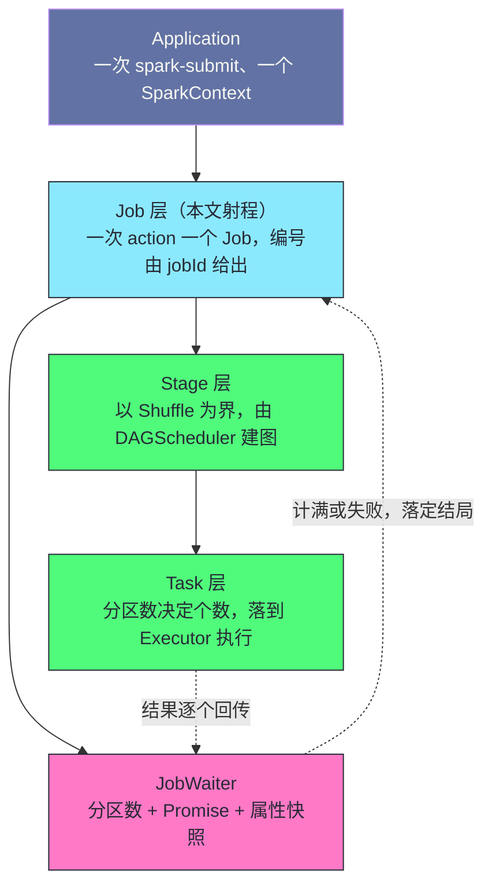
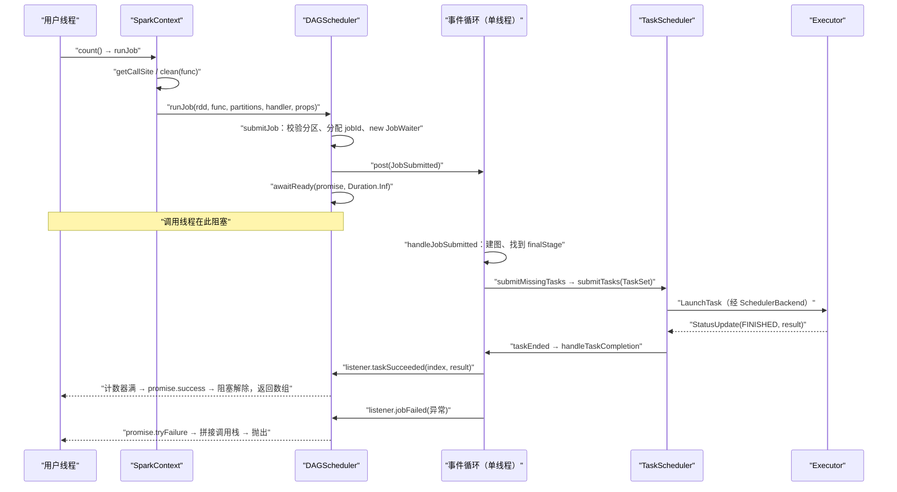
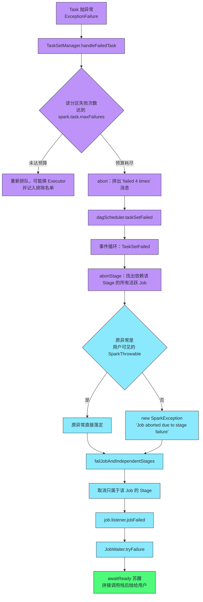
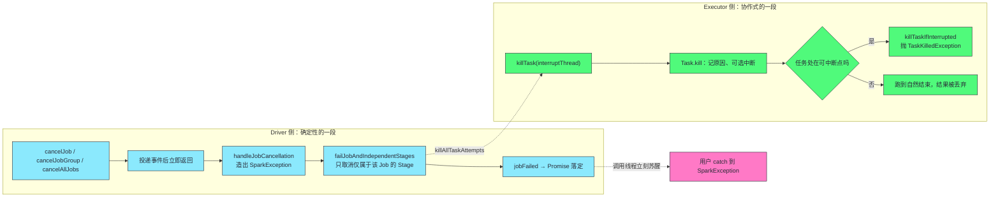
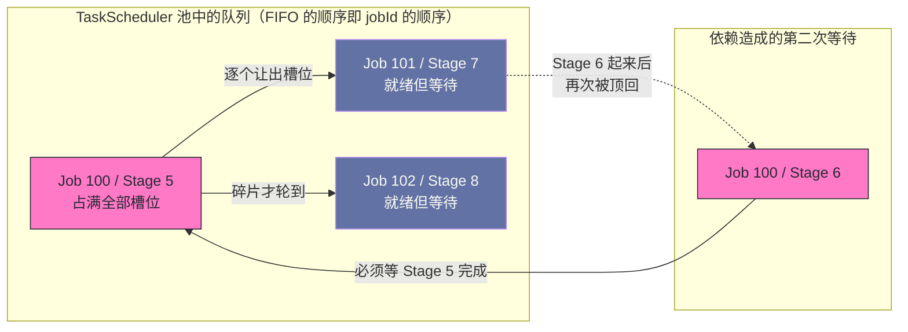

# 9. Spark Job 生命周期详解：从 action 到 **JobWaiter** 的一次往返

**摘要：**

自 Spark 有 `SparkContext` 起，`runJob` 就是所有 action 的唯一出口；十余年间签名几乎没动，围着它转的东西却换过几轮。用户写下一行 `rdd.count()`，这一行在 Driver 上要穿过闭包清理、调用点解析、属性快照、事件投递，在调度器里要换回一张凭条——`JobWaiter`——然后调用线程就地停住，等某个 Executor 上最后一个 Task 的结果回到 Driver。这张凭条是本文的主角：它既是"作业（Job）"这个概念的物理形态，也是失败与取消两种结局唯一的汇聚点。

文章要回答两个问题。第一个是：为什么 Spark 非要在"用户的一次调用"与"Stage 的一组并发任务"之间插进 Job 这一层，插进去之后它究竟持有哪几样东西，凭什么能同时承担结果聚合、失败上报、取消作用域与界面归属四件事。第二个是：为什么"取消一个 Job"是一条弱得多的承诺，它到底在哪一步落了地、又在哪几个地方根本收不到信号。两个问题都落在同一条主线上：Job 是一份契约，契约的两端一边是用户意图，一边是调度实现，中间所有的含糊都在这一层显形。

文章沿五问推进：先界定 Job 是什么、它与 Application、Stage 的分界在哪里；再逐行走过 `SparkContext.runJob` → `**DAGScheduler**.runJob` → `JobWaiter` 这条提交链，交代同步与异步两条路径的差别；接着把失败的三级放大（Task → TaskSet → Stage → Job）与 `**SparkException**` 的包装规则拆开；然后把取消讲成"标记加检测"，并说明 `spark.job.interruptOnCancel` 与调度器侧 `interruptThread` 形参的分工；之后落到 **job group** 与界面归属、并发 Job 在 DAGScheduler 的排队与队头阻塞上；最后单列边界与反例。文章口径取 Spark 4.3.0（2026-10-30 发布，4.x 预编译 Scala 2.13），涉及版本的细节以对应版本文档或源码为准。

**关键词（Keywords）**: JobWaiter, DAGScheduler, job group, **cancelJob**, interruptOnCancel, SparkException, **并发Job**

---

## 第 1 章 Job 是什么：一次 action 的记账单位

### 1.1 一行 count() 与它背后的往返

2012 年，伯克利 AMPLab 在 NSDI 上发表 RDD 论文时，把计算模型讲得很干脆：数据是不可变的分区集合，变换算子只记录血缘，真正的计算要等到一个"行动"发生。论文把这类行动算子当作触发器一笔带过，因为在那个抽象层次上，触发之后发生了什么并不重要——只要结果能回到调用者手里。

可一旦落到工程实现，这一笔带过的部分恰恰是最难写的。`RDD.count()` 的实现只有一行：

```scala
// RDD.scala：Job 的边界藏在这个 `.sum` 里
def count(): Long = sc.runJob(this, Utils.getIteratorSize _).sum
```

请注意末尾那个 `.sum`。每个分区上跑的是 `Utils.getIteratorSize`，它只回答"我这个分区有多少条"，返回一个 `Long`；把若干个 `Long` 加起来的动作发生在 Driver 上，是一段普通得不能再普通的单线程代码。也就是说，并行的是"每分区的计算"，聚合永远在 Driver。这条分界线不是实现细节，而是 Job 这一层的定义：它把一次用户调用切成"下发给集群的每分区函数"与"留在本地的结果合并"两半，中间只有一条窄得可以的通道——结果回传。

不妨设想没有这条分界线会怎样。若让每个分区自己去和别的分区合并结果，Driver 就得知道所有分区的拓扑与通信地址，血缘重算、失败重试、结果去重全部要重写一遍；若干脆不做聚合、只把分区结果直接交给用户，那么 `count()` 就退化成 `collect()`，几十 GB 的计数结果会堆在 Driver 堆里。两头都荒谬，于是 Spark 选择在中间挡一层，并给它起名叫 Job。

### 1.2 三层单位：Application、Job、Stage

Spark 里"一次计算"有三层记账单位，三者的大小关系与生命周期都不一样，混淆它们是排查问题的常见起点。

| 单位 | 由谁产生 | 生命周期 | 失败的影响面 | 用户在哪里看得见 |
|---|---|---|---|---|
| Application | 一次 `spark-submit` 或一个 `SparkContext` | 从 context 创建到 `stop()` | 全进程退出，所有 Job 一起没了 | Master 与 History Server 的 Applications 页 |
| Job | 一次 action 调用（`runJob` 或 `submitJob`） | 从提交到 `JobWaiter` 的 Promise 完成 | 该 action 的那次调用抛异常 | Spark UI 的 Jobs 页、事件日志的 `SparkListenerJobStart` |
| Stage | Job 的建图结果，以 Shuffle 为界 | 从 `submitStage` 到该 Stage 的 TaskSet 结束 | 依赖它的 Job 全部失败，共享它的其它 Job 不受影响 | Stages 页，按 Job 归组 |

表格第二行与第三行的差别值得停一下。Stage 是"计算"的单位，它的边界由数据流决定；Job 是"意图"的单位，它的边界由用户代码决定。一次 `count()` 的意图很明确——我要这个数；而它背后的 Stage 可能有三个、五个、十七个，数量取决于血缘里有几次 Shuffle，用户既不关心也无法直接控制。Job 的价值就在于把一个用户可理解、可取消、可归属的单位，盖在一堆用户不可理解的调度单位之上。

三层单位的关系可以用一张图固定下来。图中那条虚线是本文的射程：从 Job 往下的一切（Stage 的边界、Task 的产物）都只作为前提出现，从 Job 往上的 Application 只在讲关闭与归属时才会被提到。



### 1.3 本文的射程

把 Job 这一层单独抽出来写，需要先说清边界。Job 向下会碰到 Stage 的划分与提交顺序，那是由 `getShuffleDependencies` 的反向遍历与 `missingPartitions` 的账本决定的；Job 再向下会碰到两类 Task 各自的产物与结果回送，那是 `ShuffleMapTask` 写文件、`ResultTask` 返结果的分野；Task 落到 Executor 上如何反序列化、如何下载依赖，又是另一条线。这三件事本文一律当作既成前提引用，不再展开——本文只盯住"从 action 被调用到 JobWaiter 完成"这一段，中间每一处状态变化的归属方是谁。

这么切有实际好处：Job 这一层承担的四件事（结果聚合、失败上报、取消作用域、界面归属）恰好都在这一段里发生，把它们放在同一篇文章里对照，才看得出它们共用同一份数据——那份随 Job 一起走的属性快照。

### 1.4 一个贯穿全文的案例

为了让后面的机制都有具体的着力点，笔者设想一个报表服务 `funnel_report`：常驻 Driver 进程，对外提供一个 HTTP 接口，接收"漏斗转化率"的查询请求；每个请求进来，服务把它丢给一个固定大小的线程池，工作线程上依次跑三个 action——先 `count()` 出曝光总量，再 `collect()` 拉回聚合后的小结果集，最后 `saveAsTextFile` 落一份快照。服务给每个请求分配一个组标识 `req-<自增号>`，用 `setJobGroup` 写进 Spark 的本地属性，并在请求超时（譬如同一个查询超过十分钟没返回）时按组取消。

这个案例的好处是它同时踩在四个坑的边上：一个请求会产生多个 Job，所以按 Job ID 取消根本不够用；线程池会让本地属性时灵时不灵；超时取消时任务往往正卡在 HDFS 读上，中断开关开与不开是两种体验；而查询错乱时运维第一眼要看的是 Spark UI 上这些 Job 归在哪个组里。后文每讲完一个机制，都会回到这个服务上看它落在哪一行代码上。

### 1.5 一个比喻：一次送检

把 Job 比作一次送检：病人（用户代码）在窗口递上化验单（action 与分区集合），护士扫单之后给一张取单凭条（`JobWaiter`），凭条上只有一个编号与一个"已完成项数"的格子；检验科（Executor）分几台仪器并行做（Task），每做完一项就在凭条上划一格；格子划满，窗口把整份报告（结果数组）交给病人。中途任何一项仪器故障且复检次数用尽，凭条立刻作废（`jobFailed`），病人拿到的是一张写着故障原因的退单，而不是半份报告。

这个比喻的技术限定在于：凭条不掌握检验科内部的排班。病人拿着凭条去催，窗口只能告诉护士"这一单别做了"，护士能不能真的把正在离心的试管停下来，取决于仪器有没有"暂停"这个按钮——这就是后文取消与中断的全部麻烦所在。

---

## 第 2 章 从 action 到 JobWaiter：一次提交的四段路

### 2.1 六个重载收敛到一个四参方法

`SparkContext` 上挂着七个 `runJob` 重载，多到容易让人以为是历史包袱，其实它们的分工很整齐：四个返回数组（区别只在于跑全部分区还是指定分区、带不带 `TaskContext`），两个把结果交给处理器，剩下的那个是最底层的实现。真正的入口只有这个最底层——带 `partitions` 与 `resultHandler` 的四参方法。

```scala
// 最底层的那个：所有 action 最终都落到这里
def runJob[T, U: ClassTag](
    rdd: RDD[T],
    func: (TaskContext, Iterator[T]) => U,
    partitions: Seq[Int],
    resultHandler: (Int, U) => Unit): Unit
```

上面那个返回 `Array[U]` 的重载并不是另一条路，它只是先开好数组、再把自己改编成一个"按下标写入"的处理器：

```scala
def runJob[T, U: ClassTag](
    rdd: RDD[T],
    func: (TaskContext, Iterator[T]) => U,
    partitions: Seq[Int]): Array[U] = {
  val results = new Array[U](partitions.size)
  // 结果按分区下标落位，所以顺序由 partitions 决定，而不是由完成先后决定
  runJob[T, U](rdd, func, partitions, (index, res) => results(index) = res)
  results
}
```

这一层重载的意义在于它把"返回数组"这件小事也归约成了处理器模式：既然所有 action 都只是"每分区算一个值、按下标交回来"，那么 `first()` 只挑一个分区、`take(n)` 挑前几个分区、`collect()` 挑全部分区，就都成了同一段代码的不同参数。`sum` 与 `collect` 在 Driver 侧的差别，完全由调用者在拿到数组之后自己决定。

| 入口 | 分区集合 | 结果去向 | 典型调用者 |
|---|---|---|---|
| `runJob(rdd, func)` | 全部分区 | 返回数组 | `collect`、`count`、`reduce` 等 |
| `runJob(rdd, func, partitions)` | 指定子集 | 返回数组 | `first`、`take`、`takeOrdered` |
| `runJob(rdd, func, partitions, handler)` | 指定子集 | 逐个交给处理器 | 全部 action 的最终落点 |
| `submitJob(rdd, func, partitions, handler, resultFunc)` | 指定子集 | 包成 `SimpleFutureAction` | 异步提交、SQL 层 |

### 2.2 `SparkContext.runJob` 的四件事

四参版本的 `runJob` 短得可疑，但每一行都在承担一件事：

```scala
if (stopped.get()) throw new IllegalStateException("SparkContext has been shutdown")
val callSite = getCallSite()          // 1. 记下这次调用发生在用户代码的哪一行
val cleanedFunc = clean(func)          // 2. 剥掉闭包里用不到的捕获，保证可序列化
logInfo(log"Starting job: ...")
dagScheduler.runJob(rdd, cleanedFunc, partitions, callSite, resultHandler, localProperties.get)
progressBar.foreach(_.finishAll())     // 3. 交互式环境里的进度条收尾
rdd.doCheckpoint()                     // 4. 作业成功之后，才轮到 checkpoint 落地
```

第 4 行最容易被读漏。`doCheckpoint()` 写在 `dagScheduler.runJob` 之后，意味着它只在 Job 成功返回时才执行；一旦 Job 失败或被取消，这一行根本不运行。RDD 的 checkpoint 是被"消费它的那次 Job"顺带触发的，所以一个从没被完整算过的 RDD 永远不会落地 checkpoint，而一次被取消的作业会在 checkpoint 目录里留下临时文件——这类残留不会报错，只会在存储上慢慢长。

第 2 行的 `clean(func)` 把"闭包能不能序列化"这件事提前到了提交时刻：`ClosureCleaner` 会剥掉闭包里所有没被真正使用的捕获引用，譬如方法里顺手引用的 `this`、日志器、外部类实例。清理失败的典型症状不是提交失败，而是作业提交成功、Task 在 Executor 上炸——因为真正的序列化发生在 Driver 把 Task 打包下发的时候，错误要到 Executor 反序列化才以 `Task not serializable` 的面目出现。这条错位解释了为什么"日志里明明写了 Starting job"与"作业跑起来了"之间还隔着一道坑。

### 2.3 `DAGScheduler.submitJob`：校验、短路与凭条

请求进入高阶调度器之后，`submitJob` 做四件事，顺序不能换：

```scala
// 1. 分区越界直接抛，连 jobId 都不分配
val maxPartitions = rdd.partitions.length
partitions.find(p => p >= maxPartitions || p < 0).foreach { p =>
  throw new IllegalArgumentException("Attempting to access a non-existent partition: " + p + ...)
}
// 2. 提前把所有 RDD 的 partitions 算出来，避免在事件循环里做这件事（SPARK-23626）
eagerlyComputePartitionsForRddAndAncestors(rdd)
// 3. 分配 jobId
val jobId = nextJobId.getAndIncrement()
// 4. 零分区：直接发 JobStart 与 JobEnd，返回一个已完成的凭条
if (partitions.isEmpty) {
  listenerBus.post(SparkListenerJobStart(jobId, time, Seq.empty, clonedProperties))
  listenerBus.post(SparkListenerJobEnd(jobId, time, JobSucceeded))
  return new JobWaiter[U](this, jobId, 0, resultHandler)
}
val waiter = new JobWaiter[U](this, jobId, partitions.size, resultHandler)
eventProcessLoop.post(JobSubmitted(jobId, rdd, func2, partitions.toArray, callSite, waiter,
  JobArtifactSet.getActiveOrDefault(sc), Utils.cloneProperties(properties)))
waiter
```

第二件事值得多说一句：`RDD.getPartitions()` 可能很慢（读文件系统、拉元数据），而 DAGScheduler 的事件循环是一根单线程，所有 Job 的建图都排在这根线程上。如果有人在一个 RDD 的 `getPartitions` 里塞了阻塞调用，而 Spark 又懒到在事件循环里才去算它，那么整个调度器会被一个分区数计算卡住。SPARK-23626 的处理办法是提交时就把它算完——把慢动作从共享线程挪到调用方线程上，代价是提交变慢一点，收益是单线程不被污染。

第四件事是一条容易被忽略的短路：零分区的 RDD 调 action，UI 上会出现一条瞬时完成的 Job，但它压根没进事件循环，`JobWaiter` 的总任务数是 0，Promise 在构造时就已完成。由此可以推出一个诊断结论：在 UI 上看到 Job 数比 Stage 数还少、或者某个 Job 下面一条 Stage 都没有，先怀疑分区数为空，而不是怀疑调度出错。

### 2.4 `DAGScheduler.runJob`：一次没有超时的等待

提交完成之后，`DAGScheduler.runJob` 的全部工作就是等：

```scala
val waiter = submitJob(rdd, func, partitions, callSite, resultHandler, properties)
ThreadUtils.awaitReady(waiter.completionFuture, Duration.Inf)   // 没有超时
waiter.completionFuture.value.get match {
  case scala.util.Success(_) => logInfo("Job ... finished ...")
  case scala.util.Failure(exception) =>
    // SPARK-8644：把调用者的栈接上去，让异常的第一现场落在用户那一行
    val callerStackTrace = Thread.currentThread().getStackTrace.tail
    exception.setStackTrace(exception.getStackTrace ++ callerStackTrace)
    throw exception
}
```

`Duration.Inf` 是关键。这条等待没有超时，因此"作业永不结束"与"调用线程永久阻塞"是同一件事。它像一张没有取号上限的排队单：只要前面那个窗口还在处理，你就只能站着，系统里没有任何一个开关能让你在十分钟后自动放弃。正常情况下这没什么问题，因为 Job 有且只有四条出路：成功、失败、取消、`SparkContext` 关闭；四条路都会把 Promise 落定，等待线程随之醒来。反过来说，任何绕过这四条路的窗口——譬如有事件被投进一个已经停掉的事件循环——后果不是报错，而是永久挂住。

`Failure` 分支里那句 `setStackTrace` 值得专门记住。它把当前线程（也就是用户调用栈）的帧追加到已有异常栈的尾部，于是用户在 IDE 或日志里看到的栈自上而下是：`SparkException` 的构造点 → 调度器的失败处理点 → 最后几帧是自己的 `main` 与那行 action。没有这一步，异常栈只到 Driver 内部，用户得靠 `callSite` 字符串猜是谁触发的。一条异常读起来是否顺手，往往就取决于有没有人去拼接这几十个帧。

### 2.5 一次提交的时序

把上面四段拼起来，一次同步 action 的完整往返如下。图中两条回程值得对照：成功走的是"结果计数器满 → Promise 成功"，失败走的是"事件循环里造异常 → Promise 失败"，两者最终都汇到同一个阻塞点上。



---

## 第 3 章 `JobWaiter`：一个计数器与一个 Promise

### 3.1 三个字段决定的全部语义

`JobWaiter` 的实现短到可以整段读完，它只带三个状态：

```scala
private val finishedTasks = new AtomicInteger(0)          // 已完成的任务数
private val jobPromise: Promise[Unit] =
  if (totalTasks == 0) Promise.successful(()) else Promise()  // 结局唯一的落点
def jobFinished: Boolean = jobPromise.isCompleted          // "结局已定"
def completionFuture: Future[Unit] = jobPromise.future
```

加上构造时传入的 `jobId`、`totalTasks` 与 `resultHandler`，这五样东西就是 Job 在整个生命周期里的全部凭据。构造它的人（`DAGScheduler.submitJob`）已经确定了总任务数，也就是这次 action 要跑多少个分区；此后不会再有新的任务加入，也不会有人去改这个数。"一次 action 对应一组固定的分区集合"这条不变量，是在构造凭条的那一刻钉死的，后面无论 Stage 怎么重提、Task 怎么重试、推测执行多跑几份副本，凭条上的格子数始终是分区数，而不是任务尝试数。

### 3.2 两种结局

凭条只有两种落定方式，对应两个方法：

```scala
override def taskSucceeded(index: Int, result: Any): Unit = {
  // 处理器本身未必线程安全，用对象锁把调用串起来
  synchronized { resultHandler(index, result.asInstanceOf[T]) }
  if (finishedTasks.incrementAndGet() == totalTasks) jobPromise.success(())
}

override def jobFailed(exception: Exception): Unit = {
  if (!jobPromise.tryFailure(exception)) logWarning("Ignore failure", exception)
}
```

第一个方法由 DAGScheduler 在 Task 完成时调用，负责把结果交给处理器、并把计数器加一；只有计数器恰好等于总数那一次，才会让 Promise 成功。第二个方法由任何导致 Job 失败的路径调用，它用 `tryFailure` 而不是 `failure`，于是后到的失败只会打一条 "Ignore failure" 的 warning，不改变结局。

这条"先到先得"的语义比它看上去重要。取消与失败常常同时到达：用户点取消的那一刻，某个 Task 恰好因为 Executor 丢失而失败，两条路径都会去落定同一个 Promise。没有 `tryFailure`，第二条路径会抛 `IllegalStateException`，把一次本该安静的收尾变成一次新的故障。把"结局只能写一次"这件事交给 Promise 的原子性，而不是靠调用方约定顺序，是这段代码最省心的设计。

顺便厘清一处流传较广的误解。`JobListener` 这个接口只有两个方法：`taskSucceeded` 与 `jobFailed`，没有 `jobSucceeded`，也没有 `jobCancelled`。取消不是一个独立的结局，它以 `jobFailed(SparkException("Job N cancelled ..."))` 的形式到达——那个异常是 `JobCancelled` 事件的处理者造出来的，而 `JobCancelled` 正是取消请求在事件循环里的名字，于是 `jobFinished`（计满而成功）与 `JobCancelled`（请求而失败）这两条看似对称的终态，最终压在同一个 Promise 上；`SparkListenerJobEnd` 携带的 `JobResult` 也只有 `JobSucceeded` 与 `JobFailed` 两个子类型，没有"被杀"这一档。也就是说，在监听器与事件这一层，取消与失败是无法区分的；能区分的只有异常的类型、消息与那层属性里的组标识。想知道一个 Job 究竟是跑砸了还是被叫停了，得去看 Driver 日志里的取消原因、或者看调用方有没有主动调过取消接口——UI 上的红叉两者通用。

### 3.3 `jobFinished` 不等于"跑完了"

`jobFinished` 只是 `jobPromise.isCompleted` 的别名，它回答的是"结局定了没有"，不是"活儿干完了没有"。这两件事在成功路径上重合，在取消路径上则彻底分家：取消时 `jobFailed` 落定 Promise，调用线程立刻醒来，而 Executor 上的 Task 可能还在跑。`SimpleFutureAction.isCompleted` 直接转发这个字段，所以一个被取消的异步 action，`isCompleted` 会先于"任务真正停下"变成 true。

这条时间差是所有"取消之后还能在日志里看到任务输出"现象的根源。它不构成 bug，只是语义选择：凭条只担保"结论"及时，不担保"过程"优雅。要把过程也管住，得靠后面两章的中断与检测机制。

| 凭条状态 | Promise | 调用线程 | Executor 上的任务 | UI 上的 Job |
|---|---|---|---|---|
| 运行中 | 未完成 | 阻塞 | 在跑或排队 | 进行中，带已完成的 Stage 进度 |
| 成功 | 成功 | 返回结果 | 已全部结束（推测副本可能还在被杀） | 绿色对勾 |
| 失败 | 失败（异常） | 抛出 | 会被 `killAllTaskAttempts` 清一遍 | 红叉，附异常摘要 |
| 取消 | 失败（`SparkException`） | 抛出 | 可能仍在跑，视中断开关而定 | 红叉，与失败无视觉差异 |

### 3.4 `resultHandler` 站在事件循环线程上

`taskSucceeded` 不是被某个回调线程池调用的，它由 `handleTaskCompletion` 直接调用，而 `handleTaskCompletion` 跑在 DAGScheduler 的事件循环线程上——那根全 Driver 唯一的、处理所有 Job 与 Stage 决策的线程。因此 `resultHandler` 也在那根线程上执行。

这条事实推出三个后果。第一，处理器必须快。`collect` 的处理器只是一次数组赋值，成本可以忽略；但如果调用方自定义了处理器并在里面写数据库、发 HTTP、往一个可能阻塞的队列里塞数据，那么每一次任务完成都会把整个集群的调度按停一次，症状是所有 Job 一起变慢，而 CPU 与网络看起来都很闲。第二，处理器抛异常不会让 Stage 重算：源码里在处理调用外面套了 `try`，捕获后走 `job.listener.jobFailed(new SparkDriverExecutionException(e))`，于是 Job 失败、`Stage` 却已经被标记为完成。源码里那句 "Perhaps we want to mark the resultStage as failed?" 的 TODO 就是在交代这处状态机的不一致。第三，处理器里不能再去发起阻塞 action——事件循环正卡在它身上，新 Job 的事件永远排不到，等待会自锁。

### 3.5 零任务的凭条

零分区的 Job 拿到的是一张构造完成即已完成的凭条，`totalTasks` 为 0，Promise 在构造参数里就被 `Promise.successful(())` 填好了。它的意义不在计算，而在接口一致性：调用方不必为"空输入"写特例分支，`awaitReady` 立即返回，处理器一次都不会被调用，返回的数组是空数组。`funnel_report` 服务里"当日无曝光"的凌晨请求走的就是这条路——它仍然在 UI 上留下一条 Job 记录，耗时几乎为零。

---

## 第 4 章 同步与异步：两条提交路径

### 4.1 阻塞：等什么、等多久

同步路径的全部内容就是上一章那张凭条加上一次无超时的等待。同步与异步的差别不在跑得快慢，而在你把脚钉在窗口前，还是取号之后回到座位上干别的——同一套检验流程，两种站法。选择阻塞换来的是极简的错误传播模型：异常在调用线程上抛出，`try/catch` 就能接住，栈里带着用户代码的帧，不需要任何回调或上下文传递。代价有两个：一是调用线程被占满，`funnel_report` 的线程池必须按"并发查询数"配足线程，而不能像异步那样靠少量线程支撑大量请求；二是没有任何超时兜底，一个卡在死循环里的用户函数会让这个线程永远回不来，只能在服务层面用外部超时把整个请求链掐掉。

`Duration.Inf` 这个选择在批处理里几乎无感，在常驻服务里就需要外部纪律来补。笔者见过的一种做法是：把业务超时设在提交侧而不是等待侧——超时线程到点后调 `cancelJobGroup`，让凭条失败，从而把等待解开。这条路能走通，前提是取消真的能到达目标，也就是后文要讲的组标识与活跃集合。

### 4.2 异步：`submitJob` 与 `SimpleFutureAction`

异步路径把最后那次等待摘掉，只把凭条交出去：

```scala
def submitJob[T, U, R](rdd, processPartition, partitions, resultHandler, resultFunc)
    : SimpleFutureAction[R] = {
  val waiter = dagScheduler.submitJob(rdd, (ctx, it) => cleanF(it), partitions,
    callSite, resultHandler, localProperties.get)
  new SimpleFutureAction(waiter, resultFunc)      // 只是把凭条包一层 Future 外观
}
```

`SimpleFutureAction` 的四个方法各自对应凭条的一项能力：`isCompleted` 转发 `jobFinished`，`value`/`result` 从 Promise 上取值，`cancel` 把取消请求转给 `jobWaiter.cancel(reason)`，也就是向 DAGScheduler 投一条 `JobCancelled` 事件。它在本地还维护一个 `_cancelled` 标志，供 `isCancelled` 使用。

这里有一处必须讲清的语义错位：`isCancelled` 回答的是"我请求过取消没有"，而不是"作业真的被取消了"。如果作业在取消请求到达之前就已经成功，`cancel` 依然会把 `_cancelled` 置为 true，而 Future 的值仍然是成功的结果。取消是一个请求，不是一个保证——这句判断在后文还会以别的形式反复出现。

### 4.3 一个 action 未必一个 Job

`count()` 这类 action 一个 Job 收工，但 `take(n)` 不是。它的实现是一个循环：先只算 1 个分区，不够就把待算分区数按倍数放大（`spark.rdd.limit.initialNumPartitions` 默认 1，`spark.rdd.limit.scaleUpFactor` 默认 4），每放大一次就调一次 `sc.runJob`：

```scala
while (buf.size < num && partsScanned < totalParts) {
  ...
  val res = sc.runJob(this, (it: Iterator[T]) => it.take(left).toArray, p)  // 每次循环一个 Job
  res.foreach(buf ++= _.take(num - buf.size))
  partsScanned += p.size
}
```

于是 UI 上一条 `take(10)` 可能对应三四个 Job，`first()` 是它的特例，`top()` 又建在 `takeOrdered` 之上。这条事实直接冲击"按 Job 取消"的做法：用户点取消时，杀掉当前那个 Job 只是让这一轮循环失败，若调用方在场外重试或循环本身还没退出，下一次 `runJob` 会照常提交。这就是为什么 Spark 需要"组"这种跨 Job 的作用域：取消的作用对象必须是用户的一次意图，而不是调度器的一次编号。

### 4.4 取消如何穿透多个 Job

异步版本里，这件事由 `ComplexFutureAction` 承担：它持有一个 `subActions` 列表，每次内部 `submitJob` 都把新凭条登记进去，取消时先把自己这个 Promise 判失败，再逐个转发给子 action。

| 路径 | 入口 | 返回 | 一次调用产生几个 Job | 取消的作用范围 |
|---|---|---|---|---|
| 同步单 Job | `runJob` | 数组或 Unit | 1 | 调用方自己投递 `cancelJob` |
| 同步多 Job | `take` 内部循环 | 数组 | 1 到多次 | 只能按组，且组要事先设好 |
| 异步单 Job | `submitJob` | `SimpleFutureAction` | 1 | `future.cancel()` 只影响这一个 |
| 异步多 Job | `ComplexFutureAction` 包装的 `takeAsync` | `FutureAction` | 多次 | `cancel()` 逐个转发给子 action |

---

## 第 5 章 失败：从 Task 到 Job 的三级放大

### 5.1 第一级：Task 的失败与重试预算

Task 在 Executor 上抛异常时，Driver 收到的是一条带 `ExceptionFailure` 的状态更新，`TaskSetManager.handleFailedTask` 会把该分区的失败计数加一，并在计数达到预算（`spark.task.maxFailures`，默认 4）之前重新把它排进待跑队列。同一个分区的四次失败允许落在不同的 Executor 上，失败过的机器还会被记进排除名单，于是"某台机器坏掉"这类问题常常表现为"前三次失败、第四次在别处成功"，用户完全无感。

失败计数按分区算，不按 Task 尝试算。这条看似细枝末节的口径决定了重试预算的真实含义：一个 200 分区的 Stage，预算不是"总共允许失败 4 次"，而是"每个分区各允许失败 4 次"，理论上可以失败 800 次而不触发熔断。反过来，若某一个分区每次都失败（譬如表里有一条数据必然让解析器抛异常），那么四次之后整个 TaskSet 会以它为由被 abort。

### 5.2 第二级：TaskSet abort 到 Stage 失败

预算耗尽时 `TaskSetManager` 走的是 `abort`，它把消息拼成一句在日志里极其常见的话，然后交给调度器：

```scala
abort("Task %d in stage %s failed %d times, most recent failure: %s\nDriver stacktrace:"
  .format(index, taskSet.id, effectiveMaxTaskFailures, failureReasonString), failureException)
// abort 内部：sched.dagScheduler.taskSetFailed(taskSet, message, exception)
```

这句话的后半段 "Driver stacktrace:" 后面接的是 Driver 侧的栈，而不是 Executor 侧的——Executor 上的原始栈在 "most recent failure" 那段里，两段合在一起才能看出"哪个分区、什么异常、在哪台机器上、重试了几次"。看这行日志的正确顺序是先读最前面的 "Task 3 in stage 1.0 failed 4 times"，再往后找 "most recent failure" 里的异常类名，中间那段 Executor 栈往往长得没有必要逐行读。

`taskSetFailed` 把消息投成 `TaskSetFailed` 事件，事件循环里由 `handleTaskSetFailed` 转交给 `abortStage`。从这一刻起，失败的作用域就从"一个 TaskSet"扩大到"所有依赖这个 Stage 的 Job"——注意是"依赖它的"而不是"属于它的"，因为一个 ShuffleMapStage 可能被多个 Job 共享，它的失败会连坐所有下游 Job，而那些半点关系都没有的 Job 不受影响。

### 5.3 第三级：`abortStage` 与 `SparkException` 的包装

`abortStage` 先找出所有依赖失败 Stage 的活跃 Job，再逐个落定它们的凭条。包装规则在 4.x 里有一个值得单独交代的分支：

```scala
val finalException = exception.collect {
  // 用户可读的错误（带 error class 且不是内部错误）不套 "Job aborted"，直接把原异常抛给用户
  case st: Exception with SparkThrowable if st.getCondition != null &&
      !SparkThrowableHelper.isInternalError(st.getCondition) => st
}.getOrElse {
  new SparkException(s"Job aborted due to stage failure: $reason", cause = exception.orNull)
}
failJobAndIndependentStages(job, finalException)
```

这段代码解释了两类截然不同的报错体验。若底层异常是带错误码的 `SparkThrowable`（4.x 起大量用户可见错误都有 error class），用户在 `catch` 里拿到的就是他自己的异常类型，不需要在一层层 `getCause` 里翻找；若是普通异常，用户拿到的是 `SparkException`，消息以 "Job aborted due to stage failure:" 开头，原始异常挂在 `cause` 上。包装的价值在于给"非预期失败"一个统一的落点，而它的代价是原始类型被埋进 cause 链；4.x 之所以要开这个例外，正是因为统一落点在用户体验上并不总是划算。

### 5.4 异常穿透到用户代码

最后一步在 `failJobAndIndependentStages` 里：先取消所有"只属于这个 Job"的 Stage（把还在跑的重复尝试与僵尸任务清掉），再清理状态，然后 `job.listener.jobFailed(error)`、投递 `SparkListenerJobEnd(JobFailed)`。凭条的 Promise 被 `tryFailure` 置为失败，`awaitReady` 苏醒，`DAGScheduler.runJob` 把调用者栈拼上去、抛出异常，`SparkContext.runJob` 原样透传，用户代码的 `try/catch` 接住。

整条链上有一个反直觉之处：取消 Stage 的清理动作发生在通知监听器之前。这个顺序（SPARK-15783 的注释里明说了）是为了让状态先收敛、再通知，否则监听器或测试可能看到"Job 已经失败、但某台机器上还有它的任务在跑"的中间态。对用户而言，这意味着 `catch` 到异常的那一刻，作业在集群侧基本已经收干净了——除了那些不受中断控制、还在自己跑完的任务。

### 5.5 三类不经过重试的失败

并非所有失败都能享受四次预算。至少有三类失败是一次就死的，认识它们有助于快速定位。

第一类是序列化失败。`TaskSetManager` 在把 Task 打包发给 Executor 时若序列化抛错，会直接 `abort` 整个 TaskSet，注释写得很清楚："no point to re-attempt the task, as it will always fail"。所以一个 `Task not serializable` 的作业不会给你四次机会，它在第一个 Task 派发时就整体失败；同一处还会在 Task 体积超过 1000 KiB（约 1 MB）时打一条警告，提示"这个 Stage 里的任务太大了"，那是提交期的问题，与运行期性能无关。

第二类是结果处理器抛异常，前文已述，表现为 `SparkDriverExecutionException`，且 Stage 已被标记完成。第三类是关闭：`DAGScheduler` 在 `stop()` 的收尾里把所有活跃 Job 的监听器以 `SparkException("Job N cancelled because SparkContext was shut down")` 判失败，此时 Job 既没跑完也没出错，只是整个进程要走人了。

| 异常签名（消息前缀） | 由谁产生 | 重试过没有 | 第一现场该看哪里 |
|---|---|---|---|
| `Job aborted due to stage failure: Task N in stage X failed 4 times` | `abortStage` | 是，四次 | Executor 日志里该分区的异常 |
| 用户自定义 `SparkThrowable` 子类 | 原样透传 | 是，四次 | 异常自身的 error class |
| `Job aborted due to stage failure: Failed to serialize task ...` | `TaskSetManager` | 否，一次即止 | 闭包捕获了不可序列化的对象 |
| `SparkDriverExecutionException` | `handleTaskCompletion` | 否 | 自定义 `resultHandler` |
| `Job N cancelled ...` | `handleJobCancellation` | 不涉及 | 谁调了取消接口、组 ID 对不对 |
| `Job N cancelled because SparkContext was shut down` | `cleanUpAfterSchedulerStop` | 不涉及 | 关闭顺序 |

下图把三级放大的方向与沿途的落定点画在一起。注意箭头只有向上的一条：Task 的失败不会自动升级为 Stage 失败，必须先耗尽分区级预算；而 Stage 的失败会无条件连坐所有依赖它的 Job。



---

## 第 6 章 取消：标记与检测，而不是强杀

### 6.1 三个入口与一次事件投递

Spark 的取消接口有三个层级，外加两个 4.x 的补充：

| 入口 | 作用域 | 匹配依据 | 找不到目标时的表现 | 影响未来提交的 Job 吗 |
|---|---|---|---|---|
| `cancelJob(jobId)` | 单个 Job | `jobId` | 只打 debug 日志，"Trying to cancel unregistered job" | 否 |
| `cancelJobGroup(groupId)` | 一组的全部活跃 Job | 属性里的 `spark.jobGroup.id` 等值匹配 | 打 warning，"Cannot find active jobs for it" | 否 |
| `cancelAllJobs()` | 全部活跃 Job | 无需匹配 | 无目标时静默 | 否 |
| `cancelJobGroupAndFutureJobs(groupId)` | 组内活跃 Job + 后续同组 Job | 组 ID + 一个容量受限的集合 | 同上一行 | 是，直到该组被挤出集合 |
| `cancelJobsWithTag(tag)` | 带该标签的活跃 Job | 属性里的 `spark.job.tags` | 静默 | 否 |

五个接口的实现方式完全一致：把一条事件投进 DAGScheduler 的事件循环，然后立刻返回。事件的类型分别是 `JobCancelled`、`JobGroupCancelled`、`AllJobsCancelled`、`JobTagCancelled`，处理都在那根单线程上串行完成。

"立刻返回"这四个字值得重读一遍。`cancelJob` 返回时，被取消的 Job 可能还没被处理，Task 更是一个都没停。因此任何"调完取消就去读结果、或者断言资源已释放"的写法都是错的：你能断言的只有"请求已经进了队列"。

### 6.2 取消做了什么

事件循环里，`handleJobCancellation` 走的路和失败几乎重合：

```scala
if (!jobIdToStageIds.contains(jobId)) { logDebug("Trying to cancel unregistered job") }
else failJobAndIndependentStages(jobIdToActiveJob(jobId),
       error = SparkCoreErrors.sparkJobCancelled(jobId, reason, null))
```

它造的异常是 `SparkException`（消息里带 jobId 与调用方给的原因），然后走与失败完全相同的收尾：取消只属于这个 Job 的 Stage、清理状态、`jobFailed`、投 `SparkListenerJobEnd(JobFailed)`。取消与失败在这条链上唯一的差别，就是那个异常在哪儿被造出来。顺带交代一处容易忽略的边界：`failJobAndIndependentStages` 会检查 `cancelRunningIndependentStages` 的返回值，若某个 backend 不支持 `killTask`（自定义 backend 可能抛 `UnsupportedOperationException`），它返回 false，于是 Job 的结局根本落不下去、只留一条 warning——**取消这件事本身也是可能失败的**，而同一个分支对失败路径同样生效。

另一处边界是"只取消只属于这个 Job 的 Stage"。`cancelRunningIndependentStages` 里有一个明确判断：只有当某 Stage 的使用者集合里只剩这一个 Job 时才动它。设想 `funnel_report` 里两个请求共享同一段 Shuffle（同一个历史数据快照，同一份宽表），取消请求 A 时，那个共享 Stage 的 Task 不会被杀——因为杀了会连累 B。这个取舍的落点很清楚：取消的语义是"让这个 Job 不再有结论"，不是"让集群少干活"。

### 6.3 取消不做什么

顺着上一节往下推，取消不做的事可以列成三条。第一，它不等。接口返回时任务还在跑，Driver 不会阻塞到 Executor 确认。第二，它不保证停。停不停取决于下一章的检测机制与中断开关，用户代码若是一个纯 CPU 的紧循环且从不检查上下文，任务会跑到自然结束。第三，它不回收已分配的资源。Executor 是被应用借用的，Task 停了槽位空出来，但 Executor 本身不会因为取消而退出——除动态分配另有安排。

三条合起来就是那句话：取消是"标记加检测"，不是"强杀"。之所以不做强杀，理由和操作系统不轻易 `kill -9` 一样：强杀会留下半写的文件、未提交的事务与已发出的外部副作用，代价比"多跑一会儿"高得多。Spark 选择了协作式的路线，把"停不停得下来"的决定权交给任务自己。

把这两段分开画出来，取消的强弱之分就一目了然：Driver 侧的每一步都是确定的，Executor 侧的每一步都要靠任务配合。



### 6.4 检测点在哪里

任务要能"抬头看见纸条"，得有检测点。Spark 自己提供的检测点主要有两个。

第一个是 `TaskContext.killTaskIfInterrupted()`：它检查上下文里的中断标记，若已标记则抛 `TaskKilledException`。这个调用被放在 `InterruptibleIterator.hasNext` 里，而 Spark 在多个读取路径上会把父迭代器包一层 `InterruptibleIterator`，于是这些路径上的取消检测粒度是"每读一条记录"。第二个是 `TaskContext.isInterrupted`，供用户在自定义代码里自查，适合放在大循环的每若干次迭代上。

不在这两类检测点上的代码，取消就落不了地。最典型的是阻塞在 I/O 上：一个正在从 HDFS 读大块数据的任务，它既不消费迭代器、也没进自定义循环，唯一能打断它的手段就是 `Thread.interrupt()`——这正是 `spark.job.interruptOnCancel` 存在的理由，也是下一章的主题。

### 6.5 四种"没反应"

`funnel_report` 上线初期，"取消不生效"的报障最多，事后归类只有四种。

第一种是对象已经不在。`cancelJob` 打到的是一个已经结束的 Job，事件循环里 `jobIdToStageIds` 查不到，只留一条 debug 日志。第二种是组 ID 对不上：`setJobGroup` 设了，但设在了错误的线程上（线程池复用导致属性丢失或串味），于是 `cancelJobGroup` 在活跃集合里等值匹配不到任何 Job，只能打那条 "Cannot find active jobs for it" 的 warning。第三种是排队问题：取消事件被投进队列时，前面压着成千上万条 Task 完成事件，于是"点了取消"与"真正处理取消"之间隔着一段可观的时间，在事件风暴里这段延迟可以长到令人以为没生效。第四种最隐蔽：任务根本不检查中断点，取消标记已经设上，任务照跑到结束，结果被丢弃，从外面看就是"取消了还在占 CPU"。

把这四种与"取消做了什么"对照，会发现一个共同的诊断入口：先看 Driver 日志里那条 warning 在不在。warning 在，说明匹配失败，问题在属性与线程；warning 不在但任务仍在跑，说明匹配成功、问题在检测与中断；连事件都没进循环，才轮到查事件循环本身。

---

## 第 7 章 中断开关：一个属性，一个形参

### 7.1 默认不中断的理由

`setJobGroup` 的注释把默认值的选择写得很直白：

> `interruptOnCancel` If true, then job cancellation will result in `Thread.interrupt()` being called on the job's executor threads. This is useful to help ensure that the tasks are actually stopped in a timely manner, but is off by default due to HDFS-1208, where HDFS may respond to `Thread.interrupt()` by marking nodes as dead.

这条注释值得整段读。默认关闭不是懒，而是被 HDFS 客户端的历史坑吓出来的：在 HDFS-1208 描述的年代，一个被中断的读操作可能让客户端把对应的 DataNode 判成坏节点，于是"取消一个查询"的副作用变成"集群少了一个副本源"。Spark 的取舍因此很保守——宁可让任务多跑一会儿，也不能让一次取消引发一次拓扑层面的误判。这是一个典型的"默认值即立场"的例子：把风险留给资源，把安全留给数据。

### 7.2 三种设置方式与两个坑

中断开关本质上是一个本地属性 `spark.job.interruptOnCancel`，因此有三种写法：`setJobGroup(groupId, desc, interruptOnCancel)` 的第三参、`setInterruptOnCancel(bool)` 单独设、以及 SQL 层在进入查询时按 `spark.sql.execution.interruptOnCancel` 的值自动写入（后者的默认值以对应版本文档为准）。

两个坑都在这三种写法的交叉处。第一个是覆盖：`setJobGroup` 的第三参默认是 false，所以先 `setInterruptOnCancel(true)`、再调两参的 `setJobGroup(group, desc)`，中断开关会被悄悄写回 false。第二个更硬：在 `spark-defaults.conf` 里写 `spark.job.interruptOnCancel=true` 不生效。`shouldInterruptTaskThread(job)` 读的是 Job 属性表，而那张表的初值来自线程本地的 `localProperties`，后者初值是一个空的 `Properties`，从不与 `SparkConf` 合并。同名键在两处，一处有效一处无效，这是排查时最容易走偏的一步。

### 7.3 Executor 端的实际动作

属性随 Job 一路走到 Executor，最终体现为 `killTask` 消息里的一个布尔值。Executor 收到之后交给 `Task.kill`：

```scala
def kill(interruptThread: Boolean, reason: String): Unit = {
  _reasonIfKilled = reason                       // 先记原因，无论是否中断
  if (context.interruptible()) {
    context.markInterrupted(reason)              // 标记一定会设
    if (interruptThread && taskThread != null) taskThread.interrupt()  // 中断是可选的
  } else {
    // 任务当前处于不可中断区（runUninterruptibly 里），中断挂起，离开时再执行
    context.pendingInterrupt(if (interruptThread) Some(taskThread) else None, reason)
  }
}
```

这段代码把"标记"与"中断"分得很干净：标记无条件设置，中断按形参决定，且遇到不可中断区就先挂起。不可中断区是 Spark 用 `UninterruptibleThread` 划出来的保护带，源码注释里点了三个历史事故（KAFKA-1894、HADOOP-10622 等）：某些库在被中断时会永久挂死，所以 Spark 让任务线程在进入这些库之前先"闭上耳朵"，出来之后再把攒下的中断补上。

中断确实发生之后还有一处收尾：`TaskRunner` 在标记任务结束时会清掉线程的中断位（SPARK-14234）。原因是任务被杀之后还要发一次状态更新，如果线程带着中断位去写网络，`ClosedByInterruptException` 会把一次正常的收尾也弄成异常。

### 7.4 `interruptThread` 是形参，不是配置

这里需要澄清一个常见的检索误区。偶尔能在搜索结果与转载文章里看到 `spark.scheduler.interruptOnCancel` 这样的键名，但在 4.3.0 的 Configuration 配置表与 `internal/config` 的源码里都找不到它。调度器这一层确实存在"要不要中断线程"的判断，只不过它不是一个全局配置项，而是 `killTask`/`killAllTaskAttempts` 的 `interruptThread` 形参，由调用点在每次杀任务时自己决定。因此真正的差别不在两个配置之间，而在两种决策方式之间：一个是 Job 属性，随 Job 快照、由用户按需设置；另一个是调用点的硬编码，由调度器按场景决定。

把 4.x 里的调用点排一遍，规律就出来了：

| 调用点 | `interruptThread` 取值 | 依据 |
|---|---|---|
| Job 取消（`cancelRunningIndependentStages`） | `shouldInterruptTaskThread(job)` | 读 Job 属性 `spark.job.interruptOnCancel` |
| Job 成功后的僵尸任务清理 | 同上 | 同上 |
| Stage 回滚重提（`cancelStageAndTryResubmit`） | 同上 | 取该 Stage 首个 Job 的属性 |
| barrier Stage 失败后的连坐清理 | 同上 | 同上 |
| 推测执行：某份尝试成功后杀其它尝试 | `true`（硬编码） | 重复尝试必须立刻停手，否则两份结果都要往外写 |
| `SparkContext.killTaskAttempt` | 调用方传入 | 由外部 API 使用者决定 |

这张表的含义是：凡是"用户的意图被撤回"，是否中断听用户的；凡是"调度器自己发现重复劳动"，一律中断。前者涉及数据与外部状态，需要保守；后者只是白算，越快撒手越好。

### 7.5 打开的代价

把开关打开能换来什么，取决于任务卡在哪里：卡在迭代器读取、卡在可中断的等待、卡在支持中断的客户端，收益立竿见影；卡在不可中断区、卡在原生调用、或者用户代码压根没有可中断点，收益接近于零，只是让任务从一个"完整跑完"变成一个"跑一半被打断"。后者的风险不小：正在写的输出文件可能留下半截，正在刷的缓冲可能丢一批，正在跑的外部副作用（写数据库、发消息）可能停在中间态。

因此这个开关的正确定位不是"取消的增强版"，而是"取消的加速器"：打开它，取消从"迟早生效"变成"尽快生效"；不打开，也不会让取消失效，只是失效的时间尺度从毫秒级变成任务的自然时长。`funnel_report` 最终给它开了，理由很务实——这个服务读的是 HDFS 上的历史分区、写的是本地临时目录，被打断的代价可控；若换成一个往外部系统写结果的作业，笔者会倾向于关掉，改用"结果版本号 + 事后清理"来兜底。

---

## 第 8 章 job group 与界面归属

### 8.1 归属靠一次克隆

属性从"当前线程的本地变量"变成"这个 Job 的属性"，中间只有一次动作：`submitJob` 里的 `Utils.cloneProperties(properties)`。这次克隆同时做了两件事：把属性钉在此刻，此后线程再改什么都与这个 Job 无关；把属性复制成独立对象，Job 与 Job 之间不再共享同一张表。

钉住的时刻值得精确到方法：不是 action 被调用的那一行，而是 `DAGScheduler.submitJob` 里投递 `JobSubmitted` 之前。两者之间隔着调用点解析与闭包清理，通常没有可见差别，但它决定了语义的准确表述——属性跟 Job 走，不跟线程走。一个线程提交了 Job 之后立刻 `clearJobGroup()`，对已经提交的 Job 没有任何影响；反之一个 Job 提交之后再 `setJobGroup`，对已提交的 Job 也没有影响。批次化的属性变更必须发生在提交之前。

### 8.2 四个消费者

同一份属性快照被四类消费者读取，它们对"归属"的诉求并不相同。

| 消费者 | 读哪个键 | 用途 | 缺失时的表现 |
|---|---|---|---|
| 取消匹配 | `spark.jobGroup.id` | `cancelJobGroup` 等值匹配活跃 Job | 取消静默失败，打 warning |
| 界面与事件日志 | `spark.job.description`、`spark.jobGroup.id` | Job 页的描述列、事件日志归档 | 用调用点短形式兜底，组为空 |
| SQL 页归属 | `spark.sql.execution.id`、`spark.sql.execution.query.id` 与根 ID | 把多个 Job 归到同一次查询下 | 这次查询在 SQL 页上分裂成多条 |
| 公平调度池 | `spark.scheduler.pool` | 决定 Stage 进哪个池 | 落到默认池 |

第三行值得展开。SQL 层在进入一次查询时会把 `spark.sql.execution.id` 写进本地属性，再顺手给这次查询打一个作业标签（形如 `execution:<id>`），于是同一查询引发的若干个 Job 在 UI 上能被归到一条 SQL 记录下。这条链路一旦断掉——譬如表被缓存的查询走了一条不带属性的路径——用户看到的就是"SQL 页上有两条执行记录，Job 页上有五个孤立 Job，谁都对不上"。归属信息不是给人看的装饰，它是运维判断"这次慢是不是那次查询引起"的唯一线索。

### 8.3 异步里丢组的三种形态

本地属性是 `InheritableThreadLocal`，继承发生在"线程创建"那一刻。它更像一枚随人走的工作牌，而不是随工位留的便签：牌子在"一个人上岗"的那一刻被复印一份，此后原件怎么改都不影响复印件；可人一旦离开而牌子没摘，下一位坐这个位子的人就顶着别人的名字干活。线程池恰是把"上岗"与"派活"拆成两件事的地方，于是错位就出现了，`funnel_report` 三种都踩过。

第一种是丢：池里的工作线程若在池预热时就已创建，之后所有任务都继承不到调用线程的属性，`setJobGroup` 设在 HTTP 处理线程上，真正跑 action 的工作线程看到的是空表。症状是同步调用能取消、异步调用取消不了。第二种是串：属性一旦被某个工作线程继承，就会留在它的 `localProperties` 里直到被覆盖，于是下一个复用该线程、与这次查询毫无关系的请求会带上一个陈旧的组 ID，表现为 UI 上两个不相干的查询被归进同一组，或者 `cancelJobGroup("req-17")` 杀掉了 `req-31` 的作业。串的代价高于丢，因为丢只是取消不了，串是取消错了对象。第三种是深：嵌套两层线程池时，属性只继承一层，第二层的线程看到的是第一层工作线程在创建时拿到的快照，此时究竟带上了哪一次请求的组，取决于线程池的创建时机，几乎无法推理。

三种形态的修法只有一条：把 `setJobGroup` 挪到真正提交 action 的那个线程里，并用 `try/finally` 配一个 `clearJobGroup()`。写成作用域函数最稳，`withJobGroup(groupId, desc) { ... }` 这种包装让属性的生命周期收敛到一个词法块里，异常路径也能清干净。

### 8.4 job tag：第三个归属轴

4.x 在组与描述之外又加了一条轴：标签。`addJobTag`/`addJobTags` 往属性里写一个逗号分隔的 `spark.job.tags`，`cancelJobsWithTag` 按标签取消，SQL 层正是靠 `execution:<id>` 这个标签实现 `spark.interruptTag` 一类的按查询取消。标签可以叠加多个，于是"这次请求"与"这个租户"两个维度可以同时挂在同一个 Job 上。

标签与组的差别在取消语义上：组是等值匹配的单值，标签是集合包含，而且标签这条路不提供"连未来作业一起取消"的能力。这个设计差异说明定位不同——组适合"一次请求"，标签适合"一类工作"，后者的取消天然是尽力而为的。

---

## 第 9 章 并发 Job 在 DAGScheduler 里如何排队

### 9.1 Job 不排队，Stage 才排队

一个常见的误解是"DAGScheduler 里有一个 Job 队列"。事实上 `DAGScheduler` 只维护一个活跃集合（`activeJobs` 与 `jobIdToActiveJob`），Job 一旦提交就立刻建图、立刻把就绪的 Stage 交出去，它自己不留队。**真正排队的是 Stage：** Stage 变成 TaskSet 之后进入 `TaskSchedulerImpl` 的调度池，池里的 TaskSetManager 按调度算法排出一个顺序，`resourceOffers` 每次按这个顺序往空闲槽位里塞任务。

这条分层解释了并发 Job 的两种等待：一次是"等依赖"，Job B 的 Stage 要等它自己的父 Stage 完成，这在 DAGScheduler 里由 `waitingStages` 表达；一次是"等槽位"，多个 Job 的就绪 Stage 同时要资源，这在 TaskScheduler 的池子里表达。前者是数据依赖，无解；后者是策略问题，可调。

### 9.2 FIFO 的判据是 jobId

默认 `spark.scheduler.mode=FIFO`，比较器只看两个字段：`priority` 与 `stageId`，前者在 TaskSet 构造时被填成 `jobId`，后者是 Stage 编号。于是先进先出的判据非常直白——先提交的 Job 先拿资源，同一 Job 内编号小的 Stage 先拿。jobId 由 `AtomicInteger` 单调分配，所以"先进"就是"提交顺序"，没有额外的时间戳或权重可供操纵。

| 维度 | FIFO（默认） | FAIR |
|---|---|---|
| 排序依据 | `priority`（即 jobId），同级再比 `stageId` | 池的 `minShare`、`weight` 与运行中任务数 |
| 跨 Job 的公平性 | 无，先到先得 | 池级可配 |
| 队头阻塞 | 存在，且严重 | 缓解，但不能消除依赖造成的等待 |
| 适用 | 批处理、单团队、作业彼此无 SLA 诉求 | 多团队共用一个常驻 Driver 或一个集群 |

### 9.3 队头阻塞

FIFO 下最直观的代价是队头阻塞。设想 `funnel_report` 收到三个请求，Job 100、101、102 依次提交，每个都要跑一段两阶段的聚合。Job 100 的 Stage 5 先行、占满全部槽位；Job 101 与 102 的 Stage 7、8 虽然已经就绪，却只能在池子里等 100 的任务逐个让出槽位。更要紧的是 Job 100 自己还有下一个 Stage 6——它要等 Stage 5 全部完成才谈得上提交——于是 101、102 在这段空档里或许捡到几个槽位，Stage 6 一提交又被顶回去，呈现出"别人的作业一顿一顿地跑"的观感。

这就是"队头阻塞"在 Spark 里的真实形状：不是后到者完全拿不到资源，而是它永远只能捡前者不要的碎片，吞吐与尾延迟一起变差。像只开了一个窗口的食堂，排在前头的人点了二十个菜，后面的人不是没饭可吃，而是每一轮都只能等对方让出窗口的那几秒。缓解手段两种，一种是把 `spark.scheduler.mode` 切成 FAIR 并给不同请求分池，另一种是把请求本身并发度降下来、用队列在服务层限流。前者改调度器，后者改调用方，后者的确定性更好——因为队头阻塞的根因不在 Spark 的排序算法，而在"一个 Driver 上跑着互不相关的作业"这个事实。

把三个 Job 的 Stage 在队列里的相对位置画出来，等待发生在哪一层就不言自明了。



### 9.4 FAIR 的边界

切到 FAIR 能缓解队头阻塞，但它解决的是"同时就绪的 Stage 之间怎么分槽位"，不是"依赖顺序"。Job 101 的第一个 Stage 若依赖某个尚未完成的 Shuffle，即便 FAIR 把池子分得再均匀，它也只能等。所以对 `funnel_report` 这类"每个请求都要跑一段独立的读—聚合"的服务，FAIR 有效；对"一个长作业后面挂着一串小作业"的批处理流水线，FAIR 的收益会被依赖本身吃掉。

还有一条隐性边界：FAIR 的池与权重来自 `spark.scheduler.allocation.file` 指向的 XML，池名通过 `spark.scheduler.pool` 属性传入。这个属性同样是线程本地的，于是它和 job group 一起承担了 8.3 节那三种走样的风险——池选错的症状比组选错更隐蔽，因为 UI 上不会报错，只是资源分配莫名其妙地不公平。

### 9.5 事件循环是并发上限

把前面几条收在一起，会发现 Driver 上的并发瓶颈不在 Job 数，而在那根事件循环线程。所有 Job 的建图、所有 Stage 的提交与完成、所有 Task 的结束事件、所有取消请求，都排在这一条队上。因此三个量直接决定并发能力：单条事件的处理耗时、事件到达速率、以及 `resultHandler` 与监听器在这条线程上额外消耗的时间。

第三项最容易被低估。监听器总线 `LiveListenerBus` 有自己的线程与队列（默认容量 10000），队列满时会丢弃事件并打警告——一旦开始丢事件，UI 上的 Job 与 Stage 就会缺项，而调度本身仍然正确。所以"UI 上的数字对不上"有两种成因：事件被丢了，或者那个 Job 压根没进调度（被"取消未来作业"在入口拦下的作业不发 `JobStart`）。把界面当成事实来源之前，先确认事件没有被丢过。

---

## 第 10 章 边界与反例

### 10.1 用 `cancelJob` 取消一次 `take`

`take(n)` 会分多轮提交 Job，`cancelJob` 只对当前那一个编号生效。要取消一次"用户意图"，必须提前把组设好、用 `cancelJobGroup`，或者用 `ComplexFutureAction` 那类会转发取消的包装。判断办法很简单：看 UI 上这次调用产生了几个 Job，多于一个就说明按编号取消不够。

### 10.2 以为取消能立刻释放资源

取消之后 Promise 立即落定，但 Executor 上的任务可能还在跑，Executor 本身也不会退出。指望"取消 = 集群立刻空出来"的做法会在容量紧张时反复打脸。要真正腾出容量，得靠中断开关把任务尽快停掉，或者靠动态分配让空闲 Executor 自己退出。

### 10.3 以为 `setJobGroup` 在异步里一定生效

本地属性的继承发生在建线程时刻，线程池把建线程与跑任务拆开了。凡是跨越线程池、`Future`、回调的提交路径，都必须在真正提交 action 的那个线程里重设属性，并用 `try/finally` 清理。串味比丢更危险，因为它会把取消打到别人身上。

### 10.4 把 `spark.job.interruptOnCancel` 当成杀进程开关

它只是一个"取消时要不要顺便中断线程"的指示，能不能停取决于任务是否有可中断点。不设它，取消依然有效，只是生效慢；设了它，也不保证立刻停——卡在不可中断区里的任务照样要跑完。把它写进 `spark-defaults.conf` 更是完全无效，因为它读的是 Job 属性表而不是配置。

### 10.5 用 `spark.task.maxFailures` 兜住所有失败

调大这个参数只对"分区级重试"这一类失败有意义：取数失败走的是 Stage 级重提、序列化失败一次即止、结果处理器异常不重试、Driver 主动取消更是与它无关。看见失败先分清楚它来自哪一级，再决定调哪个参数。

### 10.6 以为 UI 上的 Job 数等于 action 数

三个反例：`take` 一次调用产生多个 Job；零分区 RDD 的 action 产生一个零 Task 的 Job；被 `cancelJobGroupAndFutureJobs` 拦下的 Job 压根不发 `SparkListenerJobStart`，因为它没进调度就在 `handleJobSubmitted` 的入口被判失败了。最后一种尤其容易误判——"我明明提交了，UI 上什么都没有"，答案可能在那个容量上限为 1000 的取消集合里。

### 10.7 把 `cancelJobGroupAndFutureJobs` 当成永久拉黑

它记的是一个 `LimitedSizeFIFOSet`，容量由 `spark.scheduler.numCancelledJobGroupsToTrack` 控制（默认 1000）。挤出去的组恢复接纳新 Job，于是"取消这个组的未来作业"只在有限窗口内可靠。把它当成租户级熔断器，迟早会失效。

| 反例 | 真实机制 | 正确做法 |
|---|---|---|
| 取消多 Job 的 action 只杀一个 | 取消按 jobId 精确匹配 | 事先设组，按组取消 |
| 取消后资源没回来 | 取消只落定凭条，不回收 Executor | 开中断、配动态分配 |
| 异步里取消时灵时不灵 | 属性在建线程时继承 | 在提交线程内设置并清理 |
| 中断开关以为能强杀 | 只有标记，中断是可选中转 | 在用户代码里自查 `isInterrupted` |
| 失败一律加预算 | 三类失败不经过分区级重试 | 按异常签名分级处理 |
| Job 数与 action 数对不上 | `take` 多 Job、零分区、未来作业拦截 | 以 `JobStart` 事件为准 |
| 未来作业取消永远有效 | 取消集合有容量上限 | 别把它当租户熔断 |

---

## 第 11 章 落点

回到开头的两个问题。

Job 这一层为什么不能省？因为它把"用户意图"与"调度实现"接在了一起，而这两边对"一次计算"的定义并不相同。用户说的是"我要这个数"、"这次查询别跑了"、"这条记录归哪个请求"；调度器说的是 Stage、TaskSet、分区与尝试。中间必须有一个物件同时持有双方的凭据：一组固定分区（对应调度器的输入）、一个结果处理器（对应聚合语义）、一个 Promise（对应结局）、一份属性快照（对应归属与取消）。`JobWaiter` 恰好只有这四样东西，一分不多——这一层设计的克制之处在于，它没有试图去理解 Stage，只负责把 Stage 的产出收拢成一个可交付的结论。

取消为什么是弱保证？因为它在链路上被拆成了两段：第一段在 Driver，落定凭条、清理只属于这个 Job 的 Stage，这一段是确定的；第二段在 Executor，靠标记与检测让任务自己停手，这一段是协作式的，能不能成取决于任务卡在哪里、中断开没开、库支不支持。Spark 完全有能力把第二段做成强杀，它没有这么做，理由是强杀会把"取消一次查询"的代价从浪费算力升级成污染数据。把确定性留给结论，把不确定性留给过程，这是取消语义的取舍点，也是它所有"没反应"现象的来源。

由此可以给出一套判断顺序。看到"Job 失败"，先问是哪一级：Executor 上的异常（去看 Task 日志）、TaskSet 的预算耗尽（去看 "failed N times" 那行）、还是 Driver 侧的处理（看 `SparkDriverExecutionException`）。看到"取消没生效"，先看 Driver 日志有没有 "Cannot find active jobs"，有则查组 ID 与线程，没有则查检测点与中断开关。看到"界面上的 Job 归错了组"，先查提交线程与线程池的关系，再查 SQL 层的 execution id 有没有写进去。三个问题问完，多数 Job 层的疑难会落回某一处可验证的机制，而不是停在"重启一下 Driver"。

至于"一次 action 到底该不该只对应一个 Job"，目前仍然言之尚早。`take` 的多轮提交是为了少读数据而做的务实妥协，代价是取消粒度变粗；如果未来把这类增量读取做成一个 Job 内部的、可提前结束的协议，取消与归属都会简单一档，但那要改写 Stage 的完成语义。这条路是否值得走，取决于增量取数在实际负载里占多大比重，而不是取决于哪种模型更优雅。

---

## 参考资料

1. Apache Spark 4.3.0 源码：`core/src/main/scala/org/apache/spark/SparkContext.scala`，`runJob` 七重载、`submitJob`、`cancelJob`/`cancelJobGroup`/`cancelAllJobs`、`setJobGroup` 与 `SPARK_JOB_INTERRUPT_ON_CANCEL` 常量。https://github.com/apache/spark/blob/v4.3.0/core/src/main/scala/org/apache/spark/SparkContext.scala
2. Apache Spark 4.3.0 源码：`core/src/main/scala/org/apache/spark/scheduler/DAGScheduler.scala`，`submitJob` 的校验与零分区短路、`runJob` 的 `Duration.Inf` 等待与调用栈拼接、`abortStage` 的包装规则、`handleJobCancellation` 与 `cancelRunningIndependentStages`。https://github.com/apache/spark/blob/v4.3.0/core/src/main/scala/org/apache/spark/scheduler/DAGScheduler.scala
3. Apache Spark 4.3.0 源码：`core/src/main/scala/org/apache/spark/scheduler/JobWaiter.scala`，`finishedTasks`、`jobPromise`、`jobFinished` 与 `cancel`。https://github.com/apache/spark/blob/v4.3.0/core/src/main/scala/org/apache/spark/scheduler/JobWaiter.scala
4. Apache Spark 4.3.0 源码：`core/src/main/scala/org/apache/spark/scheduler/JobListener.scala`、`JobResult.scala`，监听器只有 `taskSucceeded` 与 `jobFailed`，`JobResult` 只有成功与失败两个子类型。https://github.com/apache/spark/blob/v4.3.0/core/src/main/scala/org/apache/spark/scheduler/JobListener.scala
5. Apache Spark 4.3.0 源码：`core/src/main/scala/org/apache/spark/scheduler/TaskSetManager.scala`，`handleFailedTask` 的分区级计数、`abort` 的消息格式与序列化失败的即死处理。https://github.com/apache/spark/blob/v4.3.0/core/src/main/scala/org/apache/spark/scheduler/TaskSetManager.scala
6. Apache Spark 4.3.0 源码：`core/src/main/scala/org/apache/spark/scheduler/Task.scala`、`executor/Executor.scala`，`Task.kill` 的标记与中断两条分支、`UninterruptibleThread` 的使用与中断位清理。https://github.com/apache/spark/blob/v4.3.0/core/src/main/scala/org/apache/spark/scheduler/Task.scala
7. Apache Spark 4.3.0 源码：`core/src/main/scala/org/apache/spark/InterruptibleIterator.scala`、`executor/TaskContextImpl.scala`，`killTaskIfInterrupted` 与 `isInterrupted` 两个检测点。https://github.com/apache/spark/blob/v4.3.0/core/src/main/scala/org/apache/spark/InterruptibleIterator.scala
8. Apache Spark 4.3.0 源码：`core/src/main/scala/org/apache/spark/FutureAction.scala`，`SimpleFutureAction` 的 `isCompleted`/`isCancelled`/`cancel` 与 `ComplexFutureAction` 的子 action 转发。https://github.com/apache/spark/blob/v4.3.0/core/src/main/scala/org/apache/spark/FutureAction.scala
9. Apache Spark 4.3.0 源码：`core/src/main/scala/org/apache/spark/rdd/RDD.scala`，`count` 的一行实现与 `take` 的多轮 `runJob` 循环。https://github.com/apache/spark/blob/v4.3.0/core/src/main/scala/org/apache/spark/rdd/RDD.scala
10. Apache Spark 4.3.0 源码：`core/src/main/scala/org/apache/spark/scheduler/SchedulingAlgorithm.scala`、`TaskSet.scala`，FIFO 比较器的 `priority`（即 jobId）与 `stageId` 双判据。https://github.com/apache/spark/blob/v4.3.0/core/src/main/scala/org/apache/spark/scheduler/SchedulingAlgorithm.scala
11. Apache Spark 4.3.0 源码：`core/src/main/scala/org/apache/spark/internal/config/package.scala`，`spark.task.maxFailures`、`spark.rdd.limit.*`、`spark.scheduler.numCancelledJobGroupsToTrack`、`spark.scheduler.listenerbus.eventqueue.capacity` 的默认值与引入版本。https://github.com/apache/spark/blob/v4.3.0/core/src/main/scala/org/apache/spark/internal/config/package.scala
12. Apache Spark 4.3.0 源码：`sql/core/src/main/scala/org/apache/spark/sql/execution/SQLExecution.scala`，`spark.sql.execution.id` 等本地属性的写入与 `execution:<id>` 作业标签。https://github.com/apache/spark/blob/v4.3.0/sql/core/src/main/scala/org/apache/spark/sql/execution/SQLExecution.scala
13. Apache Spark 4.3.0 文档：Job Scheduling，作业组、取消、公平调度池与本地属性。https://spark.apache.org/docs/4.3.0/job-scheduling.html
14. Apache Spark 4.3.0 文档：Configuration，作业调度、Task 与 listener bus 相关配置项。https://spark.apache.org/docs/4.3.0/configuration.html
15. Apache Spark JIRA：SPARK-8644（异常中拼接用户调用栈）、SPARK-14234（清理中断位避免 `ClosedByInterruptException`）、SPARK-23626（提交期提前计算分区）与 HDFS-1208（中断对 HDFS 客户端的影响）。https://issues.apache.org/jira/browse/SPARK-8644

---

> [!note] 思考题
> 1. `JobWaiter` 只用"分区数"作为总任务数，而 Stage 重提与 Task 重试会让实际执行次数远大于它。这个口径为什么是对的？如果改成"按尝试计数"，结果数组的写法要跟着改哪里？
> 2. `resultHandler` 跑在 DAGScheduler 的事件循环线程上，且它抛异常时 Stage 已被标记完成。要让"处理器异常"也走一次 Stage 重算，需要动的是事件顺序还是状态机？
> 3. 取消只杀"仅被本 Job 使用"的 Stage。若两个 Job 共享一个 ShuffleMapStage，而用户只想取消其中一个，这个设计会带来什么后果？取消最多能强到什么程度，才不至于伤到另一个 Job？
> 4. `interruptThread` 在推测执行处被硬编码为 true，在 Job 取消处却要读用户属性。这两处为什么不该统一？
> 5. 假设让 `spark.job.interruptOnCancel` 从 `SparkConf` 也能生效，属性快照的语义会出现什么新问题？为什么 Spark 宁可让同名键在一处无效？