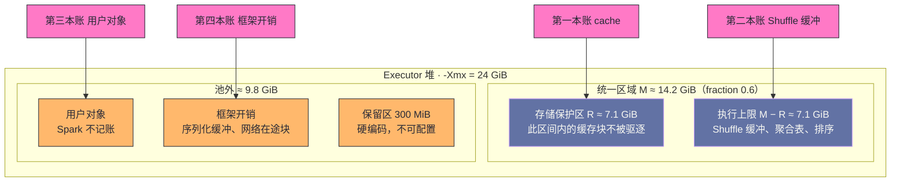
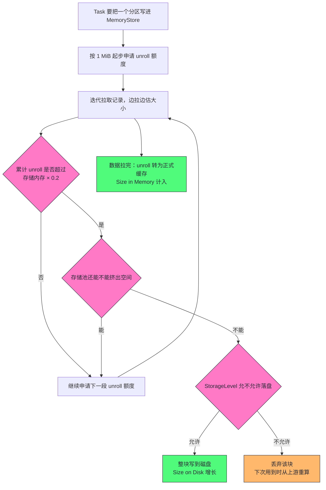
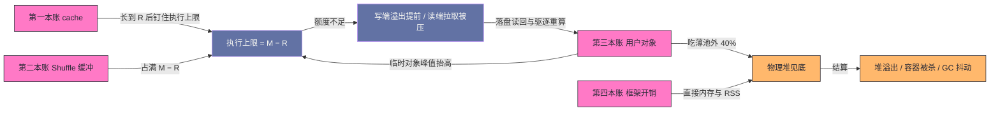
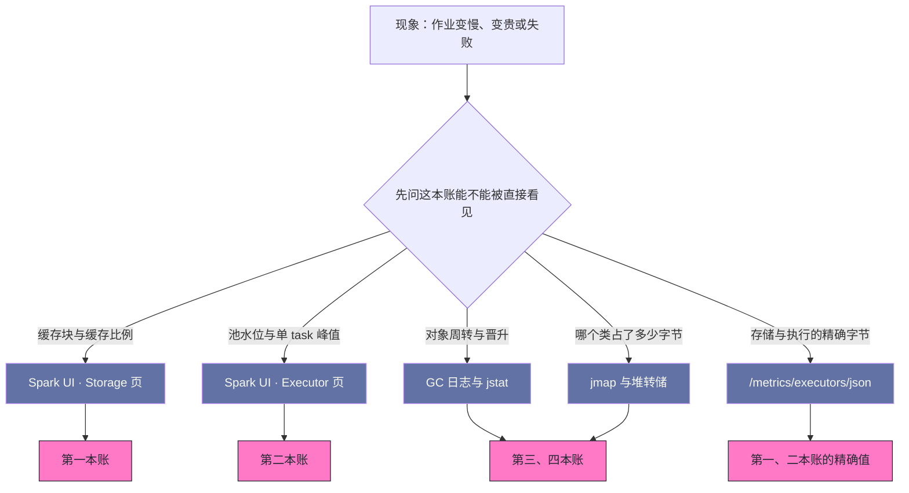
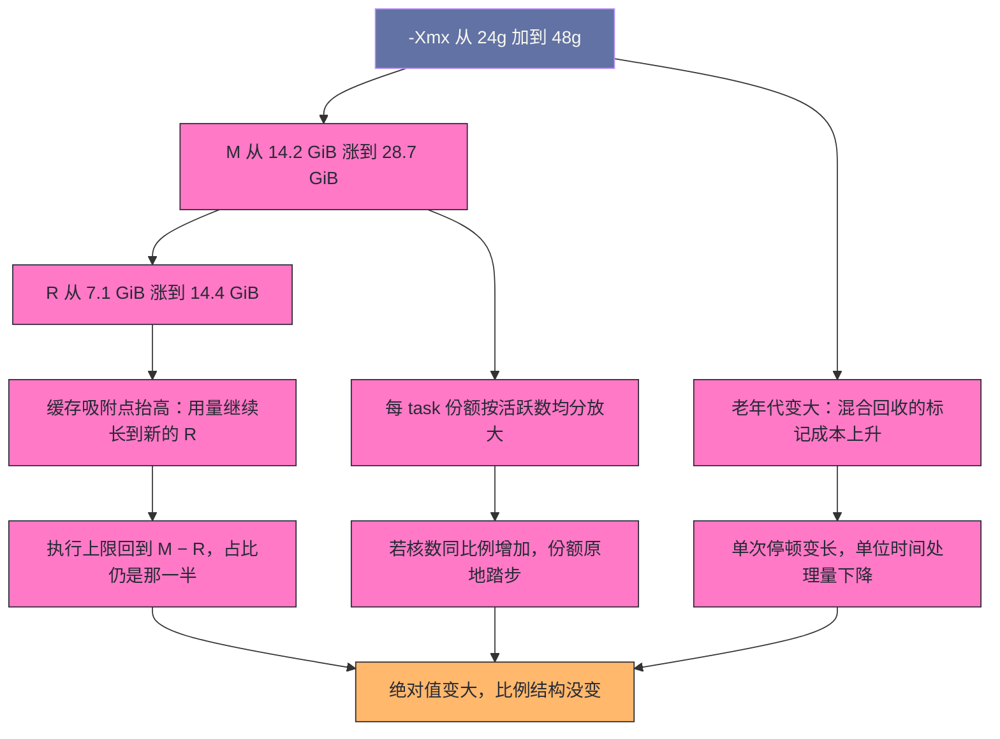

# 1. Spark 内存管理机制：Executor 消耗的四本账与归因

**摘要：**

一个 executor 的堆被四样东西花掉：缓存在存储池里、Shuffle 缓冲在执行池里、用户对象在池外、框架开销连账都不记。Spark 只给前两样立了账本，后两样共用同一个物理堆却没人给它们记账，于是四本账的边界是记账边界，不是物理隔间。这篇文章不拆统一内存池的借用与驱逐（那是本组第 2 篇的题目），也不写调参清单（属于 06 组），只做"消耗构成与归因"这一层：四本账各占多少、怎么测、失衡时各是什么症状。全文沿五问推进：先用一台 24GiB 堆、4 核的 executor 把整个堆切成 M、R 与池外三段，给出四本账各自的定量口径；再逐本拆开——cache 的记账单位是块不是 RDD，unroll 是缓存账里的二级水位，Shuffle 缓冲要按"变量还是常数"分开看，用户对象是执行中的临时物且完全不进池子，框架开销里序列化缓冲与 JVM 自身占了大半；然后把四本账互相挤占的三种形态摊开，说明为什么"缓存长到 R 就不再退让"会钉死执行侧的天花板；接着对齐五种观测手段各自看哪本账，并解释"OOM 但堆没满"与"堆满了但不报 OOM"分别指向哪一本；最后回答两件事——为什么照抄参数模板总是不对症，以及为什么"调大 executor 内存"只是二阶手段。文章口径为 Spark 4.3.0（4.x 预编译 Scala 2.13，默认 JDK 17），涉及默认值处，以对应版本文档或源码为准。

**关键词（Keywords）**: storageFraction, unroll, Peak Execution Memory, 序列化缓冲, memoryOverhead, 容器超限, GC 日志, jmap, 浮动垃圾, 池外内存

---

## 第 1 章 四本账

### 1.1 三个症状，一个动作

同一周里遇到三件事。第一件是按"广告位 + 小时"汇总曝光量的作业，reduce 端每小时刷出几万行 `spilling in-memory map of ... to disk`，能跑完，只是比前一天慢了四十分钟。第二件是协同过滤的迭代作业，日志无异常，但 Storage 页 `Fraction Cached` 停在三成多不再涨，同一个 stage 反复重算。第三件是把日志行反序列化成 case class 再做窗口统计，Executor 页上 GC Time 从四十秒涨到六分多钟，堆占用常年九成以上，却既没有 OOM，也没有容器被杀。

三个现象落在同一台机器上，处理动作也只有一个：把 `--executor-memory` 从 24g 加到 48g。结果一次有效、一次无效、一次更糟。这种"同一个动作三种结果"的局面，说明被调整的对象与真正越界的对象并不是同一个——"内存不够"这五个字在同一时刻至少指代着四样东西，它们共享一个堆，却各自按不同的规则记账。

### 1.2 四本账的分工

把 executor 进程的堆拆开看，能同时花掉它的东西有四类。

第一类是缓存（cache）。RDD 的 `persist`、`cache`、广播变量、Shuffle 落盘前的中间块，都由 `MemoryStore` 管理，记账记在**存储内存（storage memory）**一侧。第二类是 Shuffle 缓冲，写端的聚合哈希表与排序缓冲、读端的拉取缓冲与归并流缓冲，走**执行内存（execution memory）**一侧。第三类是用户对象，闭包捕获的查表结构、`mapPartitions` 里攒的 `ArrayBuffer`、反序列化出来的中间记录，它们不进任何池子，直接就是堆上的普通对象。第四类是框架开销，序列化与反序列化的字节缓冲、网络在途块、文件读写缓冲，以及 JVM 自身与业务数据无关的那几块内存。

**四本账共用同一个堆，却只有两本有账本。** 这是理解全部后续现象的前提。Spark 的统一内存管理器只管前两本：它把堆划出一块公共区域，按"存储"与"执行"两个名目记账，谁申请谁占用，额度不够就驱逐或落盘。后两本既不在这个区域里，也不受任何额度约束，它们想用多少就用多少，唯一的约束是物理堆的大小和 JVM 的分配器。

官方文档里有一句话把这层关系说得很直白：`spark.memory.fraction` 之外的 40% 空间，"留给用户数据结构、Spark 内部元数据，以及为稀疏且异常大的记录做 OOM 缓冲"。这是整套文档里唯一一处承认第三、第四本账存在的地方，而且它用的是"留给"这个词——不是分配，不是配额，只是"剩下的都归你"。**记账边界不是物理隔间**，池子边界一旦被越过的部分，没有任何机制会拦住它，只会在下一次分配时以 OOM、驱逐或者容器被杀的形式统一结算。

### 1.3 定量锚点：24GiB 的一次切分

抽象讲完必须落到数字上，否则"四本账各占多少"这句话仍然无法验证。笔者取一台常见规格：`spark.executor.memory=24g`，`spark.executor.cores=4`，其余参数默认（`spark.memory.fraction=0.6`，`spark.memory.storageFraction=0.5`）。

统一区域 M 的算法是"堆减去 300MiB 保留区，再乘比例"。24GiB 等于 24576MiB，减掉 300MiB 得 24276MiB，乘 0.6 得 14565.6MiB，约 14.2GiB。这 14.2GiB 就是执行与存储共用的全部家当。其中保护区 R 等于 M 乘 0.5，约 7.1GiB；执行侧的天花板是 M 减 R，同样约 7.1GiB。池子之外剩下 24576 减 14565.6 得 10010.4MiB，约 9.8GiB，再刨去那 300MiB 保留区，实际可被第三、第四本账使用的约 9.5GiB。

一个 4 核的 executor 上，如果 4 个 task 同时活跃，执行内存按活跃 task 数动态均分，每个 task 的名义上限约 7.1GiB 除以 4，约 1.78GiB。这个数字不是配额，它是"别人都不要"时才成立的上限，实际按需分配、按活跃数浮动。

下图把这次切分画成一张总账。图中把池内的两块与池外的三块并排画在一起，是为了说明一件容易被忽视的事：池子的记账在启动时就算死了，物理堆的分配却是运行期才发生的，两者之间没有任何隔断。

这张图上最值得记住的是那个 9.8GiB。四本账的讨论里，绝大多数精力都花在池内那 14.2GiB 上，被漏掉的恰恰是池外这四成——第三、第四本账就住在里面，而且它们没有任何额度限制，只要堆还有空间就继续申请。

### 1.4 两个作业，两套比例

同一套参数在不同的作业上会呈现完全不同的四本账结构，这是"参数模板不对症"的根源。本节引入两个贯穿后文的作业。

第一个是 `traffic_rollup`：每天凌晨读当天的曝光日志，按"广告位 + 小时"聚合曝光量与点击量，`sc.textFile(..., 200).map(parse).filter(_.valid).map(e => ((e.slot, e.hour), 1L)).reduceByKey(_ + _, 400)`。它完全不缓存，第一本账接近零，第二本账与第四本账各占一块，第三本账是每行日志解析出来的临时字符串与元组。这是一个"Shuffle 缓冲主导"的作业。

第二个是 `item_cf`：读一张用户-物品交互表，构造邻接矩阵后跑二十轮迭代，每轮都复用同一份矩阵，于是把矩阵 `persist(MEMORY_ONLY)` 下来。它第一本账占满 R，第二本账只在 join 与聚合时短暂冲高，第三本账是每轮迭代产生的中间评分对象。这是一个"缓存主导"的作业。

两个作业跑在同一批 executor 上，用的是同一份 `spark-submit` 参数模板。后文所有关于挤占的讨论，都会落回这两个作业上：它们对同一块 M 的需求方向是相反的，而参数模板给不出这个方向的区分。

### 1.5 一个比喻：四户人家一张额度卡

把 executor 的堆想成一张共享额度卡，四户人家共用，但只有两户在账本上登记了名字。第一户姓存，习惯长期寄存，管理员给它划了一个不许别人动的隔间（R）；第二户姓算，东西随用随扔，但它要占地方时，可以把姓存那户堆在隔间外面的东西请出去，却动不了隔间里的。第三户姓用，压根不在账本上，东西直接堆在走廊。第四户姓框，连走廊都不走，东西放在楼外的院子、电表箱和电梯机房。

这个比喻要收住的地方在于：四户人家的东西虽然记在不同账上，占的却是同一块楼板。第三户在走廊堆满之后，第二户要往仓库里搬东西时就会搬不动——不是因为账本上没额度，而是因为楼板已经压满了。**记账管的是额度，不管重量。**

---

## 第 2 章 第一本账：cache 占 storage 池

### 2.1 记账单位是块，不是 RDD

打开 Spark UI 的 Storage 页，看到的是每个 RDD 占了多少内存、多少磁盘、缓存比例多少。这几个数字容易被误读成"这个 RDD 占用了多少堆"，实际上它们的口径要窄得多：它们是把该 RDD 的各个缓存块在 `MemoryStore` 里登记的字节数加起来。缓存的记账单位是块（block）：一个 RDD 分区通常对应一个块，但登记、驱逐、落盘都以块为单位，不以 RDD 为单位。

更要紧的是这些字节数怎么来的。反序列化形态的块登记的是 `SizeEstimator` 估算出的对象图大小，序列化形态的块登记的是字节数组长度加包装对象开销；前者是递归遍历的估算，后者是相对准确的计量。所以 **Storage 页的 `Size in Memory` 是估算值，不是驻留内存**，它与 `jmap` 看到的堆占用之间差着一个可观的比例，这个比例来自下文要讲的对象膨胀。

### 2.2 序列化形态：一条记录两种体积

官方调优文档给过一个量级：Java 对象访问很快，但占用的空间常常是字段里裸数据的 2 到 5 倍。原因被拆成四条——每个对象有约 16 字节的对象头；`String` 在多背约 40 字节的同时按 UTF-16 存，一个字符两个字节；`HashMap`、`LinkedList` 为每个条目准备包装对象，包装对象再持有若干 8 字节指针；基本类型的集合往往存装箱对象。

这条量级落到具体记录上很容易验证。一条一百来字节的日志行，解析成带三个 `String`、两个 `Long` 的 case class，在堆上约三百字节：对象头 16 字节，两个 `Long` 各 8 字节，三个引用各 4 字节（压缩指针），补齐到 48 字节；三个 `String` 再各背一份对象头与字符数组。三倍膨胀不是夸张，是最常见的档位。

于是缓存形态的选择，本质上是在换哪一本账付钱。`MEMORY_ONLY` 付第一本账的大头，换来读取时零反序列化；`MEMORY_ONLY_SER` 把第一本账压到接近原始字节数，代价是每次读都要反序列化，那些临时对象全部落进第三本账。**序列化缓存的代价从第一本账挪到了第三本账**，总量未必减少，只是从"长期占用"变成了"高频周转"。这笔搬家账在后文讲挤占时还会再遇到。

### 2.3 unroll：缓存账里的二级水位

缓存写入过程里有一个多数人不知道的名字：unroll。一个分区要变成缓存块，不是先算好大小再一次性分配，而是迭代地从上游拉记录、边拉边估，每估一次就申请一段"尚未成形的缓存额度"。这段额度叫 unroll 内存，它的上限是存储内存乘 `spark.storage.unrollFraction`（默认 0.2），起步申请量由 `spark.storage.unrollMemoryThreshold`（默认 1MiB 量级）给出。

这一段是缓存账里最不透明的地方。**unroll 内存是账上记着却收不回来的那一部分**——它对应的块还没有成形，无法被驱逐，也无法被写出，只能等这一轮拉完或者放弃。因此当一个大分区正在 unroll 时，执行侧即使想把存储用量压到 R，也压不动这一段。0.2 这个比例正是为了给它设一个上限：即使所有活跃 task 同时 unroll，最多也只吃掉存储内存的两成。

下图是这段流程的形状。图中把"丢弃"与"落盘"两条出口并排画出来，是因为它们落在完全不同的账上：落盘只是换了介质，丢弃则要等下次用到时重算，重算的中间对象又进第三本账。

一个实际后果是：Storage 页显示的缓存总量永远小于存储池的实际占用，差值就是此刻所有活跃 task 正在 unroll 的额度。只看页面会得出"缓存还很空"的错误结论，实际上池子已经被 unroll 占住了。

### 2.4 R 是吸附点，不只是保护区

官方文档对 R 的表述是"缓存块永不被驱逐的子区域"，这句话常被理解成"缓存有一个安全垫"。它在定量层面的含义要强得多：执行侧最多只能把存储用量压到 R，压不到 R 以下；反过来，缓存用量只要还没到 R，就没有任何回收压力，会一路长上去。

两句话合起来就是一个结构性倾向：**缓存一旦长到 R，执行侧的天花板就被钉死在 M − R。** 在 24GiB 的例子里，这句话等于"缓存用了 7.1GiB 之后，Shuffle 缓冲永远只剩另外 7.1GiB，即使机器上还有 9.8GiB 的池外空间也借不过去"。

这个倾向解释了 `item_cf` 的困惑：它为缓存准备了很多内存，缓存比例却上不去。答案不在总量，在位置上——缓存贴住 R 之后，多出来的部分只能借用执行侧的空闲部分，执行侧一旦需要就得把它请出去。缓存在 R 之上是"临时栖息"，在 R 之下才是"产权"。

还有一层沉没成本。被驱逐的块不会有任何告警，日志里也未必留下痕迹，它只是在下一次被用到时重新算一遍。**被驱逐的缓存没有告警，只有重算**，而重算既是 CPU 成本，也是第三本账的成本，这一条会在第 6 章串起来。

### 2.5 广播变量同池不同源

广播变量也走 `MemoryStore`，记账同样计入存储内存，但生命期完全不同：每个 executor 一份，随实例常驻，且被标记为不可驱逐，`evictBlocksToFreeSpace` 不会动它。一个 2GiB 的广播表在 20 个 executor 上就各自占掉 2GiB 存储池，安静地压着执行侧的天花板，而 Storage 页只把它列成一个 `Broadcast` 项，很容易被扫过去。

一张表把缓存的各种形态并排放好。表中"越界后果"一列是重点：同一个"缓存放不下"的事件，在不同 StorageLevel 下会落到三本不同的账上。

| StorageLevel | 记账位置 | 放不下时的行为 | 越界后果落在哪本账 | 典型代价 |
|---|---|---|---|---|
| `MEMORY_ONLY` | 存储池，反序列化形态 | 丢弃块，不落盘 | 第三本账（重算的临时对象） | 上游整条链重算，最贵 |
| `MEMORY_AND_DISK` | 存储池 + 磁盘 | 溢出到磁盘 | 第四本账（磁盘缓冲与 I/O） | 读回时反序列化，抖动 |
| `MEMORY_ONLY_SER` | 存储池，序列化字节 | 丢弃块，不落盘 | 第一本账变小、第三本账变大 | 每次读都反序列化 |
| `MEMORY_AND_DISK_SER` | 存储池 + 磁盘 | 溢出到磁盘 | 第三、四本账同时增加 | 反序列化 + 磁盘读 |
| `DISK_ONLY` | 只落磁盘 | 直接写盘 | 第四本账 | 第一次读极慢 |
| 广播变量 | 存储池，不可驱逐 | 申请失败则任务失败 | 第一本账的固定开销 | 每 executor 常驻一份 |

---

## 第 3 章 第二本账：Shuffle 缓冲占 execution 池

### 3.1 先分变量与常数

执行内存这一侧最容易讲混，因为"Shuffle 缓冲"其实是好几样东西的统称，它们的量纲完全不同。先做一个区分，后面的定量才有意义：一类是**变量**，占用随数据量增长，譬如写端的聚合哈希表；一类是**常数**，占用是"某个配置值 × 并发数"，与数据量无关，譬如读端每个 task 的在途拉取上限。

这个区分决定了我们怎么调参。**写端是变量，读端是常数**：常数那部分调参数能直接改绝对值，值得算；变量那部分调参数只是把溢出阈值推后，真正的决定权在数据本身。把两者混在一起谈"Shuffle 占多少内存"，得到的数字既不能预测也不能优化。

本章只算第二本账的体量，不含额度怎么发放、溢出判据怎么触发、申请不到时怎么让路——那是 [[7. Spark_Shuffle内存调优]] 与 [[6. Spark_Shuffle聚合与排序结构]] 的题目，这里只需要记住一条结论：这些缓冲的额度都来自同一块执行内存，而执行内存的天花板是 M − R。

### 3.2 写端：一张会自己变大的表与一排固定缓冲

写端的第一项是聚合结构。有聚合函数时它是一张以 `(分区号, key)` 为键的哈希表，没有聚合函数时是一个逐条追加的定长缓冲。前者的大小取决于 key 的基数、聚合值的体积与装填因子；后者的大小直接与输入记录数成正比。

估算的方法不复杂，难在参数不好取。以 `traffic_rollup` 为例：一天 5 万个广告位、24 个小时，key 基数上限 120 万，实际命中约 80 万；每个键是两个 `String` 加一个 `Long` 的元组，加哈希表的槽位摊薄，压缩指针下取 60 字节；装填因子 0.7 意味着数组要按 1.43 倍放大。三个数乘起来约 68MB，看起来不大。

但这个估算有三个陷阱。其一，key 基数只能事后知道，工程上取"上一天的实际值"最靠谱。其二，聚合值会膨胀，`groupByKey` 的 combiner 是 `CompactBuffer`，某个热点键攒下十万个元素就单独吃掉几十 MB。其三，2 到 5 倍的膨胀规律在这里同样成立，60 字节已是按压缩指针乐观估的。

写端的第二项是落盘缓冲。每个输出流有一个 `BufferedOutputStream`，大小由 `spark.shuffle.file.buffer` 控制，默认 32KiB。它的量纲是"每流一份、与数据量无关"，所以总占用等于 32KiB 乘上写端同时打开的输出流数。400 个输出分区意味着最多 400 个缓冲，合起来 12.8MB，不吓人；但它有一个特性值得记住：这些缓冲是堆上的字节数组，属于第四本账，不占执行内存额度。

### 3.3 读端：在途字节是并发乘以常数

读端的账目清楚得多，也更容易被算错。每个 reduce task 在折叠数据之前要先拉取上游输出，拉取是流水式的：任意时刻都有一批块"请求已发出、流还没消费完"，这批块占着接收缓冲。上限由 `spark.reducer.maxSizeInFlight` 给出，默认 48MiB。

这里的量纲是"每 task 每批"。一个 4 核 executor 跑 4 个 reduce task，同时在途的上限就是 48MiB 乘 4，约 192MB；如果这个 executor 因为规格调整变成 16 核、16 个 task，上限就变成 768MB。**在途字节的上限随并发线性增长，不随 executor 变大而变小**——这是"大 executor 多核"在第二本账上的一处隐藏成本，第 10 章还会回到它。

这些字节落在哪个账上，取决于传输实现：走堆内缓冲时它在第一到第三本账之间游走，走直接内存（direct buffer）时它在第四本账里，且不计入 `-Xmx`。在 4.3.0 的实现里，Shuffle 传输基于 Netty，直接内存这一侧的开销要计入 `spark.executor.memoryOverhead`，否则容器会在 RSS 层面被结算。这一点在 [[5. Spark_JVM性能调优]] 里已经拆过，这里只记一句：第二本账的物理落点未必在执行池里。

### 3.4 收尾：归并流数

溢出过一次之后，收尾阶段要把内存里剩下的表与磁盘上的若干溢出文件归并起来。k 条流并排推进，每条流有自己的读缓冲、解码器与堆内候选记录。单项开销不大，麻烦在它与溢出次数成正比：溢出十次就是十条流，每条流的缓冲乘上去，可能是几十 MB 的量级。

这一项的性质介于变量与常数之间。溢出次数本身是变量（取决于数据量与可用额度），但"每条流占多少"是常数（取决于实现里的页大小与序列化格式，以版本源码为准）。它最容易在"溢出很多次"的作业里被忽略——因为那时大家的注意力都在磁盘 I/O 上，而收尾期的内存峰值其实是同一件事的另一面。

三处缓冲并排放在一张表里，量纲一列是全表的重点。它决定了后续所有调参动作能改到什么程度。

| 缓冲项 | 归属 | 量纲 | 默认值或估算依据 | 观测点 |
|---|---|---|---|---|
| 写端聚合表 | 执行池内 | 变量，随 key 基数与聚合值增长 | key 基数 × 单条体积 ÷ 装填因子 | Executor 页 Peak Execution Memory |
| 写端落盘缓冲 | 池外，堆内字节数组 | 常数，每输出流一份 | `spark.shuffle.file.buffer`，默认 32KiB | 无法直接观测，按流数推算 |
| 读端在途块 | 池外，堆内或直接内存 | 常数，每 task 每批 | `spark.reducer.maxSizeInFlight`，默认 48MiB | 按并发数推算，或看 Netty 内存 |
| 读端反序列化候选 | 执行池内 | 变量，与记录数相关 | 每批解出的记录对象 | 难观测，只能看 GC |
| 收尾归并流缓冲 | 执行池内 | 溢出次数 × 每流常数 | 与溢出次数成正比 | Peak Execution Memory 的尾部峰值 |
| 溢出文件写缓冲 | 池外 | 常数，每流一份 | 与落盘缓冲同量级 | 无法直接观测 |

---

## 第 4 章 第三本账：用户对象，执行中的临时物

### 4.1 不在任何池子里

第三本账是最难讲清的一本，因为它没有名字、没有参数、没有界面。它就是用户在算子函数里造出来的那些对象：`filter` 里的判断结果、`map` 里的输出记录、`mapPartitions` 里攒的容器、`reduce` 里的累加器、`groupByKey` 展开后的 `CompactBuffer`。它们既不算缓存，也不算 Shuffle 缓冲，Spark 的内存管理器完全不看它们。

这类对象的量纲是"执行中的临时物"：生命期从产生到 task 结束，长的几十秒，短的几微秒。它们唯一的记账方式是 JVM 自己的堆，唯一能被看见的途径是 GC 日志和堆转储。

**用户对象不进池子，只吃池外那 40%。** 这句话有一半是错的，后面要修正：它确实不进池子，但它并不安分地待在 40% 里。40% 只是文档的期望值，物理上没有边界，一个 task 真的需要时，它会把池子占过的空间一起吃掉——池子的记账还停在原来的水位上，堆已经见底了。

### 4.2 四种典型临时物

第一种是闭包捕获。算子里引用到的外部对象会被序列化进 task，在 executor 端反序列化出一份新的。捕获的若是几十 MB 的查表结构，每个 task 反序列化一份，几十个并发 task 就是几十份。官方文档给过一个判据：task 序列化后超过 20KiB 就值得优化，而几十 MB 量级的捕获早该换成广播变量——收益不只在网络，更在第三本账，它从"每 task 一份"变成"每 executor 一份"。

第二种是分区级容器。`mapPartitions` 与 `foreachPartition` 给了用户一个攒数据的机会，也给了第三本账一个无限增长的入口。典型的反例是把整个分区读进 `ArrayBuffer` 再统一处理：分区一百万行、每行三百字节，这个容器就是 300MB，4 个 task 同时这么干就是 1.2GB。

第三种是反序列化中间物。读 HDFS 时要解压，解压后的数据量常常是压块的 2 到 3 倍；官方调优文档给过一个估算，把 HDFS 块大小 128MiB 与这个倍数一起算，单个 task 的工作集可能到三百多 MB。这些对象用完即弃，但它们在 Eden 里是要占地方的。

第四种是 driver 侧的回传。`collect`、`take`、`toLocalIterator` 把 executor 的结果收进 driver 堆，`spark.driver.maxResultSize` 限制的正是这条路。它不在 executor 的四本账里，但它是同一个"第三本账"思路在 driver 上的镜像，混起来谈会把归因彻底搞乱。

### 4.3 浮动垃圾与 GC 的乘数

一个容易被忽略的定量事实是：task 结束不等于对象立刻消失。GC 的回收发生在分配压力到达阈值时，从对象变成垃圾到它被真正回收，中间隔着一个 GC 周期；在这段时间里，垃圾仍然占着堆。这部分叫浮动垃圾（floating garbage），它的量级与"每个 GC 周期内产生多少垃圾"成正比。

这条规律在 Spark 里被放大，因为 task 是批量创建的。一次 stage 提交会同时启动几十个 task，它们几乎同时开始产生临时对象、几乎同时到达峰值、几乎同时结束。峰值叠加之后，堆上瞬间多出一大块在 GC 看来"还活着"的对象，而它们的实际生命期只剩几毫秒。**第三本账的峰值还要再乘上一个 GC 周期的重叠系数。**

这也解释了为什么 G1 在 executor 上常常比 Parallel 稳定：G1 按 region 增量回收，单次停顿短，能在同样的时间窗口里多回收几轮，浮动垃圾的堆积就少一些。这属于 [[5. Spark_JVM性能调优]] 的题目，此处只借它说明第三本账与 GC 策略是同一件事的两面。

### 4.4 为什么这本账最难估

缓存可以看 Storage 页，Shuffle 缓冲可以看 Peak Execution Memory，第四本账可以按清单估，唯独第三本账没有任何直接指标。它只能间接推断：GC 频率高、年轻代回收后存活对象少、老年代增长慢，指向"临时对象多、生命期短"，也就是第三本账的典型形态；反过来，老年代持续增长且回收不掉，指向第一本账或闭包捕获那类"长期住户"。

一个可用的粗估方法是把第三本账折算成输入侧的量：单 task 峰值临时对象约等于"输入块解压后大小 × 一个常数"，常数取决于算子的空间复杂度，流式算子接近 0.1，攒批算子可以到 1 以上。官方调优文档给 Eden 的估算例子是"4 个 task、每 task 3 倍解压、HDFS 块 128MiB"，算出来是一个半 GB 量级，那本身就是第三本账的估算示范。

| 来源 | 生命期 | 是否受池约束 | 与什么成正比 | 观测手段 |
|---|---|---|---|---|
| 闭包捕获对象 | executor 常驻或 task 全程 | 否 | 捕获体积 × 并发 task 数 | 堆转储按类统计 |
| 分区级容器 | task 全程 | 否 | 分区记录数 × 单条体积 | 堆转储、GC 日志 |
| 反序列化中间物 | 微秒到毫秒 | 否 | 输入量 × 解压倍数 | 年轻代分配速率 |
| 聚合展开的容器 | task 全程 | 否 | 单键元素数（热点键最坏） | 堆转储、spill 日志 |
| 缓存读回的对象 | 调用期间 | 否 | 序列化缓存的大小 | 年轻代分配速率 |
| driver 侧回传结果 | job 全程 | 否 | 回传条数 × 单条体积 | driver 堆与 maxResultSize |

---

## 第 5 章 第四本账：框架开销

### 5.1 序列化缓冲

序列化无处不在：Shuffle 写要序列化，读要反序列化，`_SER` 缓存与 task 本身也要序列化，每一处都配着一块缓冲。

Kryo 那一侧有两组参数，`spark.kryoserializer.buffer` 管单次序列化的初始缓冲（默认 64KiB 量级，会自动扩展），`spark.kryoserializer.buffer.max` 管上限（默认 64MiB 量级）。这些缓冲每个序列化动作一份、用完即弃，单份不大，同时在世的份数等于并发 task 数。

Tungsten 那一侧是页。`UnsafeExternalSorter` 与 `UnsafeExternalAppendOnlyMap` 用内存页而不是对象来装记录，页大小由 `spark.buffer.pageSize` 这类参数推算，量级在数 MB 到上百 MB 之间（具体推算规则以对应版本源码为准）。页是执行池内最"重"的分配单元：一个 task 只要拿到一页，即使实际只写了几百条记录，这一页也整块占着执行内存。

这些缓冲里，Kryo 与写盘缓冲都在堆上、都不进入池子记账；Tungsten 的页是一个例外，它由 `TaskMemoryManager` 分配、算在执行内存里，只是形态是页而不是对象。所以第四本账的边界并不干净：**它在堆里，但大多不在账本里。**

### 5.2 网络与文件

Shuffle 传输走 Netty，接收侧的缓冲通常是直接内存（direct buffer），分配在堆外。堆外的特点是"不参与 GC、不占 `-Xmx`、但要占 RSS"，所以它在容器层是实打实的开销。并发拉取时这一块会明显膨胀：4 核 executor 与 16 核 executor 的在途块上限差四倍，直接内存的占用也差四倍。

文件这一侧有两处容易漏。其一是 HDFS 客户端的读缓冲，由 `io.file.buffer.size` 一类参数控制，通常几十 KB，每读一个块一份。其二是内存映射（memory map）：`spark.storage.memoryMapThreshold` 默认 2MiB，超过这个大小的块在从磁盘读回时用内存映射而不是读进堆。映射区不在堆里，也不在 `-Xmx` 里，但它出现在进程的 RSS 里，因此会进入容器的记账。这解释了一个奇怪现象：某个作业的堆占用平稳，容器却被判超限——映射区与直接内存在账外长胖了。

### 5.3 JVM 自身

第四本账里最容易被彻底忽略的一段，是 JVM 自己。元空间（Metaspace）装类元数据，Spark 与用户代码加载的类数量可观，几十到上百 MB 是常态；代码缓存装 JIT 编译后的机器码，几十 MB；线程栈每线程一份，默认 1MiB 量级，一个 16 核 executor 同时跑 16 个 task，就是 16MiB 以上的栈空间，且栈不在堆内。

GC 自身也有开销。G1 要维护 region 元数据、记忆集（remembered set）与卡表（card table），按堆规模比例占用，量级在堆的百分之几，且不产生任何业务价值。

最后一处是直接内存的额度。`-XX:MaxDirectMemorySize` 未显式设置时，默认与 `-Xmx` 同量级，这意味着一个 24GiB 堆的 executor 理论上还能再分配 24GiB 的直接内存，而容器只按 `spark.executor.memory` 加上 `spark.executor.memoryOverhead` 申请。`memoryOverhead` 的默认值是"384MiB 与堆的 10% 取大"，这 10% 就是为 5.1 到 5.3 这一整段准备的，够不够取决于作业形态。

### 5.4 保留区到底归谁

回到第 1 章那个 300MiB。它从 M 的基数里被扣掉，所以在账面上既不在池内，也不在池外的可用额里。它的官方用意是给"稀疏且异常大的记录"留缓冲——它是为第三本账准备的应急金，而且金额是硬编码的，不可配置。

这个固定金额对小 executor 更不友好：4GiB 堆要扣掉 7.3%，24GiB 只扣 1.2%，而小 executor 的第四本账占比本来就高。第 10 章会把它作为规格选择的依据。

第四本账的清单整理成一张表。表中"是否计入 `-Xmx`"这一列是归因的关键：计入堆的，会以 `Java heap space` 的形式失败；不计入堆的，会以 `Direct buffer memory`、`Metaspace` 或者容器被杀的形式失败。

| 开销项 | 典型量级 | 计入 `-Xmx` | 是否需要 `memoryOverhead` 覆盖 | 观测方式 |
|---|---|---|---|---|
| Kryo / Java 序列化缓冲 | 每动作 64KiB 量级，可扩展 | 是 | 否 | 堆转储按 `byte[]` 统计 |
| Tungsten 内存页 | 数 MB 到上百 MB，每 task | 是 | 否 | 计入执行内存，看 Peak Execution Memory |
| 写盘缓冲 | 32KiB × 输出流数 | 是 | 否 | 按流数推算 |
| Netty 接收缓冲 | 每 task 数 MB 到数十 MB | 否（直接内存） | 是 | 容器 RSS、Netty 指标 |
| 内存映射块 | 与磁盘块大小同量级 | 否 | 是 | 进程 RSS |
| 元空间与代码缓存 | 数十到上百 MB | 否 | 是 | `jcmd VM.metaspace` |
| 线程栈 | 1MiB × 活跃线程数 | 否 | 是 | `jstack` 与线程数 |
| GC 元数据 | 堆的百分之几 | 否（与堆同量级） | 是 | `-Xlog:gc+heap` |

---

## 第 6 章 三处挤占

### 6.1 形态一：cache 挤 Shuffle

`item_cf` 那个作业是这一形态的标准样本。它把邻接矩阵 `persist(MEMORY_ONLY)` 之后，缓存用量稳定在一个贴着 R 的位置上，然后 reduce 端的聚合开始频繁溢出。

原因不是"缓存占了太多"，而是"缓存占的位置太关键"。缓存用量贴住 R 之后，执行侧的天花板被钉在 M − R，4 核均分下来每 task 约 1.78GiB；如果没有这份缓存，执行侧可以涨到整个 M，每 task 约 3.55GiB。**缓存站住 R 的代价，是每 task 的执行内存份额被腰斩。** 这个数字比"缓存占了 7GB"要有意义得多，因为它直接对应溢出频率。

还有两条次要通道。一条是 unroll：大分区正在成形时那段内存不可驱逐，执行侧的申请被直接拒绝，表现为"某个时刻突然集中溢出"而非均匀溢出。另一条是驱逐的同步成本：驱逐在申请线程里同步完成，几千个块逐个判定、逐个通知 BlockManager，这段时间 task 就停着等。

最贵的一笔在驱逐之后。被赶出去的缓存块不会自己回来，等下一个 stage 用到它时，要么从磁盘读回（`MEMORY_AND_DISK`），要么整条血缘重算（`MEMORY_ONLY`）。重算又会产生第三本账的临时对象，于是"缓存挤 Shuffle"的账，最后是用"重算 + GC"结清的。

### 6.2 形态二：Shuffle 挤 cache

方向反过来，样本是 `traffic_rollup` 加了缓存之后的变体：作业在中间结果上 `persist` 了一份，同时 reduce 端的聚合把执行内存吃满。

执行侧吃满 M − R 之后，缓存想扩张就申请不到存储内存：`MemoryStore` 先试着从自己这边挤，但 R 以下挤不动、R 以上早就没有了，于是这次 unroll 失败。去向由 StorageLevel 决定：允许落盘的写磁盘，不允许的直接丢弃。Storage 页上的 `Fraction Cached` 停住不再上涨，日志里可能出现 "Not enough space to cache partition" 这类提示，而 stage 的重算次数开始上升。

这一形态有一个隐蔽变体：缓存没有被丢，只是被压回了 R。Storage 页的数字从 R 之上掉下来，看起来"缓存自己变少了"，实际是执行侧把它请出去的。只盯着"缓存总量为什么不稳定"，很容易走向"给存储多划一点"——那正好是把 R 调大，第 9 章会说明它为什么经常是错的。

### 6.3 形态三：用户对象两头挤

第三形态在 `traffic_rollup` 的反序列化版本上最明显。作业把每行日志解析成一个 case class，在 `mapPartitions` 里攒成批再处理。执行池的水位看起来很健康，缓存也没有异常，但任务越来越慢，偶尔整个 executor 抛出堆溢出。

这里有两个天花板同时压着。第一个是池子的记账天花板：M 由启动时的堆大小算定，不随用户对象的多少变化，所以池子该占的 60% 照占，剩下的 40% 是第三、第四本账的全部空间。第二个是物理天花板：`-Xmx` 一到，任何分配都会失败，不管账面上还有多少额度。

**M 在启动时就算死了，不随用户对象增长而缩小。** 用户对象多吃一百 MB，池子不会因此少记一百 MB，它只是把池外那 40% 吃薄了一百 MB。等池外吃尽，下一次"池内申请"在记账层面是成功的，在物理层面会失败——因为记账只是一个计数器，计数器加一不需要真的分配内存，真正分配时才发现没了。

反过来也成立：池子若把 60% 用满，第三本账在物理上就只剩那 40% 可用，加内存放大的正是这 40% 的绝对值——一个在 24GiB 上勉强过线的批处理 task，在 48GiB 上就还有一半腾挪余地。这就是"加内存有效"的场合：它解决的是第三本账的绝对空间，而不是第二本账的额度。

### 6.4 结算总是落在第三本账

三种形态摊开之后，会看到一个共同的收尾：无论起因是第一本、第二本还是第四本账，最终失败时正在申请内存的代码，通常是用户代码或者框架缓冲。缓存不够时会触发重算，重算造对象；Shuffle 缓冲不够时会落盘，落盘后的读回造对象；框架开销不够时容器被杀，杀之前的每一次分配都在造对象。

于是报错位置与病因经常错位：一个第一本账的问题，报在用户的 `map` 里；一个第四本账的问题，报成 `Direct buffer memory`；一个第二本账的问题，报成 `SparkOutOfMemoryError`。**结算总是落在第三本账上**，这就是为什么"看报错栈找病因"在 Spark 上成功率不高，必须按账归因。

下图把三处挤占与它们的结算路径画在一起。图中把"重算"画成一条回到用户对象的箭头，是为了强调这个循环：缓存被挤走会引发重算，重算会加重第三本账，第三本账又会挤压池外的物理余量。

三种形态的判别要素列成一张表。表中"首要动作"一列刻意不给参数，只给方向——因为参数的取值属于 06 组，本篇只负责指出应该动哪一本账。

| 形态 | 触发条件 | 典型症状 | 常见误判 | 首要动作 |
|---|---|---|---|---|
| cache 挤 Shuffle | 缓存用量贴住或超过 R | 溢出字节数上升、驱逐后重算、每 task 份额下降 | 以为 Shuffle 数据变大 | 缩减缓存范围或改序列化级别 |
| Shuffle 挤 cache | 执行侧需求长期占满 M − R | `Fraction Cached` 停滞、块被丢弃或落盘、stage 重算 | 以为存储配额不够，去调大 R | 降低单 task 的聚合量或提高并行度 |
| 用户对象两头挤 | 闭包捕获过大、分区级容器攒批 | 池水位健康但 GC 时间飙升、堆溢出位置在用户代码 | 以为 Spark 内存池泄漏 | 减小 task 工作集或改流式处理 |

---

## 第 7 章 观测：五种手段各看哪本账

### 7.1 Storage 页看第一本账

Storage 页是五者里最直观、也最容易被高估的一个：它列出每个 RDD 与广播变量的存储级别、分区数、缓存比例、内存与磁盘占用，适用范围只有第一本账，且只覆盖已经成形的块。两个使用要点：`Size in Memory` 是估算值，判断真实堆占用要靠堆转储；缓存总量与存储池用量不是同一个数，差值里藏着 unroll 的额度，所以"页面显示还有空间"与"池子还有额度"是两句不同的话。

### 7.2 Executor 页看第二本账与池水位

Executor 页上有三个数字要用起来。`Storage Memory` 一行给出已用与总量，这是池水位，包含 unroll；`Peak Execution Memory` 是单个 task 在执行内存上的峰值，注意它是按 task 记录再取最大，不是 executor 的实时占用；`GC Time` 是累计停顿，配合 `Shuffle spill (memory)` 的字节数一起看，能区分"溢出多但每次很小"与"溢出少但每次很大"。

`Peak Execution Memory` 有一个广为人知的口径陷阱：它只统计池内申请到的执行内存，不含用户对象、序列化缓冲与网络缓冲。所以一个"Peak Execution Memory 只有 300MB"的 executor 完全可能在 24GiB 的堆上把自己撑死。第 8 章会把这条陷阱展开。

### 7.3 GC 日志看第三、第四本账

GC 只认对象，不认账。这看起来是缺点，实际上是它不可替代的理由：正因为不认账，它是唯一能看见第三本账的手段。

在 JDK 17 上，`-Xlog:gc*` 这一组参数能把每次回收的细节留下来。要看四项：年轻代回收后存活对象的量、老年代的增长斜率、`to-space exhausted` 的出现（晋升失败，通常意味着老年代快满）、`humongous allocation` 的频率（超过半个 region 的大对象，在 G1 下直接进老年代）。

四项各自指向一本账：存活量低而回收频繁，是第三本账在高速周转；老年代持续增长且回收不掉，是第一本账或闭包捕获；晋升失败说明第三本账与第一本账在争老年代；humongous 频率高，等价于把"临时物"变成了"长期住户"。

### 7.4 jmap 与堆转储看"哪个类占了多少"

`jmap -histo:live <pid>` 输出按类聚合的对象数量与字节数，是定位第三本账最快的工具：用户自己的类排在前面，说明临时物或捕获对象是主因；`byte[]` 排第一，说明第一本账（序列化缓存块）或第四本账（缓冲）是主因；`java.util.HashMap$Node` 或 `AppendOnlyMap` 类排在前面，说明第二本账的聚合结构是主因。

需要注意两件事。其一，`-histo:live` 里的 `live` 会先触发一次 Full GC，在 24GiB 的堆上这一次停顿以十秒计，线上要慎用；替代品 `jcmd <pid> GC.class_histogram` 同样是 stop-the-world。其二，直方图只给类与总量，不给引用链，找"谁持有它们"要靠堆转储配合 MAT 的支配树。转储本身也是一次全堆遍历，文件大小约等于堆的活跃对象量，且在容器里做转储要预留出磁盘空间。

### 7.5 `spark.memory.*` 看精确字节数

前四种手段都在"估算"与"间接推断"之间打转，只有一条路径给出精确字节数：executor 的指标端点。`/metrics/executors/json` 返回 `memory.usedOnHeapStorageMemory`、`memory.usedOnHeapExecutionMemory` 这类字段，单位是字节，来源是内存管理器自己的计数器。

它的价值在于可以对账：块大小与 `usedOnHeapStorageMemory` 的差值是 unroll，`usedOnHeapStorageMemory` 与 `-Xmx` 的差值就是池外空间。**只有把三个数放在一起，才知道池外还剩多少。** 指标随 executor 心跳刷新，做趋势图比做单点快照有用。

五种手段的分工可以用一张图收住。图中从"现象"出发，按每一本账能被哪种手段看见来分流，最后落回账本本身；画成树形，是因为实际排障时确实是先选手段、再落到账。

一张表把四本账与观测手段对齐。这张表是全文的实用落点，遇到症状时按行查，比按经验猜要快。

| 账本 | 主要观测手段 | 失衡时的典型症状 | 首要动作 |
|---|---|---|---|
| 第一本账 cache | Storage 页、`usedOnHeapStorageMemory` | `Fraction Cached` 停滞或下滑、块被丢弃、stage 重算 | 缩小缓存范围或改序列化级别 |
| 第二本账 Shuffle 缓冲 | Executor 页的 Peak Execution Memory 与 spill 字节数 | 溢出字节数上升、单 task 峰值贴近份额上限 | 降低单 task 数据量或提高并行度 |
| 第三本账 用户对象 | GC 日志、`jmap -histo`、堆转储按类统计 | GC 时间占比高、年轻代回收后存活少、报错栈落在用户代码 | 改流式处理、去掉分区级攒批、换广播 |
| 第四本账 框架开销 | 容器 RSS、`jmap` 里的 `ByteBuffer` 与 `byte[]`、`memoryOverhead` 判定 | 容器被杀、`Direct buffer memory`、`Metaspace` 溢出 | 上调 `memoryOverhead` 或减少并发缓冲 |
| 池外余量 | 上述三者的差值 | 池水位正常但堆见底 | 按前三行归因，不要先动池子 |

---

## 第 8 章 两种错位

### 8.1 OOM 但堆没满

这一类最反直觉：报错说内存溢出，去看堆转储却发现活跃对象只占了三成。它的成因有五种，每种指向不同的账。

第一种是 `SparkOutOfMemoryError`，文本形如 "Unable to acquire N bytes of execution memory, got M"。它根本不是 JVM 堆溢出，而是执行内存的额度申请失败——第二本账的天花板到了，物理堆可能还空着一半。这一条在日志里出现的频率远高于真正的堆溢出，却最常被当成"内存不够"去加堆。

第二种是 `java.lang.OutOfMemoryError: Direct buffer memory`。堆外直接内存的额度用完了，指向第四本账。加 `-Xmx` 对它没有帮助，因为失败发生在堆外；真正相关的是 `memoryOverhead` 与直接内存上限。

第三种是容器被杀：YARN 上的 `Container killed by YARN for exceeding memory limits`，Kubernetes 上的 `OOMKilled` 与 exit 137。这一条也不是 JVM 报的错，是内核或调度器按 RSS 判的。它指向第四本账——进程驻留内存超了申请额度，堆可能只用了一半。

第四种是 `Metaspace` 溢出或 `unable to create new native thread`。前者是元空间不足（大量动态类或类加载器泄漏），后者是线程创建失败（栈空间或进程线程数上限），都归第四本账。

第五种比较罕见但很说明问题：`Requested array size exceeds VM limit`，或 G1 下大对象分配反复失败。它指向某一个"超大单体分配"——一个巨大的缓存块、一个巨大的 `byte[]` 缓冲，或者 `mapPartitions` 里攒了一整个分区的 `ArrayBuffer`。

判据因此非常直接：**看报错文本，不看堆占用率。** 文本里出现 "Unable to acquire ... memory, got ..." 是池内额度；出现 "Java heap space" 是物理堆；出现 "Direct buffer memory" 是堆外；出现容器被杀或 exit 137 是 RSS。

### 8.2 堆满了但不报 OOM

反过来的错位同样常见：堆常年停在九成以上，GC 时间占比过半，任务慢得像卡住，却始终不失败。两种情形。

第一种是临时对象太多。每次年轻代回收都能收走绝大部分、存活量很小，但分配速率极高，GC 时间占比被推到 50% 以上。堆看起来是满的，实际全是"刚死还没来得及收"的浮动垃圾，指向第三本账。

第二种是长期住户太大。缓存贴住 R、闭包捕获了一份大表、或者某个数据结构在跨 task 累积，老年代常年 95% 以上，每次 Full GC 只回收两三个百分点，随时可能失败但就是不失败，指向第一本账，或者第三本账里"生命期被意外延长"的那一类。

判据是**Full GC 之后老年代回收了多少**。回收比例高（三成以上），说明活着的东西不多、是垃圾造得太快，指向第三本账；回收比例低（一成以下），说明活着的太多，指向第一本账或捕获对象。这个数字在 GC 日志里直接可读，比任何单一指标都可靠。

两种错位并排放好。表里这些现象经常被同一个"加内存"动作对付，而它们的病根完全不在同一本账上。

| 现象 | 指向哪一本账 | 判据 | 常见误判 |
|---|---|---|---|
| `Unable to acquire ... execution memory` | 第二本账的额度 | 报错文本含 "Unable to acquire" | 当成堆溢出，去加 `-Xmx` |
| `Java heap space` | 第三本账或池外余量 | 堆转储活跃对象占比高 | 直接加堆，不查是谁占的 |
| `Direct buffer memory` | 第四本账 | 报错发生在堆外 | 加 `-Xmx`，无效 |
| 容器被杀 / exit 137 | 第四本账的 RSS | 调度器日志，堆只用了部分 | 当成堆溢出，继续加堆 |
| 堆九成但 GC 能收 | 第三本账 | Full GC 后老年代回收比例高 | 判断为泄漏，实际是周转太快 |
| 堆九成且回收很少 | 第一本账或捕获对象 | Full GC 后回收比例低 | 判断为 Spark 池泄漏 |

---

## 第 9 章 参数模板与二阶手段

### 9.1 模板给的是比例，不是账

网上流传的 Spark 参数模板，形状大同小异：`executor-memory` 按每核 2 到 4GB 给，`executor-cores` 给 4 到 5，`spark.memory.fraction` 保持 0.6，`spark.memory.storageFraction` 保持 0.5，`spark.reducer.maxSizeInFlight` 调到 64MiB 或 96MiB，`spark.shuffle.file.buffer` 调到 64KiB。这套东西在写它的那个人手上是有效的，因为他的作业形状与这些取值互相匹配。

模板里藏着三个假设，一个都不写在纸面上。一是"缓存与计算各占一半"，这正是 0.5 的含义；`traffic_rollup` 完全不缓存，一半 M 从没被用过，`item_cf` 却觉得一半不够。二是"每核 2 到 4GB"，它决定的是每 task 的执行内存份额，与四本账的结构无关；同一个比值在 4GiB 堆上会被保留区与固定开销吃掉一大块，在 24GiB 堆上几乎无损。三是最隐蔽的：模板从不提第三、第四本账，因为它们没有参数可调。

于是出现了第 1 章开头那种局面：三个症状，一个动作，三种结果。**模板给的是比例，四本账要的是结构。**

### 9.2 分母也变大

"加 executor 内存"之所以是二阶手段，是因为它同时放大了三层分母。

第一层是池子。M 等于堆减 300MiB 再乘比例，堆翻倍，M 也翻倍，执行上限 M − R 同样翻倍。这一层看起来是纯粹的好事，也是"加内存有效"这个经验的来源。

第二层是缓存的吸附点。堆翻倍之后 R 也翻倍，而缓存的结构性倾向是"长到 R 为止"，于是用量继续长到贴住新的 R，执行上限又回到 M − R。**加内存放大的是分母，不是分子**——缓存与 R 同比例增长，比例结构一点没动，这就是"内存翻倍、溢出照旧"的机制。

第三层是并发与 GC。按"每核多少 GB"的模板加内存，核数往往同比例增加，活跃 task 数 N 随之增加，每 task 份额等于 M − R 除以 N，分子分母同涨，原地踏步。刻意不加核数时份额确实涨了，但老年代也变大：G1 的标记成本按存活对象量上升，单次混合回收要处理更多 region，停顿变长，浮动垃圾更多，单位时间处理量可能反而下降。

下图把这三层分母画成一条链。图中把"比例结构没变"作为终点，是因为这三条路径虽然各自不同，落点却一致：绝对值变大了，账与账之间的关系没变。

### 9.3 一阶、二阶、三阶

把手段按"改哪一层"排序，可以得到一个相当清晰的分级。

一阶手段改账的结构：减少需要缓存的数据、把 `groupByKey` 换成 `reduceByKey`、把分区级攒批改成流式、把大捕获换成广播、把 `MEMORY_ONLY` 换成 `MEMORY_ONLY_SER`、把单 task 的输入量降下来。它们的共同点是直接减少某一本账的用量，或者把用量从一本账搬到另一本账，不依赖任何额度。

二阶手段改分母：调 `-Xmx`、调 `executor-cores`、调实例数。它们改变的是每本账的绝对额度，比例结构不变，还附带 GC 与失败域的副作用。

三阶手段改物理条件：换更大内存的机型、换 NVMe、换执行引擎。它们把前面所有讨论的边界整体平移。

有一处例外值得单列：调 `spark.executor.memoryOverhead`。它看起来也是"加内存"，实际却是准一阶手段——因为它直接对应第四本账里的容器额度，加了就是给那一本账加钱，不改变其他三本账的比例，也不放大 GC 停顿（这部分内存在堆外）。**能直接加到某一本账上的参数，比加到总数上的参数有效得多**，这是"对症"与"不对症"在参数层面的分界线。

一张表把常见手段排进去。阶数一列不是评价好坏，而是说明"改了之后还要不要再改别的"。

| 手段 | 作用于哪本账 | 阶数 | 主要副作用 | 生效前提 |
|---|---|---|---|---|
| 缩小缓存范围 | 第一本账 | 一阶 | 重算成本上升 | 缓存命中带来的收益确实小于占用 |
| 序列化缓存级别 | 第一本账转第三本账 | 一阶 | 反序列化 CPU 与临时对象增加 | 记录体积膨胀明显 |
| `reduceByKey` 替 `groupByKey` | 第二、三本账 | 一阶 | 语义要求可结合 | 聚合逻辑满足结合律 |
| 提高 Shuffle 并行度 | 第二本账 | 一阶 | 调度开销与文件数上升 | 分区数不是瓶颈 |
| 分区级攒批改流式 | 第三本账 | 一阶 | 需要改写业务逻辑 | 处理逻辑可以逐条进行 |
| 大捕获改广播 | 第三本账与网络 | 一阶 | 广播表常驻存储池 | 表可序列化且只读 |
| 上调 `memoryOverhead` | 第四本账 | 准一阶 | 容器申请变大，排队概率上升 | 失败形态确实是 RSS 超限 |
| 加 `-Xmx` | 全部账的基数 | 二阶 | GC 停顿变长、缓存吸附点上移 | 第三本账绝对空间不足 |
| 加核数与实例数 | 每 task 份额 | 二阶 | 单 task 份额可能反降 | 并行度确实是瓶颈 |
| 换机型与存储 | 全部账的物理边界 | 三阶 | 成本 | 前两阶已无空间 |

---

## 第 10 章 小 executor 多实例与大 executor 少实例

### 10.1 六处差异

这是内存话题里争论最久的一组取舍，四本账给出了一个比"哪个更快"更清楚的比较框架。取两个规格对照：4GiB 堆、1 核的小 executor，与 24GiB 堆、4 核的大 executor。

第一处是每 task 的执行内存份额。小的算法是 4096 减 300 得 3796，乘 0.6 得 2277.6，乘 0.5 得 1138.8MiB，单核均分约 1.11GiB；大的算法是第 1 章那 1.78GiB。**大 executor 的每 task 份额高出六成，这是它在 Shuffle 密集作业上占优的直接原因。**

第二处是固定开销的摊薄。300MiB 保留区在小 executor 里占 7.3%，在大 executor 里占 1.2%；元空间、代码缓存、GC 元数据、线程池这些每实例一份的开销同理，二十个小 executor 就是二十份，这笔钱花在第四本账上且不可压缩。第三处是缓存碎片：小 executor 的 R 只有约 1.11GiB，一个 500MiB 的分区勉强放得下、两个就放不下，放不下就落盘或丢弃；大 executor 的 R 是 7.1GiB，同样两个分区毫无压力。

第四处是第三本账的峰值。小 executor 并发少，同时活着的临时对象少，浮动垃圾的叠加效应弱；大 executor 四个 task 同时打峰值，叠加系数更高，这是小 executor 在"临时对象多、单 task 工作集小"的作业上占优的原因。第五处是第四本账的占比：读端每 task 的 48MiB 在途上限与实例大小无关，一个 4GiB 的 executor 若有一个 task 在拉数据，这 48MiB 已接近它池子的一半。第六处是失败域与停顿：大 executor 一挂要损失四个核与它缓存的全部分区，小 executor 只损失一个核，但实例多、故障概率也高；堆越大，GC 单次停顿越长。

### 10.2 谁更适合哪本账

把这些差异映射回四本账，结论就清楚了：缓存密集的作业要大的 R 与低的碎片率，倾向大 executor；Shuffle 密集且分区大的作业要大的每 task 份额，也倾向大 executor；临时对象多、单 task 工作集小、任务数极多的作业，倾向小 executor，因为它压低第三本账的峰值并摊薄单点损失。至于拉取量大的作业，"在途块占比高"这一条对小 executor 不利，实例不能给得太小。

**小 executor 用固定的第四本账换更低的峰值与更细的失败域**，这句话可以作为这条取舍的收束。所谓"固定的第四本账"，指的就是每实例一份的元空间、代码缓存、保留区与网络缓冲——它们不随 executor 变小而变小。

| 维度 | 小 executor 多实例 | 大 executor 少实例 | 主导账本 |
|---|---|---|---|
| 每 task 执行内存份额 | 低（约 1.1GiB） | 高（约 1.8GiB） | 第二本账 |
| 固定开销摊薄 | 差，保留区占比 7% 以上 | 好，保留区占比 1% 量级 | 第四本账 |
| 缓存碎片 | 严重，R 小放不下大分区 | 轻微，R 大 | 第一本账 |
| 临时对象峰值叠加 | 低 | 高 | 第三本账 |
| 在途块相对占比 | 高 | 低 | 第四本账 |
| GC 单次停顿 | 短 | 长 | 第三本账与第四本账 |
| 单点失败损失 | 小 | 大 | 与账本无关，属可用性 |

---

## 第 11 章 边界与反例

### 11.1 四个误判

四个误判都出自同一个动作：拿一个单一口径的数字去代表一本账。Storage 页的字节数是估算值，unroll 额度不在页面上，第四本账也不在页面上；`Peak Execution Memory` 是单 task 在池内的峰值，不含用户对象与池外缓冲；池水位只说明池内记账用了多少，池外那 40% 归第三、第四本账；`jmap` 里的 `byte[]` 既可能是序列化缓存块，也可能是网络缓冲、写盘缓冲、Tungsten 页或 Kryo 缓冲，要分清只能看支配树里谁持有它们。

### 11.2 三个反例

第一个反例针对"缓存越少越好"。`item_cf` 如果把缓存关掉，二十轮迭代每一轮都要从原始数据重算邻接矩阵，重算成本远大于它占掉的 7.1GiB。缓存的价值不在"省内存"，而在"省重算"；把 R 压到很小等于让缓存机制永不生效，这在迭代型与交互型作业上是纯亏。

第二个反例针对"溢出越少越好"。溢出是设计好的后备路径，它的存在是为了让作业在有界内存里完成。为了把溢出降到零而不断加内存、加阈值，最后得到的往往是一次没有预告的堆溢出，丢失的不只是一次溢出，而是整个 stage 的重算。**宁可多写一次盘，不要在无预告的 OOM 里丢掉一个 stage。**

第三个反例针对"大 executor 一定更快"。第 10 章已说明它在第三本账与失败域上的劣势；更实际的是调度粒度：一个 24GiB、4 核的 executor 在只有几个 task 待跑时会长时间空转，等它起来的这段时间小 executor 早把活干完了。

一张表把误判与实际机制对齐，这张表可以作为排障时的第一道检查。

| 现象 | 常见误判 | 实际机制 |
|---|---|---|
| Storage 页显示缓存还有余量 | 缓存没占满，可以再加 | 差值里是 unroll 额度，池子已被占住 |
| Peak Execution Memory 很低 | 执行内存充裕 | 该指标不含用户对象与池外缓冲 |
| 池水位 30% 却堆溢出 | 内存管理器有 bug 或泄漏 | 池外 40% 被第三、四本账吃尽 |
| `byte[]` 占堆六成 | 缓存太大 | 也可能是网络缓冲、写盘缓冲或 Tungsten 页 |
| 加内存后缓存比例还是上不去 | 缓存没有生效 | 缓存被压回 R，R 之上只是临时栖息 |
| 加内存后 GC 更慢 | 新内存有问题 | 老年代变大，单次回收成本上升 |

### 11.3 本文的边界

笔者把讨论范围限定在 executor 侧、单进程、四本账的消耗构成与归因。有几处明确不在本文范围内：统一内存池的借用与驱逐的源码细节，属于本组第 2 篇；JVM 分代布局、堆外统一管理、三种 OOM 的完整定位路径，属于 [[5. Spark_JVM性能调优]]；执行内存的额度发放、溢出判据与并发摊薄的三次除法，属于 [[7. Spark_Shuffle内存调优]]；缓存的写入、替换与 BlockManager 的存储层实现，属于 [[3. Spark_数据缓存机制]]。

还有两处要标注不确定性：堆外内存在统一模式下的划分规则与堆内并不完全对称，具体口径以对应版本文档或源码为准，本文只把它当作第四本账的一部分；Tungsten 内存页的推算规则随版本有过调整，页大小的实际取值以对应版本源码为准，本文只使用它的量级与"页即分配单元"这一性质。

---

## 第 12 章 结语

回到第 1 章开头那三个症状。它们的共同点不是"内存不够"，而是"内存不够"这句话在三个场合指代着三本不同的账：`traffic_rollup` 的溢出是第二本账的额度问题，`item_cf` 的缓存停滞是第一本账贴住 R 之后的挤压，反序列化那个作业的 GC 时间则是第三本账在高速周转。同一个动作对三者的效果不同，因为动作加在分母上，而问题在分子上。

四本账的定量视角可以压缩成三句话。缓存的账记在存储池里，单位是块，估算值偏乐观，且一旦贴住 R 就把执行侧的天花板钉死在 M − R。Shuffle 缓冲记在执行池里，要按"变量还是常数"分开看，常数那部分随并发线性增长，不随 executor 变大而变小。用户对象与框架开销根本不在池子里，吃的是池外那 40%，唯一的边界是物理堆。

三种挤占形态的共同收尾是"结算落在第三本账上"。这句话解释了为什么按报错栈找病因成功率不高：缓存被挤走会引发重算，重算造临时对象；Shuffle 缓冲不够会落盘，读回造临时对象；容器被杀之前的每一次分配也都在造临时对象。要归因只能按账归因——先看报错文本定账，再看 Full GC 的回收比例定性质，最后用堆转储按类定位。

至于"为什么照抄参数模板总是不对症"，答案在模板与账的关系上。模板给的是比例，比例只有在作业形状相同时才等价；而两个作业在四本账上的结构可以完全相反，一个把 R 当宝贝，一个把 R 当浪费。把别人的比例搬过来，等于把别人的作业形状假设也搬了过来，而那个假设从来不写在参数里。

**四本账的问题只能按账归因，不能按参数归因。** 一阶手段改结构，二阶手段改分母，三阶手段改物理条件；它们的顺序不该颠倒，因为分母放大之后，结构上的失衡会以同样的比例重现。这不是一条能写进模板的规则，它只是一句提醒：在动手加法之前，先确认要加的是哪一本账。

---

## 参考资料

1. Apache Spark 4.3.0 Documentation: Tuning Spark，执行与存储共用 M、R 的定义、40% 空间的用途、对象膨胀 2 到 5 倍。https://spark.apache.org/docs/latest/tuning.html
2. Apache Spark 4.3.0 Documentation: Configuration，`spark.memory.fraction`、`spark.memory.storageFraction`、`spark.storage.unrollFraction`、`spark.reducer.maxSizeInFlight` 等默认值。https://spark.apache.org/docs/latest/configuration.html
3. Apache Spark 源码（4.3.0）：`memory/UnifiedMemoryManager.scala`，保留区常量与 M、R 的算法。https://github.com/apache/spark/blob/v4.3.0/core/src/main/scala/org/apache/spark/memory/UnifiedMemoryManager.scala
4. Apache Spark 源码（4.3.0）：`memory/MemoryManager.scala` 与 `MemoryPool.scala`，池大小的动态变化。https://github.com/apache/spark/blob/v4.3.0/core/src/main/scala/org/apache/spark/memory/MemoryManager.scala
5. Apache Spark 源码（4.3.0）：`storage/memory/MemoryStore.scala`，unroll 流程与 `evictBlocksToFreeSpace` 的驱逐范围。https://github.com/apache/spark/blob/v4.3.0/core/src/main/scala/org/apache/spark/storage/memory/MemoryStore.scala
6. Apache Spark 源码（4.3.0）：`util/SizeEstimator.scala`，反序列化缓存块的字节数估算。https://github.com/apache/spark/blob/v4.3.0/core/src/main/scala/org/apache/spark/util/SizeEstimator.scala
7. Apache Spark 源码（4.3.0）：`memory/TaskMemoryManager.scala` 与 `executor/TaskMetrics.scala`，`peakExecutionMemory` 的口径。https://github.com/apache/spark/blob/v4.3.0/core/src/main/scala/org/apache/spark/memory/TaskMemoryManager.scala
8. Apache Spark 4.3.0 Documentation: Monitoring，Storage 与 Executor 页字段，以及 `/metrics/executors/json` 暴露的 `memory.usedOnHeapStorageMemory`。https://spark.apache.org/docs/latest/monitoring.html
9. Apache Spark JIRA: SPARK-1777 Prevent OOMs from single partitions，unroll 内存与 `spark.storage.unrollFraction` 前身 `bufferFraction` 的由来。https://github.com/apache/spark/pull/1165
10. "Unified Memory Management in Spark 1.6"，M、R 与"存储不得驱逐执行"这条不对称规则的原始表述。https://issues.apache.org/jira/secure/attachment/12765646/unified-memory-management-spark-10000.pdf
11. Apache Spark 源码（4.3.0）：`shuffle/sort/UnsafeExternalSorter.scala` 与 `util/collection/Spillable.scala`，溢出判据与内存页。https://github.com/apache/spark/blob/v4.3.0/core/src/main/scala/org/apache/spark/shuffle/sort/UnsafeExternalSorter.scala

---

> [!note] 思考题
> 1. R 被定义为"缓存块永不被驱逐的子区域"。如果某个作业的缓存命中率极低（命中一次就要淘汰一次），把 R 调小甚至调到接近零，会给第一本账与第三本账分别带来什么变化？
> 2. 池外那 40% 在文档里被描述为"留给用户数据结构与 OOM 缓冲"。假设某作业的第三本账峰值恰好等于这 40%，把 `spark.memory.fraction` 从 0.6 调到 0.7 会同时改善和恶化哪些账？
> 3. 读端在途字节的上限是 48MiB 乘并发 task 数。在 16 核的大 executor 上，这一项可能比聚合表还大。什么形状的作业会因此把第四本账顶成主因？
> 4. 本文把"调大 `memoryOverhead`"称为准一阶手段。它在什么情况下会退化成二阶手段，甚至掩盖真正的问题？
> 5. 一个作业在小 executor 上缓存比例上不去，在大 executor 上又出现长 GC 停顿。如果只能改一处，你会先动账的结构还是账的额度，依据是什么？