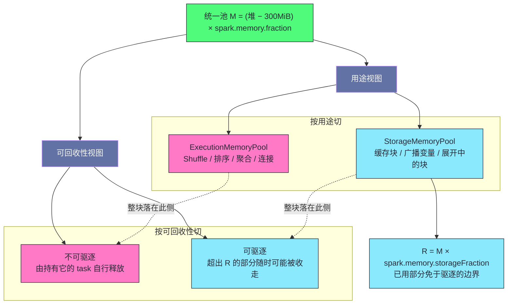
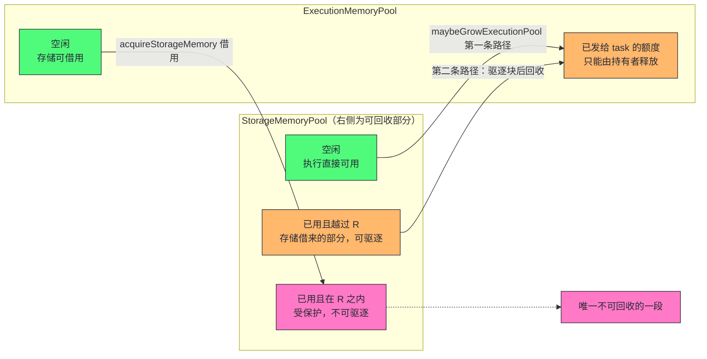
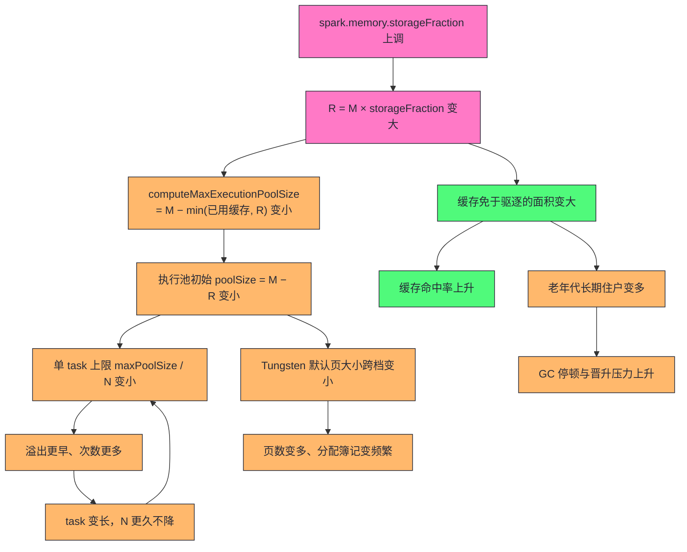
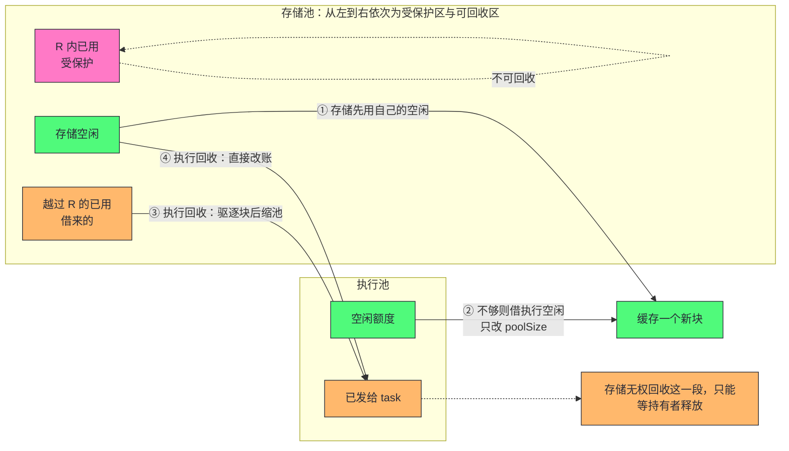
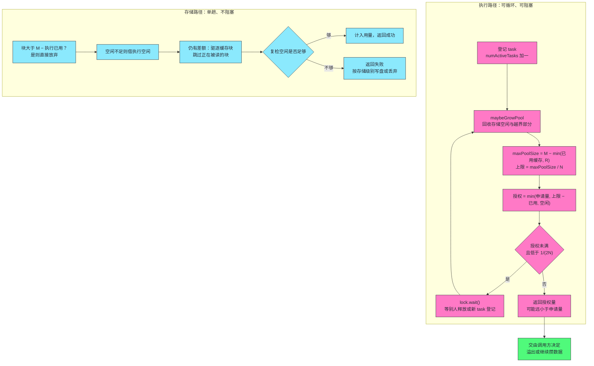
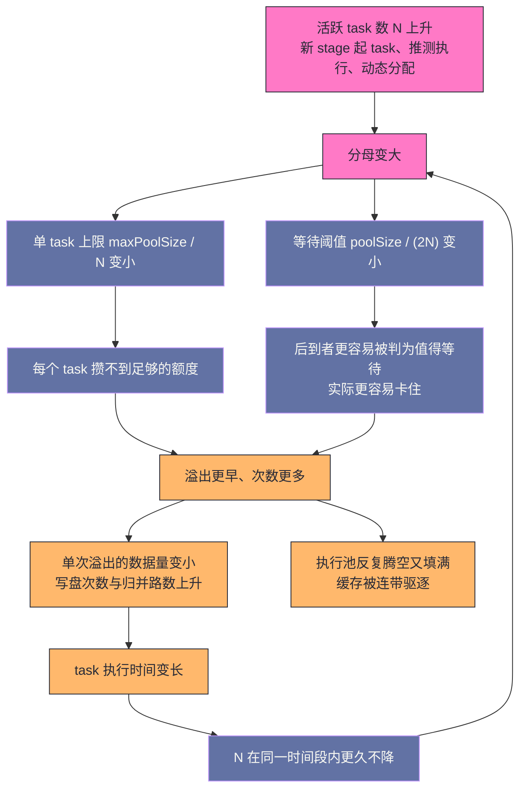

# 2. Spark 统一内存池：两个视图、借用的不对称与 1/N 摊薄

**摘要：**

2016 年 1 月发布的 Spark 1.6 做了一件在当年颇有争议的事：把执行内存与存储内存之间那道按比例砌死的墙拆掉，换成一只共用的池子，谁需要谁去要。这道改动解决了静态划分最常见的两种浪费——缓存区的空闲与 Shuffle 区的饥饿同时发生，但也在池子内部留下了一条极不寻常的规则：执行可以驱逐存储，存储却不能驱逐执行。这条不对称不是实现上的疏漏，而是整套统一内存管理的重力中心，后面所有让人困惑的现象都从它长出来：缓存为什么会在作业最需要它的时候消失，`spark.memory.storageFraction` 为什么调大之后溢出反而更多，同一个 executor 加内存之后为什么每核分到的额度反而变小。

这篇文章不谈 JVM 堆的四层账本，也不谈溢出的判定细节，只把镜头压在池子内部，回答两个问题：一个池子为什么必须被看成两个视图，以及 `storageFraction` 究竟在管什么——它不是"留给缓存的地盘"，而是"缓存默认能占到、且免于被驱逐的上限"。全文沿五问推进：先界定池子的两个视图与三个数字；再拆 `storageFraction` 的两处减法，说明受保护的只是已经用掉的那一部分；接着把两条借用路径的判定顺序逐行走一遍，指出谁能强占、谁只能等；然后把执行内存按活跃 task 数摊薄的除法摊开，看 1/N 与 1/(2N) 如何在并发升高时变成溢出；随后算清缓存被驱逐之后的真实代价，拆掉"驱逐无损"这个流行假设；最后回到 1.5 与 2.0 的版本更替，解释 `StaticMemoryManager` 为什么被删掉、它留下的参数为什么至今还在被人误调。

文章的口径是 Spark 4.3.0（4.x 预编译 Scala 2.13，默认 JDK 17）；凡涉及源码行文与默认值处，以对应版本文档或源码为准。

**关键词（Keywords）**: UnifiedMemoryManager, ExecutionMemoryPool, StorageMemoryPool, storageFraction, maybeGrowExecutionPool, acquireStorageMemory, 1/N 摊薄, 驱逐, 重算, StaticMemoryManager

---

## 第 1 章 一个池子，两个视图

### 1.1 那道被拆掉的墙

2015 年 9 月的 Spark 1.5 里，executor 的内存还是三块互不相通的隔间：缓存一块、Shuffle 一块、剩下的留给用户代码与框架自身。分法是硬的，比例写在配置里，运行期谁也别想越界。这套设计在批处理作业上还能将就，因为一个作业的内存用途大致可以预判；但一旦作业里既有需要反复复用的宽表，又有吃内存的聚合与连接，隔间就变成了麻烦——缓存区空着半壁江山的时候，Shuffle 区正在把数据往磁盘上倒，而用户只能靠调参数去猜一个中间值。

2016 年 1 月发布的 Spark 1.6 把墙拆了，执行与存储改由同一只池子供养，中间只留一条可以移动的软边界。拆墙的动机很朴素：同一台 executor 上的内存需求是分阶段的，前一个 stage 在攒 Shuffle 数据，后一个 stage 在缓存宽表，两者的峰值很少同时到来，把两块地圈死等于两头都留了余量、两头都不够用。

但拆墙必须回答一个新问题：当两边同时要内存时，谁让步。Spark 的答案是单向的：**执行可以向存储要，存储不能向执行要**。这一句话后面会展开成一整套行为，此处只需记住它的形状——一只池子，两个视图，一条只朝一个方向开的门。

### 1.2 M、R 与三个数字

统一池的容量不复杂，一次减法加两次乘法：先从堆里扣掉 300MiB 的系统保留区，再乘 `spark.memory.fraction`（默认 0.6），得到执行与存储共用的那一块，记作 M。M 里再乘一次 `spark.memory.storageFraction`（默认 0.5），得到一个字节数 R，源码里叫 `onHeapStorageRegionSize`。M 与 R 都不是配额，而是两个边界：M 是池子的总容量，R 是缓存免于驱逐的那条线。

池子内部有四组数字，两两对应。执行侧一只 `ExecutionMemoryPool`，存储侧一只 `StorageMemoryPool`，各自记着两个数：池子分到多少（`poolSize`）与用掉多少（`memoryUsed`），前者减后者是 `memoryFree`。启动时存储池的 `poolSize` 就等于 R，执行池的 `poolSize` 等于 M 减 R，两者之和恒等于 M——源码里有一句 `assertInvariants()` 专门盯着这条等式，任何一次借用都必须成对地改两只池子的 `poolSize`，否则断言立刻失败。

| 字段 | 属于谁 | 含义 | 什么时候变 |
|---|---|---|---|
| `maxHeapMemory`（M） | 管理器 | 堆内可共享的总量，(堆 − 300MiB) × `fraction` | 只在启动时算一次 |
| `onHeapStorageRegionSize`（R） | 管理器 | 缓存免于驱逐的边界，M × `storageFraction` | 只在启动时算一次 |
| `poolSize` | 每只池子 | 这只池子当前分到的容量，两只之和恒为 M | 每次借用、回收时成对变动 |
| `memoryUsed` | 每只池子 | 已经发出去的额度 | 申请成功、释放时增减 |
| `memoryFree` | 每只池子 | `poolSize` 减 `memoryUsed` | 随上面两个数联动 |

四个数里最容易被误读的是 `poolSize`。它不是"上限"，只是一次记账的中间结果：执行池的 `poolSize` 会因为驱逐存储而变大，存储池的 `poolSize` 会因为借给执行而变小，但 M 那条总账始终不动。理解这一点，后面那些"借出去的内存还不还"的争论才有落脚点——还的是 `poolSize`，不是内容。

### 1.3 两个视图：按用途看，与按可回收性看

同一只池子，Spark 要求你同时用两种方式看它，而这两种看法给出的切分线并不重合，这是全篇最关键的一处结构。

第一种是用途视图（purpose view）：这块内存是给 Shuffle、排序、聚合用的，那块是给缓存用的。这条线写在 API 上——`acquireExecutionMemory` 与 `acquireStorageMemory` 两个入口泾渭分明，调用方必须自己声明来意。

第二种是可回收性视图（reclaimability view）：这块内存能不能被别人收走。按这条线切，池子只分成两半——可以驱逐的，与不可以驱逐的。缓存属于前者：数据丢了可以重算，或者本来就有磁盘副本；执行属于后者：一张聚合表正被某个 task 的调用栈持着，中途抽走等于让这个 task 白跑，没有任何回滚手段能让它从断点继续。

两个视图叠在一起，才解释了统一池的真实形状：它不是两个相邻的池子，而是一个池子加一条单向阀。用途视图决定了谁有资格进来要内存，可回收性视图决定了要不到时谁能动手。**用途可以互相转换，可回收性却不能——这就是不对称的全部来源。**

下图把两个视图并排放在一只池子上。左半边是用途视图，右半边是可回收性视图，中间那条虚线标出两者错位的地方：用途上的"存储"整块落在"可驱逐"一侧，用途上的"执行"整块落在"不可驱逐"一侧。

图里那个错位是理解后文的钥匙：既然用途与可回收性不是同一条线，那么"某块内存属于谁"这个问题在冲突时就没有意义，有意义的只是"这块内存丢了会不会伤到正在跑的计算"。答案只有两种，规则也就只能有一条单向的。

> [!info] 本文的边界
> 堆、非堆与容器的四层账本，以及三种 OOM 的定位路径，见 [[5. Spark_JVM性能调优]]；溢出判据的形态与 `Spillable` 的申请节奏见 [[7. Spark_Shuffle内存调优]]；四本账的构成见 [[1. Spark内存管理机制]]。本文只谈池子内部的规则：谁向谁借、借的判定顺序、以及这套规则在并发与缓存上留下的现象。

### 1.4 一个贯穿全文的作业

为了让后文的每个机制都有具体的着力点，笔者设想一个用户行为漏斗作业 `session_funnel`：每天凌晨读一天的埋点日志，解析成宽表之后 `persist` 一份，供后续三个分支复用；其中一个分支与一张两千万行的维表做连接，另两个分支各自做 `groupBy` 聚合。它跑在 YARN 上，15 个 executor，每个 8GiB 堆、4 核，`spark.memory.fraction` 与 `spark.memory.storageFraction` 都用默认值。

按 1.2 的算式，单台 executor 上 M 约 4.6GiB，R 约 2.3GiB。也就是说这台 executor 启动时，存储池分到 2.3GiB、执行池分到 2.3GiB，两个数加起来正好是 M。宽表一旦缓存满，存储池用掉 R，此后执行能拿到的上限只剩 M 减 R——同一个数字，换一种读法就从"缓存的地盘"变成了"执行的天花板"。后文每一次讨论都会回到这台 executor，看同一个作业在不同阶段先撞上哪条规则。

### 1.5 一个比喻：书桌与稿纸

把 M 想成一张书桌。存储是摊在桌面上的资料，执行是正在写的那叠稿纸。桌面不够时，唯一能收走的是摊开的资料——它可以合上放回档案柜，需要时再取；正在写的稿纸不能收，收走等于这一笔白写，而且没有哪支笔能从断处接着写下去。

这个比喻还要补一个限定，否则会失真：资料"能取回"是有条件的。如果那份资料只摊在桌上、档案柜里并没有副本，收走就等于销毁，下次要用只能从头推导一遍——这正是缓存被驱逐之后重算的处境。比喻的这处裂缝，第 6 章会认真对待。

---

## 第 2 章 R 是边界，不是预留

### 2.1 文档里的原话值得逐字读

`spark.memory.storageFraction` 的官方描述只有两句，但两句都容易读反。第一句说它是"免于驱逐的存储内存量，表示为 `spark.memory.fraction` 所划区域的分数"；第二句说"这个值越高，可用的工作内存越少，task 溢出磁盘越频繁"。请注意措辞是 immune to eviction（免于驱逐），不是 reserved for storage（为存储预留）。配置项的校验条件也透露了同一件事：取值必须在 `[0, 1)` 之间，上界取不到 1。

这两个字的差别，落到实现上是两处减法。

### 2.2 源码里的两处减法

第一处在算执行池的上限，源码里叫 `computeMaxExecutionPoolSize`：从 M 里减掉 `min(storagePool.memoryUsed, storageRegionSize)`。注意减的是 `memoryUsed` 与 R 的较小者，不是 R 本身。如果缓存的用量还没到 R，执行的上限就是 M 减去实际缓存用量，缓存没用掉的那部分 R 依然算在执行头上；只有缓存真的用满了 R，减法才退化成 M − R。

第二处在算能从存储那里收回多少，`maybeGrowExecutionPool` 里写的是 `max(storagePool.memoryFree, storagePool.poolSize - storageRegionSize)`。这个式子把可回收的部分拆成两截：一截是存储池当前的空闲（`memoryFree`），另一截是存储池的 `poolSize` 超出 R 的那部分（也就是存储从执行那里借来、又已经用来缓存块的那部分），后者要收回就必须真的驱逐块。

两处减法合起来，R 的语义就清楚了：**R 保护的是"已经用掉的那一部分"，不是"整块空地"**。存储没用的内存，执行随时可以拿来用；存储自己借过头、越过 R 的那一截，执行也随时可以连块带内存一起收回去。全篇只有一件事受保护——已经缓存进 R 之内的那些块。

下图是这两处减法在池子里的位置。上半部分是存储池，浅色的已用区在 R 之内，深色的已用区在 R 之外；下半部分是执行池，箭头标出两条回收路径能碰到哪一段。

### 2.3 改 `storageFraction` 到底改了什么

既然 R 只保护已用部分，那么把它调大调小，改的其实是三件事，而不是一件事。

第一件是**执行的上限**。R 越大，`computeMaxExecutionPoolSize` 在缓存用满之后返回的值越小，单台 executor 能给执行的内存越少，溢出越早。这一点文档已经写明，多数人也知道。

第二件是**缓存存活多久**。R 越大，缓存免于驱逐的面积越大，同一份宽表更可能活到下一次被读。这一件是 R 调大的直接收益，也是调大它的动机。

第三件最容易被忽略：**Tungsten 的页大小跟着执行池的初始容量走**。`MemoryManager` 在启动时用执行池的初始 `poolSize` 算默认页大小，算法是取"执行池容量 ÷ executor 核数 ÷ 16"向上取到 2 的幂，再夹在 1MiB 与 64MiB 之间。执行池的初始容量正是 M 减 R，所以 R 一变，页大小可能跟着跨档。页大小的连锁有两层：页越大，一次分配拿到的连续空间越多、页表项越少，但单页浪费也越大；页越小，页数越多，每次申请与释放的簿记越频繁。堆内且收集器是 G1、ZGC 或 Shenandoah 时，源码还会把页大小再减掉一个数组头偏移，让请求的字节数不落在巨块区（Humongous）的边界上。

三件事的连锁可以顺着一条线读下来。图中第二行与第三行是两个不同方向的后果，箭头边上写着触发条件。

这条链上最反直觉的是最后那个回环：溢出变多会让 task 跑得更久，跑得更久意味着活跃 task 数 N 在同一时间段里更大，而 N 更大又让每 task 的额度更小，于是溢出更多。这是一个自我强化的环，第 5 章会把它拆开。

### 2.4 三个取值放在一起算一遍

还是 `session_funnel` 那台 8GiB 堆、4 核的 executor。M 约 4.6GiB，把 `storageFraction` 取三个值，各条链路的结果如下表。表中"缓存用满后执行上限"按 M 减 R 算，"单 task 上限"按 N=4 且缓存已用满 R 算，页大小按 1MB 到 64MB 的夹取规则与向上取 2 的幂推算。

| `storageFraction` | R | 执行池初始容量 | 缓存用满后执行上限 | 单 task 上限（N=4） | 默认页大小 | 主要代价 |
|---|---|---|---|---|---|---|
| 0.2 | 约 0.92GiB | 约 3.7GiB | 约 3.7GiB | 约 950MiB | 64MiB | 缓存几乎活不过一个 stage，宽表频繁重算 |
| 0.5（默认） | 约 2.3GiB | 约 2.3GiB | 约 2.3GiB | 约 590MiB | 64MiB | 折中，两类负载各让一步 |
| 0.8 | 约 3.7GiB | 约 0.92GiB | 约 0.92GiB | 约 235MiB | 16MiB | 聚合与连接大面积溢出，页变小、GC 压力上升 |

表里最值得看的一列是"缓存用满后执行上限"：它在 0.2 与 0.8 两档之间差了四倍。换言之，`storageFraction` 并不是在两类负载之间调一个比例，而是在决定"当缓存真的把 R 用满时，执行还剩多少气力"。如果作业实际上并不需要那么多缓存，调大这个值只是提前把执行饿死。

### 2.5 两个极端取值会怎样

`storageFraction` 取 0 是合法的，含义是缓存完全不免于驱逐：任何时刻执行都能把缓存全部收走。它换来的不是"全给执行"，因为缓存在被驱逐之前依然会占用内存，只是占得不稳——一个 stage 里缓存刚建立起来，下一个 stage 一开始要执行内存就被清空，于是缓存的收益接近于零，只剩下反复读盘与重算的成本。

取到接近 1 则更微妙。校验条件不允许等于 1，源码在 `MemoryManager` 的构造函数上还有一条 `require(onHeapExecutionMemory > 0)`。执行池的初始容量是 M 减 R，当 R 逼近 M 时这个差值可能被取整成 0，构造函数会直接抛出异常，executor 起不来。这是一处硬边界，不是"设了没用"——参数合法但组合不合法，失败发生在启动阶段，而且报错信息里不会提 `storageFraction`。

> [!warning] 一个常见的调参动作
> "缓存命中率低，把 `storageFraction` 调大"这个动作只在一种情况下成立：缓存的收益确实高过执行内存不足带来的溢出成本，且当前 R 之内还有装不满的空间。如果作业的瓶颈是溢出，调大这个值会让单 task 额度更小、页更碎，代价比收益大。判断依据不是命中率，而是溢出字节数与重算耗时两项的相对大小。

### 2.6 M 与 R 的两个旋转方向

`spark.memory.fraction` 与 `spark.memory.storageFraction` 经常被放在一起讨论，但两者转的不是同一个旋钮。前者决定 M 的大小，也就是"堆里有多少内存交给 Spark 自己管"，剩下的那部分不是一只池子，而是根本不归池子管：用户代码的中间对象、闭包、反序列化临时结构都在里面。后者只在 M 内部挪动那条边界，M 本身不变。

这个区别在调参时有实际后果。把 `fraction` 从 0.6 提到 0.8，M 变大，执行与存储同时按比例变大，看起来是纯收益；但被挤掉的那 20% 是"没有任何簿记的自留地"，用户代码里那些无法估算的分配一旦越界，报错的表现是堆 OOM，而不是溢出增多。**`fraction` 的上调是把风险从"溢出"换成"OOM"，不是一次免费的扩容。** 文档里对这个参数的解释也正是这个意思：它是留给内部元数据、用户数据结构与不精确估算的余量。

相对地，`storageFraction` 只在 M 内部重新分配，调错了最坏的结果是多溢出、多驱逐、多停顿，不会直接让 executor 崩掉。两个参数的风险等级不同，这也是为什么文档对前者建议"保持默认"，对后者只留下一句"建议保持默认值"却没有硬约束。

---

## 第 3 章 两条借用路径

### 3.1 存储向执行借：只借空闲，从不驱赶

缓存一个分区时，路径短得出奇。`acquireStorageMemory` 先看需要多少字节，如果存储池的空闲够，直接记账；不够的部分去向执行池借，借法只有一句：取执行池空闲量与差额的较小值，把执行池的 `poolSize` 减掉这么多，再加到存储池的 `poolSize` 上。

这里的"空闲"是字面意义的空闲——执行池里还没有发出去的额度。已经发给某个 task 的那部分，一个字节都动不了。原因在 1.3 说过：持有者是一段正在执行的调用栈，没有回滚点。于是存储向执行借这件事，实际能借到的量取决于"执行当前有多闲"，而不是"存储有多缺"。一个把执行池吃满的 executor 上，缓存请求能借到的是零，接下来只能在自己的池子里驱逐别的块，譬如把一个刚用过的大分区挤出去。

存储侧还有一处更硬的墙：如果一个块本身就大于"M 减执行已用"，`acquireStorageMemory` 会立刻放弃，日志里留下 `Will not store ... as the required space ... exceeds our memory limit`，连驱逐都不尝试。这条判据用的是 `maxOnHeapStorageMemory`，它是动态的——执行用得越多，单个块能被接受的上限越小。**一个在作业开始时缓存得好好的分区，在同一个作业的后期可能因为执行已经占了内存而根本存不进去。** 这种失败不会报错，只会让下游多算一遍。

### 3.2 执行向存储借：先空闲，后越界，再驱逐

反方向的路径分三级，每一级的代价都比上一级重。

第一级拿存储池的空闲，不碰任何已缓存的块；第二级回收存储池 `poolSize` 超出 R 的那一截，这一截本来就是存储从执行手里借走的，收回来只需要把块驱逐掉；第三级才动 R 之内的部分——而在 `maybeGrowExecutionPool` 的实现里，第三级根本不存在，可回收量被写死为 `max(memoryFree, poolSize - R)`，R 之内已用的块不在可回收范围内。

三级里只有第二、三级需要真的驱逐块，驱逐的动作走 `freeSpaceToShrinkPool`：先尽量用空闲顶掉要回收的账面数字，剩下的部分交给 `MemoryStore.evictBlocksToFreeSpace` 去挑块、逐个丢掉，然后池子容量才真正缩下来。这里有一个顺序上的讲究：**先算账、再驱逐、最后缩池**。如果反过来先缩池再驱逐，中间会有一小段时间账面说内存已经归了执行、但块还在存储里挂着，`assertInvariants` 那条总量等式就会失败。

下图把两条路径画在同一张图上。上半是存储向执行的借，只碰右侧的空闲格；下半是执行向存储的取，可以一路推到左侧受保护区之外。

两条路径的箭头数目不对等，这不是画图时的省略：存储那条路只有一步，执行那条路有三步，而且其中两步要落下真实的副作用。

### 3.3 驱逐为什么只能是单向的

单向性最容易被人当成"设计者偷懒"，其实它是三个约束叠出来的结果。

第一个约束是**驱逐需要落点**。执行内存被驱逐时，数据必须有地方去：Shuffle 数据可以溢出到本地磁盘，聚合表可以整张落盘再归并，这些都是写好的路径。缓存被驱逐时，落点由存储级别决定——`MEMORY_AND_DISK` 系列会写到本地磁盘，`MEMORY_ONLY` 系列直接丢弃、下次重算。两条路都通，所以缓存可驱逐。反过来，执行内存没有落点：一张正在被排序的数组、一页正在被写入的 Tungsten 内存，没有"溢出到一半再回来接着排"的能力。

第二个约束是**驱逐需要检查点**。要安全地把内存从持有者手里拿走，持有者必须在一个可以暂停、可以恢复的位置上。缓存块的持有者是 `MemoryStore` 里的一个条目，拿走就是删掉一个映射，没有中间状态；执行内存的持有者是一串嵌套结构——`TaskMemoryManager` 管着若干 `MemoryConsumer`，消费者可能正处在申请、扩容、排序、合并中的任意一步，任何一步被打断都没有恢复语义。

第三个约束是**驱逐需要仲裁者**。存储侧只有一个 `MemoryStore`，谁该被丢、丢多少，一个类就能决定；执行侧有 N 个 task 并发持有，要让其中一个让出内存，必须有一套跨线程的协议来保证不让出的那个不会死锁，而 Spark 选择用最便宜的那套——`lock.wait()` 加 `notifyAll()`，只做等待，不做抢占。

三个约束都指向同一个结论：**可驱逐性的边界不在"用途"上，而在"有没有落点与检查点"上。** 缓存两样都有，执行两样都没有，于是单向。

### 3.4 单向性带来的四个现象

单向规则本身只有一句话，但它在运行期会长出四种不同的表现，这四种表现经常被分别归因成四个 bug。

第一种是缓存瞬时失效。执行阶段一到，缓存被清空，下一个 stage 再读发现全部 miss。它看起来像"缓存没生效"，实际是缓存生效过、又被合法地收走了。

第二种是缓存写入被静默降级。存储级别是 `MEMORY_AND_DISK` 时，缓存不进去就写磁盘，作业不会失败，只是慢；`MEMORY_ONLY` 时块被直接丢弃，Storage 页上连痕迹都不留。两种降级都不会在日志里大喊，只是任务时长悄悄变化。

第三种是新块立刻被驱逐。当执行已经把池子吃到接近 M，`acquireStorageMemory` 会先借执行池的空闲、再驱逐别的块，而新块自己也可能在下一轮驱逐里被选中。源码注释把这句写得很直白：如果执行已经吃掉了大部分存储空间，新块会被立刻驱逐，行为取决于它自己的存储级别。

第四种是"加了缓存反而更慢"。缓存的收益是省掉重算，代价是占住内存、抬高 GC 的存活对象数、并在被收走时把成本一次性还回来。当执行侧本来就紧张时，缓存挤占的每一字节都会以溢出次数的形式还账，而缓存本身未必活到下一次被读。

### 3.5 借出去的是字节，回不来的是内容

"执行借走的内存不会还"这句话流传很广，但它只说对了一半，而且说错的那一半更要紧。

字节是会回来的。一个 task 结束或主动释放时，`ExecutionMemoryPool.releaseMemory` 只把 `memoryForTask` 里的数字减掉，并不改池子容量；于是执行池的 `memoryUsed` 下降、`memoryFree` 上升。下一次存储侧申请时，那句"不够就借执行空闲"会把这块空闲重新划到存储池名下，`poolSize` 也随之换回来。整个归还过程没有专门的"归还"动作，它发生在下一次借用的瞬间。

内容回不来。为腾出这块字节而被驱逐的缓存块，不会因为字节回来了就重新出现在内存里。`MEMORY_ONLY` 的块已经不存在，下次访问要重算；`MEMORY_AND_DISK` 的块在本地磁盘上有一份，下次访问要读盘并重新反序列化。**池子归还的是额度，驱逐带走的是数据，这两件事从来不是对称的。** 认清这一点，很多"内存明明回来了，作业还是慢"的困惑就不再是困惑。

### 3.6 为什么不做反向驱逐：一段被记下来的取舍

`UnifiedMemoryManager` 的类注释里有一句近乎坦白的说明：执行内存从不被存储驱逐，原因是实现这件事所涉及的复杂度。这句话后面还跟着一个推论：如果执行已经吃掉了大部分存储空间，尝试缓存块可能会失败，而失败的新块会被立刻驱逐。

把这段取舍拆开，可以列出至少四条实现障碍。其一，驱逐必须能找到持有者，执行内存散落在 N 个 task 各自的消费者链上，没有统一的注册表；其二，驱逐必须能回滚，执行侧的每个消费者都要实现"被拿走一块内存之后如何续跑"，而现有的溢出路径是"整张表落盘再重来"，粒度太粗；其三，驱逐会破坏正在进行的排序与归并的正确性，这类算法对缓冲区连续可用的假设很硬，譬如一个已经排好前半段的外部归并，中途拿掉一块缓冲就只能整趟重来；其四，反方向的驱逐会引入新的死锁面——存储侧可能在持有锁的情况下等执行让出内存，而执行侧又在等存储侧的锁。

| 维度 | 执行 → 存储（已实现） | 存储 → 执行（未实现） |
|---|---|---|
| 回收手段 | 先拿空闲，再驱逐缓存块 | 需要中断持有者的调用栈 |
| 数据落点 | 存储级别决定写盘或丢弃 | 无通用落点，只能溢出但粒度太粗 |
| 检查点 | 删一个映射即可 | 消费者无统一的中断与恢复协议 |
| 侧效应 | 缓存 miss 与重算 | 排序、归并、聚合的半成品无法继续 |
| 结论 | 允许 | 明确放弃，代价转嫁给缓存成功率 |

---

## 第 4 章 判定顺序：谁强占，谁只能等

### 4.1 取执行内存的五步

`acquireExecutionMemory` 是一个同步方法，整段逻辑在一把锁里，注册 task、循环申请、必要时等待。把一个 task 的一次申请拆开，是下面五步。

第一步，把 task 登记进 `memoryForTask`，初值 0。这一步的意义不在记账，而在让其他等待中的 task 醒来看一眼新的活跃数——它会让 `numActiveTasks` 变大，从而把所有人的上限压小。

第二步，先尝试回收存储。源码在循环体里第一句就调 `maybeGrowPool(numBytes - memoryFree)`，注意参数是"还差多少"，不是"总共要多少"；回收额度也只在有差额时才动手。之所以每一轮循环都再试一次，是因为两轮之间可能有别的 task 抢先把空闲缓成块，前一轮算出的可回收量已经过时。

第三步，算两个数：`maxPoolSize` 是回收后执行池可能达到的上限，也就是 M 减去受保护的缓存用量；`minMemoryPerTask` 是当前池子容量的 2N 分之一。前者决定"最多能给你多少"，后者决定"少到多少就宁可让你等"。

第四步，算这次能给多少：单 task 上限是 `maxPoolSize / N`，本次授权不超过上限与已用之差，也不超过当前空闲。于是拿到手的可能远小于申请量，甚至为零——这个"部分授权"是设计的一部分，`Spillable` 那边正是靠它来决定是否溢出。

第五步，判断要不要等。只有当"授权没给满"且"已有量加授权仍低于 2N 分之一"时才 `lock.wait()`；否则带着部分授权返回。等待中的 task 会在有人新登记、有人释放内存时被唤醒，重新进入循环，因为这几项都可能在它睡着的时候变了。

这五步里藏着两条容易被忽略的性质。其一，执行侧的申请会主动驱逐缓存，所以它是"能强占"的一方；其二，执行侧内部没有抢占，一个已经拿到额度的 task 不会被后来者挤掉，后来者只有两条路——等到它释放，或者拿到低于下限的量直接溢出。

### 4.2 取存储内存的四步

`acquireStorageMemory` 更短，但每一步的失败都是有后果的。

第一步是快失败：请求量超过"执行已用之外的全部容量"就直接返回失败，日志里那条 `Will not store` 就是这里打的。第二步是借：自己的空闲不够，就从执行池的空闲里借差额。第三步是驱逐：把还差的量交给 `MemoryStore`，由它挑块丢弃，驱逐用的是非阻塞加锁——正在被读的块会被跳过。第四步是复检：驱逐完再看空闲是否真的够了，够了才把用量加上去，否则返回失败。

失败之后的事情在 `BlockManager` 里：存储级别允许磁盘就写磁盘，不允许就丢弃并标记这一块没有缓存。这一路没有任何重试与等待，**存储侧从头到尾不会阻塞**。它只有三种结局——成功、降级写盘、放弃，没有第四种叫"等一等"的选项。

下图把两条路径并排画出来，图中左侧是执行的循环，右侧是存储的直筒，两者形状的差别就是"能不能等"的图解。

### 4.3 驱逐顺序不是 LRU

缓存被驱逐时，挑哪些块来丢，这件事的实现比多数人想的要粗。

`MemoryStore.evictBlocksToFreeSpace` 的做法是遍历内部的 `entries` 映射，从迭代器第一个开始挑，直到攒够要释放的字节数。`entries` 是一个并发哈希表，迭代顺序由哈希决定，与写入时间无关，**所以驱逐顺序不是 LRU，甚至不是任何可按时间预测的顺序。** 一段刚被读过的热数据，只要它的哈希位置靠前，就可能比一段冷数据先被丢掉。

遍历里有两道过滤，都值得单独说明。第一道跳过与"正在添加的块属于同一个 RDD"的所有块：如果允许驱逐同一 RDD 的块，缓存一个大分区时就会不停地把自己的兄弟分区挤出去，形成自我驱逐的抖动。第二道对每个候选块做一次非阻塞加写锁，拿不到就跳过——拿不到说明这个块正在被读，驱逐它会让正在进行的读操作失败。两道过滤都是"宁可不驱逐，也不要制造错误"，代价是实际释放量可能达不到请求量，于是第 4.2 节第四步的复检会失败。

这个实现选择解释了三个现象。为什么同一个作业两次运行的缓存命中率差别很大：驱逐顺序与哈希布局有关，而布局与块 ID、分区顺序相关，稍微改一下上游的并行度就会变。为什么"最近用过的数据"不一定留下：它只保证不被"同一 RDD 的新块"驱逐，不保证不被其他 RDD 的块驱逐。为什么驱逐之后有时仍然申请失败：过滤条件把可驱逐的量压到了请求量之下。

### 4.4 两条路径的判定顺序对照

把两条路径放在一张表里对照，不对称的完整形状就出来了。左边一列问的是问题，右边两列是两条路径的答案，最后一行是两者的根本差别。

| 判定环节 | 取执行内存 | 取存储内存 |
|---|---|---|
| 入口 | `acquireExecutionMemory`，同步、带循环 | `acquireStorageMemory`，同步、单趟 |
| 能否强占对方 | 能，驱逐超出 R 的缓存块 | 不能，只能借执行池的空闲 |
| 能否阻塞等待 | 能，低于 1/(2N) 时 `lock.wait()` | 不能，只有成功、降级、放弃三种结局 |
| 单次授权是否可能不足 | 是，部分授权是常态 | 否，要么全给要么不给 |
| 失败后的动作 | 由调用方溢出或释放后重试 | 由存储级别决定写盘或丢弃 |
| 记账方式 | 改本池 `memoryUsed`，必要时改两只池子的 `poolSize` | 借用时改两只池子的 `poolSize`，成功后改 `memoryUsed` |
| 触发上游连锁 | 溢出、归并、临时文件 | 缓存 miss、重算、读磁盘 |

一句话概括这张表：**执行内存是"可以挤、可以等"，存储内存是"不能挤、不能等"。** 挤与等这两种能力的分配，决定了后面所有现象的形状。

---

## 第 5 章 1/N：执行内存怎么被并发摊薄

### 5.1 三道除法

执行池不是"先来先得"，而是按活跃 task 数均分，每一次申请都要过三道除法。

第一道是单 task 的上限：`maxPoolSize / numActiveTasks`。这里的 `maxPoolSize` 是 4.1 节第三步算出的那个值，即 M 减去受保护的缓存用量，而不是执行池当前实际分到的容量。用前者是为了不低估——执行随时可以驱逐超出 R 的缓存，把上限撑到 M 减 R，如果按当前容量算，一个 task 会在明明还能回收的情况下被判定为到顶。

第二道是单 task 的下限：`poolSize / (2 * numActiveTasks)`。分子是执行池当前的容量，与第一道用的分子不是一个数，这一点经常被忽略。下限管的是"值不值得让你继续等"：如果这次能给的加上已有的仍低于下限，等下去才有意义。

第三道是本次实际授权：申请量、上限余额、当前空闲三者的最小值。三道除法里第一道决定天花板，第二道决定等待阈值，第三道决定这一次真正到手多少。三者用的分子各不相同，混为一谈就会算出错误的"每 task 能有多少内存"。

### 5.2 上限与下限之间的距离

上限 1/N 与下限 1/(2N) 之间隔着一倍，这一段就是"允许超额与允许不足"的缓冲区。

一个 task 在启动时申请一块内存，如果池子几乎空着，它能一路涨到 1/N；涨到之后再有申请，就会被上限挡住，只拿到零头或者干脆拿不到。此时它距离下限还很远，所以不会被阻塞，只是"申请不到更多"，调用方的反应是溢出。这就是溢出最标准的形态——不是内存不够，而是这个 task 已经用满了它那一份。

反过来，一个后加入的 task 面对一个已经被前人吃满的池子，能拿到的几乎为零，此时它有两条路：如果已有量加授权仍低于 1/(2N)，就 `lock.wait()` 等别人释放；如果已经高于下限，就带着现有的量继续干，缺的部分自己去溢出。**下限存在的意义，是保证每个 task 在被强制溢出之前至少能拿到一小块，避免"一个 task 把池子吃光、其他 task 连一滴都拿不到"的饥饿。**

### 5.3 等待与唤醒，以及"已持有的不会被收回"

等待用的是 JVM 的监视器：`lock.wait()` 会释放 `MemoryManager` 这把锁，让其他 task 继续申请，`notifyAll()` 在两个地方被调用——一个新的 task 第一次登记时，以及任何一次释放之后。被唤醒的 task 不会直接拿到内存，它回到循环顶部，重新计算活跃数与可回收量，再判断一次。

这套机制有两个不太直观的后果。

第一个后果是**等待者本身也算进分母**。`numActiveTasks` 取的是 `memoryForTask` 的键数，而一个 task 在第一次申请时就已经登记，即使它一分钱都没拿到、正在 `wait()` 里睡着，也仍然被计入。于是一波 task 同时涌入时，分母瞬间变大，所有人的上限一起下降，包括那些还没开始干活的。这个设计是有意的：如果只统计"拿到内存的 task"，那么新来的 task 会高估自己应得的份额，从而过度申请。

第二个后果是**已经拿到的额度不会被收回**。上限只在申请时生效，一个 task 在 N 小的时候涨到了 1/N，等 N 变大之后它依然持有那么多，没有任何机制要求它退回。源码里的处理方式是"让后来者等"——后来者若低于下限就睡，直到前人释放。这也是为什么一个 executor 上突然涌入大量 task 时，先到的那些会显得格外"占地方"。

### 5.4 N 变大时的连锁

到这里可以把摊薄的连锁完整画出来。起点是活跃 task 数上升，终点是溢出与文件数量的变化，中间经过四道手续。

图里那个回环是这套机制最不友好的地方：溢出让 task 变慢，变慢让 N 迟迟不降，N 不降让额度继续变小。它不会无限恶化下去，因为溢出的总量是有上限的——一个 task 的数据写完就结束了；但它足以让一次本该十几分钟的 stage 拖成一个小时。

顺着这条链，"溢出多导致小文件多"这句流传很广的话需要拆开看。写端的溢出产生的是 executor 本地的临时文件，每个 task 最终仍然只交出一对 data 与 index 文件，HDFS 上的文件数由输出分区数与写入 task 数决定，与溢出次数无关。真正被溢出放大的是本地临时文件的数量、归并时要同时打开的路数、以及这些文件写与读的 I/O 量。文件数在 HDFS 上增加另有路径：缓存被驱逐之后重算，整条上游血缘连同它的 Shuffle 输出被重新产出，这才是会带来额外文件的那一环。

### 5.5 同一台 executor 上的四组数字

还是 `session_funnel` 那台 8GiB、4 核的 executor，且缓存已经用满 R。此时 M 约 4735MiB，受保护缓存约 2368MiB，于是 `maxPoolSize` 与执行池的初始容量都约 2368MiB。把 N 取四个值，两个阈值如下表（单位 MiB，按整除粗算）。

| 活跃 task 数 N | 单 task 上限（`maxPoolSize/N`） | 单 task 下限（`poolSize/(2N)`） | 溢出触发时的常见形态 |
|---|---|---|---|
| 2 | 1184 | 592 | 一个 task 能吃下近半个池子，溢出少但不均衡 |
| 4 | 592 | 296 | 与核数匹配的常态，额度尚可 |
| 8 | 296 | 148 | 每个 task 的额度已接近一次排序缓冲的需求 |
| 16 | 148 | 74 | 几乎必然溢出，且每次溢出量很小 |

四行数字的差别不在"谁不公平"，而在"额度碎到什么程度"。一次排序或聚合对内存的需求大致由数据结构决定，并不随 N 缩小；当单 task 额度跌到那个需求之下，溢出就从"极端情况的兜底"变成了"每个 task 的常规路径"。表中最后一行那种情形，实际观察到的现象是溢出次数暴涨而单次溢出字节数很小——这并不说明数据倾斜，只说明额度被摊薄到了不该有的尺寸。

### 5.6 为什么"加内存"有时会加重溢出

把第 5.4 节的链与 `spark.memory.fraction` 放在一起，就能解释一个反复出现的困惑：给 executor 加内存，溢出反而更多。

加内存本身当然不会让溢出变多，但它往往伴随两件事同时发生。一件是核数跟着涨——同一个 executor 从 4 核加到 8 核，N 翻倍，额度先被摊薄一半，M 变大带来的那一份被除法吃掉了。另一件是内存变大之后，缓存更容易被填满到 R，于是 `computeMaxExecutionPoolSize` 从 M 掉到 M 减 R，执行的可用上限反而更低。两件事叠加，加内存的净效果可能是每 task 额度变小。

Tungsten 的页大小也在这条线上。页大小按执行池容量除以核数再除以 16 推算，核数翻倍会让页大小跨档变小，一次分配能拿到的连续空间随之变小，页数与簿记次数上升。这些变化单个看都很小，放在每个 task 要申请成百上千次的排序与聚合里就会积累出来。

所以"加内存"这件事的正确问法是：加的是哪一本账。加到堆上、同时不增加核数，M 变大而 N 不变，额度才会真的变宽；加到核数上，等于同时加大了分母，净效果要用两个除法算一遍才知道。

---

## 第 6 章 驱逐的代价

### 6.1 被驱逐的块有几种命运

同样一句"缓存被驱逐了"，落在不同的存储级别上，后果可以相差一整个 stage 的计算量。区别只在一件事：这块数据在内存之外还有没有落脚点。

| 存储级别 | 驱逐时发生什么 | 下次访问的代价 |
|---|---|---|
| `MEMORY_ONLY` | 块从 `MemoryStore` 删除，不落盘 | 沿血缘重算整个分区 |
| `MEMORY_ONLY_SER` | 同上，被删的是一段序列化字节 | 重算整个分区，额外付一次反序列化 |
| `MEMORY_AND_DISK` | 先把块写进本地磁盘，再删除内存条目 | 读本地磁盘并反序列化 |
| `MEMORY_AND_DISK_SER` | 字节直接落盘，省略一次序列化 | 读盘，反序列化 |
| `OFF_HEAP` | 从堆外池释放，字节丢弃 | 重算整个分区 |
| `DISK_ONLY` | 不使用存储池，不在驱逐范围内 | 与驱逐无关 |

写盘的判据在 `BlockManager.dropFromMemory` 里：存储级别带磁盘且磁盘上还没有这一块，才写下去。这意味着 `MEMORY_AND_DISK` 的"无损"是有条件的——它把一次内存丢失换成了一次磁盘写加一次磁盘读，而在写盘完成之前，这块数据依然处在"只有内存一份"的状态。

### 6.2 重算的账

`MEMORY_ONLY` 的块被驱逐之后，下次访问要靠 `RDD.iterator` 沿血缘逐级向上算回来。这条路径在短血缘上很便宜，一条 `map` 加一条 `filter`，重算几乎看不出来；但在长血缘上它是指数级放大的另一种形式——丢掉最后一环，等于前面每一环都要重跑，其中任何一环若是 Shuffle 依赖，还要看它的 map 端输出是否还在。

这里有三笔叠加的代价。第一笔是纯计算：重跑的那些转换本身要花时间，且与原任务的 CPU 需求叠加在同一个 executor 上。第二笔是内存：重算过程中的反序列化对象、聚合缓冲、排序数组都要向执行池申请额度，而这恰好发生在执行池正被当前 stage 占满的时刻。第三笔是连锁：重算把执行池逼得更紧，执行池越紧，`maybeGrowExecutionPool` 越频繁地回收存储，缓存越容易被再次驱逐，于是下一次访问又要重算。

这三笔合起来，否定了"缓存丢了再算一遍就是了"这种直觉。**在长血缘上，缓存的真正价值不是省时间，而是省掉一整套会把内存秩序打乱的重算过程。** 反过来说，在一两条窄依赖的短血缘上缓存一份大表，收益本来就有限，被驱逐了也不心疼——判断该不该缓存，先看血缘深度，再看复用次数。

### 6.3 "驱逐无损"错在三个假设

"反正能重算，所以驱逐是无损的"这句话，背后压着三个默认成立的假设，而它们在真实集群里一个都不稳。

第一个假设是数据有副本。只有带磁盘的存储级别才有，而带磁盘的级别在写入磁盘之前与 `MEMORY_ONLY` 没有区别。

第二个假设是副本可靠。本地磁盘的生命周期等于 executor 的生命周期，节点一退，磁盘上的那份随之消失；这与 HDFS 的三副本不是一回事。`MEMORY_AND_DISK` 提供的是"进程内不丢"，不是"集群内不丢"。

第三个假设是重算的代价与当下无关。重算要用 CPU、要用执行内存、要读上游文件，这三样都是当前最紧的资源。把一个"可以以后再付"的账写进"现在就要付"的时点，本身就是一次利率极高的借贷。

### 6.4 观测：锯齿与错位

缓存的驱逐在 Spark UI 上几乎不留痕迹。Storage 页列出的是当前还活着的块，被驱逐的块直接消失，页面不会告诉你"这里曾经有过一批数据"。要看出驱逐在发生，得看两组数字的错位关系。

一组是存储内存的用量曲线。正常缓存满之后应该是一条平稳的高位线；如果它反复爬升又跌落、呈锯齿状，说明有外力在周期性回收——在池内，这个外力只可能是 `maybeGrowExecutionPool`。

另一组是 Shuffle 溢出的字节数。锯齿出现的同时溢出字节数同步上升，两者几乎可以确认是同一件事：执行在扩张，缓存在让位，让位之后的重算又推高了执行需求。这组错位比单看任何一项指标都可靠。

---

## 第 7 章 从静态分区到统一池

### 7.1 静态时代的三块地

要理解统一池为什么长成这样，得先看它取代的东西。Spark 1.5 及以前只有一套实现，`StaticMemoryManager` 把堆切成互不相通的两块，另外留一大块根本不管。

| 参数（1.6.2 源码中的默认值） | 默认 | 作用 |
|---|---|---|
| `spark.storage.memoryFraction` | 0.6 | 堆中划给缓存的比例 |
| `spark.storage.safetyFraction` | 0.9 | 缓存区里实际可用的比例，留一成防估算误差 |
| `spark.shuffle.memoryFraction` | 0.2 | 堆中划给 Shuffle 的比例 |
| `spark.shuffle.safetyFraction` | 0.8 | Shuffle 区里实际可用的比例 |
| `spark.storage.unrollFraction` | 0.2 | 展开内存的上限，取缓存区的比例 |

按默认值算，缓存拿到堆的 0.54，Shuffle 拿到 0.16，剩下的 0.30 不属于任何一只池子，留给用户代码、框架对象与估算误差。类的注释写得很清楚：两块区域干净地隔开，任何一方的用量都不能向另一方借。

### 7.2 为什么这套划法难以为继

静态划法的失败不在算术，而在它要求用户在提交作业之前预判未来几十分钟的内存形态。

一个典型的迭代作业在时间轴上是这样的：前几个 stage 读数据、做解析，几乎没有 Shuffle，缓存区闲置；中间几个 stage 做聚合与连接，Shuffle 区被打满，缓存区还是闲置；最后几个 stage 反复复用中间结果，缓存区满了，Shuffle 区空了。三段需求彼此错开，静态划分却要求一条直线把它们全盖住。

两种错法都有代价。缓存给多了，Shuffle 区溢出，任务变慢，用户看到的是"内存明明够用却在写盘"；Shuffle 给多了，缓存放不下，`MEMORY_ONLY` 的块一进去就被丢弃，用户看到的是"缓存没生效"。两种现象说的是同一件事：预判错了。

### 7.3 统一换到了什么

1.6 引入的统一管理换了三样东西，而且是一起换的。

第一样是把两块地并成一块，边界从硬变软：R 不再是"缓存的地盘"，而是"缓存免于被驱逐的上限"，用完 R 之后缓存还能继续借，只是借来的部分随时可能被收走。

第二样是允许双向借用，但只给单向驱逐权：缓存可以借执行的空闲，执行可以借缓存的空闲、也可以驱逐缓存越界的那部分，反过来不行。

第三样是承认缓存是意向而非承诺。这一点最不容易被接受：在静态时代，缓存进去就是进去了；在统一池里，缓存成功只说明这一瞬间有地方放，不保证下一分钟还在。

这三样换来的好处是省掉了预判，代价是失去了确定性。**统一池不是把静态池做得更好，而是把"配置期的确定性"换成了"运行期的自适应"**，这笔交换在混合负载上是划算的，在"缓存必须常驻"的作业上则不划算。

| 维度 | 静态管理（1.5 及以前） | 统一管理（1.6 起） |
|---|---|---|
| 边界 | 硬，两块互不相通 | 软，R 只是一个免驱逐边界 |
| 借用 | 不允许 | 双向可借，但只有执行能驱逐存储 |
| 缓存可靠性 | 进去即常驻，除非自身溢出 | 成功后仍可能被驱逐 |
| 需要用户预判 | 必须预判缓存与 Shuffle 的比例 | 只需给一个偏置（`storageFraction`） |
| 失败形态 | 一侧闲置、另一侧溢出 | 缓存无声消失、重算增多 |
| 调参对象 | 四个 fraction 加两个 safety | 两个 fraction |

### 7.4 版本更替的准确时间线

关于这套机制被删掉的时间，流传的说法常常简化成"2.0 删掉了静态管理"。源码树逐版本查下来，过程比这句话细一些。

1.5 及以前，静态管理是唯一实现。1.6 引入统一管理并把它设为默认，同时留了一个 `spark.memory.useLegacyMode` 的开关，默认 `false`，只有显式打开才会走静态实现。2.0 把这个开关删掉，用户从此无法再选择静态管理——不过 `StaticMemoryManager` 这个类并没有当场消失，它作为 `private[spark]` 的部件继续留在源码树里，2.4.8 的源码中还能找到它。到 3.0，这个文件才彻底删除，4.3.0 的源码树里已经没有它的影子。

这条时间线有两个实际影响。其一，"从 2.0 起静态管理不可用"是对的，"从 2.0 起静态实现被删除"不准确。其二，那些静态时代的参数在 2.0 之后只是不再被读取，如今早已从官方配置文档里消失，却仍以老经验的形式留在大量文章的调优清单里，于是它们成了最容易误调的一批开关：`spark.shuffle.memoryFraction`、`spark.storage.memoryFraction`、`spark.storage.safetyFraction`、`spark.shuffle.safetyFraction` 这四个今天调了都不会有任何效果，却仍有人在按老文章的建议改它们的值。

另有一处细节可以对照着看：静态时代专门给"展开内存"留了 `spark.storage.unrollFraction`，限制一次展开最多能挤掉多少缓存；统一管理之后这条限制消失了，`acquireUnrollMemory` 直接等同于 `acquireStorageMemory`，展开中的块与已缓存的块共用同一本账。这意味着一次反序列化大分区的过程，会与缓存池里所有存量块正面竞争额度，而没有了那道"最多挤掉两成"的保险。

---

## 第 8 章 边界与反例

### 8.1 堆外是另一本账，规则相同但互不相通

把 `spark.memory.offHeap.size` 打开之后，池子变成两套：堆内一套、堆外一套，每套各自有一个执行池与一个存储池。`spark.memory.storageFraction` 同时作用于两套——堆外的存储区同样按这个比例切出 R。

两套之间的隔离是硬隔离。一次 `OFF_HEAP` 模式的内存申请只会在堆外那两只池子里流转，堆内再空也借不到，反之亦然；`assertInvariants` 对两套池子分别校验各自的容量等式。所以"开了堆外就能缓解堆内压力"这句话只在一个意义上成立：把一部分数据结构整体搬到堆外去，从而不再占用堆内额度。它并不构成一条通路，也不存在"堆内不够时溢出到堆外"这种事。

### 8.2 4.x 新增的一笔外部占用

从 4.1.0 起，`UnifiedMemoryManager` 多了一本以前不存在的账：unmanaged memory。它统计的是那些自己在 Spark 内存管理之外分配内存的组件，譬如 Structured Streaming 的状态存储用的 RocksDB——这些内存不在 M 的账上，却实实在在占着进程的堆或堆外空间。

这笔账由 `spark.memory.unmanagedMemoryPollingInterval` 控制，默认值是 0，也就是关闭轮询、这笔账按零处理。一旦打开，`computeMaxExecutionPoolSize` 会先减掉 unmanaged 用量，`acquireStorageMemory` 的容量上限也会先减一次。后果是执行与存储的上限同时缩水一块，而缩水的部分在 M 的算式里看不出来——排查时容易把"额度莫名变小"归因到别的参数上。

### 8.3 三种不该让池子背锅的慢

池内规则能解释的现象是有边界的，超出去就该换工具。

第一种是 GC 停顿主导的慢。执行池与存储池都只决定"谁能拿多少"，不决定"拿了之后 JVM 收起来有多贵"。存活对象数量、晋升速率、停顿分布，这些是收集器与对象布局的事，见 [[5. Spark_JVM性能调优]]。

第二种是数据倾斜。一个键的值长到几个 GB 时（譬如某个广告位把全站的曝光都吸到一个键上），无论单 task 额度多大都装不下，溢出会退化成高频的无效动作；池内规则在这里只是放大器，不是原因，判别与解法见 [[9. 数据倾斜解决方案_上]]。

第三种是序列化与对象形态造成的浪费。同一份数据用对象形态占的字节可能是序列化形态的两三倍，这直接改变"额度够不够"的答案，但根子在序列化器与记录布局，见 [[1. Spark核心性能调优实战]] 与 [[6. Spark_Shuffle聚合与排序结构]]。

### 8.4 六个常见的误判

| 现象 | 常见归因 | 池内的实际机制 |
|---|---|---|
| 缓存明明成功过，后来全 miss | 缓存失效或者被程序清掉了 | 执行扩张时驱逐了越过 R 的块，属于合法回收 |
| 调大 `storageFraction` 后溢出更多 | 参数互相冲突 | 执行池初始容量 M − R 变小，单 task 额度与页大小同时变小 |
| 加内存后每 task 额度反而变小 | 内存分配有 bug | 核数同时上调使 N 变大，除法吃掉了增量；缓存填满后分子从 M 落到 M − R |
| 溢出次数多但每次字节很少 | 数据倾斜 | 额度被摊薄到排序缓冲需求之下，溢出成了常规路径 |
| 单块缓存直接失败、不尝试驱逐 | 驱逐逻辑失效 | 块大于 M 减执行已用，快失败判据当场放弃 |
| 开了堆外堆内还是紧 | 堆外没生效 | 两套池子互不相通，堆外只分担特定结构，不提供通路 |

### 8.5 不足与争议

统一池被诟病最多的一点是可预期性差。同一个作业、同样的数据、同样的参数，缓存命中率在两次运行之间可以差出一截，因为驱逐顺序取决于哈希布局与并发时序。对于把缓存当性能保证的作业，这种不确定性比静态时代的"资源浪费"更难接受——浪费还可以通过加机器解决，不确定只能通过观测与冗余来吸收。

第二个争议点是 `storageFraction` 这个旋钮的表达能力太弱。它只有一个数字，却要同时承担"缓存能占多少""执行能占多少""页多大"三件事，而且三者之间没有独立的调节手段。真正想表达的往往是"这个作业里缓存比 Shuffle 重要"，但一个全局静态比例无法表达"某几个 stage 缓存重要、另几个 stage Shuffle 重要"。

第三个争议是容量与需求的错配没有自适应。池子能看见的是额度与用量，看不见 stage 的形态；它不知道下一个 stage 会突然要一大块排序缓冲，只能等申请到了才发现不够。近年的一些改动（譬如 AQE 对分区与倾斜的自适应）在调度层缓解了这类问题，但池内那一层至今仍然是"按需申请、事后驱逐"的反应式结构。

---

## 第 9 章 落点

回到开头的两个问题。

一个池子为什么必须被看成两个视图？因为用途与可回收性不是同一条线。用途视图决定了谁有资格来要内存，可回收性视图决定了要不到时谁能动手；两者错位的地方，就是那条只朝一个方向开的门。把池子当成"两个相邻的池子"，会在遇到"缓存被合法收走"时误判为 bug；把池子当成"一个池子"，又会误以为内存可以自由流动。只有两个视图叠着看，才不会在两种错误之间来回跳。

`storageFraction` 究竟在管什么？管的是两件事的比值：缓存免于驱逐的面积，与执行能拿到的上限。它不是留给缓存的地盘，因为缓存没用掉的那部分随时会被执行拿去；它也不是性能旋钮，因为上调它的代价同时落在单 task 额度与 Tungsten 页大小上。**调这个参数的正确问法是"我更需要缓存活着，还是更需要执行不溢出"，而不是"缓存命中率低就调大它"。**

行文至此，可以给一个排查顺序。看到作业变慢，先分清是哪一类内存压力：溢出字节数在涨，问题在执行侧；缓存呈锯齿且重算变多，问题在存储侧；两者同时涨，先看并发 task 数 N，因为它是唯一同时压两边的变量。确认方向之后，再问三个问题——R 是否用满、单 task 额度是否低于排序缓冲的需求、血缘是否长到让重算不划算。三个问题问完，多数"内存调优"会落到一个具体的判定顺序或一个具体的比例上，而不是停在"加内存、调参数"这类无法验证的建议上。

统一池这套设计里没有太多精巧的算法，它的全部智慧集中在一个选择上：把不可回收的那一类内存定义为"正在被使用"的那一类，然后让另一类承担全部不确定性。这个选择至今仍在付代价——缓存的不可预期、比例的粗糙、容量与需求之间的错配都源于此；但它换来的东西同样实在：不需要预判、不需要四五个 fraction 互相配合、不会因为估错比例而让一半内存常年闲置。这条交换线会被推到什么位置，目前仍然言之尚早。

---

## 参考资料

1. Apache Spark 源码（4.3.0）：`core/src/main/scala/org/apache/spark/memory/UnifiedMemoryManager.scala`，`maybeGrowExecutionPool`、`computeMaxExecutionPoolSize`、`acquireStorageMemory` 与 R 的两处减法。https://github.com/apache/spark/blob/v4.3.0/core/src/main/scala/org/apache/spark/memory/UnifiedMemoryManager.scala
2. Apache Spark 源码（4.3.0）：`core/src/main/scala/org/apache/spark/memory/ExecutionMemoryPool.scala`，`maxPoolSize / numActiveTasks`、`poolSize / (2 * numActiveTasks)` 与 `lock.wait()` 的等待条件。https://github.com/apache/spark/blob/v4.3.0/core/src/main/scala/org/apache/spark/memory/ExecutionMemoryPool.scala
3. Apache Spark 源码（4.3.0）：`core/src/main/scala/org/apache/spark/memory/StorageMemoryPool.scala`，`acquireMemory` 的驱逐路径与 `freeSpaceToShrinkPool`。https://github.com/apache/spark/blob/v4.3.0/core/src/main/scala/org/apache/spark/memory/StorageMemoryPool.scala
4. Apache Spark 源码（4.3.0）：`core/src/main/scala/org/apache/spark/memory/MemoryManager.scala`，池子初始容量、`require(onHeapExecutionMemory > 0)` 与 Tungsten 默认页大小的推算。https://github.com/apache/spark/blob/v4.3.0/core/src/main/scala/org/apache/spark/memory/MemoryManager.scala
5. Apache Spark 源码（4.3.0）：`core/src/main/scala/org/apache/spark/storage/memory/MemoryStore.scala`，`evictBlocksToFreeSpace` 的遍历顺序、同 RDD 过滤与读锁跳过。https://github.com/apache/spark/blob/v4.3.0/core/src/main/scala/org/apache/spark/storage/memory/MemoryStore.scala
6. Apache Spark 源码（4.3.0）：`core/src/main/scala/org/apache/spark/storage/BlockManager.scala`，`dropFromMemory` 在带磁盘存储级别下的写盘路径。https://github.com/apache/spark/blob/v4.3.0/core/src/main/scala/org/apache/spark/storage/BlockManager.scala
7. Apache Spark 源码（4.3.0）：`core/src/main/scala/org/apache/spark/internal/config/package.scala`，`spark.memory.fraction`、`spark.memory.storageFraction` 的取值校验与 `spark.memory.unmanagedMemoryPollingInterval`。https://github.com/apache/spark/blob/v4.3.0/core/src/main/scala/org/apache/spark/internal/config/package.scala
8. Apache Spark 4.3.0 文档：Configuration，Memory Management 一节。https://spark.apache.org/docs/latest/configuration.html
9. Apache Spark 源码（1.6.2）：`core/src/main/scala/org/apache/spark/memory/StaticMemoryManager.scala`，静态划分的四组 fraction、`unrollFraction` 与"两块不可互借"的注释。https://github.com/apache/spark/blob/v1.6.2/core/src/main/scala/org/apache/spark/memory/StaticMemoryManager.scala
10. Apache Spark 源码（1.6.2）：`core/src/main/scala/org/apache/spark/SparkEnv.scala`，`spark.memory.useLegacyMode` 在静态与统一实现之间的选择。https://github.com/apache/spark/blob/v1.6.2/core/src/main/scala/org/apache/spark/SparkEnv.scala
11. Apache Spark 源码（2.4.8）：`core/src/main/scala/org/apache/spark/memory/StaticMemoryManager.scala`，开关移除后静态实现仍留在源码树中的证据。https://github.com/apache/spark/blob/v2.4.8/core/src/main/scala/org/apache/spark/memory/StaticMemoryManager.scala
12. Zaharia M., Chowdhury M., Das T., et al. Resilient Distributed Datasets: A Fault-Tolerant Abstraction for In-Memory Cluster Computing. NSDI 2012. https://www.usenix.org/system/files/conference/nsdi12/nsdi12-final138.pdf

---

> [!note] 思考题
> 1. 如果允许存储反向驱逐执行，最少需要给执行侧补上哪两样东西，才能让"被驱逐者续跑"成立？
> 2. `storageFraction` 取 0 时缓存命中率接近于零，取 0.9 时执行额度被压到很低。什么样的负载形态下，中间某个值反而比两端都差？
> 3. 单 task 上限用的是 `maxPoolSize / N`，分母里的 N 包含正在 `wait()` 的 task。如果改成只统计"拿到内存的 task"，会引入什么新问题？
> 4. 驱逐顺序由哈希表迭代序决定，这与"缓存最近被使用的数据"的直觉冲突。若要改成近似 LRU，代价会落在哪几处数据结构上？
> 5. 一个作业的缓存用量呈锯齿、溢出字节数同步上升。在不加内存也不减核数的前提下，有哪几种改动可以同时压住两边？
