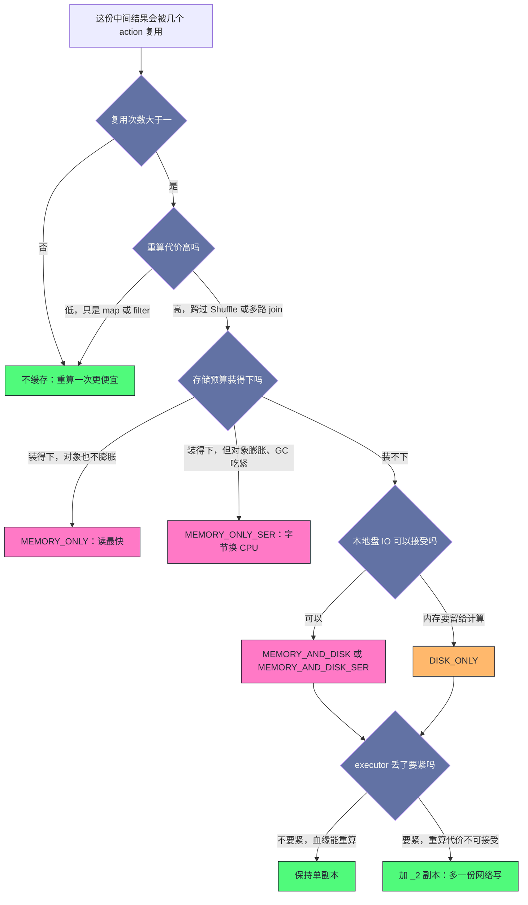
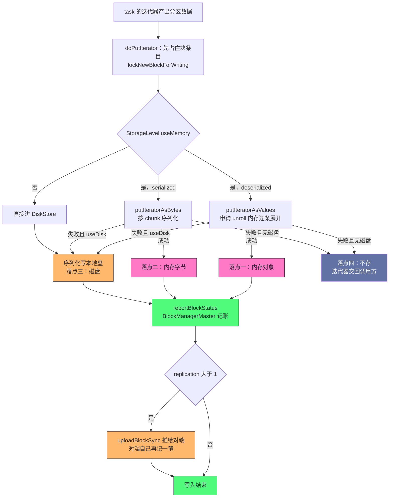
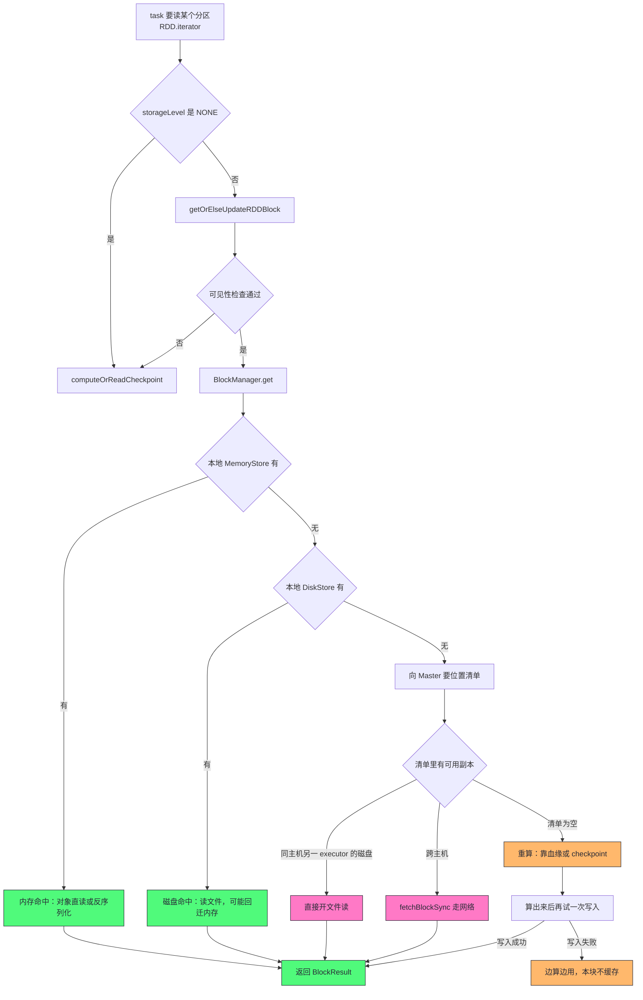
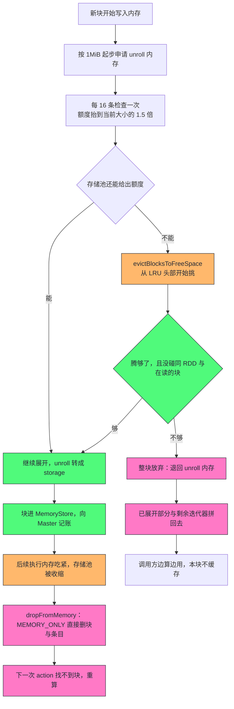
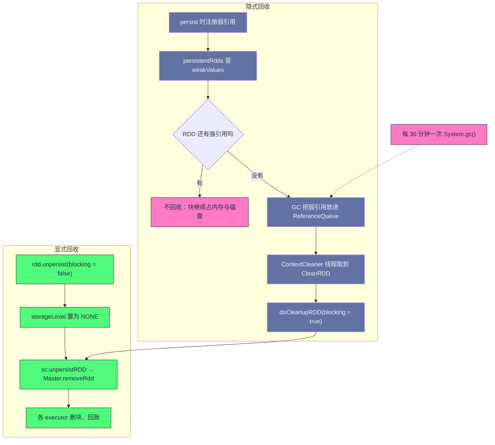
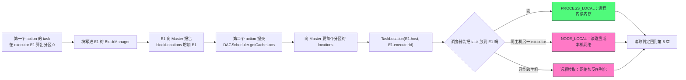

# 3. Spark 数据缓存机制：存储级别、写入落点与驱逐回收

**摘要：**

2012 年 NSDI 那篇 RDD 论文里，内存计算（in-memory computing）最吸引人的承诺是跨作业复用中间结果，而承载这个承诺的接口只有一个：persist。接口小到只需一行，落到底层却要穿过 driver 的调度器、executor 的 BlockManager、本地磁盘与 JVM 的垃圾回收四道关。这篇文章不讨论"要不要缓存"这种策略问题，只拆缓存（cache/persist）这一条物理路径：一次 cache() 究竟在什么时刻、把哪些字节、写到哪一层；内存不够、executor 死掉、忘了 unpersist 时，这套机制又靠什么把承诺收回来。全文沿五问推进：先界定存储级别的六个组合各自解决什么问题，再点明 RDD.cache() 与 Dataset.cache() 的默认值差异这个常见陷阱；随后走写入路径，看 doPutIterator 的四个落点与 BlockManagerMaster 的登记；接着走读取路径，看本地内存、本地磁盘、同机磁盘与远程副本的四次判定；最后拆驱逐、unpersist 与 ContextCleaner，把数据本地性、与 checkpoint 的边界以及 4.3.0 新增的块校验一并交代；行文终点回到取舍：缓存把一次计算的寿命从一个 task 延长到一个 application，代价落在内存、磁盘与清理时机上。口径为 Spark 4.3.0（4.x 预编译 Scala 2.13），涉及内部实现处，以对应版本文档或源码为准。

**关键词（Keywords）**: StorageLevel, BlockManager, MemoryStore, ContextCleaner, unpersist, MEMORY_AND_DISK, 缓存驱逐, 数据本地性

---

## 第 1 章 缓存是把结果从血缘的传送带上取下来

### 1.1 论文里只有一页的 persist

RDD 论文的主体篇幅花在两件事上：不可变的分区集合如何表达计算，以及血缘（lineage）如何在分区丢失时把数据重算出来。persist 在论文里只占很短的一节，因为它要解决的问题一句话就能说完——某些中间结果会被多个作业重复使用，与其每次沿血缘重算一遍，不如把这一次算出来的分区留在内存里。

这句话之所以值得单独成章，是因为它悄悄改变了 Spark 的失败模型。没有缓存时，任何一个分区都可以由血缘重新推导，executor 是可以随时牺牲的；有了缓存，一部分分区的寿命被拉长到跨越多个作业，它们的存放位置、占用空间与回收时机就变成了需要记账的状态。Spark 为此在 driver 上维护了一份块的位置账本，在 executor 上维护了一份块的介质账本，两份账本之间靠 RPC 对齐，而缓存机制的全部复杂度，几乎都来自这两份账本的对齐与失配。

### 1.2 cache() 改的只是一个字段

先看接口这一层。RDD 的 persist 有两个入口，cache() 只是 persist() 的别名：

```scala
// RDD.scala（4.3.0，节选）
def persist(): this.type = persist(StorageLevel.MEMORY_ONLY)
def cache(): this.type = persist()
```

真正的动作落在私有方法里：如果这个 RDD 之前没有被标记过持久化，就把它登记到两处——SparkContext 的 persistentRdds 与 ContextCleaner 的清理队列；然后给 storageLevel 字段赋上新级别。整个过程不碰数据，不提交作业，也不向 executor 发任何消息。

```scala
// persist(newLevel, allowOverride) 的两件实事
if (storageLevel == StorageLevel.NONE) {
  sc.cleaner.foreach(_.registerRDDForCleanup(this))  // 弱引用，交给清道夫
  sc.persistRDD(this)                                 // driver 的登记簿
}
storageLevel = newLevel
```

这解释了一个最常见的困惑：调用 cache() 之后，Spark UI 的 Storage 页里会立刻出现这个 RDD 的名字与存储级别，但已缓存分区数是零、内存占用是零。**标记与数据是两件事，cache() 只完成了前者。**

### 1.3 第一个 action 才真正开始写

数据是在 task 内部写进去的。RDD 的迭代器入口只有一处判断：

```scala
// RDD.iterator（4.3.0，节选）
if (storageLevel != StorageLevel.NONE) {
  getOrCompute(split, context)          // 先找缓存，找不到就算并顺手存
} else {
  computeOrReadCheckpoint(split, context)
}
```

也就是说，缓存不是一次独立的物化作业，而是计算过程的副产品：某个 action 触发 task，task 要读这个分区，发现 storageLevel 不是 NONE，于是走 getOrCompute；缓存里没有，就把计算出来的记录一边交给下游、一边写进 BlockManager。第一个 action 走完整条血缘，第二个 action 在缓存命中的分区上把血缘砍断，只从缓存块开始算。

对写侧而言，这意味着缓存写入与用户算子是同一趟迭代器，中间不会把分区物化成一个临时集合。好处是内存峰值低，坏处是写入失败时无法回退到"先算完再决定存不存"——迭代器已经被消费过一遍，只能把剩余部分交回调用方继续用，第 4 章会看到这个回退的具体形态。

### 1.4 一个贯穿全文的作业

为了让后面的机制有具体的着力点，笔者设想一个反作弊规则回刷作业 risk_backfill：每天凌晨读三天的曝光与点击日志（约 1.2TB），清洗成按会话聚合的宽表 sessions（约 180GB、800 个分区），然后用四套规则各跑一轮打分，每轮都要 join 一张规则维表并做聚合，最后把四份结果写出。

```scala
val sessions = sc.textFile("hdfs:///logs/impression_click", 800)
  .map(parseEvent)
  .filter(_.valid)
  .groupByKey()                       // 一次 Shuffle，把同一会话的事件收拢
  .map { case (sid, events) => buildSession(sid, events) }
  .persist(StorageLevel.MEMORY_AND_DISK)

(1 to 4).foreach { round =>
  val scored = sessions
    .join(ruleTable(round))           // 每轮一次 Shuffle
    .map { case (sid, (s, r)) => score(s, r) }
  scored.saveAsTextFile(s"hdfs:///warehouse/risk/round=$round")
}
```

这个作业同时踩中了本篇要讲的四件事：sessions 被四个 action 复用，所以值得缓存；180GB 远大于集群的堆内存储预算，所以 MEMORY_ONLY 一定装不下；每轮 join 的写端要向执行内存池申请额度，会把缓存挤掉一部分；四轮跑完之后 sessions 不再需要，理想情况下应当 unpersist。

需要说明的是，这里的 groupByKey 只是为了叙事方便，生产里更常见的是 reduceByKey 或 SQL 侧的聚合；换成哪一种都不影响缓存路径，因为缓存作用在 RDD 分区这个粒度上，与产生它的算子无关。

### 1.5 一个比喻：站台旁的货架

把计算链想成一条传送带，半成品从上游一路流下来。缓存做的事，是在某个工位旁边立一排货架，把刚下线的半成品从传送带上取下来摆上去，后续工序直接来货架上取。这个比喻要在这里收住：货架不是仓库，它有容量上限，有租期，而且旁边还有别的工位在抢同一块空地——放不下的时候，管理员不会把半成品切一半摆上去，而是整件退回传送带。

### 1.6 缓存挂在对象上，不挂在血缘上

persist 改的是 this 这个对象的字段，返回的也是 this，而不是一个新的 RDD。这个设计带来一个不直观的后果：从同一份数据出发、用同一串算子再写一遍，得到的是一个新对象，它的 storageLevel 是 NONE，读不到前一个对象缓存好的块。**缓存命中依赖对象同一性（identity），不依赖逻辑等价。** 写成 `val base = ...; base.cache()` 之后反复用 base 是对的写法；把同一个表达式写两遍，第二个表达式永远走重算。同理，在循环里每轮重新构造 RDD 再 cache，等于每轮新建一份缓存，前一轮的块只能等驱逐或清道夫来收。

---

## 第 2 章 存储级别的六个组合

### 2.1 四个布尔位与一个整数

StorageLevel 的字段只有五个：useDisk、useMemory、useOffHeap、deserialized 与 replication。前四个是布尔位，最后一个是以 1 为起点的副本数。它对外暴露的 isValid 判据同样朴素：至少要落在内存或磁盘之一，副本数大于零。StorageLevel.NONE 四个位全假，它表达的不是"一种存储级别"，而是"没有标记持久化"这个状态。

这五个字段的组合空间远大于 Spark 预置的那十几个常量，用户可以用 StorageLevel.apply 自己拼，源码只在副本数上留了一条断言，要求小于 40，理由是要参与哈希码计算。理解这一点很重要：存储级别不是一张枚举表，而是一组可以自由取值的开关，预置常量只是其中最常用的那些组合。

### 2.2 六种组合各自回答什么问题

把预置常量按"数据落在哪、以什么形态落、丢不丢得起"排开，六种基本组合的分工就清楚了；表末两行是同一组合在副本与堆外维度上的变体。

| 级别 | 内存里的形态（序列化） | 是否落盘 | 副本 | 内存装不下时 | 一次读的代价 | 适用场景与解决的问题 |
|---|---|---|---|---|---|---|
| MEMORY_ONLY | 反序列化对象 | 否 | 1 | 整块不缓存，退回边算边用 | 最低，直接拿对象引用 | 小体量、高热度的中间结果 |
| MEMORY_ONLY_SER | 序列化字节 | 否 | 1 | 同上 | 每次读都要反序列化 | 对象膨胀、GC 压力大的场景 |
| MEMORY_AND_DISK | 反序列化对象 | 是 | 1 | 溢出到本地盘 | 内存命中成本最低，磁盘命中要反序列化 | 数据集大于内存但复用次数多 |
| MEMORY_AND_DISK_SER | 序列化字节 | 是 | 1 | 溢出到本地盘 | 内存命中也要反序列化 | 既想省内存又需要磁盘兜底 |
| DISK_ONLY | 不占内存 | 是 | 1 | 不涉及 | 每次读都走本地盘 | 数据量远超内存、内存要留给计算 |
| MEMORY_AND_DISK_2 | 反序列化对象 | 是 | 2 | 同 MEMORY_AND_DISK | 本地缺块时可能跨网络 | executor 丢失后仍想留住缓存 |
| DISK_ONLY_2 / DISK_ONLY_3 | 不占内存 | 是 | 2 或 3 | 不涉及 | 本地盘或远端盘 | 磁盘级容错，代价是写放大 |
| OFF_HEAP | 堆外序列化字节 | 是 | 1 | 溢出到本地盘 | 反序列化加堆外读 | 想避开堆内 GC 的长生命周期缓存 |

这张表要配三句注解才完整。

第一句关于 MEMORY_ONLY。**它没有磁盘兜底，所以内存装不下时不会"存一半"，而是整块放弃**（第 6 章会拆这个判定）。它的读代价最低，因为缓存里放的就是对象本身，取出来直接交给下游，连反序列化都省了；代价是这些对象要参与 GC 扫描，分区越多、对象图越深，GC 的停顿越明显。

第二句关于 _SER。序列化省下的是内存，不是磁盘：任何落盘的块本来就是序列化后的字节，_SER 只是把"内存里的那一份"也从对象换成了字节。省下来的量取决于记录形态，一条包含多个字段与嵌套结构的小对象，在 64 位 JVM 上光对象头与引用就占去可观比例，换成紧凑字节后占用常常能降到几分之一；换来的是每次读都要反序列化，CPU 换空间。

第三句关于副本。_2 与 _3 不是"同一台机器上放两份"，而是由源端把字节推给另外的 executor。写放大的量级是副本数减一倍的网络传输，读的时候可能跨机；它的价值只在 executor 会丢这个前提下成立，如果集群稳定、血缘重算又便宜，多出来的网络开销就是纯亏。

### 2.3 三个容易记错的点

其一，OFF_HEAP 的 useDisk 也是真。源码里的定义是 StorageLevel(true, true, true, false, 1)，四个布尔位依次是磁盘、内存、堆外、反序列化。名字叫堆外，实际语义是"优先放堆外内存，堆外放不下时允许落盘"。把它理解成"只存在于堆外"会在容量规划时算错账。

其二，级别描述的是"允许放哪"，不是"一定放在哪"。MEMORY_AND_DISK 的块完全可能一直待在内存里，MEMORY_ONLY 的块也可能因为一次驱逐而彻底消失；级别是规则，落在哪一层由运行时的内存水位决定。

其三，副本级别的读不一定慢。块有多个副本时，读取会先按主机、再按机架排序位置，同主机优先，所以多副本有时反而提升了本地性命中率；这一点在第 8 章讲数据本地性时还会回到。

### 2.4 怎么选：一张决策图

存储级别的选择可以收敛成四个问题：会不会被复用、重算贵不贵、装不装得下、丢了要不要紧。下图把这条判断链画出来，图中每个分支的落点都是一个预置常量，不是必须严格遵守的规则。



回到 risk_backfill：180GB 的数据、800 个分区，单个分区平均 230MB，集群的堆内存储预算只有一百多 GB，所以 MEMORY_ONLY 写到数百个分区之后就会开始失败；MEMORY_AND_DISK 让内存装不下的部分落盘，读的时候先内存后磁盘，是最贴合这个作业的选择。如果四轮里某一轮的规则 join 把执行内存吃得极凶，缓存被挤掉的比例会明显上升，这一点到第 6 章再算。

---

## 第 3 章 两个默认值：RDD 与 Dataset 的陷阱

### 3.1 RDD.cache() 是 MEMORY_ONLY

RDD 的默认级别在源码里写死为 MEMORY_ONLY。这个默认值来自 1.x 时代的设计取向：那时堆内存是稀缺资源，Spark 希望用户明确地为一等公民（RDD）选择是否付出内存代价，cache() 只提供最轻量的一档。

### 3.2 Dataset.cache() 是 MEMORY_AND_DISK

Dataset 的默认级别不同。它的 persist() 不带参数时读的是 SQLConf：

```scala
// Dataset.scala（4.3.0，节选）
def persist(): this.type = persist(sparkSession.sessionState.conf.defaultCacheStorageLevel)
override def cache(): this.type = persist()
```

defaultCacheStorageLevel 对应配置项 spark.sql.defaultCacheStorageLevel，从 4.0.0 起提供，默认值就是 MEMORY_AND_DISK，并且同时作用于 dataset.cache()、catalog.cacheTable() 与 SQL 的 CACHE TABLE t 三条入口。这意味着它不是一个"RDD 与 Dataset 各有一套"的孤立差异，而是 SQL 会话级的一个开关：改了它，这个会话里所有不显式指定级别的缓存都会跟着变。

**这就是那个常见陷阱的完整形态：同一份代码里，rdd.cache() 落的是 MEMORY_ONLY，df.cache() 落的是 MEMORY_AND_DISK。** 迁移代码、比对实验、排查"为什么 SQL 缓存能扛住而 RDD 缓存一直重算"时，第一件要确认的事就是这句话。

| 维度 | RDD.cache() | Dataset.cache() |
|---|---|---|
| 默认级别 | MEMORY_ONLY | MEMORY_AND_DISK |
| 默认值来源 | 源码写死 | spark.sql.defaultCacheStorageLevel，4.0.0 起 |
| 能否全局改 | 不能，只能逐次 persist | 能，改 SQLConf 即可 |
| 缓存单位 | 一个分区一条块，块里是对象或字节 | 一个分区若干列式批次（CachedBatch） |
| 物理落点 | BlockManager 的 MemoryStore 或 DiskStore | 同一套 BlockManager，块里装的是列式批次 |
| 读取入口 | RDD.iterator → getOrCompute | InMemoryTableScanExec 读缓存 RDD 的分区 |
| 回收接口 | unpersist，另有弱引用兜底 | unpersist / uncacheTable / clearCache，无弱引用兜底 |

### 3.3 为什么两者不同

差异的来源不在存储层，而在两条 API 的演进路径。RDD 是 1.x 的核心抽象，默认值定得很保守，把"要不要占内存"的决定权交给用户；SQL 侧的缓存面对的是分析型负载，一次 cache 往往意味着一张大表被反复扫描，缓存失败的代价（整条查询重新执行）远高于多占一点磁盘，因此默认就带上了磁盘兜底。

还有一个容易被忽略的技术差别：Dataset 缓存进 BlockManager 的不是行对象，而是列式批次。CacheManager 把查询计划包成 InMemoryRelation，InMemoryRelation 里的 CachedRDDBuilder 会先把物理计划的结果转换成 CachedBatch（按列组织的压缩批次），再对这个 RDD[CachedBatch] 调用 persist(storageLevel)。**Dataset 缓存没有另一套内存管理，它最终还是走本篇第 4 章到第 6 章那条路，只是块里装的东西从行对象换成了列式批次。** 这一点纠正了"DataFrame 缓存是一套独立引擎"的常见误解。

列表式批次带来的实际差别有二：同样行数下块更小，所以 MEMORY_ONLY 有时也能装下；批次是不可变的字节结构，不存在"用户改了一个字段把缓存污染"的问题。第 9 章会把对象可变性这个坑摊开。

还有一层时序差异：Dataset 的缓存是在第一次用到它的查询里顺带物化的，CacheManager 先把计划改写成 InMemoryRelation，列式批次要等这个关系被扫描时才构建。**第一个查询负责物化，收益从第二次查询开始**，RDD 侧同理，只是物化点落在第一个 action 的 task 里。如果第一次查询本身就是全量扫描，它付出的代价最高，看不出任何加速；把这一点当成"缓存没生效"是常见的误判。

### 3.4 一个版本口径的注记

> [!info] 版本口径
> spark.sql.defaultCacheStorageLevel 自 4.0.0 起提供，默认 MEMORY_AND_DISK；3.x 及更早版本中 Dataset.cache() 的默认级别同样是 MEMORY_AND_DISK，但没有这个配置项（以对应版本文档为准）。若要在 3.x 上复现 4.x 的行为，只能逐次 persist(StorageLevel.MEMORY_AND_DISK)。

---

## 第 4 章 写入：一次 put 的四个落点

### 4.1 从 getOrCompute 到 doPutIterator

4.3.0 里 getOrCompute 把整件事委托给了 BlockManager：

```scala
// RDD.getOrCompute（4.3.0，节选）
SparkEnv.get.blockManager.getOrElseUpdateRDDBlock(
  context.taskAttemptId(), blockId, storageLevel, elementClassTag,
  () => computeOrReadCheckpoint(partition, context),
  verifySealedChecksum = verifyCheckpointChecksums)
```

块名由 RDD id 与分区号拼成，形如 rdd_12_7。getOrElseUpdate 先查一次（本地内存、本地磁盘、远程副本，顺序在第 5 章展开），命中就直接返回；未命中才调用 doPutIterator，把"算"与"存"合成一趟。对外那个更常见的 putIterator 是它的公共包装，广播、测试与外部调用走的是同一个实现。

### 4.2 先内存，后磁盘，且整块

doPutIterator 的骨架只有三段判断，但每一段都有一个必须记住的细节：

```scala
// BlockManager.doPutIterator（4.3.0，节选，伪代码）
if (level.useMemory) {
  if (level.deserialized) {
    memoryStore.putIteratorAsValues(...) match {
      case Right(size) => // 落点一：内存对象
      case Left(iter) if level.useDisk => 序列化写本地盘   // 落点三
      case Left(iter) => 交回迭代器                        // 落点四
    }
  } else {
    memoryStore.putIteratorAsBytes(...) match {
      case Right(size) => // 落点二：内存字节
      case Left(partial) if level.useDisk => 接着写完到磁盘 // 落点三
      case Left(partial) => 交回迭代器                      // 落点四
    }
  }
} else if (level.useDisk) {
  直接序列化写本地盘                                       // 落点三
}
```

第一处细节是"即便 useDisk 为真，也先进内存"。MEMORY_AND_DISK 这个名字容易被读成"内存和磁盘各放一份"，实际语义是"先试内存，放不下再落盘"，任何时刻一个块只在其中一层。源码注释写得很直白：put it in memory first, even if it also has useDisk set to true。

第二处细节是"整块"。缓存的最小单位是一个分区对应的一条块，不存在"这个分区存了 60%"的中间状态。内存展开到一半发现额度不够时，MemoryStore 返回的不是"已存的部分"，而是一个部分展开的迭代器（PartiallyUnrolledIterator 或 PartiallySerializedBlock），doPutIterator 要么把它接着写完到磁盘，要么原样交回调用方。

第三处细节是"展开（unroll）也要先申请内存"。往内存里放一个块并不等于一次 memcpy：它要逐条读取迭代器、估算每条记录的大小、按需扩大额度。初始额度由 spark.storage.unrollMemoryThreshold 给出，默认 1MiB；每展开 16 条检查一次额度，需要时把上限抬到当前大小的 1.5 倍。展开成功后，这笔额度转成正式的存储内存；展开失败，额度全部退回。

### 4.3 四个落点

| 落点 | 触发条件 | 数据形态 | 后续读的代价 | 备注 |
|---|---|---|---|---|
| 内存对象 | deserialized 且展开成功 | 对象引用数组 | 最低 | 参与 GC，对象共享引用 |
| 内存字节 | serialized 且展开成功 | 分块字节缓冲 | 每次反序列化 | 可计算内容校验和 |
| 本地磁盘 | 内存失败且 useDisk，或 DISK_ONLY | 序列化文件 | 本地盘 IO 加反序列化 | 目录由 spark.local.dir 派生 |
| 不缓存 | 内存失败且无磁盘兜底 | 无 | 每次重算 | 迭代器原样交回调用方 |

四个落点里，只有前三个会向 driver 记账。第四个落点的语义是"这次没缓存成，但计算继续"，task 不会因此失败，作业也不会报错，只是下一个 action 还要再算一遍——这也是"缓存看起来没生效"最常见的原因之一。

### 4.4 tellMaster 与 BlockManagerMaster 的登记

块写成功之后，BlockManager 做的第一件对外的事是汇报：

```scala
// doPutIterator 成功分支（4.3.0，节选）
if (tellMaster && info.tellMaster) {
  reportBlockStatus(blockId, putBlockStatus, checksum = info.checksum)
}
```

tellMaster 有两层：调用方传入的开关，以及 BlockInfo 上记录的开关，两者都真才发 RPC。默认路径两者都为真，只有内部明确不需要 driver 记账的场合才会关掉。汇报落到 driver 的 BlockManagerMasterEndpoint，它做三件事：在该 executor 的 BlockManagerInfo 里记下这个块与它的 StorageLevel、内存/磁盘字节数；把 BlockManagerId 加进 blockLocations（一个块可能对应多个位置，副本与外部 shuffle 服务都会往这里加）；如果开启了缓存可见性跟踪，还要处理"这个块是否已经对读方可见"。

blockLocations 是"块到位置"的反向索引，第 5 章的远程查找与第 8 章的本地性调度都读它。它只记位置，不记内容；内容是否一致由 4.3.0 新增的校验和字段单独负责，第 9 章会讲。

### 4.5 副本：源端推、对端自己记

replication 大于 1 时，本地写成功之后还有一段同步复制。源端先把自己的块按字节读出（doGetLocalBytes，必要时把内存对象序列化），再按副本策略挑对端，逐个 uploadBlockSync 推过去；对端收到后走自己的 putBlockData，再向 driver 汇报自己这一份。也就是说，同一个 blockId 在 blockLocations 里会有多条记录，每条对应一个 executor。

复制失败是可以容忍的：spark.storage.maxReplicationFailures 默认 1，超过之后放弃这一轮复制，块仍然保留在已有副本上。executor 丢失时，如果 spark.storage.replication.proactive 为真（默认），driver 会挑一个还持有该块副本的 executor，让它把块补给别的节点，尽量把副本数补回原值。这条路径只对 RDD 块生效，广播与 shuffle 块不走主动复制。

### 4.6 写入路径的全貌

下图把四个落点、记账与复制串成一条线。图中把"不缓存"也画成一个正常终点，是因为它在运行时不抛异常、不记日志错误，只在日志里留下一行 Putting block ... failed。



### 4.7 写入失败的两种回退

写入失败有两种，性质完全不同，排查时要分清。

一种是"块已经存在"。doPut 的第一件事是 lockNewBlockForWriting，如果本机已经有同一个 blockId，它返回 false，doPut 直接返回 None，什么都不覆盖。**写入是"只进不退"的：块一旦存在，重算不会替换它。** 这条规则在确定性算子下没有问题，谁先写都一样；在非确定性算子加推测执行的场景里，先写的那份可能是慢 task 算出来的，快 task 算出的不同结果被丢弃，正确性就只能靠 4.3.0 的校验和与封印来发现（第 9 章）。

另一种是"存不下"。doPutIterator 返回 Some(iterator)，计算继续，本块不缓存。这种失败不抛异常，只在日志里留一行 Putting block ... failed，task 与作业都正常结束。区分两者的方法很简单：看块在不在本地 BlockInfoManager 里，存在却报失败的是覆盖问题，不存在却报失败的是容量问题。

---

## 第 5 章 读取：三次判定与一次回退

### 5.1 getOrElseUpdate 的顺序

一个块读不到时会发生什么，取决于三个层次的问题：本机有没有、别的机器有没有、都没有时还能不能算。4.3.0 的 getOrElseUpdate 严格按这个顺序走：

1. 可见性检查（仅在 spark.rdd.cache.visibilityTracking.enabled 为真时生效）：块可能存在但还没被标记为可见，此时宁可重算也不能读一份可能由失败 task 写出的数据。
2. 调 get 查一次：先本地 getLocalValues，再远程 getRemoteValues。
3. 两者都空，调用 doPutIterator，把计算与写入合成一趟。

第 3 步的返回值是一个 Either：写入成功返回 Left(BlockResult)，此时调用方拿到的是刚从本机缓存读回的迭代器，并顺带把读取字节数记进 task 的输入指标；写入失败返回 Right(iterator)，调用方拿着这个迭代器继续算，缓存的事就当没发生过。这个设计保证了"缓存失败不影响正确性"，也解释了为什么 MEMORY_ONLY 装不下时作业只是变慢、不会报错。

### 5.2 本地：先内存，后磁盘

getLocalValues 先拿块条目上的读锁（lockForReading），拿不到说明本机根本没有这个块，直接返回 None。拿到之后按 StorageLevel 分叉：

- useMemory 且 MemoryStore 里有：deserialized 级别直接取对象迭代器，serialized 级别取字节缓冲再包一层反序列化流。这条路径的成本是零拷贝或一次反序列化。
- 内存没有但 useDisk 且 DiskStore 里有：deserialized 级别从磁盘反序列化，同时尝试把反序列化出来的对象塞回内存（maybeCacheDiskValuesInMemory）；serialized 级别读字节，同时尝试把字节塞回内存（maybeCacheDiskBytesInMemory）。塞得进去就把磁盘那份释放掉，塞不进去就继续用磁盘迭代器。
- 两边都没有：说明账本与介质对不上，按块缺失处理——调 removeBlock 把它从账本里删掉，再抛异常。

第二条里的"回迁"值得单独说一句。**一个 MEMORY_AND_DISK 的块被驱逐到磁盘之后，并不是永远待在磁盘上：下一次被读到时，如果存储池刚好有空，它会重新占回内存。** 这条回迁只发生在本地读路径上，也不向 driver 重新汇报尺寸，属于 executor 本机的一次优化；它让"先落盘、后回温"成为可能，代价是每次读都要判一次内存。

读锁的生命周期与迭代器绑定：调用方必须把迭代器消费完，锁才释放。这一条直接影响了第 6 章的驱逐——被读锁占住的块无法被驱逐，所以一个超大的分区在 collect 过程中不会被中途清掉，反而会把同机的其他缓存顶出去。

### 5.3 远程：先同机，再同架，最后跨网

本地没有时，getRemoteValues 向 driver 要位置清单（getLocationsAndStatus）。清单拿到手，排序规则依次是：同主机优先、同机架其次、其余最后；每一组内部 executor 优先于外部 shuffle 服务。排序之后先试一条不花钱的捷径——如果块落在同主机另一个 executor 的磁盘上，直接按目录拼路径打开文件（readDiskBlockFromSameHostExecutor），读失败再退回网络。

跨网拉取由 fetchBlockSync 完成，失败会换下一个位置重试；连续失败达到一定次数后重新向 driver 要一次清单，把所有位置试完仍失败才返回 None。块大小超过 spark.network.maxRemoteBlockSizeFetchToMem（默认 200m）时，数据不落堆内，改由临时文件中转，再包成 buffer 返回。这个阈值同时作用于 shuffle 取数，是"远程块不要把 executor 撑爆"的一道闸。

### 5.4 都没有：重算与 checkpoint

get 返回 None 之后，doPutIterator 拿到的是 makeIterator，也就是 computeOrReadCheckpoint。这里的分叉决定了一次 miss 的真实成本：

- RDD 已经做过可靠 checkpoint 且已物化：直接从 checkpoint 的存储读，血缘不再回放。
- 没有 checkpoint：沿血缘重算。若上游还有别的缓存块，重算会从最近的那个缓存边界开始，不会一路回到数据源。
- 上游缓存也被驱逐、executor 又丢过：可能触发上游 stage 的重算（stage 如何切分见 [[5. Spark_DAGScheduler_Stage划分]]），代价从"一个分区"放大到"一整个 stage"。

下图把这条读取路径完整画出来。图中"算出来再试一次写入"这一步，是缓存与普通计算唯一的分岔点：写入成功则下一次命中，写入失败则这次也不吃亏。



### 5.5 四条路径的代价

| 路径 | 触发条件 | 主要成本 | 是否更新 driver 账本 | 备注 |
|---|---|---|---|---|
| 本地内存 | 块在本机 MemoryStore | 一次反序列化或零拷贝 | 否 | 最快，受 GC 影响 |
| 本地磁盘 | 本机 DiskStore 有块 | 本地盘 IO 加反序列化 | 否，回迁也不报 | 回迁成功可转回内存 |
| 同机磁盘 | 同主机另一 executor 落过盘 | 打开文件、跨进程读 | 否 | 3.0 起默认支持的捷径 |
| 远程网络 | 只有别的机器有副本 | 网络传输加反序列化 | 否 | 大于 200m 落临时文件 |
| 重算 | 所有副本都没了 | 血缘回放，可能带 shuffle | 是，写入成功后 | checkpoint 可截断回放 |

还有一条容易被忽略的结论：**远程读到的块不会写回本地缓存。** 读取路径上没有"read-through"这一步，远程拉回来的数据用完就丢；只有本地磁盘块有回迁内存的待遇。所以在副本不足、又频繁跨机读的作业里，同一个块可能在每个 action 里都被跨网拉一次，网络成了稳定开销，而不是一次性开销。

### 5.6 读锁、迭代器与任务失败

getLocalValues 拿到的读锁与返回的迭代器绑定，调用方把迭代器消费完，锁才通过 CompletionIterator 的完成动作释放。这带来两个连带后果。

其一，**读锁与迭代器同寿**，一个正在被消费的块不可驱逐。collect 一个几 GB 的缓存分区时，这个块在整个消费期间都拿不到写锁，第 6 章的 LRU 只能跳过它去清别的块，同机缓存因此可能被成片顶掉。

其二，task 失败时锁不能靠迭代器释放。读取中途抛异常、task 被 kill、或者用户代码没有把迭代器消费完，锁会留在 BlockInfoManager 里；Task 结束时统一调 releaseAllLocksForTask 清理，避免锁泄漏把块永久钉住。这条清理路径也解释了为什么"任务失败后缓存还在"：失败清理的是锁，不是块本身。

---

## 第 6 章 驱逐：内存不够时谁让路

### 6.1 MemoryStore 是一张按访问排序的表

MemoryStore 内部用一张 LinkedHashMap 记账，构造参数里第三个是 accessOrder=true：

```scala
private val entries = new LinkedHashMap[BlockId, MemoryEntry[_]](32, 0.75f, true)
```

accessOrder 为真意味着每次 get 都会把条目移到链表尾部，链表头部就是最久未被访问的块。往内存里放新块时，如果存储池余额不够，evictBlocksToFreeSpace 会从头开始挑，逐个尝试拿写锁、累加可释放的字节数，够数就停下来，然后把挑中的块依次 dropFromMemory。这是货真价实的 LRU，但有两个必须知道的例外。

### 6.2 两个例外：同 RDD 不驱逐、正在读的不驱逐

第一个例外是**同一个 RDD 的块不驱逐**。正在写入的块属于某个 RDD，如果为了给它腾地方而去驱逐同一 RDD 的其他分区，就会形成"驱逐—重算—再驱逐"的循环：被驱逐的分区下一次会被重算，重算又要占内存，最终整张 RDD 在内存里反复换手，命中率反而下降。MemoryStore 直接把这个 RDD 排除在候选之外，宁可让这次写入失败。

第二个例外是读锁。evictBlocksToFreeSpace 只对能非阻塞拿到写锁的块动手，正在被 task 读取的块拿不到写锁，会被跳过。于是"要腾 200MB，扫下来只腾出 150MB"是完全可能的结果，此时新块不写入，调用方走第 4 章的落点四或落点三。

这两个例外加起来，构成了一个容易被误读的现象：给 Executor 加内存，缓存命中率不一定上升。加内存往往伴随并发 task 数变多，而并发读会把更多块锁在"不可驱逐"状态，可回收的余量未必同步增长。

### 6.3 驱逐之后的两种命运

dropFromMemory 的动作按 StorageLevel 分叉：

```scala
// BlockManager.dropFromMemory（4.3.0，节选，伪代码）
if (level.useDisk && !diskStore.contains(blockId)) {
  把对象序列化后写进 DiskStore        // MEMORY_AND_DISK 走这里
}
memoryStore.remove(blockId)           // 内存那一份总是删掉
reportBlockStatus(...)                // 尺寸变化要回账
```

对 MEMORY_AND_DISK 来说，驱逐是"搬家"：内存让出来，磁盘上多一份，块的位置账本不变，下一次读走磁盘路径，还有机会回迁。对 MEMORY_ONLY 来说，**驱逐就是删除**：磁盘上没有兜底，memoryStore.remove 之后块的 StorageLevel 变成非法，blockInfoManager 里的条目也被移除，driver 那边的 blockLocations 少一个位置；下一次 action 找不到块，只能重算。MEMORY_ONLY_SER 同理，序列化只改变了内存里的形态，没有改变"没有磁盘兜底"这个事实。

### 6.4 MEMORY_ONLY 的溢出行为

把 risk_backfill 的 sessions 换成 MEMORY_ONLY，写到存储池见底之后就会发生下面这条链路。图中最后一跳"下一次 action 重算"是这个级别最典型的运行形态：它不报错，只是把省下的内存换成了重复计算。



### 6.5 与执行内存的争夺是单向的

统一内存管理把执行与存储放进同一个池子，但两边的取值权限并不对称。执行内存不够时，UnifiedMemoryManager 会调用 maybeGrowExecutionPool：把存储池的空闲部分、以及超出 storageRegionSize 的借用部分一并收回，收回的空间通过驱逐块腾出，直接并入执行池。存储内存不够时，acquireStorageMemory 只能向执行池借它的空闲部分，借不到就失败，不能反过来驱逐正在被 shuffle 使用的执行内存。

**所以准确的说法是"shuffle 能挤掉 cache，cache 挤不掉 shuffle"。** 常被说成"互相驱逐"的那种现象，实际是这条单向链的连锁反应：缓存被挤掉，下一次 action 重算这些分区，重算的聚合与排序又要向执行池申请内存，进一步压缩存储池，把剩下的缓存也推下去。写端在 overflow 时向执行池要不到额度，会 spill 到磁盘，作业看起来"既慢又没缓存"。

这条不对称性对 risk_backfill 的意义很直接：四轮 join 的执行内存高峰决定了缓存能活下来多少。如果某一轮的维表倾斜、聚合值膨胀，执行内存会被长期占住，sessions 的缓存块被成片驱逐，MEMORY_AND_DISK 会把它们搬到磁盘，于是读路径从"内存命中"退化为"磁盘命中"，作业时间随之抬升。这种时候调大 spark.memory.fraction 未必有帮助，因为池子变大也会让更多 task 挤进来，每 task 的额度不一定增加——这是 [[2. Spark内存管理模型深度解析|本组第 2 篇]] 的主题，这里只交代它对缓存的影响面。shuffle 数据本身不走这套块管理，两条线只在统一内存池上相遇，界线见 [[7. Spark_Shuffle与Storage交互]]。

### 6.6 驱逐的触发点一览

| 触发点 | 谁发起 | 对 MEMORY_ONLY 的后果 | 对 MEMORY_AND_DISK 的后果 |
|---|---|---|---|
| 新块写入内存、余额不足 | MemoryStore.evictBlocksToFreeSpace | 可能腾不出足够空间，整块不写 | 腾不出则新块落盘 |
| 执行内存申请、存储池越界 | UnifiedMemoryManager.maybeGrowExecutionPool | 被驱逐的块直接消失 | 被驱逐的块落盘 |
| 手工 unpersist | 用户代码或 ContextCleaner | 块与条目一起删 | 内存与磁盘一起删 |
| executor 下线 | BlockManagerMaster 移除该节点 | 位置消失，可能重算 | 位置消失，可能重算 |
| 应用结束 | executor 进程退出 | 全部释放 | 全部释放 |

### 6.7 观测：日志与指标

排查缓存问题时，三行日志比凭感觉猜有用得多：`Persisting block rdd_x_y to disk instead` 说明内存没装下、走了落点三；`Will not store rdd_x_y` 说明连磁盘路径都没成功，块被彻底放弃；`Dropping block rdd_x_y from memory` 说明这个块正被驱逐。三行日志分别对应"级别选择"、"分区过大"与"内存竞争"三类问题。

指标侧看两处：Spark UI 的 Storage 页按 RDD 汇总已缓存分区数、内存与磁盘占用；代码里用 sc.getRDDStorageInfo 拿到同样的数字（numCachedPartitions、memSize、diskSize）。这些数字来自 driver 的块账本，也就是各 executor 汇报上来的尺寸之和，所以它反映的是"最后一次汇报时"的状态，与 executor 实时的内存占用可能有一个汇报周期的偏差。

---

## 第 7 章 unpersist 与 ContextCleaner

### 7.1 unpersist 的默认语义

RDD 的 unpersist 只有一个参数，默认值是 false：

```scala
def unpersist(blocking: Boolean = false): this.type
```

调用之后做三件事：把 storageLevel 置回 NONE；让 SparkContext 从 persistentRdds 里删掉这个 RDD；向 driver 的 BlockManagerMaster 发 removeRdd。Master 再向所有 executor 广播删除请求，各 executor 逐个 removeBlock，删完回账。blocking 为 false 时调用立即返回，删除在后台完成；为 true 时等到所有 executor 应答再返回。

三个细节值得记住。其一，unpersist 之后的 RDD 仍然可用，只是再算时不写缓存；想重新缓存必须再调一次 persist。其二，同一个 RDD 连续 persist 两个不同级别会抛异常（StorageLevel 不允许中途更换），要换级别得先 unpersist 再 persist。其三，blocking=true 只保证"删完了"，不保证"以后不再占内存"——如果有另一个 action 正在读这个 RDD，它会重新算、重新写。

Dataset 侧的 unpersist 走的是另一条入口：CacheManager.uncacheQuery，默认同样是 blocking=false，作用是把 InMemoryRelation 从 cachedData 列表里摘掉，并对其内部的缓存 RDD 调 unpersist。catalog.uncacheTable 与 spark.catalog.clearCache 是同一件事的另外两个入口。

### 7.2 ContextCleaner：弱引用兜底

忘了 unpersist 是常态，Spark 为此准备了一条兜底路径。persist 时注册的清理任务持有一个弱引用（CleanupTaskWeakReference），指向 RDD 对象本身；驱动的 persistentRdds 也是一张 weakValues 的 Map，同样不阻止 RDD 被回收。

于是整条链是这样闭合的：用户在代码里丢掉 RDD 的最后一个强引用之后，JVM 的一次 GC 会把弱引用放进 ReferenceQueue；ContextCleaner 的守护线程轮询队列，取到 CleanRDD 任务，调用 doCleanupRDD，内部就是 sc.unpersistRDD(rddId, blocking=true)。**注意这里的 blocking 与用户接口的默认值相反：清道夫默认是阻塞删除的**，因为它在后台线程里执行，阻塞不会拖慢用户代码。

这条兜底依赖 GC，而 GC 的时机不由 Spark 决定。长驻应用里 driver 堆很宽裕，可能几个小时都不发生一次能回收弱引用的 GC，于是 ContextCleaner 配了一个周期性的 System.gc()：spark.cleaner.periodicGC.interval 默认 30 分钟。这也解释了为什么"忘了 unpersist"有时过一阵子自己好了——不是 Spark 聪明，是 GC 终于跑了。

### 7.3 为什么有时不 OOM，有时会

把"忘了 unpersist"的几种结局摊开，就能看出这条兜底路径的边界。

| 情形 | 块会怎样 | 是否 OOM | 原因 |
|---|---|---|---|
| 用户丢掉 RDD 引用，堆压力正常 | GC 后清道夫回收 | 否 | 弱引用加周期 GC |
| 用户把 RDD 存在长生命周期容器里 | 一直不被回收 | 可能 | 强引用挡住了弱引用 |
| 内存吃紧、执行内存来抢 | 被 LRU 驱逐 | 否，但变慢 | 驱逐是整块删除或落盘 |
| MEMORY_AND_DISK 且反复写 | 磁盘堆积 | 可能磁盘满 | 块搬到本地盘，容量另算 |
| Dataset 缓存 | 不回收 | 可能 | CacheManager 的 cachedData 是强引用 |

最后一行是本篇最该记住的一条不对称：**RDD 缓存有弱引用兜底，Dataset 缓存没有。** CacheManager 用 IndexedSeq 强引用所有 CachedData，只要 SparkSession 活着、缓存没被显式清掉，这些缓存就一直占着 executor 的内存或磁盘。所以 DataFrame 与 SQL 侧"忘了 uncache"是真实会积累的问题，长驻服务里应当把它当成资源释放的一部分来管理。

至于"有时会 OOM"，最常见的组合是"driver 一直持有 RDD 引用 + executor 存储池被占满 + 作业继续申请执行内存"：缓存块既没被回收、又因为被读锁或同 RDD 规则挡住无法全部驱逐，执行内存拿不到额度，任务频繁 spill，GC 压力上升，最终表现为 executor 的堆溢出。此时真正的病灶在 driver 的引用管理，不在 executor 的内存参数。

### 7.4 unpersist 的时机

三个时机值得写进代码规范：跨作业复用的最后一轮结束后；数据已被下游结果完全替代时（缓存中间态而下游已经物化）；长驻应用里按预算清理（把缓存总量当成一个有上限的资源来管）。反过来，有两种写法基本没有意义：在第一个 action 之前 unpersist（等于没缓存），以及在循环体内反复 persist 与 unpersist 同一个 RDD（每次都要重算，缓存退化成一个慢速的标记）。

### 7.5 清道夫的阻塞策略

ContextCleaner 不只清 RDD，广播、shuffle、累加器与 checkpoint 元数据都注册在同一个队列上，差别在清理时的阻塞策略。RDD 与广播的清理默认阻塞（spark.cleaner.referenceTracking.blocking，默认 true），清道夫会等 executor 应答再处理下一个任务；shuffle 的清理默认不阻塞（spark.cleaner.referenceTracking.blocking.shuffle，默认 false），原因是 shuffle 清理要向所有 executor 发删除请求，在应用收尾阶段阻塞容易撞上 RPC 超时。

这个差异对缓存排查有直接影响：如果日志里出现"RDD 已清理但块还在"的错觉，通常是清理请求发出后 executor 侧的删除尚未完成；而 shuffle 的清理本来就是异步的，看到文件晚几秒消失属于正常。**清道夫兜的是"没有强引用"这一种遗忘，不兜"有强引用但忘了 unpersist"**——后者只能靠显式调用或驱逐。

下图把显式回收与隐式回收两条路径画在一起，图中虚线是那条不太可靠的 GC 触发。



---

## 第 8 章 缓存位置与数据本地性

### 8.1 块落在哪个 executor，由 task 决定

缓存块的物理位置没有独立的调度器来安排：哪个 executor 上跑出了这个分区，块就写在这个 executor 的 BlockManager 里。800 个分区的 sessions 因此会散落在参与第一个 action 的所有 executor 上，分布由当时的分区分配决定，不由用户指定。副本级别是唯一的例外，它把副本推到别的 executor，但主副本仍然跟着计算走。

### 8.2 cacheLocs：位置如何变成调度偏好

第二个 action 提交时，DAGScheduler 要为每个分区算首选位置（preferred locations）。它先查一个按 RDD 缓存的表：

```scala
// DAGScheduler.getCacheLocs（4.3.0，节选）
if (rdd.getStorageLevel == StorageLevel.NONE) {
  IndexedSeq.fill(rdd.partitions.length)(Nil)
} else {
  blockManagerMaster.getLocations(blockIds).map { bms =>
    bms.map(bm => TaskLocation(bm.host, bm.executorId))
  }
}
```

这张表把每个分区的块位置翻译成 TaskLocation。调度器拿它当首选位置，于是任务被尽量派到持有缓存块的 executor 上，形成进程内命中（PROCESS_LOCAL）。如果某个分区没有缓存位置，getPreferredLocsInternal 会沿窄依赖往上找，看父 RDD 有没有位置偏好；这也解释了为什么"缓存了下游、上游没缓存"时，下游任务有时仍会被派到上游数据所在的机器上。

cacheLocs 是按 RDD id 缓存的，每次提交 job 时清空一次，stage 重提时也清空。它反映的是"提交那一刻"的位置，job 执行期间如果有块被驱逐或 executor 丢失，表不会自动更新，调度可能把任务派到一个已经没有该块的机器上，任务到了之后发现本地没有，再走第 5 章的远程或重算路径。

### 8.3 本地性命中的真实收益

本地性命中省下的是两段成本：一次跨机网络传输，以及接收端的反序列化（若为序列化级别）。对于 risk_backfill 这种每轮要扫 180GB 的作业，命中率每下降一档，多出来的网络流量都会直接反映到一轮的墙钟时间上，而这段开销在第一次 action 时并不存在。这也是为什么 spark.locality.wait 默认给了 3 秒：调度器愿意等一等，看能不能把任务放到有缓存的机器上，而不是立刻发到一台空闲但没缓存的机器。

等价的代价也要算清楚：等待本身浪费的是 CPU 空闲时间。缓存分布严重倾斜时（譬如第一个 action 只用了少数 executor），死等本地性反而更慢；这时调小 spark.locality.wait 或让上游重新分区，比继续等更划算。

### 8.4 同机磁盘与外部服务：两种"远程"的例外

第 5 章提到过，同主机另一个 executor 落盘的块可以直接读文件，这条捷径让"远程"退化成一次本地磁盘读，省掉的是一次网络往返与对端的序列化处理。它成立的前提是块确实落在磁盘上（MEMORY_AND_DISK、DISK_ONLY 或已被驱逐的块），纯内存块没有文件可读。

另一条例外与外部 shuffle 服务（external shuffle service，ESS）有关。开启 spark.shuffle.service.fetch.rdd.enabled（3.0 起，默认 false）之后，driver 会为磁盘持久化的 RDD 块额外登记一个 ESS 位置；executor 死后，只要那台机器上的 ESS 还活着，它的本地磁盘块仍然可以被读到。这条配置同时影响动态分配：只有磁盘缓存块的 executor 会被视为空闲并回收，否则缓存块会把 executor 一直钉住。

### 8.5 动态分配的副作用

默认的 spark.dynamicAllocation.cachedExecutorIdleTimeout 是 Integer.MAX_VALUE，含义是"持有缓存块的 executor 永不因空闲被回收"。对交互式分析这是好事，对共享集群则是资源占用：一个会话 cache 了几张表之后，它的 executor 会长期占着资源不放，直到 unpersist 或会话结束。这也从另一个角度说明了第 7 章那条规范的必要性——缓存的释放不只是内存问题，也是集群资源问题。

### 8.6 两种位置错位

本地性优化的前提是"缓存的位置与下一次计算需要的数据在同一台机器上"，这个前提在两种常见写法下并不成立。

第一种是在 repartition 或 coalesce 之后立即缓存。新 RDD 的分区与上游块之间没有一一对应，块的位置要等这一次重分区算完才建立；在此之前，任务读缓存块的同时还要读上游 shuffle 输出，本地性命中的是缓存块，shuffle 取数仍然可能跨机。coalesce 还会让一个分区吞下多个上游分区，块变大、块数变少，单块超过存储池时直接落到第 4 章的落点四。

第二种是缓存下游结果、却不缓存它反复读取的上游维表。下游块位置固定，任务都被吸到少数几台机器上，维表却要在每台机器上各拉一份广播或各读一次远端，本地性只优化了一半。**缓存位置是计算位置的副产品，不是数据源位置的延续**，写代码时按"谁被反复读"而不是"谁先算出来"来选缓存点，命中率会好看得多。

下图把"块位置—调度偏好—读取路径"三段串起来。图中最后一跳回到第 5 章的判定，说明本地性只影响"从哪读"，不改变"读不到怎么办"。



---

## 第 9 章 边界与反例

### 9.1 一份误判清单

缓存这块的误判有一个共同点：现象看起来像"缓存没生效"，原因却分散在接口、级别、分区、GC 四个层面。把最常见的几种并排放，排查时可以直接对号。

| 现象 | 常见误判 | 实际机制 |
|---|---|---|
| cache 之后 UI 显示 0 个已缓存分区 | 缓存失败或版本不兼容 | 缓存是惰性的，没有 action 就没有数据 |
| MEMORY_ONLY 的命中率忽高忽低 | 内存够用，应该全命中 | 分区数多于内存容量，LRU 整块驱逐后重算 |
| 明明 cache 了还是重算 | cache 调用的位置不对 | 在 action 之前 unpersist，或换了 RDD 对象 |
| Dataset 缓存扛得住、RDD 缓存扛不住 | 两者实现不同 | 默认级别不同，一个 MEMORY_ONLY，一个 MEMORY_AND_DISK |
| unpersist 之后内存没降 | 接口失效 | 默认异步删除，且正在读的块要等迭代器消费完 |
| 缓存后作业反而更慢 | 缓存没有收益 | 只读一次、或重算比反序列化便宜 |
| executor 挂了任务没失败 | 缓存应该丢了 | 血缘兜底重算，缓存丢失不等于数据丢失 |
| 缓存块始终存不下 | 内存参数太小 | 单分区大于存储池，或同 RDD 驱逐规则挡住 |

第 4 行是最容易吃亏的一条，因为两条 API 长得一样、行为不同，而报错信息不会告诉你这件事。第 8 行也值得展开：一个 2GB 的分区在任何存储池不足 2GB 的 executor 上都存不进内存，此时无论怎么调 spark.memory.fraction 都没用，只能减少分区大小或换 DISK_ONLY。缓存的最小单位是分区，这个粒度决定了"大分区"是缓存机制天然的敌人。

### 9.2 与 checkpoint 的边界

缓存与 checkpoint 常被并称为"两种持久化"，但两者在物理路径上几乎没有交集。缓存把块交给 BlockManager，位置在 executor 的堆或本地盘，生命周期跟着应用走；checkpoint 把数据写进可靠存储（HDFS 或本地目录），并切断 RDD 的血缘。缓存丢了可以重算，checkpoint 丢了通常意味着要重跑整个作业；缓存不改变依赖关系，checkpoint 会改写 RDD 的 dependencies。

一个直接的推论是：**缓存不能替代 checkpoint，checkpoint 也不必替代缓存。** 迭代型作业里常见的组合是"先 cache 让每轮读得快，再 checkpoint 兜住血缘过长"，两者作用在不同维度。具体机制在 [[6. Spark_Checkpoint机制|本组第 6 篇]] 展开，这里只强调一条交接规则：缓存命中失败的读取会落到 computeOrReadCheckpoint，如果这个 RDD 已 checkpoint 且已物化，读的是 checkpoint，不会回放血缘。

### 9.3 缓存也有正确性的一面

4.3.0 给缓存加了两道与正确性有关的闸，说明"缓存只是性能优化"这个判断并不完整。

第一道是块内容校验。spark.storage.rddBlockChecksum.enabled（4.3.0 新增，默认 false）打开后，BlockManager 在存储序列化 RDD 块时计算内容校验和并汇报给 driver；同一分区如果被两个 task（重试或推测执行）写出了不同字节，两个副本的校验和会不一致，driver 能据此发现。与之配套的封印（seal）机制会在 local checkpoint 的提交点挑定一个权威版本，把不一致的副本拒之门外。默认关闭意味着这条保护不是免费的：算校验和要遍历一遍字节。

第二道是块可见性。spark.rdd.cache.visibilityTracking.enabled（内部配置，3.5.0 起，默认 false）打开后，一个块要等生成它的 task 成功结束才对读方可见；在此之前，即使块已经落在内存里，读请求也会被当作未命中。它针对的是非确定性算子：一个失败的 task 可能已经写出一份"看起来正常、实际算错"的块，如果被后续 task 读到，错误会静默扩散。默认关闭同样是成本考虑，可见性检查要走 driver RPC。

这两道闸的存在本身就是一条边界说明：缓存的正确性依赖"同一分区重算得到同样结果"这个假设，而推测执行、重试与非确定性算子会打破它。生产里要不要打开它们，取决于作业是否包含非确定性转换、是否能接受额外的字节遍历与 RPC；不确定时以对应版本文档或源码为准。

### 9.4 对象可变性：MEMORY_ONLY 的一个暗坑

MEMORY_ONLY 缓存的是对象引用。如果下游算子或用户代码修改了这些对象（譬如复用了一个可变的容器、在 map 里原地改字段），缓存里保存的就是被改过的版本，后续 job 读到的数据与第一次算出来的不一致，而且不会报错。

这个坑在 RDD 的不可变语义下显得矛盾，但它的成因很清楚：RDD 保证的是"分区集合不可变"，不保证"分区里的对象不可变"。规避方式有两种：用 _SER 级别，缓存的是字节，读时反序列化出新对象；或者保证缓存的数据结构本身不可变。前者付出反序列化成本，后者要求编码纪律。

### 9.5 分区粒度与倾斜

**缓存的最小单位是分区**，这个粒度带来两个后果。其一，分区数太少时缓存粒度很粗：800 个分区里有一个 5GB 的倾斜分区，它可能在任何 executor 上都放不下，反复走落点四；把它拆小（repartition 或加盐）比调内存参数有效。其二，分区数太多时块数膨胀：每个块在 driver 的 blockLocations、BlockManagerInfo 里都有一条记账，几十万个块会让 driver 的账本与心跳变重，缓存管理本身成为开销。

### 9.6 堆外与序列化的选型边界

OFF_HEAP 在 4.3.0 里仍然保留，但它要求开启堆外内存池（spark.memory.offHeap.enabled 与 spark.memory.offHeap.size），并且只支持序列化形态。它适合"缓存量大、堆内 GC 压力已经影响吞吐"的场景；普通作业开它，收益通常抵不过调参与运维成本。同理，_SER 级别适合对象膨胀明显、CPU 还有余量的作业，不适合读次数远多于写次数、且反序列化本身就很贵的作业。这两条都是"以测量为准"的选择，没有普适答案。

---

## 第 10 章 落点

回到开头那两个问题。

一次 cache() 究竟在什么时刻、把什么写到哪一层？答案是：它什么也不写，只改一个字段、登记两处引用；真正写入发生在第一个 action 的 task 内部，由 doPutIterator 把分区迭代器的结果先进内存（对象或字节）、内存放不下再按级别落本地盘、两者都失败就整块放弃并把迭代器交回调用方；写入成功后由 BlockManager 向 driver 的 BlockManagerMaster 登记位置与尺寸，副本则由源端推送、对端各自登记。所谓"缓存"，在物理上就是 BlockManager 里的一条块、driver 账本里的一条位置记录，以及 StorageLevel 上的五个字段。

内存不够、executor 死掉、忘了 unpersist 时，这套机制靠什么把承诺收回来？内存不够时靠 LRU 整块驱逐与执行内存对存储池的单向收缩，MEMORY_ONLY 直接丢块、MEMORY_AND_DISK 搬到磁盘；executor 死掉时靠血缘重算，副本与主动复制只是把这笔账推迟；忘了 unpersist 时，RDD 靠弱引用加 ContextCleaner 兜底，Dataset 没有这条兜底，只能显式清理。三条路径的共同点是：**缓存从不保证数据在，它只保证"在的时候快，不在的时候还能算出来"。**

把这两段话落到操作顺序上，可以排成五步。先问复用次数：只读一次的中间结果，缓存是负收益。再问重算代价：跨了 Shuffle 或多路 join 的，值得缓存；单纯 map 出来的，重算往往更快。然后问内存预算：数据集与存储池的比例决定用 MEMORY_ONLY 还是 MEMORY_AND_DISK，单分区大小决定它到底存不存得下。接着问容错要求：executor 会丢、重算又贵，才加副本或叠 checkpoint。最后问生命周期：什么时候不再需要，就在那里 unpersist，并且对 Dataset 的缓存单独列一条清理项。

缓存机制体现的是分布式计算里一次很朴素的权衡：用内存换时间，用血缘换可靠性。它把一次计算的寿命从一个 task 延长到一个 application，代价是把可靠性押在"还能重算"上、把性能押在"内存够用"上，而这两笔押注都要靠驱逐与清理来兑现。至于未来的方向——列式缓存、堆外内存、自适应执行对缓存计划的改写——目前仍然言之尚早。

---

## 参考资料

1. Zaharia M., Chowdhury M., Das T., et al. Resilient Distributed Datasets: A Fault-Tolerant Abstraction for In-Memory Cluster Computing. NSDI 2012. https://www.usenix.org/system/files/conference/nsdi12/nsdi12-final138.pdf
2. Apache Spark 源码（4.3.0）：`core/src/main/scala/org/apache/spark/rdd/RDD.scala`，persist/cache/unpersist、getOrCompute 与 computeOrReadCheckpoint。https://github.com/apache/spark/blob/v4.3.0/core/src/main/scala/org/apache/spark/rdd/RDD.scala
3. Apache Spark 源码（4.3.0）：`common/utils/src/main/scala/org/apache/spark/storage/StorageLevel.scala`，五个字段、预置常量与 isValid 判据。https://github.com/apache/spark/blob/v4.3.0/common/utils/src/main/scala/org/apache/spark/storage/StorageLevel.scala
4. Apache Spark 源码（4.3.0）：`core/src/main/scala/org/apache/spark/storage/BlockManager.scala`，getOrElseUpdateRDDBlock、doPutIterator、dropFromMemory 与远程块读取。https://github.com/apache/spark/blob/v4.3.0/core/src/main/scala/org/apache/spark/storage/BlockManager.scala
5. Apache Spark 源码（4.3.0）：`core/src/main/scala/org/apache/spark/storage/memory/MemoryStore.scala`，访问序 LinkedHashMap、evictBlocksToFreeSpace 与 putIterator。https://github.com/apache/spark/blob/v4.3.0/core/src/main/scala/org/apache/spark/storage/memory/MemoryStore.scala
6. Apache Spark 源码（4.3.0）：`core/src/main/scala/org/apache/spark/memory/UnifiedMemoryManager.scala`，maybeGrowExecutionPool 与 acquireStorageMemory 的不对称。https://github.com/apache/spark/blob/v4.3.0/core/src/main/scala/org/apache/spark/memory/UnifiedMemoryManager.scala
7. Apache Spark 源码（4.3.0）：`core/src/main/scala/org/apache/spark/storage/BlockManagerMasterEndpoint.scala`，updateBlockInfo、blockLocations、副本与主动复制。https://github.com/apache/spark/blob/v4.3.0/core/src/main/scala/org/apache/spark/storage/BlockManagerMasterEndpoint.scala
8. Apache Spark 源码（4.3.0）：`core/src/main/scala/org/apache/spark/ContextCleaner.scala`，弱引用队列、doCleanupRDD 与周期 GC。https://github.com/apache/spark/blob/v4.3.0/core/src/main/scala/org/apache/spark/ContextCleaner.scala
9. Apache Spark 源码（4.3.0）：`core/src/main/scala/org/apache/spark/scheduler/DAGScheduler.scala`，getCacheLocs 与 getPreferredLocsInternal。https://github.com/apache/spark/blob/v4.3.0/core/src/main/scala/org/apache/spark/scheduler/DAGScheduler.scala
10. Apache Spark 源码（4.3.0）：`sql/api/src/main/scala/org/apache/spark/sql/Dataset.scala` 与 `sql/core/src/main/scala/org/apache/spark/sql/execution/columnar/InMemoryRelation.scala`，Dataset 缓存默认级别与列式批次的持久化。https://github.com/apache/spark/blob/v4.3.0/sql/api/src/main/scala/org/apache/spark/sql/Dataset.scala
11. Apache Spark 源码（4.3.0）：`core/src/main/scala/org/apache/spark/internal/config/package.scala`，spark.sql.defaultCacheStorageLevel、spark.storage.rddBlockChecksum、spark.rdd.cache.visibilityTracking 与动态分配相关配置。https://github.com/apache/spark/blob/v4.3.0/core/src/main/scala/org/apache/spark/internal/config/package.scala
12. Apache Spark 4.3.0 文档：RDD Programming Guide 的 Persistence 一节与 Configuration 的 Storage、Dynamic Allocation 两节。https://spark.apache.org/docs/latest/rdd-programming-guide.html#rdd-persistence
13. Apache Spark JIRA：SPARK-42582，缓存块可见性与非确定性算子的一致性问题。https://issues.apache.org/jira/browse/SPARK-42582

---

> [!note] 思考题
> 1. MEMORY_ONLY 在内存不足时整块放弃，而缓存的最小单位是分区。若把 800 个分区改成 8000 个，命中率与块数记账各会往哪个方向变化？
> 2. 读取路径没有 read-through：远程拉到的块不写回本地。如果给远程读取加一条"顺手写本地缓存"的路径，会引入哪些一致性或驱逐问题？
> 3. ContextCleaner 依赖 GC 触发回收，而 periodicGC 默认 30 分钟一次。在 driver 堆很大、长期不 GC 的服务里，这条兜底还能指望吗？Dataset 缓存为什么连这条兜底都没有？
> 4. 执行内存可以收缩存储池，反向不行。如果允许存储驱逐执行，shuffle 的正确性会从哪里先出问题？
> 5. 块内容校验与可见性跟踪默认都关闭。在含非确定性转换与推测执行的作业里，打开它们的成本与收益各自落在哪一端？