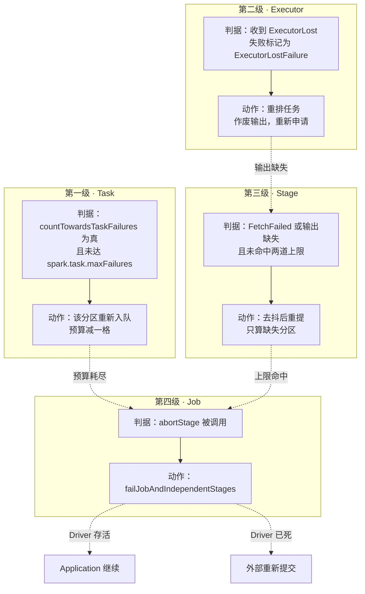
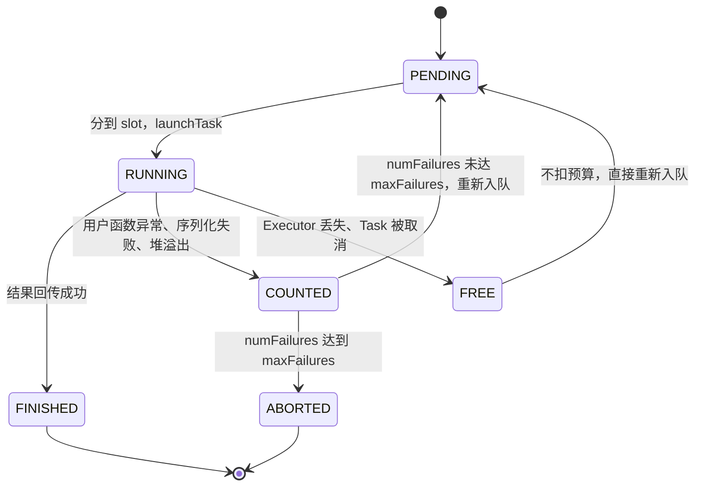
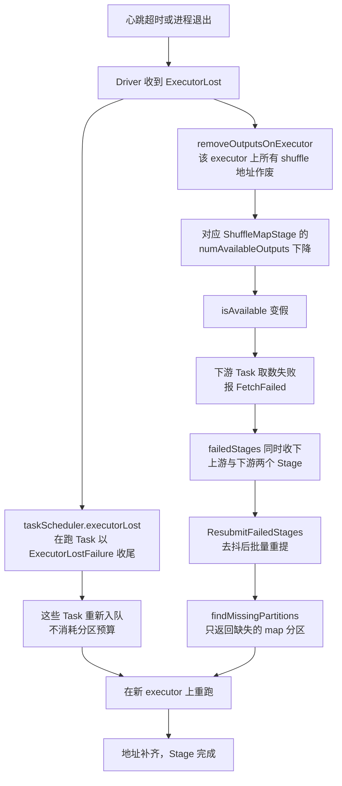
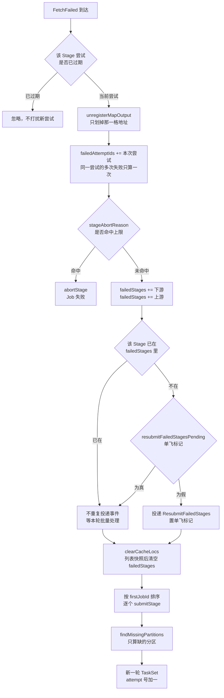
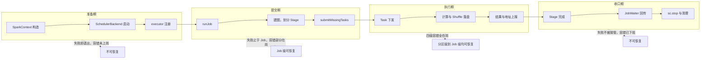
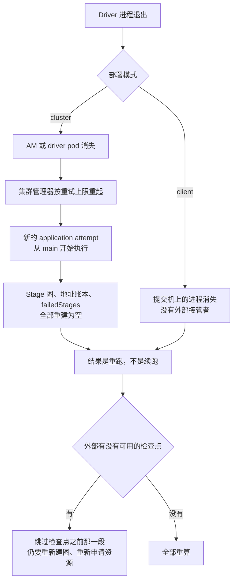

# 4. Spark 容错机制与 Runtime 生命周期：四级失败的判据、恢复动作与不可恢复的边界

**摘要：**

凌晨三点，Driver 日志里出现这样一行：`Task 77 in stage 12 failed 4 times; aborting job`。它同时给出了三样东西——一个分区号、一个失败次数、一个动作，而这三样东西恰好把 Spark 容错的全部结构压缩在了一行里：为什么偏偏是第 77 号分区而不是整个 Stage，为什么是 4 次而不是 3 次或 40 次，为什么到了这一级就再也不往上试一次。2012 年那篇 RDD 论文回答的是"数据丢了为什么还能算回来"，那是血统这一层的问题；本文把观察位置换到调度器身上，问的是同一次故障面前，Driver 里的三个组件各自收到什么信号、各自做什么动作、各自在哪里收手。

文章沿五问推进：先给四级失败划出边界，交代一次失败通常只上升一级、很难连跳；再拆开 Task 级那本按分区记账的失败预算，说明为什么一台机器掉线不计入其中；接着走一遍 Executor 丢失之后 Driver 的四个动作，指出 Shuffle 输出作废才是把"机器问题"翻译成"Stage 问题"的那一步；然后把 Stage 重提拆成账本裁剪、去抖与两道上限；再落到 Job 级的 `**abortStage**` 收口，说明失败的作用域为什么到此为止。后半程换一个切面，把 Runtime 生命周期按"容错是否在岗"重切成准备、提交、执行、收口四段，并回答最后一个问题——Driver 自己挂了为什么不能续跑，AM 重启与断点续跑到底差在哪一步。

**关键词（Keywords）**: **TaskSetManager**, countTowardsTaskFailures, spark.task.maxFailures, **executorLost**, **FetchFailed**, missingPartitions, resubmitFailedStages, abortStage, **Driver失败**, **AM重启**

> [!info] 版本口径
> 本文以 Spark 4.3.0 为基准（4.x 预编译包基于 Scala 2.13），文中源码引用同以 4.3.0 主线为准；`spark.stage.maxAttempts` 这类较晚引入的配置，会在正文里单独标注引入版本。各发行版打补丁后可能有出入的细节，以对应版本文档或源码为准。

---

## 第 1 章 四个层级：一次失败只能上升一级

### 1.1 一条日志里的三处线索

`Task 77 in stage 12 failed 4 times; aborting job` 这行日志出自 `TaskSetManager.handleFailedTask`，是调度器里少数几条会把"决策依据"完整打印出来的日志之一。分区号 77 说明记账的对象是一个具体的分区，不是整个 Stage；次数 4 说明有一个按分区累计的预算；`aborting job` 说明预算耗尽之后承接后果的是 Job，而不是 Stage，也不是 Application。

三处线索对应三次判断，三次判断分属三个不同的组件。`TaskSetManager` 管分区级的重试预算，`DAGScheduler` 管 Stage 级的重提与熔断，`TaskSchedulerImpl` 管机器与容量的进出。三者之间有一条明确的上下级关系，但这条关系并不是"出事了就往上交"，恰恰相反，调度器的默认姿态是尽量在自己这一级把事情了结，能不上交就不上交。理解 Spark 容错，首先要理解这条"不上交"的默认姿态是怎么被写进代码的。

### 1.2 四级失败的判据与动作

把一次失败从发生到收场的路径摊开，可以清楚地看到四个层级各自的判据、上限、动作与代价。这张表是后文所有讨论的地图，每一行都会在后面单独成章。

| 层级 | 判据（谁在判） | 默认上限 | 恢复动作 | 代价 |
|---|---|---|---|---|
| Task 失败 | `TaskFailedReason.countTowardsTaskFailures` 为真，且 `numFailures(index) < maxTaskFailures` | `spark.task.maxFailures`，默认 4 | `TaskSetManager` 把该分区重新入队，等下一次 slot | 一个分区的重算时间，加一次调度往返 |
| Executor 丢失 | Driver 侧收到 `ExecutorLost` 事件，该 executor 上在跑的 Task 以 `ExecutorLostFailure` 收尾 | 无独立上限，只受 Stage 级上限间接约束 | 重排这些 Task、作废其 Shuffle 输出、向集群管理器重新申请容量 | 该 executor 上全部在跑 Task 一起重算，外加上游 map 分区重算 |
| Stage 重提 | `FetchFailed`、Shuffle 输出缺失、不确定性 Stage 校验失败 | `spark.stage.maxConsecutiveAttempts` 默认 4；`spark.stage.maxAttempts` 默认 `Int.MaxValue`，两者取 max | 进 `failedStages`，去抖后重走 `submitStage`，按缺失分区重算 | 缺失分区数的重算，可能只有 1 个，也可能是全量 |
| Job 失败 | `abortStage` 被调用：Stage 上限命中、建图异常、`TaskSet` 被 abort | 无，命中即失败 | `failJobAndIndependentStages`，`JobWaiter` 收到 `SparkException` | 本次 Job 结果作废，Application 未必退出 |
| Driver 失败 | Driver 进程退出，或 AM 被集群管理器判定失败 | 由集群管理器决定（各部署模式自有配置，以对应版本文档为准） | Spark 侧没有动作，只能由外部重新提交整个应用 | 全部重跑，除非外部已有可用的检查点 |

表格适合逐行核对，流程图适合看清通道。下面这张图把四个层级的判据与动作成对摆出来，虚线是唯一允许的上升通道，其余情况都在本级了结。



图里只有三条上升边，分别写着"预算耗尽""输出缺失""上限命中"，每一条都对应一个明确的判据。没有画出来的那些路径，都是"本级消化"——这才是常态。

这张表第五行是本文的边界所在。前四行里，每一级都有明确的判据和动作；到了第五行，判据还在（进程是否活着），动作却不在 Spark 手里了。容错之所以能成立，前提是"谁来判、判完做什么"这两件事都在同一个进程的掌控之中；Driver 一死，判的人没了，动作也就无从谈起。

### 1.3 为什么一次失败往往只上升一级

日志里那行 `aborting job` 之所以少见，是因为大多数失败在到达 Job 级之前就被消化掉了。一次用户函数抛出的异常，走的是 Task 级重试；一台机器掉线，走的是 Executor 级重排；一份 Shuffle 文件消失，走的是 Stage 级重提。这三条路径互不重叠，各自有各自的判据，失败不会因为"一级没治好"就自动往上跳一级，而只有在对应那一级的判据被明确命中时才会上升。

这个设计有一个容易被忽略的后果：越往下的一级，判据越"窄"，也越容易在本地了结；越往上的一级，判据越"宽"，一旦触发就几乎没有回旋余地。Task 级的判据是"这个分区失败了几次"，窄到只关乎一个整数；Job 级的判据是"这个 Stage 连续失败了几次"，宽到足以否掉整个作业。判据的宽窄与恢复动作的代价，在四级结构里是同向变化的。

反过来说，如果让失败自动逐级上升，会出现什么？设想每次 Task 失败都同步一次 `DAGScheduler`，那么一个两千个 Task 的 Stage 在劣化集群上会把事件循环刷满，`DAGScheduler` 单线程的事件队列成为整个作业的瓶颈；更糟的是，Stage 的 attempt 号会被无意义的失败推高，`spark.stage.maxConsecutiveAttempts` 那道熔断会在真正需要它之前就被耗掉。把失败拦在最小作用域里，不是为了省事，而是为了让上一级的预算留给真正需要它的故障。

### 1.4 一个比喻：急诊分诊台

把四级结构想成急诊的分诊台。一个病人进来，护士先量体温、问症状，能贴个创可贴就打发走的，不进诊室（Task 级）；需要拍片的，进影像科，拍完还能自己走（Executor 级）；片子显示要住院的，才办住院手续（Stage 级）；而如果整个医院停电，前面所有分诊都失去意义，只能等外部的发电车（Driver 级）。分诊台的价值不在于"把病人都送进重症监护"，恰恰在于把绝大多数问题挡在重症监护之外，让有限的抢救资源留给真正的重症。

比喻的技术限定在于：Spark 的分诊不是由一个人判断，而是由三个组件按各自的判据分别判断，且判断顺序不是自上而下串行的。一次 Executor 丢失会同时触发两个方向的判断——Task 侧的重新入队与 Stage 侧的账本作废——它们并行发生，最后在"这个 Stage 还能不能继续"这一点上汇合。第 3 章会把这两条支路合到一起看。

### 1.5 五个问题

后文的推进沿五问展开，每一问对应一组可以到源码和配置里核对的机制。

其一，四级的边界究竟划在哪里，一次失败凭什么只上升一级。其二，Task 级那本预算为什么按分区记账，`countTowardsTaskFailures` 这个字段凭什么能把"责任归属"变成可编码的规则。其三，Executor 丢失既然不计入任务预算，它凭什么不会把作业拖垮，Driver 在这一刻到底做了几件事。其四，Stage 重提凭什么只算缺的那几个分区，去抖与两道上限又是怎么配合的。其五，到了 Job 与 Driver 这一级，容错的边界为什么就到头了。

---

## 第 2 章 Task 失败：预算按分区记，不按 Stage 记

### 2.1 `handleFailedTask` 的三段主干

Task 失败的处理集中在 `TaskSetManager.handleFailedTask`，去掉推测执行与僵尸状态的分支后，主干只有三段：

```scala
def handleFailedTask(tid: Long, state: TaskState, reason: TaskFailedReason): Unit = {
  // 第一段：三道闸门。僵尸状态说明这个 TaskSet 已经被判死，
  // 再记账只会让日志更难读；不计数则说明责任不在任务本身。
  if (!isZombie && reason.countTowardsTaskFailures) {
    taskSetBlacklistHelperOpt.foreach(
      _.updateBlacklistForFailedTask(info.host, info.executorId, index))

    // 第二段：只给"这一个分区"的计数器加一
    numFailures(index) += 1

    // 第三段：预算耗尽就地收口，把问题交给 DAGScheduler
    if (numFailures(index) >= maxTaskFailures) {
      abort(s"Task $index in stage ${taskSet.id} failed $maxTaskFailures times, " +
        s"most recent failure: $failureReason", failureException)
      return
    }
  }
  maybeFinishTaskSet()
}
```

三段的顺序值得逐一交代。第一段是闸门，`isZombie` 挡住"一个已经失败的 TaskSet 继续记账"这种无意义动作，`countTowardsTaskFailures` 挡住"责任不在任务"的失败。第二段的 `index` 是分区下标，不是 Task 编号——这一点决定了后面所有的推论：失败预算的记账单位是分区，不是 Task，更不是 Stage。第三段的 `return` 很关键，它在 `abort` 之后直接返回，不会走到 `maybeFinishTaskSet`，因为 `abort` 已经把整个 TaskSet 判死，收尾工作由 DAGScheduler 接手。

`numFailures` 是一个长度等于 `numTasks` 的 `Int` 数组，每个分区一格。这个数据结构的形态本身就说明了设计意图：不同的分区各自有各自的预算，互不挪用。一个两千个分区的 Stage，如果每个分区各失败一次，`numFailures` 里每一格都是 1，没有一格达到 4，于是这个 Stage 一次都不会熔断——它在 UI 上会显示成"两千个 Task 失败后又成功"，但作业照常结束。

这条推论在调优上有直接用处。看到"某个 Stage 反复重试但作业成功了"的日志，先别急着怀疑容错失效，要看的是同一个分区号出现了几次；如果日志里分区号各不相同，那是集群在持续抖动，问题在机器与网络，不在任务代码；如果同一个分区号反复出现，问题才落在这个分区的数据或这个分区的计算函数上——倾斜分区、超大文件、解析不了的脏记录，都会表现为一个固定的分区号反复失败。

### 2.2 `countTowardsTaskFailures`：把责任归属写成字段

`TaskFailedReason` 是一个 trait，`countTowardsTaskFailures` 在它上面有默认实现，值为真；需要"不计数"的子类各自覆写成假。这个设计把一个本来只能靠人判断的问题——这次失败该不该算在任务头上——变成了一个编译期可查、运行期可判的字段。

| 失败原因类型 | 典型来源 | 是否计入预算 | 理由 |
|---|---|---|---|
| `ExceptionFailure` | 用户函数抛异常、数据反序列化失败、堆内存溢出 | 是 | 计算逻辑或数据本身有问题，重试是唯一可行的手段 |
| `ExecutorLostFailure` | executor 进程退出、心跳超时被判死 | 否 | 任务没有做错事，惩罚它等于让机器故障消耗任务的预算 |
| `TaskKilled` | 推测执行的重复副本被取消、Stage 被取消 | 否 | 主动取消是调度器的决定，不该记在任务账上 |
| `TaskCommitDenied` | 输出提交被拒，同一分区已由别的尝试提交成功 | 否 | 数据已经有人写好了，重试没有意义 |
| `FetchFailed` | reduce 端取不到某个 map 分区的输出 | 见第 4 章 | 它的正确处理位置在 Shuffle 账本，不在失败预算 |

前两行的对立是这张表的全部要点。用户代码抛异常，说明这段逻辑在这份数据上确实算不出来，重试意味着"换一台机器、换一个 slot 再试一次"，赌的是环境差异；executor 掉线，说明这一段逻辑本身没问题，换台机器大概率一次就过，把它算进预算反而是错的——如果机器故障也消耗任务预算，那么一次机架级故障就能让一批本来健康的作业集体熔断，容错机制会把基础设施的问题放大成应用的问题。

第三行与第四行是同一逻辑的延伸。任务被取消时，它可能连一行用户代码都没执行；输出提交被拒时，数据其实已经由另一个副本写成功。这两种情况下"失败"这个词都是误导，真实发生的事情是"这次尝试不需要结果了"。

这里有一个隐蔽的依赖关系需要点明：`countTowardsTaskFailures` 为假的失败虽然不进预算，但它们仍然会触发 `TaskSetManager` 的重新入队，仍然会走一遍调度。也就是说，不计数不等于不重试，只等于不扣预算。这条区别在排查时很实用——一个 executor 反复掉线的集群上，日志里 Task 的失败次数会非常多，但 `numFailures` 一直是 0，作业可以跑很久都不熔断。

### 2.3 一次重试的状态迁移

把一个分区的失败与重试画成状态机，能看清"预算"与"重排"是两条独立的线：预算决定这次失败要不要上升到 Job，重排决定这个分区什么时候再被派出去。



图里从 `COUNTED` 与 `FREE` 出发的两条边都回到 `PENDING`，但代价不同：前者消耗一格预算，后者不消耗。两条边最终都汇到"重新入队"，而不是"立即重试"——中间要重新排队等 slot。这个排队动作看似只是流程细节，实际决定了重试的间隔：一个忙的集群上，重新入队意味着可能要等几十秒才有空位，这段时间恰好让偶发的网络抖动或瞬时磁盘 IO 压力自行缓解。至于这个空位最后落在哪台机器上、首选位置如何一级级往下降，那是 `TaskScheduler` 与它的 backend 的事（见 [[6. Spark_TaskScheduler_深度解析]]）。

还有一条边没有画出来：`ABORTED` 之后 TaskSet 并不会立刻消失，它先被标记为僵尸，等在跑的其他 Task 收尾，然后才把失败上报给 DAGScheduler。这个"等"是为了避免一个已经判死的 TaskSet 继续往调度器里灌事件。

### 2.4 反事实：把预算调到 1

`spark.task.maxFailures` 设成 1，意味着任何一次计入预算的失败都会直接让 Job 失败。表面上看这是"更严格"，实际上是把 Task 级的容错完全关掉，让所有失败原地上升到 Job 级。

后果分两层。第一层是可恢复性骤降：一次瞬时的磁盘抖动、一次短暂的 GC 停顿导致的超时，本来重试一次就能过去，现在会让整个 Job 重来——而 Job 重来意味着前面已经算完的那些 Stage 全白跑（除非它们的结果还在 Shuffle 账本或缓存里）。第二层是调度压力反向升高：所有失败都涌向 `DAGScheduler`，事件循环变成瓶颈，`abortStage` 被频繁调用，`failedStages` 与 `activeJobs` 两张表反复增删。

反过来把预算调得很大（譬如 40），也不是免费的。任务的每一次失败都会让这个分区在调度队列里多排一轮，一个持续失败的脏分区会长期占着 slot 反复试错，把集群算力耗在一个注定失败的地方；同时 `numFailures` 涨得慢意味着黑名单机制（由 `spark.blacklist` 系列配置控制，默认关闭）更晚生效，故障机器更晚被排除。预算的数字本身没有对错，它标定的是"多大程度的偶发故障算正常"这个前提。

### 2.5 黑名单是第二本账

失败计数之上还有一层：`TaskSetBlacklistHelper`。它记录的不是"这个分区失败了几次"，而是"这台机器、这个 executor 上失败了几次"，两个口径互补——前者决定要不要放弃这个分区，后者决定要不要放弃这台机器。

`spark.blacklist.enabled` 默认为假，开启之后有一套分层的阈值：单个 executor 上失败多少个任务、单个节点上失败多少个 executor、整个 Stage 或整个应用上失败多少个，各自有独立的配置项。这套机制的意义在于把"重试"从纯粹的重复劳动变成有方向的排除：一个分区在 A 机器上失败两次、在 B 机器上一次就过，说明问题在 A 机器；一个分区在五台机器上都失败，说明问题在这个分区。

黑名单与失败预算的交互点在于 `updateBlacklistForFailedTask` 那一行——它只对"计入预算的失败"生效。这个细节是自洽的：任务被取消、executor 掉线这类失败不该让某台机器上黑名单，否则一次集群级的网络抖动会把所有机器都拉黑。

---

## 第 3 章 Executor 丢失：一次不记账的失败

### 3.1 判死的产物是一个事件

Executor 怎么被判死、心跳窗口有多宽、GC 停顿怎样被误判成宕机，这些属于执行器侧的观察角度，这里只接住它的产物：Driver 侧收到一个 `ExecutorLost` 事件，带着 executor 标识和一个丢失原因。从这里开始，问题就从"这台机器还在不在"变成了"这台机器上曾经有过的东西该怎么办"。

这台机器上有两类东西。一类是它正在跑的 Task，另一类是它已经算完、写在本地磁盘上的 Shuffle 输出。前者是"活着的计算"，后者是"死掉的数据"，两者的处理方式完全不同——但它们在代码里被打包进了同一个事件，所以必须由 Driver 同时处理。

### 3.2 `executorLost` 的四个动作

处理逻辑的核心是四件事，顺序不能随便换：

| 动作 | 做什么 | 排在第一位的原因 | 漏掉会怎样 |
|---|---|---|---|
| 作废 Shuffle 输出 | `mapOutputTracker.removeOutputsOnExecutor`，把这个 executor 上所有 map 分区的地址抹掉 | 地址是裁剪重算范围的唯一依据，必须先脏 | 下游会继续去一台已经没有数据的机器上取数，反复报 `FetchFailed` |
| 收尾在跑的 Task | `taskScheduler.executorLost`，各 `TaskSetManager` 以 `ExecutorLostFailure` 把在跑的 Task 结束 | 这些 Task 已经没有归属，不结束就无法重新派单 | Task 永远停在运行态，Stage 的 `pendingPartitions` 永远清不空 |
| 失效本地性缓存 | `clearCacheLocs`，清掉 Driver 侧"哪个分区在哪台机器"的记忆 | 缓存里的机器集合已经失真 | 后续任务被按错误的首选位置派发，白白等待 |
| 重新申请容量 | 通过 `SchedulerBackend` 向集群管理器请求补足 executor | 容量缺口只能由集群管理器填 | 作业在少了一批机器的集群上跛行，调度队列越来越长 |

第一件事与第二件事之间没有依赖，但它们的顺序决定了日志的可读性：先作废地址，再收尾 Task，日志里会先看到"某 shuffle 的某个分区不可用"，再看到"某 Task 因执行器丢失而失败"；反过来，先收尾 Task 的话，那些 Task 的失败原因会显得莫名其妙——它们明明是被判死的，却要归因给一次尚未记录的输出丢失。

第三件事容易被当成顺手清理，实际上它有独立的必要性。Driver 侧维护着一份"分区位置缓存"，用于给后续 Task 算首选位置；这份缓存的有效期是"到下一次 Executor 集合变化为止"，而 Executor 丢失正好是一次集合变化。缓存不失效不会导致数据错误，只会让调度器持续做出错误的本地性判断，表现为任务莫名其妙地等很久才被派出去。

第四件事是四件事里唯一涉及外部系统的。在 Standalone 模式下，这是 `StandaloneSchedulerBackend` 与 Master 之间的一次请求与资源分配；在 YARN 模式下，是 `YarnSchedulerBackend` 通过 AM 向 ResourceManager 要容器；在 Kubernetes 模式下，是向 API Server 申请新的 executor pod。三者形态不同，但语义一致：Spark 只能表达"我需要多少"，能不能给、多久给，由集群管理器决定。

### 3.3 Shuffle 输出作废是传导的起点

四件事里，真正把故障从"机器问题"变成"Stage 问题"的只有第一件。下面的图把这条传导链画出来，注意它的分岔点：作废输出与重排任务同时发生，前者向上走，后者向下走，两条支路最终在"Stage 要不要重提"这一点上汇合。



图里最需要停一下看的是 `isAvailable` 这一步。它把"一个分区的地址没了"翻译成"这个 Stage 不可用"，翻译的粒度是 Stage 而不是分区——只要有一个 map 分区没地址，`isAvailable` 就是假，下游就不该被提交。但重提时真正被重算的量又回到分区粒度，因为 `findMissingPartitions` 会去问账本"到底缺哪几格"。这两次粒度切换是 Stage 级容错的核心：判定用 Stage，执行用分区。

这也解释了为什么一次 Executor 丢失在日志里往往显得矛盾——先看到"某个 ShuffleMapStage 又要重跑了"，接着只看到"提交了 1 个 Task"。前一句说的是判定，后一句说的是执行，两句话都正确。

### 3.4 重新申请与一个时间差

第四件事里藏着一个无法消除的时间差：从 Driver 发出补充容量的请求，到新 executor 注册完成、开始接收任务，中间要经过集群管理器排队、容器创建、进程启动、与 Driver 握手这几个阶段。这个窗口内，作业的并行度是缺的，`TaskSchedulerImpl` 的调度队列里堆着一批派不出去的任务。

这个时间差不是缺陷，它是"按需分配"这件事的固有成本。想要消除它，只有两条路：一是预留冗余容量（容量规划问题，代价是钱），二是让作业在缺容量时降级运行而不是排队（这恰恰是动态分配与推测执行在做的事）。容错处理的是"数据可以不丢"，不处理"容量可以立刻补上"，把这两件事混为一谈，就会在扩容逻辑里找数据一致性的 bug。

还有一处更细的时间差：decommission（优雅下线）走的路径与普通丢失不同。一个被主动下线的 executor 会先把 Shuffle 块迁走，再退出，因此 Driver 不应该像对待宕机那样把它的输出全部作废，否则迁走的块也白迁了。这条分支的存在说明"Executor 丢失"这个事件本身携带的语义比它的名字更丰富，具体判定以对应版本文档或源码为准。

### 3.5 为什么不能靠任务预算兜住

把第 2 章与第 3 章接起来看，会出现一个明显的缺口：Executor 丢失不计入任务预算，意味着一个集群可以无限次地掉机器而不消耗任何任务级的失败额度。如果只有 Task 级这一道闸，一个持续不稳定的集群会让作业永远重试下去——既不失败，也不成功。

补上这个缺口的不是任务预算，而是 Stage 级的连续失败上限。一次 Executor 丢失最终会表现为一次 `FetchFailed`，一次 `FetchFailed` 会让 Stage 的尝试计数加一，连续若干次之后熔断。两级上限各管一段：Task 级管"这个分区要不要放弃"，Stage 级管"这个作业还要不要继续"。前者是微观的、按分区的，后者是宏观的、按作业的，中间没有第三道闸。

---

## 第 4 章 Stage 重提：账本裁剪、去抖与两道上限

### 4.1 `FetchFailed` 是唯一必须回到 Driver 的 Task 失败

并非所有 Task 失败都需要惊动 DAGScheduler。用户函数异常在原地重试就够了，因为换一台机器、换一份 slot，结果可能就不同；取数失败则不同，它说明"我要的数据不在我以为的地方"，重试一万次也拉不到，必须回到 Driver 去改账本。

`FetchFailed` 携带的信息正好够做这件事：哪个 Shuffle、哪个 map 分区、哪个 reduce 分区、原来以为在哪个 BlockManager 上。Driver 拿到之后做的第一件事是 `unregisterMapOutput`，把那一格地址从 `MapOutputTracker` 里抹掉。这一步做完，"重算范围"其实就已经确定了——后面的重提不是重新决定要算什么，而是照着账本上的空格去填。

需要区分两种情况。如果丢失的 map 分区只是这一格，账本上其余格子都在，那么重算量就是 1 个分区；如果丢失的原因是一整台机器消失，账本上会一次少掉几十格，重算量就是几十个分区。相同的代码路径，不同的重算代价，差别全在"这次到底脏了多少格"。

### 4.2 `missingPartitions` 决定重算范围

Stage 被重提时并不会重算整个 Stage，因为 `submitMissingTasks` 一进来只问一件事：这个 Stage 这次要算哪些分区。

```scala
// 重提与非重提走的是同一条路径，区别只在这一个调用的返回值
val partitionsToCompute: Seq[Int] = stage.findMissingPartitions()
```

`ShuffleMapStage` 的实现是去问 `MapOutputTracker`："这个 Shuffle 还有哪些 map 分区没有地址？"首跑时账本里根本没有这个 Shuffle 的记录，返回全集；重提时只返回被划掉的那几格。`ResultStage` 的实现则完全不同，它看的是 `ActiveJob.finished` 这个布尔数组，取反之后映射回本次 Action 真正关心的分区下标。

两条实现路径对应两套账本，这件事本身说明了重提的语义：Shuffle 端的中转仓是全局可寻址的，所以它的缺失可以被精确查询；结果端的账本属于某一个 Job，所以它的缺失只能在这个 Job 里表达。第 5 章会看到，正是这条差异决定了 Job 失败的作用域。

### 4.3 去抖：一次掉线引发的几十条失败

一台 executor 掉线会瞬间引发几十条 `FetchFailed`，它们大多指向同一个上游 Stage。如果每条失败都触发一次重提，调度器的事件队列会被同一件事刷满，而每一次重提都在做同一件工作。所以从失败入队到重提执行，中间有两层去抖。



三层机制各管一件事。`failedAttemptIds` 是一个集合而不是计数器，同一个 Stage 尝试的多次失败只记一次，避免一次掉线产生的几十条失败把 attempt 号推高几十格；`failedStages` 同时扮演失败清单与去重表两个角色，已在里面的 Stage 不再投递事件；`resubmitFailedStagesPending` 是一个单飞标记，保证任意时刻最多只有一个重提事件在队列里，处理完才放行下一个。

三层叠加的效果是：**一批并发失败被合并成一轮重提**。这也解释了为什么日志里一次 executor 掉线往往只产生一行 `Resubmitting failed stages`，而不是几十行。

`clearCacheLocs` 那一行同样不能省。取数失败往往伴随 Executor 集合变化，Driver 缓存的"哪个分区在哪台机器"可能整体失真，继续用它算首选位置，会把任务派到刚刚死掉的那批机器上。清空之后，首选位置要在下一次调度时重新查 `BlockManagerMaster`，代价是几次远程调用，收益是避免一整批错误派发。

至于"先快照再清空"——`failedStages.toArray` 之后立刻 `clear`，是为了让重提过程中产生的新失败能重新入队。如果边遍历边重提，新失败会被这次遍历吞掉，反过来如果先清空再遍历就没法拿到列表。这个顺序是容器类代码里最经典的写法，也是这类逻辑最容易改错的地方。

### 4.4 两道上限，取 max 的原因

Stage 重提不能无限进行，否则一个反复丢 executor 的集群会让某个 Stage 永远重来，作业既不失败也不结束。熔断的判据写在 `stageAbortReason` 里，有两道相互独立的尺子：

```scala
// 连续失败上限：Stage 成功一次就清零
private[scheduler] val maxConsecutiveStageAttempts =
  sc.conf.get(config.STAGE_MAX_CONSECUTIVE_ATTEMPTS)

// 总量天花板：取两者较大值，保证总量上限永远不低于连续上限
private[scheduler] val maxStageAttempts: Int =
  Math.max(maxConsecutiveStageAttempts, sc.conf.get(config.STAGE_MAX_ATTEMPTS))

private def stageAbortReason(stage: Stage, failureMessage: String): Option[String] = {
  if (stage.failedAttemptIds.size >= maxConsecutiveStageAttempts) Some("连续失败已达上限")
  else if (stage.getNextAttemptId >= maxStageAttempts) Some("总尝试次数已达上限")
  else None
}
```

| 维度 | `spark.stage.maxConsecutiveAttempts` | `spark.stage.maxAttempts` |
|---|---|---|
| 引入版本 | 2.2.0 | 3.5.0 |
| 默认值 | 4 | `Int.MaxValue` |
| 计量对象 | `failedAttemptIds` 的大小，即"连续失败了几次" | `getNextAttemptId`，即"一共尝试过几次" |
| 成功时是否清零 | 是，`clearFailures` 会把它清空 | 否，编号只增不减 |
| 语义 | 硬底线，防止一个 Stage 陷在死循环里 | 可收紧的额外约束，用于长跑作业的成本控制 |
| 生效方式 | 直接参与 `stageAbortReason` 的判断 | 与连续上限取 max 之后才参与判断 |

取 max 这个细节直接改变了两个配置的关系。如果各判各的、任一命中就熔断，那么把 `spark.stage.maxAttempts` 设成一个比连续上限更小的值（譬如 2），等于悄悄把连续上限压到了 2，两个配置的语义就纠缠在一起，调参的人以为自己在设总量，实际改的是连续性。取 max 之后语义变得干净：连续上限是硬底线，总量上限只能在它之上再加一道，不能把它放松。

连续与总量的区别在实际运维里很实在。一个跑八小时的作业，中间零星因为 executor 抖动重提了十几次，每次之间都隔着几十分钟的正常计算——这种情况连续上限不会命中，因为每次重提之后 Stage 都成功过，`clearFailures` 把账清零了；但如果某个 Stage 连续四次在几分钟内失败，那说明故障是持续性的，继续重试只是浪费。连续性度量的是"故障是否持续"，总量度量的是"总体成本是否可接受"，两者回答不同问题。

### 4.5 反例：输出不确定的 Stage

"只重算缺失分区"这套推理有一个隐含前提：同一个分区算两次，得到的结果相同。这个前提一旦不成立，账本越精确，错得越彻底——第一次算出的结果已经被下游读走，第二次重算又得到不同的数据，上下游就会看到两份互相矛盾的东西。

Spark 的处理方式是给这类 Stage 打标记，命中之后重提前先做一次回滚，把该 Stage 的 Shuffle 输出整体作废，让 `findMissingPartitions` 返回全集。代价是重算量从 1 个分区变成整个 Stage，收益是避免"重算一半之后发现不一致"这种更贵的局面。

这条反例说明第 4.2 节那个漂亮的"只算一格"从来不是普适规律，它是"分区之间彼此独立且结果可复现"这个前提下才成立的结论。缺哪个前提，对应的就是一个整段重来的场景。

---

## 第 5 章 Job 失败：`abortStage` 的收口

### 5.1 三个来源，一个出口

Job 失败不是一个独立发生的事件，它是另外三个来源的汇合点：Stage 连续失败命中上限、建图阶段抛异常、`TaskSet` 被 `abort`。三条路径的终点都是 `abortStage`。

`abortStage` 做三件事：把失败的 Stage 与它的下游 Stage 一起摘出可调度队列，用失败信息把这次尝试收尾（`markStageAsFinished(..., willRetry = false)`），让受影响的 Job 的 `JobWaiter` 收到一个 `SparkException`。第三件事是用户代码能感知到的部分——`collect()`、`count()`、`saveAsTextFile()` 这些 Action 会在这里抛出异常，异常信息里通常带着失败的分区号与失败原因。Action 如何触发 Job、`JobWaiter` 又如何等待结果，属于 Job 生命周期的范围（见 [[9. Spark_Job生命周期详解]]）；这里只关心收口那一刻发生了什么。

有一个细节容易被忽略：`markStageAsFinished` 带的是 `willRetry = false`。同一个方法在正常完成与重提路径上都用，靠这个参数区分"这次尝试是结束还是暂停"。`willRetry = false` 意味着 UI 上这个 Stage 的这次尝试会被标成失败终态，不再有新的 Task 派出去。

### 5.2 失败的作用域不是"整个应用"

很多人对 Job 失败的心智模型是"作业挂了，整个 Spark 应用也就完了"。实际的作用域比这窄：`abortStage` 失败的是这个 Stage 及其下游，以及把这些 Stage 记在 `jobIds` 里的那些 Job。同一个 Application 里不经过这条 Stage 链的 Job 不受影响。

这条边界在两种情形下有实际意义。其一，一个 Application 里串了好几个 Job（先 `count()` 做校验，再 `collect()` 出结果），前面的 Job 失败不必然导致后面的 Job 失败——除非用户代码自己捕获异常之后继续往下跑。其二，两个 Job 共享了同一个上游 `ShuffleMapStage`，这个共享 Stage 失败会同时牵连两个 Job，因为它们都在这个 Stage 的 `jobIds` 里。所以"Job 失败"到底结束一个还是几个作业，取决于它们有没有共享这条链，而不取决于它们属于同一次 `spark-submit`。

### 5.3 收口的顺序

收口动作有一个隐含的顺序要求：先取消还在跑的 Task，再通知等待者，最后清理账本。顺序颠倒会留下两种不一致——用户代码收到异常时后台还有 Task 在跑，用户可能立刻退出 JVM，那些 Task 的 Shuffle 输出写了一半；或者账本先清了，`JobWaiter` 才收到失败，UI 上出现"Job 已失败但 Stage 还显示运行中"的错位。

这条顺序之所以不需要显式加锁来保证，是因为 `DAGScheduler` 的事件循环是单线程的。整个收口过程在这个线程上串行执行，外部看到的永远是某个中间状态的一个快照。这也是为什么 `DAGScheduler` 里大量代码可以直接对集合做增删而不加同步——单线程事件循环把并发问题转化成了顺序问题，代价是所有阻塞调用都必须搬出这个线程。

### 5.4 Job 失败之后 Application 还在

Job 失败之后，`SparkContext` 本身仍然活着，所有已注册的 executor 仍然活着，`MapOutputTracker` 上的账本也仍然在。用户代码如果捕获了异常，可以重新提交一个 Job，前面已经算完的 `ShuffleMapStage` 仍然可以被复用——这是 Job 级失败与 Application 级失败的本质区别。

这个区别在实际使用中常被忽略。一个 ETL 脚本对十张表分别跑一个 Job，前九张成功、第十张因为脏数据失败，如果不捕获异常，整个 Application 退出，前面九张的结果（可能已经写到了 HDFS）不会回滚，但作业的收尾逻辑（譬如最后一步的元数据登记）不会执行，留下一个"半成品"状态。Spark 的容错粒度到 Job 为止，跨 Job 的一致性要由用户代码自己负责。

---

## 第 6 章 Runtime 生命周期：容错在岗的时间比想象中短

### 6.1 四段切分：按"容错是否在岗"重新划线

通常讲 Runtime 生命周期，是按对象的创建顺序切：`SparkContext` 构造、`DAGScheduler` 与 `TaskScheduler` 初始化、资源申请、Stage 提交、Task 执行、`stop`。这个切法描述的是"发生了什么"，不描述"出事时谁能救"。换一个切法，按容错是否在岗来分，会得到完全不同的四段。

| 阶段 | 边界 | 这一段的失败面 | 容错是否在岗 | 可恢复性 |
|---|---|---|---|---|
| 准备期 | `new SparkContext` 到 executor 注册齐 | 配置错误、端口占用、资源申请不下来、闭包序列化失败 | 否 | 通常不可恢复，异常直接抛给 `main` |
| 提交期 | `runJob` 到 `submitMissingTasks` 返回 | 建图异常（输入路径不存在等）、Task 序列化失败、无活跃 Job 的 Stage 被提交 | 部分，止于 Job 级 | Job 失败，Application 存活 |
| 执行期 | Task 下发到 Stage 完成 | 用户函数异常、executor 丢失、Shuffle 输出损坏、取数失败 | 是，四级容错都在这一段 | 分区级、Stage 级、Job 级三层都有 |
| 收口期 | Stage 完成到 `sc.stop` 返回 | 结果回传失败、Shuffle 清理异常、`BlockManager` 停止超时 | 否 | 通常不可恢复，可能表现为"作业成功但结果没拿到" |

这张表最反直觉的一行是最后一行。收口期看起来只是"善后"，实际上它是失败最不可恢复的一段：一个 Job 已经算完、结果已经算出来了，但在回传或者清理的瞬间出错，前面所有的容错都帮不上忙，因为没有"重试一次收口"这种机制——`sc.stop` 之后再想重来，只能重新提交整个应用。

下面的图把这四段与它们的容错状态画在一起，虚线标出的是每一段的"容错在岗程度"。



### 6.2 准备期：容错还没有上岗

准备期的一切都发生在"调度器还没有任务可调"的状态下。`SparkContext` 构造时会依次建出 `DAGScheduler`、`TaskSchedulerImpl`、`SchedulerBackend` 与 `MapOutputTrackerMaster`，然后启动 backend、等待 executor 注册。这段时间里如果出错，没有 Stage 可重提、没有分区可重算、没有账本可裁剪——容错机制的三个抓手一个都还不存在。

这一段最常见的失败不是硬件问题，而是配置与代码问题：提交参数不合法、driver 端口被占用、用户闭包里引用了不可序列化的对象。这些失败有一个共同点——它们不是"偶发"的，重试一次会以同样的方式失败。所以这一段的设计取向是"快速失败并说清楚原因"，而不是"重试"。容错的适用前提是故障具有偶发性；对于确定性的错误，快速失败比任何重试都更有价值。

### 6.3 提交期：失败的作用域是 Job

提交期从 `runJob` 开始，到 `submitMissingTasks` 返回为止。这一段做的是纯粹的 Driver 侧工作：建图、算缺失父 Stage、序列化 Task、打包 `TaskSet` 交给 `TaskScheduler`。整个过程中没有任何一个 Task 在集群上跑。

这一段出错时的处理方式在 `handleJobSubmitted` 里写得很清楚：建图失败就地失败，不留半张图。

```scala
var finalStage: ResultStage = null
try {
  finalStage = createResultStage(finalRDD, func, partitions, jobId, callSite)
} catch {
  case e: Exception =>
    listener.jobFailed(e)   // 建图失败就地失败，不留半个 Stage 图
    return
}
```

"不留半张图"这个选择值得停下来看。建图过程中可能已经创建了几个 `ShuffleMapStage` 并登记进了 `stageIdToStage` 与 `shuffleIdToMapStage`，异常发生时它们还在表里。`handleJobSubmitted` 选择不修补、不清理、直接让 Job 失败——因为半张图比没有图更难处理：这些 Stage 已经进了两张登记表，`jobIds` 里却只剩一个随后被清理掉的 Job，后续的 Job 建图时一旦命中它们，提交时就走不到发任务那一步。在调度器里，"干净的失败"比"部分成功的状态"更有价值，这条取向在好几处重复出现。

提交期的失败还有一个特征：它不会触碰集群上的任何东西，所以恢复动作可以完全在 Driver 内完成——用户捕获异常后重新提交即可，不需要等待 executor 清理，也不需要重建 `SparkContext`。

### 6.4 执行期：唯一真正有容错的窗口

执行期是四级容错全部在岗的唯一一段。Task 失败有预算、Executor 丢失有重排、Stage 有重提、Job 有收口，每一级都有明确的判据与动作。前面三章讲的所有机制，都在这一段里生效。

这一段的时间占比往往也是最大的，于是产生了一个认知偏差：人们容易把"Spark 有容错"等同于"Spark 全程有容错"。把四段摆在一起看，容错真正能起作用的时间窗口只是中间那一段，两头都没有保护。这个偏差在容量规划上有直接后果——如果按"全程容错"的假设去估算作业的稳定性，会低估准备期与收口期的风险，而这两段恰恰是"重跑整个应用"代价最高的地方。

### 6.5 收口期：容错已经下班

收口期从最后一个 Stage 完成开始，到 `sc.stop` 返回为止。这一段做的事情包括：结果通过 `JobWaiter` 回传给用户代码、`DAGScheduler` 清理 `activeJobs` 与 `failedStages`、`TaskScheduler` 停止 backend、`BlockManager` 停止并清理本地块、Driver 端口释放。

这一段的失败面比想象中大。结果回传时网络中断，用户拿不到结果但作业在 Spark 侧已经算成功；Shuffle 清理时磁盘出错，清理线程抛异常但主流程已经结束；`stop` 过程中某个 executor 不响应，Driver 要等到超时才继续。这些失败都不会触发任何重试，因为它们不落在任何一个 Stage 或 Task 的生命周期里。

有一类现象是这一段特有的：作业在 UI 上显示成功，用户代码却抛了异常。原因通常是结果收集（尤其是 `collect` 这种把大量数据拉回 Driver 的操作）在收口阶段失败——Task 早就成功，结果在传输途中丢了，`JobWaiter` 收不到完整的 `resultHandler` 调用，最终超时或者抛异常。这类问题无法靠调大重试次数解决，因为重试的对象已经不存在了。

---

## 第 7 章 Driver：那道不可恢复的边界

### 7.1 Driver 手里握着什么

Driver 挂掉为什么不能续跑，答案不在"有没有做持久化"，而在 Driver 手里握着的那组状态本身：`stageIdToStage` 里的整张 Stage 图、`shuffleIdToMapStage` 里的 Shuffle 与 Stage 的映射、`MapOutputTrackerMaster` 里的 Shuffle 地址账本、`BlockManagerMaster` 里的块位置、`activeJobs` 与 `JobWaiter`、`failedStages` 与 `failedAttemptIds`、以及用户代码里的累加器与广播变量。

这组状态的共同点是：它们都是决策状态，而不是数据状态。Stage 图记录的是"哪些段可以独立重来"这个决定；地址账本记录的是"哪一格已经算过"这个事实；`failedStages` 记录的是"哪些段正在等重提"这个意图。这些信息没有任何一份存在于 executor 上——executor 只知道自己在算什么，不知道整个作业打算怎么算。

这就决定了 Driver 无法像 executor 那样"死而重生"。一个 executor 死掉，Driver 可以重新派单，因为决策还在；Driver 死掉，决策没了，剩下的 executor 手里的数据也就失去了意义——它们不知道自己算的那一块属于哪一段，也不知道算完之后该交给谁。

### 7.2 两种部署模式的不同结局

| 部署模式 | Driver 在哪 | Driver 挂了谁负责 | 能不能续跑 |
|---|---|---|---|
| client | 提交机上的 `spark-submit` 进程 | 没有接管者，用户看到进程退出 | 不能，重新提交 |
| cluster（YARN） | ApplicationMaster 内 | YARN 按 AM 重试上限重起 AM | 不能，重起后从 `main` 重头跑 |
| cluster（Kubernetes） | driver pod | pod 重启策略与外部控制器 | 不能，同一个应用内没有恢复点 |
| Standalone cluster | 由 Master 分配的 Worker 上 | 没有自动重启，Master 直接把应用标记为结束 | 不能，需要重新提交 |

四种模式的共同点是"重跑"，不是"续跑"。差别只在"谁来发起重跑"以及"重跑之前要等多久"：client 模式要人手动再敲一次 `spark-submit`；YARN 的 cluster 模式由 ResourceManager 自动发起新的 application attempt，attempt 编号加一，日志按 attempt 分开存；Kubernetes 模式由 pod 的重启策略或者外部的 Job 控制器决定。

有一处细节值得点明：YARN 的 AM 重试是整个应用的重试，不是某个 Stage 的重试。新的 attempt 启动之后，`SparkContext` 是一个全新的实例，所有状态从零开始，之前那个 attempt 跑完的 Stage 一个都不会被复用。这也是为什么"AM 重试次数"这个参数在集群上通常配得很小——每一次重试都意味着从头再跑一遍，代价极高。

### 7.3 AM 重启为什么不是断点续跑

"续跑"这个词容易被误用。它的严格含义是：从失败点继续，已完成的部分不重做。AM 重启不满足这个定义，因为重启之后没有任何东西告诉新的 Driver "上一次跑到哪了"。

下面的图把这条路径画出来，注意 Stage 图与账本在重启之后全部重建这一步。



图里最后那个分岔需要说清楚：检查点能缩短重跑的路，但它改变的是重跑的起点，不是恢复的语义。新 Driver 仍然要重新建图、重新申请 executor、重新提交 Stage，只是建图时读到的是检查点文件而不是原始输入。检查点本身的写入路径与持久化代价不在本文范围内，这里只强调一点：它把"从头算"变成"从中间算"，但没有把"重跑"变成"续跑"。

还有一处容易混淆：Structured Streaming 的检查点与 RDD 检查点是两套不同的机制。前者的检查点里存的是偏移量与查询进度，目的是让流式查询在重启之后接着处理；后者存的是 RDD 的数据快照，目的是让批处理少算一段。把两者混为一谈，就会得出"Spark 支持 Driver 级恢复"这种过度推论。

### 7.4 一个比喻：指挥不在，乐谱还在

把 Driver 想成乐团的指挥，executor 是乐手。指挥突然离场，乐手们手里还拿着各自的谱子，但他们不知道现在演到第几乐章、下一段该谁起、强弱怎么处理。让他们接着演下去，只会得到一段彼此错位的音乐。换一位指挥上来（AM 重启），最稳妥的做法是从头再演一遍，而不是从"刚才大概演到第三乐章"接着来——因为没有人记录过精确的位置。

比喻的技术限定在于：Spark 并不是完全没有记录位置。Shuffle 输出、缓存块、检查点文件都是"演过的证据"，但它们记录的是"哪些段落已经产出"，不记录"整个作业打算怎么组织"。指挥缺的是后者，而不是前者。

### 7.5 边界之外：还有什么不可恢复

Driver 只是不可恢复的边界上最显眼的一处。同一类问题还出现在几个地方：`SparkContext` 被用户代码意外关闭之后无法复用；一个被取消的 Job 无法从取消点恢复，只能重新提交；`SparkSession` 的 catalog 状态（临时视图、注册的函数）存在 Driver 内存里，重启后全部丢失；广播变量在 Driver 端有一份，Driver 一死，executor 上那份也就没人认领了。

这些现象的共同根源是同一个：Spark 的容错设计以"Driver 长活"为前提，所有恢复动作都发生在 Driver 之内，而不是发生在 Driver 之间。这个前提在批处理场景下完全合理，因为一次批处理的生命周期通常只有几十分钟到几小时；但在流处理与长跑作业里，这个前提就成了单点，需要靠外部的重启策略来兜底。

---

## 第 8 章 边界与反例

### 8.1 把"重试"当成"容错"的全部

最常见的误判是把容错等同于重试。实际上四级结构里只有前两级是重试，后两级是收口：Stage 重提不是"再试一次 Stage"，而是"按账本重新算缺的那几格"；Job 失败不是"再试一次 Job"，而是"把这个作业判死，交给用户代码"。把后两级也理解成重试，就会在调大重试次数上找错方向。

### 8.2 以为 Executor 丢失会让作业失败

`ExecutorLostFailure` 不计入任务预算，这条设计意味着一台机器掉线几乎不会直接导致作业失败。一个反复掉线的集群上，作业可能跑很久都不失败，也不会报出明确的错误——它只是越来越慢。这种"慢而不死"的状态比直接失败更难排查，因为日志里没有任何一条错误足以定位问题，只有大量 `ExecutorLost` 与 `FetchFailed` 的重复出现。

判断方法是看 Stage 的 attempt 号增长曲线：如果某个 Stage 的 attempt 号在缓慢上升，同时 executor 数量在波动，那就是这类问题；如果 attempt 号增长很快，说明 Stage 内部的失败率很高，问题在数据或计算逻辑。

### 8.3 一张反例速查表

| 现象 | 常见误判 | 实际机制 |
|---|---|---|
| 同一 Stage 里两千个 Task 各失败一次，作业成功 | 容错失效，应该熔断 | 预算按分区记账，没有一格达到 `maxTaskFailures` |
| Executor 掉了二十台，作业仍没失败 | 容错能力很强 | `ExecutorLostFailure` 不计数，熔断压力全在 Stage 级上限 |
| Stage 重提后只跑了 1 个 Task | 重提逻辑有 bug | `findMissingPartitions` 只返回账本上缺失的那一格 |
| Stage 连续失败 4 次后 Job 失败，其他 Job 还在跑 | 整个应用失败了 | `abortStage` 的作用域止于这条 Stage 链上的 Job |
| AM 重启后作业从头开始 | Spark 没做断点续跑 | AM 重启是重跑，Stage 图与账本全部重建 |
| 作业在 UI 上成功，用户代码却抛异常 | 容错失效 | 失败发生在收口期，不在任何 Stage 的生命周期里 |
| decommission 期间取数失败但重算量很小 | 丢失处理被跳过 | 优雅退出会先迁走 Shuffle 块，输出未必作废 |

### 8.4 反例：把 `spark.task.maxFailures` 调大以"提高稳定性"

这个配置被调大的动机通常是"让作业更不容易失败"。它的实际效果是把失败的分区多试几次，代价是每次失败都要重新排队、重新申请 slot，一个持续失败的脏分区会长期占用算力。更隐蔽的代价在前面提过：预算涨得慢意味着黑名单更晚生效，故障机器更晚被排除，集群整体的失败率可能因此上升。

真正需要调整这个参数的场景其实很窄：任务失败的原因是偶发且与机器相关的（譬如网络抖动导致的超时），并且你确认重试到新的机器上就能成功。如果失败原因是数据本身（脏记录、倾斜分区、超大文件），调大只会延后失败的时间点。

### 8.5 反例：以为 Stage 重提一定比重跑整个 Job 便宜

Stage 重提的代价取决于缺失分区的规模，而不是平均分区的大小。一个两千个分区的 Stage 里，如果那个缺失的分区恰好是数据倾斜最严重的那一个，重算它的代价可能超过重算其余一千九百九十九个。"只重算一格"在最坏情况下等于"重算最贵的那一格"，这是分区粒度容错的固有代价，也是倾斜问题除了"跑得慢"之外的第二个代价。

---

## 第 9 章 落点

回到开头那行日志。`Task 77 in stage 12 failed 4 times; aborting job` 里的三处线索，现在各自有了出处：77 是"按分区记账"的记账单位，4 是"多大程度的偶发故障算正常"这个前提被写成的数字，`aborting job` 是四级结构里最后一个能由调度器自己做主的动作。

四级结构的实质是一条责任分配线。Task 级负责把偶发的、与机器相关的失败消化掉；Executor 级负责把机器故障从任务账上摘出去，只留下数据账；Stage 级负责把"缺了什么"翻译成"要算什么"；Job 级负责在重试已经不划算的时候喊停。四级的判据一个比一个宽，动作一个比一个重，代价一个比一个大——这不是四套并列的容错机制，而是一条逐步收缩的止损线，每一级都在替下一级省下不必要的开销。

这条止损线的尽头是一道悬崖。Driver 手里握着的是一组决策状态，而不是数据状态，这组状态没有任何一份存在于 executor 上，因此 Driver 一死，所有正在进行的恢复动作失去意义。cluster 模式下集群管理器能把应用重新拉起来，但那是一次重跑：新的 attempt、新的 `SparkContext`、空白的 Stage 图。检查点能把重跑的路缩短，改变不了"重跑"这个性质。容错的作用域与决策状态的驻留位置完全重合，这是整套设计里最硬的一条约束，也是它最容易被误读的地方。

按容错是否在岗重新切分 Runtime 生命周期，得到的判断顺序与按对象创建顺序切分完全不同。看到作业失败，先问它落在哪一段：如果在准备期，查配置与依赖，不要指望重试；如果在提交期，查建图与序列化，Job 失败但应用还活着，重新提交即可；如果在执行期，按四级结构往下找，先看分区号是否重复，再看 executor 是否在波动，最后看 Stage 的 attempt 增长速度；如果在收口期，重点不在 Spark 内部，而在结果回传链路与外部存储。四个问题问完，绝大多数"作业失败"的排查都能落到一个具体机制上，而不是停在"重启一下试试"这种无从验证的动作上。

至于 Driver 级的恢复会不会有朝一日被补上，目前仍然言之尚早。要让 Driver 可恢复，需要把 Stage 图、Shuffle 地址账本、Job 等待者这些决策状态持久化到一个所有候选 Driver 都能读到的地方，并且保证恢复时 executor 集合与持久化时的视图对得上——这已经不是在调度器里加一层缓存能解决的问题，而是要把调度器改造成一个可以重建状态的服务。这笔改造的代价与它带来的收益是否匹配，取决于作业能跑多久、失败一次有多贵，而不是取决于哪一种架构更先进。

---

## 参考资料

1. Zaharia M., Chowdhury M., Das T., et al. Resilient Distributed Datasets: A Fault-Tolerant Abstraction for In-Memory Cluster Computing. NSDI 2012. https://www.usenix.org/system/files/conference/nsdi12/nsdi12-final138.pdf
2. Apache Spark 源码（4.3.0）：`core/src/main/scala/org/apache/spark/scheduler/TaskSetManager.scala`，`handleFailedTask`、`numFailures` 与 `countTowardsTaskFailures` 的判定。https://github.com/apache/spark/blob/v4.3.0/core/src/main/scala/org/apache/spark/scheduler/TaskSetManager.scala
3. Apache Spark 源码（4.3.0）：`core/src/main/scala/org/apache/spark/scheduler/TaskSchedulerImpl.scala`，`executorLost` 的入口与 `TaskSetManager` 的重新入队。https://github.com/apache/spark/blob/v4.3.0/core/src/main/scala/org/apache/spark/scheduler/TaskSchedulerImpl.scala
4. Apache Spark 源码（4.3.0）：`core/src/main/scala/org/apache/spark/scheduler/DAGScheduler.scala`，`handleExecutorLost`、`handleTaskCompletion` 的 `FetchFailed` 分支、`resubmitFailedStages`、`abortStage`。https://github.com/apache/spark/blob/v4.3.0/core/src/main/scala/org/apache/spark/scheduler/DAGScheduler.scala
5. Apache Spark 源码（4.3.0）：`core/src/main/scala/org/apache/spark/scheduler/Stage.scala` 与 `TaskSetManager.scala` 中的 `TaskFailedReason`、`ExecutorLostFailure`、`TaskKilled`、`TaskCommitDenied` 各子类的计数口径。https://github.com/apache/spark/blob/v4.3.0/core/src/main/scala/org/apache/spark/scheduler/Stage.scala
6. Apache Spark 源码（4.3.0）：`core/src/main/scala/org/apache/spark/MapOutputTracker.scala`，`removeOutputsOnExecutor`、`unregisterMapOutput` 与 `findMissingPartitions`。https://github.com/apache/spark/blob/v4.3.0/core/src/main/scala/org/apache/spark/MapOutputTracker.scala
7. Apache Spark 源码（4.3.0）：`core/src/main/scala/org/apache/spark/scheduler/ShuffleMapStage.scala` 与 `ResultStage.scala`，两套账本各自实现的 `findMissingPartitions`。https://github.com/apache/spark/blob/v4.3.0/core/src/main/scala/org/apache/spark/scheduler/ShuffleMapStage.scala
8. Apache Spark 源码（4.3.0）：`core/src/main/scala/org/apache/spark/scheduler/TaskSetBlacklist.scala`，`updateBlacklistForFailedTask` 与分层阈值。https://github.com/apache/spark/blob/v4.3.0/core/src/main/scala/org/apache/spark/scheduler/TaskSetBlacklist.scala
9. Apache Spark 源码（4.3.0）：`core/src/main/scala/org/apache/spark/internal/config/package.scala`，`spark.task.maxFailures`、`spark.stage.maxConsecutiveAttempts`、`spark.stage.maxAttempts`、`spark.blacklist.*` 的默认值与引入版本。https://github.com/apache/spark/blob/v4.3.0/core/src/main/scala/org/apache/spark/internal/config/package.scala
10. Apache Spark 4.3.0 文档：Job Scheduling，Task 重试与 Stage 重提的行为描述。https://spark.apache.org/docs/latest/job-scheduling.html
11. Apache Spark 4.3.0 文档：Configuration，Application Properties 与 Scheduling 相关配置项。https://spark.apache.org/docs/latest/configuration.html
12. Apache Hadoop 文档：YARN ApplicationMaster 重启与 `yarn.resourcemanager.am.max-attempts` 的语义。https://hadoop.apache.org/docs/stable/hadoop-yarn/hadoop-yarn-site/YARN.html

---

> [!note] 思考题
> 1. 失败预算按分区记账，一个 Stage 里两千个 Task 各失败一次不会熔断，而同一个分区失败四次就会。这个设计在什么故障形态下是优点，在什么故障形态下会掩盖真正的问题？
> 2. `ExecutorLostFailure` 不消耗任务预算，把熔断压力全部转移到 Stage 级的连续失败上限。如果给 Executor 丢失也设一个独立的失败预算，第一级与第三级的分工会被改成什么样子？
> 3. `resubmitFailedStages` 用 `failedStages` 集合与 `resubmitFailedStagesPending` 标记做了两层去抖。去掉单飞标记、只保留集合去重，会退化成什么样的行为？
> 4. `spark.stage.maxAttempts` 与连续上限取 max 而不是各判各的。如果把这条规则改成"任一命中即熔断"，会怎样影响运维人员对这两个参数的直觉？
> 5. 把 Runtime 切成准备、提交、执行、收口四段之后，只有执行期有容错。如果要给收口期补一层恢复能力，最需要持久化的是哪一份状态，代价又落在哪里？
> 6. Driver 的不可恢复性来自"决策状态只存在于 Driver 内存"。假设允许把 Stage 图与 Shuffle 账本定期快照到可靠存储，恢复时最难对齐的是哪一类状态？