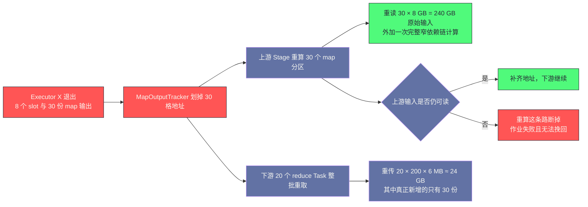
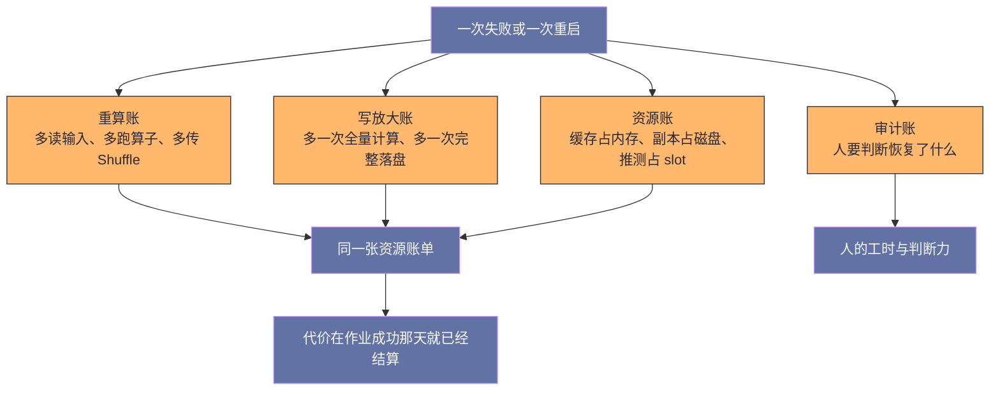
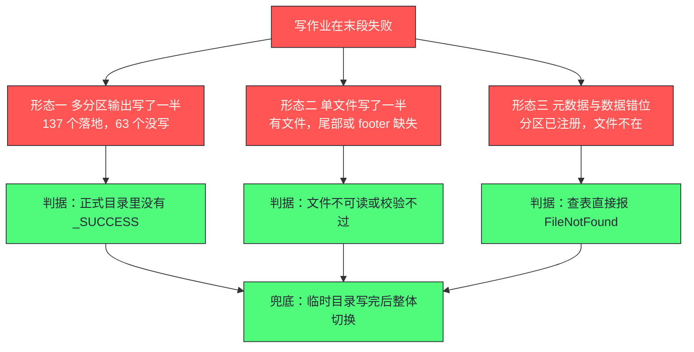
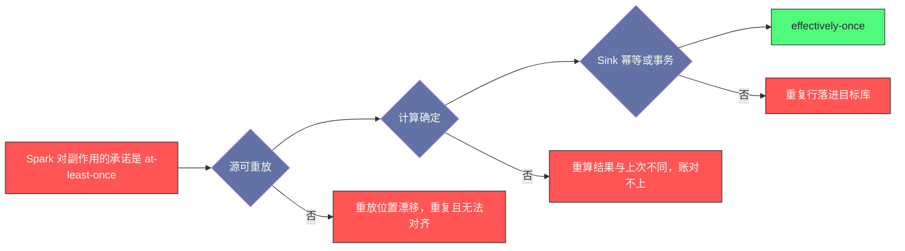
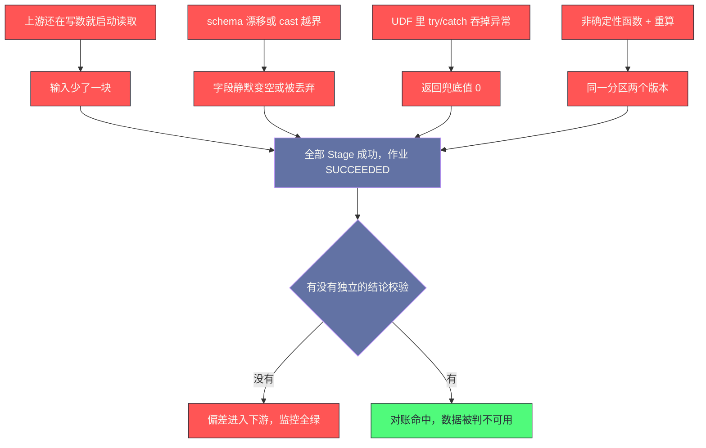

# 5. Spark 容错的代价与失败模式：**重算放大**、四本账与输出端的 **at-least-once**

**摘要：**

容错在多数材料里是以"能力"的面目出现的：机器会坏，框架会重算，所以作业不会因为一台机器掉线而全盘作废。这套说法解释了 Spark 为什么扛得住故障，却没有回答另一半问题——这些机制各自要花多少钱，以及花完钱之后还剩哪些失败是它救不回来的。

本章把容错当成一笔预算来读。先给容错划定范围：它只负责"作业能不能跑完"，不负责"跑完的结果对不对"。然后交代三笔在正常运行时就已经支付的开销——缓存钉住中间结果、检查点整段落盘、副本多存一份，它们在没有故障的作业里也照常发生。接着用一台 Executor 退出来做算术，把重算放大拆成三个乘数：扇出、血缘长度与分区大小分布，并指出"长血缘加大扇出"是最坏组合，因为重算量随两者相乘而不是相加。随后把代价拆成重算账、**写放大**账、资源账与审计账四本，说清检查点的"多一次全量计算加一次完整落盘"、缓存的"用内存买重算范围"与副本的"用磁盘买重算范围"其实是同一笔预算的不同花法。再往后依次拆开四类失败模式：**部分成功**、**副作用重复**、数据丢失与**静默错误**，逐类给出成因、判据与兜底，其中输出端只保证 at-least-once 这件事被单列成章，并把覆盖写、事务表与去重键三种幂等做法的代价并列比较。最后用"每步都 checkpoint"这类反例收束，说明容错做过头如何以新的故障源的面目回来。

全文要回答的两个问题是：一次失败究竟要花多少钱，以及这笔钱花下去之后，哪些失败仍然会以成功的样子留在数据里。口径是 Spark 4.3.0，涉及版本行为差异处会单独标注；源码细节以对应版本文档或源码为准。

**关键词（Keywords）**: 重算放大, 写放大, 部分成功, 副作用重复, **幂等写入**, at-least-once, 静默错误, **推测执行**

---

## 第 1 章 容错的账单不在故障那天结

### 1.1 先把范围限定住

本章所说的容错，专指一次作业在运行期出错之后，系统为把结果救回来所付出的代价，以及那些救不回来、却也不报错的形状。它不讨论调度器如何重新排班，也不讨论血统如何逐层回溯，只讨论钱花在哪里、花完还剩什么。

这个限定是必要的。2012 年那篇把弹性分布式数据集介绍给世界的论文，标题里写的是"弹性"（Resilient），正文用一页纸论证了不必复制数据也能恢复，却没有在同一页里给重算标价。论文关心的是可行性，工程关心的是可行性背后的账单，而账单往往比可行性更能决定一个方案在生产里活多久。

### 1.2 代价在正常运行时就已经支付

容错的设计目标是"让失败变得不可见"，它实现这个目标的手段却是"把失败的成本摊到平时"。三笔开销都发生在作业成功的那一刻：缓存把中间结果钉在内存里，检查点把中间结果写到可靠存储上，副本把同一份数据存成两份；这三件事在没有任何故障的作业里也照常发生，占内存、占磁盘、占带宽。

容错最容易被忽略的一点，是它的大部分开销并不出现在故障现场，而是摊进了每一次正常运行。 一次跑得干干净净的作业里，你已经在为那些可能永远用不上的恢复能力付过钱了，只是这笔钱以"内存不够用""落盘慢了三分钟""集群排队变长"的形式出现，肇事者从来不会在账单上签名。

这件事和写字楼里的消防通道很像：它占了整层最好的面积，常年锁着，谁也不会因为"今天没着火"就主张把它拆掉；但它的成本不是零，而是被摊进了每一平方米的租金里，只有在审批预算的时候才会有人问一句"这条通道要多宽"。容错的预算之争在技术上等价于这个问题：通道太窄，出事时过不去；通道太宽，平时的可用面积就被吃掉。

不这样会怎样？把这三笔开销全部取消，Spark 就退回成"一次失败全部重来"的批处理引擎：没有缓存，多轮迭代每轮都从源头读；没有检查点，长血缘作业一次失败就要从头跑；没有副本，任何一台机器掉线都可能让结果消失。反过来把这些开销拉满，作业在正常运行时就被自己的容错压垮。两端都不成立，真正的问题因此不是"要不要容错"，而是"在哪一层买多少"。

### 1.3 三种支付方式

容错只有三种支付方式，它们的差别不在效果，而在这笔钱以什么形态离开账户。

| 支付方式 | 谁在付 | 支付时点 | 计量单位 | 失效形态 |
|---|---|---|---|---|
| 重算（Recomputation） | CPU 与输入带宽 | 失败发生之后 | 重算分区数 × 血缘长度 | 上游不再可读时整条路断掉 |
| 落盘（Checkpoint） | 存储、写带宽与一次额外计算 | 作业成功那一刻 | 数据量 × 副本数 × 检查点次数 | 落盘位置成为新的单点 |
| 复制（Replication） | 内存或本地磁盘 | 数据产生那一刻 | 数据量 × 副本数 | 副本与原件同时丢失 |

三种支付方式各自对应一种失效形态，这个框架后文会反复用到：重算的失效是"上游不可重读"，落盘的失效是"落盘位置成为新的单点"，复制的失效是"副本与原件一起消失"。任何一种支付都不是免责的，它只是把风险从一种形状换成另一种形状。容错设计的全部难度，就落在"换哪种形状更划算"这一件事上。

### 1.4 一个贯穿全文的作业

为了让后面的算术有具体对象，笔者设一个商户风险快照作业 `risk_snapshot`：凌晨从数仓读前一天的交易流水与商户维表，按商户与小时聚合金额与笔数，结果既覆盖写入快照表，也通过 `foreachPartition` 把高风险商户推送到告警库。

```scala
val txn = spark.read.parquet("hdfs:///warehouse/txn/dt=2026-11-18")   // 200 个分区
val dim = spark.read.parquet("hdfs:///warehouse/merchant")            // 几十 MB，可广播

val risk = txn.join(dim, Seq("mid"))                                  // 第一次 Shuffle
  .groupBy("mid", "hour")                                             // 第二次 Shuffle
  .agg(sum("amt").as("amt"), count("*").as("cnt"))

risk.write.mode("overwrite").insertInto("risk_snapshot")              // Action 一：覆盖写
risk.foreachPartition { rows =>                                       // Action 二：副作用
  rows.filter(_.amt > 1000000).foreach(r => alertDb.insert(r))        // 非幂等
}
```

这段代码埋着本文要用的全部素材：两个 Action 意味着 `risk` 会被完整算两遍（除非缓存），`join` 与 `groupBy` 意味着两次 Shuffle，覆盖写意味着输出端自带幂等兜底，而 `foreachPartition` 意味着副作用没有任何兜底。第 2 章算它的重算账单，第 3 章算它的落盘与内存账单，第 5 章看它如何在一次 Task 重试之后把同一条告警写两遍。

`foreachPartition` 那一行还有个容易被跳过的细节：它跟在一次 `write` 之后，是第二个 Action。同一个 RDD 上每多一个 Action，整条血缘就多算一遍，这是最简单的一种重算放大，也是最少被计进预算的一种——它连故障都不需要，只要有人多写一行 `count()` 就会发生。

---

## 第 2 章 重算放大：一次失败要买多少单

### 2.1 账本上被划掉的格子

Shuffle 输出落在 Executor 的本地磁盘上，地址登记在 Driver 的 `MapOutputTracker` 里。一台 Executor 退出，它在账本上的那些格子随之作废，`unregisterMapOutput` 只是一行删地址的动作，真正要付的钱在删掉之后才发生：那些 map 分区必须重算。

重算多少个？不是"这个 Stage 的分区数"，而是"这台机器上曾经算完、且地址还没被别的事件作废的分区数"。一台 8 核的 Executor 在整个 map Stage 里可能前后跑过 30 个 Task，也可能只跑过 8 个——取决于 Stage 的 Task 总数、调度器往这台机器上放了多少、以及它活了多久就被杀掉。这个数字在 Spark UI 上没有单独一栏，只能从 Executor 页的 task 计数与 Stage 页的 attempt 明细里倒推：账面单位是"格"，实际成本单位是"格 × 每格背后的输入量"。

### 2.2 一次算术

不妨给 `risk_snapshot` 填上数字：`txn` 200 个分区，每分区读 8 GB 原始日志，解析过滤之后写出 1.2 GB 的 Shuffle 文件。一台承载了 30 个 map 输出的 Executor 退出，被划掉的是 30 格。

重算这 30 个分区，要把各自的输入重新读一遍：30 × 8 GB = 240 GB 读，外加解析、过滤、序列化的 CPU。下游那一侧还有第二笔：正在这台机器上跑的 20 个 reduce Task 一起阵亡，重跑时要把 200 份 map 输出重新取一遍，20 × 200 × 平均 6 MB ≈ 24 GB 网络传输——其中真正因为重算而变化的部分只有 30 份，其余几千份是纯属重复搬运的旧数据。

这两笔数字都是为了暴露放大机制而设的算术示例，不是任何一次真实作业的实测值；换一个作业，每分区读多少、Shuffle 文件多大、一台机器上压了多少个 Task，全部会变。但结构不会变：一次 Executor 退出的真实代价是"重算读回量 + 重取传输量"，而它在账本上留下的痕迹只是一句"30 个 map 分区重算"。

如果这台 Executor 上还有被缓存的 RDD 分区，且缓存没有副本，第二笔账会更贵：缓存丢失之后重算要从最近的可复用点往回退，而"最近的可复用点"可能是数据源。此时那 240 GB 会变成 240 GB 乘以血缘长度——链上有几层要读几遍，因为每一层都要把上游重新算出来，而每一层的输入都得重新读。

### 2.3 三个乘数

把重算的成本写成一句话：重算量 = 丢失分区数 × 血缘长度 × 单分区输入量 × 扇出。这是四个量在相乘，丢失分区数决定要补几处，血缘长度与单分区输入量决定每处要读多少，扇出决定同样的账要买几份。

| 乘数 | 含义 | 放大方式 | 上哪儿看 |
|---|---|---|---|
| 扇出（Fanout） | 同一份中间结果被几个下游消费 | 被 k 个下游引用，丢失一次要么重算 k 遍，要么重算一遍再写 k 次缓存 | Stage 列表里被多个 Job 或 Stage 引用的 RDD |
| 血缘长度 | 丢失点到最近可复用点之间的算子数 | 每多一层，输入多读一遍、计算多跑一遍 | Spark UI 的 DAG 可视化与 `toDebugString` |
| 分区大小分布 | 最大分区与中位数之比 | 补齐的耗时由最大那个分区决定，不由平均值 | Task 的 Shuffle Read/Write Size 分位数 |

三个乘数里最容易被低估的是扇出。一个 RDD 被 5 个下游 Job 共享，它丢一次，要么被重算 5 遍，要么重算 1 遍再写 5 份缓存；`cache()` 看上去把 5 遍压成 1 遍，实际上只是把 4 遍重算换成了 1 遍缓存写入与 5 份内存占用，并没有把账单消掉。血缘长度的问题在于它是隐性的：一条 40 层的链在代码里只有十来行，读起来毫无压力，但每丢一个分区就要把 40 层的输入各读一遍，而这个"40"永远不会出现在任何报表里。

分区大小分布则决定了成本的方差。一次 Stage 重提的代价由最大的那个分区决定，不由平均值决定——200 个分区里若有一个 40 GB 的倾斜分区，补齐它的时间可能等于补齐其余 199 个的总和。数据倾斜除了让作业跑得慢，还让容错的单位成本变得不可预测，这是同一个根因在另一个维度上的第二个代价。

### 2.4 最坏组合：长血缘加大扇出

把三个乘数乘开会得到一个不该出现、却很容易出现的形状：一条 40 层的窄依赖链，中途没有任何落盘点，末端被 5 个下游 Job 共享。任何一个分区丢失，重算量都是 40 层 × 5 份；如果这 5 个下游里有两个是写输出的 Action，这个数还要再乘一次。

反过来说，最便宜的形状是"短血缘、小扇出、正好落在 Shuffle 边界上"：丢失的代价被账本上的一格地址裁剪过，只重算那一格，而那一格的输入是数据源，读一遍就够。容错的成本曲线因此不是随数据量线性增长的，而是随"血缘长度 × 扇出"成倍地长出来的。这也解释了为什么同样是丢一台机器，有的作业抖一下就过去了，有的作业直接超时：差别不在数据量，在这条链买过多少保险。

有一种常见的误判是把"中间结果缓存一下"当成万能答案。它确实把 k 份重算压成了一份，但它同时把代价换成了"一份缓存写入 + k 份内存占用 + 缓存丢失时的一份重算"，而在内存紧张时，这份占用会以 spill 的形式转嫁给整个 Stage。账单没有消失，只是换了个科目。

### 2.5 作废粒度本身也是乘数

前面三个乘数描述的是"补一格有多贵"，还有一个常被当成实现细节的东西在放大总额：作废的粒度。

逐格作废是最省的形状：一次取数失败只划掉报错的那一格，其余 199 格原样复用，重算量是 1。但逐格作废在"整台机器的输出都不可信"的故障上会和失败来回拉锯——刚补好一格，下一个 Task 又报同一台机器上的另一格，五次三番之后累计重算量可能反而超过一次性作废。于是有些部署会把粒度放大成"一次失败作废整台机器上这个 Shuffle 的全部输出"，用多算几十格换"一次算清"。

两种粒度之间没有普适的最优解，选择取决于故障的分布：单块盘坏、单个 Executor 被 kill，逐格作废最省；宿主机掉电、网络分区、整机重启这类"一台机器上的输出同时不可信"的故障，放大粒度更划算。作废粒度把重算量在 1 格与 N 格之间摆动，而这个 N 取决于故障形状，不取决于代码——这也是为什么同一份作业在不同集群上表现出的容错成本会差出好几倍。

### 2.6 放大的范围长什么样

下面这张图把 `risk_snapshot` 的一次 Executor 退出画开，两条支路分别是上游重算与下游重取，注意它们共享同一个触发点，却把成本记在两个不同的地方。



图里那个分叉值得单独说一句：同一个事件在账本上只记一次，在资源账单上却记两次，一次记在读，一次记在网络。运维看到的是"Stage 重提 2 次"，容量规划看到的应该是"这台机器退出带走了 240 GB 读与 24 GB 传输"，两者之间隔着一层换算，没有人替你换算。

---

## 第 3 章 四本账

### 3.1 重算账

重算账记在故障之后，但它有两个隐藏项，平时不在任何报表里。第一项是"重取放大"：下游 Task 重跑时会把所有 map 输出重新取一遍，而不只是取重算后的那几份，这部分传输在网络账单上，不在计算账单上。第二项是"血缘重放"：如果丢失的是缓存而不是 Shuffle 输出，重算要一路退回可复用点，读的是这个点上游的全部输入，而不是丢失分区本身的那一份。

这两项的共同特点是不可见。重算账最容易让人低估的原因不是它贵，而是它散落在了三张不同的报表上，而且没有一张叫"容错"。

### 3.2 写放大账：检查点的两笔钱

检查点的代价是两笔钱，不是一笔：多一次全量计算，加一次完整落盘。

第一笔来自检查点的触发方式。检查点本身不产生数据，它要在数据算出来之后把全部分区写到可靠存储上——如果这个 RDD 没有被缓存，写的那一遍就是一次完整的血缘重放，把上游全部算子再跑一次；如果已经缓存，这一笔退化成"从缓存读一遍再推出去"，但遍历全部分区和跨网络传输这两项一分不少。

第二笔是落盘本身。240 GB 的逻辑数据在开启压缩之后（`spark.checkpoint.compress` 自 4.1 起默认为真）大概压到 80 GB，写进三副本的 HDFS 就是 240 GB 物理写；不开压缩则是 720 GB。压缩把字节数换成了 CPU 时间，省了带宽，没省遍历。

把两笔钱按次数摊开看，写放大的形状立刻清楚：一个 100 轮的迭代作业每 10 轮落一次盘，就是 10 次全量血缘重放加 800 GB 落盘；若每轮都落，次数翻十倍，落盘时间在总时长里的占比会从零头变成主要成本。检查点的收益只有在"失败真的发生、且发生在检查点之后"时才兑现，而写放大的成本是无条件支付的——这就是它和重算最不对称的地方：重算按需付费，检查点按期付费。

检查点还有第三笔不容易被算进去的账：它会切断血缘，于是落盘位置从"一份备份"变成了"唯一的一份"。目录被清理、对象存储最终一致读不到、权限被改、路径写错一个字符，恢复时就没有第二条路可走。容错机制本身也会失效，而它失效的时候，没有另一个机制站在它后面。

### 3.3 资源账：容错与性能是同一笔预算的两端

容错与性能看起来是两个目标，实际花的是同一张资源账单上的钱。

缓存用内存买重算范围：被缓存的分区在丢失时可以省掉一次重算，代价是这块内存不能用于聚合与排序，一旦执行内存被挤占，spill 次数上升、GC 压力上升，作业整体变慢。带副本的存储级别（譬如 `MEMORY_AND_DISK_2`）用双倍占用买"单副本丢失仍可用"，代价是同样大小的数据要占两倍空间，内存紧张时反而更容易 OOM。

检查点用存储与写带宽买恢复速度，代价是落盘期间的带宽与 NameNode 压力；推测执行用额外的 slot 买尾延迟，代价是把资源从别的作业那里挪过来，高峰期开推测执行经常是"这个作业快了、那个作业排更久"。

资源账里还有一笔更隐性的：为了让中间结果活着，Executor 不能被释放。 开启动态分配的集群按"空闲"来回收节点，而一个刚跑完 map Stage、正等着下游来取数的 Executor 看起来很空闲——它没有在跑 Task，磁盘上却压着几十 GB 的 Shuffle 文件。如果不把这份占用算进"在用"，回收动作会把刚刚算完的东西一起收掉，重算账立刻被触发一次。Spark 3.4 起的 Shuffle Tracking 就是在替 Driver 补上这笔账：它记住哪些 Executor 手里有下游还要的数据，从而不让它们在"看起来空闲"时被提前释放。这笔支出在容量规划里的名字是"预留"，在资源报表里却常常只表现为"利用率不高"。

把话说透：容错预算与性能预算不是两张表，而是同一张表上的两行。 调大任何一边的容错投入，都要从另一边扣；所谓"既快又稳"，真实含义是"在故障分布已知的前提下，把预算花在了收益最高的那一层"，而不是两边都不花钱。

### 3.4 审计账

前三本账都能量化，第四本不能。恢复之后要知道"到底恢复了什么"，靠的是人：Spark UI 给出 attempt 号与 Task 数，事件日志给出明细，但"哪些分区被重算过""有没有重复写入""上一次失败的输出有没有残留"这些问题，没有一个现成的页面能回答。

审计账的计量单位是工时，而它随失败次数累积。更贵的一种不是查错，是"证明没错"：没有对账系统的团队在故障之后只能把作业重跑一遍来求心安，而重跑本身又是一次全量计算——为了确认上一次没错，付了两次的钱。

### 3.5 四本账合起来看

| 账 | 支付时点 | 计量单位 | 可观测性 | 超支症状 |
|---|---|---|---|---|
| 重算账 | 失败之后 | 分区数 × 血缘长度 × 单分区输入量 × 扇出 | 中，Stage 重提次数可见，重取量不可见 | 故障之后作业时间成倍增长 |
| 写放大账 | 作业中途 | 数据量 × 副本数 × 检查点次数 | 高，HDFS 写入量与 NameNode 操作数可查 | 落盘带宽打满，与计算争 IO |
| 资源账 | 数据产生那一刻 | 内存字节、磁盘字节、slot 数 | 高，Executor 内存与磁盘曲线可查 | spill 增多、OOM、队列变长 |
| 审计账 | 恢复之后 | 人的工时 | 低，几乎没有 | 复盘说不清恢复了哪一段 |

四本账之间可以互相转账：想省重算账就买写放大账，想省写放大账就买资源账，四本都不买就把钱记到审计账上。没有一本可以白拿，也没有一种组合对所有作业都最优——长链迭代作业该买写放大，宽扇出的 ETL 该买缓存，短链一次性作业什么都不必买，出事了重跑一遍比买保险便宜。

把四本账和它们的支付时点画在一起，可以看到前三本汇进同一张资源账单，而审计账流向的是人的工时，两条线并不交汇。



---

## 第 4 章 失败模式之一：部分成功

### 4.1 一半的输出

四类失败模式里，部分成功是最常见也最容易被当成"没发生"的一类：作业在最后一段失败，前面 137 个分区的输出已经写好了。这些文件不会自动消失，而 Spark 也没有义务替用户删掉它们。

严重程度不取决于失败了多少，取决于下游能不能分辨。有提交点的写入路径，失败在目录层面可见——临时目录没有 rename，输出目录里没有 `_SUCCESS`，下游一看就知道这批数据不可用；没有提交点的路径，失败与成功在数据层面长得一模一样，下游只能照读。

### 4.2 三种形态

第一种是多分区输出写了一半。`risk_snapshot` 的 200 个分区里 137 个已经落盘，作业在收尾时失败。走 `FileOutputCommitter` 的路径会把这些文件留在 `_temporary` 下，正式目录干净；但如果是多次独立写入同一目录（按小时分批跑、每个批次各自提交），那么"半份数据"已经是一次合法提交，后面的批次失败也不会回滚前面的。

第二种是单个文件写了一半。一个分区写成一个文件时，失败发生在流的中段，文件存在但尾部缺失；Parquet 这类带 footer 的格式会因为 footer 缺失而读不出来，反倒安全；纯文本格式则会安静地少几行，读的时候没有任何报错。

第三种是元数据领先于数据。分区已经注册进 Hive 元数据，文件却没写完或被清理流程删掉，查询时报 `FileNotFound`；反过来也成立：文件在，元数据没有，数据成了孤儿，谁都读不到。

三种形态的判据与兜底落在不同的位置上，下图把它们并排画出，注意兜底只有一个出口，判据却各看各的地方。



### 4.3 提交点决定了原子粒度

同样是"写一半"，不同写入路径的原子粒度差得很远，这个差别写在提交协议里，不在 SQL 语句里。

| 写入路径 | 提交点 | 原子粒度 | 中途失败留下什么 |
|---|---|---|---|
| `save` 到 HDFS 的 Parquet | `FileOutputCommitter` 的 Job 提交 | 整个 Job | `_temporary` 下残留，正式目录干净 |
| `INSERT OVERWRITE` 静态分区 | 先删后写 | 全表或整批分区 | 旧数据已删、新数据未写，表空了 |
| `INSERT OVERWRITE` 动态分区 | 逐分区删除再写入 | 每个命中的分区 | 部分分区已替换、部分还是旧的 |
| `foreachPartition` 写外部库 | 无 | 无 | 已提交的行留在库里，无法回滚 |

这张表最容易被读错的一行是静态覆盖：它给的是最强的原子性，代价是"删除"与"写入"之间有一个真空窗口，作业一失败，表就是空的——幂等是保住了，可用性没保住。动态覆盖反过来，每次只删本次出现过的分区，失败时数据仍在，但"本次没有产出的分区"会保留上一次的旧值，陈旧数据静默残留。最后一行的空提交点是后文所有副作用问题的根源：外部库不参与 Spark 的提交协议，Spark 也没有办法替它回滚。

搬家这个比喻可以帮着记这三种粒度：有总签收单的搬家公司承诺"要么全到、要么全退回车上"，你回家看到的是空房或者齐整的家具；没有签收单的搬家公司是来一件放一件，你回家看到的可能是半个客厅，而且分不清那是"还没搬完"还是"搬完了就这样"。部分成功之所以危险，不在于它留下了中间态，而在于它把"中间态"和"终态"做成了同一个外观。

### 4.4 兜底与判据

部分成功的兜底原则只有一条：把"可见的中间态"缩到零，或者让下游能识别它。写法上就是把输出写进一个带批次号的临时目录，成功之后再整体切换成正式路径；读的时候先检查 `_SUCCESS` 与分区清单，再开始算。

有两个配置项要留意。`spark.sql.files.ignoreMissingFiles` 与 `spark.sql.files.ignoreCorruptFiles` 默认都是假，一旦为了"让作业别挂"把它们打开，缺文件与坏文件就从显式失败变成了少读几行——部分成功就此变成后文的静默错误。这类开关的语义不是"增强健壮性"，而是"把错误挪到你看不见的地方"。

---

## 第 5 章 失败模式之二：副作用重复

### 5.1 Spark 对副作用只承诺一次以上

Spark 保证的是"每个 Stage 的输出被正确计算"，对 Stage 之外的世界没有任何承诺。`foreachPartition` 里的那次 `insert` 在 Spark 眼里不属于计算的一部分，它只是用户函数的一个副作用，框架既不知道它发生了，也不知道它该不该发生。

Task 的重试语义是"至少执行一次"：`spark.task.maxFailures` 默认 4，一个 Task 最多被执行 4 次，每一次执行都会把 `foreachPartition` 的函数从分区开头完整跑一遍。这个函数没有逐条提交点，也没有回滚——写到外部库的每一行在函数返回之前就已经生效了，Task 之后失败与否都不影响它。

所以副作用的语义是 at-least-once：至少一次，可能多次，重复的量与"失败发生在分区的第几条记录"成正比。 一次在 500 条之后失败的重试，会让前 500 条被写第二遍；一次在第 1 条就失败的重试，重复量是 0。这个量是随机的，取决于故障落在哪里。

框架并非完全没有留钩子。`TaskContext.addTaskCompletionListener` 允许在 Task 结束时执行一段清理逻辑，看上去可以拿它做补偿——把这次写出去的行删掉；但这个回调只在 Task 的线程还在、进程还活着的时候才能跑完，Executor 掉线、进程被强杀、JVM 直接退出时它没有机会执行，而补偿动作本身也可能失败。把一个必须成功的补偿挂在一个可能不执行的回调上，只是把错误从"一定重复"变成"有时重复"，给不出幂等保证。补偿只能减小重复的期望值，去重才能把重复关掉。

### 5.2 一条具体链路

`risk_snapshot` 里那段 `foreachPartition` 赶上了最坏的一种巧合：每个 reduce 分区约 500 条高风险记录，第一次尝试在写完 500 条、准备收尾时超时，`TaskSetManager` 判定失败并重试，第二次尝试从分区开头重新读数据、重新过滤、重新 `insert`，然后成功。

下图是这条链路的形状，注意它从左到右没有一处是"故障处理出错"，每一步都是设计好的行为。


这条链上每一步都是"正常行为"：重试是设计好的，函数从头跑是分区模型的必然结果，写库立即生效是数据库的本分。没有任何一步出错，串起来的结果却是双倍告警。故障处理里最危险的情况不是机制坏了，而是每一个机制都按设计工作，组合起来产生了没人预期过的结果。

### 5.3 四个入口

重复不止发生在 Task 重试这一条路上。

| 入口 | 触发条件 | 只在故障时发生吗 | 落在哪一层 |
|---|---|---|---|
| Task 重试 | 用户函数抛异常、OOM、超时 | 是 | `TaskSetManager` |
| 推测执行 | Stage 内有任务明显偏慢，且 `spark.speculation` 开启 | 否，正常运行也会发生 | `TaskScheduler` |
| Stage 重提 | Shuffle 输出丢失、取数失败 | 是 | `DAGScheduler` |
| 作业重跑 | 人工补数、调度系统重试、上游回刷 | 是 | 外部调度 |

四个入口里最隐蔽的是第二个。另外三个都要先出故障，或者至少有人按了重跑的按钮；推测执行什么都不需要，只要某个分区慢得超过阈值，框架就会自己起一份副本。

### 5.4 推测执行把重复从故障态带到常态

推测执行默认是关的（`spark.speculation` 默认 `false`），打开之后按两个阈值判定慢任务：`spark.speculation.quantile` 默认 0.75，表示一个 Stage 里 75% 的 Task 完成之后才开始挑；`spark.speculation.multiplier` 默认 1.5，表示运行时长超过已完成 Task 中位数的 1.5 倍即视为慢任务。被挑中的 Task 会在另一个 Executor 上再起一份，先完成者胜出，另一份被 kill，被 kill 的那份不计入 `spark.task.maxFailures`。

账面上这是一笔很划算的交易：用一点额外算力换尾延迟，慢任务的拖尾被削平。但"被 kill"只终止了这个 Task 的计算，已经写出去的副作用不会回来。推测执行把重复从"故障时才发生"变成了"正常运行时也会发生"——这是它和重试最本质的区别，也是它最容易被忽略的代价。更麻烦的是两份副本可能几乎同时跑完，胜者由竞态决定，若副作用之间有顺序要求（先写主表再写明细），两份并发写还可能互相踩到。

### 5.5 审计盲区

这条链路之所以难被发现，是因为它在所有可观测面上都表现为"正常"。Spark UI 上那个分区的记录是"1 次重试后成功"，作业终态是 `SUCCEEDED`，Driver 日志里只有一行 WARN，监控大盘上任务成功率 100%。

没有任何 Spark 指标度量"重复"。 要发现它，只能从目标端反查：给告警表加唯一约束，看有没有插入冲突；或者按批次号对账，看写入条数与输入条数是否守恒。这两个手段都不在 Spark 里，都得在数据链路的另一端预先建好，等事故发生之后再补是来不及的。

---

## 第 6 章 失败模式之三：数据丢失

### 6.1 跟着 Executor 走的 Shuffle 文件

Spark 的 Shuffle 输出写在 Executor 的本地磁盘上，Driver 手里只有地址，没有数据。这个设计省掉了把中间结果写进分布式存储的开销，代价是把中间结果的生命周期绑在了 Executor 的生命周期上：机器一退，文件跟着走。

地址作废之后有两条路。上游还在、输入可重读，就走第 2 章那笔重算账；上游不在、输入不可重读，作业直接失败，而且没有恢复路径。所谓"输入不可重读"有几种常见形状：源数据按保留期被清理（一个跑得久的作业撞上了 7 天保留期）、上游是另一个作业的临时输出且已被覆盖、数据从消息队列消费之后没有落盘、外部 API 的分页结果不保证可重放。

容错的第一前提是源头还在，而"源头还在"这件事不在 Spark 的控制范围内。 它由数据治理策略决定，由 TTL 决定，由上游作业的清理逻辑决定；框架能做的是重算，做不了的是凭空造出已经被删掉的输入。

### 6.2 外部 Shuffle 服务与 Shuffle Tracking 的边界

外部 Shuffle 服务（External Shuffle Service，ESS）做的事情很朴素：把 Shuffle 文件的生命周期从 Executor 手里接过来，交给一个常驻进程管。Executor 死了，文件还在，`MapOutputTracker` 上的地址依然有效，重算量从"30 个 map 分区"直接降到 0，只剩下游重新取数。

这笔交易的代价是常驻服务本身：多一个要部署、要监控、要跟着集群升级的组件，以及它自己成为单点时的风险。它在 YARN 上是标配，在 Kubernetes 上长期缺位，具体支持程度以对应版本文档为准。

动态分配引入了另一条缝。Spark 3.4 起，Driver 会在没有外部 Shuffle 服务时跟踪 Shuffle 数据的归属（`spark.dynamicAllocation.shuffleTracking.enabled`），据此决定不把仍持有下游所需 Shuffle 数据的 Executor 提前释放。这条机制管的是"计划内的释放"，管不了"意外的崩溃"——主动缩容时它能保证不丢数据，机器掉电时它无能为力。区分这两者很重要：很多"我明明开了动态分配还是重算了"的事故，根因是把计划内释放的保障当成了崩溃的保障。

### 6.3 缓存丢失与检查点丢失不是一回事

同样是"数据没了"，缓存丢失与检查点丢失的后果差一个层级。缓存丢的是从可重算点算出来的一份副本，只要源头在，重算就能补回来，代价是第 2 章那笔账；检查点丢的是切断血缘之后唯一的一份，源头在也没用，因为没有血缘可以往回走了。

这个差异决定了两种机制的定位：缓存用内存买重算范围，检查点用写放大买单点风险。前者买的是"少算一点"，后者买的是"还能算"，两者的价钱与收益都不在同一个量级上。

### 6.4 判据与兜底

数据丢失的判据是"取数失败的时间点与 Executor 消失的时间点吻合"：一批 `FetchFailed` 集中在几十秒内出现，Stage 开始重提，`MapOutputTracker` 的可用输出数掉下去一截，基本可以确定是机器层面的丢失，而不是单个分区的数据损坏。

说到损坏，它是数据丢失的孪生形态，后果相近而成因不同：块在传输中被改坏、磁盘发生静默错误，文件还在、地址还有效，读出来的字节却不对。Spark 读取 Shuffle 块时默认会做校验（`spark.shuffle.detectCorrupt` 默认为真），校验不通过就当取数失败重取，于是损坏被转化成一次重取或一次重算。这是一个把静默错误挡在容错路径上的案例：同一个机制既处理"东西没了"，也顺手处理了"东西还在但坏了"，代价是损坏与丢失共用同一笔重算预算。它覆盖的只是传输与存储层面的校验，覆盖不了"文件完整而语义错误"那一类，后者属于后文的静默错误。

兜底则分三层：给上游数据留足可重读窗口，让重算这条路不断；在 YARN 上用外部 Shuffle 服务把文件的生命周期从 Executor 手里接出来；对关键中间结果落盘，接受写放大换恢复确定性。三层都做是浪费，一层都不做则是在赌机器不出事。

---

## 第 7 章 输出端的幂等与 exactly-once 边界

### 7.1 覆盖写

覆盖写是最便宜的一种幂等：不管重跑几次，结果都是"这一批数据替换那一批数据"。代价藏在模式选择里。`spark.sql.sources.partitionOverwriteMode` 默认是 `STATIC`，语义是先删掉目标表或指定分区的全部数据，再写新的；重跑一次结果不变，但作业失败时表会短暂为空。动态覆盖（`DYNAMIC`，自 2.3 起支持）只删本次出现过的分区，失败时旧数据还在，代价是"本次没有产出的分区"会保留上一次的旧值——数据从"有"变"无"的时候，旧分区不会被删掉，陈旧数据静默残留。

覆盖写的第二个代价是写放大：每次重跑都重写整批数据，而不是增量修正。对几十 GB 的日表无所谓，对几 TB 的全量表就是"为了改一行，重写整个表"。

### 7.2 事务表

湖仓表（Delta Lake、Iceberg、Hudi 这一类）把提交搬到元数据层：数据文件先写出去，最后用一个原子操作把新快照挂上去，失败时旧快照仍然有效。重跑的幂等性来自"一次提交只生效一次"，读端看到的是某个完整快照，不会看到写了一半的表。

代价是三笔：组件账（多一套表格式、元数据与清理逻辑要维护）、文件账（每次提交产生新文件，小文件会累积，需要定期 compaction）、路径账（写入路径更长，每次提交都要写元数据，小批量高频写的场景开销明显）。还有一笔容易被误解的：事务表保证的是表级原子，不保证你的 UDF 副作用——往表里写是原子的，往告警库里 `insert` 不是。

### 7.3 去重键

第三种做法是把幂等性从写入动作挪到数据本身：给每条输出带一个幂等键（业务主键加批次标识或分区号），写入端按主键做 upsert，或者读的时候用 `row_number()` 按时间倒序取最新一条去重。

```sql
-- 读时去重：同一个 (mid, hour) 只保留最新批次的一条
SELECT mid, hour, amt, cnt
FROM (
  SELECT *, row_number() OVER (PARTITION BY mid, hour ORDER BY batch_id DESC) AS rn
  FROM risk_snapshot_raw
) WHERE rn = 1
```

代价有两笔。第一笔是存储能力：Hive 表没有行级覆盖，upsert 只能靠重写整个分区，等于把去重键方案退化成覆盖写；要真正做到行级 upsert，得换 MySQL、HBase、Doris 这类支持按主键写的存储，而它们的写入吞吐与并发模型又是另一套约束。第二笔是键的设计：键里不含批次信息，跨批次就会误合并；键选得太细，去重等于没做；键选得太粗，两条本该并存的记录会被合成一条。去重键的幂等性不是免费的，它把成本从写入动作转移到了键的设计与存储的选择上。

批次号本身还有一处更细的取舍。用作业启动时间戳作批次号，重跑会得到一个新号，两次结果都留在表里，读端靠 `row_number` 取最新——去重成本被推给了读端，好处是永不丢数据，坏处是表会随重跑次数增长。用"业务日期加分区键"这类确定性标识作批次号，重跑会覆盖同一个键，去重更彻底，代价是这个标识必须真的能唯一确定一次产出，而"哪个分区属于哪一批"这件事在动态分区与数据回刷的场景里并不总是自明的。

### 7.4 三种做法的代价

| 做法 | 幂等性来自哪一层 | 适用输出 | 代价 | 失效条件 |
|---|---|---|---|---|
| 覆盖写 | 写入动作替换整批数据 | 分区表、全量快照 | 每次重跑重写整批数据 | 动态覆盖留下陈旧分区；静态覆盖失败时表为空 |
| 事务表 | 元数据层的原子提交 | 湖仓表 | 组件、元数据、小文件与 compaction | 只保表级原子，不保 UDF 副作用 |
| 去重键 | 存储端 upsert 或读时去重 | 明细流、告警表 | 需支持行级覆盖的存储；键设计有风险 | 键缺批次信息时跨批次误合并 |

三种做法可以叠加，叠加的收益递减而成本线性上升：覆盖写加去重键能同时挡住"重复"和"陈旧"，代价是每次重跑既重写整批数据又做一次全表去重。选型的依据不是哪种更先进，而是"这个输出的重跑频率有多高、下游对重复有多敏感、存储能承受多大的写放大"。

### 7.5 exactly-once 是三个条件的合取

输出端做到幂等，只是端到端语义的三分之一。真正的 exactly-once 需要三个条件同时成立：源可重放（失败之后能回到同一个位置重读）、计算确定（同样的输入两次算出同样的结果）、Sink 幂等或事务（重复提交不产生重复效果）。三个条件是与的关系，缺一个就退化。

下图把三个条件串成一条链，并把每个条件缺失时对应的失效形态标在下方。



流处理框架把这三件事绑在了一起：偏移量的记录与 Sink 的提交写进同一份日志，失败恢复时两者一起回退，于是"处理到哪"与"写到哪"始终对齐。批处理没有这一层，除非用户自己把批次标识、去重键与提交点串起来。这就是为什么同一套 Spark 引擎，流作业谈 exactly-once 而批作业只谈幂等写入——差别不在引擎能力，在有没有人为这三件事做绑定。

三个误解值得单独点出来。其一，"开了检查点就有 exactly-once"：检查点保的是恢复进度与计算状态，不是副作用去重，它管不了你已经写进 MySQL 的行。其二，"写 Hive 表是原子的，所以副作用是幂等的"：表级原子与副作用一次是两件事，表提交成功而告警发两次完全可能。其三，"关掉推测执行就不会重复"：Task 重试照样重复，推测执行只是把重复的概率从"故障时"扩大到"平时"。

---

## 第 8 章 失败模式之四：静默错误

### 8.1 不报错的偏差

前三类失败模式至少会在某个层面留下痕迹：部分成功没有 `_SUCCESS`，副作用重复能在目标库查到双份，数据丢失会以 `FetchFailed` 的形式暴露出来。静默错误什么都没有——作业全绿、监控全绿、数据是错的。

它是四类里唯一不触发容错机制的失败。容错机制管的是"作业跑完了没有"，而静默错误发生在"跑完了但结果不对"这个容错机制根本不看的维度上。

### 8.2 四个来源

第一类是非确定性计算。用了当前时间、随机数、`UUID`、依赖遍历顺序的 `mapPartitions`，在重算之后会得到与上次不同的值；如果下游已经读过第一次的结果，而重算只补了缺失的分区，同一批血缘上就同时存在两个版本。运行期不确定性更隐蔽：Stage 被标记为不确定之后，重提会把后续整段回滚重算，代价是第 2 章那笔账，收益是避免两个版本并存。

第二类是数据源读到半截。上游作业还在写、文件还在临时目录里没 rename、批处理读昨天的分区而昨天的分区正在被回刷，这几种情况下作业都会成功，只是读进去的量少了一块。

第三类是 schema 漂移。不开启 `spark.sql.parquet.mergeSchema` 时，Spark 按其中一个文件的 footer 推断 schema，其他文件里多出来的列会被静默丢弃；列类型从 `int` 换成 `bigint` 之后又被上游 `cast` 回 `int`，越界的值在 ANSI 关闭时变成 `null`，在 ANSI 开启时直接抛错——两种结局都不是"正常且正确"。前一个行为在默认配置下不报错，后一个在不报错的那一档里也是静默的，结果都是少几列、几行，报表上看不出来。

第四类是异常被吞。UDF 里一句 `try/catch` 返回默认值，脏数据就变成了 0；非 ANSI 模式下整数溢出、除以零、字符串转数字失败都会返回 `null` 而不是抛错。Spark 4.0 起 `spark.sql.ansi.enabled` 默认为真，这些情况改为抛错，等于把一部分静默错误改造成了显式失败——代价是原本"能容忍脏数据跑完"的作业开始报错，团队需要显式决定是修数据还是显式关掉 ANSI 并接受静默。

### 8.3 检测手段

静默错误只能靠独立于计算链路的校验来发现，因为链路内部的一切都正常。下图把四个来源画到同一个终态上：它们互不相干，却共用一条"作业成功"的出口。



可用的校验有四条：行数守恒（输入总条数与输出总条数在可解释的范围内）、主键唯一（同一批次内不出现重复主键）、金额对账（聚合值与前一日或上游清单比对）、分位数漂移（关键指标的 P50/P99 与历史窗口比较，漂移超过阈值就拦住）。四条都不需要多高的技术含量，需要的只是"不信任作业终态"这个习惯。

### 8.4 为什么它最难兜

前三类失败模式的兜底手段都能落在某一个组件上：提交点、去重键、外部 Shuffle 服务。静默错误没有对应的组件，它需要一条独立的数据链路去校验另一条数据链路的输出，而这条校验链路本身也要被维护、被告警、被信任。

投入产出也最不直观：校验作业不产出任何业务价值，只在出事时报警；它的价值等于"避免一次错误数据进入下游"的期望损失，而这个数字在事故发生之前永远是零。于是它最容易被砍掉，也最容易被砍掉之后立刻出事。

校验链路本身也有成本，而且结构上和容错很像：对账作业要再扫一遍全量数据，等于把读放大一倍。合理的做法是按便宜程度分级——行数与主键唯一这两条几乎不增加 IO、误报率也低，可以每天跑；金额对账与分位数漂移要跨表比对，按批次跑；人工抽样最贵，只在指标异常时触发。校验的价值不是"发现所有错误"，而是"用可控的成本把错误拦在下游之前"，把所有校验都做成全量强校验，等于用一次读放大去买一个可能永远用不上的保险。

---

## 第 9 章 容错做过头

### 9.1 每步都 checkpoint

把第 3 章的账推到极端，会得到一个真实存在过的形状：一条 10 步的链，每一步都 `checkpoint()`，理由是"每一步都可能失败，都落盘最安全"。

不妨按前面的量级算一遍：每步计算 20 分钟，每步结果的检查点落盘约 10 分钟（240 GB 压缩后 80 GB，三副本 240 GB 物理写，按 400 MB/s 估算）。不落盘时整条链 10 × 20 = 200 分钟。每步都落盘时，第 k 步的检查点作业要从上一份检查点读回、重算这一步、再把整份结果写出，于是每步多出约 30 分钟，整条链变成 500 分钟，是原来的 2.5 倍。

这里有一处反直觉的地方：因为检查点会切断血缘，单次重算其实变短了——第 k 步只需要从上一份检查点开始算，而不是从数据源开始。省下来的那部分计算量，正好被十次整段落盘吃掉。若先在内存里缓存每一步再落盘，重算那一项还能再省一点，但十步结果就是 2.4 TB 的常驻内存，执行内存一分不剩，spill 与 OOM 会把这笔账以另一种形式还回来。两条路都不便宜，这才是不该每步落盘的真正理由，而不是"落盘次数多了不好看"。

容错做过头不会变成"更稳"，它会变成一种新的故障源：作业因为自己的容错而超时，而超时又触发重跑，重跑再一次支付写放大。 判断该不该落盘的标准不是"这一步会不会失败"，而是"这一步失败之后重算有多贵、落盘又有多贵"——前者大于后者才落。

### 9.2 四类失败模式总表

把四类失败模式并排放，能看出它们的检测手段与兜底手段几乎没有重叠，这也是为什么"容错"不能只做一层。

| 失败模式 | 检测手段 | 后果 | 兜底手段 |
|---|---|---|---|
| 部分成功 | 正式目录缺 `_SUCCESS`、分区文件计数、下游读前校验 | 下游把半份数据当全量用 | 临时目录写完整体切换、分区级覆盖重跑 |
| 副作用重复 | 目标端唯一约束、批次号对账、行数守恒 | 金额、告警、通知重复 | 去重键、upsert、事务表 |
| 数据丢失 | `FetchFailed` 集中出现、Stage 重提次数、输入源可读性 | 重算放大甚至作业失败 | 上游保留可重读窗口、外部 Shuffle 服务、关键处落盘 |
| 静默错误 | 行数守恒、主键唯一、金额对账、分位数漂移 | 结果偏差但作业成功 | 独立校验作业、ANSI 模式、禁止吞异常 |

### 9.3 把重试次数当容错能力

另一类过头是把参数调大当成加固。`spark.task.maxFailures` 从 4 调到 100，`spark.stage.maxConsecutiveAttempts` 一起调大，看上去"更宽容"，实际效果是把一个必然会失败的分区拖成几小时的无效重试：用户函数有 bug 的 Task 重试 100 次仍然会失败，而每一次重试都在消耗集群资源、拉长作业时长、把真正的错误信息淹没在几百行 WARN 里。

重试次数的合理值由"故障的瞬时性"决定，而不由"我想不想让它失败"决定。能通过重试解决的只有瞬时故障（网络抖动、Shuffle 文件短暂取不到），不能通过重试解决的是确定性故障（数据格式错误、代码空指针、磁盘满）。把两类失败混在一起重试，等于用资源去换一个不会到来的成功。

一个具体的形状：某个分区因为一条格式错误的历史记录，用户函数每次都在同一条上抛同一个异常。重试上限是 4 时，作业几分钟内失败，日志第一行就是那个异常，值班的人顺着堆栈能找到坏数据；把上限调到 100，作业在失败与重试之间耗掉两小时，日志里躺着 99 行一模一样的 WARN，结论仍然是失败，只是发现它的时间从分钟变成了小时。重试次数买到的是瞬时故障的自愈概率，买不到确定性故障的豁免。

### 9.4 反例速查

| 现象 | 常见归因 | 实际机制 |
|---|---|---|
| 作业成功但下游金额翻倍 | 数据源重复推送 | `foreach` 副作用在 Task 重试后重复执行 |
| 重跑一遍结果就对了 | 集群抖动 | 上次是部分成功，输出目录残留了半份数据 |
| 加了 checkpoint 反而更慢 | 检查点无效 | 每步都落盘，写放大压过了重算收益 |
| 开了 cache 内存更紧张 | 缓存没生效 | 缓存挤占执行内存，spill 变多 |
| 开了推测执行告警变多 | 告警系统故障 | 推测执行的副本重复产生了副作用 |
| 修好上游数据重跑，旧分区还在 | 覆盖写没生效 | 动态覆盖只删本次出现过的分区 |

---

## 第 10 章 落点

回到开头那两个问题。

一次失败花多少钱？账面单位是"丢失的分区数"，实际单位是这个数乘以血缘长度、单分区输入量与扇出。这三个乘数里，扇出最容易被低估，血缘长度最不容易被看见，分区大小分布决定了成本的方差。而这三笔钱里只有重算账记在故障之后，写放大账、资源账与审计账都记在作业成功的那一天——所以"我们的作业没有故障"从来不等于"我们没有为容错付钱"。

哪些失败会以成功的样子留下？部分成功、副作用重复与静默错误这三类。它们共同的特征是：不触发任何恢复路径，因为恢复路径只处理"作业失败"这一种信号。`_SUCCESS` 检查、去重键与独立对账是唯一能把它们从"成功"里抠出来的手段，而这三样都不在 Spark 里。

由此可以得到一个判断顺序，遇到容错相关的问题按它走一遍：先问这条血缘上最近的可复用点在哪、扇出多大，决定该不该缓存或落盘；再问输出端有没有提交点、有没有去重键，决定重跑安全不安全；最后问结果有没有独立校验，决定静默错误会不会被拦住。三个问题问完，绝大多数"要不要加 checkpoint""要不要开推测执行"的纠结都会落到某一个具体的账上，而不是停在"保险一点总没错"这种无法验证的判断上。

至于 exactly-once，它从来不是一个开关，而是三个条件的合取：源可重放、计算确定、Sink 幂等或事务。缺一个，端到端就退化成 at-least-once，此时唯一的补救是把重复变成无害——去重键、覆盖写、事务表，三选一，代价自付。

行文至此，容错这件事的轮廓可以说清楚了：它不是一道免费的保险，而是一笔必须在正常运行时支付的预算，支付方式有三种，账目有四本，而它买不到的失败有四类。哪一种花法更划算，取决于作业跌一次有多贵、重算一次有多慢、以及下游对重复与偏差有多敏感。这些参数没有一个是框架能替运维判断的，这也是容错方案永远需要人来定的原因。

容错做过头会以新的故障源的面目回来，这一点在长链迭代与"每步都落盘"的作业上已经反复出现。至于以后会不会有一个既便宜又完整的方案，目前仍然言之尚早——每一种看起来更聪明的恢复策略，本质上都是在把成本从时间轴搬到容量轴或者人力轴上，而这三根轴上从来没有免费的位移。

---

## 参考资料

1. Zaharia M., Chowdhury M., Das T., et al. Resilient Distributed Datasets: A Fault-Tolerant Abstraction for In-Memory Cluster Computing. NSDI 2012. https://www.usenix.org/system/files/conference/nsdi12/nsdi12-final138.pdf
2. Apache Spark 源码（4.3.0）：`core/src/main/scala/org/apache/spark/scheduler/TaskSetManager.scala`，Task 重试计数与 `spark.task.maxFailures` 的判定。https://github.com/apache/spark/blob/v4.3.0/core/src/main/scala/org/apache/spark/scheduler/TaskSetManager.scala
3. Apache Spark 源码（4.3.0）：`core/src/main/scala/org/apache/spark/MapOutputTracker.scala`，Shuffle 输出地址表与 `unregisterMapOutput`。https://github.com/apache/spark/blob/v4.3.0/core/src/main/scala/org/apache/spark/MapOutputTracker.scala
4. Apache Spark 源码（4.3.0）：`core/src/main/scala/org/apache/spark/rdd/RDD.scala`，`foreachPartition` 与 `doCheckpoint` 的触发时机。https://github.com/apache/spark/blob/v4.3.0/core/src/main/scala/org/apache/spark/rdd/RDD.scala
5. Apache Spark 源码（4.3.0）：`core/src/main/scala/org/apache/spark/rdd/ReliableRDDCheckpointData.scala`，检查点写盘与 `writeRDDToCheckpointDirectory` 的额外 Job。https://github.com/apache/spark/blob/v4.3.0/core/src/main/scala/org/apache/spark/rdd/ReliableRDDCheckpointData.scala
6. Apache Spark 源码（4.3.0）：`sql/core/src/main/scala/org/apache/spark/sql/execution/datasources/FileFormatWriter.scala`，`FileOutputCommitter` 的提交算法与动态分区覆盖的删除范围。https://github.com/apache/spark/blob/v4.3.0/sql/core/src/main/scala/org/apache/spark/sql/execution/datasources/FileFormatWriter.scala
7. Apache Spark 源码（4.3.0）：`core/src/main/scala/org/apache/spark/internal/config/package.scala`，`spark.speculation`、`spark.speculation.multiplier`、`spark.speculation.quantile`、`spark.checkpoint.compress`、`spark.dynamicAllocation.shuffleTracking.enabled` 的默认值与引入版本。https://github.com/apache/spark/blob/v4.3.0/core/src/main/scala/org/apache/spark/internal/config/package.scala
8. Apache Spark 4.3.0 文档：Configuration，Execution Behavior、Shuffle Behavior、Dynamic Allocation 相关配置项。https://spark.apache.org/docs/latest/configuration.html
9. Apache Spark 4.3.0 文档：Migration Guide — SQL, Datasets and DataFrame，`spark.sql.ansi.enabled` 自 4.0 起默认开启的说明。https://spark.apache.org/docs/latest/sql-migration-guide.html
10. Apache Spark 4.3.0 文档：Migration Guide — Core，`spark.checkpoint.compress` 与 Shuffle Tracking 的版本行为变化。https://spark.apache.org/docs/latest/core-migration-guide.html
11. Armbrust M., Das T., Davidson A., et al. Spark SQL: Relational Data Processing in Spark. SIGMOD 2015. https://people.csail.mit.edu/matei/papers/2015/sigmod_spark_sql.pdf
12. Kleppmann M. Designing Data-Intensive Applications. O'Reilly, 2017，第 11 章「流处理」中关于 at-least-once、at-most-once 与 effectively-once 的界定。https://dataintensive.net/

---

> [!note] 思考题
> 1. 一台承载 30 份 map 输出的 Executor 退出，重算量由"30 × 每分区输入量 × 血缘长度 × 扇出"决定。如果把这个作业的输入分区从 200 个改成 2000 个（每分区小十倍），重算量会怎么变，总成本为什么未必下降？
> 2. 检查点的收益只在"失败发生在检查点之后"时兑现，写放大的成本却无条件支付。给定一个作业的历史失败率与单次重算耗时，你会用什么不等式决定要不要落盘？
> 3. `foreachPartition` 的副作用是 at-least-once 语义。如果把这个副作用改成"写一个带批次号与分区号的临时文件，再由另一个作业合并"，重复问题被转移到了哪里，代价又变成了什么？
> 4. 动态分区覆盖会保留"本次没有产出的分区"里的旧数据，静态覆盖会在失败时把表清空。这两种失效形态分别在下游引发什么问题，能否用同一个方案同时挡住？
> 5. Spark 4.0 起 ANSI 模式默认开启，把一部分静默错误改成了显式失败。对于一个长期靠"容忍脏数据跑完"维持的作业，这个默认值改变带来的迁移成本应该记到哪一本账上？
> 6. 推测执行把重复从"故障时才发生"变成了"正常运行也会发生"。在什么条件下这笔交易仍然划算，什么条件下它只是把故障换成了另一种故障？