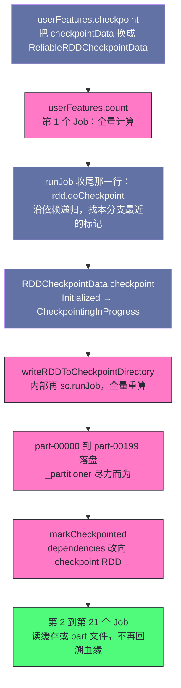
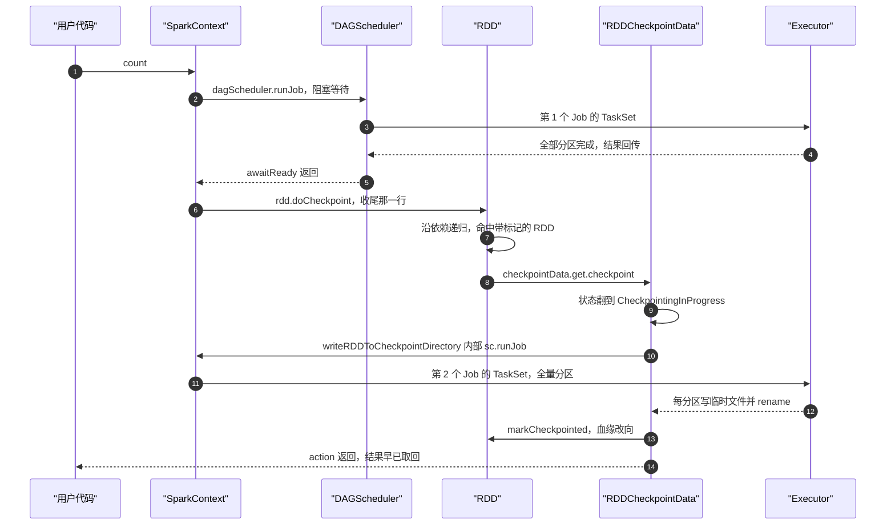
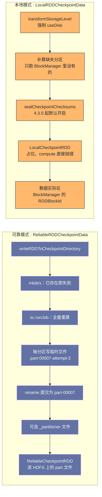
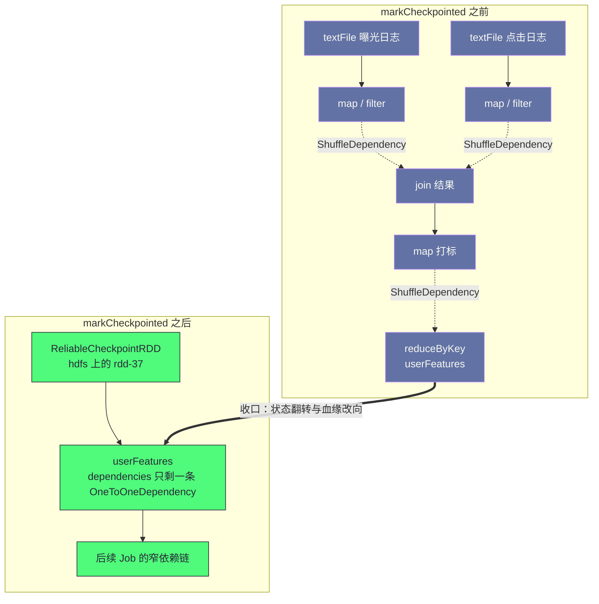
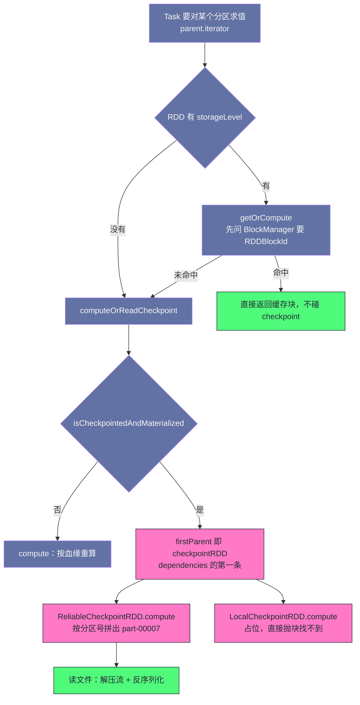

# 6. Spark Checkpoint 机制：两次 Job、一次血缘改向

**摘要：**

2012 年，伯克利 AMPLab 在 NSDI 上发表 RDD 论文时，把容错的账押在血缘（Lineage）上：数据不复制，改动不可变，分区丢了就照着血缘重算。这套论证成立的前提是一个经济学假设——重算的代价可以接受。迭代型作业把这个假设打穿了：血缘上叠着三五次 Shuffle，中间还夹着几十轮迭代，任何一次失败都可能回到读数据源那一步。检查点（Checkpoint）就是这条路上的例外条款：把中间结果物化到可靠存储，再把血缘截断，让此后每一次读取都不必回溯。

这篇文章只回答两个问题：这份数据是怎么写出去的，断了血缘之后又是怎么被找回来的。文章沿五问推进：先界定 `checkpoint()` 到底改了什么（它只挂一个对象，一个 record 都不读）；再拆开 `SparkContext.runJob` 收尾那一行 `rdd.doCheckpoint()`，说明为什么真正的物化发生在触发的那个 Job 结束之后，以及为什么它内部会再起一个 Job 把整个 RDD 重算一遍；接着对比可靠模式（`ReliableRDDCheckpointData`，写 HDFS 一类可靠存储）与本地模式（`LocalRDDCheckpointData`，写 executor 本地块）在写盘者、提交协议、分区表来源上的物理差别；然后落到 `markCheckpointed`，看它如何让 `dependencies` 改向 checkpoint RDD、让 `partitions` 换成文件列表还原出来的那一份；之后走一遍恢复时的查找路径，纠正"优先读 checkpoint"这句话的真实前提；最后解释官方为什么反复强调"先 `cache` 再 `checkpoint`"，以及这一步在源码里对应的是哪一次全量重算。

文章口径是 Spark 4.3.0（默认 Scala 2.13 构建），源码细节以对应版本文档或源码为准。需要先钉死一处：4.3.0 里没有 `cutLineage` 这个方法，截断血缘落在 `RDD.markCheckpointed` 上。

**关键词（Keywords）**: Checkpoint, doCheckpoint, markCheckpointed, ReliableRDDCheckpointData, LocalRDDCheckpointData, ReliableCheckpointRDD, computeOrReadCheckpoint, setCheckpointDir, spark.checkpoint.compress, 血缘截断

---

## 第 1 章 打标记之前：血缘能保证什么，保证不了什么

### 1.1 一笔被论文留在脚注里的账

RDD 论文给出的容错论证相当漂亮：分区之间的血缘被记录下来，任何一个分区丢失，都能沿着血缘把它重新算出来，因此不必像 HDFS 那样为每份中间数据做三副本，粗粒度变换换来的正是"重算得起"这四个字。论文同时留了一个例外——当血缘链长到重算不可接受时，可以把中间结果物化到可靠存储，代价是存储与一次额外计算。这句留在论证边上的话，后来长成了 `RDD.checkpoint`。

先说清楚血缘的重算范围，才能看清这个例外为什么必要。窄依赖链上重算一个分区，只需要按迭代器往回拉一个父分区，代价与链长线性相关、与数据总量无关；一旦中间隔了一次 Shuffle，重算一个下游分区就要去拉上游全部 map 分区的输出，代价从"一个分区的量"跳到"一次 Shuffle 的量"。同一个作业里，不同位置的重算代价能差出几个数量级。

更贵的是跨 Job 的那一层。一个 Job 跑完之后，Driver 会把不再被引用的 Shuffle 输出登记给清理器，上游 RDD 一旦被回收，那些 map 输出文件也跟着消失。于是迭代型作业的恢复不是"回到上一轮"，而是"回到读数据源那一步"：第 17 轮某个分区丢了，要补它就得把第 1 轮以来的整条链重走一遍。一个迭代几十轮、每轮耗时几十分钟的作业，一次 Executor 掉线就能把代价放大到以小时计。

还有一笔不常被提起的固定开销：Stage 提交时，调度器把这一段的 RDD 图与计算函数一起序列化成 task 二进制广播出去，血缘越长，这份二进制越大、广播越慢。截断血缘省下的不只是重算时间，还有一份随链长增长的管理成本。

### 1.2 checkpoint 的定义与三条性质

笔者的定义是：检查点指的是把某个 RDD 的全部分区重新算一遍、序列化写到可靠存储或本地块存储，然后把这个 RDD 的依赖表整体改向那份落盘数据，使得此后对它的读取不再经过上游血缘。

这个定义里有三件事，缺一件就不算 checkpoint：

**其一，一次额外的物化。** 数据不是"顺手留下来"的，而是由一个单独的 Job 重新算出来再写出去的。这一点与 `persist` 正好相反：缓存的语义是"算的时候就留下来"，checkpoint 的语义是"算完之后再补一遍"。

**其二，一次血缘改向。** 落盘完成之后，这个 RDD 的 `dependencies` 会变成一条指向 checkpoint RDD 的 `OneToOneDependency`，`partitions` 也会换成从文件列表还原出来的那一份。改向之后再问它"你从哪来"，答案不再是上游那几个 RDD。

**其三，一份可被后续 Job 复用的数据。** 后续 Job 读取它时优先吃缓存、缓存缺失则直接读落盘文件，两者都不需要上游参与，于是恢复的作用域被截短到"这一份文件还在不在"。

三条性质也顺手划出了边界：checkpoint 不是备份，它不保存应用的结构，也不保证能从文件把整个应用接回来；它不是缓存，不占 Executor 内存，也不加快第一次计算；它更不是 `saveAsObjectFile`，用户拿不到一个"在新应用里接着用"的公开入口。这三条边界在第 6 章与第 8 章还会各自咬人一次。

### 1.3 一个贯穿全文的作业

为了让后面的机制有具体的着力点，笔者设想一个推送人群定向作业 `push_targeting`：每天凌晨从 HDFS 读当天的曝光日志与点击日志，两边各按 200 个分区读入、各自解析并过滤掉无效记录，按请求标识把两边 join 起来，再按用户聚合成一张特征宽表，然后拿这张宽表跑 20 轮聚类迭代。

```scala
// 两条窄依赖链，各自以一次 Shuffle 收尾
val imp = sc.textFile("hdfs:///logs/impressions").map(parseImp).filter(_.valid)
val clk = sc.textFile("hdfs:///logs/clicks").map(parseClk).filter(_.valid)

// join 内部有两个 ShuffleDependency，两条父分支在此汇合
val events = imp.join(clk)
// 再叠一次 Shuffle，得到贯穿整个迭代过程的宽表
val userFeatures = events.map(toUserFeaturePair).reduceByKey(mergeFeature).cache()
userFeatures.checkpoint()        // 只是挂个标记
userFeatures.count()             // 第 1 个 Job：算出来、进缓存、触发物化
(1 to 20).foreach(i => kmeansStep(userFeatures, i))   // 后续 20 个 Job
```

这段代码里，`userFeatures` 的血缘上有三次 Shuffle：`join` 左右各一次，`reduceByKey` 一次。20 轮迭代中每一轮都会读它、每一轮都会产生新的 Shuffle，而上一轮的 Shuffle 输出在该轮 Job 结束后就不再被引用。换句话说，这张宽表是整条作业上唯一稳定复用的节点，也是唯一值得物化的节点。它会在后文反复出现：第 3 章看它的第一个 Job 收尾时发生了什么，第 4 章看它的 200 个分区怎么写出去，第 5 章看它的血缘怎么被改向，第 6 章看后续迭代怎么找到那份数据。

### 1.4 一个比喻：公证存档

把 checkpoint 想成给一段长链工程做一次公证存档。施工队不是每拧一颗螺丝就拍照留证——那是缓存与血缘混合起来干的事；而是在关键节点把半成品整体封存进一个公家仓库，领一张存档编号。此后原件丢了、图纸烧了，拿着编号直接领料即可，不必回溯前面几十道工序。

这个比喻有三处技术限定，都要说清楚。第一，存档的动作发生在这个节点完工之后，而不是施工过程中，所以它是一次额外搬运，不是零成本的顺带动作。第二，存档之后工单上不再列上游工序，这是"血缘被截断"的现实含义——省的是以后的核对，代价是以后要改这一批料就必须重开一张工单。第三，存档封的是"重新配的一份料"，不保证与施工当天客户手里那一份逐件一致：底层运算若带不确定性，两次计算本就可以给出不同结果，源码注释对此写得很直白。

### 1.5 全文的地形

把这一章收成一张图：打标记、主 Job、收尾触发、重新物化、改向血缘、后续 Job 读取，六步走完，checkpoint 的生命周期就结束了。



图里有两次"全量计算"：第一次是 `count()` 自己，第二次是物化那个 Job。这两次计算之间隔着一次 Job 的边界，也隔着本文最容易被忽略的一个事实——**`checkpoint()` 不等任何人，它只挂一个对象；真正写盘的是它触发的那个 Job 结束之后、由 `runJob` 收尾补上的第二个 Job。**

---

## 第 2 章 打标记：`checkpoint()` 只写两个字段

### 2.1 两个分支，一个 record 都不读

`RDD.checkpoint()` 的全部代码短到可以整段贴出来，它做的事情只有两件：确认目录存在，挂上数据对象。

```scala
// RDD.checkpoint：两个分支，一个都不碰数据
def checkpoint(): Unit = RDDCheckpointData.synchronized {
  // 这里用一把全局锁：下游 RDD 的分区必须指向正确的父分区，
  // 用粗粒度锁换取"不会出现父子错位"的简单
  if (context.checkpointDir.isEmpty) {
    throw SparkCoreErrors.checkpointDirectoryHasNotBeenSetInSparkContextError()
    // 抛出的消息就是 "Checkpoint directory has not been set in the SparkContext"
  } else if (checkpointData.isEmpty) {
    checkpointData = Some(new ReliableRDDCheckpointData(this))
    // 构造期就把落盘目录算好：<checkpointDir>/rdd-<id>，此刻并不创建目录
  }
}
```

两个分支各有讲究。第一个分支把"没设目录"这件事挡在最早的位置，而不是等到物化时才失败——那会白跑一次全量计算才发现写不出去。第二个分支带 `isEmpty` 判断，意味着重复调用是幂等的：已经挂过标记的 RDD 再调一次 `checkpoint()`，什么都不会发生，也不会把已有的标记覆盖掉。

构造函数里那句 `new ReliableRDDCheckpointData(this)` 需要停下来看。它的构造体第一行就解析落盘路径，解析失败会抛另一条错误："Checkpoint dir must be specified."。这条分支在公开 API 下不可达（`checkpoint()` 已经挡过一遍），它是一道防御性断言：能构造出这个对象，就一定有一个目录可用。

### 2.2 落盘路径的三层拼接

checkpoint 的文件路径不是一个参数，而是三层拼出来的，每一层各有各的理由。

第一层由 `SparkContext.setCheckpointDir` 决定：

```scala
def setCheckpointDir(directory: String): Unit = {
  // 非 local 模式而目录落在本地文件系统时，这里只警告、不拒绝
  if (!isLocal && Utils.nonLocalPaths(directory).isEmpty) {
    logWarning(log"Spark is not running in local mode, therefore the checkpoint directory " +
      log"must not be on the local filesystem. ...")
  }
  checkpointDir = Option(directory).map { dir =>
    val path = new Path(dir, UUID.randomUUID().toString)   // 每个 SparkContext 一个命名空间
    val fs = path.getFileSystem(hadoopConfiguration)
    fs.mkdirs(path)
    fs.getFileStatus(path).getPath.toString
  }
}
```

这里出现了两个容易被忽略的设计。其一，用户给的目录下还会再拼一段随机 UUID，因此同一个 HDFS 目录可以被多个应用反复使用而不互相覆盖，代价是旧目录会一直留在那里，谁也不会替你删除。其二，非 local 模式而目录在本地文件系统时，Spark 只打一条警告就放行；警告的理由写得很清楚——Driver 可能照着本地路径去重建 checkpoint 数据，而文件其实在别的机器上。

第二层是 `ReliableRDDCheckpointData` 顺着 `checkpointDir` 拼出的 `rdd-<rddId>` 子目录，第三层是每个分区一个 `part-00000` 这类文件。三层合起来，一个分区在 HDFS 上的完整地址形如 `<用户目录>/<uuid>/rdd-37/part-00007`。这套命名同时服务于两个目的：写的时候各分区互不干扰，读的时候可以只靠列目录就把分区表还原出来（见第 4 章）。

顺带记一条 4.x 起的变化：`spark.checkpoint.dir`（自 4.0.0 起）允许在配置里直接给默认目录，`SparkContext` 构造时用它调一次 `setCheckpointDir`，之后用户代码仍可覆盖。对目录由平台统一注入的场景，这个配置省掉了改代码。

### 2.3 为什么必须在第一个 Action 之前打标记

`checkpoint()` 的注释里有一句硬性要求：这个函数必须在任何 Job 跑过这个 RDD 之前调用。原因不在 API 洁癖，而在三个一次性闸门。

第一个闸门是 `checkpointData`。物化只认这个字段，标记挂晚了，物化就晚了；而物化晚了的直接后果是"这一次计算白算了"——主 Job 已经把数据算出来又扔掉，紧接着的 checkpoint Job 再算一遍。

第二个闸门是 `doCheckpointCalled`，它是 `RDD` 上一个 `@transient` 的布尔量，一旦置真，这个 RDD 的 `doCheckpoint()` 永远直接返回。也就是说，一个 RDD 的 checkpoint 机会在它的第一次 Action 收尾时用掉一次，用掉就没有第二次。

第三个闸门是 `cpState`，它从 `Initialized` 只能往 `CheckpointingInProgress`、`Checkpointed` 两个状态走，回不了头。三个闸门叠在一起，决定了 checkpoint 是一次性的、不可重来的状态迁移，而不是一个可以随时开关的开关。

### 2.4 反事实：如果 `checkpoint()` 当场写盘

设想一个更"直觉"的实现：调用 `checkpoint()` 时就同步把数据写到 HDFS。这个设计在三处立刻崩掉。

第一处是数据还不存在。`checkpoint()` 调用时，这个 RDD 可能一个分区都没算过，要写盘就得先跑一个 Job——等于把"用户还没决定要不要跑"变成"调用即计算"，彻底破坏 RDD 的惰性求值语义。而惰性是整个调度体系的前提，Stage 划分、缓存位置、本地性全都建立在"知道终点之后才开始算"这件事上。

第二处是写盘频率。若把物化塞进正常的 Task 里，每个 Task 算完一个分区就顺手写 HDFS，等于把 HDFS 的三副本复制延迟摊到每一个 Task 的尾延迟上；一个 200 分区的 Stage，尾部会多出 200 次"等三副本写完"的等待，而这段时间 Executor 的核是占着的。

第三处是失败语义纠缠。Task 重试、推测执行、Stage 重提都会让同一个分区被算多遍，若写盘与计算混在一条路径上，"哪一份写下去的结果算数"就得在 Task 层解决，而 Task 层不知道 Job 的边界。

### 2.5 打标记改变了什么

把这一章收成一张表。这张表只有四行，但每一行都对应后文一次具体的崩溃或一次具体的省事。

| 动作 | 改了哪个状态 | 没有做什么 |
|---|---|---|
| 校验目录 | 读 `context.checkpointDir`，为空即抛错 | 不创建 `rdd-<id>` 子目录，不校验权限 |
| 挂数据对象 | `checkpointData = Some(new ReliableRDDCheckpointData(this))` | 不读一条记录，不发一个 Task |
| 解析落盘路径 | 构造体算出 `cpDir`，失败抛 "Checkpoint dir must be specified." | 不发起任何 Job，不碰 HDFS |
| 幂等保护 | 已有 `checkpointData` 则原样返回 | 不覆盖已有的标记，也不升级模式 |

`RDDCheckpointData` 的状态机同样只有三格，它决定了外部观察到的一切：

| 状态 | 何时进入 | 谁改的 | 此时读取走哪条路 |
|---|---|---|---|
| `Initialized` | `checkpoint()` 返回之后 | `RDD.checkpoint` | 原 `compute`，或缓存 |
| `CheckpointingInProgress` | `RDDCheckpointData.checkpoint` 开头，锁内翻转 | 物化线程自己 | 仍是原 `compute`；若物化失败会长期停在这里 |
| `Checkpointed` | `doCheckpoint()` 返回之后，与 `markCheckpointed` 在同一次锁内 | `RDDCheckpointData.checkpoint` | `firstParent` 已指向 checkpoint RDD |

第三格是这个机制的全部意义所在。它不是一个"数据写好就算完"的标志，而是一个"从这一刻起，这个 RDD 的数据来源换了"的标志。

---

## 第 3 章 触发：`runJob` 收尾的那一行

### 3.1 所有 Action 都会走到的那三行

`SparkContext.runJob` 是 Action 的统一入口，`count`、`collect`、`foreach`、`take` 最终都汇入它的四参重载。这个重载的尾部只有三行，checkpoint 的全部触发逻辑就藏在这里：

```scala
def runJob[T, U: ClassTag](
    rdd: RDD[T], func: (TaskContext, Iterator[T]) => U,
    partitions: Seq[Int], resultHandler: (Int, U) => Unit): Unit = {
  ...
  dagScheduler.runJob(rdd, cleanedFunc, partitions, callSite, resultHandler, localProperties.get)
  progressBar.foreach(_.finishAll())
  rdd.doCheckpoint()          // 收尾那一行：所有 Action 的必经之路
}
```

顺序里有一处必须看清：`dagScheduler.runJob` 是阻塞的，它内部在 `ThreadUtils.awaitReady(waiter.completionFuture, Duration.Inf)` 上等 Job 结束，成功才返回、失败就抛异常。因此 `rdd.doCheckpoint()` 一定发生在 Job 完成之后；反过来，Job 失败时这一行根本执行不到，checkpoint 也就不会被触发。**"checkpoint 由 Action 触发"这句话的准确含义是"由一次成功的 Action 收尾触发"**，而不是"由 Action 开始触发"。

这解释了一个常见困惑：明明写了 `checkpoint()`、也跑了 Action，HDFS 上却什么都没有。答案通常是那次 Action 失败了，或者 Action 落在这个 RDD 的另一个分支上，收尾递归没走到它。

### 3.2 递归、一次性闸门与"只截一段"

`doCheckpoint` 本身很短，但它承担了三件事：往上游找标记、给每个 RDD 一次机会、决定要不要连带处理祖先。

```scala
private[spark] def doCheckpoint(): Unit = {
  RDDOperationScope.withScope(sc, "checkpoint", allowNesting = false, ignoreParent = true) {
    if (!doCheckpointCalled) {
      doCheckpointCalled = true
      if (checkpointData.isDefined) {
        if (checkpointAllMarkedAncestors) {
          // 先祖先、后自己：自己一物化，血缘就断了，祖先再也走不到
          dependencies.foreach(_.rdd.doCheckpoint())
        }
        checkpointData.get.checkpoint()
      } else {
        dependencies.foreach(_.rdd.doCheckpoint())   // 自己没有标记，继续往上游找
      }
    }
  }
}
```

三个分支语义各不相同。自己没标记，就顺着依赖往上游找；自己有标记，就物化自己，默认**不再往上走**——一旦自己也物化，血缘被截断，上游那几个 RDD 从此在这个方向上不可达，再想物化它们既没有触发路径，也没有必要。若把 `spark.checkpoint.checkpointAllMarkedAncestors` 置真，就先递归处理祖先再处理自己，顺序不能反。

默认关掉"连带处理祖先"，图的是少写数据：一条链上若每个 RDD 都打了标记，全部物化意味着成倍的存储与计算。但这个优化有一个真实的反例，源码注释里点了名（SPARK-6847）：流式处理里每一批同时给一个 RDD 和它的父 RDD 打标记，由于默认只处理路径上第一个，父 RDD 永远轮不到，它的血缘永远不会被截断，长跑几十万批之后 Driver 端的图与序列化开销累积到 OOM。这是"局部优化在长跑场景下变成系统性风险"的典型案例。

还有一个容易踩的细节：`checkpointAllMarkedAncestors` 在 `RDD` 初始化时被读成一个 `val`，取自 `sc.getLocalProperty`。也就是说它在 RDD 构造那一刻就固定了，之后再 `setLocalProperty` 对它无效。

### 3.3 第二个 Job：靠一个布尔量挡住的自陷

现在回到那句"checkpoint 会再起一个 job"。链路是这样的：`doCheckpoint` 调 `checkpointData.get.checkpoint()`，后者调 `ReliableRDDCheckpointData.doCheckpoint()`，再调 `writeRDDToCheckpointDirectory`，而这个方法的中间一行是：

```scala
// TODO: This is expensive because it computes the RDD again unnecessarily (SPARK-8582)
sc.runJob(originalRDD, writePartitionToCheckpointFile[T](checkpointDirPath.toString, broadcastedConf) _)
```

这是一次货真价实的 `SparkContext.runJob`：它会进 DAGScheduler、建 Stage 图、发 TaskSet、在 Spark UI 的 Job 列表里留下一条记录。而 `runJob` 的尾部又会调 `originalRDD.doCheckpoint()`——如果没有任何保护，这里就是无限递归：物化触发 Job，Job 收尾又触发物化。

挡住它的正是 3.2 里那个 `doCheckpointCalled`：外层 `doCheckpoint` 进入时已经把它置真，所以嵌套的这一次调用在第一行就返回了。**这个布尔量不是防重复执行的优化，它是防止 checkpoint 自我递归的必要条件。**读这段代码时若只看到"避免多次处理"的注释，很容易把它当成锦上添花。

这次物化 Job 有三个可观测的特征。其一，它是全量的：`sc.runJob(originalRDD, func)` 没有传分区列表，等于对 `0 until numPartitions` 全部分区发任务，`userFeatures` 的 200 个分区就是 200 个 Task，每个 Task 写一个 part 文件。其二，它读的是这个 RDD 本身，若上游有 Shuffle，这个 Job 的 Stage 图里会带上读 Shuffle 的那一段——除非缓存命中。其三，它的耗时在 Spark UI 上单独可见，是一条容易被误认成"业务 Job"的记录；排查"为什么 count 完了还多跑了一个 Job"，答案就在这里。

源码里那句 TODO 是这条设计最诚实的注脚：官方承认这次重算是浪费，也承认要消掉它就得让主 Job 的 Task 顺手把数据写出去，而那要改写 Task 的输出协议与失败语义。十几年过去，这个 TODO 还在。

### 3.4 `take(1)` 也会触发全量物化

由此可以推出一件反直觉的事。假设用户写的是 `userFeatures.take(1)`，主 Job 只算一个分区，很快就返回；但收尾的 `doCheckpoint` 照样触发物化，而物化 Job 要算全部 200 个分区。一次轻量的探查性 Action，附带了一次重活。

这个不对称来自两处：`doCheckpoint` 只关心"这个 RDD 有没有标记"，不关心"这次 Action 用了几个分区"；`writeRDDToCheckpointDirectory` 又明确要全量。于是 checkpoint 的成本与触发它的 Action 的成本完全解耦——写 checkpoint 之前用 `take(5)` 瞄一眼数据是对的，但要知道那一眼之后可能跟着一次全量计算。

本地模式在这里便宜一点：它只补算块管理器（`BlockManager`）里还没有的分区（见 4.4），`take(1)` 之后要补 199 个而不是 200 个。省下的一个可以忽略，但机制上的差别要记住——可靠模式是"无条件全量重算"，本地模式是"缺什么补什么"。

### 3.5 物化失败之后不会自动重试

把失败路径走一遍，会发现一个比"多跑一个 Job"更难接受的事实。

物化 Job 失败时，异常从 `writeRDDToCheckpointDirectory` 抛回 `RDDCheckpointData.checkpoint()`，再抛回 `doCheckpoint()`，最后从 `runJob` 尾部抛到用户那次 Action 的调用处。此时状态停在 `CheckpointingInProgress`，`cpRDD` 仍为空，`markCheckpointed` 没有执行，血缘完好无损。看起来"下次再跑一次就会重来"，实际不会：`doCheckpointCalled` 已经是真，之后每个 Action 收尾调用 `doCheckpoint()` 都在第一行返回；`cpState` 也不再是 `Initialized`，即使有人绕过第一个闸门，`checkpoint()` 里的状态判断也会直接 `return`。

于是用户观察到的现象是：第一次 `count()` 成功、紧接着抛出一个写着 checkpoint 路径的写盘异常；重跑同一次 `count()` 则完全正常、也不再报错，而 HDFS 上始终没有那份数据。这不是 bug，是三个一次性闸门的直接后果——**checkpoint 在本应用的生命周期里只有一次机会，失败即作废**。真要重来，只能重建 RDD 图，也就是重新执行打标记之前的那几步代码。

### 3.6 一次完整的触发时序

把这一章串起来，`userFeatures.count()` 的完整时序如下。注意第 9 步到第 13 步发生在用户 action 的收尾处，用户代码此时已经在等返回值。



三个 Job 的分工可以并排看：

| Job | 谁发起 | 读什么 | 写什么 | 能不能省掉 |
|---|---|---|---|---|
| 第 1 个（业务 Job） | 用户的 Action | 按血缘算，或命中缓存 | 缓存块与 Action 结果 | 不能，这是业务本身 |
| 第 2 个（物化 Job） | `runJob` 收尾的 `doCheckpoint` | 缓存命中则不重算，未命中则重算上游 | `part-NNNNN` 与 `_partitioner` | 不写 checkpoint 才能省 |
| 第 3 个及以后 | 后续 Action | 缓存或 part 文件 | 各自结果 | 不能，这是业务本身 |

第 2 行是 checkpoint 的全部成本所在：一次全量计算（除非缓存兜住）加一次全量写盘。它换来的是第 3 行起每一次读取都不必回溯血缘——**这笔交易的方向是把成本从"未来每一次失败恢复"挪到"现在一次性付出"**。

用一个比喻收束这一章：checkpoint 像婚礼当天的跟拍摄影。仪式（主 Job）照常进行，摄影师不打断它，事后按录像补拍一套照片存档。好处是不打扰仪式，代价是要再演一遍；而且补拍时的光线可能与当天现场不完全一致——源码注释对此写得很直白：物化发生在第一个 Action 之后，存下的那一份未必是 Action 期间用过的那一份。

---

## 第 4 章 写路径：两种模式的物理差别

### 4.1 可靠模式：目录、临时文件、rename

可靠模式的写盘入口是 `ReliableCheckpointRDD.writeRDDToCheckpointDirectory`，去掉测试用的 `blockSize` 参数后，主干只有六个动作：

```scala
def writeRDDToCheckpointDirectory[T: ClassTag](
    originalRDD: RDD[T], checkpointDir: String, blockSize: Int = -1): ReliableCheckpointRDD[T] = {
  val checkpointDirPath = new Path(checkpointDir)
  val fs = checkpointDirPath.getFileSystem(sc.hadoopConfiguration)
  if (!fs.mkdirs(checkpointDirPath)) {                  // HDFS 语义：目录已存在即返回 false
    throw SparkCoreErrors.failToCreateCheckpointPathError(checkpointDirPath)
  }
  val broadcastedConf = SerializableConfiguration.broadcast(sc)
  // 物化：不传分区列表，等于全量
  sc.runJob(originalRDD, writePartitionToCheckpointFile[T](checkpointDirPath.toString, broadcastedConf) _)
  if (originalRDD.partitioner.nonEmpty) {               // 分区器单独存一个文件，best-effort
    writePartitionerToCheckpointDir(sc, originalRDD.partitioner.get, checkpointDirPath)
  }
  val newRDD = new ReliableCheckpointRDD[T](sc, checkpointDirPath.toString, originalRDD.partitioner)
  if (newRDD.partitions.length != originalRDD.partitions.length) {   // 对一次账
    throw SparkCoreErrors.checkpointRDDHasDifferentNumberOfPartitionsFromOriginalRDDError(...)
  }
  newRDD
}
```

`mkdirs` 那一行值得停一下：多数文件系统上"目录已存在"不是异常而是返回 `false`，于是这段代码的语义变成"目录必须由我创建"。正常路径上踩不到，因为路径里含 `SparkContext` 级的随机 UUID、`rdd-<id>` 子目录，且一个 RDD 的物化只发生一次；但它把一条边界钉了下来——**同一个 RDD 的 checkpoint 目录不允许被第二次物化复用**，要重来只能换命名空间。

分区数校验那一行同样是必要的对账。`ReliableCheckpointRDD` 的分区表不是从原 RDD 抄来的，而是列目录数出来的（见 4.2），因此必须在构造完成后回头问一句"你数出来的和我原有的一致吗"。两者不一致时抛的错误信息里带着两个 RDD 的 id 与分区数，直接指出是哪一次物化出了问题。

单个分区的写盘动作把"提交"这件事拆成了两步：

```scala
val finalOutputName = ReliableCheckpointRDD.checkpointFileName(ctx.partitionId())   // part-%05d
val finalOutputPath = new Path(outputDir, finalOutputName)
val tempOutputPath = new Path(outputDir, s".$finalOutputName-attempt-${ctx.taskAttemptId()}")
...
val renamed = try {
  fs.rename(tempOutputPath, finalOutputPath)            // 可见性在这里一次落定
} catch {
  case e: FileAlreadyExistsException => false           // S3A/ABFS 用异常表达"目标已存在"（SPARK-58750）
}
if (!renamed) {
  if (!fs.exists(finalOutputPath)) {                    // 既没改名成功、目标也不存在，才算真失败
    fs.delete(tempOutputPath, false)
    throw SparkCoreErrors.checkpointFailedToSaveError(ctx.attemptNumber(), finalOutputPath)
  } else {                                              // 另一个 attempt 已经提交过，删掉自己的临时文件即可
  }
}
```

三点解释。第一，先写临时文件再 rename，是为了让"文件可见"等价于"这个分区写完"：读端只认 `part-NNNNN`，永远看不到半个文件；HDFS 的 rename 是原子操作，这一步不需要额外锁。第二，临时文件名带 `taskAttemptId`，同一个分区被重试或推测执行时，多个尝试各写各的临时文件，不会互相覆盖。第三，rename 失败不等于出错：目标文件已存在说明另一个 attempt 先提交了，此时删掉临时文件、安静退出，比让整个 Job 失败合理得多。这条分支在对象存储上尤其重要，S3A 一类实现用抛 `FileAlreadyExistsException` 而非返回假来表达"已存在"。

写盘时是否压缩由 `spark.checkpoint.compress` 决定，它自 2.2.0 起默认就是真，用的编码器是 `spark.io.compression.codec`。默认开启本身是一个判断：官方认为 checkpoint 的瓶颈在存储容量与网络带宽，而不在 CPU，压缩用一点核换掉成倍的字节数是划算的。它同时带来一个兼容性约束——读的时候必须用同一套编解码配置，这也是 8.1 里那个"升级之后旧 checkpoint 读不回来"的现象来源之一。

`_partitioner` 文件是尽力而为的：写失败只打一条 warning，读失败也只打一条 warning，然后返回 `None`。代价不是数据错，而是恢复后的 RDD 丢了分区器：下游的 `join`、`reduceByKey` 发现分区器不见了，只好再 Shuffle 一次。日志里那句 "partitioner will not be recovered which may lead to performance loss" 说的就是这件事。

### 4.2 分区表从文件系统重建

读端的 `getPartitions` 不依赖任何元数据文件，直接列目录：

```scala
protected override def getPartitions: Array[Partition] = {
  val inputFiles = fs.listStatus(cpath)
    .map(_.getPath)
    .filter(_.getName.startsWith("part-"))
    .sortBy(_.getName.stripPrefix("part-").toInt)
  inputFiles.zipWithIndex.foreach { case (path, i) =>
    if (path.getName != ReliableCheckpointRDD.checkpointFileName(i)) {   // 名字必须严丝合缝
      throw SparkCoreErrors.invalidCheckpointFileError(path)             // "Invalid checkpoint file: <path>"
    }
  }
  Array.tabulate(inputFiles.length)(i => new CheckpointRDDPartition(i))
}
```

三个后果值得记住。其一，分区数等于文件数：写出去 200 个文件就是 200 个分区，第 4.1 节的分区数校验就是对这件事的兜底。其二，"少一个中间文件"不会被静默接受：文件按数值排序后逐位比对名字，第 7 个位置上的文件若叫 `part-00008`，比对立刻失败并指出具体路径。其三，分区对象换了类型：原本可能是 `HadoopPartition` 或 `ShuffledRDDPartition`，checkpoint 之后统一变成通用的 `CheckpointRDDPartition`，`index` 不变。

补零到五位（`%05d`）不是审美问题：它让文件名长度恒定、字典序与数值序一致，也让"这是第几个分区"在目录列表里一眼可读。写端与读端共用同一个格式化函数，所以两边的名字永远对得上。

### 4.3 读端：打开、解压、反序列化

`ReliableCheckpointRDD.compute` 短得没有分支：

```scala
override def compute(split: Partition, context: TaskContext): Iterator[T] = {
  val file = new Path(checkpointPath, ReliableCheckpointRDD.checkpointFileName(split.index))
  ReliableCheckpointRDD.readCheckpointFile(file, broadcastedConf, context)
}
```

`readCheckpointFile` 做四件事：打开文件、按配置套一层解压流、用 `SparkEnv.serializer` 建反序列化流、注册一个 Task 完成回调去关流。最后返回 `deserializeStream.asIterator`，于是数据以迭代器形式被下游消费，一个分区一个文件、一次只读一个文件，天然按分区本地化。

位置信息也跟着换了来源。checkpoint 之后，`preferredLocations` 转交给 `ReliableCheckpointRDD`，它去问 HDFS"这个文件的块在哪些节点上"，并过滤掉 `localhost`。这份查询可以缓存若干分钟，开关是 `spark.rdd.checkpoint.cachePreferredLocsExpireTime`（自 3.0.0 起，内部配置，未设置则不缓存）。缓存换来的是少打扰 NameNode，代价是位置可能过期、丢掉一些数据本地性——一个典型的"用一点本地性换一点元数据压力"的取舍。

### 4.4 本地模式：数据留在 BlockManager

本地模式的入口是 `localCheckpoint()`，它比 `checkpoint()` 多做一件事：自己先把缓存级别摆正。

```scala
def localCheckpoint(): this.type = RDDCheckpointData.synchronized {
  if (Utils.isDynamicAllocationEnabled(conf) && conf.contains(DYN_ALLOCATION_CACHED_EXECUTOR_IDLE_TIMEOUT)) {
    logWarning("Local checkpointing is NOT safe to use with dynamic allocation, ...")
  }
  // forceCheckpointSerialized 来自 4.3.0 的校验和开关，见 4.4 后半段
  val checkpointLevel = if (storageLevel == StorageLevel.NONE) {
    LocalRDDCheckpointData.transformStorageLevel(LocalRDDCheckpointData.DEFAULT_STORAGE_LEVEL,
      forceCheckpointSerialized)
  } else {
    LocalRDDCheckpointData.transformStorageLevel(storageLevel, forceCheckpointSerialized)
  }
  persist(checkpointLevel, allowOverride = true)
  ...
  checkpointData = Some(new LocalRDDCheckpointData(this))
  this
}
```

`transformStorageLevel` 只改一位：把 `useDisk` 强置为真，内存标记与副本数原样保留。理由写在 `LocalRDDCheckpointData` 的注释里——纯内存级别一旦被驱逐，checkpoint 数据就丢了，而本地模式的全部承诺就是"数据还在 Executor 上"。副本数不强制提高，这一点决定了它的可靠性天花板：`StorageLevel.MEMORY_AND_DISK` 是单副本，`MEMORY_AND_DISK_2` 才是两副本，但副本仍落在集群内的 Executor 磁盘上，与 HDFS 的跨机架副本不是一回事。

物化动作也短，但它有一处与可靠模式截然不同的细节：

```scala
protected override def doCheckpoint(): CheckpointRDD[T] = {
  val level = rdd.getStorageLevel
  assume(level.useDisk, s"Storage level $level is not appropriate for local checkpointing")
  // 不是所有 Action 都算全部分区（譬如 take），缺的必须在这里补齐
  val missingPartitionIndices = rdd.partitions.map(_.index).filter { i =>
    !SparkEnv.get.blockManager.master.contains(RDDBlockId(rdd.id, i))
  }
  // 只为把缺的分区算出来并落块，结果大小本身没有意义
  val action = (tc: TaskContext, iterator: Iterator[T]) => Utils.getIteratorSize(iterator)
  if (missingPartitionIndices.nonEmpty) {
    rdd.sparkContext.runJob(rdd, action, missingPartitionIndices.toImmutableArraySeq)
  }
  if (rdd.verifyCheckpointChecksums) rdd.sealCheckpointChecksums()
  new LocalCheckpointRDD[T](rdd)
}
```

这里没有 mkdirs、没有临时文件、没有 rename，因为它不写文件系统，写的是本机 `BlockManager` 的磁盘块；`missingPartitionIndices` 那段是"缺什么补什么"，`take(1)` 的作业只需要补 199 个分区；末尾的 `sealCheckpointChecksums` 是 4.3.0 新增的一道保险。

这道保险值得单独说，因为它解决的是本地模式独有的一类风险。HDFS 上的 checkpoint 靠 rename 提交、靠文件系统的覆盖语义保证"一个分区只有一份"；本地模式把数据交给缓存层，在非确定性运算叠加推测执行或 Stage 重提时，同一个分区可能被两个不同的 Task 尝试各存一份，内容还不一样。`spark.checkpoint.local.verifyChecksum.enabled`（内部配置，自 4.3.0 起，默认为真）让 BlockManager 在存块时给序列化字节算一份校验和，在物化收口时按分区选一个版本、踢掉不一致的副本、此后拒绝新的分歧版本，读端再自校验一次。它只对序列化存储级别生效；`spark.checkpoint.local.verifyChecksum.forceSerialized`（默认假）控制是否把反序列化级别悄悄换成序列化级别——默认不换，理由是不要替用户改存储级别。

最后一件事是返回的 `LocalCheckpointRDD` 到底是什么。它是个占位符，`compute` 里只有一行抛异常：

```scala
override def compute(partition: Partition, context: TaskContext): Iterator[T] = {
  throw SparkCoreErrors.checkpointRDDBlockIdNotFoundError(RDDBlockId(rddId, partition.index))
}
```

正常路径上永远不会调到它：原 RDD 是全量缓存的，读取走缓存命中。它存在的意义是"万一系统还是走到了这里"，给出一条能读懂的报错——消息里点明两个可能原因（原分区所在的 Executor 已经不在了、原 RDD 被显式 `unpersist`），并建议改用 `rdd.checkpoint()`。**本地模式的 checkpoint RDD 不是数据源，它是错误信息的载体。**

### 4.5 两种模式的物理对照

把两套写读路径并排，差别集中在八个地方：

| 维度 | 可靠模式（`ReliableRDDCheckpointData`） | 本地模式（`LocalRDDCheckpointData`） |
|---|---|---|
| 落盘介质 | HDFS 一类可靠分布式文件系统 | Executor 本地磁盘上的 `BlockManager` 块 |
| 谁写 | 物化 Job 的 200 个 Task 各写一个文件 | 缓存层在计算时落块，物化时只补缺 |
| 分区表来源 | 列目录得到的 `part-*` 文件 | `Array.tabulate`，分区数在构造时固定 |
| 提交协议 | 临时文件 + rename，靠文件系统原子性 | 无提交协议，靠 BlockManager 的块登记 |
| 一致性保险 | 分区数校验 + 文件名校验 | 4.3.0 起按分区校验和封印 |
| 一份数据的最小丢失单位 | 整个目录被删或权限变更 | 一个 Executor 退出 |
| 能否跨 Application 复用 | 理论上能（文件在），实际上要靠图元数据 | 不能，块随 Executor 生命周期结束 |
| 是否占用 Executor 内存/磁盘 | 不占 | 占，且强制使用磁盘 |

这张表里最容易被低估的是第六行：可靠模式的失败是"整份目录不可用"，本地模式是"某一台机器的块不可用"。图中把两条路径的写读动作都摊开了。



用一个比喻收束：可靠模式像把稿子交出版社入库——异地存放、多副本、过一次编目，日后取用要查目录，慢但稳；本地模式像把稿子锁进自己办公桌的抽屉——目录就贴在抽屉上、拿得极快，但换工位、抽屉被清，稿子就真没了。比喻的技术限定在于：本地模式并非"没有可靠性"，它的可靠性恰好等于当时的缓存级别，比"有"少一层，比"没有"多一层。

---

## 第 5 章 切血缘：`markCheckpointed` 与三张被改向的表

### 5.1 收口的三段式

写盘成功之后，收口动作由 `RDDCheckpointData.checkpoint()` 完成。它把"翻转状态"与"写盘"分在锁的内外两侧，再把"登记新 RDD"与"改向血缘"合进同一次临界区：

```scala
final def checkpoint(): Unit = {
  RDDCheckpointData.synchronized {          // 锁内只做状态翻转
    if (cpState == Initialized) cpState = CheckpointingInProgress
    else return                             // 另一个线程已经在做同一件事
  }
  val newRDD = doCheckpoint()               // 写盘在锁外，可能要几分钟
  RDDCheckpointData.synchronized {          // 回到锁内一次性收口
    cpRDD = Some(newRDD)
    cpState = Checkpointed
    rdd.markCheckpointed()                  // 状态与血缘改向不可分割
  }
}
```

三处设计各有理由。其一，`doCheckpoint()` 放在锁外，因为写盘要跑一个 Job、可能持续几分钟，持锁期间别的 RDD 的 checkpoint 都会被堵住（这把锁是 `RDDCheckpointData` 伴生对象上的全局锁）。其二，状态翻转用"比较再设置"的写法，堵住两个线程同时物化同一个 RDD。其三，`cpState = Checkpointed` 与 `markCheckpointed()` 必须在同一个临界区里，否则外部线程可能看到一个"状态已 Checkpointed、血缘却还没切"的中间态，读取与重算会同时发生。

这把锁还有一个不显眼的使用者：`submitMissingTasks` 在序列化 task 二进制、取分区表时，同样在 `RDDCheckpointData.synchronized` 内完成这两个动作，源码注释写明"task 二进制与分区表都受 checkpoint 状态影响"。少了这层同步，一次并发提交可能拿到改向前的分区表配改向后的 task 二进制，分区号与数据来源当场错位。

### 5.2 `markCheckpointed`：四行代码，三处清空

截断血缘的实现在 4.3.0 里只有四行，方法名是 `markCheckpointed`：

```scala
private[spark] def markCheckpointed(): Unit = stateLock.synchronized {
  legacyDependencies = new WeakReference(dependencies_)   // 旧依赖留一份弱引用
  clearDependencies()                                     // dependencies_ = null
  partitions_ = null                                      // 分区表作废
  deps = null                                             // 构造参数里的依赖也放掉
}
```

先钉死一处版本事实：Spark 4.3.0 里没有 `cutLineage` 这个方法，从 1.2 到 4.3.0 都没有过。网络上流传的"checkpoint 靠 cutLineage 切断血缘"是早期二手材料的说法，实际动作全部落在这四行上。把方法名写错，唯一后果是排查时搜不到代码，但它也提醒一件事——这段逻辑在十几个大版本里没怎么变过，属于"设计对了就很少改动"的那一类代码。

四行各管一件事。`legacyDependencies` 是旧依赖序列的弱引用，不阻止回收，但保留一条清理论据（5.4 详述）；`clearDependencies()` 把 `dependencies_` 置空，它是可被子类覆写的方法，`UnionRDD` 就在覆写里额外做了自己的清理；`partitions_` 置空，让分区表改由 checkpoint RDD 提供；`deps` 是 `RDD` 构造参数里那串依赖，属于最后一处强引用，不放掉它，祖先 RDD 依然被动持有。

### 5.3 血缘不是被删除，而是被短路

如果只看 `markCheckpointed`，会以为血缘被删掉了。真正的效果要看三个 `final` getter 的第一优先级：

```scala
final def dependencies: Seq[Dependency[_]] = {
  checkpointRDD.map(r => List(new OneToOneDependency(r))).getOrElse {
    if (dependencies_ == null) stateLock.synchronized {   // 首次访问才问子类
      if (dependencies_ == null) dependencies_ = getDependencies
    }
    dependencies_
  }
}

final def partitions: Array[Partition] =
  checkpointRDD.map(_.partitions).getOrElse { /* 走子类实现并缓存进 partitions_ */ }

final def preferredLocations(split: Partition): Seq[String] =
  checkpointRDD.map(_.getPreferredLocations(split)).getOrElse { getPreferredLocations(split) }
```

`checkpointRDD` 是 `checkpointData.flatMap(_.checkpointRDD)`，物化完成后它就有值。于是全部猜想的答案变成一句话：**旧依赖表被清空，getter 的第一优先级换成了 checkpoint RDD；这个 RDD 的父从一个"算得出来的上游"变成了一份"读得出来的文件"。**血缘没有被删除，它被短路了——从它往上问，一步就到底，再往上问不到任何东西。

这个区分有实际意义。若血缘是被删除，`markCheckpointed` 就必须知道新父是谁、必须自己拼出 `OneToOneDependency`；实际上它什么都不需要知道，只负责把旧东西清掉，新答案由 getter 按 `checkpointData` 现算。职责拆得干净，`markCheckpointed` 才可能只有四行。

由此还能看出 `dependencies`、`partitions`、`preferredLocations` 为什么在基类里被写成 `final`（三个方法在五要素那一层的分工见 [[5. Spark_RDD内部机制深度解析]]）。改向要覆盖全部算子，若这三个方法由各子类各实现一遍，"改向"就得在几十个子类里各改一次，漏一个就是"血缘截短了、某个算子仍按老父 RDD 去读"的错位。

### 5.4 旧依赖为什么要留一份弱引用

`clearDependencies()` 之后，`dependencies_` 就没了。那为什么还要先存一个 `legacyDependencies` 弱引用？因为血缘截断与资源清理是两件事，取消血缘不等于上游的产物可以被立刻丢弃。

上游的 Shuffle 输出文件由 `ContextCleaner` 负责删除，删除的依据是"对应的 `ShuffleDependency` 已经没有任何强引用"。如果 `markCheckpointed` 直接把这串依赖丢掉，GC 回收之后清理器就会认为"没人要了"，把上游的 map 输出删掉——这听起来正是我们想要的，但顺序上有个陷阱：`markCheckpointed` 执行的那一刻，可能还有别的 RDD 分支仍然依赖同一批 Shuffle 输出（一个 RDD 可以有多个孩子）。弱引用让"是否还被引用"这件事由 GC 与 `internalDependencies` 共同判断，`cleanShuffleDependencies` 这个开发者 API 也正是通过 `internalDependencies` 在血缘被截断之后仍然能沿旧路径清理的。

一句话收束：**弱引用是血缘与清理之间的桥——血缘断了，但清理的路线图还留了一份副本，而且不阻止回收。**

### 5.5 读取路径为什么不用改

物化之后，`computeOrReadCheckpoint` 里那句 `firstParent[T].iterator(split, context)` 会自动落到 checkpoint RDD 上：`firstParent` 的实现是 `dependencies.head.rdd`，而 `dependencies` 已经改向，于是它自然成了 checkpoint RDD。这里没有一行"如果是 checkpoint 就读文件"的判断，读取的分叉完全由依赖表的改写带来。这是这段设计里最省事的一处：**功能不是加出来的，是数据结构改向之后自己长出来的。**

### 5.6 反事实：只落盘、不切血缘

假设有一种实现，把数据写到 HDFS 就算完，不动依赖表。那么每一次后续 Job 仍会按原血缘向上追溯：调度器要知道这个 RDD 的分区从哪来，仍然只能沿血缘走；`userFeatures` 的每一次读取仍然会经过 join 与 reduceByKey 的依赖链，checkpoint 文件除了占地方之外毫无用处。要让文件真正被用上，就必须有一条"读取时优先读文件"的规则，而这条规则要么写进每个算子、要么写进基类的 getter——Spark 选了后者。

更隐蔽的代价在调度层。血缘不截断，Stage 图的形状不变，上游的 Shuffle 依赖仍在，`getMissingParentStages` 仍然会认为下游缺父 Stage；哪怕数据已经完整躺在 HDFS 上，调度器也不会知道"这里可以直接读"。**切血缘不只是省重算，它是让调度器承认"这一段已经算完了"的唯一方式。**

### 5.7 切断的代价

切血缘是一次不可逆的结构变更，代价有三条。

第一条：这个 RDD 此后不能重算。可靠模式下问题不大，文件在就能读；本地模式下这条代价是致命的——`unpersist` 之后数据没了、血缘也没了，`RDD.unpersist` 里有一条专门的 warning 说这件事："was locally checkpointed, its lineage has been truncated and cannot be recomputed after unpersisting"。同一句话换个说法就是：本地 checkpoint 之后，这个 RDD 从"可重算"退化成了"只能读那几块缓存"。

第二条：上游的产物可能被清理。血缘断了，上游的 Shuffle 文件被 `ContextCleaner` 删掉是正常结果，也正是 checkpoint 想省掉的开销；但如果同一个上游还被别的分支使用，清理时机就取决于那些分支的引用计数，这一点第 5.4 节的弱引用已经在兜底。

第三条：checkpoint 文件本身成了单点。文件损坏、被误删、权限变更，读端唯一的表现是"分区数变少"或"Invalid checkpoint file"，没有第二条退路——血缘已经断了。

### 5.8 前后对照

把 `userFeatures` 物化前后的血缘并排放，能看出"改向"这个动作在图上是什么形状。



图上那三次 Shuffle 在右半边全部消失了，取而代之的是一条从文件到 RDD 的 `OneToOneDependency`。这条边就是"截断"这个动作的全部产出：链没有变短，链的起点被换掉了。`userFeatures` 之后无论被读多少次，图都只有两层——文件、它自己。

被改动的字段清点如下：

| 字段 | 改前 | 改后 | 目的 |
|---|---|---|---|
| `dependencies_` | 指向 `map 打标` 那一段的依赖序列 | `null` | 放掉对祖先的强引用，允许回收 |
| `partitions_` | 200 个上游分区对象 | `null`，改由 checkpoint RDD 提供 | 分区表以落盘文件为准 |
| `deps` | 构造参数里那串依赖 | `null` | 最后一处强引用，一并放掉 |
| `legacyDependencies` | 不存在 | 旧依赖序列的弱引用 | 保留清理论据，不阻止回收 |
| `checkpointRDD` | `None` | `Some(ReliableCheckpointRDD)` | getter 的第一优先级 |

五行的改动量，换来的是整个作业形状的变化。这也是为什么这一段代码十几年没动过——它能改的地方太少，而改错的地方都很致命。

---

## 第 6 章 恢复：从 RDD 对象找到 part 文件

### 6.1 三条查找链

所谓"恢复时怎么找到 checkpoint 数据"，实际上是三次跳转，每一次都在问一个不同的问题。

第一跳问的是"这个 RDD 有没有替身"：`RDD.checkpointData` 是一个 `Option`，物化之后里面的 `cpRDD` 指向 `ReliableCheckpointRDD` 或 `LocalCheckpointRDD`。

第二跳问的是"替身从哪里读"：`ReliableCheckpointRDD` 的构造参数里有 `checkpointPath`，它是那个形如 `<用户目录>/<uuid>/rdd-37` 的字符串。这个字符串保存在 Driver 内存的对象里，随任务序列化被带到 Executor。

第三跳问的是"哪一段字节对应这个分区"：`compute` 拿 `split.index` 拼出 `part-%05d`，打开文件、解压、反序列化。到这一步，"找到数据"这件事就完成了。

本地模式只有前两跳：第二跳落到 `LocalCheckpointRDD`，它没有路径可读，读取动作在别处——按 `RDDBlockId(rddId, split.index)` 去本机块管理器取块。

### 6.2 读取优先级：缓存优先，checkpoint 次之

源码里那条判断链值得逐行看清楚，因为它与常见的表述有偏差：

```scala
final def iterator(split: Partition, context: TaskContext): Iterator[T] = {
  if (storageLevel != StorageLevel.NONE) {
    getOrCompute(split, context)              // 第一层：缓存
  } else {
    computeOrReadCheckpoint(split, context)   // 第二层：checkpoint 或重算
  }
}

private[spark] def computeOrReadCheckpoint(split: Partition, context: TaskContext): Iterator[T] = {
  if (isCheckpointedAndMaterialized) {
    firstParent[T].iterator(split, context)   // 命中 checkpoint 则读文件
  } else {
    compute(split, context)                   // 否则老老实实重算
  }
}
```

三层顺序是：先问 `BlockManager` 有没有这个分区的缓存块；未命中，再看这个 RDD 是否"已 checkpoint 且已物化"；命中就读 checkpoint 文件；两者都没有，才沿血缘重算。

所以"checkpoint 之后优先读 checkpoint"这句话需要修正为：**缓存优先，缓存缺失时 checkpoint 优先于重算。**大多数场景下这两句的差别看不出来（缓存命中率高），但一旦缓存丢失，差别就出来了——读的是文件，不是重算，这正是 checkpoint 想要的结果。

这里还有一层容易被忽略的连带效果：`getOrCompute` 在从 checkpoint 文件读到数据之后，会按这个 RDD 的 `storageLevel` 把结果存回 `BlockManager`。于是可靠模式下，缓存丢过一次之后可以"从文件重新填充缓存"，一次读文件的代价换来后续若干次缓存命中；本地模式没有这条退路，因为没有任何地方能提供数据。

### 6.3 分区索引如何对齐

`split.index` 是这条链上唯一贯穿始终的标识。写的时候，`writePartitionToCheckpointFile` 用 `ctx.partitionId()` 命名文件；读的时候，`compute` 用 `split.index` 拼文件名；中间的分区对象虽然从 `HadoopPartition` 换成了 `CheckpointRDDPartition`，但 `index` 必须一致。这条要求写进了 `partitions` getter 的断言里——每个分区的 `index` 必须等于它在数组里的下标，否则构造 RDD 时就抛错。

由此推出两个推论。其一，"分区数不变"是硬约束，第 4.1 节那次核对是它的守门人；不同数的情形只可能来自写盘期间文件系统出了事，报错信息里会同时列出原 RDD 与 checkpoint RDD 的分区数。其二，手工删 part 文件是危险的：删末尾的几个，分区数变少但前面仍然能读；删中间的，逐位名字比对会立刻失败并抛出 `Invalid checkpoint file`，比读到错位数据好得多。

### 6.4 跨 Application：文件在，不等于能接回来

这一节要处理一个流传很广的预期："做了 checkpoint，Driver 挂了重启就能接着跑。"

对裸 RDD 的 checkpoint 来说，这个预期不成立。checkpoint 目录里只有数据文件（`part-NNNNN`）和可选的 `_partitioner`，没有任何文件记录"这个 RDD 是什么类、用什么函数算出来、依赖谁"。`ReliableCheckpointRDD` 是 Driver 内存里的一个对象，应用结束、对象消失，文件就成了一批无主的序列化字节。重启之后的程序重新执行一遍代码，拿到的是一张全新的、没有 `checkpointData` 的 RDD 图，它既不知道那些文件存在，也不会去读。

能跨应用接回来的只有两条路。第一条是带图元数据的框架：流式处理与图计算把整张 RDD 图（含 `ReliableCheckpointRDD` 的构造参数）序列化到 checkpoint 目录，恢复时反序列化出同一张图，文件因此重新有了主人。第二条是手工构造：`SparkContext.checkpointFile` 能按路径造一个 `ReliableCheckpointRDD`，但它是 `protected[spark]`，不对外开放。也就是说，**普通批处理里 checkpoint 救的是"这个应用内部血缘断了、分区丢了"，不是"应用可以重启"。**

这也顺带解释了 `ReliableRDDCheckpointData` 类注释里那句"allows drivers to be restarted on failure"为什么容易误导：那句话的语境是流式与图计算，不是裸 RDD。

### 6.5 本地模式的恢复路径

本地模式的查找链短，但尽头是一堵墙。`isCheckpointedAndMaterialized` 为真时，`firstParent` 指向 `LocalCheckpointRDD`，而它的 `compute` 只有一句抛异常。正常路径上走不到这里——`localCheckpoint()` 保证了全量缓存，读取在 `getOrCompute` 那一层就命中了。

走不到不等于不会走到。三种情形会把它逼到台前：原分区所在的 Executor 退出了；有人显式 `unpersist` 了原 RDD；存储级别本身不适合（`assume` 那道断言说明它不是万无一失）。此时报错信息是 `CHECKPOINT_RDD_BLOCK_ID_NOT_FOUND`，消息里点明两个原因，最后附一条建议：改用 `rdd.checkpoint()`，慢一些但容错更好。

这条报错的存在本身就是设计声明：**本地 checkpoint 的"恢复"不是一个动作，而是一个前提——缓存必须还在。**前提不成立时，它不假装能恢复，而是立刻说清楚。

### 6.6 谁负责删除 checkpoint 目录

文件写出去之后，谁删？答案取决于一个默认关闭的配置。`spark.cleaner.referenceTracking.cleanCheckpoints`（自 1.4.0 起，默认为假）为真时，物化完成之后会把新 RDD 与 `rdd.id` 注册给 `ContextCleaner`；对应的 RDD 被回收后，清理器删除这个 `rdd-<id>` 目录。

默认为假，意味着绝大多数作业的 checkpoint 目录不会被自动清理，第 8.6 节会把这条运维事实摊开算一遍。

注册发生在写盘成功之后、`markCheckpointed` 之前，于是清理绑定在 RDD 的引用上，而不绑在"文件有没有被读过"上。

### 6.7 恢复时的查找路径

把这一章收成一张图。注意图中两个终点：读文件和抛错，它们分别对应可靠模式与本地模式。



三种可能的数据来源，各自的恢复能力差别很大：

| 数据来源 | 分区表来自 | 数据来自 | 缺失时的表现 |
|---|---|---|---|
| 缓存块 | 原 RDD 的 `partitions_` | `BlockManager` 的 `RDDBlockId` | 未命中，继续往下走 |
| 可靠 checkpoint | 列目录得到的 `part-*` 文件 | HDFS 上的 part 文件 | 分区数变少，或 `Invalid checkpoint file` |
| 本地 checkpoint | `Array.tabulate` 生成的占位分区 | 同一台 Executor 的 `BlockManager` 块 | 抛 `CHECKPOINT_RDD_BLOCK_ID_NOT_FOUND` |

用一个比喻收束这一章：恢复像在图书馆找一本书。先看手边书桌（缓存），没有就查馆藏目录（checkpoint 文件），两者都没有就只能自己重写一本（重算）。而血缘截断这个动作，等于把"馆藏目录"和"作者手稿"一起烧了——查得到就借，查不到就真的没有了。

---

## 第 7 章 顺序：为什么必须先 `cache` 再 `checkpoint`

### 7.1 官方那句"强烈建议"的出处

`RDD.checkpoint()` 的 scaladoc 里有一句直白的话：强烈建议先把这个 RDD 持久化到内存，否则把它保存到文件需要重新计算一遍。这是 Spark 官方文档体系里关于 checkpoint 使用顺序最明确的一句要求，而它背后就是第 3 章那个物化 Job。缓存命中在读取链上处于第几层，决定了"先 cache"能省下什么（存储级别见 [[3. Spark_数据缓存机制]]）。

把两种写法的计算量并排算一遍就清楚了。只写 `checkpoint()`：主 Job 算一遍（200 个分区，三次 Shuffle），物化 Job 从数据源再算一遍，再写盘——总计算量两遍，Shuffle 也做两遍。先 `cache()` 再 `checkpoint()`：主 Job 算一遍并把 200 个分区留在 `BlockManager`，物化 Job 的 200 个 Task 逐个从缓存取数据、序列化、写文件——总计算量一遍，Shuffle 一遍。

省下的那"一遍"不是抽象概念。它等于三次 Shuffle 的落盘与网络传输、等于 200 个分区从头解析两份日志、等于与主 Job 等长的一段执行时间。对一个每天跑一次、血缘里有三次 Shuffle 的宽表，这个差别通常就是把物化时间从"和主 Job 差不多"压到远小于主 Job 的一段。

### 7.2 省在哪一行

从源码看，这一遍省在 `iterator` 的第一层判断上。物化 Job 的任务函数是 `writePartitionToCheckpointFile`，它对每个分区调 `iterator`：若 `storageLevel` 不为 `NONE`，先走 `getOrCompute`；缓存命中就直接返回块的迭代器，`compute` 一次都不会被调用；缓存未命中才退回 `computeOrReadCheckpoint`，此时尚未 `markCheckpointed`，于是落到 `compute`，从上游一路算下来。

因此"先 cache"改变的是物化 Job 的性质：从"重跑一遍业务逻辑"变成"把算好的 200 份数据搬到 HDFS"。计算密集变成 I/O 密集，正好与写盘重叠。

源码里那句 TODO 是这件事的官方承认：`writeRDDToCheckpointDirectory` 里写着"这很贵，因为它毫无必要地把 RDD 又算了一遍"（SPARK-8582）。修不掉的根因在于 Task 的输出协议——要让物化不重算，就得让主 Job 的 Task 在算完之后顺手把数据交出去，而那会同时改动 Task 输出、失败语义与提交时机。缓存是一条便宜得多的绕行方案：不改协议，只让第二遍计算变成第二遍读取。

### 7.3 反过来写为什么无效

把顺序倒过来——先 `checkpoint()` 再 `cache()`——代码仍然能跑，但物化那一次的账已经付掉了。物化 Job 在主 Job 收尾时立即执行，此时缓存还没建立（`cache()` 那一行还没执行到），200 个 Task 只能从数据源重算。之后调用 `cache()` 只是给"未来的读取"加一层缓冲：此后读这个 RDD 会走 `getOrCompute`，未命中时经 `computeOrReadCheckpoint` 读 checkpoint 文件，再把结果存回 `BlockManager`。

所以两个问题必须分开想。**顺序影响的是物化的成本，是否 cache 影响的是读取的成本。**先 checkpoint 再 cache 的写法，等于把物化成本锁死在"两遍计算"，只买到了读取侧的加速；而读取侧的加速本来就可以用"先 cache"一并拿到。

顺序错误的症状在 Spark UI 上很好认：物化 Job 的 Stage 图里出现了完整的血缘（三次 Shuffle 的 Stage 都在），而不是清一色的"从缓存读块"的 Task。看到物化 Job 的耗时与主 Job 基本相等，几乎可以断定缓存没生效——可能压根没 cache，也可能 cache 写在了 checkpoint 之后，还可能缓存级别是 `MEMORY_ONLY` 且内存不足，读的时候已经被驱逐。

### 7.4 一个组合之后才会出现的现象

`cache` 与 `checkpoint` 叠加之后，这个 RDD 的同一份数据在系统里可能有两个版本，而且它们未必相同。

主 Job 计算时把结果放进缓存；物化 Job 重新算一遍（缓存命中时是"读缓存"，未命中时是"重算"）并把结果写进文件。对于一个输出确定的算子，两份数据逐条相同，无所谓；但底层运算若带不确定性——没有固定种子的采样、依赖当前时间戳、依赖遍历顺序的聚合——两次计算本就可以给出不同结果。源码注释对此没有任何掩饰：第一次 Action 之后物化出来的数据，可能与 Action 期间用到的数据不同。

后果是这样的：`markCheckpointed` 之后，读取先看缓存，命中就拿到主 Job 那一版；缓存丢了的那些分区则读文件，拿到物化那一版。同一次作业里，不同分区可能来自两个不同的计算版本。对绝大多数业务这无感，但对"必须有一份可复现快照"的场景就是隐患。

对策不复杂：要确定性快照，就先跑一个 eager 的 Action 把数据算定、再触发物化，让"存下来的这一份"就是"用过的这一份"。这也解释了为什么有些团队会在 checkpoint 之前显式 `count()` 一次——那不是多此一举，而是在用一次全量计算把两个版本钉成同一个。

### 7.5 `localCheckpoint` 为什么自带缓存

本地模式没有这个问题，因为它把 `persist` 写进了 `localCheckpoint()`：没有存储级别就用默认的 `MEMORY_AND_DISK`，已有级别就在其上强制加 `useDisk`。两种模式在使用姿势上的实质差别正在这里：可靠 checkpoint 靠文档劝你缓存，本地 checkpoint 靠代码替你缓存。

代价是本地模式没有"只切血缘、不占缓存"的选项。它必须占 Executor 的内存与磁盘，因为数据就活在那里；可靠模式则相反，物化之后数据在 HDFS 上，Executor 侧可以什么都不留。

### 7.6 两条时间线

把两种顺序画成时间线，差别一眼可见。

```mermaid
%%{init: {'theme': 'dracula'}}%%
flowchart TD
    subgraph OK["先 cache 再 checkpoint"]
        A1["第 1 个 Job：全量计算"] --> A2["200 个分区落进 BlockManager"]
        A2 --> A3["第 2 个 Job：读缓存 + 序列化写 part 文件"]
        A3 --> A4["总计算量：1 遍，Shuffle 1 遍"]
    end
    subgraph BAD["只 checkpoint 不 cache"]
        B1["第 1 个 Job：全量计算，算完即扔"] --> B2["第 2 个 Job：从数据源重新算一遍"]
        B2 --> B3["再序列化写 part 文件"]
        B3 --> B4["总计算量：2 遍，Shuffle 2 遍"]
    end
    classDef good fill:#50fa7b,stroke:#282a36,color:#282a36
    classDef bad fill:#ff5555,stroke:#282a36,color:#f8f8f2
    class A1,A2,A3,A4 good
    class B1,B2,B3,B4 bad
```



两条时间线的长度差，就是"物化 Job 要不要重跑业务逻辑"的差。下边那条不是"错"，只是把成本付在物化上；上边那条把同一份成本摊到了缓存上。

### 7.7 四个必须分清的口径

`persist` 与 `checkpoint` 常被混着谈，因为它们都"留住数据"。把最要紧的四条并排看：

| 维度 | `persist` / `cache` | `checkpoint`（可靠模式） |
|---|---|---|
| 可靠性 | 等于存储级别：`MEMORY_ONLY` 丢一个 Executor 就丢一份，磁盘级别看本地盘 | 落在可靠分布式存储上，Executor 全灭不影响 |
| 血缘 | 完整保留，缓存丢了照血缘重算 | 物化后截断，只剩一条指向文件的 `OneToOneDependency` |
| 存储位置 | Executor 的 `BlockManager`，内存与本地磁盘 | Driver 指定的分布式文件系统，与 Executor 无关 |
| 生命周期 | 与 RDD 引用、Executor、驱逐策略绑定，随应用结束消失 | 与文件系统上的目录绑定，默认需要平台侧清理 |

四条里最容易被低估的是"生命周期"。缓存的消失是自动的、可预期的，Executor 退出就没了；checkpoint 文件不会自己消失，它要么被清理器删（默认关），要么一直躺在那里。一个用 checkpoint 做"临时物化"的作业，跑上一年会在 HDFS 上留下一年份的 `rdd-*` 目录。

三者的分工可以再细一层：

| 手段 | 数据在哪 | 血缘 | 适合什么 |
|---|---|---|---|
| `persist` | Executor 内存/磁盘 | 不切 | 复用几次、丢得起、想省一次计算 |
| `localCheckpoint` | Executor 磁盘块 | 切 | 血缘极长、集群稳定、要压 Driver 端图与序列化开销 |
| `checkpoint` | 可靠分布式存储 | 切 | 血缘极长、丢不起、要跨 Executor 故障恢复 |

---

## 第 8 章 边界与反例

### 8.1 序列化兼容性会锁住升级路径

checkpoint 文件里存的是序列化后的字节，用的是 `SparkEnv.serializer`，而 `spark.serializer` 默认是 `JavaSerializer`。这意味着两件事：其一，升级 Spark 大版本、或者把序列化器换成 Kryo 之后，旧 checkpoint 文件很可能读不回来——Java 序列化对类结构变化敏感，Kryo 的字节布局更是按字段声明顺序排的。其二，`spark.checkpoint.compress` 默认开着，读取时必须用同一套 `spark.io.compression.codec` 配置，换编码器同样读不回来。

所以 checkpoint 目录不能当长期档案，它的合理生命周期是"这一轮作业、这一个应用"。真有跨版本需求，显式落盘、自己管格式的方案更合适。

### 8.2 同一次 Action 里多个标记，默认只处理一个

一条链上给两个 RDD 都打了标记、只跑一次 Action，默认只有路径上离终点最近的那一个被物化，祖先即使也打了标记也不会被处理。原因在第 3.2 节：默认 `checkpointAllMarkedAncestors` 为假，物化完自己血缘就断了，递归不再往上走。

要两个都物化，只有两条路：设 `spark.checkpoint.checkpointAllMarkedAncestors=true`（必须在 RDD 构造之前设，它是构造时读的 `val`），或者分两次 Action 触发。前者的代价是物化数据量按链长累加，后者要求用户自己安排触发顺序。

### 8.3 `localCheckpoint` 与动态资源分配是冲突的

`localCheckpoint()` 里有一条专门的警告：动态资源分配会回收空闲 Executor，而那些 Executor 上的缓存块（也就是本地 checkpoint 的数据）会一起消失。源码给的建议是把 `spark.dynamicAllocation.cachedExecutorIdleTimeout` 设得足够大（这个配置默认是 `Int.MaxValue`，即永不回收有缓存的 Executor），或者干脆别在这两者之间做组合。

### 8.4 RDD 的 checkpoint 与流式处理的 checkpoint 不是一回事

两者同名，但保存的东西完全不同。RDD 的 checkpoint 保存的是数据文件与截断后的血缘，目的是"少重算"；流式处理的 checkpoint 保存的是应用元数据与整张 RDD 图（含批次进度、数据源位置），目的是"重启之后能把应用接回来"。前者的恢复单位是一个分区，后者的恢复单位是一个应用。

把两者混起来，最容易产生的误解就是第 6.4 节那个："做了 checkpoint，Driver 挂了能接着跑。"对裸 RDD 不成立，对启用了元数据 checkpoint 的流式应用才成立。这个区分在排查"为什么重启之后从 Kafka 最新位点开始消费"一类问题时尤其重要。

### 8.5 checkpoint 不是省内存的手段

有一种直觉：数据太大放不进内存，那就 checkpoint 到 HDFS，反正也能复用。这个直觉漏掉了两件事。其一，checkpoint 之后读取要走网络与磁盘，比内存慢一个量级，它省的是重算不是等待；其二，物化那一次要占额外的计算资源——除非缓存兜住，否则等于把整条血缘再跑一遍。

它也不减少 Shuffle。那三次 Shuffle 在物化之后不再发生，原因是后续读取不再触发上游计算；缓存没兜住时，物化那一次自己就要把这条链再走一遍。

### 8.6 目录会长期累积

默认配置下，checkpoint 目录不会被自动清理。每个 `SparkContext` 新建一个 UUID 子目录，每个 RDD 一个 `rdd-<id>` 子目录，应用结束之后这些目录仍然留在 HDFS 上。日更的作业跑一年，就是 365 个 UUID 目录。

`spark.cleaner.referenceTracking.cleanCheckpoints` 可以在 RDD 被回收后删目录，但它默认关闭，打开也只覆盖"RDD 对象被 GC"这一种情形——长跑应用里 RDD 一直活着，文件也就一直留着。清理的最终责任人仍然是平台侧。

### 8.7 反例速查

| 现象 | 常见误判 | 实际机制 |
|---|---|---|
| `count()` 成功后又抛 checkpoint 写盘异常 | 重跑一次就会好 | `doCheckpointCalled` 与 `cpState` 双重闸门，本应用内不再重试 |
| 物化 Job 耗时与主 Job 相当 | checkpoint 本身很慢 | 缓存没生效，物化 Job 把血缘重跑了一遍 |
| `take(1)` 之后 Spark UI 多出一个 200 Task 的 Job | 调度器重复提交 | 物化无条件全量，与触发它的 Action 分区数无关 |
| 重启应用后 HDFS 上有文件但读不到 | checkpoint 损坏 | 裸 RDD 的 checkpoint 不保存图，文件没有主人 |
| 本地 checkpoint 之后 Executor 掉线，作业彻底失败 | 容错失效 | 血缘已截断，缓存块随 Executor 消失，无路可退 |
| 同一条链上两个标记只生效一个 | 后一个被覆盖 | 默认只处理路径上最近的标记，祖先不再递归 |
| 升级 Spark 后旧 checkpoint 读不出来 | 文件被删了 | 序列化器与压缩编码器变了，字节格式对不上 |

---

## 第 9 章 落点

回到开头那两个问题。

数据是怎么写出去的？答案是一条被拆成两段的路径：`checkpoint()` 只挂一个对象、算好落盘目录；真正的写盘发生在触发它的那个 Action 收尾时，由 `runJob` 尾部的 `rdd.doCheckpoint()` 唤起，沿依赖递归找到最近的标记，再在 `writeRDDToCheckpointDirectory` 内部起第二个 Job 全量重算、逐分区写临时文件、rename 提交。所以"checkpoint 会再起一个 job"不是比喻，是源码里一次真实的 `sc.runJob`；而它能不无限递归，靠的是 `doCheckpointCalled` 这个一次性布尔量。

断了血缘之后怎么找回来？答案是一次改向加三层查找：`markCheckpointed` 清空 `dependencies_`、`partitions_` 与构造参数里的依赖表，`dependencies` 的 getter 于是把父换成 `OneToOneDependency(checkpointRDD)`；读取时先问缓存，未命中再看是否已物化，命中就读 checkpoint 文件。血缘并没有被删除，它被短路了——往上问一步就到文件，再往上什么都问不到。

这笔交易的方向可以收成一句话：**checkpoint 用"现在付一次全量计算与一份存储"换"未来每次恢复都不必回溯血缘"。**划不划算，取决于三个量：血缘有多长（回溯一次要多久）、失败有多频繁（这份保险被理赔的概率）、数据有多大（保费有多贵）。三个量任何一个不成立，这笔交易就亏——血缘很短时 `cache` 就够，失败极罕见时重算更省，数据大到写不起时本地 checkpoint 或干脆不 checkpoint 才是对的。

判断的顺序也可以固定下来。要 checkpoint，先问血缘长度——三次 Shuffle 以上、每轮迭代都复用，才值得；再问可靠性要求——Executor 掉线能接受就本地模式，不能接受就可靠模式加 HDFS；最后问顺序与清理——先 `cache` 再 `checkpoint`，目录由谁清理、跨版本还要不要读。三个问题问完，"要不要 checkpoint、用哪种、怎么写"基本就定了，而不是停在"checkpoint 能加速"这种无从验证的说法上。

至于 checkpoint 会不会被更聪明的机制取代，目前仍然言之尚早。物化这一刀切下去，收益是恢复路径变短，代价是数据要搬一次家、血缘从此不可回溯；只要"重算的代价随血缘增长"这个前提还在，这一刀就有存在的理由。真要绕开它，得让调度器能在"算一半"和"读一份旧数据"之间更细粒度地选择，而那已经不只是 checkpoint 一个机制的事了。

---

## 参考资料

1. Zaharia M., Chowdhury M., Das T., et al. Resilient Distributed Datasets: A Fault-Tolerant Abstraction for In-Memory Cluster Computing. NSDI 2012. https://www.usenix.org/system/files/conference/nsdi12/nsdi12-final138.pdf
2. Apache Spark 源码（4.3.0）：`core/src/main/scala/org/apache/spark/rdd/RDD.scala`，`checkpoint`、`localCheckpoint`、`doCheckpoint`、`markCheckpointed`、`computeOrReadCheckpoint` 与三个 `final` getter。https://github.com/apache/spark/blob/v4.3.0/core/src/main/scala/org/apache/spark/rdd/RDD.scala
3. Apache Spark 源码（4.3.0）：`core/src/main/scala/org/apache/spark/rdd/RDDCheckpointData.scala`，三态状态机与 `checkpoint()` 的收口时序。https://github.com/apache/spark/blob/v4.3.0/core/src/main/scala/org/apache/spark/rdd/RDDCheckpointData.scala
4. Apache Spark 源码（4.3.0）：`core/src/main/scala/org/apache/spark/rdd/ReliableRDDCheckpointData.scala`，`rdd-<id>` 目录解析与清理注册。https://github.com/apache/spark/blob/v4.3.0/core/src/main/scala/org/apache/spark/rdd/ReliableRDDCheckpointData.scala
5. Apache Spark 源码（4.3.0）：`core/src/main/scala/org/apache/spark/rdd/ReliableCheckpointRDD.scala`，写盘协议、临时文件与 rename、分区表列目录重建、读端反序列化。https://github.com/apache/spark/blob/v4.3.0/core/src/main/scala/org/apache/spark/rdd/ReliableCheckpointRDD.scala
6. Apache Spark 源码（4.3.0）：`core/src/main/scala/org/apache/spark/rdd/LocalRDDCheckpointData.scala` 与 `LocalCheckpointRDD.scala`，本地模式的补算、存储级别强制与占位 RDD。https://github.com/apache/spark/blob/v4.3.0/core/src/main/scala/org/apache/spark/rdd/LocalRDDCheckpointData.scala
7. Apache Spark 源码（4.3.0）：`core/src/main/scala/org/apache/spark/SparkContext.scala`，`runJob` 尾部三行与 `setCheckpointDir` 的 UUID 命名空间。https://github.com/apache/spark/blob/v4.3.0/core/src/main/scala/org/apache/spark/SparkContext.scala
8. Apache Spark 源码（4.3.0）：`core/src/main/scala/org/apache/spark/internal/config/package.scala`，`spark.checkpoint.dir`、`spark.checkpoint.compress`、`spark.checkpoint.local.verifyChecksum.*`、`spark.cleaner.referenceTracking.cleanCheckpoints`、`spark.rdd.checkpoint.cachePreferredLocsExpireTime` 的默认值与引入版本。https://github.com/apache/spark/blob/v4.3.0/core/src/main/scala/org/apache/spark/internal/config/package.scala
9. Apache Spark 源码（4.3.0）：`core/src/main/scala/org/apache/spark/errors/SparkCoreErrors.scala` 与 `common/utils/src/main/resources/error/error-conditions.json`，checkpoint 相关错误文案。https://github.com/apache/spark/blob/v4.3.0/core/src/main/scala/org/apache/spark/errors/SparkCoreErrors.scala
10. Apache Spark 4.3.0 文档：RDD Programming Guide，RDD Persistence 与 Checkpointing 一节。https://spark.apache.org/docs/latest/rdd-programming-guide.html
11. Apache Spark 4.3.0 文档：Configuration，`spark.checkpoint.*` 与 Cleaner 相关配置项。https://spark.apache.org/docs/latest/configuration.html
12. Apache Spark JIRA：SPARK-8582（物化时重复计算 RDD）、SPARK-6847（streaming 场景下祖先 checkpoint 永不触发）、SPARK-58750（rename 时目标已存在的处理）。https://issues.apache.org/jira/browse/SPARK-8582

---

> [!note] 思考题
> 1. `checkpoint()` 只挂对象、不读数据，而物化发生在 Action 收尾。如果让 `checkpoint()` 当场同步物化，会同时破坏惰性求值、Task 尾延迟与失败语义三件事，哪一件最先崩？
> 2. 物化 Job 内部又调 `sc.runJob`，靠 `doCheckpointCalled` 挡住递归。如果没有这个布尔量，Spark 会在哪一步栈溢出，还是先耗尽资源？
> 3. `markCheckpointed` 只清空缓存字段，新父由 `dependencies` 的 getter 现算。把"清空"换成"直接写入新的依赖序列"，会丢掉哪个能力（提示：旧依赖的弱引用是给谁用的）？
> 4. 可靠 checkpoint 的文件列表即分区表。如果运维在作业运行期间手工删掉了中间某个 `part-` 文件，报错发生在什么时候，代价是什么？
> 5. 先 `cache` 再 `checkpoint` 省下一次全量重算，但缓存本身也要额外写一次块。在什么规模与什么血缘形状下，这笔"缓存开销"会反过来超过"重算开销"？