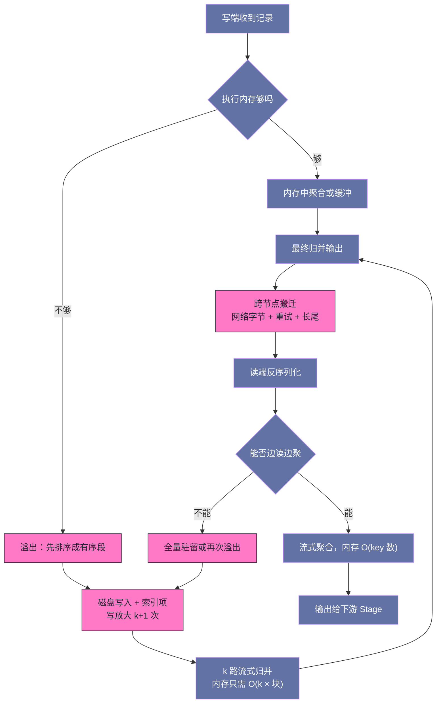
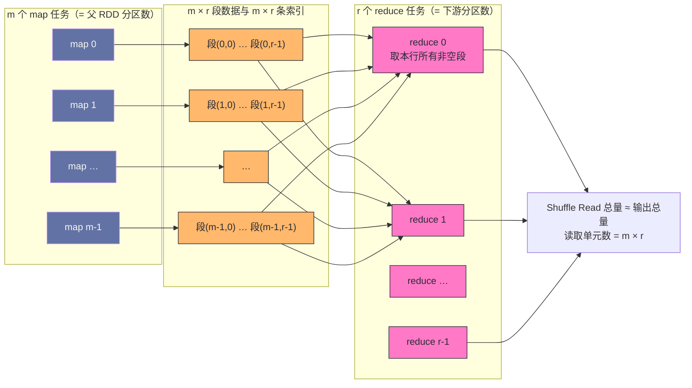
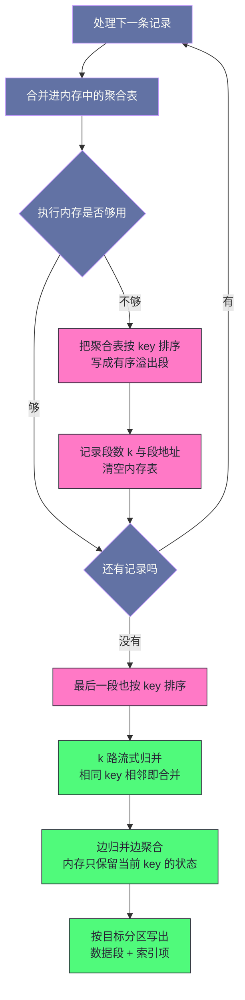
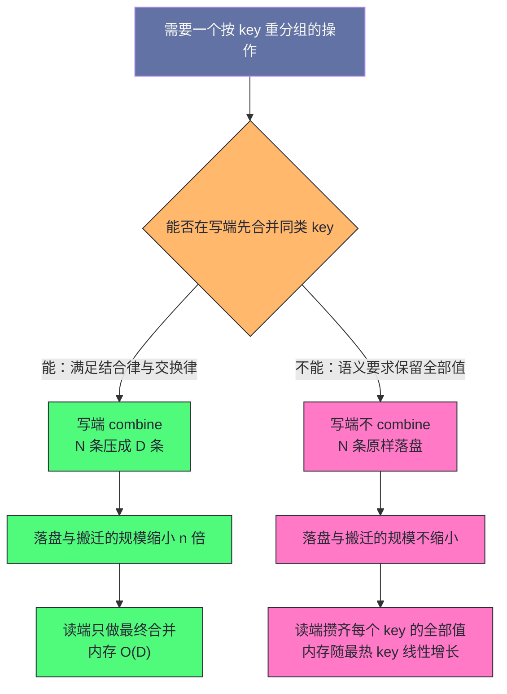
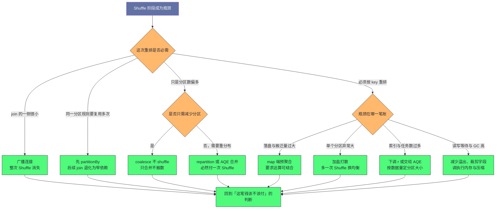

# 1. Spark Shuffle 机制深度解析：三笔账、m×r 放大与避开 Shuffle 的边界

**摘要：**

2012 年伯克利 AMPLab 在 NSDI 上发表 RDD 论文时，把**宽依赖**（Shuffle Dependency）当作与窄依赖并列的一种依赖类型，只用很短的篇幅交代了它的容错语义；十余年之后，几乎每一个"Spark 作业跑得慢"的现场，追到底都是这一条依赖在收账。原因不难理解：窄依赖可以在一条迭代器链上流水完成，中间结果不落地、不跨机器、不需要重新组织；而宽依赖要求下游按 key 重新分组，同一份数据必须离开它被算出来的那个分区，先物化、再搬迁、再重新归拢，这三件事分别落在磁盘、网络与 CPU 上，也就构成了本文要算的三笔账。

这篇文章只回答一个问题：Shuffle 为什么贵，贵在哪里，以及在什么条件下可以不付这笔钱。文章沿五问推进：先界定 Shuffle 是什么、宽依赖为什么非物化不可；再把代价拆成磁盘、网络、CPU 三笔，说明它们之间是相互兑换而非简单相加的关系；接着算清 m 个 map 任务与 r 个 reduce 分区构成的 m×r 网格，如何把读取次数、索引条目与失败面同时放大；然后解释"先排序再落盘"为什么是省内存而不是费内存，以及 map 端聚合如何让 `reduceByKey` 与 `groupByKey` 拉开数量级的差距；最后落到"什么时候该主动避开 Shuffle"上，把**广播连接**、预分区复用、`**coalesce**` 与加盐打散这几条路的适用前提与代价逐条摊开，并单列边界与反例。

文章的口径是 Spark 4.3.0（2026-10-30 发布，4.x 预编译 Scala 2.13）；4.x 里已经出现流水线化 Shuffle 等新机制，凡涉及实现细节处，以对应版本文档或源码为准。

**关键词（Keywords）**: ShuffleDependency, 宽依赖, **代价模型**, **map端聚合**, **spill**, 广播连接, coalesce, **AQE**, **数据倾斜**

---

## 第 1 章 Shuffle 是什么：一次重排把流水线剪断

### 1.1 一个不寻常的落差

同样一份数据、同样的核数，把 `map` 链换成一次 `reduceByKey`，作业耗时常常从几分钟跳到几十分钟；把 `spark.sql.shuffle.partitions` 从 200 改成 2000，有时快一半，有时慢一倍；再把这行配置改回来，反而又快了。同一个操作，收益方向如此不稳定，说明它背后不是一个"开销恒定"的动作，而是一组随规模、随分布、随机器状态一起变形的代价。

要理解这组代价的形状，先得说清 Shuffle 到底在搬什么。它搬的不是"一批数据"，而是"一次重新分组"：把散落在各处的记录，按某个函数（通常是 key 的哈希）重新归拢到与目标分区一一对应的位置上。搬完之后，原来相邻的记录不再相邻，原来分区的边界不再成立，下游看到的是一个按 key 组织好的新世界。Shuffle 的本质不是传输，是让"分组"这件事在物理上成立。

### 1.2 窄依赖为什么可以不落地

`map`、`filter`、`mapPartitions`、`union` 这些变换满足一个共同性质：子 RDD 的第 i 个分区只依赖父 RDD 的第 i 个（或固定的那几个）分区。这条性质允许执行引擎把整条链折叠进同一个 Task，用迭代器套迭代器的方式向下推进：父分区算出一个元素，子分区立刻消费一个元素，再传给下一层，内存里同时只有极少数元素在流动。中间结果从头到尾没有名字，也就从来没有落过地。

这段流水能够成立，靠的是一对隐含前提。其一，每个下游分区都能从"某一个确定的父分区"取到它需要的全部数据；其二，链上没有任何一步需要看到"全局输入中的某一类子集"。`filter` 只是逐条判断，`map` 只是逐条改写，都不需要全局视野，于是流水畅通，代价与链长成正比而与数据总量无关。

一旦某个变换需要"把相同 key 的放在一起看"，这两个前提就同时失效了。

### 1.3 宽依赖：下游要按 key 重新分组

`groupByKey`、`reduceByKey`、`join`、`distinct`、`repartition` 都属于宽依赖（Shuffle Dependency）。以 `reduceByKey` 为例，它的语义是"把所有相同 key 的值聚到一起再算"，而相同 key 的原始记录在输入里必然是分散的：订单流水按时间顺序落盘，同一个商品品类会散落在全部 200 个分区里，任何一个分区都不掌握完整答案。

于是下游第 j 个分区要拿到自己的完整输入，只能去读上游全部 200 个分区中"键经过哈希落在 j 上"的那些记录。这就是宽依赖必须物化的全部理由：下游要读的不是"某一段连续数据"，而是"散落在所有上游分区里、按某个函数筛出来的那部分数据"。前者可以由一个 Task 顺着血缘算出来，后者不能，因为它要的答案在上游任何一个 Task 手里都不完整。

不妨反过来设想不物化的两条替代路线。第一条是让第 j 个 reduce Task 分别向 200 个上游分区下单"你算一遍，把我要的记录发给我"，代价是上游重算 200 次；第二条是让每个 reduce Task 自己把整份输入读一遍再筛，代价是输入被读 200 次。两条路都把"一次重排"换成了"两百次重算"，量级差出两个数量级。由此可见，物化并不是 Shuffle 额外加的一笔开销，而是把"重算"换成"搬家"之后省下来的那笔钱——先把答案落到一个所有下游都能寻址的地方，下游才只需要付一次搬迁费。

### 1.4 一个贯穿全文的作业

后面的论述需要一个具体的着力点，笔者这里设一个电商数仓的日结作业 `gmv_daily`：从 HDFS 读入当天的订单明细与商品维表，各按 200 个分区读入，按商品标识连接、按品类汇总成交额，最后写回数仓。

```scala
// 两条彼此独立的窄依赖链，各自以一次 Shuffle 收尾
val orders = sc.textFile("hdfs:///dw/orders").map(parseOrder)     // m = 200
val items  = sc.textFile("hdfs:///dw/item_dim").map(parseItem)    // m = 200

// join 会对 orders 与 items 各生成一个 ShuffleDependency，两条父分支在此汇合
val priced = orders.join(items)

// 再一次按 key 重分组：品类 -> 成交额
val byCat = priced
  .map { case (_, (o, it)) => (it.category, o.amount) }
  .reduceByKey(_ + _)                                            // r = 200
byCat.saveAsTextFile("hdfs:///dw/gmv_by_category")
```

这段代码里有三个 Shuffle 依赖：`join` 内部两个（左表一个、右表一个），`reduceByKey` 一个。map 端任务数 m 由父 RDD 的分区数决定，这里三次都是 200；reduce 端分区数 r 由分区器决定，`join` 取两侧分区数的较大值，`reduceByKey` 一般沿用父 RDD 的分区数（除非显式指定或设置了 `spark.default.parallelism`），也还是 200。m 与 r 都是两百，不是为了凑一个好看的数字，而是因为分区数在 Spark 里是一个"从读入一路继承下来"的量，很少有人在中途刻意改它。

这个"200 × 200"会在第 3 章被反复拿出来算账：它意味着一次 Shuffle 的逻辑寻址单元是四万个，三次 Shuffle 是十二万个，而作业真正处理的数据量可能只有几百 GB。分区数是用户在写 `textFile` 那一刻就几乎定死的东西，而它决定了后面每一次 Shuffle 的账本规模。这种"配置在上游、收账在下游"的错位，是 Shuffle 调优最容易被忽略的一层。

### 1.5 一个比喻：跨校区并班

把窄依赖想成一节连堂课：老师在同一个教室里讲完第一章接着讲第二章，学生不用换座位，讲义不用搬运，中间没有交接。Shuffle 则是学期初的跨校区并班：原先按入学成绩分好的班要按选课重新编班，同一个学生可能从东校区调到西校区，同一个新班的学生来自十几个老班。

并班这件事的成本不在"学生走了多少路"，而在它导致的三个连锁动作：老班的花名册必须结算并存档（落盘）、学生要按新班级跨校区流动（网络）、新班要重新点名并把同一门课的学生归拢到一起（CPU 与内存）。更关键的是，并班开始之后老班就不能再往里加人，新班也必须等所有人到齐才能开课——这就是 Stage 之间那条"下游必须等上游"的严格边界。

比喻的限定在于：Spark 的并班并非"全部到齐才开第一节课"。`MapOutputTracker` 是逐分区登记地址的，reduce 端理论上可以边取边等。Spark 没有这么做，而是在 Stage 提交这一层就把等待做掉了，宁可粗一点也要换来确定性——省下的不是时间，是"白跑一半又被推翻"的风险。

把窄依赖的流水线与宽依赖的两阶段并排放，能看出两者的分工远不止"快与慢"：

```mermaid
%%{init: {'theme': 'dracula'}}%%
flowchart LR
    subgraph N["窄依赖链：一个 Task 内流水完成"]
        N1["父分区<br/>iterator"] --> N2["map 逐条改写"]
        N2 --> N3["filter 逐条判断"]
        N3 --> N4["子分区输出<br/>不落地"]
    end
    subgraph W["Shuffle Write：上游 Stage 收尾"]
        W1["按 key 计算<br/>partitionId = hash(key) % r"] --> W2["写端缓冲<br/>可先做 map 端聚合"]
        W2 --> W3["落盘：数据段 + 索引项"]
    end
    subgraph R["Shuffle Read：下游 Stage 起始"]
        R1["按 (shuffleId, mapId, reduceId)<br/>向 m 个上游取数"] --> R2["反序列化 + 归并"]
        R2 --> R3["聚合或排序<br/>得到本分区的完整输入"]
    end
    N4 -. "窄依赖到此为止" .-> W1
    W3 -. "跨节点搬迁" .-> R1
    classDef narrow fill:#6272a4,stroke:#bd93f9,color:#f8f8f2
    classDef shuffle fill:#ff79c6,stroke:#282a36,color:#282a36
    class N1,N2,N3,N4 narrow
    class W1,W2,W3,R1,R2,R3 shuffle
```



图中虚线处就是 Stage 的接缝：左边是迭代器链，右边必须先有地址才谈得上读取。把两阶段的职责并排看，Shuffle 的账本就有了分栏的依据：

| 阶段 | 主要任务 | 发生位置 | 主要成本 |
|---|---|---|---|
| **Shuffle Write** | 按目标分区归拢记录、可选的 map 端预聚合、排序后落盘并写索引 | map 端 Task | 磁盘写、序列化、排序比较 |
| **Shuffle Read** | 按地址向上游取数、反序列化、归并或分组、执行最终聚合 | reduce 端 Task | 网络拉取、反序列化、内存与 spill |

两个阶段的分工还带来一个后果：写端的产出形态决定了读端的读取效率，而读端的取数模式又反过来约束写端的布局。这份"布局与读取方式必须事先谈妥"的耦合，正是 Shuffle 无法像窄依赖那样自由流水的根源。

---

## 第 2 章 代价模型：三笔账，以及它们之间的兑换

### 2.1 为什么不能笼统说成"网络开销"

"Shuffle 慢是因为要过网络"，这句话只对了一半，而且是最容易误导人的一半。真实的一次 Shuffle 至少向三个地方付费：写端把记录落成文件（磁盘）、跨节点把文件搬过去（网络）、两端各自把记录序列化与重组（CPU）。三者不是同一笔钱换算成三种单位，它们有各自的伸缩规律——磁盘随数据量与溢出次数增长，网络随 m×r 的取数网格与实际字节数增长，CPU 随记录条数增长——因此它们的调优旋钮也不同。

把三笔账混成"网络开销"，会直接推出一个错误结论：加带宽或者换更快的网卡就能解决。可在很多现场，瓶颈其实在写端的排序比较与读端的反序列化上，网卡利用率根本没打满；也有些现场网络是瓶颈，但因为读端 spill 太重，把线程都堵在了磁盘上，看起来像"CPU 不够"。

分开算账还有一个附带好处：它让"为什么这个参数有效"变得可以推理。压缩能减网络与磁盘，代价是 CPU；预聚合能减网络与磁盘，代价是 CPU 与内存；加大读端缓冲能减磁盘读次数，代价是堆内存。每一条都不是免费的午餐，选择哪一条取决于当下哪一笔账最贵。

### 2.2 磁盘账：落盘、索引与留存

写端要为每个 `(shuffleId, mapId, reduceId)` 组合留下一段数据，并且留下"这一段从哪开始、有多长"的索引。索引由 `IndexShuffleBlockResolver` 这一类组件维护，条目数是 m×r——注意这个数字与数据是否有值无关，即便某个 map 任务在某个 reduce 分区上一条记录都没有，索引表通常也要为它留一个位置（长度为 0 的段）。所以磁盘账的第一项不是"写了多少字节"，而是"记了多少个位置"。前者随数据量变化，后者只随分区数变化，这解释了为什么"把分区数从 200 调到 2000"在小数据量作业上反而更慢。

第二项是写放大。写端不是一次成型：内存里的缓冲区满了就要溢写（spill）一次，k 次溢出意味着同一批记录被写过 k+1 次（k 次溢写加上最终归并输出）。溢出的次数取决于单分区数据量与可用执行内存的比值，而可用执行内存又受 `spark.memory.fraction`（默认 0.6）与统一内存管理里存储内存的占用情况影响。spills 一旦变成常态，磁盘写的字节数就可能是数据量的数倍，且每一次溢出都伴随着一次排序，CPU 账同步上涨。

第三项常被忽略：留存时间。默认配置下，Shuffle 依赖不会仅仅因为对应的 RDD 失去引用就被立刻清理（`spark.cleaner.referenceTracking.cleanShuffleDependencies` 需要显式打开），于是一个长驻的 Spark 应用——ThriftServer、常驻的结构化流作业、反复提交小作业的调度器——它的 Shuffle 文件会随着 `shuffleId` 的增长而持续累积，直到 SparkContext 结束。磁盘账在这一层上不是"贵"，而是"不漏"，漏到最后把所有节点的磁盘写满，作业以一种与 Shuffle 毫无关系的方式失败。写端的文件数与打开句柄数同样是这一栏的老账，SPARK-6237 处理的是打开文件过多，SPARK-2045 处理的是把写端大量小文件与缓冲对象收成一份有序输出，两者的动因都在代价一侧，而不是风格一侧。

### 2.3 网络账：拉取、重试与长尾

读端要向上游的 m 个位置各取一段数据。取数过程由 `ShuffleBlockFetcherIterator` 组织，它把请求按"目标地址"聚合，控制同时在途的数据量（`spark.reducer.maxSizeInFlight`，默认 48 MiB）与每个地址的并发块数，并在某次请求失败时按退避策略重试（`spark.shuffle.io.maxRetries` 与 `spark.shuffle.io.retryWait` 决定重试轮数与间隔）。

网络账有三层，逐层叠加。第一层是必需的字节数，约等于本地要处理的那部分 Shuffle 输出，这一层由数据量与分区函数共同决定，能被压缩按比例削减（`spark.shuffle.compress` 默认开启，用 CPU 换网络）。第二层是重试，一次节点抖动、一次网络闪断，都会让已经发出去的请求作废重来；若某个 map 输出所在的主机整个消失，则会升级为 `FetchFailed`，触发上游重算与下游整段重提，这一层是尾部事件，但它的期望成本随 m×r 增大而上升。第三层是长尾，r 个 reduce Task 里最慢的那一个决定整个 Stage 的完成时间，而最慢的那个往往不是数据最多的，而是恰好要向一台慢盘机器取数的那个。

这三层里，只有第一层是"可以预算的"，后两层都是"方差"。Shuffle 的网络成本因此不是一条直线，而是一条带着长尾的分布：均值好算，交付时间由尾部决定。任何以"平均带宽够用"为前提的容量规划，都会在尾部被证伪。

### 2.4 CPU 账：序列化、排序与合并

第三笔账落在 CPU 上，由四类开销构成，它们都随记录条数增长，与字节数关系不大。

序列化至少两次：写端把对象编成字节（跨进程必须），读端再把字节还原成对象。若中途还有溢出，同一批记录可能被反复编解码。反序列化尤其昂贵，因为它在读端是"热路径"，每条记录都要走一遍；这也是为什么 `select` 之后尽早把宽表裁成窄表、把不需要的字段尽早丢掉，对 Shuffle 的收益远超直觉。

排序是写端最重的单项。为了能做出有序的溢出段，每条记录都要参与比较，复杂度是 O(n log n) 次 key 比较，而比较的是序列化后的字节序列，每次比较都可能触及多次内存访问。合并是读端对应的开销，k 个有序段做 k 路归并，复杂度 O(n log k)，再叠加哈希分组或最终聚合的 O(n)。

最后是 GC。Shuffle 路径上产生大量短命对象——反序列化出的记录、包装用的元组、排序用的比较器视图——它们在年轻代里迅速变成垃圾，推动频繁的 minor GC。一次大 Shuffle 把 CPU 打满，事后看监控却发现用户代码只占很小一部分时间，剩下的都在 GC 与比较器里，这几乎是最常见的"Shuffle 慢"的实际形态。

### 2.5 三笔账之间是兑换关系

把三笔账分开算完之后，最重要的一步是承认它们可以相互兑换。压缩是拿 CPU 换网络与磁盘；map 端预聚合是拿 CPU 与内存换网络与磁盘；减少溢出是拿内存换磁盘与 CPU；加大读端在途缓冲是拿堆内存换网络往返次数。每一条优化都是在账本之间划账，而不是凭空消掉成本。

下面这张表把三笔账的量化口径并排放好：

| 账本 | 成本项 | 量级由什么决定 | 主要旋钮 | 典型失效表现 |
|---|---|---|---|---|
| 磁盘 | 数据段写入、索引条目、溢出写放大、文件留存 | 数据量 × 溢出次数；索引条目 = m×r | `spark.shuffle.file.buffer`、执行内存、`spark.shuffle.compress` | 写盘等待高、spills 计数飙升、节点磁盘被占满 |
| 网络 | 拉取字节、重试、长尾 | 本分区输入量、m×r 网格、节点稳定性 | `spark.reducer.maxSizeInFlight`、压缩、`spark.shuffle.io.maxRetries` | fetch wait 时间高、`FetchFailed` 频发、Stage 尾延迟极长 |
| CPU | 序列化与反序列化、排序比较、归并、GC | 记录条数（而非字节数）与 key 的复杂度 | 提前裁剪字段、减少溢出、聚合前置 | GC 时间占比高、Task 的 CPU 时间远大于读写时间 |

相互兑换的那几条路径，可以收成一张更小的表：

| 想省下的 | 常用手段 | 付出的是 | 何时不该用 |
|---|---|---|---|
| 网络字节 | 压缩、map 端预聚合、提前裁剪字段 | CPU 压缩解压、内存中的哈希表 | 记录本身极小、压缩比低时，压缩反而更慢 |
| 磁盘写入 | 加大执行内存、减少溢出 | 堆内存，进而抬高 GC 压力 | 单分区数据量远超内存时，加大内存只是推迟溢出 |
| 网络往返次数 | 加大在途缓冲、合并请求 | 堆内存与更长的单次等待 | 分区极多且每份很小，合并收益有限 |
| 读端内存 | 写端排序、流式归并 | 写端一次排序的 CPU | 数据本来就能全部放进内存时，排序是多余动作 |

把这张表与前面的账本表叠起来看，能看清一条传导链：写端多花一次排序，换来溢出的段可归并，于是读端不必把全部数据拉进内存，内存压力下降，GC 变少，CPU 反而省回来。这就是"排序"在 Shuffle 里的真实位置——它不是为了让结果有序，而是为了让溢出这件事变得可合并。



图中被染色的四个节点就是三笔账真正发生的位置，其余节点都只是流程。特别注意从 J 回到 E 的那条边：读端一旦放弃"边读边聚"，成本就被退回写端，重新变成一次落盘与排序——在某些实现路径上，省下来的内存，是从磁盘上借来的。

---

## 第 3 章 m×r：放大的乘法

### 3.1 一次 Shuffle 到底发生多少次读取

m 个 map 任务各产出一份输出，每份输出按 r 个 reduce 分区切成 r 段；r 个 reduce 任务各要向这 m 份输出取走属于自己的那一段。于是逻辑上的寻址单元数是 m×r，读取动作的粒度也是一个 map 任务在某一个 reduce 分区上的那一段。

以 `gmv_daily` 为例，200 个 map 任务、200 个 reduce 分区，一次 Shuffle 的读取单元是四万个；三个 Shuffle 依赖合起来，是十二万个。作业处理的数据也许只有几百 GB，但它围绕这些数据要处理十二万个寻址单元、十二万条索引、以及读端与这十二万个单元对应的请求编排。

这里的"四万"不等于"四万次网络往返"。读端的取数组件会按目标地址把请求合并，把多个块打包成一次请求，实际往返次数可以低一个数量级。但合并只削减了往返，削减不了三样东西：索引条目的数量（写端必须为每个单元留位置）、块的数量（每个单元至少一条元数据）、以及"某一份输出不可用"时的重试面（任何一个单元缺失都会让对应的 reduce Task 失败）。因此 m×r 是一个"底层面积"，优化能让它上面的建筑更矮，但改不了这块地的尺寸。

### 3.2 数据量不放大，寻址成本放大

有一点容易搞混：m×r 放大的是"读取的次数与寻址的面"，不是"经由网络搬运的字节数"。每条记录在正常情况下只被搬一次，从它被算出来的 map 任务搬到目标 reduce 任务，数据量由分区函数与记录数决定，与 m、r 的乘积无关。

真正被放大的是三类元信息与调度成本。第一类是索引与块元数据，条数都是 m×r，它们在 Driver 与 Executor 之间流转、被序列化、被查表，成本与数据量无关，只与网格面积成正比。第二类是任务间的依赖面：每个 reduce Task 在启动时要先建立与 m 个上游位置的联系，m 越大，建立成本越高，`MapOutputTracker` 上的地址表也越大。第三类是失败面，见 3.4 节。

理解了这一点，就能解释一个反直觉现象：数据量很小、分区数却很大的作业，Shuffle 阶段耗时可能主要花在"看不见"的地方——索引、元数据、任务编排，而不是数据本身。这类作业的特征是 Shuffle Read Size 很小而 Shuffle 阶段耗时很长，看指标的人容易误判成"网络有问题"。

### 3.3 网格与文件：一张图看清 m×r

下面这张图把一次 Shuffle 的网格铺开。横向是 m 个 map 任务，纵向是 r 个 reduce 分区，每一个交叉点就是一个数据段、一条索引项，也是一次潜在的读取单元；读端每一行（一个 reduce 分区）都要把这一行上所有非空交叉点取回来。



图里最能说明问题的是那个"每一列都被每个 reduce 读一次"的结构：m 越大，每一行要读的段越多；r 越大，行数越多。m 与 r 都以乘积的方式进入账本，这解释了为什么"两个都调大"往往比"只调一个大"更糟。

### 3.4 失败面也按乘积放大

Shuffle 输出的每一段都是有寿命的：它躺在某个 Executor 的本地磁盘上，Executor 一旦退出，那台机器上的所有段同时失效。读端一旦发现某段取不到，就抛 `FetchFailed`，进而引发一轮上游重算与下游整段重提。

于是有个朴素的概率论证：设单个段在作业期间失效的概率为 p，那么读端在取 m×r 个段的过程中，至少撞上一次失效的概率接近于 1 − (1 − p)^(m×r)。p 通常很小，但乘上四万、十二万之后，就不再可以忽略。分区越多，任务的并行度越高，同时"暴露在风险中的段"也越多，而每一个段的失效都会让一整批 reduce 任务白跑。这也是为什么大作业里 `FetchFailed` 往往不是真的磁盘坏了，而是任务太多、时间太长，撞上了正常的节点回收与抢占。

重提的代价还不止重算本身。reduce 端已经拉回来的数据在失败时会作废，重新来过；若这个 reduce 任务已经跑了四十分钟，那么这次作废的代价就是四十分钟乘以并发度。这条链条把"失败面"从概率问题变成了"期望损失"问题，而期望损失与 m×r 同阶。

### 3.5 r 的三档取值

既然 r 以乘积进入账本，它的取值就不可能"越大越好"。把 r 拉成三档来权衡，各自的胜负项很不一样：

| r 的档位 | 网格面积 | 单分区数据量 | 并行度与资源 | 主要风险 |
|---|---|---|---|---|
| 明显偏小 | 小，索引与元数据省 | 大，单 Task 要处理的数据远超内存 | 并行度不足，集群空转 | 大规模溢出、单个 Task 长尾、OOM |
| 大致合适 | 与数据量匹配 | 落在数十 MB 到百 MB 量级 | 能填满集群，Task 粒度不至于过碎 | 需要按数据量估算，估算依赖统计信息 |
| 明显偏大 | 大，索引与请求编排成本上升 | 极小，大量分区只有几 MB 甚至更少 | 调度开销与固定成本占比上升 | 小文件、元数据膨胀、`FetchFailed` 面变大 |

"大致合适"这一档的判断依据，官方调优文档给的思路是按数据量估算分区大小，而自适应查询执行给出的默认建议值是 `spark.sql.adaptive.advisoryPartitionSizeInBytes`（默认 64 MiB）。SQL 侧另有 `spark.sql.shuffle.partitions`（默认 200）作为初始值，它在 AQE 开启时只负责"第一版计划"，后续会被运行时统计改写。

三档的排布说明一件事：r 的选择本质上是"让每个 Task 的固定成本被足够多的数据摊薄，同时不让单 Task 的数据量超出内存能承受的范围"。这两条约束一上一下，中间的窗口并不宽，而窗口的位置随数据量变化。把 r 固定写成 200 或 2000 值不值，取决于它落在这个窗口的哪一侧，而不取决于数字本身有多大。

---

## 第 4 章 为什么必须先排序、聚合再落盘

### 4.1 全量驻留：一个跑不起来的方案

要把相同 key 的记录归拢到一起，最直接的做法是建一张哈希表：key 作索引，value 用一个列表把所有同 key 的值攒起来，等全部记录处理完再统一计算。逻辑清楚，实现也简单，问题在于它的内存需求：表的规模与本分区的记录条数成正比。

粗算一下单条记录在堆里的占用。一个 key 对象、一个 value 对象、列表里的两个引用、哈希桶里的一个节点，加上对象头与对齐填充，几十到上百字节是常态。如果一个 reduce 分区要处理上千万条记录，这张表就是几个 GB；如果分区数偏少、单分区数据量更大，几十 GB 也不奇怪。堆放不下，于是要么 OOM，要么靠巨大的堆和频繁的 Full GC 硬撑——后者的表现是任务跑得极慢而 CPU 利用率不高。

这条路失败的形态不是"慢"，是"根本跑不完"。它把内存需求写成了数据量的线性函数，而 Shuffle 面对的恰恰是"数据量远大于内存"的场景，前提从一开始就不成立。

### 4.2 排序是为了让溢出的段可以合并

换一条路：不让全部数据同时驻留，而是攒够一批就落一次盘。问题是落盘的这一批如果无序，后面就没法高效地把多批合并起来——你得把每一批都读回内存再建哈希表，等于绕回了 4.1 的死路，只不过把 OOM 的时刻推迟了几轮。

如果落盘时先按键排序，情况就完全不同：k 个有序段可以做 k 路归并，每一步只需要从每个段里读一小块（一个缓冲块），把当前最小的 key 推进输出，读完再续下一块。内存需求从 O(记录数) 降到 O(k × 块大小 + 归并堆)，与数据总量无关。这正是 `ExternalSorter` 一类外部排序器的基本形状，也是"先排序再落盘"能省内存的全部秘密——它把"同时容纳全部数据"替换成了"同时容纳 k 个段的头部"，而 k 是溢出次数，与数据量只有对数关系。

排序还带来一个副产品，这个副产品比排序本身更重要：有序之后，相同的 key 必然相邻，于是聚合可以在归并过程中顺流完成——来一个 key 就开始攒，key 一变就把结果吐出去。整个过程只需要在内存里保留"当前正在聚合的那一个 key"的状态，而不是"全部 key 的全部值"。这就是排序与聚合在 Shuffle 里总是绑在一起的原因：排序不是为了输出有序，而是为了让聚合可以在有限内存里流式进行。

必须给这个结论加上限定。流式归并的前提是"每一段都有序"，而制造有序段本身要付出排序的 CPU 代价；当数据量小到完全可以全部放进内存时，排序就是纯粹的浪费，此时简单的哈希聚合更快。Spark 在写端保留了绕开排序的路径（`spark.shuffle.sort.bypassMergeThreshold`，默认 200，用于 reduce 分区数不多且不需要 map 端聚合的场景），正是承认这个边界存在。

### 4.3 聚合前置：在大规模落盘之前先收缩一次

排序解决了"如何合并"，但没有解决"要合并多少"。如果在写端就先把同一个 key 的多条记录压成一条，那么落盘、搬迁、归并的规模都会同步下降——这一步叫 map 端聚合（map-side combine），在第 5 章会专门算它的收益。

从内存角度看，聚合前置还有一个不那么显然的作用：它让"有序段里的元素数"从"记录条数"降到"本分区内不同 key 的个数"。两个数在真实数据上可能差一到两个数量级（订单流水里同一个品类会被重复提到成千上万次）。段变小，归并的推进次数变少，落盘字节数变少，读端要拉的量也变少。同一个动作，同时削掉了三笔账，这是 Shuffle 优化里少见的"一次付三份收益"的位置。

它的代价也很实在：写端要维护一张 key 到中间结果的哈希表，这张表的大小等于本分区的 key 基数，若 key 基数很大（譬如按用户标识聚合，几千万个 key），这张表本身就会溢出，预聚合的收益被溢出成本吃掉一部分。是否值得，取决于 key 基数与记录数的比值，而这个比值在数据到手之前往往只能估。

### 4.4 排序与聚合的先后：三种排法

把"排序"与"聚合"这两件事放在一起，先后顺序有三种排法，各自的代价结构差别很大：

第一种是先排序再聚合。数据先整体排好序，再顺序扫描一遍完成聚合。它的优点是排序与聚合的语义都很直白，结果天然满足"既有序又聚合"的需求；缺点是排序时需要一个能容纳全部数据的线性结构，或者退化成外部排序，且无法在排序过程中顺便做聚合，CPU 被走两遍。传统 MapReduce 走的就是这条路。

第二种是用有序结构同时完成两件事，譬如以 TreeMap 为容器，插入即有序，插入时顺便做聚合。这条路的优点是排序与聚合一体化，内存中一次成型；缺点是每次插入都是 O(log n) 的比较与树结构调整，常数项很大，且整棵树必须驻留内存，数据量一大就无法支撑。它适合小规模、需要强有序的场景。

第三种是先聚合再排序，也就是用一个哈希结构完成聚合，需要输出有序时再对聚合结果排序。这条路的优点是聚合与排序彻底解耦：聚合可以复用在线聚合（收到一条就并入一次，不保留值列表），排序只作用在收缩后的结果上，规模小得多；缺点是聚合结果要额外占一份内存，或者需要引用原始数据再排。Spark 选择的正是这一条。

把这三种排法放在一张表里，取舍会更清楚：

| 方案 | 执行顺序 | 优点 | 缺点 | 适用场景 |
|---|---|---|---|---|
| **先排序再聚合** | 排序 → 聚合 | 一次成型即满足排序与聚合；聚合逻辑简单 | 需容纳全量数据的线性结构；无法在线聚合，CPU 走两遍 | 传统 MapReduce 式的大规模批处理 |
| **排序聚合同时进行** | 以有序结构边插边聚 | 一体化，内存中一次完成，输出天然有序 | 每次插入 O(log n) 且常数大；整棵结构必须驻留 | 小规模、强有序需求 |
| **先聚合再排序** | 聚合 → 排序 | 聚合可在线化；排序只作用于收缩后的结果，规模更小 | 需要额外空间保存聚合结果或引用 | Spark 的大规模数据聚合 |

Spark 选择第三条的深层理由是它把"聚合"看作可以流式推进的动作，而把"排序"看作可选的输出修饰。这样一来，绝大多数不需要有序结果的聚合（`reduceByKey`、`aggregateByKey`）完全不用付排序的钱，只有明确要求有序的算子（`sortByKey`、`repartitionAndSortWithinPartitions`）才把排序拉进来。把昂贵的动作设为可选项，是 Spark 在 Shuffle 设计上最重要的一次减法。

下面这张图画的是"聚合→溢出排序→归并"这条路径的完整形状。注意每次溢出之后内存被清空，处理继续，最后才做一次全局归并：



图中粉色节点是磁盘动作，绿色节点是归并动作。整条路径上，内存占用始终与"当前聚合表的大小"和"k 个段的缓冲"有关，而与"这个分区一共有多少条记录"无关——这就是它能扛住远超内存的数据量的原因。

### 4.5 反事实：不排序直接落盘会怎样

把 4.2 里那个排序动作删掉，让溢出段保持写入顺序，会依次发生三件事。

第一件，归并失效。乱序的多个段无法用 k 路归并合并，因为它们各自的头部不构成"全局最小"的候选；唯一的替代是把所有段读回内存重建哈希表，于是内存需求重新回到 O(记录数)，4.1 的死路原样复现。第二件，聚合退化。相同 key 分散在各个段里，归并时无法"key 一变就吐出去"，只能等全部读完再统一算，在线聚合彻底失效。第三件，读端恶化。读端拿到的是一堆无序块，任何需要按 key 组织的下游操作（分组、连接、去重）都得自己再排一遍，本该在写端做一次的排序，被推迟到读端做 r 次。

三件事叠加，等于把"一次排序"换成"r 次全量重建"。在 Shuffle 里，写端省下的一次排序，通常要在读端以分区数倍的方式还回去。

---

## 第 5 章 map 端聚合：`reduceByKey` 与 `groupByKey` 的代价差

### 5.1 两个算子只差一个函数

`groupByKey` 与 `reduceByKey` 在用户眼里长得很像：都是按键分组，都产生一次 Shuffle。差异在于前者的结果是 `(K, Iterable[V])`，后者是 `(K, V)`——一个保留了全部原始值，一个把它们合并成了一个。

这一处差异在 Shuffle 的路径上会分叉成两条完全不同的曲线。`reduceByKey` 可以在写端就把同一个 key 的多条记录合并成一条，落盘、搬迁、归并的对象都是合并后的结果；`groupByKey` 不能，因为它的语义要求"所有值都要留着"，任何合并都会丢信息。于是前者搬的是"不同 key 的个数"，后者搬的是"记录总条数"。当同一个 key 平均有 n 条记录时，两者的 Shuffle 数据量就差 n 倍，而 n 在真实数据里常常是几十到几千。

更要紧的是内存形态。`groupByKey` 在读端必须把每个 key 的全部值攒起来才能交给下游，这意味着它的读端内存需求与最热那个 key 的记录数成正比；一旦某个 key 特别热（数据倾斜），这个 key 会把整个 Task 拖垮，溢出甚至 OOM 都由此而来。`reduceByKey` 在读端只需要为每个 key 保留一个中间结果，热 key 的代价被压成常数。

### 5.2 写端那次收缩的收益怎么算

不妨设一个分区的输入是 N 条记录，不同 key 的个数是 D，平均每个 key 有 n = N/D 条记录。不做写端聚合时，落盘与搬迁的对象是 N 条；做了之后是 D 条。收缩比就是 n。

这个比值进入三笔账的方式各不相同。磁盘上，写入字节数与索引之外的写放大同时按 n 缩小；网络上，拉取字节数按 n 缩小；CPU 上，读端反序列化与排序比较的次数按 n 缩小，只有写端多出了一次哈希表维护的成本（O(N) 次插入）。只要 n 明显大于 1，写端多付的那次 O(N) 就必然划算；n 接近 1 时，预聚合几乎不收缩任何东西，反而白付一次哈希。至于这两次合并本身，同一个聚合函数在 Shuffle 的两端会被各调用一次：写端那一次负责把同 key 的多条并成一条，读端那一次负责把各 map 任务留下的中间结果再并一次，两处调用的必须是同一个可结合的运算，否则结果对不上。

n 的值由业务决定，不由框架决定：按品类聚合（几百个品类、上亿条订单）n 可以到十万量级，预聚合几乎是决定性的；按订单号聚合（每个订单一条记录，n = 1），预聚合一点用都没有。判断一个聚合算子的 Shuffle 是否昂贵，第一步不是看数据量，而是看 key 的基数——数据量大而 key 基数小，是最幸运的组合；数据量大而 key 基数也大，才是最贵的 Shuffle。

### 5.3 `groupByKey` 为什么压不动

`groupByKey` 的问题不是实现懒，而是语义上不允许收缩：它的返回值是一个可迭代的值的集合，把三条记录并成一条就改变了返回内容。因此它在写端不能 combine，读端也不能只保留一个中间结果，必须老老实实把每个 key 的全部值攒起来。

这也解释了为什么"用 `groupByKey` 再 `map` 求 sum"是一种典型的写法错误：它在 Shuffle 路径上搬了全部原始记录，然后在读端做了一次本可以在写端做的聚合。同样的语义用 `reduceByKey` 表达，Shuffle 数据量差 n 倍，最热 key 的内存压力差更多。这个差别在数据倾斜时会放大成事故：`groupByKey` 遇到一个千万条记录的 key，读端必须先攒下这一千万条才能往下走；`reduceByKey` 遇到同一个 key，只需要在内存里维护一个累加值。

不过 `groupByKey` 并非无用地存在。当语义确实需要"看到全部值"时（譬如要算中位数、要按序拼接、要把值列表原样输出），它没有替代品，此时能做的是控制 key 基数、加盐打散或改用其他算法，而不是假装它和 `reduceByKey` 一样便宜。

把两者的差异、以及 map 端聚合的适用条件收进一张表：

| 维度 | `reduceByKey` 一类的聚合算子 | `groupByKey` |
|---|---|---|
| 写端能否预聚合 | 能，同 key 的多条压成一条 | 不能，语义要求保留全部值 |
| Shuffle 数据量 | 约等于不同 key 的个数 | 约等于记录总条数 |
| 读端内存形态 | 每个 key 一个中间结果，与热点无关 | 每个 key 一份值列表，随最热 key 线性增长 |
| 对数据倾斜的敏感度 | 低，热 key 被压成常数状态 | 高，热 key 直接决定单 Task 内存 |
| 适用前提 | 聚合函数满足结合律与交换律 | 语义确实需要看到全部值 |
| 常见误用 | 把不可结合的运算硬塞进聚合 | 用 `groupByKey` 再手写聚合 |

下面这张图把"哪些操作能在写端就收缩、哪些不能"画清楚。左侧是能在写端收缩的，右侧是必须把原始粒度搬到读端的：



图中的分叉点只有一个判据：这个聚合能不能在"只看到部分同 key 记录"的情况下先算出一个中间结果。能，就走上半支，成本的量级由 n 决定；不能，就走下半支，成本的量级由记录总数决定。

### 5.4 combine 的前提与它的失效边界

写端聚合的合法性来自聚合函数的代数性质：满足结合律与交换律，才能保证"任意分批、任意顺序地合并局部结果"与"一次合并全部"得到相同答案。求和、取最大值、取最小值、计数、集合并集都满足；求平均值不满足（要先转成 sum 与 count 再相除），求中位数不满足，拼接字符串在非空串之间勉强满足结合律但不满足交换律，顺序敏感的运算全部不满足。

实践中常见的错误是把"看起来像聚合"的运算硬塞进聚合算子：用 `reduceByKey` 求平均值，先在 map 端把两个值平均、再在读端把平均再平均，得到的是一个加权错误的结果。正确的做法是把平均值拆成两个可结合的统计量（和、计数），聚合完再相除。这类错误不会报错，只会让结果悄悄偏掉——它的危险不在于性能，而在于它把一个正确性问题伪装成了一个性能优化。

另一个失效边界是效率而非正确性：当 key 基数极大时，写端哈希表本身会成为负担，它的规模等于本分区的 key 数，若 key 数接近记录数，这张表既占内存又没有收缩收益，此时关掉写端聚合反而更快。这就是 4.2 节提到的那条绕开排序的路径存在的意义——框架给出的是默认最优路径，而不是永远最优的路径。

---

## 第 6 章 什么时候可以不 Shuffle

### 6.1 `coalesce` 与 `repartition`：一个不搬，一个必搬

这两个算子常被混用，但它们在物理上完全不同。

`coalesce(n)` 默认不产生 Shuffle。它的做法是把相邻的若干个父分区在逻辑上归并成一个子分区，子分区由同一个 Task 顺序读取多个父分区，属于窄依赖。因此它有几个硬约束：只能减少分区数，不能增加；合并不跨分区重排，所以下游看到的数据顺序仍是"几个父分区依次拼接"；分区数减少意味着并行度下降，一个本来有 200 个 Task 的 Stage 可能变成 20 个，若数据量没有同步变小，反而更慢。

`coalesce(n, shuffle = true)` 以及 `repartition(n)` 一定产生 Shuffle。它们要重新分配数据，就必须让数据离开原分区、按新的分区规则重新聚拢，这正是一次 Shuffle 的定义。所以"用 `repartition` 减少分区数"是一笔白付的账：你花了重排的钱，只为了得到一个 `coalesce` 免费就能给出的结果。反过来，"用 `coalesce` 增加分区数"是不成立的，它压根做不到，此时只能用 `repartition`。

这里还有一个容易踩的细节：`coalesce` 不 shuffle 的前提是"只做相邻合并"。若上游分区数为 200、目标为 20，每个子分区由 10 个相邻父分区组成，这在物理上是"一个 Task 读十份数据"，不会产生跨节点搬运；但若上游数据本身分布极不均匀（某几个父分区特别大），合并后的子分区也会极不均匀，此时 `coalesce` 省下的 Shuffle 成本，会以长尾的形式还回来。

### 6.2 广播连接：把"按 key 重排"换成"人手一份"

宽依赖的代价来自"数据要按 key 重新分组"。但如果 join 的一侧足够小，小到可以给每个 Executor 各发一份，那么就不需要重排了：大表照旧按自己的分区扫描，每一行在本地小表的哈希表里查一次即可。这就是广播连接（Broadcast Join）。

它的收益是结构性的：join 从"一次 Shuffle"变成"每个 Task 内部的一次哈希查找"，网络成本从"按 key 重排整张大表"降为"把小表分发一遍"。SQL 侧由 `spark.sql.autoBroadcastJoinThreshold`（默认 10 MiB）控制何时自动选择，RDD 侧则由使用者显式广播。

代价与边界同样明确。广播的表要在 Driver 侧收集、序列化，再分发到每个 Executor 并常驻内存，表一大就会压垮 Driver 或 Executor；广播变量是只读的，无法参与需要动态更新的场景；统计信息缺失或过期时，优化器可能误判表的大小，选错了连接方式。广播连接的适用条件是"一侧足够小"这个物理事实，而不是"想避免 Shuffle"这个愿望。

### 6.3 预分区：把重排提前，然后反复复用

如果两个数据集要用同一个分区规则连接多次，那么"每次连接都重排一遍"显然是浪费。可行的做法是先按目标分区器各做一次 `partitionBy`，之后的 join 因为两侧分区器一致，会退化成窄依赖——每个子分区只依赖对应的那一个父分区，不再需要跨分区拉数。

这条路的收益随复用次数线性增长：只用一次，等于把 Shuffle 提前，没有净收益；用三次，就省下两次重排。它的边界也很清楚：分区器必须完全相同（分区数相同、分区函数等价），中间任何一次会改变分区的操作（`repartition`、经过一次新的 Shuffle、`filter` 之后部分分区变空）都可能让复用失效；而哈希分区器本身无法解决倾斜，键分布不均时分区的数据量仍然不均。

RDD 侧的分区器复用同样受这条约束支配，`CoGroupedRDD` 在构造依赖时就会检查父 RDD 的分区器是否与本次目标一致，一致则建窄依赖，否则建宽依赖。"分区器一致"这件事在物理上等价于"数据已经在正确的位置上"，因此它省掉的不是一次计算，而是一次搬迁。

### 6.4 加盐打散：缓解而不是消除

数据倾斜时，一个 key 可能占了某个分区一半的数据量，此时无论怎么调分区数都无济于事，因为哈希函数把所有同 key 的记录都送到了同一个分区。加盐的做法是给 key 加一个随机前缀，把一个热 key 人为拆成若干个键，先分散到多个分区做局部聚合，再去掉前缀做一次最终聚合。

要看清它的账：它没有消掉 Shuffle，反而增加了 Shuffle 的次数——第一次把热 key 打散，第二次把局部结果收拢。它换来的是"每一次 Shuffle 的数据分布更均匀"，从而把"一个 Task 跑两小时"变成"两百个 Task 各跑一分钟"。这是用"多一次重排"买"单次重排的均衡"，属于用账本换方差，而不是用账本换均值。

它的边界同样明显：只对可结合的聚合有效（求和、计数可以，求中位数不行）；join 场景需要两侧同时扩容，代价翻倍；盐的粒度过粗起不到打散作用，过细则第二次聚合的分区数暴涨。这类手段应当在确认倾斜是主要矛盾之后再上，而不是当成默认配置。

### 6.5 自适应查询执行的运行时合并

SQL 作业里还有一条路：让框架在运行时自己决定读端要开多少个分区。自适应查询执行（Adaptive Query Execution，AQE）在 map 阶段结束后能拿到每个 reduce 分区的实际数据量统计（`MapOutputStatistics`），据此把若干相邻的小分区合并成一个大分区再交给读端，合并的目标大小由 `spark.sql.adaptive.advisoryPartitionSizeInBytes`（默认 64 MiB）给出，具体实现落在 `CoalesceShufflePartitions` 这一类规则里。

它能减少分区数的原因不复杂：`spark.sql.shuffle.partitions`（默认 200）是在写计划时凭空定下的一个上界，而实际数据量往往远小于"200 个分区各装一份"的预期；AQE 在拿到真实统计之后，把小分区按顺序并起来，读端任务数随之下降，而已经落盘的数据布局不必改写——合并的是读取边界，不是文件。这就绕开了"r 定大了会浪费、定小了会溢出"的两难：先按一个偏大的上界切，再按实际大小回收。

它的边界也不该被忽略：合并只对连续的小分区生效，遇到超大分区它无能为力；统计收集与计划重写本身有成本，对短作业未必划算；它改变的是读端并行度，不改写端的落盘布局，所以写端的索引条目仍然是按初始分区数生成的。AQE 把"分区数该定多少"从一个静态配置问题，变成了一个运行期观测问题——但它只解决了"定大了"这一侧，没有解决"数据本身不均"那一侧。

把这一章的手段并排放好，各自的适用面与代价一目了然：

| 手段 | 消掉的是什么 | 前提条件 | 代价 | 什么时候不该用 |
|---|---|---|---|---|
| `coalesce(n)` 无 shuffle | 合并分区带来的重排 | 只需减少分区数，且可接受并行度下降 | 并行度降低、分布可能更不均 | 需要增加分区，或不能牺牲并行度 |
| `coalesce(n, true)` / `repartition(n)` | 无（它本身就要重排） | 必须改变分区数或分布 | 一次完整 Shuffle | 目的只是"减少分区数" |
| 广播连接 | 按 key 重排整张大表 | 一侧足够小，能装进内存 | Driver 与 Executor 内存、序列化开销 | 两侧都大，或统计信息不可靠 |
| 预分区复用 | 重复连接的多次重排 | 分区器可复用且不被中间操作破坏 | 首次那次 Shuffle 无法省 | 只用一次，或分区器会被打乱 |
| 加盐打散 | 不消除 Shuffle，只消掉倾斜 | 聚合可结合，倾斜已确认为主因 | 多一次 Shuffle 与去盐逻辑 | 数据本来均匀，或运算不可结合 |
| AQE 运行时合并 | 初始分区数定大造成的浪费 | SQL 侧、AQE 开启、存在连续小分区 | 统计收集与计划重写成本 | 分区本身极大或分布极不均 |

这些手段可以按一张决策顺序来用：



图中的顺序刻意把"这次重排是否必需"放在最前面，因为绝大多数调优动作都发生在"必需"这一侧，而真正能省掉整次 Shuffle 的动作都在"不必需"那一侧。先问要不要付，再问怎么付得便宜，顺序颠倒就会在错误的账本上省小钱。

---

## 第 7 章 边界与反例

### 7.1 "分区数调大总是更快"

这条直觉来自"并行度越高越快"，它在计算密集、数据均匀的场景里大致成立，在 Shuffle 上经常反过来。r 以乘积进入索引条目与寻址成本，m×r 增大意味着写端要留更多位置、读端要编排更多请求、失败面同步变大。当单分区数据量已经小到几十 MB 时，再增大 r 只是把固定成本摊到更多任务上，收益趋近于零而开销继续上升。

判断的分界线不在数字，而在"每个 Task 的有效工作量"。若一个 Task 的大部分时间花在启动、取数编排与序列化上，而真正处理数据的时间占比很低，那么增大 r 就是纯损失。

### 7.2 "Shuffle 必须尽量避免"

这是另一个方向的过度矫正。Shuffle 是宽依赖的物理代价，只要语义要求按 key 全局重分组，这笔钱就必须付，试图用"全量驻留内存"或"手工维护全局字典"绕过去，通常只是把成本从框架的账本上搬到了应用自己的 OOM 上。

更实际的说法是：能被消除的 Shuffle 只有那几种（广播、预分区复用、分区数调整），其余的只能被优化，不能被取消。把"避免 Shuffle"当成目标，会引导人去做"用 `groupByKey` 加一个大堆"这类看似绕开实则更贵的操作。

### 7.3 "map 端聚合总是赚"

写端聚合的收益等于收缩比减一，而收缩比由 key 基数决定。当 key 基数接近记录数时，写端哈希表既不收缩数据，又占内存，还多了一次哈希计算，此时它是一笔净亏损。这条边界在按唯一标识聚合的场景里非常常见，而这类场景恰恰是数据量最大的场景。

同理，"先聚合再排序"也不是无条件的：当结果必须保留原始顺序、或聚合本身不可结合时，这条路走不通，只能退回"先排序再聚合"，付双倍的 CPU。

### 7.4 "只看 Shuffle Read Size 就够"

Shuffle Read Size 只反映了一个账本里的一项：读端拉取的字节数。它看不见写端的溢出次数、看不见索引条目的数量、看不见读端的反序列化与 GC、更看不见取数失败的重试。一个作业可能 Read Size 不大，但 Shuffle 阶段耗时占了八成，原因是 spills 太多或 GC 太长。

诊断的顺序应当是先看三笔账哪一笔最贵（磁盘等待、网络等待、CPU 与 GC），再看这个账本上的哪一项在起作用，最后才回到参数。跳过前两步直接调参数，成功与否基本靠运气。

### 7.5 一张反例速查表

| 现象 | 常见误判 | 实际机制 |
|---|---|---|
| Shuffle Read Size 很小但阶段极慢 | 网络带宽不足 | 索引与寻址单元多、单 Task 有效工作量低，成本在元数据与编排上 |
| 分区数调大后反而更慢 | 参数没生效 | m×r 索引与失败面上升，固定成本摊不薄，写端还可能触发更多溢出 |
| 用了 `reduceByKey` 仍然很慢 | 算子是错的 | key 基数接近记录数，写端聚合无收缩收益，还多付一次哈希 |
| 加盐之后整体耗时没降 | 加盐无效 | 倾斜不是主因，或盐的粒度过粗；也可能是多出的一次 Shuffle 抵消了收益 |
| 广播连接后 Driver OOM | 广播不生效 | 广播表在 Driver 侧收集并分发，表一大就压垮 Driver |
| `coalesce` 之后任务变慢了 | `coalesce` 有问题 | 分区数下降导致并行度不足，或相邻合并后分布更不均 |

---

## 第 8 章 落点

回到开头那个问题：Shuffle 为什么贵。

答案可以收成一句：它把"重算"换成了"搬家"，而搬家要同时向磁盘、网络与 CPU 付费，三笔账之间还彼此兑换。窄依赖之所以便宜，是因为它的中间结果从不需要名字，从而从不需要落地；宽依赖之所以昂贵，是因为下游要的不是"某一段数据"，而是"散落在所有上游分区里、按某个函数筛出来的那部分"，这个需求在物理上只能靠一次全量重排来满足。分区的数量决定了这笔账的规模：m×r 是账本的面积，"先排序再落盘"是让溢出可合并的手段，"map 端聚合"是在落盘之前先把规模压下去，而广播连接与预分区复用则是在问"这笔钱是否根本不必付"。

由此得到一条判断顺序：看到 Shuffle 慢，先问这次重排是否必需——是否存在一侧足够小可以广播、是否存在可复用的分区规则、是否只是分区数定得偏大；若必需，再问三笔账里哪一笔最贵——磁盘看 spills 与写放大，网络看取数等待与重试，CPU 看反序列化与 GC；最后才问参数——`r` 该定多大、压缩该不该开、在途缓冲该给多少。三个问题问完，绝大多数"Shuffle 慢"会落到某个具体机制上，而不是停在"调大并行度"这类无法验证的建议上。

至于 4.x 正在推进的流水线化 Shuffle 会不会改写这套账本，目前仍然言之尚早。它改变的是"下游能否在上游产出过程中就开始消费"，也就是把等待的时间成本换成资源的占用成本；但"按 key 重排必须物化"这个前提没有变，变的只是物化的时机与粒度。这笔新账划不划算，取决于集群的松紧与作业的长短，而不取决于哪一种机制更先进。

---

## 参考资料

1. Zaharia M., Chowdhury M., Das T., et al. Resilient Distributed Datasets: A Fault-Tolerant Abstraction for In-Memory Cluster Computing. NSDI 2012. https://www.usenix.org/system/files/conference/nsdi12/nsdi12-final138.pdf
2. Apache Spark 源码（4.3.0）：`core/src/main/scala/org/apache/spark/util/collection/ExternalSorter.scala`，外部排序、溢出与多路归并的主流程。https://github.com/apache/spark/blob/v4.3.0/core/src/main/scala/org/apache/spark/util/collection/ExternalSorter.scala
3. Apache Spark 源码（4.3.0）：`core/src/main/scala/org/apache/spark/shuffle/IndexShuffleBlockResolver.scala`，Shuffle 数据段与索引的布局、索引条目与文件句柄管理。https://github.com/apache/spark/blob/v4.3.0/core/src/main/scala/org/apache/spark/shuffle/IndexShuffleBlockResolver.scala
4. Apache Spark 源码（4.3.0）：`core/src/main/scala/org/apache/spark/storage/ShuffleBlockFetcherIterator.scala`，读端按地址取数、请求合并、在途字节控制与失败重试。https://github.com/apache/spark/blob/v4.3.0/core/src/main/scala/org/apache/spark/storage/ShuffleBlockFetcherIterator.scala
5. Apache Spark 源码（4.3.0）：`core/src/main/scala/org/apache/spark/rdd/ShuffleDependency.scala`，宽依赖的定义、分区器与 map 端聚合标志 `mapSideCombine`。https://github.com/apache/spark/blob/v4.3.0/core/src/main/scala/org/apache/spark/rdd/ShuffleDependency.scala
6. Apache Spark 源码（4.3.0）：`core/src/main/scala/org/apache/spark/rdd/RDD.scala`，`coalesce` 与 `repartition` 的分区重排语义差异。https://github.com/apache/spark/blob/v4.3.0/core/src/main/scala/org/apache/spark/rdd/RDD.scala
7. Apache Spark 源码（4.3.0）：`core/src/main/scala/org/apache/spark/rdd/CoGroupedRDD.scala`，分区器一致时退化为 `OneToOneDependency` 的判定。https://github.com/apache/spark/blob/v4.3.0/core/src/main/scala/org/apache/spark/rdd/CoGroupedRDD.scala
8. Apache Spark 源码（4.3.0）：`core/src/main/scala/org/apache/spark/scheduler/MapOutputTracker.scala`，Shuffle 输出的地址表与按分区块查询。https://github.com/apache/spark/blob/v4.3.0/core/src/main/scala/org/apache/spark/scheduler/MapOutputTracker.scala
9. Apache Spark 源码（4.3.0）：`core/src/main/scala/org/apache/spark/internal/config/package.scala`，`spark.shuffle.file.buffer`、`spark.reducer.maxSizeInFlight`、`spark.shuffle.sort.bypassMergeThreshold`、`spark.cleaner.referenceTracking.cleanShuffleDependencies` 等配置的默认值。https://github.com/apache/spark/blob/v4.3.0/core/src/main/scala/org/apache/spark/internal/config/package.scala
10. Apache Spark 源码（4.3.0）：`sql/core/src/main/scala/org/apache/spark/sql/execution/adaptive/CoalesceShufflePartitions.scala`，AQE 在运行期合并小分区的规则。https://github.com/apache/spark/blob/v4.3.0/sql/core/src/main/scala/org/apache/spark/sql/execution/adaptive/CoalesceShufflePartitions.scala
11. Apache Spark 4.3.0 文档：Tuning Guide，Shuffle 相关的内存、序列化与并行度建议。https://spark.apache.org/docs/latest/tuning.html
12. Apache Spark 4.3.0 文档：Configuration，Shuffle Behavior 与 AQE 相关配置项及默认值。https://spark.apache.org/docs/latest/configuration.html
13. Apache Spark 4.3.0 文档：SQL Performance Tuning，Adaptive Query Execution 与分区合并。https://spark.apache.org/docs/latest/sql-performance-tuning.html
14. Apache Spark JIRA：SPARK-2045（Sort-Based Shuffle 的引入动机与设计讨论，减少 Shuffle 文件数与写端缓冲区压力）。https://issues.apache.org/jira/browse/SPARK-2045
15. Apache Spark JIRA：SPARK-6237（合并 Shuffle 文件以缓解打开文件句柄过多的问题）。https://issues.apache.org/jira/browse/SPARK-6237

---

> [!note] 思考题
> 1. 宽依赖必须物化的根本原因是"下游要按 key 读取散落在所有上游分区里的数据"。如果把分区数 r 增大到等于记录数，这个论证会以什么方式失效？
> 2. `gmv_daily` 里 m 与 r 都是 200，一次 Shuffle 的寻址单元是四万个。若把 r 改成 2000，哪一笔账会先爆炸，哪一笔会先改善？
> 3. 写端排序的收益是"让溢出段可以流式归并"。若把执行内存加到单分区数据能全部驻留，排序还值得做吗，答案取决于什么？
> 4. `reduceByKey` 与 `groupByKey` 的差距来自收缩比 n。当 key 基数接近记录数时，还有哪些手段能让这次 Shuffle 变便宜？
> 5. AQE 的运行时分区合并只解决"r 定大了"，不解决"数据本身不均"。后一半问题在框架层还有哪些可用的手段，各自的代价落在哪一笔账上？