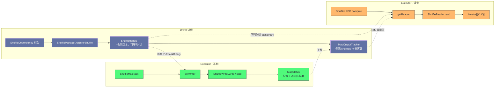
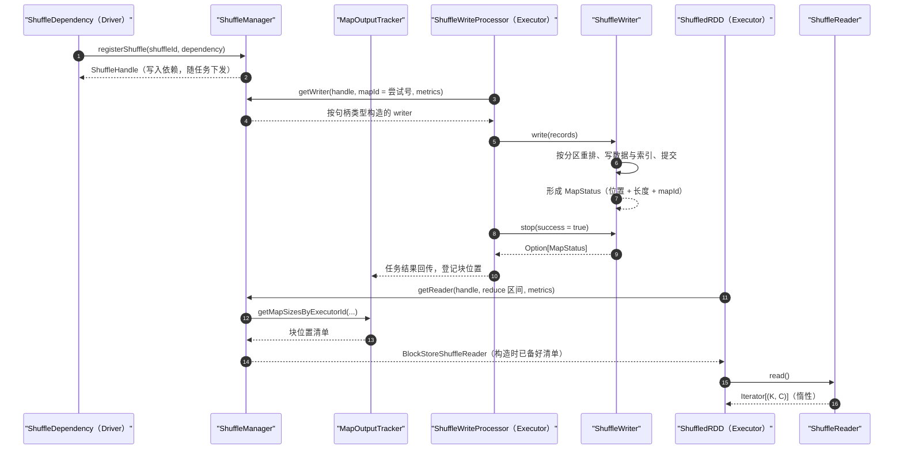
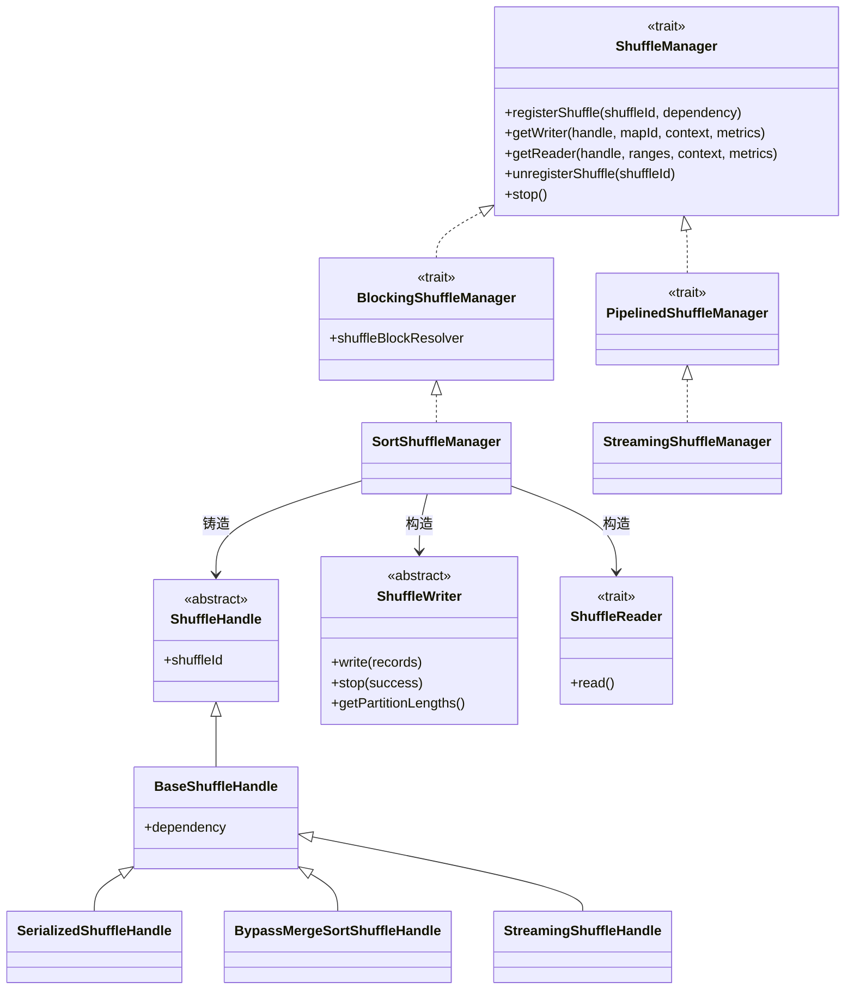
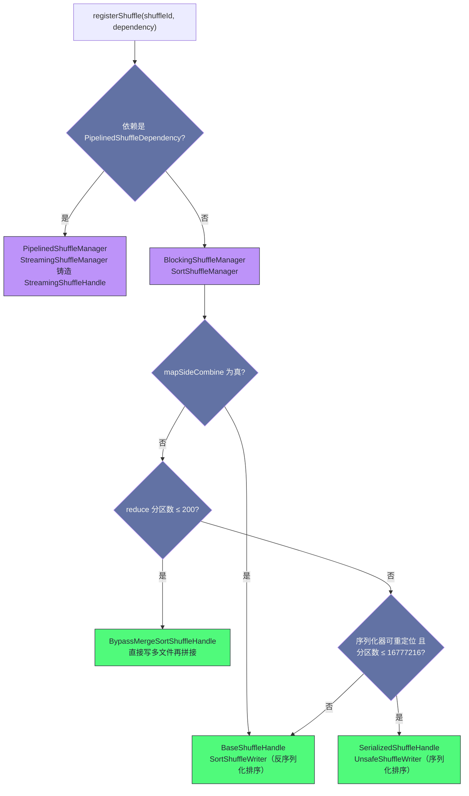
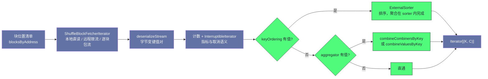

# 2. Spark Shuffle 框架：接口分层、Writer 选择与读写契约

**摘要：**

一次 Shuffle 的写与读，发生在两台机器、两个进程、两个时刻：map 端把记录按目标分区重排、序列化、落盘，并交出一份地址表；reduce 端拿着这张表去取字节，再按某种语义把字节还原成键值对。中间没有任何一方能看见对方的代码，能对齐的只有一份随任务走的"合同"。Spark 的 Shuffle 框架，本质上就是这份合同的三个落点：`ShuffleManager` 在注册期定规格，`ShuffleWriter` 在写期按规格产出并交账，`ShuffleReader` 在读期按规格复验。

本文沿五问推进：先界定这三个接口各自承诺了什么、又刻意不承诺什么；再用四个反事实说明为什么拆成三段而不是一段；接着把 `registerShuffle`、`getWriter`、`write`、`stop`、`getReader`、`read` 的签名与调用时机逐个走一遍，交代 `MapStatus` 的账是怎么记的、`mapId` 为什么是任务尝试号而不是分区号；然后把 `SortShuffleManager` 的三条 writer 判据、两个阈值与三种句柄子类拆开，说明 `BaseShuffleHandle` 为什么必须把 `ShuffleDependency` 与 `Partitioner` 带到 Executor 上；再进入 `BlockStoreShuffleReader.read()`，看它如何把 `MapOutputTracker` 给出的块位置折叠成 `Iterator[(K, C)]`；最后收在读写两侧那份不写在接口里的隐含约定上，并交代 `spark.shuffle.manager` 能换什么、不能换什么。

4.3.0 给这套框架加了一层新分界：`ShuffleManager` 被拆成 `BlockingShuffleManager` 与 `PipelinedShuffleManager` 两支，按依赖类型路由，`shuffleBlockResolver` 只属于前者。这条分界让"接口统一"与"语义统一"第一次公开分家，也构成本文最后两章的落点。

文章口径是 Spark 4.3.0（2026-10-30）；4.x 预编译包基于 Scala 2.13，源码细节以对应版本文档或源码为准。

---

## 第 1 章 三个接口是一份合同的三段

### 1.1 先把范围收窄

本章所说的 Shuffle 框架，特指"从 map 端写出到 reduce 端读出"这条链路上的接口与约定，包括 `ShuffleManager`、`ShuffleWriter`、`ShuffleReader`、`ShuffleHandle`、`ShuffleBlockResolver` 五个角色，以及它们之间传递的 `MapStatus` 与块坐标。它不讨论排序算法本身快不快，不讨论 `PartitionedAppendOnlyMap` 与 `ExternalSorter` 的内部结构，也不讨论 Hash 式实现怎样被 Sort 式实现取代——那属于另外的问题。

这样限定之后，剩下的问题只有一个：**写出来的字节，读的人凭什么认得。**

这个问题听起来像废话，因为写和读都是 Spark 自己的代码。但只要把时序摆开，它立刻变得不平凡：写发生在 `ShuffleMapTask` 里，读发生在若干分钟之后的 `ResultTask` 里；写的人可能是一台已经下线的 Executor，读的人在另一台机器上；写的人用的聚合函数来自用户代码，读的人手里只有一份序列化过的任务包。双方没有共享内存，没有共享调用栈，唯一共享的是那份任务包里的元数据。

### 1.2 四个问题与三份答案

一次跨节点的数据交付，要回答四个问题：由谁来写、写到哪里、由谁来读、读到的字节怎么解释。这四个问题被摊到三个接口上，分工相当干脆。

`ShuffleManager` 回答前两个问题里"由谁"的部分，并给出"怎么解释"的总纲。它不碰数据，只做判断与分派：注册阶段根据依赖的静态属性决定这份 Shuffle 由哪条写路径承接，并把这个决定包进一个 `ShuffleHandle`；执行阶段按句柄类型取出对应的 writer，按句柄与区间取出 reader。它像招标方，定的是标，不是施工。

`ShuffleWriter` 回答"写到哪里"以及"写完怎么交账"。它在 map 任务里被调用一次，把整个分区的记录按目标分区重排、序列化、落盘，最后交出一份 `MapStatus`：数据落在哪台机器的 BlockManager 上、每个 reduce 分区各占多少字节。索引文件与数据文件的布局由它与块解析器约定，读侧以后就按这份约定去切字节。

`ShuffleReader` 回答"读到的字节怎么解释"。它拿到的是块位置的清单，不是数据；它把清单变成一条惰性迭代器，在迭代过程中完成取块、解压、反序列化、聚合与排序。

三者的分工可以并排看：

| 角色 | 谁调用它 | 在哪个进程 | 回答的问题 | 交付物 |
|---|---|---|---|---|
| `ShuffleManager` | Driver 的依赖构造、Executor 的任务 | Driver 与每个 Executor | 这份 Shuffle 由哪条路径承接、谁写谁读 | `ShuffleHandle` |
| `ShuffleWriter` | `ShuffleWriteProcessor` | Executor | 写到哪、写多少、写完怎么登记 | `MapStatus` 与磁盘上的数据/索引文件 |
| `ShuffleReader` | `ShuffledRDD.compute` 一类读侧代码 | Executor | 这些字节按什么语义还原 | `Iterator[(K, C)]` |

### 1.3 句柄：随任务发走的合同正本

三个接口里最不起眼的是 `ShuffleHandle`：一个只有 `shuffleId` 字段的抽象类，带 `Serializable`。它的存在理由恰恰藏在"随任务发走"这几个字里。

Driver 在注册期做完选择，选择的结论必须能到达 Executor，否则 Executor 无从知道该构造哪个 writer。Spark 的做法是把结论编码成句柄的具体类型：`BypassMergeSortShuffleHandle` 表示"走直接拼文件那条路"，`SerializedShuffleHandle` 表示"走序列化排序那条路"，`BaseShuffleHandle` 表示"走反序列化排序那条路"。句柄随 `ShuffleDependency` 一起被序列化进任务包，Executor 上的 `getWriter` 用一次模式匹配就能还原结论。**选择被表达成了类型，而不是一个整型开关**——这是这套框架里最省事的一处设计，因为它让非法组合在类型层面就难以构造。

但句柄的价值不止于"贴标签"。`BaseShuffleHandle` 持有整个 `ShuffleDependency`，而依赖里装着分区器、序列化器、聚合器、排序器与若干开关，它带着"这份活按什么规格验收"的全部条款，本身就是合同正本。

### 1.4 一个贯穿全文的作业

为了让后面的机制有具体的着力点，笔者设想一个广告归因作业 `ad_attribution`：从数仓读当天的曝光与点击两份日志，各自按请求标识打成键值对，按请求标识 join 起来，再按广告位与小时聚合点击率，最后回收一份小结果做校验。

```scala
// 两份日志各按 200 个分区读入；join 两侧都没有现成的分区器
val imp = sc.textFile("hdfs:///warehouse/impressions")   // 200 分区
val clk = sc.textFile("hdfs:///warehouse/clicks")        // 200 分区

// join 会为两侧各生成一个 ShuffleDependency，reduce 分区数取两侧分区数的较大者
val joined = imp.map(toReqPair).join(clk.map(toReqPair))  // 200 个 reduce 分区

// 显式指定 2000 个 reduce 分区，且带 map 端预聚合
val agg = joined.map(toSlotHour).reduceByKey(_ + _, 2000)

agg.collect()
```

这段代码里有三个 Shuffle 依赖：`join` 内部两个（左右两表各一），`reduceByKey` 一个。三个依赖的静态属性并不相同：`join` 的两个依赖没有聚合器、没有排序器、reduce 分区数是 200；`reduceByKey` 的那个带聚合器、`mapSideCombine` 为真、reduce 分区数是 2000。

这份差异会在第 4 章兑现成一条很具体的结论：**同一个作业里的三次 Shuffle，会走到两条不同的写路径上；而它们读回来的时候，用的是同一个 reader 类。**写侧三选一、读侧只有一种，这个不对称是理解整个框架的钥匙。

### 1.5 比喻：定标、施工、交账、提货

把三个接口想成一项工程的四方协作：`registerShuffle` 是定标，招标方看完图纸就决定这份活按哪套工艺干，并把工艺要求写进合同；`ShuffleWriter` 是施工队，按合同施工，竣工时交一张"各库位占用长度"的清单；`MapOutputTracker` 是竣工备案处，只登记"这批货在哪台机器的哪个库"，不登记货的细节；`ShuffleReader` 是提货方，先到备案处查库位，再去仓库按清单切货，最后按合同里写的规格（要不要合并、要不要排序）复验。

比喻的技术限定有两处。其一，施工队与提货方不是同一批人，甚至可能隔了几分钟才交接，所以合同必须能独立成立，不能依赖"当时在场的人记得"。其二，Spark 的备案处只记位置与长度，不记内容，因此提货方拿到的是字节流，语义得靠合同里的聚合器与排序器现场还原——这正是 `BlockStoreShuffleReader` 存在的理由。

把这套协作关系画出来，就是下面这张分层图。图的左侧是 Driver 的定标与备案，右侧是 Executor 的施工与提货，中间那条虚线是随任务走的句柄。



图中三个子系统各持一份信息：Driver 持"规格与地址"，写侧持"字节与长度"，读侧持"解释权"。三者之间只有两条通道——句柄随任务下行，`MapStatus` 随任务结果上行。框架其余部分，都是在保证这两条通道上的信息足够对方使用。

---

## 第 2 章 为什么必须拆成三段

### 2.1 写与读不在同一个进程，也不在同一时刻

先看一个容易忽略的事实：Spark 从不在写完之后立刻读。`ShuffleMapTask` 完成后，结果作为 `MapStatus` 回到 Driver，登记进 `MapOutputTracker`；下游 Stage 的 `ResultTask` 或下一个 `ShuffleMapTask` 是另一批任务，可能落在完全不同的 Executor 上。写与读之间隔着调度、隔着资源分配、隔着可能的失败与重试。

这个间隔决定了一件事：**双方不能靠"约定俗成"对齐，只能靠显式传递的元数据对齐。**一旦某项规格只存在于写侧的代码路径里（譬如"我按 200 个分区切的文件"），读侧就必须有办法知道这个 200，否则连索引该读几个 8 字节都无从判断。框架存在的第一动机，就是把这些规格从代码里搬到数据里。

### 2.2 反事实一：没有 manager，读法会写死在算子里

假设没有 `ShuffleManager`，`ShuffledRDD.compute` 只能自己打开文件、自己解析索引、自己反序列化。这样一来，"换一种 Shuffle 实现"就变成"改 `ShuffledRDD`"，而 `ShuffledRDD` 是所有宽依赖算子的公共下游；它一旦写死某种文件布局，任何新实现都必须迁就它，或者复制一份新的 RDD 类型。

更麻烦的是职责错位。`ShuffledRDD` 的本职是"把上游的分区数据按键归拢"，它不该知道文件在哪、索引几位、压缩用什么编码。把寻址与解码塞进算子，等于让每个消费 Shuffle 的算子都持有一份存储层的知识，这份知识会在第一次换实现时全部作废。

`ShuffleManager` 把这个决策点抽出来，代价是多一层间接；收益是算子层只剩一句 `getReader(...).read()`，换实现不动算子。

### 2.3 反事实二：句柄不带依赖，Executor 认不出规格

再看句柄。假设 `ShuffleHandle` 只带 `shuffleId`，Executor 拿到任务包之后能知道什么？它能知道自己的分区号、能反序列化出父 RDD，但父 RDD 的依赖关系里那份 `ShuffleDependency` 是 `@transient` 的——源码注释写得很直白：Shuffle 场景下 RDD 是 transient 的，因为 Executor 侧不需要它。

也就是说，Executor 手里没有"这份 Shuffle 用哪个分区器、哪个序列化器、要不要 map 端聚合"的信息。这些信息必须有人带过来。最自然的载体就是句柄：它本来就要随任务走，而且它已经在 Driver 侧被构造过一次，把依赖塞进去不增加任何通信成本。

这里有一个容易误判的细节：`ShuffleDependency` 里的 `_rdd` 是 transient 的，序列化时被丢弃，所以带上 Executor 的其实是"依赖的元数据部分"，不含父 RDD。这也解释了 4.x 为什么可以把 `numMaps` 从 `registerShuffle` 的参数里删掉——map 端分区数已经登记在 `MapOutputTracker` 的注册项里，句柄再存一份只会制造两个可能不一致的口径。

### 2.4 反事实三：写者不交账，Driver 就只剩一张空地图

第三个反事实针对 `MapStatus`。假设 writer 写完就算，不返回任何东西，Driver 便无从知道"第 7 个 map 分区的输出落在哪台机器的哪个文件里"。下游要读，只有两条路：全量广播"谁有这个分区"（不可能，规模不允许），或者让 reduce 端向所有 Executor 盲发请求（代价与正确性都无法接受）。

`MapStatus` 把三样东西带回 Driver：位置、逐分区的长度、以及这次尝试的 `mapId`。位置用于寻址，长度用于估价与过滤空块，`mapId` 用于在多次尝试之间定位"最新成功的那一份"。少了任何一样，账本都不完整：没有位置无法取数，没有长度无法调度取数批次，没有 `mapId` 则重试之后读侧可能取到旧文件。

### 2.5 反事实四：读侧不做解释，中间结果只能被一个下游消费

最后一个反事实最有意思：假设读侧只负责把字节还原成 `(K, V)`，聚合与排序都推给算子自己做。表面上职责更清晰，实际上会让 Shuffle 的产出变成"一次性"的——因为不同下游对同一份中间结果的解释方式不同：`reduceByKey` 要按键合并，`sortByKey` 要按键排序，`join` 要按键归并两侧。如果解释权在算子层，那么每种解释都要重新把数据读一遍、重新建一次哈希表或排序器；而如果把解释权收进 reader，同一份字节就可以被不同 reader 实例按各自的依赖解释，甚至被不同 Job 复用。

这就是"写侧只分区、读侧做解释"这个分工的来历。它带来一个直接后果：**写侧的产出必须是"语义中立"的**——只保证按分区连续，不保证分区内有序，更不保证聚合已完成。是否聚合、是否排序，全部记在依赖里，由读侧按合同执行。

常见算子对两侧能力的要求，可以按这套分工归位：

| 算子 | 依赖里的开关 | 写侧要做的 | 读侧要做的 |
|---|---|---|---|
| `partitionBy`、`repartition` | 无聚合器、无排序器 | 只按目标分区重排 | 按分区原样拼接 |
| `groupByKey` | 有聚合器，`mapSideCombine = false` | 只分区，不预聚合 | 按值合并成 `CompactBuffer` |
| `reduceByKey`、`aggregateByKey` | 有聚合器，`mapSideCombine = true` | 分区 + map 端预聚合 | 合并 combiner |
| `sortByKey` | `keyOrdering = Some(...)` | 只分区，不排序 | 建 `ExternalSorter` 排序 |
| `join`（两侧无同分区器） | 两侧各一个无聚合依赖 | 各侧只分区 | 按键归并两侧迭代器 |

这张表里没有一列叫"数据量"或"内存占用"，因为两侧的能力是由依赖的开关决定的，与数据规模无关。规模只决定同一套动作要重复多少轮、要不要落盘。

### 2.6 4.3.0 把"交付方式"也做成了合同的一种

上面五节讨论的都还是"物化后读取"这一种交付方式：写侧全部完成、登记地址，读侧才开始。4.3.0 把另一条路也提升成了一等公民：`PipelinedShuffleDependency`。

它是 `ShuffleDependency` 的子类，语义是"生产者还在跑，消费者就可以开始读"。这个语义由依赖类型本身承载，带来两个立即可见的效果：`SparkEnv.shuffleManagerFor` 看到这个类型就把这份 Shuffle 路由给 `PipelinedShuffleManager`（默认实现是 `StreamingShuffleManager`），而不是 `BlockingShuffleManager`；同时它在构造时就把推送式合并关掉，因为合并要等写侧全部完成再做一次收尾，与"边产边读"正好相反。

这条分界回答了一个此前被含糊处理的问题：**"Shuffle"到底是一种数据布局，还是一种交付时序。**4.3.0 的答案是后者更根本——布局可以统一（都是"按分区切成段"），时序不能统一，所以时序被提到了依赖类型上，再由类型决定由哪个 manager 承接。

---

## 第 3 章 签名与时机：接口在什么时候被谁调用

### 3.1 `ShuffleManager` 的六个成员

4.3.0 的 `ShuffleManager` 是一个包级私有的 trait，成员不多，但每一个都对应一处生命周期节点：

```scala
private[spark] trait ShuffleManager {
  // 注册：Driver 侧调一次，拿到随任务下发的句柄
  def registerShuffle[K, V, C](
      shuffleId: Int,
      dependency: ShuffleDependency[K, V, C]): ShuffleHandle

  // 取写者：Executor 侧每个 map 任务调一次
  def getWriter[K, V](
      handle: ShuffleHandle,
      mapId: Long,                       // 4.x 是任务尝试号，不是分区号
      context: TaskContext,
      metrics: ShuffleWriteMetricsReporter): ShuffleWriter[K, V]

  // 取读者：便捷重载，读全部 map 输出、指定 reduce 区间
  final def getReader[K, C](
      handle: ShuffleHandle,
      startPartition: Int,
      endPartition: Int,
      context: TaskContext,
      metrics: ShuffleReadMetricsReporter): ShuffleReader[K, C] =
    getReader(handle, 0, Int.MaxValue, startPartition, endPartition, context, metrics)

  // 取读者：完整形态，map 区间与 reduce 区间都要
  def getReader[K, C](
      handle: ShuffleHandle,
      startMapIndex: Int,
      endMapIndex: Int,
      startPartition: Int,
      endPartition: Int,
      context: TaskContext,
      metrics: ShuffleReadMetricsReporter): ShuffleReader[K, C]

  // 清理：未知或已清理的 shuffleId 必须当幂等空操作处理
  def unregisterShuffle(shuffleId: Int): Boolean

  def stop(): Unit
}
```

三点值得停下来看。第一，`shuffleBlockResolver` 已经不在这个 trait 里了，它被挪到了子 trait `BlockingShuffleManager` 上；这意味着"能按块坐标取字节"不再是所有 manager 的共性，而是"物化式 manager"的专属能力。第二，`registerShuffle` 的参数只剩 `shuffleId` 与依赖，3.x 时代那个 `numMaps` 被去掉了。第三，两个 `getReader` 是重载关系，便捷版把 map 区间写成 `0` 到 `Int.MaxValue`，后者在 `MapOutputTracker` 里会被解释成"全部 map 输出"。

### 3.2 `registerShuffle`：在依赖构造时被调用

注册发生在哪一刻？不在 Job 提交时，也不在任务运行时，而在 `ShuffleDependency` 的构造函数里：

```scala
// ShuffleDependency 构造过程中完成注册；句柄在此刻定终身
val shuffleId: Int = _rdd.context.newShuffleId()
val shuffleHandle: ShuffleHandle = _rdd.context.env.shuffleManagerFor(this).registerShuffle(
  shuffleId, this)
```

这段代码的位置决定了三件事。其一，注册是**在 Driver 上、建图期间**发生的：`rdd.dependencies` 一旦被求值，依赖对象就被构造，注册随之发生，此时还没有任何 Task 被提交。其二，句柄只铸造一次，之后 Executor 拿到的都是同一份序列化副本，因此 Driver 与 Executor 不可能对"用哪个 writer"产生分歧。其三，`shuffleManagerFor(this)` 表明路由在这里就完成了——是走 `BlockingShuffleManager` 还是 `PipelinedShuffleManager`，由依赖的运行时类型决定，而不是由某个 `shuffleId` 到 manager 的映射表决定。

第三点值得多说一句。用类型做路由有个隐含前提：Driver 与 Executor 必须能对同一个依赖对象得出同一个结论。这一点是成立的，因为依赖是随任务包一起过去的普通对象，类型信息完整；于是路由不需要任何共享状态，也不需要 Executor 重新读配置。源码注释把这条性质讲得很清楚：路由是依赖的纯函数，所以两侧天然一致。

### 3.3 `getWriter`：`mapId` 是尝试号，不是分区号

`getWriter` 在 Executor 侧被调用，调用点是 `ShuffleWriteProcessor.write`。这个方法名容易让人以为它只是个工厂，实际上它有两件事要做：构造 writer，以及登记"这个 shuffle 有哪些 map 输出落在我这台 Executor 上"。

```scala
override def getWriter[K, V](
    handle: ShuffleHandle, mapId: Long, context: TaskContext,
    metrics: ShuffleWriteMetricsReporter): ShuffleWriter[K, V] = {
  // 记账：unregisterShuffle 之后要靠这张表逐份删本地文件
  val mapTaskIds = taskIdMapsForShuffle.computeIfAbsent(
    handle.shuffleId, _ => new OpenHashSet[Long](16))
  mapTaskIds.synchronized { mapTaskIds.add(mapId) }

  handle match {
    case h: SerializedShuffleHandle[K, V]        => new UnsafeShuffleWriter(...)
    case h: BypassMergeSortShuffleHandle[K, V]  => new BypassMergeSortShuffleWriter(...)
    case other: BaseShuffleHandle[K, V, _]      => new SortShuffleWriter(...)
  }
}
```

`mapId` 的类型是 `Long`，来源是 `context.taskAttemptId()`——**它是任务尝试的标识，不是 map 分区的序号**。分区序号另有一个参数 `mapIndex`，只在 `ShuffleWriteProcessor` 内部使用（推送式合并要用它定位块）。这个区分很关键：用尝试号作 `mapId`，意味着同一个分区重试一次就换一个坐标，新文件不会覆盖旧文件；于是"正在被下游读取的旧输出"不会被一次重试抹掉，代价是旧文件要等到整个 Shuffle 被清理时才回收。

`getWriter` 里的模式匹配还有一个细节：最后一个分支是 `case other: BaseShuffleHandle`，它是兜底而不是校验。由于 `SerializedShuffleHandle` 与 `BypassMergeSortShuffleHandle` 都继承自 `BaseShuffleHandle`，模式匹配的次序决定了优先级；而任何未被前两支命中的 `BaseShuffleHandle` 子类都会安静地落到常规排序路径上。这个设计的好处是扩展新句柄时不至于让老代码崩溃，坏处是"句柄类型即选择"这条约定并没有被代码强制。

### 3.4 `write` 与 `stop`：账本在 `write` 里就记好了

`ShuffleWriter` 只有三个方法，其中 `getPartitionLengths()` 是 4.x 新增的：

```scala
private[spark] abstract class ShuffleWriter[K, V] {
  @throws[IOException]
  def write(records: Iterator[Product2[K, V]]): Unit

  def stop(success: Boolean): Option[MapStatus]

  // 4.x 新增：推送式合并要在任务结果之外拿到逐分区长度
  def getPartitionLengths(): Array[Long]
}
```

这里有一个与直觉相反的地方：`MapStatus` 不是在 `stop` 里算出来的，而是在 `write` 里就算好了。以 `SortShuffleWriter` 为例，`write` 的末尾依次做三件事——把排序结果按分区写进 `ShuffleMapOutputWriter`、提交并拿到逐分区长度、用长度数组与 `mapId` 构造 `MapStatus`；`stop(success)` 只负责在成功时把这个已算好的值交出去，并释放排序器的临时文件。

为什么要这样安排？因为"提交"这个动作本身必须完成，才能确定每个分区在文件里的最终偏移；而提交一旦完成，账本就已经是事实了，`stop` 再算一遍既无意义又可能引入不一致。这也解释了 `stop` 的返回值为什么是 `Option[MapStatus]`：失败时无账可交，只能给 `None`；而重复调用 `stop` 也返回 `None`，避免同一份输出被登记两次。

`MapStatus` 本身的形态也值得看一眼。它是一个密封 trait，实际类型是 `CompressedMapStatus` 或 `HighlyCompressedMapStatus`——分区数超过 `spark.shuffle.minNumPartitionsToHighlyCompress`（默认 2000）时用后者。逐分区长度不是精确值：常规实现把它压成 8 位的对数刻度（底数 1.1，最大可表示 35GB，误差约 10%），高压缩实现只记录非空分区的近似大小。**这些数字的作用是估算取数批次与过滤空块，不是用来定位字节的**；真正的定位靠索引文件。估算值上挂了一个硬不变量：非空分区必须返回非零大小，因为取数端会把零长度块直接跳过——一个近似值如果违反这条不变量，数据就被静默丢掉了。

### 3.5 `getReader`：两个重载，两个世界

`getReader` 的两个形态对应两类调用方。便捷版被 RDD 层的算子使用：`ShuffledRDD.compute` 与 `CoGroupedRDD.compute` 都是这个形状——一个 reduce 分区一次，map 区间取全量。

```scala
// ShuffledRDD.compute 的调用点：一个 Task 只读自己那一个 reduce 分区
SparkEnv.get.shuffleManagerFor(dep).getReader(
  dep.shuffleHandle, split.index, split.index + 1, context, metrics).read()
```

完整版被 SQL 层使用。`ShuffledRowRDD` 会把一份分区规格翻译成四个区间参数，规格有四种形态：合并多个 reduce 分区的 `CoalescedPartitionSpec`、只读某段 map 输出的 `PartialReducerPartitionSpec`、只读单个 map 的 `PartialMapperPartitionSpec`、以及合并 map 区间的 `CoalescedMapperPartitionSpec`。后三种存在的理由很实际：自适应查询执行（Adaptive Query Execution，AQE）在 Shuffle 之后可能把若干小分区合并成一个任务，也可能因为倾斜把一个 reduce 分区拆成几段，每种形态都要求"只读某一段 map 输出"。

这解释了为什么完整的 `getReader` 把 map 区间与 reduce 区间分开传：它们不是一回事。reduce 区间决定"我要哪几段字节"，map 区间决定"这些字节从哪些 map 输出里来"。RDD 层的算子永远只需要前者，因为它的分区边界天然与 map 输出对齐。

### 3.6 `read` 返回的是迭代器

`ShuffleReader` 只有一个方法：`def read(): Iterator[Product2[K, C]]`。签名短得可疑，但它包含的信息不少。

返回值是 `Iterator`，不是集合。这意味着 `read()` 被调用时，真正的取数还没有发生；迭代器第一次被 `next()` 时才触发第一批块请求。这个惰性是有意为之：读侧常常只需要前面若干条记录（`take`、`first`、带 `LIMIT` 的查询），提前把全部数据拉回来既浪费网络也浪费内存。

类型参数 `C` 是"聚合后的类型"，不是 `V`。若依赖里没有聚合器，`C` 与 `V` 相同；若有聚合器且 `mapSideCombine` 为真，读到的每条记录已经是 `(K, C)`；若有聚合器但 `mapSideCombine` 为假，读到的仍是 `(K, V)`，需要现场合并成 `C`。读侧必须知道当前处于哪种情形，而这个知识只能来自依赖——又一次回到"句柄带的是合同"。

### 3.7 清理与寻址：`unregisterShuffle`、`stop`、resolver

`unregisterShuffle` 的契约里有一条容易被忽略的要求：**未知的或已清理的 `shuffleId` 必须当幂等空操作处理，返回 `false` 而不是抛异常。**理由写在接口注释里：清理路径手里只有一个 `shuffleId`，它无法知道这个 Shuffle 归哪个 manager 管，于是会向所有配置过的 manager 广播一次，包括那些从未处理过这个 Shuffle 的 manager。

4.3.0 的实现把这条契约推到了极致：`SparkEnv.unregisterShuffleFromAllManagers` 同时通知两个 manager，并把结果做逻辑或；而 `SortShuffleManager.unregisterShuffle` 在按本地登记的 `mapId` 逐份删除数据之后，无条件返回 `true`。于是这个布尔值在双 manager 架构下几乎恒为真，它的语义已经从"是否删除了元数据"退化成"调用已被接受"。清理的正确性不再由返回值承担，而由"广播到每个 Executor、每个 Executor 按自己那张 `taskIdMapsForShuffle` 表逐份删"承担。

`stop` 更简单：它只关闭块解析器，不负责数据。数据文件的寿命由 Shuffle 的引用关系决定，不由 manager 的寿命决定。

至于寻址，`ShuffleBlockResolver` 是"逻辑块坐标到字节"的唯一入口，`getBlockData(blockId)` 接受 `ShuffleBlockId`（单个分区）与 `ShuffleBlockBatchId`（连续若干分区）两种坐标，返回 `ManagedBuffer`。它是外部 Shuffle 服务能够与 Spark 共存的接口基础：服务端只要按同样的文件布局与同样的块命名去响应请求，就不必理解 Spark 的任务与依赖。

### 3.8 一张调用时机总表

把这一章的方法按"谁调、何时调、调几次"排开，接口的时序关系就清楚了：

| 方法 | 调用方 | 进程与时机 | 调用频次 | 返回值去向 |
|---|---|---|---|---|
| `registerShuffle` | `ShuffleDependency` 构造 | Driver，建图期间 | 每个 Shuffle 一次 | 存入依赖，随任务包下发 |
| `getWriter` | `ShuffleWriteProcessor.write` | Executor，map 任务开始时 | 每个 map 任务一次 | 交给 `write` 使用，用完即弃 |
| `write` | 同上 | Executor，任务主体 | 每个 map 任务一次 | 无返回值，产出文件与长度 |
| `stop` | 同上 | Executor，任务收尾 | 每个 map 任务一次 | `MapStatus` 作为任务结果回传 |
| `getReader` | `ShuffledRDD` 或 `ShuffledRowRDD` | Executor，reduce 任务开始 | 每个读取任务一次 | 交给 `read` 使用 |
| `read` | 同上 | Executor，任务主体 | 每个读取任务一次 | 惰性迭代器，边取边算 |
| `unregisterShuffle` | 清理路径 | Driver 发起，广播到全部节点 | 每个 Shuffle 一次（幂等） | 布尔值，仅表示调用被接受 |

下图把一次完整的 Shuffle 在时间轴上串起来。注意 `MapStatus` 是在 `write` 内部就形成的，`stop` 只是把它交出去；也注意 `getReader` 在构造阶段就已经把块位置清单备好了，`read` 拿到的不是"去哪找"，而是"找什么"。



---

## 第 4 章 `SortShuffleManager` 怎么选 writer

### 4.1 选择只发生在注册期

`SortShuffleManager` 是 `BlockingShuffleManager` 的内置实现，也是 `spark.shuffle.manager` 的默认值 `sort` 指向的类。它最重要的一个方法不是 `getWriter`，而是 `registerShuffle`——因为写路径的三种可能，在注册期就已经收敛成一种。

判断的输入只有两样：配置，以及依赖的静态属性。依赖里能参与判断的有四项：`mapSideCombine`（是否做 map 端预聚合）、`partitioner.numPartitions`（reduce 分区数）、`serializer.supportsRelocationOfSerializedObjects`（序列化器能否在不反序列化的情况下重排字节）、以及依赖本身的类型（是否 `PipelinedShuffleDependency`）。数据量、记录条数、字段宽度一概不参与。

### 4.2 三条判据与它们的次序

```scala
override def registerShuffle[K, V, C](
    shuffleId: Int, dependency: ShuffleDependency[K, V, C]): ShuffleHandle = {
  if (SortShuffleWriter.shouldBypassMergeSort(conf, dependency)) {
    // 无 map 端聚合，且 reduce 分区数不超过阈值：直接写多个分区文件再拼接
    new BypassMergeSortShuffleHandle[K, V](shuffleId, dependency.asInstanceOf[...])
  } else if (SortShuffleManager.canUseSerializedShuffle(dependency)) {
    // 序列化器可重定位、无 map 端聚合、分区数未触顶：全程操作序列化字节
    new SerializedShuffleHandle[K, V](shuffleId, dependency.asInstanceOf[...])
  } else {
    // 其余情况：反序列化后排序
    new BaseShuffleHandle(shuffleId, dependency)
  }
}
```

第一档的判据是 `!mapSideCombine && numPartitions <= spark.shuffle.sort.bypassMergeThreshold`（默认 200）。第二档的判据是三条同时成立：`serializer.supportsRelocationOfSerializedObjects`、`!mapSideCombine`、`numPartitions <= 16777216`（即 `PackedRecordPointer.MAXIMUM_PARTITION_ID + 1`）。单条记录的实际上限由记录指针的位宽决定，具体阈值以对应版本文档或源码为准。两条都不成立时落到第三档。

次序是有意义的，不能换。假设把序列化判据提到前面：由于它同样要求 `!mapSideCombine`，凡是能走 bypass 的场景大概率也能走序列化路径，bypass 就永远不会被选中。而 bypass 在"分区数很少"这个区间里恰恰是更便宜的——它不需要排序，也不需要重排指针，只是把每个分区的字节顺序追加到同一个文件里，再用索引记下偏移。

### 4.3 判据背后的代价

三条路径的差别不在"能不能算对"，而在"内存与 CPU 花在哪"：

| 写路径 | 句柄类型 | 触发条件 | 内存形态 | 主要代价 |
|---|---|---|---|---|
| 直接拼接 | `BypassMergeSortShuffleHandle` | 无 map 端聚合，reduce 分区数 ≤ 200 | 每个分区一个写缓冲 | 同时打开的分区文件多，缓冲占用与分区数成正比 |
| 序列化排序 | `SerializedShuffleHandle` | 序列化器可重定位，无 map 端聚合，分区数 ≤ 16777216 | 只缓存序列化字节与 8 字节指针 | 依赖序列化器的重定位能力，记录过大时受限 |
| 反序列化排序 | `BaseShuffleHandle` | 其余情况（含带 map 端聚合的） | 缓存反序列化对象 | 对象开销与 GC 压力最大，但通用性最好 |

第一档的阈值 200 值得单独说一句。它是**reduce 分区数**的阈值，不是数据量、不是 map 分区数，也不是文件大小。`ad_attribution` 里 join 的两个依赖恰好是 200 个 reduce 分区，`200 <= 200` 成立，于是走直接拼接；如果把 join 的分区数改成 400，同一个 join、同一份代码，就会落到第三档。**阈值贴着默认值，是这个参数最容易被忽视的原因**——大多数 RDD 作业的默认分区数就是 200 上下，恰好压在边界上。

### 4.4 句柄的三个子类就是选择结果

三个句柄子类的关系如下图。注意它们的类型参数：`BypassMergeSortShuffleHandle[K, V]` 与 `SerializedShuffleHandle[K, V]` 都继承 `BaseShuffleHandle[K, V, V]`，也就是把聚合类型 `C` 钉成了 `V`。这个钉子不是装饰：它用类型表达"这两条路径保证没有 map 端聚合"，于是 writer 拿到句柄时不需要再判一次 `mapSideCombine`。



`StreamingShuffleHandle` 是第四个句柄子类，也是唯一一个不归 `SortShuffleManager` 管的。它继承 `BaseShuffleHandle[K, V, C]` 而不是 `[K, V, V]`，因为流水线式 Shuffle 允许带聚合器与排序器——它的读侧是另一套实现，不受 `BlockStoreShuffleReader` 的类型约束。

### 4.5 `BaseShuffleHandle` 为什么必须带 `Dependency` 与 `Partitioner`

`BaseShuffleHandle` 的定义只有一行：`class BaseShuffleHandle[K, V, C](shuffleId: Int, val dependency: ShuffleDependency[K, V, C])`。为什么不是只带一个 `shuffleId`，或者只带 `numPartitions` 与 `serializer` 几个散字段？

第一层理由是完备性。Executor 上的 writer 与 reader 需要的东西分布在整个依赖上：writer 需要 `partitioner`（每条记录算分区号）、`serializer`（写字节）、`aggregator` 与 `mapSideCombine`（决定是否预聚合）、`keyOrdering`（可选，用于 map 端有序输出）；reader 需要 `aggregator`、`mapSideCombine`、`keyOrdering`、`serializer`，还需要校验和相关的 `rowBasedChecksums`。把这些字段拆开复制进句柄，等于在依赖之外维护第二份定义，任何一次依赖扩展都要同步改句柄。

第二层理由是**唯一性**。依赖对象同时是"这条血缘边的定义"和"这份 Shuffle 的规格书"，两者天然是同一份事实。`ShuffleDependency` 在构造时做了一次一致性校验——若 `mapSideCombine` 为真而 `aggregator` 为空，直接 `require` 失败——这条校验只有在"规格与依赖同体"时才有意义。若句柄另存一份规格，校验就可能校验到另一份副本上。

第三层理由是分区器的不可替代性。`Partitioner` 不仅决定"每条记录去哪个分区"，还决定"一共有几个分区"。写侧要靠它算分区号与索引长度，读侧要靠它给出的分区数理解 `MapStatus` 长度数组的含义。分区器是用户代码（或框架内置的 `HashPartitioner`、`RangePartitioner`）提供的对象，两侧必须拿到同一个实例的等价副本，否则同一个键在两侧会算出不同的分区号。把它挂在依赖上、随句柄下发，是唯一能保证"同一份逻辑、同一份实现"的方式。

相比之下，4.x 删掉 `numMaps` 就不难理解了：map 端分区数不是"规格"，而是"事实"，它已经由 `MapOutputTracker.registerShuffle` 在 Driver 侧登记，句柄再存一份只会产生两个口径。

### 4.6 选择是静态的

把这三条判据放在一起看，会发现它们全都不看运行时状态。一个只有 10 条记录的 Shuffle 与一个有 10TB 的 Shuffle，只要依赖相同、配置相同，选出来的 writer 就相同。数据量只影响 spill 次数与合并轮数，不影响路径。

这条性质的代价在第 8 章会展开：运行期无法"看到数据小就换条路"，因为读侧并不参与选择，它只认句柄。若允许写侧临时改主意，读侧就得有能力识别两套布局，接口的分层立刻失效。

### 4.7 短名不是实现

配置项 `spark.shuffle.manager` 接受短名，4.3.0 的映射表里有两个条目：`sort` 与 `tungsten-sort`，两者都指向 `SortShuffleManager`。也就是说，把配置写成 `tungsten-sort` 并不会切换到一个不同的 manager，它只是历史短名的兼容映射；真正决定是否走序列化路径的，是 4.2 节那三条判据。**短名换的是类名解析结果，不是写路径。**

顺带说一个默认配置下的现实：`spark.serializer` 的默认值是 `JavaSerializer`，它不支持序列化对象的重定位，于是第二档判据在默认 RDD 作业里几乎不会命中，能走的多半是第一档或第三档。SQL 侧使用的 `UnsafeRowSerializer` 支持重定位，所以同样的数据、同样的分区数，走 DataFrame 与走 RDD 可能落到不同的写路径上。4.3.0 起，这个槽位还多了一个"交付方式"维度的分叉，下面这张图把两种路由与三种写路径放在一起。



图中最上层的分叉与下面三层不是同一类判断：前者决定"谁来承接"，后者决定"用什么工艺"。这两件事在 4.3.0 之前都压在 `spark.shuffle.manager` 一个配置上，现在被拆到了两个槽位与依赖类型上。

---

## 第 5 章 读侧契约：`BlockStoreShuffleReader.read()`

### 5.1 构造参数就是输入契约

`BlockStoreShuffleReader` 的构造函数排开一串参数，其中前四个是契约性的，其余是可替换的依赖：

```scala
private[spark] class BlockStoreShuffleReader[K, C](
    handle: BaseShuffleHandle[K, _, C],                 // 合同正本
    blocksByAddress: Iterator[(BlockManagerId, Seq[(BlockId, Long, Int)])],  // 块位置清单
    context: TaskContext,
    readMetrics: ShuffleReadMetricsReporter,
    serializerManager: SerializerManager = SparkEnv.get.serializerManager,
    blockManager: BlockManager = SparkEnv.get.blockManager,
    mapOutputTracker: MapOutputTracker = SparkEnv.get.mapOutputTracker,
    shouldBatchFetch: Boolean = false)
```

第一项是句柄，读侧只接受 `BaseShuffleHandle` 及其子类；第二项是块位置清单，注意它**不是**在 `read()` 里现查的，而是构造时由 `SortShuffleManager.getReader` 备好后传进来的；第三项是任务上下文，负责取消与资源清理；第四项是读侧指标上报器。后四项带默认值，是为测试与替换留的口子。

把块位置清单提前到构造阶段，是一个不大但重要的改动。它让 `read()` 变成纯消费：清单里有什么就读什么，读侧不再关心清单从哪来。这也让推送式合并能够插手——合并完成之后，块位置不再是"每个 map 一份"，而是"每个 reduce 分区一份合并块"，清单的形状变了，reader 不用改。

### 5.2 块位置从哪来

清单的元素是三元的：`(BlockManagerId, Seq[(BlockId, Long, Int)])`，含义是"某台机器的 BlockManager 上，有这些块，每块的估算大小与 map 序号"。它由 `MapOutputTracker.getMapSizesByExecutorId` 从 Driver 侧的地址表换算而来，换算过程中做了两件对契约有影响的事。

第一件是过滤空块。`MapStatus` 里某分区的长度为 0 时，对应块不会进入清单——这就是 3.4 节那条"非空必非零"不变量的用处：读侧不请求空块，省下的不只是网络，还有一堆零长度文件的打开与关闭。

第二件是允许批量坐标。清单里永远是逐分区的 `ShuffleBlockId`；当一次读取覆盖多个连续的 reduce 分区（AQE 合并小分区之后常见），且批量取数的条件成立时，取数迭代器会把"同一个 `mapId`、reduce 编号连续"的若干块合并成一个 `ShuffleBlockBatchId`，块解析器据此一次定位、一次读一段，比逐分区请求少很多系统调用与文件打开。合并条件写在 reader 的 `fetchContinuousBlocksInBatch` 里：序列化器可重定位、压缩编码器支持序列化流拼接（或未压缩）、未启用旧取数协议、未开启 IO 加密，四条同时成立才会合并。

### 5.3 `read` 的五步

`read()` 的主干可以拆成五步：

```scala
override def read(): Iterator[Product2[K, C]] = {
  // 1) 建取数迭代器：本地块直接读，远程块按 maxBytesInFlight 分批拉
  val wrappedStreams = new ShuffleBlockFetcherIterator(
    context, blockManager.blockStoreClient, blockManager, mapOutputTracker,
    blocksByAddress, serializerManager.wrapStream,
    conf.get(config.REDUCER_MAX_SIZE_IN_FLIGHT) * 1024 * 1024,  // 默认 48 MiB
    ...).toCompletionIterator

  // 2) 每个块的流经 SerializerManager 包一层（解压、解密在这里发生）
  val serializerInstance = dep.serializer.newInstance()

  // 3) 反序列化成键值对迭代器；close 由 NextIterator 在耗尽时保证
  val recordIter = wrappedStreams.flatMap { case (blockId, stream) =>
    serializerInstance.deserializeStream(stream).asKeyValueIterator
  }

  // 4) 逐条计数，迭代器耗尽时把临时指标合并进任务指标
  val metricIter = CompletionIterator(recordIter.map { r => readMetrics.incRecordsRead(1); r },
    context.taskMetrics().mergeShuffleReadMetrics())

  // 5) 支持取消，再交给聚合/排序分支解释
  val interruptibleIter = new InterruptibleIterator(context, metricIter)
  ...  // 见 5.4 与 5.5
}
```

第一步的取数迭代器负责两件事：把清单拆成本地块与远程块（本地块走 BlockManager 直读，远程块走网络），并给远程请求限流。限流的单位是"在途字节数"，默认 48MiB（`spark.reducer.maxSizeInFlight`），单个远程请求的目标长度是它的五分之一，好让最多五个请求并行；返回的迭代器按块完成的先后顺序吐出流，不保证 map 顺序。读侧不能假设顺序，这是后面"排序必须在读侧显式做"的根源。

第四步那个 `CompletionIterator` 与第五步的 `InterruptibleIterator` 都不处理数据，它们处理的是生命周期：前者保证指标在迭代器耗尽时被合并（而不是在 `read()` 返回时就合并，那时一条记录都没读），后者保证任务被取消时 `next()` 能抛出中断异常，而不是继续把几万条记录读完。

把这五步画成一条流水，能看清哪些环节在"搬运"、哪些环节在"解释"。前四步只把字节变成键值对，第五步的语义分支才决定这些键值对要不要合并、要不要排序；同一条流水之所以能服务三种解释方式，是因为语义没有沉到字节里，而是留在了依赖里。



图中左侧四个节点是搬运，右侧四个节点是解释。搬运部分的成本与数据量成正比，解释部分的成本则取决于依赖里的开关——同一个 Shuffle 输出，`groupByKey` 的读法要建哈希表，`sortByKey` 的读法要建排序器，`partitionBy` 的读法什么都不用建。

### 5.4 聚合分支：类型参数里藏着语义

五步之后，`read()` 按依赖里的开关选择解释方式。4.3.0 的次序是"先看排序、再看聚合"：

```scala
val resultIter: Iterator[Product2[K, C]] = {
  if (dep.keyOrdering.isDefined) {
    // 需要排序：交给 ExternalSorter，聚合由 sorter 内部的 Aggregator 一并完成
    val sorter = if (dep.aggregator.isDefined && dep.mapSideCombine) {
      new ExternalSorter[K, C, C](context,
        Option(new Aggregator[K, C, C](identity, agg.mergeCombiners, agg.mergeCombiners)),
        ordering = Some(dep.keyOrdering.get), serializer = dep.serializer)
    } else { ... }
    sorter.insertAllAndUpdateMetrics(interruptibleIter.asInstanceOf[...])
  } else if (dep.aggregator.isDefined) {
    if (dep.mapSideCombine) {
      // 上游已预聚合，读到的是 (K, C)，只需合并 combiner
      agg.combineCombinersByKey(interruptibleIter.asInstanceOf[Iterator[(K, C)]], context)
    } else {
      // 上游未预聚合，读到的是 (K, V)，按值合并
      agg.combineValuesByKey(interruptibleIter.asInstanceOf[Iterator[(K, Nothing)]], context)
    }
  } else {
    interruptibleIter.asInstanceOf[Iterator[(K, C)]]
  }
}
```

这段代码里有一处类型上的"装傻"需要说明。`combineValuesByKey` 的参数类型是 `Iterator[(K, Nothing)]`，而实际传进去的是 `(K, V)`。源码注释解释了原因：读侧不应该也不需要知道具体的 `V` 类型，依赖已经保证了它与聚合器兼容。这种"用 `Nothing` 抹掉类型"的写法只在"规格由依赖担保"的前提下成立——它把类型系统的责任转移给了契约。

另一处值得看的是 `mapSideCombine` 的两条分支。读到的记录究竟是 `(K, C)` 还是 `(K, V)`，完全取决于写侧做没做预聚合；如果这个判断错了，后果不是抛异常，而是**把两个 combiner 当成两个 value 再合并一次**。对加法这类幂等性巧合成立的聚合（`_ + _` 恰好满足 `f(f(a,b),c) = f(a,b,c)`），结果会碰巧正确；对求平均、求去重集合这类聚合，结果就是错的，而且不会报错。这是整份契约里最危险的一处不对齐。

### 5.5 排序分支：读侧的第二次解释

排序分支的存在，解释了原始笔记里那句"排序功能主要在 Read 端完成"。写侧 `SortShuffleWriter` 在 `mapSideCombine` 为假时，传给 `ExternalSorter` 的 `ordering` 是 `None`，注释说得明确：不关心分区内键是否有序，因为如果算子是 `sortByKey`，排序会在 reduce 侧做。

于是 `sortByKey` 的真实路径是：写侧只按 `partitionId` 把记录聚到不同分区（分区内顺序由插入顺序与 spill 合并顺序决定，不可依赖）；读侧看到 `keyOrdering` 有值，建一个带排序器的 `ExternalSorter`，把聚合后的结果全部灌进去，再按序吐出。排序的代价因此在读侧、在每个 reduce 任务里各付一次，而且可能触发第二次 spill——这也是"两次排序"批评的来源：写侧按分区排、读侧按键排，两次都要落盘。

返回值最后还包了一层 `InterruptibleIterator`：排序器或聚合器可能已经把上一步的可中断迭代器消费掉了，结果迭代器需要重新具备响应取消的能力。这类"包装套包装"在读路径上很常见，每一层都对应一个不能省的语义。

### 5.6 返回迭代器的三条义务

`read()` 的返回值是一条惰性迭代器，接口上没写、实现上却必须遵守三条义务。

第一条是单次消费。迭代器背后是打开的文件流与取数缓冲，读两遍会把已释放的流再读一次。调用方若需要复用，只能自己缓存，例如 `CoGroupedRDD` 会把多个迭代器灌进一个 `ExternalAppendOnlyMap`。

第二条是线程约束。取数、解压、反序列化都绑定在任务线程的 `TaskContext` 上，跨线程消费会破坏取消语义与指标归属。

第三条是耗尽即释放。接口里没有 `stop()`——源码里那行被注释掉的 `def stop(): Unit` 与一句 TODO 说明了原因：等 `ShuffleReader` 变成对外的开发者 API 时才会补上，那时资源释放才需要显式契约。眼下释放靠两件事：迭代器耗尽时 `NextIterator` 关闭底层流，任务结束时的完成监听器回收取数缓冲。**这意味着调用方一旦中途放弃迭代器，资源要等到任务结束才释放**，而不是立刻释放。

### 5.7 失败语义与重提的接口

读侧失败不是异常处理问题，是跳转到写侧的入口。取块失败、块校验失败、块大小与 `MapStatus` 不符，最终都会抛 `FetchFailedException`；任务框架把它转换成 `FetchFailed` 消息上报给 Driver，Driver 再从 `MapOutputTracker` 上划掉对应那一格地址，让上游重算那个 map 分区（详见 [[5. Spark_DAGScheduler_Stage划分]]）。

这条链路对接口的要求是：`FetchFailedException` 必须携带足够的信息——`shuffleId`、`mapId`、`mapIndex`、`reduceId`、目标地址。少了 `mapIndex` 就无法定位到账本上的哪一格；少了 `reduceId` 就无法判断影响的读取范围。校验和的存在（4.x 默认开启，算法默认 ADLER32）让失败从"读不出来"细分到"读出来但是坏的"，并能初步区分网络损坏与磁盘损坏。

---

## 第 6 章 读写两侧的对齐

### 6.1 一份清单

三条写路径、一种 reader、两套 manager，能凑在一起工作，靠的是一组没有写进任何接口的约定。把它们并排列出：

| 约定项 | 写侧的来源 | 读侧的用法 | 不一致的后果 |
|---|---|---|---|
| reduce 分区数 | `dep.partitioner.numPartitions` | 解释 `MapStatus` 长度数组与索引偏移 | 索引越界或读到相邻分区数据 |
| 序列化器 | `dep.serializer` | 同一个实例的副本反序列化 | 解析异常，或解出错误对象 |
| 压缩编码 | `spark.shuffle.compress` 与 `spark.io.compression.codec` | `wrapStream` 解压 | 解压失败或数据错位 |
| 聚合语义 | `aggregator` 与 `mapSideCombine` | 选 `combineCombinersByKey` 或 `combineValuesByKey` | 二次合并，结果错误且不报错 |
| 排序语义 | `keyOrdering`（写侧不用） | 建 `ExternalSorter` 排序 | 结果有序性丢失，下游静默出错 |
| 块坐标 | `mapId`（尝试号）、`mapIndex` | 由 `MapStatus` 换算出 `ShuffleBlockId` | 取到旧尝试的输出或取不到 |
| 校验和 | `checksums` 数组与算法 | 取数时校验并诊断 | 数据损坏无法定位 |

这份清单里没有一项写在 `ShuffleManager` 的方法签名上。签名只保证"有句柄、有 writer、有 reader"，至于分区数从哪来、序列化器是谁，全靠约定。**接口定义的是形状，依赖定义的是语义**——这是理解这套框架时最容易错位的地方。

### 6.2 分区数：索引的长度就是承诺

写侧提交时，索引文件的内容是 `lengths.scanLeft(0L)(_ + _)`：以 0 开头，每累加一个分区长度记一个偏移，最后多出一个文件末尾偏移。于是索引文件的长度恰好是 `(numPartitions + 1) * 8` 字节。这个等式被写进了提交逻辑的校验里：`checkIndexAndDataFile` 先比较 `index.length() == (blocks + 1) * 8L`，不等就认为索引与数据不匹配，走覆盖或沿用旧文件的逻辑。

也就是说，分区数这个约定不是靠"大家记得"维持的，它在提交时被检查了一次。检查失败的处理方式也很有意思：如果发现索引与数据已经一致（说明同一坐标下已有一次成功提交），本次尝试就沿用已有长度、删掉自己的临时数据；否则用本次的索引与数据覆盖。前一种情形对应"同一个坐标被两次尝试写过"，在旧取数协议下 `mapId` 取分区号时确实会发生。

### 6.3 序列化器与压缩

序列化器两侧必须一致，这一点没有争议，值得说的是"一致到什么程度"。`dep.serializer` 是一个 `Serializer` 对象，写侧用它建 `SerializationStream`，读侧用同一个对象 `newInstance()` 再建反序列化流。两边的 `newInstance()` 必须产生兼容的流格式——对 `JavaSerializer` 这种自带流头的实现，兼容性由类本身保证；对 `KryoSerializer`，还要求两侧的注册表一致，否则同一个类型会拿到不同的编号。

压缩是叠加在序列化之上的一层。`spark.shuffle.compress` 默认开启，编码器由 `spark.io.compression.codec` 指定，默认 LZ4；写侧的落盘缓冲由 `spark.shuffle.file.buffer` 控制，默认 32KiB，它决定每次系统调用能写多少字节。压缩发生在写侧把数据提交进磁盘写缓冲的那一刻，解压发生在读侧逐块包流的时候，两处用的是同一个编码器配置。**压缩编码器还额外承担了一个正确性职责**：批量取数要求编码器支持"序列化流拼接"，因为批量坐标把多段连续分区读成一个块，读侧需要把多个独立压缩段当作一条流解开；不支持拼接的编码器会让批量取数自动降级为逐块取数。

### 6.4 聚合与排序：语义在依赖里，不在字节里

写出来的字节里没有任何语义标记：没有"这条记录是 combiner"，也没有"这个分区内有序"的标记。语义全部在依赖里，读侧按依赖解释。这个设计带来两个后果。

好的一面是写侧可以完全不理解业务语义，它只做"按分区重排 + 序列化"，于是三种写路径可以共用同一种文件格式，读侧只需要一种实现。坏的一面是错误无法被字节层发现：如果 `mapSideCombine` 在两侧的解释不一致，读侧会拿到一堆"看起来像 `(K, V)`"的 `(K, C)`，然后按值的语义合并它们，全程不抛异常。

聚合之外还有排序。排序在读侧做，不只是因为写侧不需要，更因为**排序的语义属于消费方**：`sortByKey` 要升序，`sortByKey(false)` 要降序，`repartitionAndSortWithinPartitions` 要按分区内键序。同一份 Shuffle 输出，可以被不同 `Ordering` 的读取器以不同顺序消费，前提是排序不发生写侧。这与 2.5 节那个反事实是同一件事的两面。

### 6.5 校验和：4.x 新增的第四份对齐

4.x 在读写之间加了第四份对齐物：逐分区校验和。写侧在提交时把每个分区的校验和写进独立的校验和文件（`spark.shuffle.checksum.enabled` 默认开启，算法由 `spark.shuffle.checksum.algorithm` 指定，默认 ADLER32），并把聚合后的校验和值放进 `MapStatus`。读侧取块后先校验，失败时再根据校验和文件诊断原因。

这份对齐物的特殊之处在于它是"尽力而为"的：校验和文件写失败不会让任务失败，只会记一条错误日志；校验失败也不会直接修数据，而是让任务以 `FetchFailed` 结束、走上游重算。它把"数据坏了"从事后现象变成了当场可判的事实，但没有改变"坏了就重算"的处理方式。

### 6.6 对齐失败会怎样

三种典型失败，后果的严重程度依次上升。

序列化器不一致会立刻炸：反序列化流读到的字节对不上类型，抛异常，任务失败。这类错误吵得很，但好排查。

分区数不一致会读错段：索引长度与 `MapStatus` 长度数组不匹配，轻则越界抛异常，重则读到相邻分区的数据——因为定位是"偏移 + 长度"，长度错了就会把别人的字节算进自己的范围。这类错误在提交时能被 `checkIndexAndDataFile` 抓住一部分，抓不住的那部分会表现为"结果莫名其妙地少了几条或多了一些不属于这里的记录"。

聚合语义不一致最安静：不抛异常，不越界，只是把不该合并的东西合并了，或者该合并的没合并。它通常要等到业务方发现指标对不上才会被追查到 Shuffle 这一层，而那时现场往往已经没了。

---

## 第 7 章 可插拔的边界

### 7.1 三层插拔

`spark.shuffle.manager` 常被当作"Shuffle 可插拔"的全部，实际上 4.3.0 的可替换点有三层，能力与公开程度各不相同：

| 层次 | 配置项 | 替换的东西 | 公开性 | 能改什么 |
|---|---|---|---|---|
| 管理器层 | `spark.shuffle.manager`、`spark.shuffle.manager.incremental` | 整个 `ShuffleManager` 实现 | 包级私有 trait，通过类名反射加载 | 读写流程、句柄类型、块解析方式 |
| IO 层 | `spark.shuffle.sort.io.plugin.class` | `ShuffleDataIO` 提供的写侧落地组件 | 面向插件设计（`@Private`） | 字节怎么写、写到哪里、如何提交 |
| 服务层 | 外部 Shuffle 服务、推送式合并、下线迁移 | 块由谁提供、从哪取 | 部署与集群配置 | 块的来源与生命周期，不改接口 |

三层的边界不一样。管理器层换的是"谁来组织读写"，IO 层换的是"写下去的那一下怎么做"，服务层换的是"读的时候去哪拿"。**能换流程、能换落地、能换来源，唯独不能换块坐标**——这一点在第 7.3 节展开。

### 7.2 加载与校验

manager 的加载集中在 `SparkEnv.initializeShuffleManager` 里，做法是反射加类型校验：按配置值解析短名或全限定类名，用 `Utils.instantiateSerializerOrShuffleManager` 实例化（构造函数必须接受 `SparkConf` 与 `isDriver` 两个参数），然后校验它是否落在正确的槽位上——`spark.shuffle.manager` 槽位只接受 `BlockingShuffleManager`，`spark.shuffle.manager.incremental` 槽位只接受 `PipelinedShuffleManager`，放错就抛 `IllegalArgumentException`，错误信息里直接告诉你该改哪个配置。

初始化被刻意推迟到 `SparkContext` 与 `Executor` 启动的较晚阶段，理由是让用户 jar 有机会先进入 classpath；否则一个通过 `--jars` 传入的自定义 manager 会在类加载时找不到。管理的两个槽位都是 `@volatile` 字段，配一个 `CountDownLatch` 供调用方等待初始化完成。`SparkEnv.shuffleManager` 这个老入口在 4.3.0 被标记为弃用，注释建议改用 `shuffleManagerFor(dependency)` 做路由，或显式取 `blockingShuffleManager`。

### 7.3 被写死的三处

三处约定不在 manager 手里，因此任何自定义实现都得迁就。

第一处是块坐标。读侧要构造 `ShuffleBlockId(shuffleId, mapId, reduceId)`，这个三元组由 `MapOutputTracker` 在换算块位置时生成，不受 manager 控制。自定义实现若想让内置 reader 读到自己的数据，就必须让自己的块解析器认这三个坐标；若要连坐标一起换，就得连 reader 一起换，那就不是"换 manager"而是"换整套框架"。

第二处是索引与数据两文件布局。`IndexShuffleBlockResolver` 约定索引是 `(numPartitions + 1)` 个 8 字节偏移，数据是一个连续文件；外部 Shuffle 服务、推送式合并的块推送、下线迁移时的块搬迁，都按这个布局读文件。换布局等于让这三条外部路径同时失效。

第三处是 `BaseShuffleHandle` 的类型。`SortShuffleManager.getReader` 直接 `asInstanceOf[BaseShuffleHandle[K, _, C]]`，没有模式匹配兜底；`BlockStoreShuffleReader` 的构造参数也声明为 `BaseShuffleHandle`。自定义句柄若要复用内置 reader，只能继承 `BaseShuffleHandle`。

### 7.4 pipelined 的边界

流水线式 Shuffle 把"接口统一、语义不统一"这件事暴露得最彻底。

它的 writer 同样实现 `write` 与 `stop`，但 `stop` 返回的是一个**逐分区长度全为 0 的占位 `MapStatus`**。源码注释把理由写得很清楚：流水线式读取通过输出跟踪器定位写入方，直接走 Netty 拉数据，从不查 `MapStatus` 的块大小，也没有标准的块取数回退路径；这个返回值只是为了满足 `ShuffleWriter` 契约与调度器的账本，其长度数组不会被任何 reduce 方读取。

它的 reader 同样实现 `read()`，但 `getReader` 的四个区间参数对它没有意义——源码注释直说这几个参数不相关。它的 `unregisterShuffle` 也不需要释放任何管理器侧状态，直接返回 `true`，因为资源都在任务完成监听器里释放。

这意味着两条契约在同一组接口下并存：一条契约里 `MapStatus` 是账本的核心，另一条契约里它只是形式。**接口能保证调用成立，保证不了返回值有意义**，用错的代价由调用方承担。

### 7.5 自定义实现的最小清单

若真要在 4.3.0 上写一个自定义的物化式 manager，绕不开这些点：实现 `BlockingShuffleManager` 的全部方法——注册、取写者、两个取读者重载、清理、停止，外加它从父 trait 接手的 `shuffleBlockResolver`；提供一个能与外部 Shuffle 服务共存的块解析器（要么兼容索引/数据布局，要么确保集群不启用外部服务与推送式合并）；`registerShuffle` 必须返回 `BaseShuffleHandle` 的子类，否则 `getReader` 的类型转换会失败；`unregisterShuffle` 必须对未知 `shuffleId` 幂等；构造函数必须是 `(SparkConf, Boolean)` 形式；类要能被 Driver 与全部 Executor 同时加载。

六条里没有一条是关于性能的，全是关于"能不能接上"。这恰好说明可插拔的真实成本不在实现新算法，而在满足既有契约。

---

## 第 8 章 边界与反例

### 8.1 接口统一不等于语义统一

第 7.4 节那个占位 `MapStatus` 是最直接的例子。同一份接口，一种实现的返回值是账本的全部，另一种实现的返回值是形式。任何"拿到 `MapStatus` 就按长度调度取数"的代码，在流水线式 Shuffle 上都会算出全零的取数计划。

同一类的缺口还有 `ShuffleReader` 没有 `stop()`。接口上缺一个释放方法，实现里就得靠"耗尽即释放 + 任务结束兜底"，调用方若中途放弃迭代器，资源只能等任务结束。

### 8.2 阈值量的是分区数

`spark.shuffle.sort.bypassMergeThreshold` 的默认值 200 经常被理解成"数据量小于多少就走快路径"，实际它比的是 reduce 分区数。一个 200 分区、每个分区 10GB 的 Shuffle 照样走直接拼接，一个 201 分区、总共 1MB 的 Shuffle 照样走排序。调这个参数时若按数据量去估，方向会完全错。

### 8.3 区间参数不是给 RDD API 的

`getReader` 的完整形态有四个区间参数，但 RDD 层的两个调用点都用便捷重载，把 map 区间写成"全部"。区间参数真正的用户是 SQL 层的 `ShuffledRowRDD`，它要把 AQE 产生的分区规格翻译成读取范围。**RDD 作业里永远只有"一个 reduce 分区、全部 map 输出"这一种读法**，看到区间参数就以为 RDD 会做局部读取，是把它当成了通用能力。

### 8.4 AQE 不换 writer

AQE 在 Shuffle 之后会合并小分区、拆分倾斜分区，看起来像在"调整 Shuffle"，但它调整的是分区数与读取区间，不触碰写路径。写路径在注册期由依赖的静态属性定死，那时 AQE 还没拿到任何运行时统计。因此"开了 AQE 就会用更合适的 writer"是一种误解；AQE 改变的是"读几个分区、从哪几个 map 读"，而不是"怎么写"。

### 8.5 换 manager 不等于换布局

自定义 manager 若改了文件布局而不改块解析器，内置 reader 会读错；若改了块解析器而没改外部服务，服务会读错；若两者都改了，推送式合并与下线迁移会读错。三处消费者各持一份对布局的假设，任何一处不同步，故障都会以"取数失败"或"数据对不上"的形式出现在别处，而不是出现在改动点。

### 8.6 一张反例速查表

| 现象或直觉 | 常见误判 | 实际机制 |
|---|---|---|
| 同一作业里两次 Shuffle 写路径不同 | 框架按数据量自适应 | 选择按依赖的静态属性做，两次依赖的 `mapSideCombine` 与分区数不同 |
| 把 `spark.shuffle.manager` 写成 `tungsten-sort` 却没变化 | 配置未生效 | 短名映射到同一个 `SortShuffleManager`，路径由判据决定 |
| 201 个分区的 Shuffle 没走直接拼接 | 阈值按数据量算 | 阈值比的是 reduce 分区数 |
| 读侧拿到全零长度的 `MapStatus` | 写侧有 bug | 流水线式 Shuffle 的 `stop` 返回占位值 |
| 自定义 manager 后取数全部失败 | 网络或权限问题 | 块坐标与索引布局仍由内置解析器约定，自定义实现未对齐 |
| 重试后旧 Shuffle 文件仍在磁盘上 | 清理逻辑失效 | `mapId` 是尝试号，旧尝试的文件要等 Shuffle 被整体清理 |

---

## 第 9 章 落点

回到开篇那两个问题。

谁决定 writer？不是数据量，不是运行期统计，而是注册期那份依赖的静态属性：有没有 map 端聚合、reduce 分区几个、序列化器能不能重定位。这个决定被编码进句柄的类型，随任务下发，此后写侧照做、读侧照认。把选择前移到注册期，换来的是读写两侧永不需要协商——代价是运行期彻底失去自适应能力，数据倾斜、数据量突变都只能靠 spill 与读侧排序兜底，而不能换一条更合适的写路径。

读侧凭什么能读懂写侧的字节？凭三样东西同时到位：句柄里那份依赖给出语义（聚合、排序、序列化器），`MapOutputTracker` 给出块坐标，索引文件给出分区边界。三样缺一，读侧就只能猜；而这三样没有一样写在接口签名上，它们全部是隐含约定。**这套框架真正的设计对象不是三个接口，而是那份被三个接口分摊的合同。**

4.3.0 的双 manager 分界把这份合同撕成了两式：一式要求"物化、可寻址、有账本"，另一式允许"边产边读、无坐标、账本只是形式"。撕开之后，"接口统一"与"语义统一"不再被混为一谈——同一组方法可以承载两种完全不同的交付时序，而区分它们的是依赖类型，不是配置，也不是运行时判断。这层分界解决的是一类长期存在的张力：想用一套 API 同时服务批处理与实时模式，就必须承认"统一"只能停在形状层面。

复杂性不会消失，只会转移。把选择从运行期搬到注册期，复杂性就从"读写两侧协商"转移到了"依赖构造时必须一次算准"；把交付时序从配置搬到类型，复杂性就从"运维记住两个开关"转移到了"建图时必须选对依赖类型"。这个转移是否划算，取决于作业的形状：批处理作业的依赖在建图期就完全确定，前移几乎无成本；而实时模式恰恰需要"边算边读"，此时前移的代价由流水线式 Shuffle 那一整套新的失败语义来偿付——整组 Stage 同时起步、失败整组重来，账算在容量上而不是时间上（见 [[5. Spark_DAGScheduler_Stage划分]]）。

至于这套分层会不会再被拆一次，目前仍然言之尚早。可以确定的是，每一次拆分都不会发生在"性能不够"的驱动下，而会发生在"有一种新的交付时序无法用现有依赖类型表达"的时候——4.3.0 这次正是如此。

---

## 参考资料

1. Apache Spark 源码（4.3.0）：`core/src/main/scala/org/apache/spark/shuffle/ShuffleManager.scala`，`ShuffleManager`、`BlockingShuffleManager`、`PipelinedShuffleManager` 三个 trait 与短名解析。https://github.com/apache/spark/blob/v4.3.0/core/src/main/scala/org/apache/spark/shuffle/ShuffleManager.scala
2. Apache Spark 源码（4.3.0）：`core/src/main/scala/org/apache/spark/shuffle/BaseShuffleHandle.scala` 与 `ShuffleHandle.scala`，句柄的定义与依赖承载。https://github.com/apache/spark/blob/v4.3.0/core/src/main/scala/org/apache/spark/shuffle/BaseShuffleHandle.scala
3. Apache Spark 源码（4.3.0）：`core/src/main/scala/org/apache/spark/shuffle/ShuffleWriter.scala` 与 `ShuffleReader.scala`，`write`/`stop`/`getPartitionLengths` 与 `read` 的契约。https://github.com/apache/spark/blob/v4.3.0/core/src/main/scala/org/apache/spark/shuffle/ShuffleWriter.scala
4. Apache Spark 源码（4.3.0）：`core/src/main/scala/org/apache/spark/Dependency.scala`，`ShuffleDependency` 的构造期注册、transient RDD、`mapSideCombine` 校验与 `PipelinedShuffleDependency`。https://github.com/apache/spark/blob/v4.3.0/core/src/main/scala/org/apache/spark/Dependency.scala
5. Apache Spark 源码（4.3.0）：`core/src/main/scala/org/apache/spark/shuffle/sort/SortShuffleManager.scala`，三条 writer 判据、`getReader` 的块清单准备与 `getWriter` 的句柄分派。https://github.com/apache/spark/blob/v4.3.0/core/src/main/scala/org/apache/spark/shuffle/sort/SortShuffleManager.scala
6. Apache Spark 源码（4.3.0）：`core/src/main/scala/org/apache/spark/shuffle/sort/SortShuffleWriter.scala`，写侧的排序参数选择、`MapStatus` 形成与 `shouldBypassMergeSort`。https://github.com/apache/spark/blob/v4.3.0/core/src/main/scala/org/apache/spark/shuffle/sort/SortShuffleWriter.scala
7. Apache Spark 源码（4.3.0）：`core/src/main/java/org/apache/spark/shuffle/sort/BypassMergeSortShuffleWriter.java` 与 `UnsafeShuffleWriter.java`，两条写路径的 `write`/`stop`/`getPartitionLengths` 实现形态。https://github.com/apache/spark/blob/v4.3.0/core/src/main/java/org/apache/spark/shuffle/sort/BypassMergeSortShuffleWriter.java
8. Apache Spark 源码（4.3.0）：`core/src/main/scala/org/apache/spark/shuffle/BlockStoreShuffleReader.scala`，取数、解包、反序列化、聚合与排序的完整链路。https://github.com/apache/spark/blob/v4.3.0/core/src/main/scala/org/apache/spark/shuffle/BlockStoreShuffleReader.scala
9. Apache Spark 源码（4.3.0）：`core/src/main/scala/org/apache/spark/shuffle/IndexShuffleBlockResolver.scala` 与 `ShuffleBlockResolver.scala`，索引偏移格式、`getBlockData` 的块坐标与提交校验。https://github.com/apache/spark/blob/v4.3.0/core/src/main/scala/org/apache/spark/shuffle/IndexShuffleBlockResolver.scala
10. Apache Spark 源码（4.3.0）：`core/src/main/scala/org/apache/spark/MapOutputTracker.scala`，`getMapSizesByExecutorId` 与 `convertMapStatuses` 的块位置换算、零长度块过滤。https://github.com/apache/spark/blob/v4.3.0/core/src/main/scala/org/apache/spark/MapOutputTracker.scala
11. Apache Spark 源码（4.3.0）：`core/src/main/scala/org/apache/spark/SparkEnv.scala`，双 manager 槽位、`shuffleManagerFor` 路由、`unregisterShuffleFromAllManagers` 与延迟初始化。https://github.com/apache/spark/blob/v4.3.0/core/src/main/scala/org/apache/spark/SparkEnv.scala
12. Apache Spark 源码（4.3.0）：`core/src/main/java/org/apache/spark/shuffle/api/ShuffleMapOutputWriter.java` 与 `ShuffleExecutorComponents.java`，IO 插件的提交契约与 `MapOutputCommitMessage`。https://github.com/apache/spark/blob/v4.3.0/core/src/main/java/org/apache/spark/shuffle/api/ShuffleMapOutputWriter.java
13. Apache Spark 源码（4.3.0）：`core/src/main/scala/org/apache/spark/internal/config/package.scala`，`spark.shuffle.manager`、`spark.shuffle.manager.incremental`、`bypassMergeThreshold`、`checksum` 等配置的默认值。https://github.com/apache/spark/blob/v4.3.0/core/src/main/scala/org/apache/spark/internal/config/package.scala
14. Apache Spark 源码（4.3.0）：`sql/core/src/main/scala/org/apache/spark/sql/execution/ShuffledRowRDD.scala`，四种分区规格与 `getReader` 区间参数的对应关系。https://github.com/apache/spark/blob/v4.3.0/sql/core/src/main/scala/org/apache/spark/sql/execution/ShuffledRowRDD.scala
15. Apache Spark 源码（4.3.0）：`core/src/main/scala/org/apache/spark/shuffle/streaming/StreamingShuffleManager.scala` 与 `StreamingShuffleWriter.scala`，流水线式 Shuffle 的占位 `MapStatus` 与无状态清理。https://github.com/apache/spark/blob/v4.3.0/core/src/main/scala/org/apache/spark/shuffle/streaming/StreamingShuffleManager.scala
16. Apache Spark 源码（4.3.0）：`core/src/main/scala/org/apache/spark/scheduler/MapStatus.scala` 与 `ShuffleWriteProcessor.scala`，`MapStatus` 的压缩表示与写流程编排。https://github.com/apache/spark/blob/v4.3.0/core/src/main/scala/org/apache/spark/scheduler/MapStatus.scala

---

> [!note] 思考题
> 1. `registerShuffle` 在依赖构造时被调用，一次定终身。若允许运行期改选 writer（譬如看到数据量小就换直接拼接），读侧需要额外知道什么，又会破坏第 6 章哪一条对齐？
> 2. 4.x 把 `numMaps` 从注册参数与句柄里都去掉了，只留 `shuffleId` 与依赖。若某个自定义实现确实需要 map 数，它应当从哪里取，为什么不该在句柄里再存一份？
> 3. `getWriter` 的最后一个分支是 `case other: BaseShuffleHandle`，它兜底而非校验。什么情况下这个兜底会把错误掩盖成"走了一条较慢但能跑的路"？
> 4. 流水线式 Shuffle 的 `stop` 返回逐分区长度全零的 `MapStatus`。什么样的读侧代码拿到这种返回值之后会静默出错，而不是抛异常？
> 5. 写侧有两层插拔（manager 与 `ShuffleDataIO`），读侧只有一层（manager 与块解析器）。为什么读侧没有对称地开放，若强行开放，外部 Shuffle 服务与下线迁移要付出什么代价？